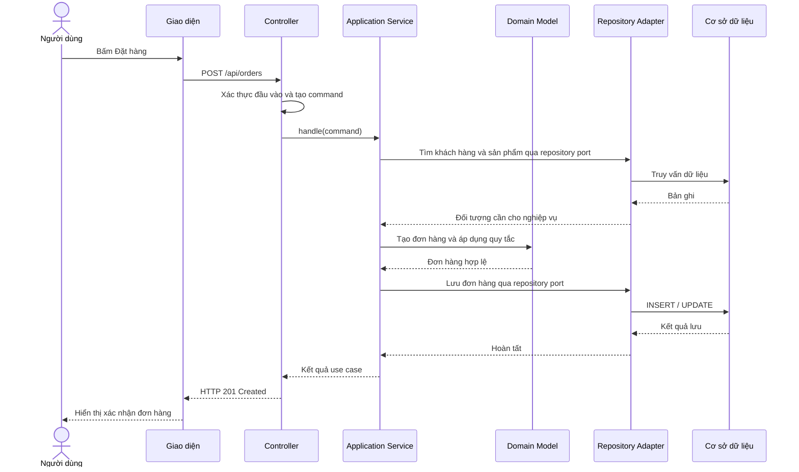
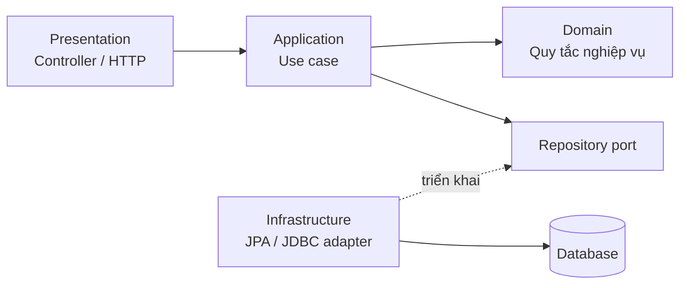

# Luồng tổng thể từ tương tác người dùng đến nghiệp vụ và lưu trữ

Trong kiến trúc phân tầng, một yêu cầu thường đi qua nhiều phần của ứng dụng: giao diện nhận thao tác, tầng trình bày tiếp nhận yêu cầu, tầng ứng dụng điều phối công việc, mô hình nghiệp vụ áp dụng quy tắc, rồi tầng truy cập dữ liệu đọc hoặc ghi thông tin. Khi kết quả được tạo ra, dữ liệu quay trở lại qua các tầng để ứng dụng trả phản hồi cho người dùng.

Hiểu luồng này giúp ta biết mỗi trách nhiệm nên nằm ở đâu, xác định ranh giới giao tiếp giữa các phần và tìm đúng nơi khi cần sửa lỗi hoặc viết kiểm thử. Đây là cách nhìn thực tế để tổ chức phần mềm theo kiến trúc phân tầng; số lượng tầng và cách đặt tên có thể thay đổi theo quy mô, framework và yêu cầu của hệ thống.

## Một yêu cầu đi qua ứng dụng như thế nào?

Xét chức năng đặt hàng trong một ứng dụng Java dùng Spring Boot. Người dùng chọn sản phẩm, nhập số lượng rồi bấm **Đặt hàng**. Trình duyệt gửi một yêu cầu HTTP `POST /api/orders` chứa các dòng hàng. Máy chủ cần xác thực người dùng, kiểm tra dữ liệu đầu vào, xác nhận sản phẩm có thể bán, tính và tạo đơn hàng, lưu đơn hàng, sau đó trả mã đơn hàng cùng trạng thái cho giao diện.

Luồng xử lý điển hình:



Sơ đồ mô tả thứ tự gọi lúc chạy. Repository port là giao diện mà tầng cần lưu trữ sử dụng; khi ứng dụng chạy, Spring inject một adapter thực thi giao diện đó. Vì vậy, lời gọi từ tầng ứng dụng có thể đi tới adapter và cơ sở dữ liệu dù mã nguồn của tầng ứng dụng chỉ biết giao diện.

## Trách nhiệm ở từng phần

### 1. Giao diện và tầng trình bày

Giao diện (web, mobile hoặc một client khác) thu thập thao tác và gửi yêu cầu tới máy chủ. Trong ứng dụng Spring MVC, controller là điểm vào của tầng trình bày. Controller nhận HTTP request, đọc thông tin xác thực đã được xử lý bởi Spring Security, chuyển dữ liệu request thành kiểu đầu vào phù hợp và gọi use case tương ứng.

Controller nên tập trung vào giao thức và cách biểu diễn dữ liệu: đường dẫn, HTTP method, mã trạng thái, request DTO và response DTO. Nó không nên tự tính giá đơn hàng, quyết định một khách hàng có được mua sản phẩm hay ghi trực tiếp nhiều bảng cơ sở dữ liệu. Nếu những quy tắc đó nằm trong controller, cùng một nghiệp vụ sẽ khó tái sử dụng từ tác vụ nền hoặc giao diện khác, đồng thời controller khó kiểm thử độc lập.

Ví dụ rút gọn:

```java
@RestController
@RequestMapping("/api/orders")
class OrderController {
    private final PlaceOrderUseCase placeOrder;

    OrderController(PlaceOrderUseCase placeOrder) {
        this.placeOrder = placeOrder;
    }

    @PostMapping
    ResponseEntity<OrderResponse> create(
            @AuthenticationPrincipal AppPrincipal principal,
            @Valid @RequestBody CreateOrderRequest request) {

        var command = new PlaceOrderCommand(
                principal.customerId(), request.lines());
        var result = placeOrder.handle(command);

        return ResponseEntity
                .status(HttpStatus.CREATED)
                .body(OrderResponse.from(result));
    }
}
```

`CreateOrderRequest` và `OrderResponse` là kiểu dữ liệu phục vụ giao tiếp HTTP. `PlaceOrderCommand` và `PlaceOrderUseCase` biểu diễn lời gọi nghiệp vụ ở mức ứng dụng. Ví dụ lấy mã khách hàng từ principal đã xác thực thay vì tin một `customerId` tùy ý do client gửi lên. Trong hệ thống thực tế, quyền truy cập vào khách hàng và tài nguyên liên quan vẫn phải được kiểm tra ở nơi phù hợp với chính sách bảo mật.

`@Valid` có thể kiểm tra cấu trúc đầu vào như danh sách dòng hàng không rỗng hoặc số lượng là số dương. Tuy nhiên, kiểm tra ở biên HTTP không thay thế các bất biến nghiệp vụ: một đơn hàng không được chứa sản phẩm ngừng kinh doanh vẫn phải được bảo vệ trong logic nghiệp vụ, kể cả khi use case được gọi từ một nguồn khác.

### 2. Tầng ứng dụng điều phối use case

Tầng ứng dụng diễn tả hệ thống cần thực hiện công việc gì để hoàn thành một ca sử dụng. Với `PlaceOrderService`, công việc có thể gồm:

1. Lấy thông tin khách hàng và sản phẩm qua các cổng truy cập dữ liệu.
2. Kiểm tra điều kiện ở cấp use case, chẳng hạn khách hàng có thể đặt hàng hay không.
3. Gọi mô hình nghiệp vụ để tạo đơn hàng và áp dụng các quy tắc liên quan.
4. Yêu cầu lưu kết quả.
5. Trả về một kết quả đủ cho tầng trình bày tạo phản hồi.

Tầng này điều phối các bước, nhưng không nên trở thành nơi chứa mọi quy tắc tính toán và bất biến của đơn hàng. Nó thường là nơi đặt ranh giới giao dịch cho một thao tác ghi. Ví dụ:

```java
@Service
class PlaceOrderService implements PlaceOrderUseCase {
    private final CustomerRepository customers;
    private final ProductRepository products;
    private final OrderRepository orders;

    PlaceOrderService(
            CustomerRepository customers,
            ProductRepository products,
            OrderRepository orders) {
        this.customers = customers;
        this.products = products;
        this.orders = orders;
    }

    @Transactional
    public OrderResult handle(PlaceOrderCommand command) {
        var customer = customers.findActiveById(command.customerId())
                .orElseThrow(CustomerNotFoundException::new);

        var items = command.lines().stream()
                .map(line -> {
                    var product = products.findSellableById(line.productId())
                            .orElseThrow(ProductNotAvailableException::new);
                    return OrderItem.of(product.id(), product.price(), line.quantity());
                })
                .toList();

        var order = Order.place(customer.id(), items);
        orders.save(order);
        return OrderResult.from(order);
    }
}
```

Đây là mã minh họa, lược bỏ import và chi tiết triển khai. `@Transactional` yêu cầu các thao tác cơ sở dữ liệu trong phạm vi giao dịch cùng thành công hoặc cùng rollback khi có lỗi phù hợp. Giao dịch không tự động làm cho một lời gọi tới dịch vụ bên ngoài (ví dụ cổng thanh toán) trở thành một phần nguyên tử của giao dịch cơ sở dữ liệu; những quy trình nhiều hệ thống có thể cần cơ chế như outbox, retry hoặc saga tùy yêu cầu.

### 3. Mô hình nghiệp vụ bảo vệ quy tắc

Mô hình nghiệp vụ (domain model) biểu diễn khái niệm và quy tắc cốt lõi của bài toán. Trong ví dụ đặt hàng, `Order` có thể đảm bảo đơn hàng phải có ít nhất một dòng hàng; `OrderItem` có thể đảm bảo số lượng dương; chính sách giá có thể quyết định cách tính giá theo quy định của sản phẩm.

```java
public final class Order {
    private final OrderId id;
    private final CustomerId customerId;
    private final List<OrderItem> items;

    private Order(OrderId id, CustomerId customerId, List<OrderItem> items) {
        if (items == null || items.isEmpty()) {
            throw new IllegalArgumentException("Đơn hàng phải có ít nhất một dòng hàng");
        }
        this.id = id;
        this.customerId = customerId;
        this.items = List.copyOf(items);
    }

    public static Order place(CustomerId customerId, List<OrderItem> items) {
        return new Order(OrderId.newId(), customerId, items);
    }
}
```

Ví dụ này cho thấy một bất biến được bảo vệ ngay tại mô hình. Ứng dụng không thể tạo `Order` rỗng chỉ vì một controller hoặc một tác vụ nền quên kiểm tra danh sách. Trong ứng dụng nhỏ, quy tắc đơn giản có thể nằm trong service; khi quy tắc và trạng thái trở nên phức tạp, mô hình domain riêng thường giúp chúng rõ ràng và dễ kiểm thử hơn. Không cần áp dụng đầy đủ Domain-Driven Design cho mọi dự án mới có thể tổ chức trách nhiệm hợp lý.

Domain model không nên phụ thuộc vào `HttpServletRequest`, controller, `JpaRepository` hoặc chi tiết bảng dữ liệu. Nhờ vậy, quy tắc nghiệp vụ có thể được kiểm thử bằng Java thuần và không cần khởi động Spring.

### 4. Tầng truy cập dữ liệu chuyển yêu cầu thành thao tác lưu trữ

Tầng ứng dụng cần khả năng tìm và lưu đơn hàng, nhưng không cần biết dữ liệu được lưu bằng JPA, JDBC, một dịch vụ từ xa hay một cơ chế khác. Nó gọi qua một giao diện, thường được gọi là repository port hoặc persistence port:

```java
public interface OrderRepository {
    void save(Order order);
}
```

Một adapter trong tầng hạ tầng có thể triển khai giao diện đó bằng Spring Data JPA:

```java
@Repository
class JpaOrderRepository implements OrderRepository {
    private final SpringDataOrderRepository dataRepository;

    JpaOrderRepository(SpringDataOrderRepository dataRepository) {
        this.dataRepository = dataRepository;
    }

    @Override
    public void save(Order order) {
        dataRepository.save(OrderJpaEntity.from(order));
    }
}
```

`SpringDataOrderRepository` là repository Spring Data làm việc với `OrderJpaEntity`; adapter chịu trách nhiệm chuyển đổi giữa mô hình nghiệp vụ và biểu diễn lưu trữ. Ở dự án đơn giản, entity JPA và mô hình nghiệp vụ đôi khi được dùng chung để giảm mã chuyển đổi. Cách đó có thể chấp nhận được nếu ranh giới vẫn rõ và các annotation lưu trữ không làm mô hình phụ thuộc quá mức vào hạ tầng. Khi nghiệp vụ phức tạp hoặc nhiều cách lưu trữ, tách hai mô hình thường đem lại sự độc lập tốt hơn.

Giao diện repository nên được đặt ở phía cần sử dụng khả năng đó (thường là application hoặc domain, tùy thiết kế). Adapter thuộc hạ tầng và phụ thuộc vào giao diện để triển khai. Đây là một cách áp dụng nguyên tắc đảo ngược phụ thuộc: mã nghiệp vụ không cần phụ thuộc trực tiếp vào thư viện cơ sở dữ liệu.

## Luồng gọi và hướng phụ thuộc trong mã nguồn

Luồng gọi lúc chạy và hướng phụ thuộc lúc biên dịch là hai khái niệm khác nhau. Khi xử lý yêu cầu, lời gọi đi từ controller tới application service, rồi qua repository port tới adapter và cơ sở dữ liệu. Nhưng trong mã nguồn, tầng ứng dụng chỉ phụ thuộc vào giao diện repository; adapter phụ thuộc vào giao diện đó để thực thi.



Sơ đồ trên thể hiện quan hệ mã nguồn ở mức khái quát. Nó không có nghĩa domain bắt buộc phải chứa mọi interface repository; vị trí của port phụ thuộc vào phần nào sở hữu nhu cầu đó. Điều quan trọng là tầng nghiệp vụ không bị buộc phải biết chi tiết triển khai lưu trữ.

Trong cách tổ chức phân tầng đóng (closed layering), một tầng thường chỉ gọi tầng liền kề bên dưới. Ví dụ controller gọi application service; application điều phối domain và các port cần thiết. Cách này làm luồng dễ lần theo và hạn chế việc tầng trình bày tự ý truy cập sâu vào dữ liệu. Trong phân tầng mở (open layering), một tầng có thể được phép gọi xuyên qua một tầng trung gian khi có lý do rõ ràng, chẳng hạn một truy vấn đọc đơn giản đi tới một query service chuyên biệt. Nếu cho phép bỏ qua tầng tùy tiện, quy tắc nghiệp vụ và truy cập dữ liệu sẽ dần bị phân tán, làm kiến trúc khó hiểu. Hãy chọn chính sách phù hợp và áp dụng nhất quán.

## Tầng logic không đồng nghĩa với tầng triển khai

Presentation, application, domain và data access là các **tầng logic**: chúng mô tả trách nhiệm và ranh giới trong thiết kế. Chúng không nhất thiết là bốn máy chủ hoặc bốn tiến trình riêng. Một ứng dụng Spring Boot dạng monolith có thể đóng gói controller, service, domain model và adapter JPA trong cùng một file JAR, chạy trên một máy chủ ứng dụng và kết nối tới một máy chủ cơ sở dữ liệu.

Ngược lại, **tier triển khai** mô tả nơi phần mềm thực sự chạy và ranh giới giao tiếp khi vận hành. Ví dụ trình duyệt là một tier phía client, Spring Boot là một tier phía server, còn PostgreSQL là một tier lưu trữ. Một tier máy chủ có thể chứa nhiều tầng logic. Việc tách tầng logic thành các dịch vụ triển khai riêng làm tăng độ phức tạp về mạng, vận hành và nhất quán dữ liệu; chỉ nên thực hiện khi có nhu cầu độc lập về mở rộng, triển khai, sở hữu hoặc độ tin cậy.

## Xử lý kết quả, lỗi và giao dịch

Khi lưu thành công, adapter trả kết quả cho application service. Service tạo `OrderResult`; controller chuyển kết quả đó thành `OrderResponse` và chọn mã HTTP phù hợp, chẳng hạn `201 Created` khi tạo tài nguyên thành công. Giao diện nhận phản hồi rồi hiển thị mã đơn hàng.

Khi xảy ra lỗi, mỗi tầng nên báo lỗi bằng khái niệm phù hợp với trách nhiệm của mình. Domain có thể từ chối một trạng thái không hợp lệ; tầng ứng dụng có thể báo không tìm thấy khách hàng hoặc sản phẩm; tầng dữ liệu có thể gặp lỗi kết nối hoặc ràng buộc. Một cơ chế như `@ControllerAdvice` ở tầng trình bày có thể ánh xạ các lỗi đã biết thành mã HTTP và nội dung phản hồi ổn định. Không nên trả stack trace hoặc chi tiết SQL nội bộ cho client.

Ranh giới giao dịch thường đặt quanh use case ghi dữ liệu để việc đọc trạng thái cần thiết, tạo thay đổi và lưu kết quả được phối hợp nhất quán. Cần xem xét kỹ các tình huống đồng thời, ví dụ hai yêu cầu cùng mua sản phẩm cuối cùng trong kho. Một lần kiểm tra tồn kho trước khi ghi không tự bảo đảm không có yêu cầu khác chen vào; hệ thống có thể cần khóa, cập nhật có điều kiện, optimistic locking hoặc cơ chế giữ chỗ tùy nghiệp vụ.

## Kiểm thử theo từng ranh giới

Luồng tổng thể có thể được kiểm thử ở nhiều mức, mỗi mức trả lời một câu hỏi khác nhau:

| Mức kiểm thử | Phần được kiểm tra | Ví dụ |
|---|---|---|
| Unit test domain | Quy tắc và bất biến nghiệp vụ | Không tạo đơn hàng rỗng; số lượng dòng hàng phải dương |
| Unit test application | Trình tự điều phối và quyết định của use case | Khi sản phẩm không bán được, use case không lưu đơn hàng |
| Web/controller test | Hợp đồng HTTP và chuyển đổi request/response | Request hợp lệ trả `201`; dữ liệu sai trả `400` |
| Integration test adapter | Ánh xạ và truy vấn với công nghệ lưu trữ thật | JPA lưu rồi đọc lại đúng dữ liệu đơn hàng |
| End-to-end test | Các thành phần phối hợp qua luồng thực | Gửi HTTP request và xác nhận dữ liệu được lưu, phản hồi đúng |

Có thể dùng JUnit cho unit test, Spring MVC Test hoặc MockMvc cho controller, và Testcontainers để kiểm thử adapter với cơ sở dữ liệu tương thích môi trường thật. Không cần mọi bài kiểm thử đều khởi động toàn bộ ứng dụng: kiểm thử ở đúng ranh giới thường chạy nhanh hơn và chỉ ra nguyên nhân lỗi rõ hơn. Một số end-to-end test vẫn hữu ích để xác nhận cấu hình và tích hợp tổng thể.

## Khi nào nên điều chỉnh luồng?

Không phải mọi yêu cầu đều cần đi qua tất cả thành phần. Một endpoint đọc đơn giản có thể dùng query service hoặc projection để trả dữ liệu hiệu quả, miễn là quyền truy cập và quy tắc liên quan vẫn được thực thi đúng. Một thao tác cập nhật phức tạp có thể cần domain model giàu hành vi. Tác vụ nền có thể gọi cùng application use case mà không đi qua HTTP controller.

Kiến trúc phân tầng tạo ra ranh giới để thay đổi một phần ít ảnh hưởng tới phần khác, nhưng mỗi ranh giới cũng có chi phí: thêm interface, lớp chuyển đổi, cấu hình dependency injection và luồng điều hướng. Nếu một service chỉ chuyển tiếp nguyên xi lời gọi mà không bảo vệ trách nhiệm hay tạo điểm thay thế có ích, có thể nó đang làm kiến trúc dài dòng. Ngược lại, nếu controller chứa SQL, domain phụ thuộc vào Spring Data, hoặc nhiều nơi tự thực hiện cùng một quy tắc, các trách nhiệm đang bị trộn lẫn.

Khi thiết kế một chức năng mới, hãy lần theo câu hỏi: ai nhận giao tiếp, ai điều phối use case, quy tắc nào phải luôn đúng, và ai chịu trách nhiệm lưu hoặc truy xuất dữ liệu? Đặt mã vào đúng phần trả lời cho từng câu hỏi, giữ hướng phụ thuộc có chủ đích và kiểm thử tại các ranh giới. Đó là nền tảng để tổ chức phần mềm theo kiến trúc phân tầng mà vẫn có thể điều chỉnh số tầng và mức độ tách biệt theo nhu cầu thực tế.
