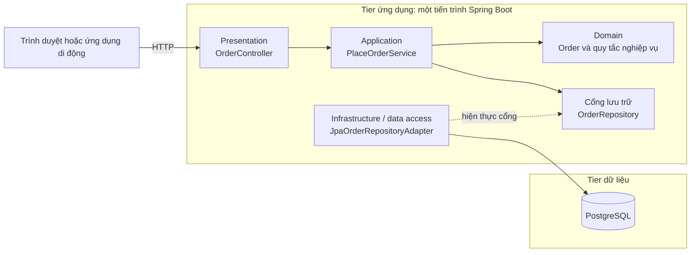

# Phân biệt tầng logic, module mã nguồn và tier triển khai vật lý

Bài học này thuộc chương **Tổng quan kiến trúc phân tầng** của module `SOFTWARE_DESIGN_ARCHITECTURE_ARCHITECTURAL_PATTERN_LAYERED`, trong chương trình **học tổ chức phần mềm theo kiến trúc phân tầng**. Một hệ thống có thể được mô tả bằng nhiều tầng, được chia thành nhiều module mã nguồn và được triển khai trên nhiều môi trường chạy. Ba cách chia này giải quyết ba vấn đề khác nhau. Nếu gọi tất cả chúng là “layer” hoặc “tier”, ta dễ thiết kế sai ranh giới, tạo phụ thuộc không cần thiết hoặc triển khai phức tạp hơn yêu cầu.

Sau bài này, bạn có thể giải thích một tầng logic khác module mã nguồn và tier triển khai ở điểm nào; đọc một cấu trúc dự án Java/Spring mà không nhầm package với máy chủ; và mô tả đường đi của một request từ giao diện đến cơ sở dữ liệu trên cả ba góc nhìn.

## 1. Ba góc nhìn, ba loại ranh giới

### Tầng logic: phần mềm chịu trách nhiệm về việc gì?

**Tầng logic (logical layer)** là cách chia hệ thống theo trách nhiệm và mức độ trừu tượng trong thiết kế. Tầng giúp xác định phần nào tiếp nhận tương tác, phần nào điều phối ca sử dụng, phần nào giữ quy tắc nghiệp vụ và phần nào giao tiếp với hệ thống bên ngoài.

Một cách tổ chức thường gặp là:

- **Presentation / giao diện:** nhận và trình bày dữ liệu qua HTTP, giao diện web, ứng dụng di động hoặc giao diện dòng lệnh.
- **Application / ứng dụng:** điều phối một ca sử dụng, kiểm tra quyền ở mức ca sử dụng, mở giao dịch và gọi các thành phần cần thiết.
- **Domain / nghiệp vụ:** biểu diễn khái niệm, trạng thái, bất biến và quy tắc nghiệp vụ cốt lõi.
- **Data access / infrastructure / truy cập dữ liệu và hạ tầng:** đọc ghi cơ sở dữ liệu, gọi API bên ngoài, gửi thông điệp hoặc tích hợp với thư viện và dịch vụ kỹ thuật.

Đây là một cách phân chia hữu ích, không phải quy định rằng mọi ứng dụng đều phải có đúng bốn tầng. Ứng dụng nhỏ có thể gộp trách nhiệm application với domain hoặc đặt phần truy cập dữ liệu trong cùng một module mã nguồn. Hệ thống khác có thể tách thêm tầng tích hợp, giao diện hoặc dịch vụ. Điều quan trọng là trách nhiệm và quy tắc phụ thuộc được hiểu rõ.

Tầng logic chủ yếu là khái niệm thiết kế. Nó có thể được thể hiện bằng package, module, lớp hoặc quy ước của nhóm. Bản thân một tầng không đòi hỏi phải có process, container hay máy chủ riêng.

### Module mã nguồn: mã được tổ chức và phụ thuộc với nhau ra sao?

**Module mã nguồn (source-code module)** là đơn vị tổ chức mã và quan hệ phụ thuộc trong quá trình phát triển, biên dịch, kiểm tra hoặc đóng gói. Trong Java, từ “module” có thể được dùng ở vài mức khác nhau:

- **Package** như `com.example.order.application` là namespace để nhóm các kiểu Java. Package giúp đặt tên và tổ chức mã, nhưng tự nó không nhất thiết là một đơn vị build độc lập.
- **Maven module hoặc Gradle project** có thể có cấu hình build, dependency và đầu ra riêng như JAR. Đây thường là ranh giới rõ hơn để kiểm soát phụ thuộc và build.
- **JPMS module** là module của Java Platform Module System, thường khai báo bằng `module-info.java`, có thể quy định package nào được export và module nào được yêu cầu.

Trong bài này, “module mã nguồn” nói chung về đơn vị tổ chức mã; khi cần nói chính xác, hãy gọi rõ đó là package, Gradle/Maven module hay JPMS module. Một module có thể chứa một hoặc nhiều tầng logic. Ngược lại, một tầng logic có thể trải qua nhiều module mã nguồn.

Ví dụ, dự án có thể đặt `OrderController`, `PlaceOrderService`, `Order` và `JpaOrderRepositoryAdapter` trong cùng một Gradle module nhưng ở các package khác nhau. Một dự án lớn hơn có thể tách `orders-domain`, `orders-application`, `orders-adapters` và `orders-boot` thành các Gradle module. Cả hai cách đều có thể giữ cùng một cách phân chia trách nhiệm logic.

### Tier triển khai: thành phần chạy ở đâu và được vận hành thế nào?

**Tier triển khai (deployment tier, đôi khi gọi là physical tier)** là ranh giới triển khai và vận hành của hệ thống. Một tier thường tương ứng với một môi trường chạy có thể được cấu hình, bảo vệ, mở rộng hoặc phát hành độc lập, chẳng hạn trình duyệt của người dùng, tiến trình ứng dụng, container, máy chủ cơ sở dữ liệu hoặc một cụm dịch vụ. Trong cách dùng nghiêm ngặt, “physical tier” thường nhấn mạnh sự tách biệt về hạ tầng hoặc mạng; hai tiến trình trên cùng máy có thể là hai đơn vị triển khai riêng nhưng chưa chắc được xem là hai physical tier trong mọi sơ đồ.

Tier trả lời các câu hỏi như: thành phần chạy trên máy hoặc cụm nào, giao tiếp qua giao thức gì, có thể mở rộng độc lập không, ranh giới mạng và bảo mật nằm ở đâu, và khi một thành phần ngừng hoạt động thì phần nào bị ảnh hưởng?

Ví dụ quen thuộc là ứng dụng web có trình duyệt, máy chủ Spring Boot và PostgreSQL. Trình duyệt gửi HTTP đến ứng dụng; ứng dụng dùng JDBC hoặc driver tương ứng để giao tiếp với cơ sở dữ liệu. Đây có thể được mô tả là ba tier triển khai: client, application và database. Trong tier ứng dụng, nhiều tầng logic vẫn có thể chạy chung trong một tiến trình Spring Boot.

## 2. So sánh trực tiếp

| Góc nhìn | Ranh giới dùng để chia | Câu hỏi chính | Ví dụ trong Java |
|---|---|---|---|
| Tầng logic | Trách nhiệm và mức trừu tượng | Thành phần này làm nhiệm vụ gì? | Presentation, application, domain, data access |
| Module mã nguồn | Tổ chức mã và phụ thuộc build/compile | Mã nào được nhóm lại và được phép phụ thuộc vào mã nào? | Package `order.domain`, Gradle module `orders-domain`, JPMS module |
| Tier triển khai | Môi trường chạy và ranh giới vận hành | Thành phần chạy ở đâu và giao tiếp qua ranh giới nào? | Trình duyệt, Spring Boot process, PostgreSQL server |

Ba góc nhìn có thể liên hệ với nhau nhưng không đồng nhất. Tầng logic là mô hình trách nhiệm; module mã nguồn là cách tổ chức và kiểm soát mã; tier triển khai là cách phân bố thành phần khi hệ thống chạy. Việc một thành phần nằm trong package riêng không làm nó trở thành tier riêng. Việc một JAR được build riêng cũng không tự động có nghĩa nó được triển khai thành một dịch vụ riêng.

## 3. Theo dõi một request trong ứng dụng Java/Spring

Giả sử người dùng đặt hàng qua một ứng dụng web. Ở góc nhìn logic, request có thể đi qua các trách nhiệm sau:

1. `OrderController` thuộc tầng presentation nhận HTTP request, chuyển dữ liệu đầu vào thành lời gọi use case và trả HTTP response.
2. `PlaceOrderService` thuộc tầng application điều phối ca sử dụng: kiểm tra thông tin cần thiết, gọi các quy tắc nghiệp vụ, lưu đơn hàng và phát sinh kết quả.
3. `Order` cùng các đối tượng nghiệp vụ liên quan thuộc tầng domain thực thi các quy tắc như số lượng phải dương, đơn hàng chỉ được xác nhận khi thỏa điều kiện hoặc tổng tiền được tính theo chính sách nghiệp vụ.
4. Một cổng lưu trữ như `OrderRepository` mô tả thao tác mà ca sử dụng hoặc domain cần. Vị trí khai báo interface tùy cách tổ chức; trong thiết kế hướng cổng và bộ chuyển đổi, interface thường nằm ở phía trong.
5. `JpaOrderRepositoryAdapter` thuộc tầng infrastructure/data access hiện thực thao tác lưu trữ bằng Spring Data JPA hoặc JDBC.
6. PostgreSQL thực hiện truy vấn và lưu dữ liệu.

Luồng này mô tả **trách nhiệm logic** và đường đi khi xử lý request. Nó không có nghĩa mỗi bước phải chạy trên một máy chủ riêng.



Trong ví dụ triển khai phổ biến, `OrderController`, `PlaceOrderService`, `Order`, `OrderRepository` và `JpaOrderRepositoryAdapter` đều được đóng gói trong ứng dụng Spring Boot và chạy trong cùng JVM. PostgreSQL chạy ở một dịch vụ hoặc máy chủ cơ sở dữ liệu riêng. Nếu có trình duyệt ở phía người dùng, ta có thể mô tả ba tier triển khai: client, application và database. Trong tier application lại có nhiều tầng logic.

Một cách tổ chức mã nguồn tương ứng có thể là:

```text
orders-app/
└── src/main/java/com/example/orders/
    ├── presentation/
    │   └── OrderController.java
    ├── application/
    │   └── PlaceOrderService.java
    ├── domain/
    │   ├── Order.java
    │   └── OrderRepository.java
    └── infrastructure/
        └── JpaOrderRepositoryAdapter.java
```

Ở cấu trúc này, các thư mục con thường ánh xạ đến package Java; toàn bộ mã vẫn có thể thuộc một Gradle module `orders-app`. Khi build, Gradle tạo một ứng dụng Spring Boot có thể chạy độc lập. Package giúp người đọc nhận ra trách nhiệm, nhưng không tạo thêm tiến trình hay tier.

Với dự án cần kiểm soát phụ thuộc chặt hơn, ta có thể tách thành các Gradle module:

```text
orders/
├── orders-domain/
├── orders-application/
├── orders-adapters/
└── orders-boot/
```

Ví dụ, `orders-application` phụ thuộc vào `orders-domain`; `orders-adapters` cung cấp adapter triển khai các cổng cần thiết; `orders-boot` lắp ghép các thành phần và cấu hình Spring. Cách chia module này giúp build có thể phát hiện một số phụ thuộc không mong muốn và làm ranh giới mã rõ hơn. Tuy nhiên, nếu `orders-boot` đóng gói các module đó vào một ứng dụng và chạy một JVM, chúng vẫn thuộc cùng một tier ứng dụng khi triển khai. Việc có nhiều JAR hoặc nhiều Gradle module không tự động tạo ra nhiều tier.

## 4. Những cách ánh xạ thường gặp

Không có quy tắc ánh xạ một-một giữa tầng logic, module mã nguồn và tier triển khai. Một số cấu hình hợp lệ:

| Kiểu tổ chức | Tầng logic | Module mã nguồn | Tier triển khai |
|---|---|---|---|
| Ứng dụng nhỏ | Nhiều trách nhiệm logic được phân biệt bằng lớp hoặc package | Một Maven/Gradle module | Một ứng dụng backend; cơ sở dữ liệu có thể là tier riêng; client có thể ở tier khác |
| Modular monolith | Các tầng logic có ranh giới trách nhiệm rõ | Nhiều module domain/application/adapter được ghép vào một ứng dụng | Một đơn vị triển khai backend, cộng các tier client hoặc database nếu có |
| Hệ thống phân tán | Mỗi dịch vụ có thể chứa presentation/API, application, domain và infrastructure riêng | Nhiều module và project theo dịch vụ hoặc theo thư viện dùng chung | Nhiều dịch vụ/tiến trình/container, thường giao tiếp qua mạng, cùng các tier dữ liệu |

### Một tầng logic có thể trải qua nhiều module

Giả sử tầng domain có nhiều miền nghiệp vụ và nhóm phát triển muốn quản lý phụ thuộc độc lập. Họ có thể tách `billing-domain`, `inventory-domain` và `shipping-domain` thành các module khác nhau. Cả ba vẫn là phần logic nghiệp vụ, dù được đặt trong ba đơn vị mã nguồn. Việc tách module nên dựa trên ranh giới phụ thuộc, quyền sở hữu hoặc nhu cầu build, không chỉ dựa trên mong muốn tạo thêm thư mục.

### Một module mã nguồn có thể chứa nhiều tầng logic

Trong ứng dụng nhỏ, một Gradle module duy nhất có thể chứa controller, application service, domain object và repository adapter. Điều đó không làm mất đi khả năng phân biệt trách nhiệm. Nhóm vẫn có thể quy định controller không chứa quy tắc nghiệp vụ, domain không phụ thuộc vào Spring MVC, và việc truy cập cơ sở dữ liệu đi qua adapter.

### Một tier triển khai có thể chứa nhiều tầng logic và nhiều module

Đây là trường hợp thường gặp của modular monolith. Ứng dụng được chia thành nhiều module để quản lý mã nhưng được đóng gói và phát hành như một đơn vị. Khi chạy, các module có thể cùng nằm trong một JVM. Ranh giới module là ranh giới mã; tier ứng dụng là ranh giới triển khai.

### Một tầng logic không nhất thiết là một tier

Không cần triển khai riêng presentation, application, domain và data access thành bốn máy chủ. Nếu tách từng tầng thành dịch vụ từ sớm, các lời gọi nội bộ có thể biến thành lời gọi mạng, kéo theo độ trễ, lỗi kết nối, xác thực giữa dịch vụ, retry, giám sát và quản lý giao dịch phân tán. Chỉ nên tạo ranh giới triển khai khi có lý do vận hành hoặc tổ chức đủ rõ.

## 5. Phân biệt “layered” và “three-tier” trong tài liệu kiến trúc

Tài liệu và công cụ đôi khi dùng từ *layer* và *tier* không nhất quán. Cụm từ “three-tier architecture” thường chỉ mô hình triển khai gồm presentation tier, application tier và data tier. Trong khi đó, “three-layer architecture” có thể nói đến ba tầng logic bên trong mã nguồn. Hai mô hình có thể có số lượng phần tử giống nhau, nhưng đó chỉ là một cách ánh xạ cụ thể.

Khi đọc hoặc viết tài liệu, hãy kiểm tra sơ đồ đang mô tả điều gì:

- Nếu các hộp là controller, service, domain model, repository, sơ đồ thường đang nói về trách nhiệm hoặc cấu trúc logic.
- Nếu các hộp là package, Maven/Gradle project hoặc JAR, sơ đồ đang nói về tổ chức mã và build.
- Nếu các hộp là browser, application server, container, database server hoặc cloud service, sơ đồ đang nói về triển khai và vận hành.

Đừng kết luận số tier chỉ từ số package hoặc số module. Cũng đừng kết luận số tầng logic chỉ từ số máy chủ. Nếu một sơ đồ dùng từ “tầng” nhưng không rõ góc nhìn, hãy bổ sung nhãn như “tầng logic”, “module mã nguồn” hoặc “tier triển khai”.

## 6. Ranh giới module, hướng phụ thuộc và kiểu phân tầng

Ba góc nhìn khác nhau nhưng cần phối hợp. Tầng logic mô tả trách nhiệm; quy tắc phụ thuộc cho biết mã ở tầng nào được phép biết đến tầng nào; module mã nguồn có thể dùng hệ thống build hoặc cơ chế ngôn ngữ để thực thi một phần quy tắc đó. Tier triển khai lại xác định các thành phần giao tiếp qua lời gọi trong cùng tiến trình hay qua mạng.

Ví dụ, nếu nhóm chọn phân tầng đóng (*closed layering*), một tầng chỉ gọi tầng liền kề theo quy tắc đã định. Controller gọi application service; application service gọi domain và cổng lưu trữ. Controller không tự truy cập repository nếu quy tắc kiến trúc không cho phép. Với phân tầng mở (*open layering*), một số tầng có thể được phép sử dụng tầng thấp hơn mà không phải đi qua mọi tầng trung gian. Đây là lựa chọn về đường phụ thuộc logic, không phải quyết định số module hay số máy chủ.

Hướng phụ thuộc cũng không đồng nghĩa với hướng truyền dữ liệu lúc chạy. Chẳng hạn, adapter cơ sở dữ liệu có thể phụ thuộc vào interface `OrderRepository` được định nghĩa ở phía trong, trong khi lúc chạy application service gọi interface và Spring cung cấp implementation của adapter. Đây là cách giữ phụ thuộc mã hướng vào chính sách nghiệp vụ; nó không yêu cầu adapter phải chạy ở tier riêng.

Một module có thể giúp thực thi ranh giới bằng cách không khai báo dependency đến module bị cấm. Tuy nhiên, chỉ tạo module `domain` riêng chưa bảo đảm domain không phụ thuộc vào hạ tầng; cần xem dependency thực tế và cấu hình build. Tương tự, đặt hai thành phần ở hai container không tự tạo ra một mô hình phân tầng logic tốt: trách nhiệm và giao thức giữa chúng vẫn cần được thiết kế.

## 7. Chọn ranh giới nào và khi nào?

Hãy bắt đầu từ vấn đề cần giải quyết:

| Nhu cầu | Ranh giới nên xem xét | Lợi ích | Chi phí cần cân nhắc |
|---|---|---|---|
| Làm rõ trách nhiệm, giảm trộn lẫn giao diện với nghiệp vụ | Tầng logic | Mã dễ hiểu, dễ thay đổi và kiểm thử theo trách nhiệm | Cần quy ước rõ để tránh tầng chỉ là lớp chuyển tiếp vô nghĩa |
| Ngăn phụ thuộc không mong muốn, chia quyền sở hữu hoặc build độc lập | Module mã nguồn | Kiểm soát dependency, tăng tính độc lập khi phát triển | Cấu hình build, phiên bản và cấu trúc dự án phức tạp hơn |
| Mở rộng tải, cô lập bảo mật, phát hành hoặc vận hành độc lập | Tier triển khai | Có thể mở rộng, giới hạn truy cập và quản lý lỗi theo đơn vị | Giao tiếp mạng, độ trễ, quan sát hệ thống và xử lý lỗi phân tán |

Ví dụ, nếu vấn đề là controller chứa quá nhiều quy tắc nghiệp vụ, hãy tách trách nhiệm logic và chuyển quy tắc về thành phần phù hợp. Nếu nhiều nhóm thường xuyên làm hỏng ranh giới phụ thuộc khi sửa mã, cân nhắc tách module build và đặt quy tắc dependency. Nếu phần xử lý ảnh cần mở rộng độc lập với API đơn hàng, hoặc dữ liệu cần nằm trong mạng riêng, lúc đó mới cân nhắc một đơn vị triển khai riêng.

Không nên tách tier chỉ vì sơ đồ có nhiều tầng logic. Lời gọi trong cùng JVM thường đơn giản và nhanh hơn lời gọi mạng; một modular monolith có thể là lựa chọn hợp lý trong thời gian dài. Ngược lại, cũng không nên giữ mọi thành phần trong một tiến trình nếu yêu cầu bảo mật, khả năng mở rộng, độ sẵn sàng hoặc vòng đời phát hành thực sự đòi hỏi sự cô lập. Quyết định cần dựa trên tải, rủi ro, năng lực vận hành và chi phí thay đổi của hệ thống.

## 8. Những nhầm lẫn cần tránh

1. **“Có bốn package thì có bốn tier.”** Package là cách nhóm mã; tier là ranh giới triển khai. Bốn package có thể nằm trong một JAR và một JVM.
2. **“Mỗi Gradle module là một dịch vụ.”** Gradle module là đơn vị build. Nhiều module có thể được ghép vào một ứng dụng duy nhất.
3. **“Repository là database tier.”** Repository hoặc repository adapter là thành phần mã thuộc trách nhiệm truy cập dữ liệu. Database server là hệ thống lưu trữ có thể được triển khai ở tier riêng.
4. **“Mỗi tầng logic phải có máy chủ riêng.”** Không có yêu cầu như vậy. Nhiều tầng thường chạy chung trong một tiến trình ứng dụng.
5. **“Ba tầng logic luôn tương ứng với ba tier triển khai.”** Số lượng và cách ánh xạ phụ thuộc topology. Hãy mô tả rõ từng góc nhìn thay vì suy ra góc nhìn này từ góc nhìn kia.
6. **“Tách module là đủ để kiến trúc đúng.”** Module chỉ cung cấp một cơ chế tổ chức và kiểm soát phụ thuộc. Trách nhiệm, hướng phụ thuộc và cách giao tiếp vẫn cần được thiết kế và kiểm tra.

## 9. Tự kiểm tra cách đọc một kiến trúc

Với hệ thống gồm một trình duyệt, một ứng dụng Spring Boot và PostgreSQL; trong ứng dụng có `web`, `application`, `domain`, `persistence` package; toàn bộ backend được build bằng một Gradle module và chạy trong một container:

- **Tầng logic:** có thể nhận diện bốn nhóm trách nhiệm `web`, `application`, `domain`, `persistence` theo quy ước của dự án.
- **Module mã nguồn:** có một Gradle module; bốn package là cách tổ chức bên trong module đó.
- **Tier triển khai:** có thể mô tả ba tier là client, application và database. Container ứng dụng chứa các package thuộc nhiều tầng logic.

Nếu sau này nhóm tách `domain` và `application` thành các Gradle module nhưng vẫn đóng gói chúng trong cùng container ứng dụng, số module mã nguồn thay đổi còn topology triển khai có thể giữ nguyên. Nếu nhóm chuyển persistence adapter thành một dịch vụ riêng giao tiếp qua mạng, topology triển khai thay đổi; đồng thời cần đánh giá lại giao thức, lỗi mạng, giao dịch và quyền sở hữu dữ liệu. Các thay đổi đó cho thấy ba ranh giới có liên quan nhưng độc lập.

Khi xem xét một kiến trúc phân tầng, hãy luôn tự hỏi ba câu riêng: **trách nhiệm logic được chia thế nào, mã được chia thành module nào và thành phần được triển khai ở đâu?** Trả lời tách biệt ba câu này giúp sơ đồ kiến trúc chính xác hơn và giúp nhóm chọn đúng loại ranh giới để giải quyết vấn đề đang gặp.
