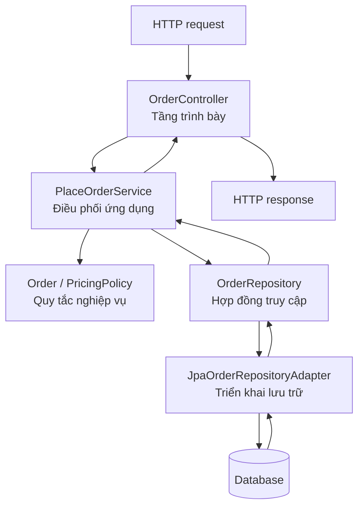

# Lợi ích về khả năng hiểu, kiểm thử, thay đổi và tái sử dụng

*Chương: Tổng quan kiến trúc phân tầng*

Bài học này thuộc module `SOFTWARE_DESIGN_ARCHITECTURE_ARCHITECTURAL_PATTERN_LAYERED`, có mục tiêu **Học tổ chức phần mềm theo kiến trúc phân tầng**. Ta xem xét kiến trúc phân tầng qua bốn kết quả thực tế: giúp người đọc hiểu hệ thống nhanh hơn, kiểm thử hành vi độc lập hơn, thay đổi một phần với ít ảnh hưởng lan truyền hơn và tái sử dụng đúng phần logic có giá trị.

Các lợi ích này xuất hiện khi mỗi phần có trách nhiệm rõ ràng và các phần giao tiếp qua ranh giới có chủ đích. Chỉ chia mã nguồn thành nhiều package hoặc nhiều lớp Java chưa đủ để đạt được chúng. Nếu các phần vẫn phụ thuộc chặt vào nhau, kiến trúc có thể chỉ thêm bước chuyển tiếp mà không làm hệ thống dễ hiểu hay dễ thay đổi hơn.

## 1. Phân tầng tạo ra lợi ích bằng cách nào?

Kiến trúc phân tầng tổ chức các trách nhiệm theo vai trò. Một ứng dụng có thể có những phần tương ứng với:

- **Trình bày (presentation):** nhận yêu cầu từ HTTP, giao diện hoặc một kênh đầu vào khác; kiểm tra dữ liệu ở mức giao tiếp và định dạng phản hồi.
- **Điều phối ứng dụng (application):** thực hiện một ca sử dụng, điều phối các bước, quản lý ranh giới giao dịch và gọi các khả năng cần thiết.
- **Nghiệp vụ hoặc miền (business/domain):** biểu đạt quy tắc và trạng thái nghiệp vụ, chẳng hạn điều kiện một đơn hàng được xác nhận.
- **Truy cập dữ liệu (data access):** đọc, ghi và chuyển đổi dữ liệu giữa mô hình của ứng dụng với cơ sở dữ liệu hoặc hệ thống lưu trữ.

Đây là những nhóm trách nhiệm thường gặp, không phải quy định rằng mọi hệ thống đều phải có đúng bốn tầng. Ứng dụng nhỏ có thể gộp một số trách nhiệm; hệ thống lớn có thể tách chúng thành các thành phần chi tiết hơn. Điều quan trọng là người đọc có thể xác định nơi một quy tắc thuộc về và đường đi của một yêu cầu.

Các tầng trên là **tầng logic** trong cách tổ chức phần mềm. Chúng không nhất thiết là các **tier triển khai** riêng biệt. Ví dụ, controller, application service, domain object và repository adapter có thể cùng chạy trong một tiến trình Spring Boot, cùng được đóng gói trong một ứng dụng và cùng triển khai lên một máy chủ. Chỉ khi hệ thống được tách thành các tiến trình hoặc nút triển khai độc lập thì mới có nhiều tier triển khai. Tách tầng logic không tự động đòi hỏi tách dịch vụ hay triển khai phân tán.

## 2. Giúp hệ thống dễ hiểu

Một hệ thống dễ hiểu khi người đọc có thể trả lời nhanh ba câu hỏi: yêu cầu đi vào từ đâu, quy tắc được quyết định ở đâu và dữ liệu được lấy hoặc lưu ở đâu.

Nếu controller vừa phân tích HTTP, vừa tính giá, vừa quyết định trạng thái đơn hàng, vừa viết SQL, người đọc phải hiểu nhiều loại trách nhiệm trong cùng một chỗ. Khi các trách nhiệm được phân chia, mỗi thành phần có phạm vi nhỏ hơn:

- Controller tập trung vào giao thức và chuyển đổi dữ liệu đầu vào/đầu ra.
- Application service cho thấy các bước của ca sử dụng theo thứ tự.
- Mô hình nghiệp vụ thể hiện các quy tắc và điều kiện hợp lệ.
- Thành phần truy cập dữ liệu chịu trách nhiệm cụ thể về lưu trữ.

Tên lớp, tên phương thức và hợp đồng giữa các tầng trở thành bản đồ để lần theo hành vi. Ví dụ, khi tìm hiểu chức năng đặt hàng, người đọc có thể bắt đầu ở `OrderController`, theo lời gọi đến `PlaceOrderService`, xem quy tắc trong `Order`, rồi tìm nơi triển khai `OrderRepository`.

Một luồng điển hình trong ứng dụng Java/Spring có thể được biểu diễn như sau:



Sơ đồ cho biết trách nhiệm và hướng luồng gọi ở mức khái quát. Cách đặt interface và adapter cụ thể tùy thiết kế; không có một vị trí duy nhất bắt buộc cho mọi dự án. Khi đọc một codebase, hãy kiểm tra hợp đồng thực tế và hướng phụ thuộc thay vì chỉ suy ra kiến trúc từ tên package.

Sự phân chia cũng giúp nhóm thống nhất ngôn ngữ. Khi nói “quy tắc xác nhận đơn hàng”, mọi người có thể tìm ở mô hình nghiệp vụ hoặc ca sử dụng liên quan, thay vì phải dò qua nhiều controller và câu truy vấn. Điều này đặc biệt hữu ích khi người mới tham gia dự án hoặc khi một chức năng có nhiều đường vào như REST API, tác vụ nền và xử lý hàng loạt.

## 3. Giúp kiểm thử tập trung và đáng tin cậy hơn

Kiểm thử dễ hơn khi hành vi cần kiểm tra không bị buộc phải khởi động toàn bộ hệ thống. Nếu application service phụ thuộc vào một hợp đồng lưu trữ, bài kiểm thử ca sử dụng có thể cung cấp một implementation giả trong bộ nhớ. Nhờ đó, bài kiểm thử tập trung vào quy tắc và trình tự điều phối thay vì phụ thuộc vào cơ sở dữ liệu thật.

Ví dụ, tầng ứng dụng có thể phụ thuộc vào một interface:

```java
public interface OrderRepository {
    void save(Order order);
    Optional<Order> findById(OrderId id);
}
```

Một service điều phối việc đặt hàng có thể sử dụng hợp đồng đó:

```java
public class PlaceOrderService {
    private final OrderRepository orders;
    private final PricingPolicy pricingPolicy;

    public PlaceOrderService(
            OrderRepository orders,
            PricingPolicy pricingPolicy) {
        this.orders = orders;
        this.pricingPolicy = pricingPolicy;
    }

    public OrderId execute(PlaceOrderCommand command) {
        Order order = Order.place(command.items(), pricingPolicy);
        orders.save(order);
        return order.id();
    }
}
```

Trong unit test, `OrderRepository` có thể được thay bằng một fake repository lưu đối tượng vào `Map`. Bài kiểm thử có thể xác nhận rằng đơn hàng hợp lệ được tạo và gửi đến repository, hoặc rằng dữ liệu không hợp lệ bị từ chối. Nó không cần kết nối database, chạy migration hay khởi động Spring context nếu mục tiêu chỉ là kiểm tra logic của ca sử dụng.

Các loại kiểm thử nên bổ sung cho nhau:

| Phạm vi kiểm thử | Điều cần xác minh | Phụ thuộc thường dùng |
|---|---|---|
| Unit test nghiệp vụ | Quy tắc tính giá, chuyển trạng thái, điều kiện hợp lệ | Đối tượng miền và dữ liệu đầu vào |
| Unit test tầng ứng dụng | Trình tự ca sử dụng, phối hợp các cộng tác viên, kết quả xử lý | Fake hoặc mock cho các interface |
| Integration test truy cập dữ liệu | Mapping, truy vấn, transaction và hành vi của database | Database kiểm thử hoặc môi trường tương đương |
| Web/API test | Routing, binding, validation và định dạng HTTP | Spring MVC test hoặc ứng dụng tích hợp |

Không nên thay mọi integration test bằng mock. Mock có thể xác nhận một lời gọi đã diễn ra nhưng không chứng minh câu truy vấn, mapping JPA hay transaction hoạt động đúng. Ranh giới tầng giúp chọn đúng phạm vi cho từng kiểm thử: kiểm tra logic độc lập ở tầng phù hợp và vẫn có kiểm thử tích hợp để xác nhận các tầng nối với nhau chính xác.

Trong Spring, có thể dùng `@WebMvcTest` để tập trung vào lớp web, `@DataJpaTest` để kiểm tra phần JPA, và `@SpringBootTest` cho các luồng tích hợp rộng hơn. Việc dùng annotation nào phụ thuộc mục tiêu kiểm thử; không cần khởi động toàn bộ context cho một phép kiểm tra đơn vị đơn giản.

## 4. Giúp thay đổi có phạm vi rõ ràng

Phần mềm thay đổi liên tục: giao diện API có thể đổi, quy tắc nghiệp vụ có thể được điều chỉnh, hoặc hệ thống có thể chuyển từ một cách lưu trữ sang cách khác. Phân tầng hỗ trợ thay đổi khi mỗi phần phụ thuộc vào hợp đồng ổn định thay vì chi tiết nội bộ của phần khác.

Ví dụ, nếu controller chỉ gọi application service và không biết ứng dụng dùng JPA hay JDBC, việc thay implementation lưu trữ có thể được giới hạn ở tầng truy cập dữ liệu. Nếu quy tắc tính giá nằm trong một chính sách nghiệp vụ riêng, việc thay cách tính giá không cần sửa cách nhận HTTP request. Nếu đổi định dạng phản hồi API, phần chuyển đổi ở tầng trình bày có thể được điều chỉnh mà không viết lại quy tắc xác nhận đơn hàng.

Hướng phụ thuộc quyết định mức độ độc lập đó. Một hướng thiết kế thường hữu ích là:

- Tầng trình bày gọi các ca sử dụng của ứng dụng.
- Tầng ứng dụng điều phối và sử dụng các quy tắc nghiệp vụ cùng những hợp đồng cần thiết.
- Chi tiết lưu trữ triển khai hợp đồng được tầng trong sử dụng.
- Quy tắc nghiệp vụ không cần biết về HTTP, SQL, JPA hay cấu hình Spring.

Trong Java, interface có thể giúp tách nơi khai báo nhu cầu khỏi nơi cung cấp chi tiết. Ví dụ, `OrderRepository` mô tả khả năng lưu và tìm đơn hàng; một adapter dùng Spring Data JPA thực hiện khả năng đó. Khi thay database hoặc thư viện lưu trữ, adapter có thể thay đổi trong khi ca sử dụng vẫn gọi cùng hợp đồng. Tuy nhiên, nếu interface làm lộ kiểu `Pageable`, entity JPA hoặc exception riêng của một thư viện ra khắp ứng dụng, ranh giới đã bị rò rỉ và thay đổi vẫn lan rộng.

Một số kiến trúc áp dụng **closed layering**: một tầng chỉ được gọi tầng liền kề bên dưới. Quy tắc này giúp luồng phụ thuộc dễ dự đoán và hạn chế việc tầng trên bỏ qua điều phối của tầng giữa. Chẳng hạn, controller không truy cập thẳng repository nếu mọi thao tác đọc/ghi phải tuân theo một ca sử dụng ở tầng ứng dụng.

**Open layering** cho phép một tầng gọi xuyên qua một hoặc nhiều tầng khi thiết kế có lý do rõ ràng. Cách này có thể hữu ích cho truy vấn đọc đơn giản hoặc một thành phần dùng chung, nhưng nếu cho phép tùy tiện, các tầng sẽ bị phụ thuộc chéo và khó kiểm soát. Dự án nên nêu rõ quy tắc nào áp dụng cho đường đi nào, thay vì để mỗi lập trình viên tự chọn.

Dù đóng hay mở, mục tiêu vẫn là làm rõ đường phụ thuộc. Khi một thay đổi buộc phải sửa nhiều tầng, hãy kiểm tra xem hợp đồng có đang chứa chi tiết không phù hợp, một tầng có đang đảm nhiệm quá nhiều trách nhiệm, hoặc các thành phần có đang phụ thuộc ngược vào nhau hay không.

## 5. Hỗ trợ tái sử dụng logic phù hợp

Tái sử dụng có giá trị nhất khi cùng một quy tắc hoặc khả năng nghiệp vụ thực sự được nhiều luồng công việc cần đến. Ví dụ, quy tắc xác định một đơn hàng có đủ điều kiện áp dụng chiết khấu có thể được gọi từ REST API, tác vụ nhập đơn hàng và quy trình xử lý theo lịch. Nếu quy tắc nằm trong một thành phần nghiệp vụ có giao diện rõ ràng, các đường vào có thể dùng chung mà không sao chép điều kiện tính toán.

Tương tự, application service có thể được gọi từ nhiều adapter đầu vào nếu các luồng đó thực sự thực hiện cùng một ca sử dụng. REST controller và một message handler có thể chuyển dữ liệu của mình thành cùng một command rồi gọi use case. Phần trình bày vẫn chịu trách nhiệm về giao thức riêng; phần nghiệp vụ không cần biết yêu cầu đến từ HTTP hay message queue.

Tuy vậy, không phải mọi đoạn mã dùng chung đều nên được đưa vào một tầng chung. Một hàm tiện ích chỉ nên được chia sẻ khi ngữ nghĩa và lý do thay đổi của nó thực sự giống nhau. Hai chức năng có vài dòng mã tương tự nhưng quy tắc có thể tiến hóa khác nhau; ép chúng dùng chung có thể tạo ra abstraction khó hiểu và khiến một thay đổi ảnh hưởng đến bên không liên quan.

Cũng cần phân biệt **tái sử dụng mã** với **tái sử dụng qua triển khai độc lập**. Các tầng logic có thể được tái sử dụng trong cùng một tiến trình. Muốn dùng một thành phần từ nhiều ứng dụng hoặc triển khai nó như dịch vụ riêng còn cần quyết định về API, phiên bản, vận hành, bảo mật và chi phí giao tiếp. Phân tầng tự nó không tạo ra những điều kiện đó.

## 6. Ví dụ tổng hợp trong ứng dụng đặt hàng

Giả sử một hệ thống bán hàng cần tạo đơn hàng và lưu vào database. Một cách tổ chức có thể là:

1. `OrderController` nhận `CreateOrderRequest`, kiểm tra cấu trúc dữ liệu HTTP và chuyển thành `PlaceOrderCommand`.
2. `PlaceOrderService` thực hiện ca sử dụng: gọi chính sách tính giá, yêu cầu mô hình `Order` tạo đơn hàng, rồi lưu kết quả.
3. `Order` và `PricingPolicy` giữ các quy tắc như số lượng phải dương, trạng thái hợp lệ và cách tính tổng tiền.
4. `OrderRepository` là hợp đồng mà ca sử dụng cần; `JpaOrderRepositoryAdapter` chuyển hợp đồng đó thành thao tác Spring Data JPA.
5. Controller chuyển kết quả của ca sử dụng thành `CreateOrderResponse` và trả mã HTTP thích hợp.

Cách tổ chức này đem lại bốn lợi ích có thể quan sát:

- **Dễ hiểu:** người đọc lần theo yêu cầu từ controller đến ca sử dụng, quy tắc và lưu trữ.
- **Dễ kiểm thử:** quy tắc đơn hàng có thể kiểm tra độc lập; ca sử dụng có thể dùng repository giả; adapter JPA được kiểm tra bằng integration test.
- **Dễ thay đổi:** thay cách lưu trữ tập trung ở adapter; thay định dạng HTTP tập trung ở controller/DTO; thay quy tắc tính giá tập trung ở chính sách nghiệp vụ.
- **Có thể tái sử dụng:** một message handler có thể gọi cùng ca sử dụng đặt hàng nếu ngữ nghĩa nghiệp vụ giống nhau.

Trong ứng dụng thực tế, transaction thường cần bao phủ việc thực hiện ca sử dụng và lưu dữ liệu. Với Spring, ranh giới transaction có thể được đặt ở application service bằng `@Transactional`, tùy cách tổ chức. Điều này giúp người đọc biết thao tác nào được thực hiện như một đơn vị công việc. Không nên đặt transaction tùy tiện ở mọi tầng vì có thể làm luồng điều khiển khó dự đoán.

Ví dụ trên là một cách triển khai hợp lý, không phải khuôn mẫu bắt buộc. Dự án có thể dùng tên tầng khác, gộp application service với một thành phần nhỏ, hoặc đặt hợp đồng repository ở vị trí khác. Điều cần giữ là trách nhiệm rõ ràng, hợp đồng có ý nghĩa và phụ thuộc phù hợp với chính sách nghiệp vụ.

## 7. Khi nào lợi ích không xuất hiện?

Phân tầng có thể làm hệ thống phức tạp hơn nếu áp dụng máy móc. Một số dấu hiệu thường gặp:

- **Tầng chuyển tiếp không có ý nghĩa:** mỗi tầng chỉ gọi tầng kế tiếp mà không bảo vệ một trách nhiệm hay hợp đồng nào. Điều này làm tăng số lần nhảy khi đọc mã.
- **Phụ thuộc rò rỉ:** tầng nghiệp vụ sử dụng trực tiếp entity JPA, kiểu HTTP hoặc exception của framework, khiến thay đổi hạ tầng lan vào quy tắc nghiệp vụ.
- **Phụ thuộc vòng hoặc gọi vượt ranh giới tùy tiện:** tầng trên truy cập trực tiếp chi tiết dữ liệu, hoặc tầng dưới phải biết về tầng trình bày.
- **Tái sử dụng giả tạo:** gom các đoạn mã chỉ giống bề ngoài vào một thư viện chung, khiến các chức năng không liên quan phải thay đổi cùng nhau.
- **Quá nhiều abstraction:** tạo interface và package cho mọi lớp dù chưa có nhu cầu tách biệt, làm người đọc phải đi qua nhiều định nghĩa để hiểu một thao tác đơn giản.

Khi gặp các dấu hiệu này, hãy xem xét lại trách nhiệm và lý do tồn tại của từng ranh giới. Không cần tách thêm tầng chỉ để đạt một con số nhất định. Domain-Driven Design (DDD) có thể cung cấp thêm khái niệm để mô hình hóa miền phức tạp, nhưng không phải điều kiện bắt buộc để áp dụng kiến trúc phân tầng. Một ứng dụng CRUD đơn giản có thể dùng cách tổ chức nhẹ hơn; một miền nghiệp vụ phức tạp có thể cần mô hình và ranh giới chi tiết hơn.

## 8. Cách đánh giá một thiết kế phân tầng

Khi xem xét một chức năng hoặc một thay đổi cụ thể, hãy tự kiểm tra:

1. Tôi có thể xác định nhanh điểm vào, ca sử dụng, quy tắc nghiệp vụ và nơi lưu trữ không?
2. Tôi có thể kiểm thử quy tắc quan trọng mà không phải khởi động web server hoặc database không?
3. Nếu thay giao thức đầu vào hoặc công nghệ lưu trữ, những thành phần nào thực sự phải thay đổi?
4. Có quy tắc nghiệp vụ nào đang bị sao chép giữa REST API, tác vụ nền hoặc các luồng khác không?
5. Các tầng có phụ thuộc theo hướng dễ hiểu và tuân thủ quy tắc đóng/mở của dự án không?
6. Mỗi interface hoặc lớp trung gian có bảo vệ một ranh giới có ý nghĩa không?

Một thiết kế tốt không nhất thiết có nhiều tầng hay nhiều interface. Nó giúp nhóm định vị trách nhiệm, kiểm tra hành vi, dự đoán phạm vi ảnh hưởng của thay đổi và chia sẻ đúng logic cần dùng chung. Đó là cách đánh giá lợi ích của kiến trúc phân tầng trong bối cảnh thực tế của dự án.
