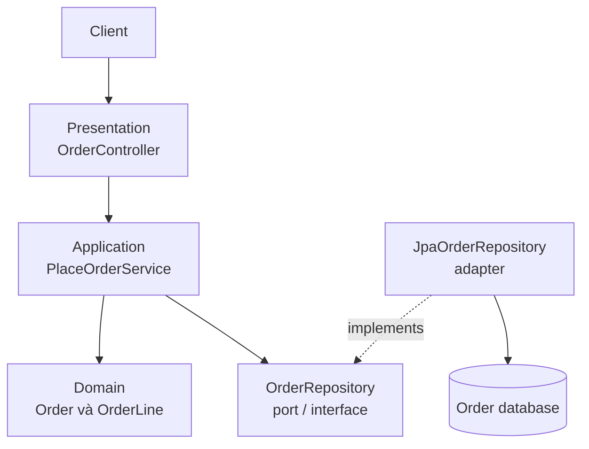

# Bài toán xuyên suốt: hệ thống quản lý đơn hàng

Trong chương **Tổng quan kiến trúc phân tầng**, ta dùng một cửa hàng trực tuyến làm ví dụ xuyên suốt để học cách tổ chức phần mềm theo kiến trúc phân tầng của module **SOFTWARE_DESIGN_ARCHITECTURE_ARCHITECTURAL_PATTERN_LAYERED**. Mục tiêu là làm rõ mỗi phần của ứng dụng chịu trách nhiệm gì, một yêu cầu đi qua các phần đó như thế nào, và vì sao ranh giới giữa chúng giúp hệ thống dễ thay đổi, kiểm thử và bảo trì.

## 1. Bối cảnh và yêu cầu

Khách hàng chọn sản phẩm, nhập số lượng rồi gửi yêu cầu tạo đơn hàng. Hệ thống cần:

- Kiểm tra dữ liệu đầu vào và quyền thực hiện thao tác.
- Tìm sản phẩm, xác nhận sản phẩm còn được phép bán và lấy giá áp dụng.
- Bảo đảm số lượng hợp lệ, tính tổng tiền và tạo đơn hàng.
- Lưu đơn hàng để có thể tra cứu về sau.
- Trả về mã đơn hàng cùng thông tin cần thiết cho giao diện.

Một yêu cầu HTTP có thể chạm đến nhiều mối quan tâm khác nhau: giao thức web, điều phối nghiệp vụ, quy tắc đơn hàng và lưu trữ. Nếu đặt tất cả vào một controller hoặc một lớp lớn, thay đổi nhỏ ở cơ sở dữ liệu hay giao diện có thể làm ảnh hưởng đến phần xử lý đơn hàng. Kiến trúc phân tầng giúp gom các trách nhiệm liên quan vào những ranh giới có mục đích rõ ràng.

## 2. Chia trách nhiệm thành các tầng logic

Với ví dụ này, ta dùng bốn nhóm trách nhiệm để dễ quan sát. Đây là cách phân chia phù hợp cho bài toán, không phải quy định rằng mọi ứng dụng đều phải có đúng bốn tầng hoặc phải đặt tên tầng giống hệt nhau.

| Tầng logic | Trách nhiệm chính | Ví dụ trong hệ thống đơn hàng |
|---|---|---|
| Presentation (trình bày) | Tiếp nhận và trả dữ liệu qua giao diện hoặc giao thức | REST controller, request/response DTO |
| Application (ứng dụng) | Điều phối một ca sử dụng và xác định ranh giới giao dịch | Use case tạo đơn, gọi cổng lấy sản phẩm và lưu đơn |
| Domain (miền nghiệp vụ) | Mô hình hóa khái niệm và bảo vệ quy tắc nghiệp vụ | Order, OrderLine, quy tắc số lượng và tổng tiền |
| Data access / Infrastructure (truy cập dữ liệu / hạ tầng) | Kết nối cơ sở dữ liệu và hệ thống bên ngoài, chuyển đổi dữ liệu lưu trữ | Spring Data JPA adapter, entity ánh xạ bảng, repository implementation |

### Presentation: giao tiếp với bên ngoài

Tầng trình bày hiểu HTTP, URL, JSON, mã trạng thái và cấu trúc dữ liệu trao đổi. Controller nhận request, kiểm tra những điều kiện ở biên như trường bắt buộc hoặc định dạng, chuyển dữ liệu thành lệnh cho ca sử dụng rồi chuyển kết quả thành response.

Ví dụ, `POST /orders` nhận `CreateOrderRequest` và trả `OrderResponse`. Controller không nên tự tính tổng tiền, tự quyết định đơn hàng có hợp lệ theo nghiệp vụ hay gọi trực tiếp `EntityManager`. Nếu giao diện đổi từ REST sang giao diện dòng lệnh, phần quy tắc tạo đơn vẫn có thể được sử dụng lại.

### Application: điều phối ca sử dụng

Tầng ứng dụng mô tả hệ thống thực hiện một mục tiêu cụ thể như `PlaceOrder`. Nó điều phối các bước: lấy thông tin sản phẩm, yêu cầu miền tạo đơn, lưu đơn và trả kết quả. Tầng này quyết định thứ tự gọi các thành phần và thường là nơi đặt ranh giới giao dịch cho thao tác ghi.

Application service không cần chứa mọi quy tắc tính toán. Nó có thể yêu cầu miền thực hiện quy tắc rồi phối hợp kết quả. Những thao tác như gửi email, giữ tồn kho hoặc phát sự kiện cũng thường được điều phối ở đây thông qua các giao diện mà ứng dụng cần.

### Domain: bảo vệ quy tắc nghiệp vụ

Tầng miền chứa các khái niệm và quy tắc có ý nghĩa đối với hoạt động bán hàng. Chẳng hạn:

- Một đơn hàng phải có ít nhất một dòng hàng.
- Số lượng của một dòng hàng phải lớn hơn 0.
- Thành tiền của dòng hàng được tính từ đơn giá áp dụng nhân với số lượng.
- Tổng tiền đơn hàng là tổng thành tiền của các dòng hàng.

Các quy tắc này cần đúng dù đơn hàng được tạo từ REST API, tác vụ nền hay một giao diện khác. Vì vậy, mô hình miền không nên phụ thuộc vào `HttpServletRequest`, controller, Spring Data JPA hoặc cấu trúc bảng.

Có thể dùng các lớp Java thông thường để biểu diễn miền. Một ứng dụng CRUD đơn giản không nhất thiết phải áp dụng đầy đủ Domain-Driven Design (DDD), aggregate phức tạp hay nhiều mẫu chiến thuật. Điều quan trọng là quy tắc có ý nghĩa nghiệp vụ được đặt ở nơi phù hợp và có thể được kiểm tra độc lập.

### Data access / Infrastructure: lưu trữ và tích hợp

Tầng này biết cách làm việc với công nghệ cụ thể: SQL, JPA, schema, câu truy vấn, ánh xạ bản ghi hoặc API của dịch vụ ngoài. Ví dụ, `JpaOrderRepository` chuyển một `Order` thành entity lưu trữ, gọi Spring Data repository và chuyển kết quả về mô hình mà tầng ứng dụng sử dụng.

Không nên để JSON request hoặc entity JPA trở thành mô hình dùng chung cho mọi tầng. DTO phục vụ giao tiếp, mô hình miền phục vụ quy tắc, còn entity lưu trữ phục vụ cấu trúc dữ liệu. Ba mô hình có thể có một số trường giống nhau nhưng mục đích và vòng đời khác nhau.

## 3. Luồng từ request đến cơ sở dữ liệu

Giả sử khách hàng gửi yêu cầu tạo đơn. Luồng xử lý ở mức khái niệm như sau:



Mũi tên liền thể hiện luồng gọi ở thời điểm chạy. Đường nét đứt thể hiện adapter lưu trữ triển khai giao diện repository. Khi application gọi `OrderRepository.save(order)`, đối tượng thực thi được cấu hình trong ứng dụng là `JpaOrderRepository`, và adapter này làm việc với cơ sở dữ liệu.

Có thể diễn giải yêu cầu theo từng bước:

1. **Client gửi request.** Ví dụ request chứa mã khách hàng và danh sách sản phẩm cùng số lượng.
2. **Controller tiếp nhận.** Controller kiểm tra cấu trúc request, chuyển thành `PlaceOrderCommand` rồi gọi ca sử dụng.
3. **Application service điều phối.** Service lấy thông tin sản phẩm qua một cổng như `ProductCatalog`, tạo các dòng hàng và yêu cầu miền tạo đơn.
4. **Domain kiểm tra quy tắc.** `Order.place(...)` từ chối đơn rỗng hoặc dòng hàng có số lượng không hợp lệ, sau đó tính tổng tiền.
5. **Repository lưu đơn.** Application gọi giao diện `OrderRepository`; adapter JPA chuyển mô hình thành dữ liệu lưu trữ và ghi vào cơ sở dữ liệu.
6. **Kết quả quay lại.** Application tạo kết quả ca sử dụng; controller chuyển kết quả thành response, chẳng hạn HTTP 201 Created cùng mã đơn hàng.

Luồng trả kết quả đi ngược về phía client, nhưng mỗi tầng vẫn giữ trách nhiệm của mình. Controller không cần biết câu SQL đã chạy; miền không cần biết response dùng JSON; adapter lưu trữ không quyết định một đơn hàng có đáp ứng chính sách bán hàng hay không.

## 4. Ví dụ tổ chức bằng Java và Spring

Các đoạn mã dưới đây minh họa ranh giới giữa các tầng. Tên package có thể thay đổi theo quy ước dự án; điều quan trọng là hướng phụ thuộc và trách nhiệm.

### DTO và controller ở tầng trình bày

```java
public record CreateOrderRequest(
    UUID customerId,
    List<CreateOrderItemRequest> items
) {}

public record CreateOrderItemRequest(
    UUID productId,
    int quantity
) {}

public record OrderResponse(
    UUID orderId,
    BigDecimal total
) {}
```

```java
@RestController
@RequestMapping("/orders")
@RequiredArgsConstructor
class OrderController {
    private final PlaceOrderService placeOrderService;

    @PostMapping
    ResponseEntity<OrderResponse> create(
            @Valid @RequestBody CreateOrderRequest request) {

        var command = new PlaceOrderCommand(
            request.customerId(),
            request.items().stream()
                .map(item -> new PlaceOrderItem(
                    item.productId(), item.quantity()))
                .toList()
        );

        var result = placeOrderService.handle(command);
        var response = new OrderResponse(result.orderId(), result.total());

        return ResponseEntity.status(HttpStatus.CREATED).body(response);
    }
}
```

Controller chuyển đổi dữ liệu giao tiếp thành lệnh của ứng dụng. Có thể dùng Bean Validation để kiểm tra dữ liệu hình thức, chẳng hạn trường không được để trống. Tuy nhiên, quy tắc cốt lõi như đơn hàng phải có dòng hàng vẫn cần được bảo vệ ở miền, vì ca sử dụng có thể được gọi từ nơi không đi qua controller này.

### Ca sử dụng ở tầng ứng dụng

```java
public interface ProductCatalog {
    ProductSnapshot getSellableProduct(UUID productId);
}

public interface OrderRepository {
    Order save(Order order);
}
```

```java
@Service
@RequiredArgsConstructor
class PlaceOrderService {
    private final ProductCatalog productCatalog;
    private final OrderRepository orderRepository;

    @Transactional
    public PlaceOrderResult handle(PlaceOrderCommand command) {
        var lines = command.items().stream()
            .map(item -> {
                var product =
                    productCatalog.getSellableProduct(item.productId());

                return new OrderLine(
                    product.id(),
                    item.quantity(),
                    product.price()
                );
            })
            .toList();

        var order = Order.place(command.customerId(), lines);
        var savedOrder = orderRepository.save(order);

        return new PlaceOrderResult(
            savedOrder.id(),
            savedOrder.total()
        );
    }
}
```

Ở đây, `ProductCatalog` và `OrderRepository` là các giao diện mà ca sử dụng cần. Chúng mô tả nhu cầu của ứng dụng mà không buộc logic ứng dụng phải biết đang dùng REST client, JDBC hay JPA. `@Transactional` là cách phổ biến trong Spring để đặt ranh giới giao dịch cho thao tác lưu; dự án có thể cấu hình ranh giới này bằng cơ chế khác nếu muốn giữ mã use case ít phụ thuộc framework hơn.

### Quy tắc ở tầng miền

```java
public record OrderLine(
    UUID productId,
    int quantity,
    BigDecimal unitPrice
) {
    public OrderLine {
        Objects.requireNonNull(productId);
        Objects.requireNonNull(unitPrice);

        if (quantity <= 0) {
            throw new IllegalArgumentException(
                "Số lượng phải lớn hơn 0");
        }
        if (unitPrice.signum() < 0) {
            throw new IllegalArgumentException(
                "Đơn giá không được âm");
        }
    }

    public BigDecimal subtotal() {
        return unitPrice.multiply(BigDecimal.valueOf(quantity));
    }
}
```

```java
public final class Order {
    private final UUID id;
    private final UUID customerId;
    private final List<OrderLine> lines;
    private final BigDecimal total;

    private Order(
            UUID id,
            UUID customerId,
            List<OrderLine> lines,
            BigDecimal total) {
        this.id = id;
        this.customerId = customerId;
        this.lines = lines;
        this.total = total;
    }

    public static Order place(
            UUID customerId,
            List<OrderLine> lines) {
        Objects.requireNonNull(customerId);
        Objects.requireNonNull(lines);

        if (lines.isEmpty()) {
            throw new IllegalArgumentException(
                "Đơn hàng phải có ít nhất một dòng hàng");
        }

        var immutableLines = List.copyOf(lines);
        var total = immutableLines.stream()
            .map(OrderLine::subtotal)
            .reduce(BigDecimal.ZERO, BigDecimal::add);

        return new Order(
            UUID.randomUUID(),
            customerId,
            immutableLines,
            total
        );
    }

    public UUID id() { return id; }
    public BigDecimal total() { return total; }
}
```

Ví dụ này đặt kiểm tra số lượng và phép tính tổng trong mô hình miền. Trong hệ thống thật, tiền tệ thường cần một kiểu `Money` mang cả số tiền lẫn đơn vị tiền tệ; chính sách làm tròn, giảm giá, thuế và thời điểm chốt giá cũng cần được mô hình hóa rõ. Đoạn mã đã lược bớt các chi tiết đó để tập trung vào vị trí của quy tắc.

### Adapter lưu trữ ở tầng hạ tầng

```java
@Repository
@RequiredArgsConstructor
class JpaOrderRepository implements OrderRepository {
    private final SpringDataOrderJpaRepository jpaRepository;

    @Override
    public Order save(Order order) {
        var entity = OrderJpaEntity.fromDomain(order);
        var saved = jpaRepository.save(entity);
        return saved.toDomain();
    }
}
```

`OrderJpaEntity` và `SpringDataOrderJpaRepository` thuộc phần triển khai lưu trữ. Việc ánh xạ giữa entity và mô hình miền có thể cần thêm mã, nhưng nó giúp thay đổi schema hoặc cách lưu trữ ít làm rò rỉ chi tiết sang nghiệp vụ.

Trong ví dụ, interface `OrderRepository` được đặt ở phía mà application cần đến, còn `JpaOrderRepository` ở tầng hạ tầng triển khai interface đó. Đây là cách dùng Dependency Inversion để giữ hướng phụ thuộc mã nguồn hướng vào các chính sách ổn định. Một dự án có thể đặt interface repository trong package application hoặc domain tùy cách tổ chức; cần nhất quán và tránh để miền phụ thuộc trực tiếp vào lớp JPA cụ thể.

## 5. Tầng logic khác tầng triển khai như thế nào?

**Tầng logic (layer)** là cách chia trách nhiệm trong mã nguồn. **Tầng triển khai (deployment tier)** là một đơn vị chạy hoặc hạ tầng được triển khai riêng, chẳng hạn một tiến trình, máy chủ hay cụm dịch vụ.

Một ứng dụng Spring Boot có thể đóng gói controller, application service, domain và adapter JPA trong cùng một file JAR, chạy trong cùng một tiến trình. Cơ sở dữ liệu có thể chạy ở máy chủ riêng. Khi đó ứng dụng có nhiều tầng logic nhưng chỉ có một tầng ứng dụng được triển khai, cộng với tầng cơ sở dữ liệu.

Ngược lại, hệ thống có thể triển khai web server và application server riêng. Mỗi tiến trình vẫn có thể chứa nhiều tầng logic. Vì vậy, không thể suy ra số máy chủ từ số tầng trong sơ đồ kiến trúc. Việc tách thành nhiều tier là quyết định triển khai, thường liên quan đến mở rộng tải, bảo mật, độ sẵn sàng và vận hành; nó kéo theo chi phí giao tiếp mạng, triển khai và giám sát.

## 6. Layer đóng, layer mở và hướng phụ thuộc

### Layer đóng (closed layering)

Một tầng chỉ được gọi tầng liền kề bên dưới. Ví dụ, presentation gọi application; application sử dụng miền và các cổng mà nó cần; tầng triển khai thấp hơn cung cấp adapter cho các cổng đó. Muốn truy cập dữ liệu, controller đi qua ca sử dụng thay vì tự gọi repository lưu trữ.

Cách tổ chức này buộc các yêu cầu đi qua nơi điều phối đã định. Nhờ vậy, chính sách, phân quyền ở mức ca sử dụng, giao dịch và các bước nghiệp vụ ít bị bỏ qua. Đổi lại, một thao tác chuyển tiếp đơn giản có thể tạo thêm mã ở tầng trung gian.

### Layer mở (open layering)

Trong layer mở, một tầng có thể truy cập tầng thấp hơn mà không nhất thiết đi qua tầng liền kề. Ví dụ, dự án có thể cho phép một endpoint chỉ đọc danh mục tham chiếu gọi một query adapter chuyên biệt, bỏ qua một application service chỉ chuyển tiếp dữ liệu.

Ngoại lệ như vậy có thể giảm lớp trung gian hoặc phù hợp với truy vấn đọc đơn giản. Tuy nhiên, nếu dùng tùy tiện, controller có thể truy cập dữ liệu trực tiếp, bỏ qua quy tắc, phân quyền hoặc giao dịch mà ứng dụng cần. Vì thế, cần quy định rõ tầng nào được phép bỏ qua tầng nào, lý do và cách bảo vệ các chính sách liên quan. Không nên xem layer mở là giấy phép để mọi thành phần gọi tùy ý mọi thành phần khác.

### Hướng phụ thuộc

Cần phân biệt **luồng gọi lúc chạy** với **phụ thuộc mã nguồn**:

- Khi xử lý request, lời gọi thường đi từ controller đến application, rồi application gọi mô hình miền và các cổng cần thiết.
- Mã application phụ thuộc vào interface `OrderRepository`; adapter JPA phụ thuộc vào interface đó vì nó triển khai interface. Application không cần import lớp `JpaOrderRepository`.
- Dữ liệu trả về đi ngược lên qua các lời gọi và kết quả, nhưng điều đó không có nghĩa là tầng miền phải phụ thuộc vào tầng trình bày.

Các quy tắc thực tế để giữ ranh giới rõ ràng:

- Domain không import controller, DTO HTTP, Spring MVC hay lớp JPA cụ thể.
- Presentation không tự truy vấn cơ sở dữ liệu hoặc tự thực hiện quy tắc tạo đơn.
- Application điều phối ca sử dụng và phụ thuộc vào các abstraction cần thiết.
- Infrastructure được phép phụ thuộc vào framework và công nghệ cụ thể để triển khai các abstraction.
- Tránh vòng phụ thuộc giữa các package hoặc module; nếu hai tầng phải hiểu chi tiết nội bộ của nhau, ranh giới có thể đang đặt chưa hợp lý.

## 7. Kiểm thử theo từng tầng

Phân tầng tạo điều kiện chọn loại kiểm thử phù hợp với trách nhiệm:

| Phạm vi kiểm thử | Nội dung nên kiểm tra | Công cụ hoặc cách làm thường gặp |
|---|---|---|
| Domain unit test | Đơn rỗng bị từ chối, số lượng không hợp lệ bị từ chối, tổng tiền được tính đúng | JUnit, không cần Spring hoặc database |
| Application test | Use case gọi catalog, tạo đơn, lưu đơn và xử lý lỗi đúng thứ tự | Fake hoặc mock các port |
| Persistence adapter test | Ánh xạ domain/entity, truy vấn và lưu dữ liệu đúng | `@DataJpaTest`, database kiểm thử hoặc Testcontainers |
| Presentation test | Request/response, validation, HTTP status và ánh xạ lỗi | Spring MVC Test, MockMvc |
| End-to-end test | Một request tạo đơn thực sự đi qua các thành phần chính | Spring Boot integration test với hạ tầng kiểm thử |

Nếu quy tắc tổng tiền chỉ được kiểm tra bằng test chạy cả ứng dụng và database, phản hồi khi lỗi sẽ chậm và khó xác định nguyên nhân. Quy tắc miền nên có unit test độc lập. Ngược lại, unit test không thể chứng minh mapping JPA hoặc câu truy vấn hoạt động với cơ sở dữ liệu thật; adapter cần integration test phù hợp.

## 8. Lợi ích, giới hạn và lỗi tổ chức thường gặp

Phân tầng giúp người đọc lần theo một yêu cầu, cô lập thay đổi và kiểm thử từng nhóm trách nhiệm. Khi thay REST bằng giao diện khác, ca sử dụng có thể được giữ nguyên. Khi thay JPA bằng JDBC, miền và hợp đồng của application có thể tiếp tục giữ nguyên nếu adapter đáp ứng cùng interface.

Kiến trúc này cũng có chi phí. Một ứng dụng CRUD nhỏ có thể không cần nhiều interface, mapper và lớp chuyển tiếp cho mỗi thao tác. Nếu tạo tầng chỉ để chuyển tiếp lời gọi mà không tạo ranh giới có ý nghĩa, mã nguồn sẽ dài hơn mà không dễ hiểu hơn. Ngược lại, nếu mọi logic dồn vào `OrderController` hoặc một `OrderService` khổng lồ, tên package có phân tầng cũng không làm trách nhiệm được tách biệt.

Một số dấu hiệu cần xem lại:

- Controller chứa phép tính giá, chính sách giảm giá hoặc thay đổi trạng thái đơn hàng.
- Domain import Spring Data JPA hoặc nhận trực tiếp request DTO.
- Entity JPA được trả thẳng ra API, khiến schema lưu trữ trở thành hợp đồng giao tiếp.
- Application service chỉ chuyển tiếp mọi lời gọi nhưng không sở hữu điều phối hay ranh giới ca sử dụng.
- Tầng trình bày gọi repository tùy tiện, làm một số đường đi bỏ qua kiểm tra nghiệp vụ.
- Quá nhiều interface và lớp wrapper cho thao tác đơn giản, không có nhu cầu thay thế hoặc kiểm thử riêng.

Cũng cần lưu ý về giao dịch. `@Transactional` thường quản lý giao dịch của một cơ sở dữ liệu trong phạm vi phù hợp với transaction manager. Nếu use case vừa ghi đơn vào database vừa gọi dịch vụ tồn kho từ xa, giao dịch database không tự động hoàn tác tác động đã xảy ra ở dịch vụ kia. Với tích hợp phân tán, cần thiết kế cơ chế giữ chỗ, idempotency, retry, outbox hoặc quy trình bù trừ phù hợp thay vì giả định có một giao dịch ACID bao trùm mọi hệ thống.

## 9. Cách tự kiểm tra thiết kế

Khi thêm một chức năng như hủy đơn hàng, hãy lần lượt hỏi:

1. Đầu vào và kết quả giao tiếp với client thuộc tầng nào?
2. Ai điều phối các bước hủy đơn và xác định ranh giới giao dịch?
3. Quy tắc nào quyết định đơn có được hủy ở trạng thái hiện tại hay không?
4. Thành phần nào biết cách cập nhật dữ liệu trong database?
5. Có tầng nào bị bỏ qua không? Nếu có, ngoại lệ đó đã được chủ đích và bảo vệ chưa?
6. Có thể kiểm thử quy tắc hủy đơn mà không khởi động Spring và database không?
7. Số tầng logic có đang bị nhầm với số tiến trình hoặc máy chủ triển khai không?

Nếu câu trả lời chỉ rõ nơi chịu trách nhiệm, đường đi của request có thể được lần theo, và quy tắc nghiệp vụ không bị khóa vào HTTP hay công nghệ lưu trữ, thiết kế đã đạt được mục tiêu cốt lõi của kiến trúc phân tầng cho bài toán này.

