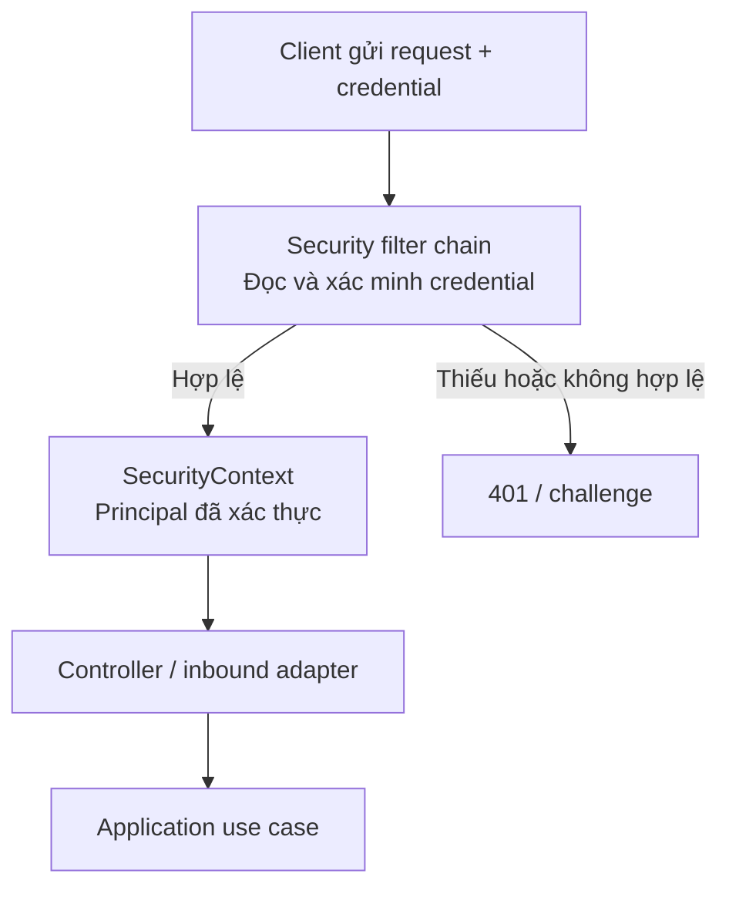
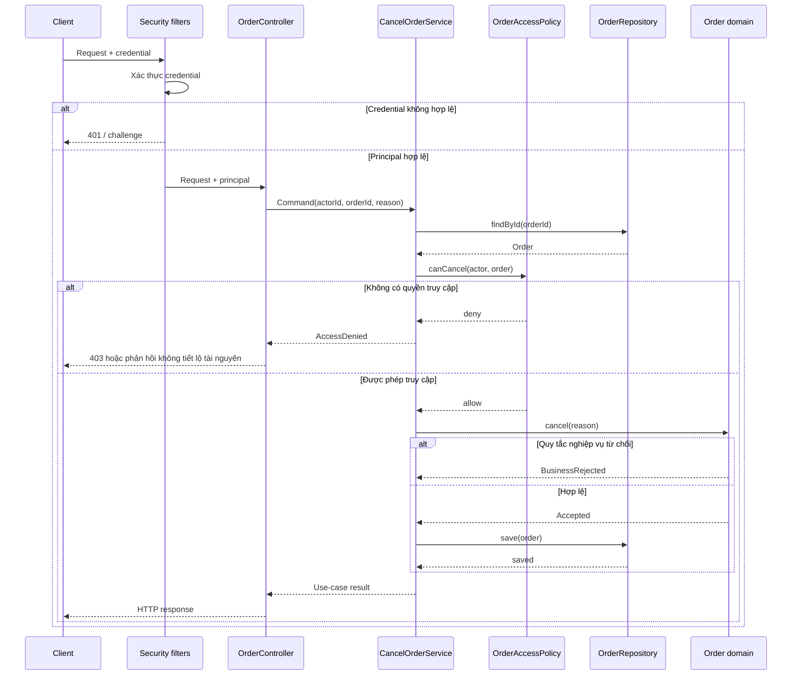

# Phân chia xác thực, phân quyền truy cập và quyền quyết định nghiệp vụ

Bài học này thuộc chương **Các mối quan tâm xuyên tầng** của module `SOFTWARE_DESIGN_ARCHITECTURE_ARCHITECTURAL_PATTERN_LAYERED`, trong chương trình **học tổ chức phần mềm theo kiến trúc phân tầng**. Một ứng dụng cần biết ai đang gửi yêu cầu, người đó được phép truy cập tài nguyên nào và hành động được yêu cầu có hợp lệ theo quy tắc nghiệp vụ hay không. Ba câu hỏi này thường xuất hiện cùng một request nhưng là ba trách nhiệm khác nhau: **xác thực (authentication)**, **phân quyền truy cập (authorization/access control)** và **quyết định nghiệp vụ (business decision)**.

Nếu trộn chúng vào controller hoặc một lớp `SecurityService` duy nhất, hệ thống dễ lặp logic, bỏ sót kiểm tra ở một kênh khác hoặc dùng quyền truy cập để thay thế quy tắc nghiệp vụ. Trong kiến trúc phân tầng, xác thực thường được thực hiện ở ranh giới tiếp nhận request; phân quyền được áp dụng xuyên các ranh giới và cần được kiểm tra tại điểm thực thi use case/tài nguyên; còn các bất biến và quyết định thuộc nghiệp vụ phải được bảo vệ trong application/domain theo bản chất của chúng.

Sau bài học, bạn có thể phân biệt ba loại quyết định, đặt chúng ở đúng vị trí trong ứng dụng Java/Spring, thiết kế kiểm tra quyền trên tài nguyên cụ thể, và kiểm thử độc lập việc nhận diện người dùng, quyền truy cập và tính hợp lệ nghiệp vụ.

## 1. Ba câu hỏi khác nhau trong một request

Giả sử người dùng gửi yêu cầu hủy đơn hàng `ORD-204`:

1. **Xác thực:** request có chứng minh được danh tính của người gọi không? Hệ thống xác định request thuộc về tài khoản nào, dựa trên session, token hoặc cơ chế tin cậy khác.
2. **Phân quyền truy cập:** danh tính đã xác thực đó có được phép thực hiện hành động hủy trên đơn hàng này không? Ví dụ người gọi có vai trò phù hợp, thuộc đúng tenant hoặc được phân công quản lý đơn.
3. **Quyết định nghiệp vụ:** dù người gọi có quyền truy cập, đơn hàng hiện tại có đủ điều kiện để hủy không? Ví dụ đơn chưa được giao, chưa hoàn tất và chính sách hủy vẫn cho phép.

Một người dùng có thể đã đăng nhập nhưng không có quyền truy cập đơn hàng. Người dùng có quyền truy cập cũng có thể yêu cầu một hành động không hợp lệ theo trạng thái nghiệp vụ. Ngược lại, một thao tác có thể hợp lệ về nghiệp vụ nhưng người gọi không được phép thực hiện nó. Mỗi câu hỏi cần được trả lời bằng dữ liệu và quy tắc phù hợp.

| Khái niệm | Câu hỏi | Đầu vào điển hình | Kết quả |
|---|---|---|---|
| Authentication | Người gọi là ai? | Credential, session, token, chứng thư hoặc danh tính từ hệ thống tin cậy | Principal/identity đã được xác thực hoặc lỗi xác thực |
| Authorization | Người đó có được phép truy cập tài nguyên/hành động này không? | Identity, role, permission, tenant, quan hệ với tài nguyên, context | Cho phép hoặc từ chối truy cập |
| Business decision | Hành động có hợp lệ theo quy tắc và trạng thái nghiệp vụ không? | Aggregate, trạng thái, chính sách nghiệp vụ, thời điểm và dữ liệu use case | Chấp nhận, từ chối theo nghiệp vụ hoặc kết quả tương ứng |

## 2. Xác thực: xác định danh tính người gọi

### Xác thực làm gì?

Xác thực kiểm tra bằng chứng mà một chủ thể cung cấp để xác định danh tính của chủ thể đó. Trong ứng dụng web, bằng chứng có thể là thông tin đăng nhập, session cookie, access token hoặc một cơ chế liên kết danh tính. Với hệ thống service-to-service, nó có thể là client credential, certificate hoặc workload identity.

Sau khi xác thực thành công, framework bảo mật thường tạo một principal hoặc security context để các thành phần phía sau có thể biết danh tính đã được xác minh. Trong Spring Security, `Authentication` thường chứa principal, authorities và trạng thái xác thực. Ứng dụng có thể chuyển một định danh ổn định như `userId` hoặc `subject` vào application layer.

Xác thực không có nghĩa người dùng được phép thực hiện mọi thao tác. Một token hợp lệ chỉ chứng minh danh tính/claims theo cơ chế đã cấu hình; nó không tự chứng minh người dùng sở hữu một đơn hàng cụ thể hoặc đơn hàng được phép hủy.

### Xác thực thường nằm ở ranh giới giao tiếp

Với HTTP và Spring Security, request đi qua security filter chain trước khi đến controller. Các filter có thể trích xuất credential, xác minh chữ ký hoặc session, kiểm tra thời hạn và tạo security context. Nếu credential không hợp lệ hoặc không có khi endpoint yêu cầu xác thực, request bị từ chối ở ranh giới này.



Ví dụ cấu hình Spring Security cho một API stateless có thể như sau. Cấu hình thực tế cần phù hợp với loại credential và chính sách triển khai của ứng dụng:

```java
@Configuration
@EnableWebSecurity
public class SecurityConfiguration {
    @Bean
    SecurityFilterChain securityFilterChain(HttpSecurity http)
            throws Exception {
        return http
                .authorizeHttpRequests(auth -> auth
                        .requestMatchers("/health").permitAll()
                        .requestMatchers("/api/**").authenticated()
                        .anyRequest().denyAll())
                .oauth2ResourceServer(oauth -> oauth.jwt())
                .build();
    }
}
```

Đoạn cấu hình minh họa việc yêu cầu xác thực cho API và dùng JWT resource server. Nó chưa định nghĩa đầy đủ cách cấp token, kiểm tra audience/issuer, CORS, CSRF hay chính sách cho từng endpoint; các phần đó phụ thuộc loại ứng dụng và môi trường. Với ứng dụng dùng session/cookie, cách cấu hình CSRF và session sẽ khác.

### Danh tính cần được lấy từ nguồn tin cậy

Không nên coi `userId`, `role` hoặc `tenantId` do client gửi trong JSON/query parameter là danh tính đã xác thực. Client có thể sửa những giá trị đó. Hãy lấy subject từ security context hoặc một identity provider đáng tin cậy, sau đó chuyển định danh đã xác minh vào command của use case.

Ví dụ controller lấy principal từ Spring Security:

```java
@PostMapping("/api/orders/{id}/cancel")
public ResponseEntity<?> cancel(
        @PathVariable UUID id,
        @AuthenticationPrincipal Jwt jwt,
        @RequestBody CancelOrderRequest request) {
    var actorId = UUID.fromString(jwt.getSubject());
    var result = cancelOrder.execute(
            new CancelOrderCommand(actorId, id, request.reason()));
    return toHttpResponse(result);
}
```

Trong ví dụ này, `actorId` được lấy từ subject của JWT đã được resource server xác minh. Ứng dụng vẫn cần kiểm tra claim có đúng định dạng, issuer/audience và quy tắc ánh xạ subject sang user nội bộ theo cấu hình bảo mật. Không truyền toàn bộ JWT vào domain object nếu domain chỉ cần định danh người thực hiện.

## 3. Phân quyền truy cập: quyết định ai được làm gì trên tài nguyên nào

### Authorization khác authentication

Sau khi biết người gọi là ai, ứng dụng cần quyết định người đó có thể làm gì. Một mô hình phân quyền thường xem xét:

- **Subject:** người dùng, service account hoặc nhóm đang yêu cầu hành động.
- **Action:** thao tác như đọc, tạo, sửa, hủy, phê duyệt hoặc xuất dữ liệu.
- **Resource:** tài nguyên cụ thể như đơn hàng, tài khoản, hồ sơ hoặc tenant.
- **Context:** thuộc tính bổ sung như tenant hiện tại, thời gian, trạng thái gán việc, địa chỉ mạng hoặc mức độ rủi ro.

Ví dụ, vai trò `ORDER_MANAGER` có thể được phép xem đơn hàng trong tenant của mình; một nhân viên chỉ được xem các đơn được phân công; người mua chỉ được xem đơn của chính họ. Chỉ kiểm tra một role chung ở endpoint chưa đủ nếu quyền phụ thuộc vào tài nguyên cụ thể.

### RBAC và kiểm soát theo thuộc tính/quan hệ

**RBAC (Role-Based Access Control)** gán quyền thông qua vai trò. Ví dụ `ADMIN`, `ORDER_MANAGER` hoặc `CUSTOMER_SUPPORT` được gắn với một tập quyền. RBAC phù hợp với quyền tương đối ổn định theo chức năng công việc.

Khi quyền phụ thuộc vào thuộc tính của người dùng, tài nguyên hoặc quan hệ giữa chúng, cần kiểm tra thêm theo thuộc tính (ABAC) hoặc quan hệ (ReBAC). Ví dụ:

- Người dùng có role `ORDER_MANAGER` và `tenantId` trùng với tenant của đơn.
- Nhân viên được phân công xử lý đúng hồ sơ đó.
- Người mua là chủ sở hữu của đơn hàng đang xem.

Các mô hình này có thể kết hợp. Role giúp xác định loại thao tác mà một nhóm được làm; kiểm tra quan hệ hoặc thuộc tính giới hạn thao tác trên tài nguyên cụ thể.

### Kiểm tra quyền ở nhiều mức

Một hệ thống có thể kiểm tra quyền tại nhiều ranh giới:

1. **Endpoint/request-level:** endpoint có yêu cầu người dùng đăng nhập hoặc có authority chung không? Ví dụ chỉ principal đã xác thực mới được gọi `/api/orders/**`.
2. **Use-case/method-level:** principal có quyền gọi ca sử dụng này không? Ví dụ chỉ nhân viên có `ORDER_CANCEL` mới được yêu cầu hủy đơn.
3. **Resource-level/object-level:** principal có quyền trên chính đơn hàng được chỉ định không? Ví dụ đơn thuộc tenant của principal hoặc người gọi là chủ đơn.
4. **Data-level:** truy vấn hoặc cập nhật cần giới hạn dữ liệu theo tenant/ownership, đồng thời database có thể hỗ trợ constraint hoặc row-level security nếu kiến trúc yêu cầu.

Kiểm tra ở filter hoặc controller giúp từ chối sớm nhưng không nên là lớp bảo vệ duy nhất. Một use case có thể được gọi từ HTTP, CLI, message consumer hoặc job nội bộ; quyền ở mức application/resource cần được bảo vệ tại nơi tất cả các kênh cùng đi qua. Ngược lại, không cần lặp mọi kiểm tra role ở từng lớp nếu một policy chung đã bảo vệ đúng ranh giới.

### Ví dụ kiểm tra quyền với Spring Security

Spring Security hỗ trợ method security. Ví dụ sau thể hiện một quyền tổng quát trên use case:

```java
@Service
public class CancelOrderUseCase {
    @PreAuthorize("hasAuthority('ORDER_CANCEL')")
    public CancelOrderResult execute(CancelOrderCommand command) {
        // Tải đơn, kiểm tra quyền trên tài nguyên và thực hiện use case.
        return doCancel(command);
    }
}
```

Để method security hoạt động, ứng dụng cần bật cấu hình tương ứng, chẳng hạn `@EnableMethodSecurity`, và lời gọi phải đi qua Spring proxy theo cách hoạt động của framework. Gọi một method được bảo vệ từ method khác trong cùng object (self-invocation) có thể bỏ qua proxy; không nên dựa vào annotation mà không kiểm tra đường gọi thực tế.

Kiểm tra quyền trên tài nguyên có thể được ủy quyền cho policy component:

```java
public interface OrderAccessPolicy {
    boolean canCancel(Actor actor, Order order);
}

@Component
public class DefaultOrderAccessPolicy implements OrderAccessPolicy {
    @Override
    public boolean canCancel(Actor actor, Order order) {
        return actor.hasAuthority("ORDER_CANCEL")
                && actor.tenantId().equals(order.tenantId());
    }
}
```

Use case có thể gọi policy sau khi tải tài nguyên:

```java
@Service
public class CancelOrderService {
    private final OrderRepository orders;
    private final OrderAccessPolicy access;

    public CancelOrderService(OrderRepository orders,
                              OrderAccessPolicy access) {
        this.orders = orders;
        this.access = access;
    }

    public CancelOrderResult execute(CancelOrderCommand command) {
        var order = orders.findById(command.orderId());
        if (order.isEmpty()) {
            return new CancelOrderResult.NotFound();
        }

        if (!access.canCancel(command.actor(), order.get())) {
            return new CancelOrderResult.AccessDenied();
        }

        // Quyết định nghiệp vụ được kiểm tra riêng trên aggregate.
        var decision = order.get().cancel(command.reason());
        if (decision instanceof Order.CancelDecision.Rejected rejected) {
            return new CancelOrderResult.BusinessRejected(rejected.reason());
        }

        orders.save(order.get());
        return new CancelOrderResult.Cancelled(order.get().id());
    }
}
```

Đây là ví dụ minh họa; `Actor` phải được tạo từ danh tính/claims đã xác thực và được ánh xạ theo chính sách ứng dụng. `OrderAccessPolicy` quyết định quyền truy cập trên tài nguyên; phương thức `order.cancel(...)` quyết định hành động có hợp lệ theo nghiệp vụ. Tách hai bước giúp cùng một use case có thể kiểm tra quyền nhất quán dù được gọi từ HTTP hay một kênh khác.

## 4. Quyết định nghiệp vụ: hành động có hợp lệ theo trạng thái và chính sách không?

### Quyền truy cập không thay thế quy tắc nghiệp vụ

Phân quyền trả lời “người này có quyền yêu cầu hành động không?”. Quyết định nghiệp vụ trả lời “hành động có được phép theo trạng thái và chính sách của miền nghiệp vụ không?”. Hai câu trả lời có thể khác nhau.

Ví dụ người dùng có authority `ORDER_CANCEL` và đúng tenant, nhưng đơn hàng đã được giao. Họ có quyền yêu cầu hủy đơn nói chung, song quy tắc nghiệp vụ không cho phép hủy đơn đã giao. Ngược lại, đơn đang ở trạng thái `PENDING` và có thể hủy, nhưng người gọi không thuộc tenant của đơn; hệ thống vẫn phải từ chối truy cập.

### Đặt bất biến trong domain

Các quy tắc luôn phải đúng đối với trạng thái domain nên được bảo vệ bởi domain model hoặc thành phần nghiệp vụ phù hợp. Ví dụ:

```java
public final class Order {
    private OrderStatus status;

    public CancelDecision cancel(String reason) {
        if (status == OrderStatus.SHIPPED
                || status == OrderStatus.DELIVERED) {
            return new CancelDecision.Rejected(
                    CancelRejectionReason.ALREADY_SHIPPED);
        }

        if (reason == null || reason.isBlank()) {
            return new CancelDecision.Rejected(
                    CancelRejectionReason.REASON_REQUIRED);
        }

        status = OrderStatus.CANCELLED;
        return new CancelDecision.Accepted();
    }
}
```

Đoạn code minh họa quy tắc hủy đơn bên trong aggregate. Domain không cần biết request đến từ người dùng nào, role nào, JWT ra sao hoặc HTTP status nào sẽ được trả. Domain bảo vệ trạng thái hợp lệ bất kể caller là controller, batch job hay message handler.

Không phải mọi quyết định đều nằm trong entity. Quy tắc cần phối hợp nhiều aggregate, dữ liệu bên ngoài hoặc chính sách thay đổi theo tổ chức có thể thuộc application service hoặc domain policy/service. Tiêu chí là bản chất quyết định: nếu đó là quyền truy cập, hãy đặt trong authorization policy; nếu đó là quy tắc về cách nghiệp vụ vận hành, hãy đặt trong domain/application theo phạm vi dữ liệu và vòng đời của nó.

### Một số quyết định có vẻ giống phân quyền nhưng là nghiệp vụ

- “Nhân viên có role `APPROVER` được mở màn hình phê duyệt” là quyền truy cập.
- “Một yêu cầu phải được hai người khác nhau phê duyệt” là quy tắc nghiệp vụ của quy trình.
- “Người tạo yêu cầu không được tự phê duyệt yêu cầu của mình” có thể là quy tắc kiểm soát nghiệp vụ (separation of duties); nó liên quan danh tính nhưng bảo vệ tính đúng đắn của quy trình.
- “Đơn chỉ được hủy trước khi bàn giao vận chuyển” là quy tắc trạng thái nghiệp vụ.
- “Người dùng chỉ được xem hồ sơ thuộc tenant mình” là kiểm soát truy cập dữ liệu.

Một quy tắc có thể cần cả identity và trạng thái domain. Hãy xác định mục đích của nó và nơi mọi đường thực thi đều có thể bảo vệ được quy tắc đó; không chỉ phân loại dựa trên việc điều kiện có nhắc đến user hay role.

## 5. Luồng xử lý kết hợp ba trách nhiệm

Một request hủy đơn có thể đi qua các bước sau:



Luồng trên cho thấy ba trách nhiệm được thực hiện ở các điểm khác nhau. Filter xác minh credential và tạo principal. Application/use case phối hợp truy cập tài nguyên và gọi policy phân quyền. Domain kiểm tra trạng thái và quy tắc hủy. Controller chỉ chuyển kết quả use case thành phản hồi phù hợp.

Thứ tự kiểm tra tài nguyên cần được thiết kế cẩn thận. Một hệ thống có thể tìm đơn rồi kiểm tra quyền, nhưng phải tránh để response tiết lộ sự tồn tại của tài nguyên cho người không có quyền. Một số API trả cùng phản hồi `404` cho “không tồn tại” và “không được phép xem” để giảm khả năng dò ID; đây là quyết định của hợp đồng bảo mật và API. Truy vấn cũng có thể giới hạn tenant ngay từ database để giảm nguy cơ lộ dữ liệu.

## 6. Lỗi thường gặp khi đặt trách nhiệm sai tầng

### Chỉ kiểm tra quyền ở giao diện

Ẩn nút “Hủy đơn” hoặc khóa một form giúp trải nghiệm tốt hơn, nhưng client có thể gọi API trực tiếp hoặc dùng giao diện cũ. Quyền phải được kiểm tra ở phía server tại điểm thực thi đáng tin cậy. UI chỉ là nơi phản ánh quyền đã được cung cấp cho nó.

### Nhầm đăng nhập thành được phép truy cập

Một endpoint chỉ yêu cầu `.authenticated()` đã biết người gọi là ai, nhưng chưa xác định người đó có quyền đọc đơn cụ thể hay không. Cần kiểm tra authority, tenant, ownership hoặc quan hệ với resource theo chính sách.

### Đưa mọi quy tắc vào Spring Security annotation

`@PreAuthorize` hữu ích cho quyền ở mức method hoặc policy đơn giản. Nếu nhét điều kiện trạng thái đơn hàng, hạn mức tín dụng, quy tắc phê duyệt hoặc điều kiện chuyển trạng thái vào biểu thức bảo mật, nghiệp vụ bị gắn với framework và khó dùng lại từ batch/message handler. Hãy để security annotation bảo vệ quyền gọi; domain/application bảo vệ quy tắc nghiệp vụ.

### Đưa authorization vào entity domain một cách máy móc

Domain object không nên phụ thuộc vào `SecurityContextHolder`, JWT hay Spring Security. Truyền một actor/value object hoặc gọi policy từ application sẽ giúp domain giữ độc lập với framework. Một số quy tắc nghiệp vụ có thể phụ thuộc vào vai trò người tham gia, nhưng nên truyền thông tin cần thiết dưới dạng mô hình rõ ràng, không đọc global security context từ entity.

### Dùng role quá rộng

Role `ADMIN` có thể thuận tiện nhưng dễ trở thành quyền bỏ qua mọi kiểm soát. Hãy định nghĩa quyền theo hành động và phạm vi cần thiết; cấp quyền tối thiểu; tách quyền quản trị kỹ thuật khỏi quyền phê duyệt nghiệp vụ. Mỗi quyền đặc biệt nên có lý do và được kiểm thử.

### Kiểm tra quyền rồi dữ liệu thay đổi trước khi ghi

Nếu quan hệ sở hữu hoặc phân công có thể thay đổi đồng thời, kết quả kiểm tra quyền có thể lỗi thời trước khi cập nhật. Với thao tác nhạy cảm, cần đặt kiểm tra và thay đổi trong transaction phù hợp, dùng khóa/version hoặc điều kiện cập nhật nguyên tử khi cần. Authorization check không thay thế concurrency control.

## 7. Mã HTTP và cách biểu diễn kết quả

Với API HTTP, một số status thường gặp:

| Tình huống | Phản hồi thường dùng | Ý nghĩa |
|---|---|---|
| Thiếu credential hoặc credential không hợp lệ | `401 Unauthorized` (thường kèm challenge phù hợp) | Client cần xác thực hoặc cung cấp credential hợp lệ |
| Đã xác thực nhưng không đủ quyền | `403 Forbidden` | Server hiểu caller nhưng từ chối thao tác |
| Tài nguyên không tồn tại hoặc cố ý che giấu sự tồn tại | `404 Not Found` | Hợp đồng không tiết lộ tài nguyên cho caller |
| Hành động bị từ chối do trạng thái/quy tắc nghiệp vụ | Thường là `409 Conflict`, `422 Unprocessable Content` hoặc mã theo hợp đồng | Request có thể hợp lệ về cú pháp nhưng không thể thực hiện trong trạng thái hiện tại |
| Thành công | `200`, `202`, `204` hoặc status phù hợp | Use case đã hoàn tất hoặc được tiếp nhận theo hợp đồng |

`401` có tên lịch sử chứa chữ “Unauthorized”, nhưng ý nghĩa thực tế của nó là thiếu hoặc không có credential xác thực hợp lệ. `403` thể hiện từ chối quyền truy cập. Một lỗi nghiệp vụ không nên tự động biến thành `403`: người gọi có thể có quyền hủy đơn nhưng đơn đã giao nên hành động bị từ chối vì trạng thái nghiệp vụ.

Application nên trả kết quả có ý nghĩa như `AccessDenied`, `BusinessRejected` hoặc `Cancelled`; HTTP adapter ánh xạ chúng thành status và response body. CLI có thể chuyển thành thông báo/mã thoát; GUI có thể hiển thị thông báo. Như vậy, application không phải phụ thuộc vào HTTP để mô tả kết quả.

## 8. Kiểm thử riêng authentication, authorization và business decision

Ba nhóm kiểm thử nên xác minh ba cam kết khác nhau:

| Nhóm kiểm thử | Điều cần xác nhận | Ví dụ |
|---|---|---|
| Authentication | Credential hợp lệ được nhận diện; credential thiếu, hết hạn hoặc sai chữ ký bị từ chối | MockMvc gọi endpoint có/không có JWT hợp lệ và kiểm tra security context/status |
| Authorization | Principal hợp lệ chỉ truy cập được hành động và tài nguyên được phép | Người dùng tenant A không đọc/hủy đơn của tenant B; user thiếu `ORDER_CANCEL` bị từ chối |
| Business decision | Hành động chỉ xảy ra khi trạng thái và quy tắc domain cho phép | Đơn `PENDING` có thể hủy; đơn `DELIVERED` bị từ chối dù actor có quyền |
| Tích hợp end-to-end | Các ranh giới phối hợp đúng | Request JWT hợp lệ, đúng tenant và đơn đang chờ tạo kết quả hủy; request sai quyền không ghi dữ liệu |

Một số lưu ý khi kiểm thử:

- Unit test domain không cần khởi tạo Spring Security; tạo actor hoặc dữ liệu domain trực tiếp để kiểm tra quy tắc.
- Unit test application có thể fake `OrderAccessPolicy` và repository để kiểm tra thứ tự điều phối, nhưng cần integration/security test để xác nhận cấu hình thật được áp dụng.
- Test endpoint với MockMvc nên kiểm tra cả `401`, `403`/`404`, kết quả nghiệp vụ và việc repository không bị gọi khi request bị từ chối ở lớp sớm.
- Kiểm tra quyền trên tài nguyên cụ thể, không chỉ kiểm tra role chung.
- Kiểm tra các đường vào khác như message handler hoặc CLI nếu chúng có thể gọi cùng use case; không để chúng bỏ qua authorization cần thiết.

## 9. Cách quyết định vị trí của một điều kiện

Khi gặp một điều kiện `if` liên quan đến user hoặc trạng thái, hãy tự hỏi:

1. Điều kiện này xác minh credential hoặc danh tính? Đặt ở authentication boundary/identity provider.
2. Điều kiện này quyết định principal có được gọi hành động hoặc truy cập tài nguyên không? Đặt trong security configuration, method policy hoặc authorization policy ở application boundary, tùy phạm vi.
3. Điều kiện này xác định hành động có hợp lệ theo trạng thái, quy trình, hạn mức hoặc quy tắc kinh doanh không? Đặt trong domain hoặc application policy theo nơi sở hữu quy tắc.
4. Điều kiện có cần được áp dụng cho mọi kênh gọi use case không? Nếu có, bảo vệ ở điểm chung mà mọi kênh phải đi qua; không chỉ ở controller.
5. Điều kiện phụ thuộc vào dữ liệu có thể thay đổi đồng thời không? Nếu có, xem xét transaction, version, lock hoặc điều kiện cập nhật nguyên tử.

Ví dụ với thao tác hủy đơn: Spring Security xác thực token và tạo principal; application lấy actor từ principal, kiểm tra quyền `ORDER_CANCEL` và quan hệ tenant qua `OrderAccessPolicy`; aggregate `Order` kiểm tra trạng thái hiện tại và lý do hủy. Nếu policy cho phép nhưng domain từ chối vì đơn đã giao, đó là business rejection chứ không phải authentication failure hay access denial.

## 10. Nguyên tắc tổ chức xuyên tầng

Xác thực, phân quyền và quyết định nghiệp vụ đều có thể ảnh hưởng nhiều tầng, nhưng không nên gom chúng thành một trách nhiệm không phân biệt. Hãy giữ cơ chế xác thực gần ranh giới tiếp nhận credential; cung cấp danh tính đã xác minh cho application; áp dụng authorization tại các điểm thực thi hành động và truy cập tài nguyên; và bảo vệ bất biến nghiệp vụ trong domain/application. Presentation có thể phản ánh quyền để cải thiện trải nghiệm, nhưng server vẫn là nơi thực thi kiểm soát.

Trong một ứng dụng Java/Spring, security filter chain có thể xác minh JWT/session; controller chuyển principal thành actor của use case; application gọi policy để kiểm tra quyền trên resource; domain quyết định hành động có hợp lệ theo trạng thái. Cấu trúc này giúp một ca sử dụng được gọi từ nhiều kênh mà vẫn giữ được cùng quy tắc truy cập và nghiệp vụ, đồng thời cho phép từng loại kiểm tra được kiểm thử và thay đổi ở đúng phạm vi của nó.
