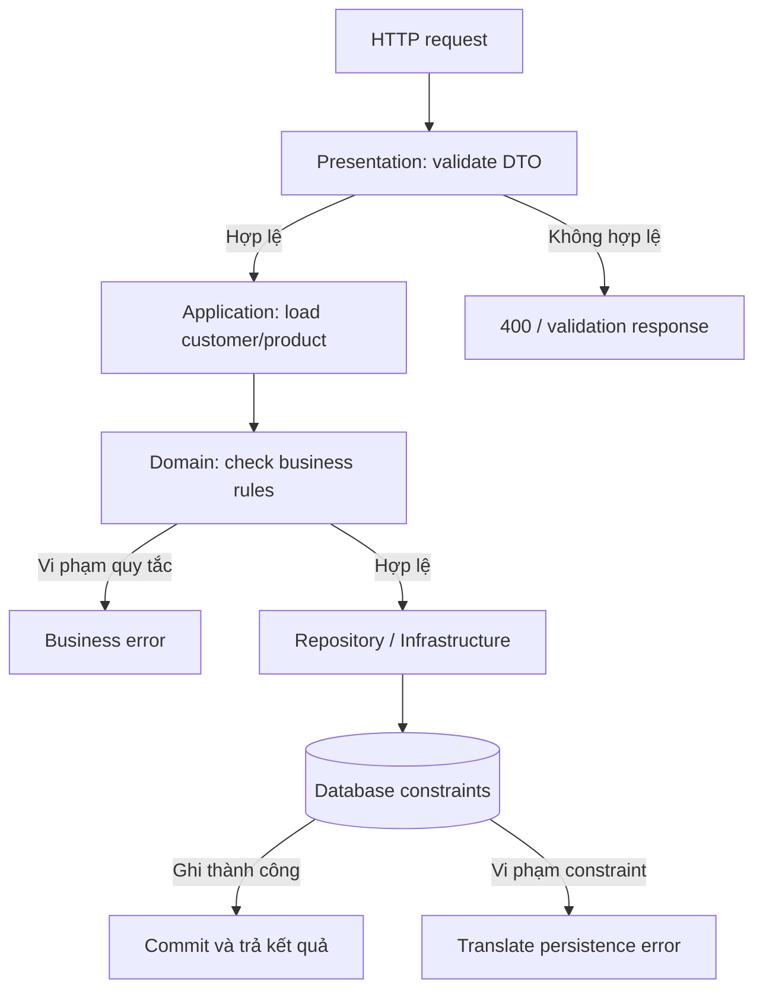

# Phân chia kiểm tra đầu vào, kiểm tra nghiệp vụ và ràng buộc lưu trữ

> Chương: **Các mối quan tâm xuyên tầng**

Trong module **SOFTWARE_DESIGN_ARCHITECTURE_ARCHITECTURAL_PATTERN_LAYERED**, chúng ta học cách tổ chức phần mềm theo kiến trúc phân tầng. Một chức năng thường cần kiểm tra dữ liệu ở nhiều thời điểm: khi nhận request, khi thực hiện quy tắc nghiệp vụ và khi ghi dữ liệu xuống cơ sở dữ liệu. Ba loại kiểm tra này liên quan với nhau nhưng bảo vệ những điều khác nhau. Bài học này giúp đặt mỗi kiểm tra ở đúng ranh giới để hệ thống vừa phản hồi lỗi rõ ràng, vừa giữ được tính nhất quán ngay cả khi nhiều request chạy đồng thời.

## 1. Vì sao một dữ liệu cần được kiểm tra ở nhiều tầng?

Hãy xét API tạo đơn hàng. Client gửi `productId`, `quantity` và địa chỉ giao hàng. Một số điều kiện có thể kiểm tra ngay khi nhận request: `productId` phải có định dạng UUID, `quantity` phải là số nguyên dương và địa chỉ không được để trống. Những điều kiện khác chỉ biết được sau khi tải dữ liệu và áp dụng quy tắc nghiệp vụ: sản phẩm có đang được bán không, khách hàng có được phép mua số lượng đó không, đơn hàng có vượt hạn mức không. Cuối cùng, database phải bảo vệ các ràng buộc dữ liệu như khóa ngoại, mã đơn duy nhất và cột bắt buộc không được `NULL`.

Nếu dồn tất cả vào controller, controller sẽ phải truy cập database, hiểu quy tắc miền và xử lý các tình huống cạnh tranh dữ liệu. Nếu chỉ kiểm tra ở controller, các luồng khác như tác vụ nền hoặc message consumer có thể bỏ qua kiểm tra. Nếu chỉ dựa vào database, người dùng thường nhận được lỗi kỹ thuật khó hiểu và quy tắc nghiệp vụ không được diễn đạt ở đúng nơi.

Một thiết kế phân tầng thường phân chia như sau:

| Loại kiểm tra | Câu hỏi cần trả lời | Nơi chịu trách nhiệm chính |
|---|---|---|
| Kiểm tra đầu vào (input validation) | Dữ liệu gửi vào có đúng cấu trúc, định dạng và miền giá trị cơ bản của hợp đồng không? | Presentation hoặc adapter đầu vào |
| Kiểm tra nghiệp vụ (business validation) | Thao tác có hợp lệ theo chính sách và trạng thái hiện tại của miền nghiệp vụ không? | Domain, được Application điều phối |
| Ràng buộc lưu trữ (storage constraints) | Dữ liệu đã ghi có bảo đảm toàn vẹn và các bất biến ở mức database không? | Database và Infrastructure persistence |

Một điều kiện có thể được bảo vệ ở nhiều lớp nếu mỗi lớp có mục đích riêng. Ví dụ, kiểm tra `quantity > 0` trên request giúp trả lỗi sớm; Domain vẫn phải bảo vệ bất biến này vì đối tượng có thể được tạo từ nhiều nguồn; database có thể có `CHECK (quantity > 0)` như lớp bảo vệ cuối cùng nếu điều kiện đó được biểu diễn trong schema.

## 2. Kiểm tra đầu vào: xác minh hợp đồng giao tiếp

Kiểm tra đầu vào xác minh dữ liệu bên ngoài có thể được phân tích và đáp ứng hợp đồng của endpoint hoặc message hay không. Các ví dụ thường gặp:

- Trường bắt buộc không bị thiếu hoặc rỗng.
- Chuỗi có độ dài trong giới hạn cho phép.
- Email, UUID, ngày tháng và số điện thoại có định dạng được chấp nhận.
- Số lượng, số trang hoặc kích thước trang nằm trong miền giá trị cơ bản.
- Các trường có quan hệ với nhau thỏa điều kiện cấu trúc, chẳng hạn ngày kết thúc không sớm hơn ngày bắt đầu trong một request đặt lịch.
- Nội dung không chứa kiểu dữ liệu hoặc cấu trúc mà API không hỗ trợ.

Với Spring MVC, có thể dùng Jakarta Bean Validation trên request DTO:

```java
public record CreateOrderRequest(
    @NotNull UUID productId,
    @NotNull @Positive Integer quantity,
    @NotBlank @Size(max = 300) String shippingAddress
) {}
```

Controller kích hoạt validation bằng `@Valid`:

```java
@RestController
@RequestMapping("/orders")
public class OrderController {
    private final CreateOrderUseCase createOrder;

    public OrderController(CreateOrderUseCase createOrder) {
        this.createOrder = createOrder;
    }

    @PostMapping
    ResponseEntity<OrderResponse> create(
            @Valid @RequestBody CreateOrderRequest request,
            @AuthenticationPrincipal CustomerPrincipal principal) {
        var command = new CreateOrderCommand(
            principal.customerId(), request.productId(), request.quantity(),
            request.shippingAddress());
        var result = createOrder.execute(command);
        return ResponseEntity.status(HttpStatus.CREATED)
            .body(OrderResponse.from(result));
    }
}
```

Nếu request không thỏa annotation, Spring MVC và Bean Validation có thể từ chối request trước khi gọi ca sử dụng. Ứng dụng nên chuẩn hóa lỗi validation thành response nhất quán, thường gồm tên trường, mã lỗi và thông điệp có thể hiển thị cho client.

Request DTO là hợp đồng giao tiếp. Nó có thể thay đổi theo phiên bản API mà không buộc mô hình Domain thay đổi theo. Vì vậy, không nên mặc định dùng entity JPA làm request body. Làm vậy có thể để client gửi trực tiếp các trường nội bộ như `id`, `status`, `createdAt` hoặc quan hệ persistence mà họ không có quyền điều khiển.

### Kiểm tra đầu vào không thay thế kiểm tra nghiệp vụ

`@Positive` chỉ chứng minh số lượng là số dương. Nó không chứng minh sản phẩm tồn tại, đang được phép bán, hoặc khách hàng có quyền mua số lượng đó. `@Email` kiểm tra định dạng email theo bộ validator đang dùng; nó không chứng minh địa chỉ có hộp thư hoạt động hay người gửi sở hữu hộp thư.

Một kiểm tra liên quan nhiều trường trong request cũng chưa chắc là quy tắc nghiệp vụ. Ví dụ, kiểm tra `startDate <= endDate` có thể là quy tắc cấu trúc của hợp đồng đặt lịch. Nhưng việc một khung giờ có còn chỗ, có nằm trong lịch làm việc của nhân viên hay có được phép đặt theo chính sách hủy là quyết định nghiệp vụ cần trạng thái miền.

Không nên coi mọi annotation validation đều phải đặt ở controller. Có thể dùng validator riêng cho request hoặc command để kiểm tra hợp đồng đầu vào. Điều quan trọng là xác định ai sở hữu điều kiện và điều kiện đó có cần được bảo vệ khi đối tượng được tạo từ một nguồn khác hay không.

## 3. Kiểm tra nghiệp vụ: bảo vệ quy tắc và bất biến của miền

Kiểm tra nghiệp vụ trả lời câu hỏi: với trạng thái hiện tại của hệ thống, người dùng có được thực hiện thao tác này không? Câu trả lời thường cần dữ liệu đã tải từ repository và phải tuân theo chính sách của miền.

Trong ví dụ tạo đơn hàng, các quy tắc có thể gồm:

- Sản phẩm tồn tại và đang được phép bán.
- Khách hàng không bị đình chỉ mua hàng.
- Số lượng không vượt giới hạn mỗi đơn hoặc giới hạn của khách hàng.
- Giá áp dụng được xác định theo chính sách tại thời điểm đặt hàng.
- Đơn hàng chỉ được tạo khi các điều kiện nghiệp vụ liên quan được đáp ứng.

Application tải dữ liệu và điều phối; Domain thực thi các quy tắc thuộc về đối tượng hoặc khái niệm nghiệp vụ. Ví dụ:

```java
public class Order {
    private final UUID id;
    private final UUID productId;
    private final int quantity;
    private final ShippingAddress shippingAddress;
    private OrderStatus status;

    private Order(UUID id, Product product, int quantity,
                  ShippingAddress shippingAddress) {
        this.id = id;
        this.productId = product.getId();
        this.quantity = quantity;
        this.shippingAddress = shippingAddress;
        this.status = OrderStatus.PENDING;
    }

    public static Order create(Product product, int quantity,
                               Customer customer,
                               ShippingAddress shippingAddress) {
        if (quantity <= 0) {
            throw new InvalidOrderQuantityException();
        }
        if (!product.isSellable()) {
            throw new ProductNotSellableException(product.getId());
        }
        if (!customer.canPlaceOrder()) {
            throw new CustomerCannotOrderException(customer.getId());
        }
        if (quantity > customer.maximumOrderQuantity()) {
            throw new OrderQuantityLimitExceededException();
        }
        return new Order(UUID.randomUUID(), product, quantity, shippingAddress);
    }
}
```

Ví dụ đã lược bớt constructor, getter và mapping. Các điều kiện trên không chỉ xác minh request có đúng kiểu dữ liệu; chúng quyết định một đơn hàng có được tạo theo chính sách hiện hành hay không. Vì thế, hành vi tạo đơn bảo vệ chúng ngay trong Domain.

Application service điều phối việc tải dữ liệu và gọi hành vi:

```java
@Service
public class CreateOrderService implements CreateOrderUseCase {
    private final ProductRepository products;
    private final CustomerRepository customers;
    private final OrderRepository orders;

    public CreateOrderService(ProductRepository products,
                              CustomerRepository customers,
                              OrderRepository orders) {
        this.products = products;
        this.customers = customers;
        this.orders = orders;
    }

    @Transactional
    public OrderResult execute(CreateOrderCommand command) {
        Product product = products.findById(command.productId())
            .orElseThrow(ProductNotFoundException::new);
        Customer customer = customers.findById(command.customerId())
            .orElseThrow(CustomerNotFoundException::new);

        Order order = Order.create(product, command.quantity(), customer,
            command.shippingAddress());
        orders.save(order);
        return OrderResult.from(order);
    }
}
```

Application không cần tự viết lại các điều kiện về khả năng bán hoặc hạn mức. Nó tải dữ liệu, gọi hành vi Domain và lưu kết quả. Nếu một quy tắc cần phối hợp nhiều aggregate hoặc cần một chính sách không thuộc riêng entity nào, có thể đặt nó trong domain service hoặc policy phù hợp. Không nên dồn toàn bộ quy tắc vào controller hay một application service chỉ vì nơi đó đang có sẵn dữ liệu.

## 4. Ràng buộc lưu trữ: bảo vệ tính toàn vẹn ở database

Ràng buộc lưu trữ bảo đảm database không nhận trạng thái dữ liệu vi phạm các điều kiện toàn vẹn đã định nghĩa. Chúng đặc biệt quan trọng khi có nhiều request đồng thời, nhiều ứng dụng ghi vào cùng database hoặc một thao tác ghi được thực hiện ngoài luồng HTTP chính.

Các ràng buộc thường gặp:

| Ràng buộc | Bảo vệ điều gì? | Ví dụ |
|---|---|---|
| `NOT NULL` | Cột bắt buộc phải có giá trị | `product_id` không được null |
| `UNIQUE` | Giá trị hoặc tổ hợp giá trị không được trùng | Mã đơn hoặc idempotency key duy nhất |
| `PRIMARY KEY` | Định danh hàng duy nhất | `orders.id` |
| `FOREIGN KEY` | Quan hệ tham chiếu phải trỏ tới hàng tồn tại | `orders.customer_id` tham chiếu `customers.id` |
| `CHECK` | Giá trị phải thỏa biểu thức điều kiện | `quantity > 0`, `total >= 0` |

Ví dụ DDL:

```sql
CREATE TABLE orders (
    id UUID PRIMARY KEY,
    customer_id UUID NOT NULL,
    product_id UUID NOT NULL,
    quantity INTEGER NOT NULL CHECK (quantity > 0),
    total NUMERIC(18, 2) NOT NULL CHECK (total >= 0),
    idempotency_key VARCHAR(100) NOT NULL UNIQUE,
    CONSTRAINT fk_order_customer
        FOREIGN KEY (customer_id) REFERENCES customers(id),
    CONSTRAINT fk_order_product
        FOREIGN KEY (product_id) REFERENCES products(id)
);
```

Database bảo vệ các điều kiện này tại thời điểm ghi. Nếu hai request cùng cố tạo một đơn với cùng `idempotency_key`, ràng buộc unique chỉ cho phép một hàng được ghi thành công. Nếu application chỉ truy vấn trước để xem key đã tồn tại chưa rồi mới insert, cả hai request vẫn có thể cùng đọc kết quả “chưa tồn tại” trước khi ghi. Ràng buộc unique xử lý cuộc đua ở nơi có thẩm quyền cuối cùng là database.

Ràng buộc lưu trữ nên phản ánh các bất biến dữ liệu có thể và cần được database bảo vệ. Không phải mọi quy tắc nghiệp vụ đều phù hợp để viết thành `CHECK`. Ví dụ, kiểm tra khách hàng có đang bị khóa hay không cần đọc trạng thái ở bảng khác hoặc tuân theo quy trình nghiệp vụ; database constraint đơn giản thường không phải nơi thích hợp để biểu diễn toàn bộ chính sách đó.

## 5. Ba loại kiểm tra phối hợp với nhau như thế nào?

Một request tạo đơn có thể đi qua các bước sau:



Các bước có ý nghĩa riêng:

1. Presentation từ chối request sai định dạng hoặc thiếu trường trước khi chạy ca sử dụng.
2. Application tải dữ liệu mà nghiệp vụ cần và gọi hành vi Domain.
3. Domain từ chối thao tác vi phạm chính sách hoặc bất biến dựa trên trạng thái được cung cấp.
4. Infrastructure ghi dữ liệu; database kiểm tra các ràng buộc toàn vẹn ở mức lưu trữ.
5. Nếu database từ chối ghi, Infrastructure/Application chuyển lỗi kỹ thuật thành lỗi có ý nghĩa với ca sử dụng.

Không phải request nào cũng cần đủ mọi bước. Ví dụ, một truy vấn đọc đơn giản có thể chỉ cần kiểm tra đầu vào và truy vấn projection. Nhưng khi ghi dữ liệu, database constraints vẫn là lớp bảo vệ quan trọng cho tính toàn vẹn.

## 6. Xử lý lỗi ở đúng ranh giới

Mỗi loại kiểm tra có cách phản hồi khác nhau:

- Lỗi đầu vào thường được ánh xạ thành phản hồi validation của API, chẳng hạn HTTP 400 với thông tin trường không hợp lệ.
- Lỗi nghiệp vụ có thể được biểu diễn bằng exception nghiệp vụ hoặc kết quả có kiểu rõ ràng; Presentation ánh xạ sang HTTP status phù hợp với hợp đồng API, thường là 409 cho xung đột trạng thái hoặc 422 cho nội dung không thể xử lý theo chính sách.
- Lỗi ràng buộc lưu trữ cần được nhận diện và chuyển đổi. Ví dụ, vi phạm unique có thể tương ứng với xung đột idempotency hoặc mã đơn đã tồn tại; vi phạm foreign key có thể cho thấy dữ liệu tham chiếu đã thay đổi hoặc một lỗi lập trình.

Không nên trả nguyên SQL, tên bảng, tên cột hoặc thông điệp của JDBC driver cho client. Những thông tin này hữu ích trong log nội bộ nhưng có thể tiết lộ chi tiết hệ thống và khó tạo hợp đồng API ổn định.

Với Spring, lỗi validation của request có thể được xử lý tập trung bằng `@RestControllerAdvice`. Lỗi nghiệp vụ và lỗi persistence cũng có thể được ánh xạ tại ranh giới web, nhưng cần phân biệt nguyên nhân để không biến mọi exception thành cùng một mã lỗi.

Ví dụ khái quát:

```java
@RestControllerAdvice
public class ApiExceptionHandler {
    @ExceptionHandler(ProductNotSellableException.class)
    ResponseEntity<ApiError> productNotSellable(
            ProductNotSellableException ex) {
        return ResponseEntity.unprocessableEntity()
            .body(new ApiError("PRODUCT_NOT_SELLABLE"));
    }

    @ExceptionHandler(DuplicateIdempotencyKeyException.class)
    ResponseEntity<ApiError> duplicateRequest(
            DuplicateIdempotencyKeyException ex) {
        return ResponseEntity.status(HttpStatus.CONFLICT)
            .body(new ApiError("REQUEST_ALREADY_PROCESSED"));
    }
}
```

Đây là ví dụ về cách ánh xạ lỗi ứng dụng thành response. Trong thực tế, exception vi phạm constraint có thể được bọc bởi Spring/Hibernate và cần được phân tích nguyên nhân gốc hoặc constraint name trong adapter trước khi chuyển thành lỗi ứng dụng. Không nên bắt mọi `DataIntegrityViolationException` rồi kết luận đó luôn là lỗi trùng lặp; nó có thể xuất phát từ foreign key, not-null hoặc check constraint khác.

## 7. Tránh kiểm tra trùng lặp sai chỗ và cuộc đua dữ liệu

Một số điều kiện có thể được kiểm tra sớm để cải thiện trải nghiệm, nhưng vẫn cần một cơ chế bảo vệ ở nơi có thẩm quyền cuối cùng.

Ví dụ, trước khi tạo tài khoản, Application có thể kiểm tra email đã tồn tại để trả thông báo thân thiện. Nhưng giữa thao tác đọc và ghi, request khác có thể tạo tài khoản với cùng email. Vì thế database vẫn cần unique constraint trên email chuẩn hóa. Khi insert bị từ chối, ứng dụng chuyển lỗi thành `EmailAlreadyRegisteredException` hoặc kết quả xung đột tương ứng.

Tương tự, kiểm tra số lượng tồn kho bằng cách đọc `available_quantity` rồi so sánh ở Java không đủ để ngăn hai request cùng mua đơn vị hàng cuối cùng. Cần kiểm soát đồng thời, chẳng hạn optimistic locking với `@Version`, pessimistic lock hoặc câu lệnh cập nhật có điều kiện:

```sql
UPDATE inventory
SET available_quantity = available_quantity - :quantity
WHERE product_id = :productId
  AND available_quantity >= :quantity;
```

Ứng dụng kiểm tra số hàng bị ảnh hưởng. Nếu bằng 0, tồn kho không đủ hoặc dữ liệu đã thay đổi trước khi cập nhật. Cách cụ thể phụ thuộc database và chính sách xử lý cạnh tranh của hệ thống.

Đây là điểm khác biệt quan trọng: kiểm tra nghiệp vụ quyết định thao tác có hợp lệ theo chính sách hay không; cơ chế đồng thời và constraint bảo đảm quyết định đó không bị vô hiệu bởi các thao tác ghi cạnh tranh.

## 8. Tránh đặt mọi validation vào một tầng

Một số cách làm dễ gây lỗi thiết kế:

- **Chỉ kiểm tra ở controller:** tác vụ nền, consumer hoặc test gọi Application trực tiếp có thể bỏ qua kiểm tra.
- **Đưa toàn bộ kiểm tra vào Domain:** Domain bị buộc phải hiểu định dạng JSON, annotation HTTP hoặc chi tiết request DTO.
- **Chỉ dựa vào database:** lỗi thường xuất hiện muộn và thông báo khó hiểu; các chính sách nghiệp vụ cũng bị trộn vào schema.
- **Lặp lại toàn bộ quy tắc ở mọi nơi:** cùng một chính sách có thể bị triển khai khác nhau và lệch theo thời gian.
- **Dùng entity làm request/response:** client có thể điều khiển hoặc nhìn thấy các trường nội bộ không thuộc hợp đồng API.
- **Coi kiểm tra trước khi ghi là bảo đảm tuyệt đối:** giữa kiểm tra và ghi có thể xảy ra thay đổi đồng thời.

Hãy đặt kiểm tra ở nơi có đủ thông tin và sở hữu trách nhiệm. Có thể lặp một kiểm tra đơn giản ở nhiều lớp nếu mục đích khác nhau: request validator để phản hồi sớm, Domain để bảo vệ bất biến, database constraint để bảo vệ dữ liệu bền vững. Nhưng tránh sao chép một chính sách phức tạp ở nhiều nơi.

## 9. Kiểm thử ba loại kiểm tra

Mỗi loại kiểm tra cần được kiểm thử ở cấp phù hợp:

| Loại | Kiểm thử phù hợp | Ví dụ |
|---|---|---|
| Input validation | Web/controller test hoặc validator test | Thiếu `productId`, quantity bằng 0, địa chỉ quá dài |
| Business validation | Domain unit test và Application test | Sản phẩm ngừng bán, khách hàng bị đình chỉ, vượt hạn mức |
| Storage constraints | Persistence integration test với database thực tế hoặc môi trường tương thích | Unique key, foreign key, check quantity, rollback khi ghi thất bại |

Một số kịch bản nên có:

1. Request sai định dạng bị từ chối trước khi Application service được gọi.
2. Request hợp lệ về cấu trúc nhưng vi phạm quy tắc Domain bị từ chối với lỗi nghiệp vụ phù hợp.
3. Dữ liệu hợp lệ được ghi thành công và có thể đọc lại.
4. Hai request cạnh tranh cho cùng một khóa duy nhất chỉ tạo được một bản ghi hợp lệ.
5. Khi constraint từ chối ghi, giao dịch không để lại một phần thay đổi không mong muốn.

Unit test với mock không chứng minh database thực thi constraint đúng. Ngược lại, integration test database không thay thế các unit test giúp kiểm tra từng quy tắc nghiệp vụ một cách nhanh và rõ.

## 10. Checklist khi thiết kế validation

Khi thêm một điều kiện kiểm tra, hãy tự hỏi:

1. Điều kiện này kiểm tra định dạng của hợp đồng hay quyết định nghiệp vụ?
2. Thành phần nào có đủ thông tin để đánh giá điều kiện?
3. Nếu đối tượng được tạo từ message consumer hoặc batch job, điều kiện có còn được bảo vệ không?
4. Điều kiện có cần database constraint để chống dữ liệu trùng hoặc tham chiếu không hợp lệ không?
5. Có thể xảy ra race condition giữa lúc kiểm tra và lúc ghi không?
6. Lỗi được chuyển thành phản hồi hoặc kết quả ứng dụng rõ ràng chưa?
7. Có kiểm thử đúng cấp cho input, domain và persistence chưa?

Nếu điều kiện là cấu trúc request, đặt nó ở adapter đầu vào. Nếu điều kiện quyết định trạng thái nghiệp vụ hợp lệ, bảo vệ nó trong Domain và để Application điều phối. Nếu điều kiện bảo vệ tính toàn vẹn dữ liệu trước mọi đường ghi, dùng constraint phù hợp ở database. Cách phân chia này giữ từng tầng tập trung vào trách nhiệm của mình và tạo nhiều lớp bảo vệ bổ trợ cho nhau.

## Ghi nhớ

- Kiểm tra đầu vào bảo vệ hợp đồng giao tiếp: định dạng, trường bắt buộc, độ dài và miền giá trị cơ bản.
- Kiểm tra nghiệp vụ bảo vệ chính sách và bất biến dựa trên trạng thái miền; Application tải dữ liệu và điều phối, Domain quyết định hành vi hợp lệ.
- Ràng buộc lưu trữ như `NOT NULL`, `UNIQUE`, `FOREIGN KEY` và `CHECK` bảo vệ tính toàn vẹn tại database.
- Một điều kiện có thể được kiểm tra ở nhiều tầng với mục đích khác nhau; không nên sao chép toàn bộ chính sách phức tạp ở mọi nơi.
- Kiểm tra trước khi ghi không loại bỏ race condition; constraint và cơ chế kiểm soát đồng thời bảo vệ thao tác ghi cuối cùng.
- Chuyển lỗi kỹ thuật thành lỗi ứng dụng có ý nghĩa, không để lộ SQL hoặc chi tiết database ra API.
- Kiểm thử input, Domain và persistence ở cấp phù hợp để xác minh cả trải nghiệm lẫn tính toàn vẹn dữ liệu.
