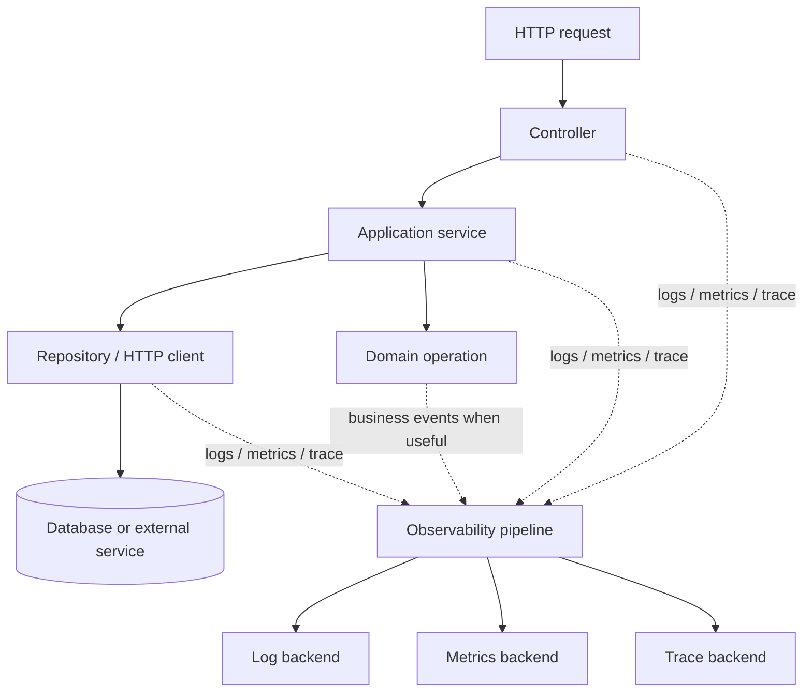
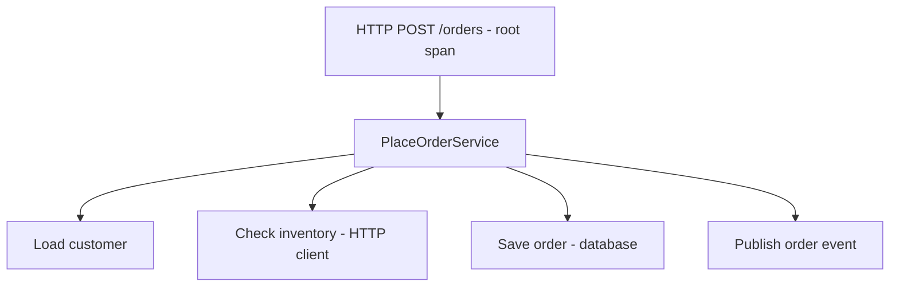

# Đặt log, metric và distributed trace phục vụ chẩn đoán

Khi một ứng dụng gặp lỗi hoặc phản hồi chậm, chỉ nhìn vào một dòng log thường không đủ để biết điều gì đã xảy ra. Một yêu cầu có thể đi qua controller, application service, domain, repository và nhiều dịch vụ bên ngoài. Để chẩn đoán được luồng đó, hệ thống cần ghi lại sự kiện có ý nghĩa, đo xu hướng hoạt động và liên kết các bước xử lý xuyên qua nhiều thành phần.

Bài học này thuộc module `SOFTWARE_DESIGN_ARCHITECTURE_ARCHITECTURAL_PATTERN_LAYERED`, tập trung vào cách tổ chức phần mềm theo kiến trúc phân tầng. Trong chương **Các mối quan tâm xuyên tầng**, ta tìm hiểu ba tín hiệu quan sát chính: log, metric và distributed trace; cách đặt chúng ở đúng vị trí trong ứng dụng Java/Spring; và cách giữ thông tin đủ hữu ích mà không làm lộ dữ liệu nhạy cảm hoặc tạo chi phí vận hành không cần thiết.

## Ba tín hiệu quan sát trả lời ba câu hỏi khác nhau

Observability (khả năng quan sát) là khả năng hiểu trạng thái bên trong của hệ thống thông qua dữ liệu mà hệ thống phát ra. Log, metric và trace bổ sung cho nhau:

| Tín hiệu | Câu hỏi chính | Dạng dữ liệu | Ví dụ |
|---|---|---|---|
| Log | Sự kiện cụ thể nào đã xảy ra và có ngữ cảnh gì? | Bản ghi sự kiện theo thời gian, thường có cấp độ và trường dữ liệu | Đơn hàng `A123` bị từ chối vì không đủ tồn kho |
| Metric | Hệ thống đang hoạt động ở mức nào và xu hướng thay đổi ra sao? | Giá trị số được tổng hợp theo thời gian | Tỷ lệ yêu cầu lỗi, số đơn mỗi phút, độ trễ p95 |
| Distributed trace | Một yêu cầu đã đi qua những thành phần nào và thời gian tiêu tốn ở đâu? | Trace gồm nhiều span có quan hệ cha-con | API đặt hàng gọi service tồn kho mất 800 ms |

Log giúp điều tra một sự kiện riêng lẻ. Metric giúp phát hiện xu hướng, cảnh báo và đánh giá SLO. Trace giúp lần theo đường đi của một thao tác phân tán. Không nên kỳ vọng một loại dữ liệu thay thế hoàn toàn hai loại còn lại.

## Đặt instrumentation theo ranh giới kiến trúc

Instrumentation là mã hoặc cấu hình phát ra log, metric và trace. Vì đây là mối quan tâm xuyên tầng, nó có thể xuất hiện ở nhiều nơi, nhưng mỗi nơi nên ghi nhận điều phù hợp với trách nhiệm của mình.

- **Presentation/API:** ghi nhận request đến, route, mã phản hồi, kích thước hoặc thời gian xử lý ở mức phù hợp. Không ghi toàn bộ body, cookie hay token theo mặc định.
- **Application:** đo thời gian ca sử dụng, kết quả thành công/từ chối, các bước điều phối quan trọng và lời gọi tới cổng bên ngoài.
- **Domain:** ghi nhận sự kiện nghiệp vụ có ý nghĩa khi thật sự cần chẩn đoán hoặc audit. Không đưa logger, HTTP request hay client metrics vào mọi entity chỉ để tiện gọi.
- **Data access/infrastructure:** đo truy vấn, lỗi kết nối, pool, thời gian gọi database hoặc dịch vụ ngoài. Log cần tránh lộ câu SQL chứa dữ liệu nhạy cảm và thông tin xác thực.

Có thể dùng abstraction chung như SLF4J cho logging, Micrometer Observation/MeterRegistry cho metric và tracing, hoặc OpenTelemetry API cho trace. Adapter và cấu hình hạ tầng quyết định nơi gửi dữ liệu: console, file, hệ thống log tập trung, Prometheus-compatible backend hay trace collector. Business/domain code không nên phụ thuộc vào một nhà cung cấp quan sát cụ thể nếu không có lý do rõ ràng.

Một luồng tổng quát:



## Log sự kiện có cấu trúc và có ngữ cảnh

Một log record hữu ích thường có thời điểm, mức độ nghiêm trọng, tên logger hoặc service, thông điệp, trace/span ID nếu có và các trường nghiệp vụ đã được phép ghi. Log có cấu trúc (structured logging) lưu trường dữ liệu riêng biệt thay vì chỉ ghép mọi thứ vào một câu văn.

Ví dụ dùng SLF4J:

```java
@Service
class ConfirmOrderService {
    private static final Logger log =
        LoggerFactory.getLogger(ConfirmOrderService.class);

    public void confirm(UUID orderId) {
        log.info("order.confirm.started orderId={}", orderId);
        // Điều phối ca sử dụng...
        log.info("order.confirm.completed orderId={} outcome={}",
            orderId, "confirmed");
    }
}
```

Đoạn mã trên dùng thông điệp có tên sự kiện và tham số tách biệt. Trong môi trường production, có thể cấu hình encoder JSON để các trường được lập chỉ mục và tìm kiếm riêng. Tên trường nên nhất quán giữa các service, ví dụ `service.name`, `environment`, `order.id`, `outcome` và `error.type`.

Chọn cấp độ log theo mục đích:

- `ERROR`: một thao tác quan trọng thất bại và cần được điều tra hoặc xử lý.
- `WARN`: tình trạng bất thường nhưng hệ thống vẫn có thể tiếp tục, chẳng hạn retry thành công sau một lỗi tạm thời.
- `INFO`: sự kiện vận hành hoặc nghiệp vụ quan trọng, có ích khi theo dõi hoạt động bình thường.
- `DEBUG`/`TRACE`: chi tiết phục vụ điều tra sâu, thường tắt hoặc giới hạn ở production vì lượng dữ liệu có thể lớn.

Không ghi cùng một exception ở mọi tầng khi nó được ném lên qua nhiều lớp. Hãy chọn ranh giới chịu trách nhiệm xử lý hoặc chuyển lỗi để ghi stack trace một lần, đồng thời bổ sung ngữ cảnh cần thiết. Nếu mỗi tầng đều ghi `ERROR` cho cùng một lỗi, một sự cố có thể tạo ra nhiều bản ghi trùng và làm khó việc đếm lỗi.

### Trace ID và correlation ID trong log

Một correlation ID giúp tìm các log liên quan tới cùng một yêu cầu hoặc tác vụ. Distributed trace có `traceId` để liên kết các span thuộc cùng một luồng; mỗi span có `spanId` riêng. Khi hệ thống tracing tích hợp với logging, trace ID và span ID có thể được đưa vào MDC hoặc trường log tự động.

Không nên nhầm correlation ID do ứng dụng tự tạo với trace ID của chuẩn tracing. Nếu một request đã có trace context hợp lệ, hãy tiếp tục trace đó qua các service. Nếu chỉ có correlation ID cho mục đích nghiệp vụ, đặt tên riêng và không dùng nó thay cho trace context.

## Metric: đo xu hướng thay vì ghi từng đối tượng

Metric là chuỗi số liệu được thu thập theo thời gian. Một số metric hữu ích cho API hoặc ca sử dụng:

- Số lượng request và tỷ lệ phản hồi theo mã kết quả.
- Thời gian xử lý request hoặc application service, gồm p50, p95, p99.
- Số lần lỗi gọi database hoặc dịch vụ bên ngoài.
- Số đơn hàng được chấp nhận hoặc từ chối theo một nhóm lý do ổn định.
- Số kết nối đang sử dụng trong connection pool hoặc số tác vụ đang chờ.

Với Micrometer, có thể đo thời gian một ca sử dụng bằng `Timer`:

```java
@Service
class PlaceOrderService {
    private final MeterRegistry registry;

    PlaceOrderService(MeterRegistry registry) {
        this.registry = registry;
    }

    public PlaceOrderResult place(PlaceOrderCommand command) {
        return Timer.builder("orders.place.duration")
            .description("Thời gian xử lý ca sử dụng đặt hàng")
            .tag("channel", command.channel())
            .record(() -> doPlace(command));
    }

    private PlaceOrderResult doPlace(PlaceOrderCommand command) {
        // Tải dữ liệu, áp dụng quy tắc và lưu đơn.
        return ...;
    }
}
```

Đây là ví dụ rút gọn; kiểu `PlaceOrderResult` và `PlaceOrderCommand` thuộc hợp đồng ứng dụng của ví dụ. `Timer` ghi nhận số lần gọi và thời gian, từ đó backend có thể tổng hợp phân vị hoặc histogram tùy cấu hình. Trong dự án dùng Spring Boot, Micrometer Observation cũng có thể liên kết instrumentation với metric và tracing thông qua các handler/bridge đã cấu hình.

### Chọn tag có cardinality thấp

Mỗi tổ hợp tag có thể tạo một time series riêng. Vì vậy, tag cần có số lượng giá trị hữu hạn và được kiểm soát. Các tag thường phù hợp gồm `method`, `route` theo template, `status`, `outcome`, `operation` hoặc `region` có tập giá trị nhỏ.

Không dùng `userId`, `orderId`, email, URL đầy đủ có ID động hoặc exception message làm metric tag. Những giá trị này tạo cardinality rất cao, làm tăng bộ nhớ và chi phí backend, đồng thời có thể tiết lộ dữ liệu. Nếu cần điều tra theo một order cụ thể, dùng log hoặc trace attribute có chính sách bảo vệ phù hợp.

Ví dụ, tag `route="/orders/{orderId}"` có cardinality thấp hơn nhiều so với tag chứa `/orders/8f...` cho mỗi đơn hàng. Tương tự, tag `error.type="TimeoutException"` ổn định hơn nội dung thông báo exception có thể thay đổi theo từng request.

## Distributed trace: theo dấu một request qua nhiều thành phần

Trace là tập hợp các span mô tả những đoạn công việc trong một request phân tán. Một span thường có tên thao tác, thời điểm bắt đầu/kết thúc, thuộc tính, trạng thái và quan hệ với span cha. Trace ID liên kết các span cùng một luồng.

Ví dụ, request tạo đơn có thể tạo ra trace như sau:



Khi trace được thu thập, người vận hành có thể thấy span kiểm tra tồn kho chiếm 900 ms trong tổng thời gian 1.1 giây, từ đó xác định nơi cần điều tra. Tên span nên mô tả thao tác ổn định như `inventory.check` hoặc `orders.save`, không nên đưa mã đơn hàng vào tên span.

OpenTelemetry cung cấp API và SDK để tạo span, gắn thuộc tính và truyền context. Ví dụ:

```java
Span span = tracer.spanBuilder("inventory.check").startSpan();
try (Scope scope = span.makeCurrent()) {
    span.setAttribute("inventory.channel", "warehouse-api");
    return inventoryClient.checkAvailability(productIds);
} catch (RuntimeException ex) {
    span.recordException(ex);
    span.setStatus(StatusCode.ERROR);
    throw ex;
} finally {
    span.end();
}
```

`tracer` ở đây là OpenTelemetry `Tracer` được inject hoặc lấy từ cấu hình ứng dụng; `Scope` làm cho span trở thành span hiện hành trong phạm vi khối lệnh. Trong ứng dụng Spring Boot, instrumentation tự động cho web server, HTTP client, JDBC hoặc messaging có thể đã tạo span; chỉ thêm span thủ công cho bước nghiệp vụ có giá trị chẩn đoán để tránh tạo quá nhiều span trùng lặp.

### Truyền trace context qua ranh giới dịch vụ

Khi service A gọi service B, trace context cần được truyền qua giao thức, thường bằng W3C Trace Context với header `traceparent` và có thể có `tracestate`. Instrumentation tương thích OpenTelemetry có thể tự inject context vào request đi và extract context ở request đến.

```text
Client -> API Gateway -> Order Service -> Inventory Service -> Database
          trace context được truyền xuyên suốt các lời gọi
```

Nếu mỗi service tự tạo một trace mới mà không nối parent context, người vận hành sẽ thấy nhiều trace rời rạc và khó hiểu quan hệ nhân quả. Với message broker, context cũng cần được inject vào metadata/header của message và extract ở consumer nếu instrumentation của nền tảng hỗ trợ.

Với tác vụ bất đồng bộ, context không phải lúc nào cũng tự truyền qua thread pool hoặc executor. Dùng cơ chế context propagation được thư viện/framework hỗ trợ, hoặc capture và restore context rõ ràng. Không lưu `Span` hoặc context trong một biến static dùng chung giữa các request; điều đó có thể nối nhầm dữ liệu giữa người dùng.

## Dùng Micrometer Observation để kết hợp tín hiệu

Trong hệ sinh thái Spring, Micrometer Observation cung cấp một abstraction để ghi nhận một thao tác quan sát. Khi có handler thích hợp, một Observation có thể tạo metric và span từ cùng một điểm instrumentation. Điều này giúp mã ứng dụng ít phụ thuộc trực tiếp vào backend.

```java
@Service
class ConfirmOrderService {
    private final ObservationRegistry observationRegistry;

    ConfirmOrderService(ObservationRegistry observationRegistry) {
        this.observationRegistry = observationRegistry;
    }

    public void confirm(UUID orderId) {
        Observation.createNotStarted("orders.confirm", observationRegistry)
            .contextualName("confirm-order")
            .lowCardinalityKeyValue("operation", "confirm")
            .observe(() -> doConfirm(orderId));
    }

    private void doConfirm(UUID orderId) {
        // Thực hiện ca sử dụng.
    }
}
```

`lowCardinalityKeyValue` phù hợp với thuộc tính có tập giá trị nhỏ và có thể trở thành tag metric. Những dữ liệu chỉ có ý nghĩa ở trace nên được thêm dưới dạng high-cardinality key value nếu API và cấu hình đang dùng hỗ trợ. Không nên đưa mã người dùng hoặc mã đơn hàng vào low-cardinality key value. Observation chỉ phát ra metric/trace khi registry có handler tương ứng được cấu hình; việc tạo đối tượng Observation không tự gửi dữ liệu tới một backend chưa được thiết lập.

Chọn một cách instrumentation nhất quán trong dự án. Nếu Spring Boot đã tự động tạo Observation cho HTTP server và client, hãy tận dụng các tín hiệu đó rồi bổ sung observation cho ca sử dụng cần thiết. Tránh vừa bật instrumentation tự động vừa viết thủ công một span bao trùm y hệt mà không có mục đích, vì trace sẽ bị lặp và khó đọc.

## Bảo mật và chất lượng dữ liệu quan sát

Log, metric và trace có thể chứa dữ liệu nhạy cảm hoặc thông tin giúp suy ra hành vi người dùng. Cần áp dụng quy tắc bảo vệ ngay tại điểm phát dữ liệu và trong pipeline:

- Không ghi password, access token, refresh token, session cookie, khóa bí mật hoặc thông tin thanh toán.
- Hạn chế hoặc loại bỏ PII như email, số điện thoại, địa chỉ nhà và dữ liệu định danh nếu không có mục đích hợp lệ.
- Kiểm soát quyền truy cập, thời gian lưu trữ, vùng lưu trữ và khả năng xuất dữ liệu của hệ thống observability.
- Làm sạch dữ liệu đầu vào trước khi ghi log để tránh log injection qua ký tự xuống dòng hoặc nội dung giả mạo.
- Đặt giới hạn kích thước cho message, exception detail và thuộc tính span.
- Dùng sampling cho trace khi lưu toàn bộ trace quá tốn kém; cân nhắc giữ lại trace lỗi hoặc trace chậm theo chính sách backend.

Không nên tắt hoàn toàn log hoặc trace khi có dữ liệu nhạy cảm. Thay vào đó, chọn trường an toàn, mask hoặc hash có chủ đích khi cần liên kết, và giới hạn người được truy cập. Hash không tự động làm dữ liệu vô danh nếu không gian giá trị nhỏ hoặc có thể đối chiếu ngược.

## Đọc tín hiệu cùng nhau khi chẩn đoán

Giả sử metric cho thấy tỷ lệ lỗi của `POST /orders` tăng từ 0,2% lên 8% sau một lần phát hành. Quy trình điều tra có thể là:

1. Xem dashboard metric theo route, status và phiên bản để xác định thời điểm bắt đầu và phạm vi ảnh hưởng.
2. Chọn một trace lỗi để tìm span thất bại hoặc span có độ trễ bất thường, ví dụ `inventory.check`.
3. Dùng trace ID hoặc span ID tìm log tương ứng để xem loại exception, mã kết quả hoặc ngữ cảnh nghiệp vụ đã được phép ghi.
4. So sánh với trace thành công và metric của dependency để xác định lỗi nằm ở ứng dụng, database hay dịch vụ ngoài.
5. Sau khi khắc phục, tiếp tục theo dõi metric và log để xác nhận tỷ lệ lỗi và độ trễ trở lại mức mong đợi.

Metric cho biết vấn đề đang xảy ra ở quy mô nào; trace chỉ ra đường đi và nơi tiêu tốn thời gian; log giải thích sự kiện cụ thể. Liên kết ba tín hiệu bằng trace context, tên service, environment và timestamp giúp rút ngắn thời gian chẩn đoán.

## Tránh những lỗi thường gặp

| Lỗi thiết kế | Hệ quả | Cách xử lý |
|---|---|---|
| Log mọi bước ở mọi tầng | Nhiều bản ghi trùng, chi phí cao, khó tìm sự kiện quan trọng | Chọn ranh giới ghi log và cấp độ theo mục đích |
| Metric tag chứa ID người dùng/đơn hàng | Cardinality tăng mạnh, backend quá tải | Dùng tag hữu hạn; chuyển ID sang log/trace khi phù hợp |
| Mỗi service tạo trace mới độc lập | Mất quan hệ giữa các lời gọi | Truyền và extract trace context xuyên service |
| Chỉ có log, không có metric | Khó phát hiện xu hướng hoặc cảnh báo sớm | Đo số lượng, tỷ lệ lỗi và độ trễ quan trọng |
| Tạo span thủ công trùng instrumentation tự động | Trace rối và tăng chi phí | Kiểm tra span sẵn có trước khi thêm span |
| Ghi token hoặc body nhạy cảm | Rủi ro lộ dữ liệu | Chọn trường an toàn, mask và giới hạn truy cập |

Không phải mọi lớp đều cần phát cả ba loại tín hiệu. Hãy đặt instrumentation ở nơi có ý nghĩa và dùng convention chung để dữ liệu từ nhiều service có thể so sánh được. Với một ứng dụng nhỏ, log có cấu trúc cùng một số metric request/latency có thể đã đủ; distributed tracing trở nên có giá trị hơn khi request đi qua nhiều service hoặc dependency bất đồng bộ.

## Kết luận về trách nhiệm xuyên tầng

Log, metric và distributed trace là mối quan tâm xuyên tầng vì chúng hỗ trợ vận hành toàn bộ ứng dụng, nhưng không nên làm mờ ranh giới kiến trúc. Presentation ghi nhận giao thức; application đo ca sử dụng và điều phối; domain chỉ phát ra sự kiện nghiệp vụ thật sự cần thiết; infrastructure quan sát việc truy cập tài nguyên và tích hợp. Dùng abstraction và convention thống nhất, truyền context đúng cách, kiểm soát cardinality và bảo vệ dữ liệu sẽ giúp hệ thống dễ chẩn đoán mà vẫn giữ mã nghiệp vụ tập trung vào quy tắc của bài toán.
