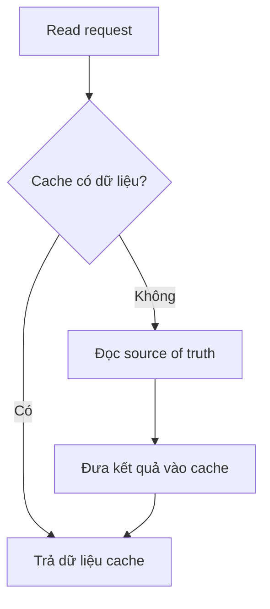
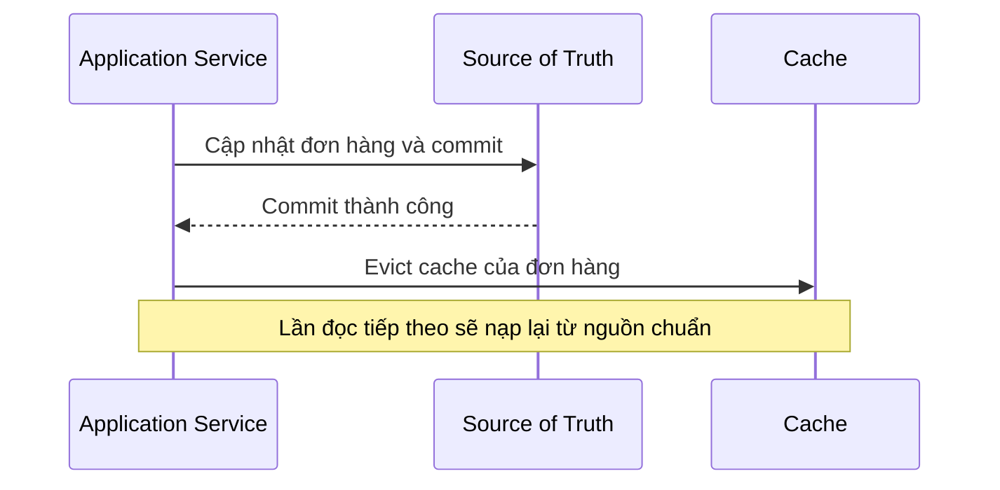

# Đặt cache, xác định nguồn dữ liệu chuẩn và xử lý mất hiệu lực

Bài học này thuộc module `SOFTWARE_DESIGN_ARCHITECTURE_ARCHITECTURAL_PATTERN_LAYERED`, nhằm giúp người học tổ chức phần mềm theo kiến trúc phân tầng. Trong chương **Các mối quan tâm xuyên tầng**, ta tìm hiểu cách dùng cache để giảm độ trễ và tải cho hệ thống, đồng thời xác định nguồn dữ liệu chuẩn và bảo đảm dữ liệu cache được làm mới hoặc mất hiệu lực đúng lúc. Cache ảnh hưởng đến nhiều tầng, nhưng cần có chủ sở hữu, chính sách và ranh giới rõ ràng để dữ liệu cũ không làm sai nghiệp vụ.

## 1. Cache là bản sao phục vụ hiệu năng

Cache lưu tạm dữ liệu đã được tính toán hoặc đọc từ một nguồn khác để những lần truy cập sau nhanh hơn. Dữ liệu cache có thể nằm trong bộ nhớ của một tiến trình, trong Redis hoặc trong một hệ thống lưu trữ chuyên dụng. Vì cache có thể bị xóa, hết hạn hoặc mất khi tiến trình khởi động lại, nó thường không phải nơi lưu giữ dữ liệu chuẩn của nghiệp vụ.

Ví dụ, cơ sở dữ liệu quan hệ lưu trạng thái và giá trị đơn hàng. Trang tổng quan thường xuyên đọc thông tin tóm tắt đơn hàng. Hệ thống có thể cache bản tóm tắt trong 30 giây để giảm truy vấn lặp lại. Nếu Redis bị khởi động lại, ứng dụng vẫn có thể đọc lại dữ liệu chuẩn từ cơ sở dữ liệu và tái tạo cache.

Phân biệt ba khái niệm:

- **Nguồn dữ liệu chuẩn (source of truth):** nơi hệ thống xem là có thẩm quyền để xác định trạng thái đúng của dữ liệu. Với đơn hàng, đó có thể là cơ sở dữ liệu giao dịch.
- **Cache:** bản sao có thể tái tạo, được tối ưu cho tốc độ đọc và có chính sách hết hạn hoặc mất hiệu lực.
- **Read model/projection:** dữ liệu được tổ chức lại để phục vụ truy vấn hoặc màn hình. Nó có thể được lưu bền vững và cập nhật bất đồng bộ; do đó không nhất thiết chỉ là cache.

Không nên dùng từ “cache” cho mọi bản sao dữ liệu. Một projection phục vụ báo cáo có thể chấp nhận độ trễ cập nhật nhưng có vòng đời và cơ chế đồng bộ riêng. Cache thường được xem là dữ liệu tạm, có thể loại bỏ và nạp lại.

## 2. Chọn nơi đặt cache theo dữ liệu và ngữ nghĩa

Cache có thể xuất hiện ở nhiều vị trí:

| Vị trí | Ví dụ | Điều cần cân nhắc |
|---|---|---|
| Client hoặc CDN | Ảnh sản phẩm, tài nguyên tĩnh, response công khai | HTTP cache header, quyền truy cập, thời hạn và khả năng làm mới |
| Tầng trình bày/API | Response của endpoint công khai | Không cache nhầm dữ liệu theo người dùng hoặc quyền khác nhau |
| Tầng ứng dụng | Kết quả truy vấn tổng hợp hoặc use case đọc | Cache theo ngữ nghĩa use case, kiểm soát key và invalidation |
| Tầng truy cập dữ liệu | Kết quả đọc theo ID hoặc repository query | Cô lập chi tiết lưu trữ, tránh làm cache che khuất transaction |
| ORM/database | Persistence context, second-level cache, buffer cache | Hiểu phạm vi và cơ chế riêng của từng công nghệ |

Không có một vị trí duy nhất phù hợp cho mọi loại cache. Hãy đặt cache ở nơi biết rõ dữ liệu nào được cache, ai sử dụng, khi nào dữ liệu thay đổi và ai chịu trách nhiệm làm mất hiệu lực. Cache ở controller có thể phù hợp cho response công khai; cache một aggregate theo ID có thể phù hợp ở adapter đọc; cache kết quả tính toán nghiệp vụ có thể cần ở application service hoặc một thành phần chuyên trách.

Tránh thêm cache ở nhiều tầng cho cùng một dữ liệu nếu chưa có lý do. Khi một request đi qua CDN, API cache, application cache và ORM cache, việc xác định bản sao nào đang trả dữ liệu cũ sẽ khó hơn nhiều.

## 3. Cache-aside: đọc từ nguồn chuẩn khi cache không có dữ liệu

Một chiến lược phổ biến là **cache-aside** (lazy loading): ứng dụng kiểm tra cache trước; nếu không có dữ liệu, ứng dụng đọc từ nguồn chuẩn, đưa kết quả vào cache rồi trả về.



Ví dụ Java với một abstraction cache nhỏ:

```java
public interface OrderSummaryCache {
    Optional<OrderSummary> get(OrderId id);
    void put(OrderSummary summary);
    void evict(OrderId id);
}

public class CachedOrderSummaryReader {
    private final OrderSummaryCache cache;
    private final OrderSummaryRepository source;

    public CachedOrderSummaryReader(
            OrderSummaryCache cache,
            OrderSummaryRepository source) {
        this.cache = cache;
        this.source = source;
    }

    public Optional<OrderSummary> find(OrderId id) {
        Optional<OrderSummary> cached = cache.get(id);
        if (cached.isPresent()) {
            return cached;
        }

        Optional<OrderSummary> loaded = source.findSummary(id);
        loaded.ifPresent(cache::put);
        return loaded;
    }
}
```

Ví dụ giả định cache adapter tự đặt TTL khi `put`. Nếu không tìm thấy bản ghi, `Optional.empty()` không được lưu trong cache ở phiên bản này. Hệ thống có thể chọn negative caching để giảm truy vấn lặp cho ID không tồn tại, nhưng cần TTL ngắn và cân nhắc trường hợp bản ghi mới được tạo ngay sau đó.

Cache-aside dễ áp dụng vì ứng dụng kiểm soát lúc đọc và ghi cache. Nhược điểm là cache miss làm tăng một lượt đọc nguồn chuẩn, và nhiều request đồng thời cùng miss có thể cùng truy vấn một khóa. Với dữ liệu có lưu lượng cao, có thể dùng request coalescing, single-flight hoặc cơ chế khóa có giới hạn để giảm cache stampede.

## 4. Xác định source of truth trước khi cache

Trước khi bật cache, hãy xác định rõ nguồn nào có thẩm quyền cho từng loại dữ liệu. Một hệ thống có thể có nhiều nguồn chuẩn cho các miền khác nhau: cơ sở dữ liệu đơn hàng là chuẩn cho trạng thái đơn; dịch vụ thanh toán là chuẩn cho kết quả giao dịch thẻ; dịch vụ định danh là chuẩn cho hồ sơ tài khoản.

Không nên tự chọn cache làm nguồn chuẩn chỉ vì nó nhanh hoặc chứa bản ghi mới nhất trong một thời điểm. Cache có thể bị xóa, cập nhật trễ hoặc bị ghi đè bởi một request cũ. Nếu dữ liệu được cập nhật bởi hệ thống khác, ứng dụng cần xác định ai là chủ sở hữu và cơ chế nhận thay đổi từ nguồn đó.

Ví dụ, trạng thái thanh toán có thể được cập nhật bởi webhook của nhà cung cấp. Ứng dụng cần xác minh chữ ký webhook, cập nhật trạng thái vào nguồn dữ liệu chuẩn của miền thanh toán, sau đó phát tín hiệu làm mới cache. Việc ghi trực tiếp trạng thái `PAID` vào cache mà không cập nhật nguồn chuẩn sẽ khiến dữ liệu biến mất khi cache hết hạn hoặc tiến trình khởi động lại.

Khi có read replica, cần nhớ replica là bản sao phục vụ đọc và có thể trễ so với primary. Nếu một use case vừa ghi dữ liệu rồi lập tức cần đọc kết quả mới, đọc từ replica hoặc cache cũ có thể trả trạng thái trước đó. Có thể đọc lại từ primary trong luồng cần read-your-writes, hoặc dùng cơ chế đồng bộ/định tuyến phù hợp với yêu cầu nhất quán.

## 5. Cache key phải biểu diễn đầy đủ phạm vi dữ liệu

Cache key quyết định hai yêu cầu có dùng chung một giá trị hay không. Nếu key thiếu một yếu tố làm thay đổi kết quả, ứng dụng có thể trả dữ liệu của yêu cầu này cho yêu cầu khác.

Ví dụ cache danh sách đơn hàng theo tenant và bộ lọc:

```java
String key = "orders:v2:tenant:" + tenantId.value()
    + ":status:" + status
    + ":page:" + page
    + ":size:" + size
    + ":sort:" + sortField + ":" + direction;
```

Key thực tế cần đưa vào mọi tiêu chí ảnh hưởng kết quả: tenant, quyền hoặc phạm vi truy cập nếu kết quả phụ thuộc quyền, filter, sort, page/cursor, locale nếu nội dung đã bản địa hóa và phiên bản cấu trúc dữ liệu. Có thể dùng một hàm chuẩn hóa để tránh hai cách biểu diễn tương đương tạo ra hai key khác nhau.

Không dùng key chỉ gồm `orderId` nếu dữ liệu được phân vùng theo tenant mà ID không bảo đảm duy nhất toàn hệ thống. Cũng không dùng chung response có trường nhạy cảm giữa các người dùng có quyền khác nhau. Nếu kết quả phụ thuộc danh tính hoặc quyền, hãy cache theo đúng phạm vi đó hoặc cache phần dữ liệu chung rồi áp dụng kiểm tra quyền sau khi đọc.

Tránh đưa thông tin nhạy cảm như access token hoặc email cá nhân vào key có thể quan sát được trong hệ thống cache. Dùng ID nội bộ hoặc một biểu diễn đã chuẩn hóa và cân nhắc giới hạn độ dài key.

## 6. TTL, eviction và invalidation là các chính sách khác nhau

Cache cần có cách kết thúc vòng đời của dữ liệu. Một số cơ chế thường dùng:

- **TTL (time to live):** tự hết hạn sau một khoảng thời gian. Dễ vận hành, nhưng dữ liệu có thể cũ cho đến khi TTL kết thúc.
- **Eviction:** loại bỏ một mục hoặc một nhóm mục khi cần chỗ chứa, ví dụ LRU hoặc chính sách giới hạn kích thước. Eviction vì áp lực bộ nhớ không bảo đảm dữ liệu vừa thay đổi sẽ bị xóa ngay.
- **Invalidation:** chủ động đánh dấu một mục không còn hợp lệ khi có sự kiện hoặc thao tác ghi liên quan.
- **Refresh:** chủ động nạp giá trị mới trước hoặc sau khi hết hạn, có thể đồng bộ hoặc bất đồng bộ.

TTL không thay thế hoàn toàn invalidation nếu nghiệp vụ yêu cầu cập nhật nhanh. Ngược lại, invalidation không thay thế TTL vì sự kiện có thể bị mất, consumer có thể lỗi hoặc một luồng ghi không phát tín hiệu. Nhiều hệ thống kết hợp invalidation khi ghi với TTL như một giới hạn an toàn cho tuổi dữ liệu.

TTL nên dựa trên mức độ chấp nhận dữ liệu cũ và tốc độ thay đổi, không chọn một con số chung cho toàn ứng dụng. Dữ liệu cấu hình ít thay đổi có thể có TTL dài; số dư tài khoản hoặc trạng thái thanh toán có thể cần đọc từ nguồn chuẩn hoặc dùng cơ chế nhất quán chặt hơn. TTL ngẫu nhiên một khoảng nhỏ (jitter) giúp tránh nhiều key hết hạn cùng lúc và tạo tải đột biến lên nguồn chuẩn.

## 7. Mất hiệu lực cache sau khi ghi

Với cache-aside, một cách thường dùng là cập nhật nguồn chuẩn trước, sau đó xóa cache liên quan. Lần đọc tiếp theo sẽ nạp giá trị mới.



Không nên xóa cache trước khi transaction cơ sở dữ liệu commit nếu mục tiêu là lần đọc tiếp theo phải thấy dữ liệu mới. Một request khác có thể đọc cache miss trong khi transaction ghi chưa commit, nạp lại giá trị cũ rồi đặt nó vào cache. Khi transaction commit, cache lại chứa dữ liệu cũ.

Với Spring, có thể phát một sự kiện trong transaction và xử lý eviction sau commit:

```java
public record OrderChangedEvent(OrderId orderId) {}

@Service
class UpdateOrderService {
    private final OrderRepository orders;
    private final ApplicationEventPublisher events;

    UpdateOrderService(
            OrderRepository orders,
            ApplicationEventPublisher events) {
        this.orders = orders;
        this.events = events;
    }

    @Transactional
    public void changeStatus(OrderId id, OrderStatus status) {
        Order order = orders.findById(id)
            .orElseThrow(() -> new OrderNotFoundException(id));
        order.changeStatus(status);
        orders.save(order);
        events.publishEvent(new OrderChangedEvent(id));
    }
}

@Component
class OrderCacheInvalidator {
    private final OrderSummaryCache cache;

    OrderCacheInvalidator(OrderSummaryCache cache) {
        this.cache = cache;
    }

    @TransactionalEventListener(phase = TransactionPhase.AFTER_COMMIT)
    public void on(OrderChangedEvent event) {
        cache.evict(event.orderId());
    }
}
```

Ví dụ dùng Spring transaction-bound event để chỉ eviction sau khi transaction commit. Listener trong cùng tiến trình không phải một cơ chế giao nhận bền vững: nếu tiến trình dừng sau commit nhưng trước khi listener xử lý, tín hiệu có thể không được thực hiện. Với cache phân tán hoặc nhiều instance, cần cơ chế phát invalidation đến các node khác.

### Transactional Outbox cho invalidation bền vững

Nếu việc phát sự kiện là quan trọng, ứng dụng có thể ghi một bản ghi outbox cùng transaction với thay đổi nghiệp vụ. Một publisher đọc outbox sau commit và gửi sự kiện đến broker. Consumer ở mỗi instance nhận sự kiện rồi xóa cache cục bộ hoặc cập nhật cache phân tán. Vì outbox được ghi cùng transaction, thay đổi dữ liệu và ý định phát sự kiện được lưu bền vững cùng nhau.

Outbox thường cung cấp giao nhận ít nhất một lần, nên consumer cần xử lý idempotent. Một sự kiện invalidation lặp lại thường an toàn nếu thao tác chỉ xóa key. Với thao tác cập nhật cache bằng payload, cần thêm version hoặc sequence để không áp dụng bản cập nhật cũ sau bản cập nhật mới.

## 8. Cache nhiều instance và nguy cơ dữ liệu cũ

Cache trong bộ nhớ của từng JVM là local cache. Nếu ứng dụng chạy ba instance, mỗi instance có một bản sao riêng. Khi một instance cập nhật dữ liệu và chỉ xóa cache của nó, hai instance còn lại vẫn có thể trả giá trị cũ.

Có một số lựa chọn:

| Kiểu cache | Đặc điểm | Cần xử lý |
|---|---|---|
| Local in-memory | Độ trễ thấp, không cần mạng | Mỗi instance có bản sao riêng; cần TTL ngắn hoặc broadcast invalidation |
| Distributed cache | Nhiều instance dùng chung kho cache như Redis | Quản lý kết nối, key namespace, lỗi mạng, TTL và quyền truy cập |
| Hybrid local + distributed | Local cache trước, distributed cache sau | Phải đồng bộ invalidation giữa các local cache và xử lý nhiều lớp TTL |

Với Redis, các instance có thể dùng pub/sub hoặc message broker để nhận tín hiệu invalidation. Pub/sub thường không lưu giữ thông điệp cho consumer đang offline; nếu cần đảm bảo bền vững, dùng broker có lưu message hoặc outbox cùng cơ chế retry. Dù dùng cách nào, TTL vẫn hữu ích như giới hạn tối đa cho thời gian một bản sao có thể tồn tại.

Nếu dữ liệu cần tính nhất quán chặt, cache phân tán không tự động giải quyết vấn đề. Cần xác định độ trễ cho phép, khả năng đọc dữ liệu cũ và hành vi khi cache hoặc kênh invalidation bị lỗi. Một số use case nhạy cảm có thể bỏ qua cache và đọc nguồn chuẩn.

## 9. Các lỗi nhất quán thường gặp

### Cache được nạp lại bằng dữ liệu cũ sau khi eviction

Một request đọc bắt đầu trước khi transaction ghi commit. Nó bị cache miss, đọc dữ liệu cũ từ database rồi đặt vào cache. Transaction ghi sau đó commit và eviction có thể xảy ra trước hoặc sau thao tác put tùy thứ tự. Nếu put cũ xảy ra sau eviction, cache lại chứa dữ liệu cũ. Có thể giảm rủi ro bằng versioning, kiểm soát thứ tự, khóa theo key hoặc thiết kế refresh/invalidation phù hợp. Không nên giả định “write rồi evict” tự giải quyết mọi race condition.

### Cache stampede khi nhiều key hết hạn cùng lúc

Khi một key phổ biến hết hạn, hàng trăm request có thể đồng thời truy vấn nguồn chuẩn. Dùng TTL jitter, single-flight theo key, refresh nền hoặc stale-while-revalidate để phân tán tải. Cần quy định rõ liệu caller được phép nhận dữ liệu cũ trong thời gian refresh hay phải chờ dữ liệu mới.

### Cache dữ liệu theo quyền nhưng key thiếu phạm vi

Nếu kết quả có lọc theo tenant hoặc quyền, key phải chứa phạm vi đó hoặc cache chỉ phần dữ liệu không phụ thuộc quyền. Kiểm tra quyền vẫn phải thực hiện ở server. Không để cache trở thành đường vòng bỏ qua authorization.

### Cache lỗi làm ứng dụng không thể đọc dữ liệu

Nếu cache chỉ là tối ưu, lỗi cache thường nên được xử lý bằng cách fallback tới nguồn chuẩn khi có thể. Tuy nhiên, fallback cũng có thể tạo tải lớn lên database. Cần timeout ngắn, giới hạn concurrency, circuit breaker hoặc rate limit phù hợp; khi cache hỏng, ứng dụng phải có cách bảo vệ nguồn chuẩn.

## 10. Ví dụ Spring Cache và các lưu ý

Spring Cache cung cấp abstraction annotation để cache kết quả phương thức:

```java
@Service
class ProductQueryService {
    private final ProductRepository products;

    ProductQueryService(ProductRepository products) {
        this.products = products;
    }

    @Cacheable(cacheNames = "productSummary", key = "#productId")
    public ProductSummary findSummary(String productId) {
        return products.findSummary(productId)
            .orElseThrow(() -> new ProductNotFoundException(productId));
    }

    @CacheEvict(cacheNames = "productSummary", key = "#productId")
    public void evictSummary(String productId) {
        // Phương thức chỉ phục vụ eviction.
    }
}
```

Ví dụ rút gọn để minh họa API; cấu hình cache provider, TTL và serialization cần được thiết lập riêng. Với `@Cacheable`, Spring dùng key để tra cache và chỉ gọi phương thức khi miss. `@CacheEvict` có thể xóa key khi phương thức được gọi, nhưng nếu gọi eviction trong cùng transaction ghi, cần chú ý thứ tự commit. Có thể kết hợp transaction-bound event sau commit như ví dụ trước hoặc dùng cơ chế đồng bộ phù hợp.

Annotation cache của Spring thường dựa trên proxy. Gọi một phương thức cacheable từ phương thức khác trong cùng object (self-invocation) có thể bỏ qua proxy và không kích hoạt interceptor. Cũng cần kiểm tra cache key, `unless`/`condition`, kiểu dữ liệu cache và hành vi khi exception. Không nên cache lỗi hoặc kết quả không hoàn chỉnh nếu chưa có chính sách rõ.

## 11. Đo lường và vận hành cache

Không thể đánh giá cache chỉ bằng cảm giác rằng endpoint nhanh hơn. Nên theo dõi:

- **Hit ratio:** tỷ lệ request tìm thấy dữ liệu trong cache. Hit ratio cao không có nghĩa dữ liệu luôn đúng hoặc hệ thống thực sự nhanh hơn.
- **Miss rate và load latency:** số lần phải đọc nguồn chuẩn và thời gian truy vấn khi miss.
- **Eviction/expiration rate:** số mục bị xóa do TTL hoặc áp lực bộ nhớ.
- **Cache size và memory usage:** dung lượng, số key, key có kích thước bất thường.
- **Invalidation lag:** độ trễ từ lúc nguồn chuẩn commit đến khi các cache liên quan được làm mới hoặc xóa.
- **Fallback/error rate:** số lần cache lỗi và ứng dụng phải đọc nguồn chuẩn.

Đo cả độ trễ p95/p99 và tải database trước/sau khi bật cache. Một cache có hit ratio cao nhưng invalidation lag lớn có thể gây lỗi nghiệp vụ. Một cache làm tăng serialization, network hop hoặc quản lý key có thể không cải thiện hiệu năng tổng thể.

## 12. Kiểm thử cache và chính sách mất hiệu lực

Nên kiểm thử hành vi cache theo các trường hợp có ý nghĩa:

- **Cache hit:** dữ liệu được trả từ cache và repository nguồn chuẩn không bị gọi lại.
- **Cache miss:** dữ liệu được tải từ source of truth, cache được điền và kết quả đúng.
- **Write rồi invalidation:** sau commit, key liên quan bị xóa; lần đọc tiếp theo nhận dữ liệu mới.
- **Transaction rollback:** nếu ghi thất bại và rollback, không phát invalidation như thể dữ liệu đã thay đổi thành công, trừ khi chính sách yêu cầu khác.
- **Phạm vi key:** hai tenant, filter, locale hoặc quyền khác nhau không nhận nhầm dữ liệu của nhau.
- **TTL và negative caching:** dữ liệu hết hạn đúng lúc; bản ghi vừa được tạo không bị che bởi negative cache quá lâu.
- **Multi-instance:** invalidation đến mọi node theo cơ chế đã chọn; consumer xử lý message lặp lại an toàn.
- **Cache outage:** ứng dụng fallback có giới hạn và không làm quá tải nguồn chuẩn.
- **Race condition:** kiểm tra trường hợp read miss đồng thời với write và eviction để phát hiện khả năng cache lại giá trị cũ.

Test nên dùng clock có thể điều khiển hoặc cache provider thử nghiệm để không phụ thuộc vào thời gian chờ thực. Integration test với Redis hoặc provider thật cần thiết khi hành vi serialization, TTL, pub/sub hoặc transaction khác với fake trong bộ nhớ.

## 13. Checklist trước khi đưa cache vào sử dụng

Trước khi cache một dữ liệu, hãy trả lời:

1. Source of truth của dữ liệu này là gì và ai có quyền cập nhật?
2. Use case chấp nhận dữ liệu cũ trong bao lâu? Có thao tác nào phải đọc nguồn chuẩn?
3. Cache đặt ở tầng nào, ai sở hữu key và ai chịu trách nhiệm invalidation?
4. Key đã bao gồm tenant, filter, sort, locale và phạm vi quyền cần thiết chưa?
5. TTL, eviction và invalidation có vai trò gì? TTL có đủ hay cần phát sự kiện sau commit?
6. Hệ thống có bao nhiêu instance và làm sao đồng bộ cache giữa chúng?
7. Điều gì xảy ra nếu cache hoặc kênh invalidation bị lỗi?
8. Có nguy cơ cache stampede, stale refill hoặc dữ liệu nhạy cảm bị lộ không?
9. Metrics và test nào chứng minh cache vừa cải thiện hiệu năng vừa giữ đúng ngữ nghĩa?

## 14. Ghi nhớ

Cache là bản sao phục vụ hiệu năng; source of truth mới quyết định trạng thái chuẩn của dữ liệu. Hãy xác định nguồn chuẩn và mức dữ liệu cũ có thể chấp nhận trước khi chọn vị trí cache, key, TTL và chiến lược invalidation. Cache-aside là lựa chọn phổ biến: đọc cache trước, miss thì đọc nguồn chuẩn và điền lại. Khi ghi, thường cập nhật nguồn chuẩn rồi invalidation sau commit; với nhiều instance hoặc yêu cầu giao nhận bền vững, dùng sự kiện/outbox và cơ chế đồng bộ phù hợp. TTL giúp giới hạn tuổi bản sao nhưng không thay thế hoàn toàn invalidation. Cache key phải chứa đầy đủ phạm vi dữ liệu và quyền, còn lỗi cache phải được xử lý mà không làm quá tải nguồn chuẩn. Đo hit/miss, độ trễ, invalidation lag và kiểm thử cả race condition để bảo đảm cache thực sự hữu ích và không làm sai nghiệp vụ.
