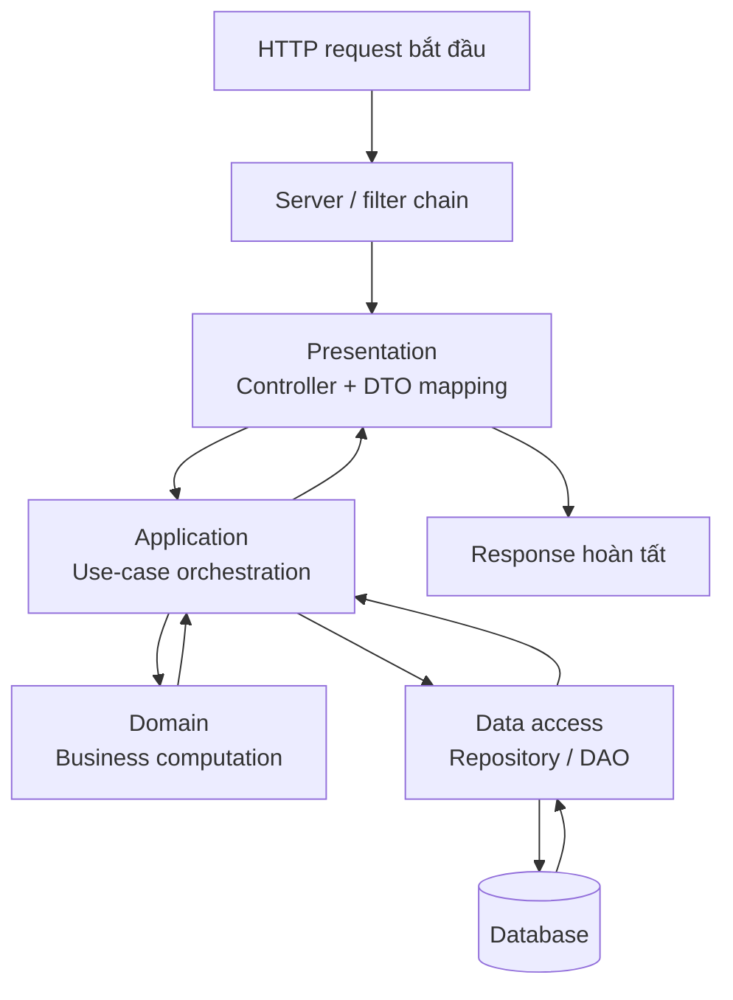

# Đo thời gian theo chặng để xác định chi phí thực của ranh giới tầng

Bài học này thuộc chương **Hiệu năng và triển khai** của module `SOFTWARE_DESIGN_ARCHITECTURE_ARCHITECTURAL_PATTERN_LAYERED`, trong chương trình **học tổ chức phần mềm theo kiến trúc phân tầng**. Kiến trúc phân tầng tạo ra các ranh giới trách nhiệm như presentation, application, domain và data access. Mỗi ranh giới có thể thêm lời gọi phương thức, chuyển đổi dữ liệu, validation hoặc điều phối. Muốn biết các ranh giới đó có ảnh hưởng đáng kể đến hiệu năng hay không, cần đo thời gian xử lý theo từng chặng và đặt số đo trong bối cảnh của toàn request.

Một request chậm không có nghĩa mọi tầng đều chậm. Phần lớn thời gian có thể nằm ở truy vấn database, chờ connection pool, gọi dịch vụ mạng, khóa đồng thời hoặc hàng đợi thread. Ngược lại, nhiều bước chuyển đổi nhỏ cũng có thể cộng dồn thành chi phí đáng kể ở luồng có throughput cao. Đo đúng giúp nhóm xác định phần tốn thời gian thực tế trước khi thay đổi cấu trúc kiến trúc.

Sau bài học, bạn có thể chọn điểm đo ở ranh giới tầng, phân biệt thời gian bao gồm và thời gian riêng của một chặng, dùng metrics/tracing để tìm nút thắt, và đánh giá chi phí của lời gọi nội bộ so với I/O hoặc ranh giới triển khai.

## 1. Bắt đầu từ thời gian end-to-end

**Latency end-to-end** là thời gian từ khi một thao tác bắt đầu ở ranh giới được chọn đến khi kết quả hoàn tất ở ranh giới đó. Với HTTP API, thường đo từ lúc server nhận request đến lúc server gửi response; nếu muốn đo trải nghiệm người dùng, cần đo thêm ở phía client từ lúc gửi đến lúc nhận và xử lý xong response.

Trước khi đo từng tầng, hãy xác định rõ:

- Điểm bắt đầu và kết thúc của phép đo: toàn request, một use case, một truy vấn hay một thao tác ở client.
- Loại request: endpoint, use case, kích thước dữ liệu, trạng thái cache và các nhánh xử lý.
- Điều kiện tải: số request đồng thời, throughput, dữ liệu thử nghiệm, trạng thái warm-up và môi trường triển khai.
- Chỉ số cần quan sát: latency, throughput, tỷ lệ lỗi, CPU, bộ nhớ, pool/queue và các tài nguyên liên quan.

Nếu không có số đo end-to-end, một chặng mất 20 ms có thể trông đáng kể nhưng thực tế chỉ chiếm phần nhỏ của request 800 ms. Ngược lại, chặng 20 ms trong request 25 ms có thể là mục tiêu tối ưu rõ ràng.

## 2. Chọn các điểm đo theo ranh giới tầng

Trong một request tạo đơn hàng, có thể đặt các điểm đo ở những ranh giới có ý nghĩa:

1. **HTTP/server:** thời gian request đi qua server và middleware đến khi response hoàn tất.
2. **Presentation/controller:** binding request, validation định dạng, mapping DTO và chuyển kết quả thành response.
3. **Application/use case:** thời gian điều phối ca sử dụng, bao gồm các lời gọi domain và data access.
4. **Domain:** thời gian tính toán quy tắc nghiệp vụ, định giá hoặc chuyển trạng thái.
5. **Data access:** thời gian lấy connection, thực hiện truy vấn và ánh xạ dữ liệu ở adapter/repository.
6. **Database hoặc dịch vụ ngoài:** thời gian thực thi truy vấn hoặc chờ phản hồi từ hệ thống khác, nếu có thể quan sát riêng.



Không nhất thiết phải đo mọi phương thức. Hãy bắt đầu ở các ranh giới mà nhóm muốn so sánh hoặc nghi ngờ có chi phí lớn. Một span cho mỗi getter/setter hoặc mỗi dòng code thường tạo nhiều dữ liệu và overhead mà không giúp giải thích hiệu năng.

### Ví dụ một trace minh họa

Giả sử một request có latency server là 180 ms. Khi chia thành các khoảng thời gian riêng không chồng lấn, số đo minh họa có thể như sau:

| Chặng riêng (exclusive time) | Thời gian minh họa | Diễn giải |
|---|---:|---|
| Controller, binding và response mapping | 8 ms | Nhận DTO, validation định dạng và tạo response |
| Điều phối application | 12 ms | Chuẩn bị command, gọi collaborator và xử lý kết quả |
| Domain computation | 3 ms | Kiểm tra và tính toán nghiệp vụ |
| Repository/DAO ngoài thời gian DB | 18 ms | Chuyển đổi dữ liệu, xử lý adapter và các bước cục bộ |
| JDBC và database wait/execution | 95 ms | Lấy connection, gửi truy vấn, chờ database và đọc kết quả |
| Serialization/response handling | 7 ms | Ghi body và hoàn tất response |
| Chờ hoặc chi phí khác chưa gắn nhãn | 37 ms | Scheduler, contention, middleware hoặc khoảng chưa được instrument |
| **Tổng** | **180 ms** | **Bằng latency end-to-end trong ví dụ** |

Các con số chỉ minh họa cách phân rã. Trong trace thực, thời gian DB có thể là span con nằm bên trong span repository; khi đó không được cộng cả hai span inclusive vào tổng vì sẽ đếm trùng. Hãy xem waterfall hoặc tính exclusive time để biết mỗi khoảng đóng góp riêng bao nhiêu.

## 3. Inclusive time và exclusive time

Khi một span chứa các span con, có hai cách đọc thời gian:

- **Inclusive time:** toàn bộ thời gian của span, bao gồm các lời gọi con. Ví dụ application span có thể kéo dài 140 ms vì nó gọi repository và chờ database.
- **Exclusive time:** thời gian nằm trong span nhưng không thuộc các span con đã đo. Nó cho biết phần công việc riêng của chặng đó theo mô hình instrument hiện tại.

Giả sử `PlaceOrderService.execute()` mất 130 ms; bên trong nó có `OrderRepository.save()` mất 105 ms và domain computation mất 4 ms. Thời gian inclusive của application là 130 ms, không phải 130 + 105 + 4. Phần exclusive xấp xỉ 21 ms nếu các span con bao phủ đúng phần thời gian tương ứng và không có overlap. Nếu các tác vụ chạy song song, việc tính exclusive time và cộng các span con phức tạp hơn; tổng thời lượng của các span con có thể lớn hơn wall-clock time của cha.

Đừng trừ máy móc các số đo khi chúng không cùng điểm bắt đầu/kết thúc hoặc không được lồng đúng. Một span DB có thể không bao gồm thời gian chờ connection pool nếu instrumentation bắt đầu sau khi lấy connection. Ngược lại, span repository có thể bao gồm cả pool wait, mapping và DB call. Tên span và vị trí đặt instrumentation phải mô tả đúng phần được đo.

## 4. Phân biệt wall-clock time, CPU time và thời gian chờ

**Wall-clock time** là thời gian thực trôi qua. Nó bao gồm thời gian thread chạy, chờ I/O, chờ lock, chờ connection pool và bị scheduler tạm dừng. Đây thường là chỉ số quan trọng nhất khi đo latency người dùng cảm nhận.

**CPU time** là thời gian CPU thực sự thực thi cho thread/process được đo. Một request có wall-clock 500 ms nhưng CPU time chỉ 20 ms có thể đang chờ database, mạng, lock hoặc queue. Tối ưu vòng lặp CPU trong trường hợp này khó cải thiện latency bằng việc xử lý nguyên nhân chờ.

Các dạng chờ cần xem xét:

- **Connection pool wait:** ứng dụng không có connection rảnh và phải chờ pool cấp phát.
- **Database wait:** database chờ I/O, lock, tài nguyên hoặc thực thi query phức tạp.
- **Network wait:** gọi API, broker hoặc database từ xa qua mạng.
- **Lock/contention:** thread chờ synchronized lock, semaphore hoặc khóa database.
- **Queue/scheduler wait:** request chờ worker thread, executor hoặc event loop xử lý.

Một span tổng hợp thường chỉ cho biết chặng nào chậm. Để phân biệt CPU với wait, cần kết hợp tracing với thread dump, CPU profiling, metrics của pool/database và quan sát hệ điều hành/runtime.

## 5. Đo bằng metrics và tracing

### Metrics trả lời câu hỏi tổng thể theo thời gian

Metric là số liệu được tổng hợp theo một nhóm sự kiện trong khoảng thời gian, ví dụ:

- Histogram hoặc timer của latency endpoint/use case.
- Throughput, số request mỗi giây và tỷ lệ lỗi.
- Số lượng request đang xử lý, độ sâu queue và thời gian chờ.
- Connection pool active/idle/pending và thời gian lấy connection.
- CPU, heap, garbage collection và số thread.

Metrics phù hợp để theo dõi xu hướng, so sánh trước/sau triển khai và phát hiện khi p95/p99 tăng. Trung bình (average) một mình thường che giấu request chậm ở phần đuôi. Hãy xem các percentile như p50, p95 và p99 cùng throughput và error rate.

### Distributed tracing trả lời request cụ thể đã đi qua đâu

Trace gồm các span có quan hệ cha-con. Một trace có thể cho thấy request HTTP gọi use case, use case gọi repository, repository gọi database hoặc dịch vụ ngoài. Waterfall giúp tìm chặng kéo dài, các lời gọi tuần tự, lời gọi song song và khoảng chờ chưa được gắn nhãn.

Metrics và tracing bổ sung cho nhau: metrics cho biết vấn đề có thường xuyên và ảnh hưởng rộng không; trace giúp điều tra một request cụ thể. Log có trace ID/span ID giúp liên kết thông tin lỗi với đường đi của request.

### Micrometer Timer cho chặng đồng bộ

Trong Spring Boot dùng Micrometer, có thể đo thời gian một thao tác và ghi vào registry:

```java
@Component
public class TimedOrderLookup {
    private final OrderRepository orders;
    private final MeterRegistry registry;

    public TimedOrderLookup(OrderRepository orders,
                            MeterRegistry registry) {
        this.orders = orders;
        this.registry = registry;
    }

    public Optional<Order> find(OrderId id) {
        Timer.Sample sample = Timer.start(registry);
        try {
            return orders.findById(id);
        } finally {
            sample.stop(registry.timer("orders.repository.find"));
        }
    }
}
```

Đây là ví dụ tối giản; cần cấu hình registry/exporter phù hợp để quan sát metric. Tên metric nên ổn định và mô tả thao tác. Không thêm `orderId`, email, URL đầy đủ hoặc giá trị tùy ý vào tag vì cardinality cao có thể làm hệ thống metrics tốn bộ nhớ và khó truy vấn. Có thể dùng các tag có tập giá trị giới hạn như operation, outcome hoặc loại adapter.

`Timer` đo thời gian của đoạn code đồng bộ trong thread hiện tại. Nếu method chỉ khởi chạy một tác vụ async rồi trả về, timer này đo thời gian khởi chạy chứ không đo thời gian tác vụ hoàn tất. Với tác vụ async, cần đo cả thời điểm bắt đầu và hoàn tất ở callback/completion stage hoặc dùng tracing context để nối span.

### OpenTelemetry span để xem đường đi của một request

Khi cần liên kết các chặng trong một trace, có thể tạo span cho một thao tác đáng chú ý:

```java
public Order loadOrder(UUID id) {
    Span span = tracer.spanBuilder("OrderRepository.load")
            .startSpan();
    try (Scope scope = span.makeCurrent()) {
        return repository.findById(id)
                .orElseThrow(() -> new OrderNotFoundException(id));
    } catch (RuntimeException ex) {
        span.recordException(ex);
        span.setStatus(StatusCode.ERROR);
        throw ex;
    } finally {
        span.end();
    }
}
```

Ví dụ giả định `tracer` là OpenTelemetry `Tracer` đã được cấu hình và các import `Span`, `Scope`, `StatusCode` tương ứng đã có. Trong ứng dụng thực tế, ưu tiên instrumentation tự động của framework/client/database khi nó cung cấp span phù hợp; thêm span thủ công cho các ranh giới nghiệp vụ chưa được quan sát. Tránh tạo span trùng lặp cho cùng một thao tác nếu instrumentation tự động đã ghi nhận nó.

## 6. Đo chi phí của lời gọi qua ranh giới tầng

### Lời gọi trong cùng process

Một lời gọi Java từ controller sang application service hoặc từ service sang domain object thường là lời gọi trong cùng JVM. Chi phí của nó phụ thuộc JIT, allocation, dispatch, kích thước dữ liệu và các công việc được thực hiện bên trong. Bản thân việc gọi một method thường rất nhỏ so với truy vấn database hoặc gọi mạng, nhưng nhiều mapping/copy/validation hoặc object allocation trên đường nóng có thể tích lũy thành chi phí.

Để xác định chi phí của một ranh giới, hãy so sánh các phần tương đương:

- Thời gian gọi service và xử lý nghiệp vụ khi dùng implementation thật.
- Thời gian mapping DTO/domain/persistence model.
- Số lượng object được tạo, allocation rate và GC.
- Số lời gọi repository/DAO và số câu SQL phát sinh.
- Tổng latency khi tăng số lớp chuyển tiếp hoặc thay đổi cách gom thao tác.

Đừng kết luận rằng một abstraction làm chậm ứng dụng chỉ vì có thêm interface hoặc class. JIT có thể inline lời gọi nhỏ; chi phí thực thường nằm ở công việc bên trong, allocation, truy vấn hoặc chờ tài nguyên. Hãy đo trước khi gộp tầng hoặc bỏ abstraction.

### Ranh giới I/O và tier triển khai

Khi một tầng gọi database hoặc dịch vụ khác qua mạng, latency có thể bao gồm pool wait, serialization, network round trip, queue ở phía nhận và thời gian xử lý bên kia. Đây là chi phí lớn hơn đáng kể so với lời gọi nội bộ trong nhiều hệ thống.

Nếu tách application layer và data access thành hai process riêng, một lời gọi nội bộ có thể biến thành lời gọi mạng. Khi đó cần đo thêm serialization, DNS/TLS nếu có, retry, timeout, queue, connection reuse và độ trễ giữa các vùng triển khai. Việc chia tầng logic không bắt buộc phải chia tier vật lý; đặt nhiều tầng trong cùng process có thể giữ giao tiếp nội bộ đơn giản.

## 7. Đo benchmark nhỏ và đo hệ thống dưới tải là hai việc khác nhau

### Microbenchmark cho một đoạn code nhỏ

Nếu muốn so sánh hai cách mapping hoặc hai thuật toán thuần Java, dùng công cụ benchmark như JMH. JMH quản lý warm-up, fork, lặp đo và các vấn đề của JIT tốt hơn một vòng lặp `System.currentTimeMillis()` tự viết.

Một benchmark có ý nghĩa cần:

- Dùng dữ liệu đại diện và tránh để compiler loại bỏ kết quả không được sử dụng.
- Có warm-up để JIT tối ưu trước khi ghi số đo.
- Chạy nhiều fork/lần đo để nhận biết biến động.
- Giữ môi trường và cấu hình JVM tương đương khi so sánh.
- Đo allocation hoặc throughput nếu đó là yếu tố cần tối ưu, không chỉ latency trung bình.

Microbenchmark không đại diện cho latency toàn request, vì nó thường không bao gồm database, mạng, pool, contention và hành vi tải thực.

### Load test cho use case và API

Để biết kiến trúc hoạt động ra sao dưới tải, chạy load test với profile request, dữ liệu và concurrency gần thực tế. Theo dõi đồng thời latency percentiles, throughput, error rate, CPU, heap/GC, thread pool, connection pool và database. Khi tăng concurrency, một thành phần có thể chuyển từ nhanh sang nghẽn do pool hoặc lock; benchmark tuần tự sẽ không phát hiện điều đó.

Hãy so sánh baseline và phiên bản thay đổi trong điều kiện gần như giống nhau. Ghi lại commit/build, cấu hình JVM, số instance, database, dataset, cache state, thời lượng warm-up và tải. Nếu thay đổi nhiều yếu tố cùng lúc, khó xác định nguyên nhân của kết quả.

## 8. Các sai lầm khi đo hiệu năng theo tầng

1. **Chỉ xem average.** Average có thể tốt dù một tỷ lệ nhỏ request rất chậm. Xem p50/p95/p99, throughput và tỷ lệ lỗi.
2. **Cộng các span inclusive.** Span cha đã chứa span con; cộng chúng sẽ đếm trùng thời gian. Xem waterfall và exclusive time.
3. **Đo quá nhiều điểm nhỏ.** Instrumentation dày làm tăng overhead, dữ liệu nhiễu và cardinality. Đo ở ranh giới có ý nghĩa rồi bổ sung chi tiết khi cần.
4. **Nhầm thời gian chờ với CPU.** Một method kéo dài có thể chủ yếu chờ database hoặc lock. Kết hợp tracing, profiler và metrics tài nguyên.
5. **Chỉ đo môi trường local.** Local database, cache nóng và không có tải mạng không đại diện production. Dùng môi trường và dữ liệu gần thực tế.
6. **Benchmark ngay sau khi khởi động.** JIT, class loading, connection pool và cache chưa ổn định. Có warm-up và nhiều lần đo.
7. **Dùng ID làm metric tag.** Tag có cardinality không giới hạn làm tăng chi phí lưu trữ và truy vấn. Đưa định danh request vào trace/log, không đưa vào label metric.
8. **Tối ưu một chặng nhưng làm tăng chặng khác.** Cache có thể giảm query nhưng tăng bộ nhớ và nguy cơ dữ liệu cũ; batching giảm round trip nhưng tăng latency chờ gom nhóm. Đo end-to-end sau thay đổi.
9. **Coi số đo là nguyên nhân.** Span dài cho biết nơi thời gian trôi qua, không luôn giải thích tại sao. Cần điều tra lock, query plan, pool, CPU hoặc network tương ứng.

## 9. Quy trình tìm nút thắt thực tế

Một quy trình có thể áp dụng cho endpoint chậm:

1. **Xác định triệu chứng:** endpoint/use case nào chậm, p95/p99 ra sao, từ thời điểm nào, với loại request và mức tải nào.
2. **Đo baseline end-to-end:** ghi latency, throughput, error rate và điều kiện chạy.
3. **Mở trace đại diện:** xem thứ tự span, thời gian inclusive/exclusive, các lời gọi tuần tự/song song và khoảng chưa được instrument.
4. **Khoanh vùng:** xác định thời gian chủ yếu nằm ở controller/application/domain, pool, database hay dịch vụ ngoài.
5. **Đi sâu đúng chỗ:** dùng CPU profiler/flame graph cho CPU; query plan và DB metrics cho SQL; pool metrics cho connection wait; thread dump cho lock/queue.
6. **Đề xuất thay đổi nhỏ:** tối ưu query, giảm mapping thừa, batch lời gọi, điều chỉnh pool hoặc thay đổi ranh giới nếu số đo chứng minh cần thiết.
7. **Đo lại trong điều kiện tương đương:** so sánh percentile, throughput, error rate và tài nguyên; kiểm tra không làm sai hành vi nghiệp vụ.

### Ví dụ diễn giải kết quả

Nếu trace cho thấy request 180 ms, trong đó JDBC/database chiếm khoảng 95 ms, repository mapping chiếm 18 ms và application/domain chỉ chiếm 15 ms, việc gộp application với domain khó đem lại cải thiện lớn. Nên kiểm tra query plan, index, số lần round trip và connection pool trước. Nếu thay đổi query giảm DB time từ 95 ms xuống 30 ms, hãy đo lại end-to-end để xác nhận mức cải thiện thực tế.

Nếu database chỉ chiếm 10 ms nhưng controller/application dành 70 ms để map hàng nghìn object hoặc gọi lặp cùng một service, cần xem allocation, số lần gọi, thuật toán và dữ liệu được tải. Khi đó tối ưu cấu trúc xử lý hoặc projection có thể hiệu quả hơn.

## 10. Nguyên tắc đánh giá chi phí ranh giới tầng

Đo thời gian theo chặng giúp trả lời câu hỏi kiến trúc bằng dữ liệu: ranh giới nào thực sự thêm chi phí, phần nào đang chờ I/O, phần nào tiêu tốn CPU và phần nào không đáng để tối ưu. Hãy giữ một phép đo end-to-end làm mốc; instrument các ranh giới có ý nghĩa; đọc đúng inclusive/exclusive time; và kết hợp trace với metrics, profiler cùng load test.

Trong ứng dụng Java/Spring, có thể bắt đầu bằng HTTP server metrics và trace, sau đó thêm span cho use case hoặc repository nếu thiếu khả năng quan sát. Chỉ tách hoặc gộp tầng khi số đo cho thấy một chi phí cụ thể và thay đổi đó vẫn giữ được trách nhiệm, khả năng kiểm thử và tính đúng đắn nghiệp vụ. Mục tiêu là giảm latency và tăng throughput theo nhu cầu thực tế, không phải làm cho sơ đồ có ít tầng hơn.
