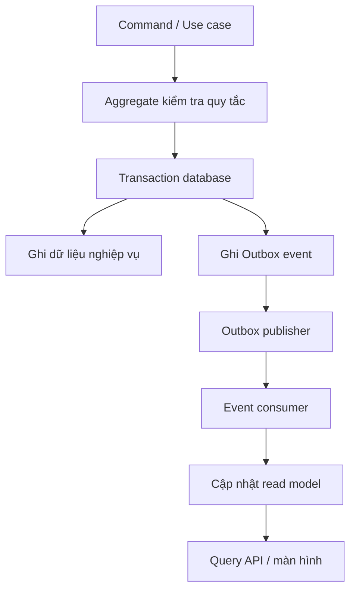

# Tối ưu truy vấn và mô hình đọc mà vẫn giữ quy tắc của luồng ghi

Trong module **SOFTWARE_DESIGN_ARCHITECTURE_ARCHITECTURAL_PATTERN_LAYERED** (Học tổ chức phần mềm theo kiến trúc phân tầng), bài học này tập trung vào cách tăng hiệu năng đọc khi ứng dụng có nhiều màn hình tra cứu, danh sách và báo cáo. Ta dùng hệ thống quản lý đơn hàng để phân biệt mô hình ghi với mô hình đọc, lựa chọn truy vấn phù hợp và giữ các quy tắc nghiệp vụ ở đúng nơi.

Một màn hình danh sách đơn hàng có thể cần mã đơn, tên khách hàng, thời điểm tạo, trạng thái và tổng tiền. Để hiển thị dữ liệu đó, ứng dụng không nhất thiết phải tải toàn bộ object graph của đơn hàng, dựng aggregate rồi mới lấy vài trường. Nhưng nếu người dùng yêu cầu hủy đơn, ứng dụng cũng không thể chỉ cập nhật một dòng dữ liệu trên mô hình đọc và bỏ qua quy tắc hủy. Tối ưu luồng đọc và bảo vệ luồng ghi là hai mục tiêu cần được thiết kế cùng nhau.

## 1. Vì sao cần phân biệt mô hình đọc và mô hình ghi?

**Mô hình ghi (write model)** biểu diễn dữ liệu và hành vi cần thiết để thực hiện thay đổi nghiệp vụ. Với đơn hàng, mô hình này có thể là aggregate `Order` cùng các dòng hàng, trạng thái và những hành vi như xác nhận thanh toán, bắt đầu chuẩn bị, giao hàng hoặc hủy đơn. Nó bảo vệ bất biến và điều kiện chuyển trạng thái.

**Mô hình đọc (read model)** biểu diễn dữ liệu theo cách thuận tiện cho việc truy vấn và hiển thị. Một màn hình có thể cần dữ liệu ghép từ đơn hàng, khách hàng, thanh toán và giao vận. Read model có thể là projection, DTO, view SQL, bảng tổng hợp hoặc một cấu trúc được cập nhật từ sự kiện.

| Khía cạnh | Mô hình ghi | Mô hình đọc |
|---|---|---|
| Mục tiêu | Thực hiện hành động hợp lệ và bảo vệ quy tắc | Trả dữ liệu nhanh, đúng nhu cầu truy vấn |
| Cách tổ chức | Entity/aggregate và hành vi nghiệp vụ | Projection, DTO, view hoặc bảng đọc |
| Truy cập dữ liệu | Thường tải đủ dữ liệu cần để kiểm tra và thay đổi | Chỉ lấy trường và quan hệ cần cho truy vấn |
| Thay đổi | Qua use case/command và quy tắc nghiệp vụ | Có thể được dựng từ truy vấn hoặc cập nhật từ sự kiện |
| Ưu tiên | Tính đúng đắn của nghiệp vụ và tính nhất quán | Độ trễ, thông lượng và cách trình bày dữ liệu |

Không có nghĩa mọi ứng dụng phải dùng hai database hoặc triển khai CQRS đầy đủ. Trong ứng dụng nhỏ, một database và một codebase có thể dùng chung bảng, nhưng có hai cách truy cập khác nhau: command service xử lý thay đổi, query service tối ưu truy vấn. Phân biệt trách nhiệm đã có giá trị ngay cả khi chưa tách hạ tầng.

## 2. Bắt đầu tối ưu bằng cách đo

Không nên đoán truy vấn nào chậm chỉ dựa vào số lượng bảng hoặc độ dài câu SQL. Hãy đo trên dữ liệu gần với quy mô và phân bố production.

Các chỉ số hữu ích:

- Thời gian phản hồi trung vị và percentile cao như p95/p99.
- Số truy vấn database phát sinh cho một request.
- Thời gian thực thi từng truy vấn và thời gian chờ connection.
- Số dòng database đọc, số dòng trả về và lượng dữ liệu truyền qua mạng.
- CPU, bộ nhớ, I/O và mức sử dụng connection pool.
- Tần suất gọi endpoint và mức độ cạnh tranh khi nhiều request chạy cùng lúc.

Bật SQL logging hoặc dùng APM để xác định truy vấn thực tế. Với truy vấn đáng chú ý, kiểm tra execution plan bằng công cụ của database, chẳng hạn `EXPLAIN` hoặc `EXPLAIN ANALYZE` tùy hệ quản trị. `EXPLAIN ANALYZE` thường thực thi câu truy vấn, vì vậy cần cẩn trọng với truy vấn ghi và môi trường production. Kiểm tra trên môi trường kiểm thử có dữ liệu đại diện khi có thể.

Một quy trình thực tế:

1. Xác định endpoint hoặc use case đang chậm.
2. Ghi nhận truy vấn và số lần truy vấn trong một request.
3. Xem truy vấn có đọc quá nhiều cột hoặc dòng không.
4. Đọc execution plan để tìm full scan, join đắt, sort hoặc ước lượng cardinality sai.
5. Thay đổi một yếu tố, đo lại với cùng dữ liệu và tải.
6. Kiểm tra cả hiệu năng lẫn tính đúng của kết quả.

Không tối ưu bằng cách chỉ làm giảm số truy vấn. Một truy vấn join quá lớn có thể tốn hơn vài truy vấn nhỏ có chủ đích. Mục tiêu là giảm tổng chi phí và độ trễ trong khi vẫn trả đúng dữ liệu.

## 3. Chỉ truy vấn dữ liệu cần thiết

Một lỗi phổ biến là tải entity đầy đủ rồi chỉ dùng vài trường:

```java
var orders = orderRepository.findAllByCustomerId(customerId);

return orders.stream()
    .map(order -> new OrderSummary(
        order.getId(),
        order.getStatus(),
        order.getTotal()
    ))
    .toList();
```

Nếu entity có quan hệ lazy tới khách hàng, dòng hàng, sản phẩm và địa chỉ, việc tải danh sách có thể tạo object graph lớn hoặc kích hoạt thêm truy vấn khi mapper truy cập getter. Trang danh sách chỉ cần một vài trường nên có thể dùng projection.

### Projection trong Spring Data JPA

```java
public interface OrderSummaryView {
    UUID getId();
    Instant getCreatedAt();
    OrderStatus getStatus();
    String getCustomerName();
    BigDecimal getTotal();
}
```

```java
public interface SpringDataOrderRepository
        extends JpaRepository<OrderEntity, UUID> {

    @Query("""
        select o.id as id,
               o.createdAt as createdAt,
               o.status as status,
               c.displayName as customerName,
               o.total as total
        from OrderEntity o
        join o.customer c
        where c.id = :customerId
        order by o.createdAt desc, o.id desc
        """)
    Page<OrderSummaryView> findOrderSummaries(
        @Param("customerId") UUID customerId,
        Pageable pageable
    );
}
```

Application query service chuyển projection sang DTO công khai:

```java
public record OrderSummaryResponse(
    UUID id,
    Instant createdAt,
    String status,
    String customerName,
    BigDecimal total
) {}
```

```java
@Service
@RequiredArgsConstructor
public class ListCustomerOrdersQuery {
    private final SpringDataOrderRepository repository;

    @Transactional(readOnly = true)
    public Page<OrderSummaryResponse> handle(
            UUID customerId, Pageable pageable) {
        return repository.findOrderSummaries(customerId, pageable)
            .map(row -> new OrderSummaryResponse(
                row.getId(),
                row.getCreatedAt(),
                row.getStatus().name(),
                row.getCustomerName(),
                row.getTotal()
            ));
    }
}
```

Projection giúp database chỉ trả các cột được chọn trong truy vấn. DTO tạo ranh giới ổn định cho API, không để client phụ thuộc vào interface projection hoặc entity ORM. Với truy vấn đọc phức tạp, có thể dùng JPQL constructor projection, native SQL hoặc query builder phù hợp.

Projection không tự động làm mọi truy vấn nhanh. Cần kiểm tra SQL được sinh, join, điều kiện lọc, index và execution plan. Nếu một projection gọi getter trên association lazy sau khi truy vấn kết thúc, nó vẫn có thể phát sinh truy vấn bổ sung; projection dạng interface cần được thiết kế theo dữ liệu thực sự được select.

## 4. Tránh N+1 và tải quan hệ có chủ đích

N+1 xảy ra khi ứng dụng tải một danh sách bằng một truy vấn rồi phát thêm một truy vấn cho mỗi phần tử để lấy dữ liệu liên quan. Ví dụ, tải 100 đơn hàng rồi truy cập tên khách hàng của từng đơn có thể tạo một truy vấn danh sách và 100 truy vấn khách hàng.

Có nhiều cách xử lý tùy mục tiêu:

- Dùng projection với join để lấy đúng các trường cần hiển thị.
- Dùng `@EntityGraph` hoặc fetch join khi cần tải một object graph cho một use case cụ thể.
- Dùng batch fetching khi truy cập nhiều association lazy và provider hỗ trợ cấu hình batch.
- Tách truy vấn theo hai bước: lấy trang ID trước, sau đó tải dữ liệu cần thiết cho tập ID đó.

Ví dụ dùng entity graph cho trang chi tiết:

```java
@EntityGraph(attributePaths = {"customer", "lines", "lines.product"})
Optional<OrderEntity> findDetailById(UUID id);
```

Cách này phù hợp khi use case thật sự cần các association trên để ánh xạ response hoặc thực hiện thao tác nghiệp vụ. Với trang danh sách, projection thường nhẹ hơn.

Cẩn thận khi kết hợp fetch join collection với phân trang. Một đơn có nhiều dòng hàng tạo nhiều hàng kết quả SQL cho cùng một đơn, làm số hàng bị nhân lên. ORM có thể phải khử trùng lặp hoặc xử lý phân trang trong bộ nhớ tùy truy vấn và phiên bản. Hãy xem SQL thực tế; không mặc định fetch join mọi collection là cách tối ưu.

## 5. Thiết kế phân trang và sắp xếp ổn định

Không nên trả toàn bộ đơn hàng của một khách hàng chỉ vì hiện tại dữ liệu còn ít. Phân trang giới hạn số dòng được đọc và truyền qua mạng.

### Offset pagination

`Pageable` của Spring Data thường dùng offset và limit:

```java
Page<OrderSummaryView> findOrderSummaries(
    UUID customerId,
    Pageable pageable
);
```

Ví dụ truy vấn trang thứ 4 với 20 phần tử thường tương đương `LIMIT 20 OFFSET 60` tùy database. Cách này dễ hiểu, hỗ trợ nhảy đến trang cụ thể và phù hợp với nhiều màn hình quản trị.

Nhược điểm là offset lớn có thể tốn chi phí vì database phải bỏ qua nhiều dòng. Khi dữ liệu thay đổi giữa các lần lấy trang, người dùng cũng có thể thấy dòng bị lặp hoặc bị bỏ qua.

### Keyset/seek pagination

Với danh sách lớn được sắp xếp theo thời gian giảm dần, có thể dùng khóa của phần tử cuối trang trước làm cursor:

```sql
SELECT id, created_at, status, total
FROM orders
WHERE customer_id = :customer_id
  AND (created_at, id) < (:last_created_at, :last_id)
ORDER BY created_at DESC, id DESC
LIMIT :page_size;
```

Cú pháp so sánh tuple như trên được nhiều database hỗ trợ nhưng không phải tất cả; có thể viết điều kiện tương đương bằng `created_at < :lastCreatedAt OR (created_at = :lastCreatedAt AND id < :lastId)`.

Cursor cần chứa đủ các trường sắp xếp để thứ tự ổn định. Nếu chỉ sắp xếp theo thời gian có thể trùng nhau, thêm khóa duy nhất như `id` làm tie-breaker. Cursor nên được encode an toàn và gắn với bộ lọc hiện tại để tránh dùng nhầm cho truy vấn khác.

Keyset pagination hiệu quả với danh sách lớn và luồng cuộn tiếp, nhưng không thuận tiện cho nhảy đến trang bất kỳ. Lựa chọn phụ thuộc trải nghiệm và truy vấn thực tế.

### Count query có thể đắt

`Page<T>` thường cần tổng số phần tử để tính tổng trang, do đó có thể chạy thêm count query. Nếu giao diện chỉ cần biết còn trang tiếp theo hay không, `Slice<T>` hoặc cách truy vấn theo cursor có thể tránh tính tổng toàn bộ. Không nên yêu cầu count chính xác nếu sản phẩm không dùng thông tin đó.

## 6. Thiết kế index theo truy vấn thực tế

Index giúp database tìm dòng nhanh hơn khi điều kiện lọc và thứ tự sắp xếp phù hợp với cấu trúc index. Nhưng index cũng tiêu tốn dung lượng và làm thao tác insert/update/delete tốn thêm công ghi.

Giả sử truy vấn thường lọc theo khách hàng và sắp xếp đơn mới nhất:

```sql
SELECT id, created_at, status, total
FROM orders
WHERE customer_id = ?
ORDER BY created_at DESC, id DESC
LIMIT 20;
```

Một index tổng hợp có thể hữu ích:

```sql
CREATE INDEX idx_orders_customer_created_id
ON orders (customer_id, created_at DESC, id DESC);
```

Index cụ thể cần được xác minh theo database và phân bố dữ liệu. Một số điểm khi thiết kế:

- Đặt các cột lọc phù hợp ở đầu index; thứ tự cột có ảnh hưởng đến khả năng tận dụng index.
- Xem xét cột sắp xếp và tie-breaker nếu truy vấn cần thứ tự ổn định.
- Không tạo index cho mọi cột một cách máy móc.
- Kiểm tra độ chọn lọc của điều kiện lọc; index ít hữu ích khi truy vấn trả phần lớn bảng.
- Cân nhắc covering index hoặc included columns nếu database hỗ trợ và execution plan cho thấy có lợi.
- Theo dõi chi phí ghi, dung lượng index và thời gian bảo trì.

Không thể kết luận index tốt chỉ từ tên cột. Hãy kiểm tra execution plan, số dòng ước lượng so với thực tế và thử trên dữ liệu đại diện. Sau khi thêm index, đo cả truy vấn đọc lẫn tác động lên luồng ghi.

## 7. Khi nào cần một read model riêng?

Một số màn hình cần dữ liệu ghép từ nhiều phần của hệ thống. Ví dụ, trang tổng quan đơn hàng có thể hiển thị:

- Mã đơn, tên khách hàng và ngày tạo.
- Trạng thái thanh toán.
- Trạng thái giao hàng mới nhất.
- Tổng số mặt hàng.
- Số tiền đã thu và số tiền hoàn.
- Nhãn ưu tiên hoặc thông tin phân loại phục vụ lọc.

Nếu mỗi request phải join nhiều bảng lớn và tính toán tổng hợp, truy vấn có thể trở nên đắt. Khi đó có thể xây dựng read model chuyên biệt, ví dụ bảng `order_summary`:

| Trường | Nguồn dữ liệu ví dụ |
|---|---|
| `order_id` | Đơn hàng |
| `customer_name` | Thông tin khách hàng được chụp tại thời điểm phù hợp |
| `order_status` | Trạng thái đơn |
| `payment_status` | Trạng thái thanh toán |
| `shipment_status` | Trạng thái giao hàng |
| `item_count` | Tổng hợp các dòng hàng |
| `total_amount` | Tổng tiền theo chính sách nghiệp vụ |

Bảng đọc có thể được cập nhật đồng bộ trong cùng transaction nếu tất cả dữ liệu nằm trong cùng database và chi phí phù hợp. Hoặc một consumer có thể cập nhật read model từ domain event/outbox sau khi luồng ghi commit.

Read model không nhất thiết là một bản sao đầy đủ của database. Nó là cấu trúc phục vụ một nhóm truy vấn cụ thể. Có thể có nhiều read model cho nhiều màn hình, nhưng mỗi cấu trúc mới tạo thêm chi phí cập nhật, kiểm thử, giám sát và tái tạo dữ liệu.

### CQRS là một lựa chọn, không phải điều kiện bắt buộc

CQRS (Command Query Responsibility Segregation) tách mô hình xử lý command khỏi mô hình xử lý query. Cách tách có thể chỉ ở code và repository trong cùng ứng dụng, hoặc ở mức hạ tầng với read database riêng.

Nên cân nhắc khi:

- Mẫu truy vấn khác đáng kể với cấu trúc tối ưu cho cập nhật.
- Nhiều màn hình cần projection hoặc tổng hợp riêng.
- Lưu lượng đọc cao hơn nhiều so với ghi và cần scale độc lập.
- Có thể chấp nhận độ trễ đồng bộ của read model.
- Đội ngũ có khả năng vận hành consumer, retry, replay và giám sát đồng bộ.

Với ứng dụng CRUD nhỏ, một repository và vài projection thường đủ. CQRS không tự làm hệ thống nhanh hơn; nó tạo thêm mô hình và cơ chế đồng bộ cần quản lý.

## 8. Giữ quy tắc nghiệp vụ trong luồng ghi

Tối ưu truy vấn đọc không cho phép bỏ qua quy tắc khi thay đổi dữ liệu. Ví dụ, read model có thể lưu trạng thái đơn để hiển thị, nhưng không nên dùng một câu SQL cập nhật trực tiếp trạng thái từ giao diện:

```java
@Modifying
@Query("""
    update OrderEntity o
       set o.status = :newStatus
     where o.id = :id
""")
int updateStatus(UUID id, OrderStatus newStatus);
```

Câu lệnh trên chỉ thay cột trạng thái. Nó không tự kiểm tra đơn có đang ở trạng thái cho phép chuyển đổi, đã thanh toán hay chưa, có vận đơn hay không, người gọi có quyền hay không, hoặc cần phát sự kiện nào. Bulk update JPA còn có thể bỏ qua lifecycle callback và dirty checking của entity đang quản lý; trạng thái persistence context có thể không còn đồng bộ với database.

Thay đổi nghiệp vụ nên đi qua command/use case:

```java
@Service
@RequiredArgsConstructor
public class CancelOrderService {
    private final OrderRepository orderRepository;
    private final OrderEventRepository eventRepository;

    @Transactional
    public void handle(CancelOrderCommand command) {
        var order = orderRepository.getById(command.orderId());

        order.requestCancellation(command.actorId());

        orderRepository.save(order);
        eventRepository.appendAll(order.pullDomainEvents());
    }
}
```

Trong ví dụ, `Order.requestCancellation()` kiểm tra trạng thái, quyền hoặc chính sách phù hợp rồi mới thay đổi mô hình. Application service tải aggregate, gọi hành vi, lưu thay đổi và ghi sự kiện trong transaction. Chi tiết phân quyền có thể nằm trong use case hoặc policy miền tùy ngữ cảnh; điểm cốt lõi là lệnh ghi phải thực thi đầy đủ quy tắc.

Có những trường hợp cần cập nhật nguyên tử trực tiếp bằng SQL để tránh cạnh tranh, chẳng hạn giảm một bộ đếm có điều kiện. Khi đó, điều kiện nghiệp vụ phải được thể hiện tường minh trong câu lệnh, số dòng cập nhật phải được kiểm tra, và cơ chế versioning/sự kiện cần được xử lý phù hợp. Đây là tối ưu có chủ đích cho một quy tắc đã xác định, không phải lý do để mọi thao tác ghi bỏ qua mô hình nghiệp vụ.

## 9. Đồng bộ read model và độ nhất quán

Khi read model được cập nhật từ sự kiện, dữ liệu đọc có thể chậm hơn mô hình ghi. Ví dụ, đơn hàng đã được đánh dấu `SHIPPED` trong database chính nhưng bảng tổng hợp chưa nhận sự kiện `OrderShipped`. Trong một khoảng thời gian ngắn, trang tổng quan vẫn hiển thị `PROCESSING`.

Đây là **eventual consistency** (nhất quán cuối cùng): nếu không có lỗi đồng bộ kéo dài, read model sẽ hội tụ về dữ liệu phản ánh các thay đổi đã commit.

Một luồng cập nhật điển hình:



Để luồng này đáng tin cậy, cần xử lý:

- **Idempotency:** consumer có thể nhận một event nhiều lần mà không cộng tổng hoặc tạo bản ghi trùng.
- **Thứ tự:** các event của cùng một đơn cần được áp dụng theo thứ tự phù hợp; có thể dùng version của aggregate hoặc sequence.
- **Retry và lỗi độc hại:** lỗi tạm thời cần retry; event lỗi kéo dài cần được đưa vào dead-letter/quarantine và có quy trình xử lý.
- **Tái tạo:** cần khả năng rebuild read model từ nguồn sự kiện hoặc dữ liệu chuẩn khi projection bị sai.
- **Giám sát độ trễ:** đo thời gian từ lúc event commit đến lúc read model được cập nhật.

Nếu read model nằm trong cùng database và được cập nhật trong cùng transaction, độ nhất quán có thể mạnh hơn nhưng transaction ghi có thêm công việc. Nếu tách database hoặc consumer bất đồng bộ, cần chấp nhận và quản lý độ trễ.

### Read-your-writes

Sau khi người dùng vừa tạo đơn, họ thường mong thấy đơn mới ngay. Nếu query đọc từ read replica hoặc read model bất đồng bộ, kết quả có thể chưa xuất hiện.

Một số cách xử lý:

- Trả dữ liệu vừa tạo trong response của command, không bắt client phải query lại ngay.
- Sau khi ghi, đọc từ primary database trong một khoảng thời gian hoặc cho đến khi read model đạt version cần thiết.
- Trả mã/version của thay đổi và cho client biết trạng thái cập nhật đang chờ nếu sản phẩm chấp nhận.
- Dùng cơ chế đồng bộ projection khi cần read-after-write tức thì và chi phí phù hợp.

Không nên hứa read-after-write mạnh nếu hệ thống đang đọc từ replica có replication lag hoặc projection bất đồng bộ.

## 10. Cache và dữ liệu đọc

Cache có thể giảm tải database cho dữ liệu đọc thường xuyên, nhưng cũng tạo thêm một bản dữ liệu cần đồng bộ.

Các lựa chọn phổ biến:

- Cache theo ID cho thông tin ít thay đổi.
- Cache theo key truy vấn cho danh sách hoặc bộ lọc thường dùng.
- Cache cục bộ trong tiến trình cho dữ liệu tham chiếu nhỏ.
- Cache phân tán khi nhiều instance cần chia sẻ dữ liệu.

Cần thiết kế key bao gồm các tham số ảnh hưởng đến kết quả như tenant, người dùng, bộ lọc, sort và version. Nếu bỏ qua tenant hoặc quyền truy cập trong cache key, dữ liệu của người dùng này có thể bị trả cho người dùng khác.

Khi dữ liệu thay đổi, có thể xóa cache theo key, cập nhật giá trị hoặc dùng TTL ngắn. TTL giúp giới hạn thời gian stale nhưng không bảo đảm dữ liệu mới ngay lập tức. Invalidation chính xác khó hơn khi cache nhiều biến thể truy vấn; cần cân nhắc liệu cache có thật sự cần thiết sau khi đã tối ưu SQL và index.

Không nên cache quyết định phân quyền hoặc trạng thái nhạy cảm với độ trễ cao nếu chưa xác định chính sách stale data. Với thao tác ghi quan trọng, use case vẫn cần kiểm tra dữ liệu nguồn và quy tắc hiện hành.

## 11. Đọc từ replica và scale theo tải

Read replica có thể tăng khả năng phục vụ truy vấn khi database chính chịu nhiều tải đọc. Tuy nhiên, replication thường bất đồng bộ: một thay đổi vừa commit ở primary có thể chưa xuất hiện ở replica.

Nếu endpoint đọc từ replica ngay sau lệnh ghi, người dùng có thể thấy dữ liệu cũ. Cần xác định endpoint nào chấp nhận eventual consistency, endpoint nào cần đọc từ primary, và có cơ chế read-your-writes hay không.

Replica cũng không thay thế việc tối ưu truy vấn. Một câu SQL quét toàn bảng vẫn tốn tài nguyên trên replica và có thể ảnh hưởng các truy vấn khác. Cần theo dõi replication lag, tải đọc, số connection và khả năng phục hồi khi replica chậm hoặc mất kết nối.

Tách read database, dùng sharding hoặc tạo nhiều read model là quyết định triển khai có chi phí vận hành. Chỉ nên mở rộng khi số liệu cho thấy cần thiết và nhóm có thể duy trì đồng bộ, backup, migration, monitoring và quy trình phục hồi.

## 12. Kiểm thử hiệu năng và tính đúng đắn

Một tối ưu chỉ có giá trị khi truy vấn nhanh hơn mà vẫn trả đúng dữ liệu và không làm luồng ghi bỏ qua quy tắc.

| Nhóm kiểm thử | Nội dung cần xác minh |
|---|---|
| Query integration test | Bộ lọc, join, sort, projection và phân trang trả đúng kết quả |
| Domain/application test | Command vẫn kiểm tra đầy đủ bất biến và điều kiện chuyển trạng thái |
| Persistence test | Index, mapping, bulk operation và transaction có hành vi dự kiến |
| Read model test | Event lặp, sai thứ tự hoặc retry không làm sai projection |
| Consistency test | Độ trễ read model/replica và hành vi read-your-writes đúng hợp đồng |
| Performance test | Latency, số truy vấn, số dòng đọc và tài nguyên ở quy mô đại diện |

Với query performance, hãy dùng dữ liệu có phân bố gần production. Dataset vài chục dòng thường không bộc lộ N+1, sort lớn hoặc offset sâu. Theo dõi p95/p99 và số truy vấn thay vì chỉ đo một lần trên máy cá nhân.

Với read model bất đồng bộ, cần test consumer xử lý cùng event hai lần, event đến sai thứ tự và tình huống consumer dừng giữa chừng. Với luồng ghi, cần test rằng trạng thái không hợp lệ vẫn bị từ chối dù có read model hoặc endpoint đọc nhanh.

## 13. Lỗi thiết kế thường gặp

**Tải toàn bộ entity cho mọi màn hình.** Điều này có thể kéo theo association không cần thiết và N+1. Hãy chọn projection hoặc fetch plan theo use case.

**Tạo read model nhưng không có nguồn sự thật rõ ràng.** Khi bảng tổng hợp và bảng nghiệp vụ lệch nhau, cần biết dữ liệu nào là nguồn chuẩn và cách rebuild projection.

**Dùng read model để quyết định ghi.** Read model có thể stale. Những quyết định ảnh hưởng trạng thái phải được xác nhận lại trong command/use case trên dữ liệu nguồn phù hợp.

**Cập nhật trạng thái bằng bulk SQL để tăng tốc mà bỏ qua quy tắc.** Câu lệnh nhanh nhưng có thể bỏ qua bất biến, version, event và audit. Chỉ dùng cập nhật nguyên tử trực tiếp khi quy tắc được biểu diễn đầy đủ và kiểm thử được.

**Thêm index mà không đo.** Index có chi phí ghi và lưu trữ. Hãy dựa vào truy vấn thực tế và execution plan.

**Phân trang không có thứ tự ổn định.** Các dòng có cùng thời gian tạo có thể đổi vị trí giữa các trang. Thêm khóa duy nhất làm tie-breaker.

**Tách CQRS hoặc database quá sớm.** Nhiều mô hình và luồng đồng bộ làm tăng độ phức tạp. Bắt đầu bằng query service và projection trong cùng ứng dụng, sau đó chỉ tách khi số liệu và nhu cầu vận hành chứng minh lợi ích.

**Bỏ qua quyền truy cập trong truy vấn đọc.** Query phải áp dụng điều kiện tenant/owner và phạm vi dữ liệu ngay tại nguồn phù hợp; không nên tải mọi dữ liệu rồi lọc ở bộ nhớ.

## 14. Cách rà soát một truy vấn và luồng ghi liên quan

Khi tối ưu một màn hình hoặc endpoint, hãy tự hỏi:

1. Request cần những trường nào và có thể dùng projection thay vì tải entity không?
2. Có N+1, join quá rộng, sort hoặc count query đắt không?
3. Execution plan cho thấy database đọc bao nhiêu dòng và dùng index nào?
4. Bộ lọc và thứ tự sắp xếp có phù hợp với index không?
5. Phân trang có thứ tự ổn định và phù hợp với quy mô dữ liệu không?
6. Read model có được dựng từ nguồn dữ liệu nào và độ trễ tối đa chấp nhận được là bao nhiêu?
7. Nếu người dùng vừa ghi dữ liệu, endpoint có cần read-your-writes không?
8. Cache hoặc replica có thể trả dữ liệu stale hay lẫn phạm vi người dùng không?
9. Command thay đổi trạng thái có tiếp tục đi qua use case/domain để bảo vệ quy tắc không?
10. Có kiểm thử cả hiệu năng truy vấn, tính đúng của projection và bất biến của luồng ghi không?

Một thiết kế tốt cho phép mỗi màn hình đọc dữ liệu theo hình dạng và hiệu năng phù hợp, trong khi mọi thay đổi nghiệp vụ vẫn đi qua nơi bảo vệ quy tắc. Khi đo đạc, projection, index, read model và cơ chế đồng bộ được chọn theo nhu cầu thực tế, ứng dụng có thể phục vụ tải đọc lớn hơn mà vẫn giữ được tính đúng đắn của luồng ghi.

