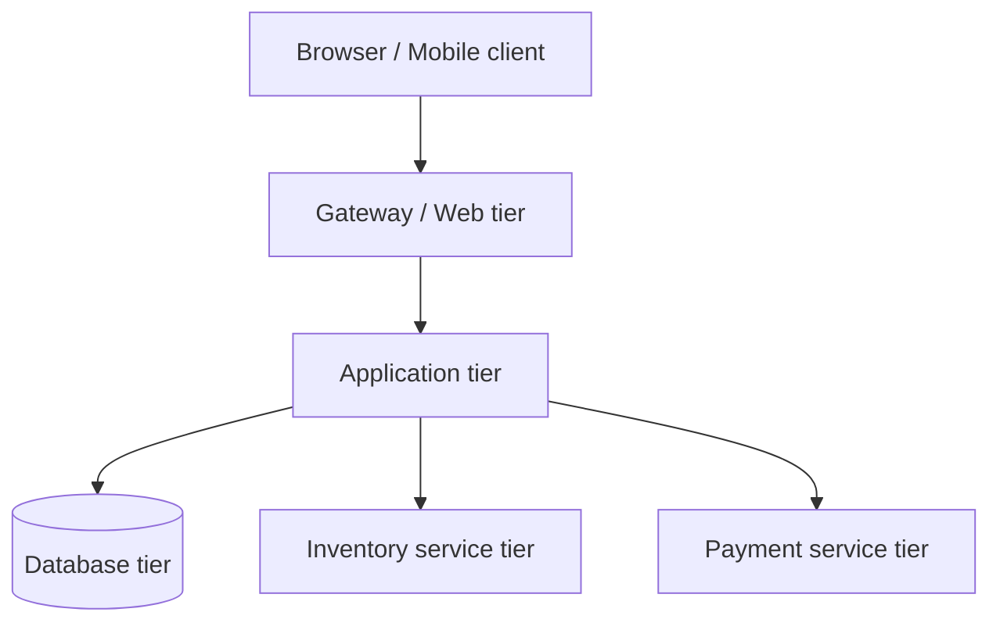
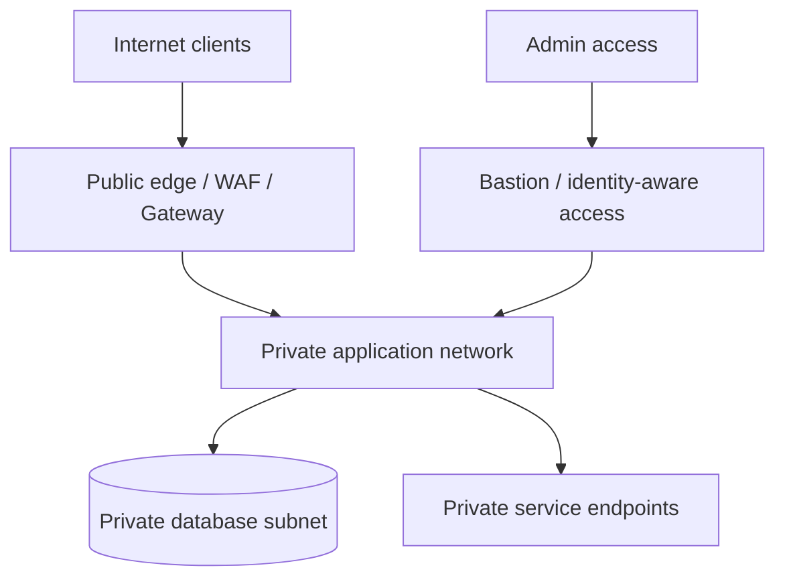

# Đánh giá độ trễ mạng, lỗi từng phần và bảo mật khi tách nhiều tier

Khi ứng dụng được triển khai trên nhiều máy chủ hoặc dịch vụ, các thành phần phải giao tiếp qua mạng. Việc tách tầng có thể giúp mở rộng độc lập, cô lập lỗi và đặt các vùng bảo mật riêng, nhưng mỗi lời gọi qua mạng đều thêm độ trễ và một điểm có thể thất bại. Một cơ sở dữ liệu chậm, một dịch vụ tồn kho tạm ngừng hoặc một kết nối bị timeout có thể làm cả ca sử dụng thất bại dù các thành phần còn lại vẫn hoạt động.

Bài học này thuộc module `SOFTWARE_DESIGN_ARCHITECTURE_ARCHITECTURAL_PATTERN_LAYERED`, tập trung vào tổ chức phần mềm theo kiến trúc phân tầng. Trong chương **Hiệu năng và triển khai**, ta xem cách đánh giá độ trễ mạng, thiết kế hành vi khi chỉ một phần hệ thống gặp lỗi và bảo vệ các ranh giới tin cậy khi triển khai thành nhiều tier.

## Phân biệt logical layer và deployment tier

Layer là cách chia trách nhiệm logic trong mã nguồn, chẳng hạn presentation, application, domain và data access. Tier là một ranh giới triển khai hoặc tiến trình riêng, thường giao tiếp với tier khác qua mạng. Một ứng dụng Spring Boot có thể chứa controller, application service, domain và repository trong cùng một tiến trình; đó là nhiều layer logic nhưng chỉ một application tier.

Khi tách deployment, cùng một hệ thống có thể được triển khai như sau:



Gateway có thể xác thực request đầu vào, áp dụng giới hạn lưu lượng và định tuyến. Application tier chạy ca sử dụng và quy tắc nghiệp vụ. Database tier lưu trạng thái bền vững. Inventory và Payment có thể là các dịch vụ triển khai riêng. Các layer bên trong application tier vẫn có thể được giữ tách biệt dù chúng chạy trong cùng một tiến trình.

Tách tier tạo thêm network hop, serialization/deserialization, quản lý kết nối và cơ chế xác thực giữa các tiến trình. Vì vậy, không nên tách một lớp thành dịch vụ riêng chỉ vì sơ đồ logic có một ô riêng. Quyết định triển khai nên dựa trên nhu cầu mở rộng, quyền sở hữu, cô lập lỗi, bảo mật, khả năng vận hành và chi phí giao tiếp.

## Độ trễ mạng hình thành như thế nào?

Độ trễ đầu cuối (end-to-end latency) là thời gian người gọi chờ từ lúc gửi yêu cầu đến lúc nhận kết quả. Trong một lời gọi dịch vụ, thời gian này có thể bao gồm:

- Tra cứu DNS hoặc phân giải địa chỉ đích.
- Thiết lập kết nối TCP, TLS hoặc mTLS nếu chưa có kết nối tái sử dụng.
- Thời gian chờ trong hàng đợi, connection pool hoặc bộ lập lịch.
- Thời gian truyền dữ liệu qua mạng và thời gian xử lý ở máy chủ.
- Serialization ở bên gửi và deserialization ở bên nhận.
- Thời gian xử lý nghiệp vụ, truy vấn database và gọi các dependency tiếp theo.

Một request tạo đơn có thể đi qua gateway, application service, inventory service và database. Nếu các lời gọi được thực hiện tuần tự, thời gian tổng gần bằng tổng thời gian từng bước cộng với chi phí mạng và xử lý ở các tầng. Nếu một số lời gọi độc lập được thực hiện song song, thời gian chờ thường bị chi phối bởi nhánh chậm nhất, cộng chi phí điều phối. Song song hóa giảm thời gian chờ trong một số trường hợp nhưng tăng tải đồng thời lên dependency.

Ví dụ minh họa về ngân sách thời gian:

| Thành phần | Ngân sách mục tiêu |
|---|---:|
| Gateway và xác thực request | 30 ms |
| Application logic | 40 ms |
| Inventory service | 100 ms |
| Database operations | 80 ms |
| Mạng, serialization và dự phòng | 50 ms |
| **Tổng mục tiêu** | **300 ms** |

Các con số chỉ là ví dụ để minh họa cách phân bổ budget. Đội phát triển cần đo trên môi trường gần production, theo tải và phân vị thực tế. Trung bình (mean) có thể che khuất một số request rất chậm; hãy theo dõi p50, p95 và p99 cùng tỷ lệ timeout và lỗi.

### Đo ở cả đầu vào và từng dependency

Đo thời gian tổng tại API cho biết người dùng đang trải nghiệm ra sao. Đo riêng từng span hoặc lời gọi dependency giúp xác định thời gian bị tiêu tốn ở đâu. Nên phân biệt:

- **Latency:** thời gian hoàn thành một thao tác.
- **Throughput:** số thao tác hoàn thành trong một đơn vị thời gian.
- **Queue time:** thời gian chờ trước khi được xử lý.
- **Saturation:** mức sử dụng tài nguyên như CPU, thread pool, connection pool hoặc hàng đợi.

Khi throughput tiến gần giới hạn và hàng đợi tăng, latency thường tăng nhanh. Chỉ tăng timeout có thể khiến nhiều request cùng chờ lâu hơn, giữ thread hoặc connection lâu hơn và làm hệ thống quá tải nặng hơn. Cần xem latency cùng throughput, saturation và tỷ lệ lỗi để xác định nút thắt.

## Phân bổ timeout theo ngân sách đầu cuối

Mỗi lời gọi mạng nên có timeout hữu hạn. Nếu gateway chờ 2 giây, application tier chờ dịch vụ tồn kho 5 giây thì request có thể đã bị client hoặc gateway hủy trước khi application tier nhận ra. Một timeout dài ở tầng trong không làm request bên ngoài có thêm thời gian.

Hãy xác định deadline hoặc ngân sách thời gian cho toàn bộ ca sử dụng, rồi phân bổ phần còn lại cho từng dependency. Ví dụ, nếu API cần trả kết quả trong 800 ms, application tier có thể dành tối đa 250 ms cho inventory, 250 ms cho payment và giữ phần còn lại cho database, xử lý nội bộ và dự phòng. Cần tính cả thời gian kết nối, retry và xử lý lỗi trong ngân sách này.

Trong Java/Spring, timeout được cấu hình ở HTTP client hoặc thư viện kết nối cụ thể. Ví dụ với Reactor Netty:

```java
HttpClient httpClient = HttpClient.create()
    .option(ChannelOption.CONNECT_TIMEOUT_MILLIS, 200)
    .responseTimeout(Duration.ofMillis(400));

WebClient inventoryClient = WebClient.builder()
    .clientConnector(new ReactorClientHttpConnector(httpClient))
    .baseUrl("https://inventory.internal")
    .build();
```

Ví dụ minh họa thời hạn thiết lập kết nối và thời gian chờ response; trong hệ thống thật cần kiểm tra thêm timeout đọc/ghi, timeout lấy connection từ pool, timeout tổng của request và deadline được truyền từ tầng gọi. Tên API và cấu hình có thể khác theo phiên bản Spring/Reactor Netty. Đừng coi một timeout response là deadline bao trùm mọi bước của ca sử dụng.

Khi một request hết thời gian chờ, phía gọi có thể ngừng chờ nhưng phía nhận vẫn đang thực thi. Vì vậy, timeout không bảo đảm thao tác phía xa đã bị hủy. Với lệnh ghi hoặc thanh toán, cần thiết kế idempotency và cơ chế tra cứu trạng thái để tránh gửi lại rồi tạo tác động trùng.

## Xử lý lỗi từng phần

Trong hệ thống phân tán, một thành phần có thể lỗi trong khi các thành phần khác vẫn khỏe. Đây là lỗi từng phần (partial failure). Ví dụ:

- Gateway hoạt động nhưng application tier không truy cập được database.
- Application tier vẫn phục vụ xem đơn hàng nhưng inventory service tạm thời không phản hồi.
- Payment service đã nhận yêu cầu nhưng phản hồi bị mất trên đường về.
- Một replica chậm hoặc mất kết nối trong khi các replica khác vẫn hoạt động.

Không phải mọi lỗi đều có thể xử lý giống nhau. Cần xác định thao tác nào bắt buộc để hoàn thành ca sử dụng, thao tác nào có thể trì hoãn và trạng thái nào cần được thể hiện rõ cho người dùng.

Ví dụ, trang chi tiết sản phẩm có thể hiển thị mô tả và giá đã lưu khi dịch vụ đề xuất sản phẩm tạm ngừng; đề xuất là phần tùy chọn nên có thể bỏ qua. Ngược lại, khi xác nhận thanh toán mà không thể xác minh kết quả giao dịch, hệ thống không nên tự giả định thanh toán thất bại hoặc thành công. Nó cần trạng thái như `PENDING_CONFIRMATION` và một quy trình đối soát hoặc truy vấn lại.

## Retry: chỉ thử lại khi có cơ sở

Retry có ích khi lỗi có tính tạm thời, ví dụ connection reset hoặc một phản hồi quá tải có chỉ dẫn thử lại. Nhưng retry không phù hợp với mọi lỗi:

- Lỗi validation hoặc lỗi nghiệp vụ thường không thay đổi khi gửi lại cùng dữ liệu.
- Retry quá nhanh có thể làm dependency đang quá tải càng quá tải hơn.
- Retry lệnh ghi có thể tạo dữ liệu trùng nếu lần gọi trước đã thành công nhưng phản hồi bị mất.
- Nhiều tầng cùng retry có thể nhân số lần gọi theo cấp số nhân.

Nếu cần retry, hãy giới hạn số lần, dùng exponential backoff và jitter, tôn trọng deadline và chỉ retry những lỗi được xác định là tạm thời. Không retry vô hạn và không xếp retry ở mọi tầng cùng lúc.

Với lệnh ghi, dùng idempotency key hoặc một định danh yêu cầu ổn định để server nhận biết các lần gửi lại thuộc cùng một thao tác. Ví dụ, client gửi `Idempotency-Key` khi tạo thanh toán; payment service lưu kết quả gắn với key đó và trả lại kết quả cũ nếu cùng key được gửi lại. Cơ chế này cần được thiết kế bền vững và có quy tắc hết hạn rõ ràng.

## Circuit breaker, bulkhead và fallback

Ba cơ chế thường dùng để giới hạn ảnh hưởng của dependency lỗi:

| Cơ chế | Cách hoạt động | Khi hữu ích |
|---|---|---|
| Circuit breaker | Ngừng gọi dependency trong một khoảng thời gian sau khi tỷ lệ lỗi vượt ngưỡng; sau đó thử lại có kiểm soát | Tránh tiếp tục dồn request vào dịch vụ đang hỏng hoặc quá chậm |
| Bulkhead | Giới hạn số request/connection/thread đồng thời cho một dependency | Ngăn một dịch vụ chậm chiếm hết tài nguyên của application tier |
| Fallback | Cung cấp hành vi thay thế đã được định nghĩa khi dependency không sẵn sàng | Chỉ dùng khi nghiệp vụ cho phép kết quả suy giảm an toàn |

Ví dụ dùng Resilience4j Circuit Breaker trong Spring:

```java
@Service
class InventoryGateway {
    private final InventoryClient client;

    InventoryGateway(InventoryClient client) {
        this.client = client;
    }

    @CircuitBreaker(name = "inventory", fallbackMethod = "unavailable")
    public InventoryResult check(ProductId productId) {
        return client.check(productId);
    }

    private InventoryResult unavailable(ProductId productId, Throwable cause) {
        return InventoryResult.unknown();
    }
}
```

`InventoryResult.unknown()` biểu diễn rằng không xác định được tồn kho. Nó không được hiểu là còn hàng hoặc hết hàng. Application service phải quyết định có thể tiếp tục hay cần trả trạng thái tạm thời không xác định. Fallback chỉ an toàn khi hợp đồng nghiệp vụ định nghĩa rõ kết quả suy giảm; không dùng fallback để che giấu lỗi hoặc tạo ra thành công giả.

Circuit breaker không thay thế timeout. Timeout giới hạn thời gian chờ một lời gọi; circuit breaker ngăn bắt đầu những lời gọi mới khi dependency đang có vấn đề. Bulkhead có thể được cấu hình bằng giới hạn concurrency, semaphore hoặc thread pool riêng. Khi dùng annotation dựa trên Spring proxy, hãy chú ý quy tắc proxy và self-invocation tương tự các annotation Spring khác.

## Thiết kế nhất quán khi kết quả của lời gọi mạng chưa rõ

Một trường hợp khó là request gửi sang dịch vụ thanh toán đã được xử lý, nhưng response bị mất. Application tier chỉ biết đã timeout; nó không biết giao dịch đã được capture hay chưa. Nếu lập tức retry với một request mới, khách hàng có thể bị trừ tiền hai lần.

Một quy trình an toàn hơn thường gồm:

1. Gửi lệnh với một operation ID hoặc idempotency key ổn định.
2. Nếu timeout, đánh dấu trạng thái nội bộ là chưa xác định hoặc đang chờ xác nhận.
3. Truy vấn trạng thái bằng cùng operation ID hoặc chờ callback/event có xác thực.
4. Chỉ hoàn tất hoặc bù trừ khi đã biết kết quả có thẩm quyền.
5. Ghi nhận mọi chuyển trạng thái để có thể đối soát và xử lý lại.

Khi một ca sử dụng trải qua nhiều dịch vụ và không thể dùng một transaction phân tán, có thể cần Saga: mỗi bước commit cục bộ và có hành động bù trừ cho trường hợp quy trình phải dừng. Hành động bù trừ là một thao tác nghiệp vụ mới, không phải rollback vật lý của transaction trước; nó cũng có thể thất bại và cần retry/đối soát riêng.

## Bảo mật khi tách nhiều tier

Mỗi ranh giới mạng là một ranh giới tin cậy cần được bảo vệ. Việc hai service nằm trong cùng mạng nội bộ không có nghĩa request từ service này luôn đáng tin. Một máy chủ có thể bị xâm nhập, cấu hình sai hoặc bị dùng làm bàn đạp để truy cập thành phần khác.

Một cách phân vùng thường gặp:



Gateway là điểm vào công khai; application và database đặt trong mạng riêng, chỉ mở những luồng giao tiếp cần thiết. Database không nên được public trực tiếp cho browser hoặc client bên ngoài. Luồng quản trị cần cơ chế truy cập riêng, có xác thực mạnh và audit.

### Mã hóa và xác thực giữa các tier

- Dùng TLS cho giao tiếp qua mạng, kể cả giữa các service nội bộ khi dữ liệu hoặc rủi ro yêu cầu.
- Dùng mTLS khi cần xác thực danh tính cả client lẫn server ở cấp kết nối.
- Dùng OAuth2 client credentials, workload identity hoặc cơ chế tương đương để cấp danh tính dịch vụ và token có scope/audience phù hợp.
- Xác thực người dùng cuối ở biên; nếu chuyển tiếp danh tính hoặc quyền người dùng qua service, phải dùng token/claim được ký và kiểm tra đúng issuer, audience, expiry và scope.
- Không tin các header như `X-User-Id`, `X-Role` hoặc `X-Tenant-Id` do client tự gửi. Gateway chỉ được ghi đè/thiết lập header tin cậy sau khi xác thực, và service nhận vẫn phải xác minh nguồn cùng chính sách.

TLS bảo vệ dữ liệu trên đường truyền và xác thực endpoint theo cấu hình chứng thư; nó không thay thế authorization ở từng service. Một request hợp lệ về mặt kết nối vẫn có thể không được phép đọc một đơn hàng cụ thể.

### Least privilege và giới hạn luồng mạng

Mỗi service chỉ nên có quyền truy cập đúng database, schema, queue và endpoint mà nó cần. Dùng tài khoản database riêng cho ứng dụng, quyền đọc/ghi theo nhu cầu và tách quyền migration khỏi tài khoản chạy thường ngày. Áp dụng firewall hoặc network policy theo allowlist luồng cần thiết; hạn chế egress để giảm nguy cơ server bị lợi dụng gọi tới địa chỉ không mong muốn.

Quản lý secret bằng secret manager hoặc cơ chế cấp phát an toàn, xoay vòng credential và không đưa secret vào source code, image container hoặc log. Cần có quy trình thu hồi chứng thư/token khi service bị xâm nhập hoặc không còn được sử dụng.

Phân quyền vẫn phải được kiểm tra ở tầng ứng dụng theo tài nguyên và quy tắc nghiệp vụ. Gateway có thể xác thực token và lọc request, nhưng application service cần xác minh actor có quyền trên đối tượng cụ thể. Không dựa vào việc client không hiển thị nút thao tác để bảo vệ dữ liệu.

## Quan sát và vận hành trong môi trường nhiều tier

Khi triển khai nhiều tier, log, metric và distributed trace trở nên quan trọng hơn vì một request có thể đi qua nhiều tiến trình và nhóm vận hành. Hãy truyền trace context qua HTTP hoặc message metadata, thống nhất `service.name`, môi trường và phiên bản triển khai, đồng thời đo latency từng dependency.

Các chỉ số nên theo dõi gồm:

- Request rate, error rate và p95/p99 latency của từng API.
- Timeout, retry, circuit breaker open/half-open và fallback count theo dependency.
- Connection pool usage, queue depth, thread pool saturation và database connection wait.
- Tỷ lệ request bị từ chối do xác thực/phân quyền và các lỗi truy cập bất thường.
- Số lần xử lý lặp, idempotency conflict và các giao dịch đang chờ đối soát.

Metric tag cần cardinality thấp; không gắn user ID hoặc request ID làm tag metric. Log và trace có thể mang định danh để điều tra nếu chính sách dữ liệu cho phép, nhưng phải mask thông tin nhạy cảm và kiểm soát quyền truy cập. Không ghi access token, session cookie, mật khẩu hoặc dữ liệu thanh toán vào log.

## Đánh giá trade-off trước khi tách tier

Tách tier có thể giúp scale riêng phần web, application hoặc data; đặt database trong vùng mạng riêng; giới hạn blast radius; và cho phép nhóm khác nhau triển khai độc lập. Đổi lại, hệ thống cần quản lý network, service identity, timeout, retry, observability, deployment automation và các tình huống lỗi từng phần. Một lời gọi nội bộ trong cùng process thường rẻ và đơn giản hơn một lời gọi qua mạng.

Trước khi tách, hãy trả lời:

1. Có nhu cầu scale, bảo mật, cô lập lỗi hoặc quyền sở hữu triển khai độc lập nào đủ lớn không?
2. Những lời gọi nào sẽ trở thành network hop, và latency budget của ca sử dụng có đủ không?
3. Nếu dependency timeout hoặc phản hồi không xác định, hệ thống sẽ hiển thị và khôi phục trạng thái ra sao?
4. Lệnh ghi có idempotent không; có cần outbox, đối soát hoặc hành động bù trừ không?
5. Service identity, TLS, authorization, network policy và secret rotation được quản lý thế nào?
6. Có metric, log và trace đủ để phát hiện và khoanh vùng lỗi xuyên tier không?

Không có một số lượng tier tối ưu cho mọi hệ thống. Một ứng dụng Spring Boot được tổ chức tốt trong một tiến trình có thể phù hợp lâu dài. Khi nhu cầu triển khai thực sự đòi hỏi tách riêng, hãy giữ ranh giới logic rõ ràng, đo chi phí giao tiếp, định nghĩa hành vi khi dependency lỗi và bảo vệ từng ranh giới tin cậy. Làm được các việc đó giúp lợi ích của triển khai nhiều tier lớn hơn chi phí và độ phức tạp mà nó mang lại.
