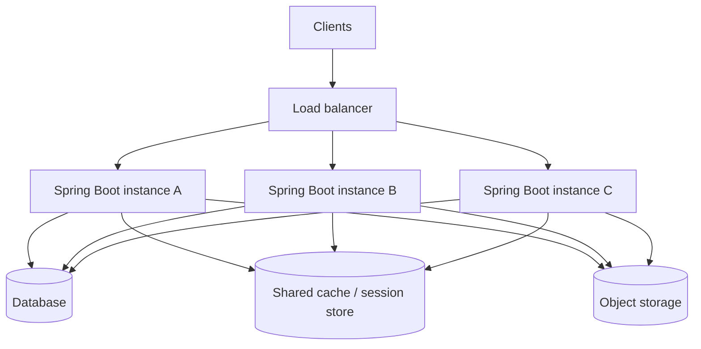

# Mở rộng theo tải thực tế, trạng thái dùng chung và tài nguyên hạ tầng

Một ứng dụng phân tầng có thể chạy tốt trên một máy chủ khi số người dùng còn ít, nhưng gặp vấn đề khi lưu lượng tăng, nhiều phiên làm việc đồng thời hoặc dữ liệu lớn dần. Mở rộng hệ thống không chỉ là tăng số bản sao ứng dụng. Cần xác định nút thắt đang giới hạn tốc độ, biết trạng thái nào được giữ ở đâu, và phân bổ tài nguyên cho ứng dụng, cơ sở dữ liệu cùng các dịch vụ phụ trợ.

Trong kiến trúc phân tầng, presentation, application, domain và data access là các ranh giới logic của mã nguồn. Khi triển khai, chúng có thể cùng nằm trong một tiến trình Spring Boot, trong khi ứng dụng được chạy thành nhiều bản sao phía sau load balancer và sử dụng cơ sở dữ liệu, cache hoặc object storage dùng chung. **Tầng logic không đồng nghĩa với máy chủ hoặc tier triển khai.** Việc nhân bản tiến trình ứng dụng cũng không tự động làm cho trạng thái trong bộ nhớ của từng tiến trình trở thành trạng thái dùng chung.

Bài học này trình bày cách mở rộng theo tải thực tế, tổ chức trạng thái dùng chung và quản lý tài nguyên hạ tầng trong một ứng dụng Java/Spring. Mục tiêu là chọn cách mở rộng phù hợp với bằng chứng đo đạc và đặc tính của use case, không áp dụng một cấu hình cố định cho mọi hệ thống.

## 1. Đo tải trước khi quyết định mở rộng

Một hệ thống có thể chậm vì nhiều nguyên nhân khác nhau: CPU xử lý nghiệp vụ quá tải, heap gây áp lực garbage collection, truy vấn cơ sở dữ liệu chậm, pool kết nối cạn, dịch vụ ngoài phản hồi lâu, hoặc một tác vụ đồng bộ giữ thread quá lâu. Tăng số instance chỉ có ích nếu tài nguyên được tăng thêm nằm trên đường xử lý đang bị giới hạn.

Trước khi thay đổi kiến trúc, hãy thu thập các chỉ số phản ánh trải nghiệm và tài nguyên:

| Nhóm đo lường | Chỉ số nên theo dõi | Câu hỏi cần trả lời |
|---|---|---|
| Lưu lượng | Request/second, số kết nối đồng thời, tỷ lệ request theo endpoint | Hệ thống đang nhận loại tải nào và tải tăng vào thời điểm nào? |
| Độ trễ | p50, p95, p99, thời gian theo từng dependency | Người dùng nào bị chậm và bước nào chiếm thời gian? |
| Lỗi | HTTP 5xx, timeout, exception, retry, tỷ lệ lỗi theo dependency | Hệ thống đang quá tải hay một dịch vụ phụ thuộc đang lỗi? |
| JVM | CPU, heap, allocation rate, GC pause, thread count | Tiến trình Java bị giới hạn bởi CPU, bộ nhớ hay thread? |
| Database | Connection đang dùng/chờ, query latency, lock wait, CPU, I/O | Tầng dữ liệu có phải nút thắt không? |
| Hạ tầng | CPU/memory theo container, network, disk, số replica | Tài nguyên cấp phát có phù hợp với mức sử dụng không? |

Không nên chỉ nhìn thời gian phản hồi trung bình. Trung bình có thể che khuất một nhóm request rất chậm; p95 và p99 giúp thấy phần đuôi phân phối mà người dùng dễ cảm nhận. Cũng cần phân tách độ trễ của ứng dụng với độ trễ của database hoặc dịch vụ ngoài, nếu không sẽ khó xác định nơi cần tối ưu.

Một quy trình hữu ích là xác định mức tải mục tiêu, chạy tải đại diện, quan sát chỉ số, tìm giới hạn đầu tiên và thay đổi từng yếu tố. Sau mỗi thay đổi, đo lại cùng kịch bản. Kết quả đo trong môi trường thử nghiệm chỉ có ý nghĩa khi dữ liệu, cấu hình, loại request và giới hạn tài nguyên gần với môi trường triển khai dự kiến.

## 2. Mở rộng dọc và mở rộng ngang

Có hai hướng cơ bản để tăng khả năng xử lý:

- **Mở rộng dọc (vertical scaling):** tăng CPU, bộ nhớ, IOPS hoặc năng lực của một máy chủ/instance. Cách này thường dễ thực hiện và không đòi hỏi thay đổi nhiều về ứng dụng, nhưng bị giới hạn bởi cấu hình máy và có thể làm một điểm lỗi tập trung lớn hơn.
- **Mở rộng ngang (horizontal scaling):** chạy nhiều instance ứng dụng và phân phối request qua load balancer. Cách này có thể tăng năng lực tổng thể và hỗ trợ thay instance khi triển khai, nhưng yêu cầu quản lý trạng thái dùng chung, kết nối dữ liệu, tính lặp an toàn và các dependency phía sau.



Trong sơ đồ, mỗi instance có bộ nhớ và thread riêng, còn database, cache/session store và object storage là các dịch vụ được nhiều instance sử dụng. Các tầng logic vẫn tồn tại bên trong từng ứng dụng. Có thể bắt đầu bằng một instance lớn hơn, sau đó chuyển sang nhiều instance khi cần tính sẵn sàng hoặc năng lực xử lý lớn hơn. Không có yêu cầu mọi ứng dụng phải scale ngang ngay từ đầu.

### Khi nào thêm instance có ích?

Scale ngang thường có ích khi CPU hoặc năng lực xử lý của ứng dụng là nút thắt, request có thể phân phối độc lập, và database cùng các dependency phía sau còn đủ khả năng đáp ứng. Nếu database đã ở mức bão hòa, tăng từ hai lên mười instance có thể làm số truy vấn đồng thời tăng mạnh và khiến hệ thống chậm hơn.

Scale dọc có thể phù hợp khi một tiến trình cần nhiều heap hoặc CPU hơn, hoặc khi việc vận hành nhiều instance chưa đem lại lợi ích tương xứng. Cần kiểm tra giới hạn của máy ảo/container và khả năng chịu lỗi: một máy lớn hơn không thay thế được tính sẵn sàng nếu toàn bộ dịch vụ vẫn phụ thuộc vào một điểm duy nhất.

## 3. Thiết kế ứng dụng để chạy nhiều instance

Để nhiều instance cùng xử lý request, phần xử lý thông thường nên có thể chạy trên bất kỳ instance nào. Controller và service Spring mặc định thường là singleton trong application context. Điều đó không có nghĩa chúng được phép giữ trạng thái nghiệp vụ thay đổi theo từng người dùng trong field của bean.

Ví dụ không an toàn khi có nhiều request đồng thời:

```java
@Service
class CheckoutService {
    private String currentCustomerId; // Trạng thái dùng chung giữa các request

    public Receipt checkout(String customerId, Cart cart) {
        this.currentCustomerId = customerId;
        // Một request khác có thể ghi đè field trước khi xử lý xong.
        return createReceipt(currentCustomerId, cart);
    }
}
```

Field `currentCustomerId` thuộc về bean dùng chung, vì vậy hai request có thể ghi đè dữ liệu của nhau ngay cả khi chỉ có một instance. Khi chạy nhiều instance, mỗi bản sao lại có một giá trị riêng, khiến trạng thái không nhất quán giữa các request.

Hãy truyền dữ liệu theo tham số và giữ service stateless đối với trạng thái request:

```java
@Service
class CheckoutService {
    public Receipt checkout(String customerId, Cart cart) {
        return createReceipt(customerId, cart);
    }
}
```

Các đối tượng thay đổi trong quá trình xử lý nên có phạm vi rõ ràng, không lưu vào field singleton. Dùng immutable object khi phù hợp, tránh chia sẻ mutable collection giữa request và để trạng thái lâu dài trong nơi lưu trữ được thiết kế cho mục đích đó.

Không phải mọi trạng thái đều phải đưa ra ngoài tiến trình. Dữ liệu tạm thời chỉ dùng trong một lần gọi có thể ở biến cục bộ; cache cục bộ có thể phù hợp cho dữ liệu có thể tái tạo và chấp nhận độ trễ đồng bộ. Cần phân biệt rõ dữ liệu tạm, cache, trạng thái phiên và dữ liệu nghiệp vụ bền vững.

## 4. Phân loại trạng thái và chọn nơi lưu

Trước khi nhân bản ứng dụng, hãy kiểm kê trạng thái đang được giữ ở đâu và ai cần truy cập nó:

| Loại trạng thái | Ví dụ | Nơi lưu thường phù hợp |
|---|---|---|
| Trạng thái trong một request | Request DTO, kết quả tính toán tạm | Biến cục bộ hoặc đối tượng theo request |
| Trạng thái phiên người dùng | Session đăng nhập, thông tin luồng nhiều bước | Shared session store hoặc token phù hợp với mô hình xác thực |
| Dữ liệu nghiệp vụ bền vững | Đơn hàng, số dư, thông tin khách hàng | Database hoặc kho dữ liệu có tính bền vững |
| Cache có thể tái tạo | Kết quả đọc thường xuyên, cấu hình ít thay đổi | Cache cục bộ hoặc distributed cache tùy yêu cầu nhất quán |
| Tệp người dùng | Ảnh, tài liệu, bản xuất báo cáo | Object storage hoặc file service dùng chung |
| Công việc nền | Email cần gửi, tác vụ cần retry, sự kiện tích hợp | Message broker, bảng outbox hoặc job store bền vững |

Một lựa chọn lưu trữ cần cân nhắc độ bền, phạm vi chia sẻ, độ trễ, tính nhất quán, chi phí và cách phục hồi. Không nên dùng cache làm nơi lưu duy nhất cho dữ liệu nghiệp vụ quan trọng nếu mất cache đồng nghĩa mất dữ liệu.

### Session không nên chỉ tồn tại trong bộ nhớ của một instance

Nếu ứng dụng lưu session trong bộ nhớ tiến trình, request tiếp theo của cùng người dùng có thể được load balancer chuyển sang instance khác và không tìm thấy session. Có thể cấu hình sticky session để một người dùng thường xuyên quay lại cùng instance, nhưng đây là cách giảm triệu chứng và có giới hạn: instance hỏng thì session cục bộ mất, việc scale hoặc phân phối tải kém linh hoạt hơn.

Với ứng dụng cần session chia sẻ, có thể dùng Spring Session kết hợp Redis hoặc JDBC. Ví dụ cấu hình phụ thuộc starter và phiên bản Spring tương ứng:

```yaml
spring:
  session:
    store-type: redis
  data:
    redis:
      host: redis.internal
      port: 6379
```

Các instance đọc/ghi session qua cùng một store. Cần thiết lập timeout, chính sách hết hạn, bảo mật kết nối, khả năng dự phòng và giới hạn kích thước session. Không nên lưu cả object đồ sộ hoặc dữ liệu nhạy cảm không cần thiết trong session. Với API stateless sử dụng access token, server có thể không cần lưu session cho mỗi client; tuy vậy, các nhu cầu thu hồi token, đăng xuất toàn cục hoặc lưu refresh token vẫn có thể cần trạng thái phía server.

## 5. Cache dùng chung và tính nhất quán

Cache giúp giảm số lần đọc từ nguồn dữ liệu chậm hơn. Cache cục bộ trong một instance dễ triển khai, nhưng mỗi instance có bản sao riêng. Khi một instance cập nhật hoặc xóa cache, các instance khác có thể vẫn giữ giá trị cũ. Distributed cache như Redis cho phép nhiều instance cùng truy cập một vùng cache, nhưng bổ sung độ trễ mạng, vận hành và yêu cầu xử lý lỗi cache.

Ví dụ với Spring Cache:

```java
@Service
class ProductQueryService {
    private final ProductRepository products;

    ProductQueryService(ProductRepository products) {
        this.products = products;
    }

    @Cacheable(cacheNames = "product", key = "#productId")
    public ProductView find(String productId) {
        return products.findViewById(productId)
                .orElseThrow(ProductNotFoundException::new);
    }

    @CacheEvict(cacheNames = "product", key = "#productId")
    public void evict(String productId) {
        // Xóa cache sau khi dữ liệu nguồn được cập nhật thành công.
    }
}
```

Đoạn mã chỉ minh họa annotation; để cache được chia sẻ giữa các instance, cần cấu hình `CacheManager` dùng Redis hoặc một provider phân tán khác. Nếu không cấu hình provider đó, cache có thể là cache cục bộ trong từng tiến trình. Cũng cần thiết kế thứ tự cập nhật dữ liệu và xóa cache sao cho lỗi không làm cache giữ giá trị cũ quá lâu.

Các quyết định quan trọng khi dùng cache:

- **TTL:** dữ liệu tồn tại bao lâu trước khi tự hết hạn. TTL ngắn giảm thời gian giữ dữ liệu cũ nhưng tăng lượt đọc nguồn.
- **Invalidation:** khi nào xóa hoặc cập nhật cache sau thay đổi nghiệp vụ. Invalidation khó hơn cache read-only vì có nhiều đường ghi dữ liệu.
- **Cache key:** phải chứa mọi yếu tố làm thay đổi kết quả, như tenant, ngôn ngữ, quyền truy cập hoặc phiên bản dữ liệu nếu có liên quan.
- **Cache stampede:** nhiều request cùng làm mới một key hết hạn có thể dồn tải lên database. Có thể dùng single-flight, khóa có thời hạn, làm mới trước khi hết hạn hoặc stale-while-revalidate tùy mức chấp nhận dữ liệu cũ.
- **Cache failure:** xác định khi cache không khả dụng thì request sẽ fallback, trả lỗi hay từ chối có kiểm soát. Fallback đồng loạt vào database có thể tạo thêm tải đúng lúc hệ thống đang gặp sự cố.

Cache không thay thế cơ chế bảo vệ dữ liệu. Với dữ liệu nhạy cảm hoặc phụ thuộc quyền, phải đảm bảo cache key và chính sách truy cập không làm lộ dữ liệu giữa người dùng hoặc tenant.

## 6. Tệp và công việc nền trong môi trường nhiều instance

Nếu một instance ghi tệp tải lên vào thư mục local, instance khác có thể không đọc được tệp đó. Tệp cũng có thể mất khi container bị thay thế hoặc máy chủ bị thu hồi. Với nhiều instance, thường nên lưu tệp vào object storage hoặc file service dùng chung, còn database lưu metadata và tham chiếu.

Một luồng tải tệp có thể gồm:

1. Application service xác thực người dùng và kiểm tra quyền tải tệp.
2. Adapter storage ghi nội dung vào object storage bằng khóa hoặc đường dẫn duy nhất.
3. Application lưu metadata, chủ sở hữu, loại nội dung, kích thước và storage key vào database.
4. Khi tải xuống, ứng dụng kiểm tra quyền rồi đọc qua adapter hoặc cấp URL có thời hạn theo chính sách.

Nếu bước ghi storage thành công nhưng transaction database thất bại, có thể xuất hiện tệp mồ côi. Cần có quy trình bù trừ hoặc job dọn dẹp dựa trên metadata và tuổi tệp. Không nên giả định transaction database có thể rollback thao tác object storage.

Tác vụ nền cũng không nên dựa vào một scheduler cục bộ chạy trên tất cả instance mà không có cơ chế phối hợp. Khi có ba replica, một `@Scheduled` job có thể chạy ba lần. Nếu tác vụ phải chạy đúng một lần theo khóa nghiệp vụ, hãy dùng distributed lock có lease và xử lý an toàn khi lock hết hạn, hoặc thiết kế job có thể chạy lặp mà không gây tác dụng phụ trùng. Message broker, hàng đợi công việc hoặc transactional outbox có thể giúp phân phối và retry công việc giữa các instance.

Với message broker, cần giả định message có thể được giao lại. Consumer nên idempotent: xử lý cùng một message nhiều lần không tạo nhiều khoản thanh toán, email hoặc bản ghi ngoài ý muốn. Có thể lưu message ID đã xử lý, dùng unique constraint hoặc dùng idempotency key của hệ thống đích. “Exactly once” xuyên nhiều hệ thống thường không được bảo đảm chỉ bằng cấu hình broker; thiết kế nghiệp vụ vẫn phải chịu được retry và lỗi giữa các bước.

## 7. Quản lý connection pool và tài nguyên database

Mỗi instance ứng dụng thường có pool kết nối database riêng, ví dụ HikariCP trong Spring Boot. Nếu một instance được cấu hình tối đa 20 kết nối và triển khai 8 replica, tổng số kết nối tiềm năng từ ứng dụng có thể lên tới 160, chưa tính worker, tác vụ quản trị và các ứng dụng khác. Tăng replica mà không tính tổng pool có thể làm database hết kết nối trước khi CPU ứng dụng đạt giới hạn.

Ví dụ cấu hình:

```yaml
spring:
  datasource:
    hikari:
      maximum-pool-size: 12
      minimum-idle: 2
      connection-timeout: 3000
      idle-timeout: 600000
      max-lifetime: 1800000
```

Các con số chỉ là giá trị minh họa, không phải khuyến nghị dùng nguyên trạng. Cần chọn pool size dựa trên khả năng database, số replica tối đa, thời gian truy vấn, số luồng xử lý và các workload khác. Pool quá nhỏ gây hàng đợi ở ứng dụng; pool quá lớn làm database chịu quá nhiều truy vấn đồng thời, context switching và tranh chấp tài nguyên.

Ước lượng ban đầu:

\[
\text{Tổng kết nối tối đa} \approx
\text{Số replica} \times \text{maximumPoolSize mỗi replica}
\]

Đây là giới hạn cấu hình có thể đạt tới, không phải số kết nối luôn được mở. Khi autoscaling, hãy tính theo số replica tối đa chứ không chỉ số replica trung bình. Dành phần năng lực cho migration, báo cáo, tác vụ nền và công cụ vận hành. Theo dõi connection acquisition time, active/idle/pending connections và database load để điều chỉnh.

Ngoài database connection, mỗi replica còn tiêu thụ heap, direct memory, thread, file descriptor và network socket. Container memory limit cần đủ cho heap cùng native memory, metaspace, thread stack và buffer; đặt `-Xmx` bằng toàn bộ giới hạn container có thể khiến tiến trình bị OOM kill dù heap chưa đầy. CPU limit quá thấp có thể gây throttling và làm p95 tăng. Cần quan sát tài nguyên ở cả JVM và container.

## 8. Giới hạn tài nguyên và bảo vệ hệ thống khi quá tải

Khi tải vượt khả năng xử lý, hệ thống cần có cách từ chối hoặc làm chậm công việc có kiểm soát. Nếu mọi request đều chờ vô hạn ở database hoặc API ngoài, số thread và request đang chờ có thể tăng liên tục, cuối cùng làm toàn bộ ứng dụng không còn phản hồi.

Một số cơ chế thường dùng:

- Timeout hữu hạn cho truy vấn, HTTP client và thao tác chờ tài nguyên.
- Giới hạn số request đồng thời hoặc kích thước hàng đợi để tránh tích tụ vô hạn.
- Bulkhead để cô lập tài nguyên của dependency chậm, ví dụ giới hạn số request đồng thời tới cổng thanh toán.
- Circuit breaker để tạm ngừng gọi dependency đang lỗi liên tục và cho hệ thống thời gian phục hồi.
- Retry có giới hạn, backoff và jitter; chỉ retry lỗi tạm thời và thao tác an toàn khi lặp.
- Rate limiting để bảo vệ API khỏi một client hoặc nhóm client tạo tải quá lớn.
- Backpressure hoặc cơ chế queue có giới hạn cho công việc có thể xử lý bất đồng bộ.

Không nên retry mọi lỗi hoặc retry ngay lập tức ở mọi tầng. Nhiều lớp cùng retry có thể nhân số lần gọi lên rất lớn. Cần chọn một nơi chịu trách nhiệm retry cho từng loại thao tác, giới hạn tổng thời gian và bảo đảm idempotency khi thao tác có tác dụng phụ.

## 9. Autoscaling theo tín hiệu phù hợp

Autoscaling điều chỉnh số replica theo tải hoặc tín hiệu vận hành. CPU là tín hiệu phổ biến, nhưng không phải lúc nào cũng phản ánh đúng nhu cầu. Ứng dụng có thể chờ database hoặc API ngoài trong khi CPU thấp; khi đó scale theo CPU có thể không giải quyết được độ trễ. Ngược lại, tăng replica khi database đang quá tải có thể làm tình hình tệ hơn.

Có thể kết hợp nhiều tín hiệu:

| Tín hiệu | Khi nào hữu ích | Điều cần kiểm tra |
|---|---|---|
| CPU utilization | Request tiêu tốn CPU và xử lý có thể phân phối | CPU throttling, giới hạn container, workload nền |
| Request rate hoặc số request đang chạy | Tải web tăng rõ rệt | Mức độ phức tạp khác nhau giữa endpoint |
| Queue depth và tuổi message lâu nhất | Tác vụ nền đang tích tụ | Tốc độ consumer, giới hạn broker và khả năng downstream |
| Độ trễ p95/p99 | Trải nghiệm người dùng xấu đi | Độ trễ có do ứng dụng hay dependency phía sau |
| Số connection chờ database | Pool bị nghẽn | Database có đủ năng lực nhận thêm connection hay không |

Đặt ngưỡng scale có hysteresis hoặc thời gian ổn định để tránh replica tăng giảm liên tục. Cần có thời gian khởi động, readiness probe và giới hạn replica tối đa. Scale down cũng phải cho request đang chạy hoàn tất hoặc đóng kết nối có kiểm soát. Với job consumer, scale theo queue depth nhưng vẫn phải tôn trọng giới hạn throughput của database và hệ thống đích.

## 10. Triển khai nhiều instance an toàn

Một ứng dụng chạy nhiều replica cần được triển khai theo cách hỗ trợ instance khởi động, sẵn sàng nhận tải và dừng mà không làm mất công việc đang xử lý. Một số thực hành thường gặp:

- **Readiness check:** chỉ đưa instance vào load balancer sau khi ứng dụng đã khởi tạo và có thể phục vụ request theo điều kiện đã chọn.
- **Liveness check:** phát hiện tiến trình bị kẹt hoặc không thể phục hồi; không nên biến lỗi tạm thời của một dependency thành việc khởi động lại liên tục mọi replica.
- **Graceful shutdown:** ngừng nhận request mới, chờ request đang chạy trong giới hạn thời gian, đóng pool và tài nguyên đúng cách.
- **Cấu hình bên ngoài:** endpoint, credential và giới hạn tài nguyên được truyền qua môi trường hoặc secret store; tránh đóng cứng vào image.
- **Migration tương thích:** triển khai thay đổi schema theo hướng có thể cùng tồn tại với phiên bản ứng dụng cũ trong giai đoạn rolling deployment, thường dùng quy trình expand-and-contract.
- **Log và trace có định danh instance:** giúp nối request qua nhiều replica và xác định nguồn phát sinh lỗi.

Không nên lưu tệp quan trọng hoặc trạng thái phiên duy nhất trên filesystem/container local nếu instance có thể bị thay thế. Cũng cần kiểm tra tác vụ khởi động như database migration: nếu mọi replica cùng chạy migration đồng thời, cần cơ chế khóa hoặc tách migration thành bước triển khai riêng.

## 11. Kiểm thử khả năng mở rộng

Kiểm thử chức năng thông thường không cho biết ứng dụng chịu được bao nhiêu tải. Có thể dùng nhiều loại kiểm thử tải với mục tiêu khác nhau:

| Loại kiểm thử | Mục đích | Ví dụ |
|---|---|---|
| Load test | Đo hành vi ở mức tải dự kiến | 300 request/giây với phân bố endpoint gần thực tế |
| Stress test | Tìm giới hạn và cách hệ thống suy giảm | Tăng tải từng bước cho đến khi độ trễ/lỗi vượt ngưỡng |
| Spike test | Quan sát khi tải tăng đột ngột | Lưu lượng tăng gấp nhiều lần trong thời gian ngắn |
| Soak test | Phát hiện vấn đề tích lũy theo thời gian | Chạy tải ổn định nhiều giờ để tìm memory leak hoặc cạn pool |
| Failover test | Xác nhận khả năng phục hồi khi một thành phần mất | Dừng một replica hoặc làm cache tạm thời không khả dụng |

Kịch bản nên bao gồm cả request đọc và ghi, dữ liệu có kích thước thực tế, cache lạnh/nóng, phiên người dùng, tác vụ nền và lỗi dependency. Đo p95/p99, tỷ lệ lỗi, CPU, heap/GC, pool database, queue depth và throughput. Một bài test chỉ đo endpoint đơn giản trong khi bỏ qua database hoặc dịch vụ ngoài thường không phản ánh khả năng của hệ thống thật.

Sau khi thêm replica, hãy xác nhận throughput tăng trong khi database, cache và dependency khác vẫn nằm trong giới hạn. Nếu throughput không tăng hoặc p99 xấu đi, hãy kiểm tra nút thắt tiếp theo thay vì tiếp tục tăng số instance.

## 12. Ví dụ chọn phương án theo tình huống

| Tình huống quan sát được | Hướng xử lý có thể xem xét | Lý do và giới hạn |
|---|---|---|
| CPU ứng dụng cao, database còn dư năng lực | Tối ưu phần tính toán hoặc tăng replica | Công việc có thể phân phối; cần xác nhận không có state cục bộ phụ thuộc instance |
| Heap tăng theo số request, GC pause dài | Tìm object giữ tham chiếu, giảm dữ liệu tải, xem lại cache và tăng memory nếu có cơ sở | Tăng heap có thể trì hoãn chứ không sửa memory leak |
| Thread chờ database, pool pending tăng | Tối ưu query/transaction và điều chỉnh pool theo giới hạn database | Tăng replica có thể làm tổng connection vượt năng lực DB |
| Request chậm do API đối tác | Timeout, bulkhead, circuit breaker, cache hoặc xử lý bất đồng bộ | Thêm instance không làm đối tác phản hồi nhanh hơn |
| Người dùng mất session khi request sang replica khác | Dùng shared session store hoặc thiết kế xác thực stateless phù hợp | Sticky session có giới hạn về failover và phân phối tải |
| Tệp upload không đọc được từ replica khác | Chuyển sang object storage hoặc file service dùng chung | Filesystem local không phải kho chia sẻ giữa các instance |
| Scheduled job chạy lặp khi tăng replica | Dùng scheduler có phối hợp hoặc thiết kế job idempotent | Mỗi tiến trình có thể kích hoạt lịch riêng |

## 13. Nguyên tắc ra quyết định

Khi chuẩn bị mở rộng một ứng dụng phân tầng, hãy trả lời lần lượt các câu hỏi:

1. Tải thực tế tăng ở endpoint, tác vụ hay dependency nào? Có số đo p95/p99, throughput và lỗi để chứng minh không?
2. Nút thắt là CPU, memory, thread, database, network hay hệ thống ngoài?
3. Trạng thái nào đang nằm trong bộ nhớ instance? Nó là trạng thái request, session, cache hay dữ liệu nghiệp vụ bền vững?
4. Nếu thêm replica, những trạng thái nào phải được chia sẻ qua database, session store, cache, object storage hoặc message broker?
5. Tổng connection pool, thread và memory ở mức replica tối đa có nằm trong năng lực hạ tầng không?
6. Khi dependency chậm hoặc mất kết nối, ứng dụng có timeout, giới hạn hàng đợi, retry có kiểm soát và phục hồi an toàn không?
7. Kịch bản kiểm thử tải nào chứng minh thay đổi thực sự cải thiện throughput, độ trễ và tỷ lệ lỗi?

Mở rộng hiệu quả là kết quả của việc đo đúng, đặt trạng thái đúng nơi, giữ các instance có thể thay thế và không vượt quá năng lực của dependency phía sau. Một ứng dụng phân tầng có thể tiếp tục chạy như một monolith trong một tiến trình hoặc được nhân bản thành nhiều instance; các tầng logic vẫn giúp tổ chức trách nhiệm, còn lựa chọn triển khai phải dựa trên tải, độ sẵn sàng và giới hạn tài nguyên thực tế.
