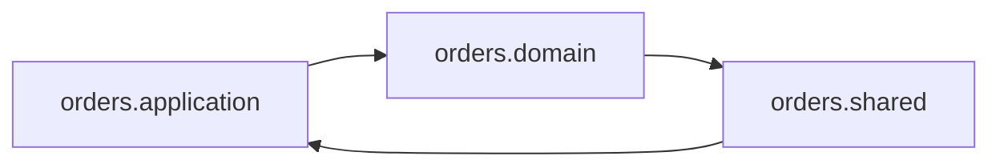

# Tự động kiểm tra phụ thuộc bị cấm, chu trình và rò rỉ kiểu dữ liệu

Bài học này thuộc chương **Chiến lược kiểm thử** của module `SOFTWARE_DESIGN_ARCHITECTURE_ARCHITECTURAL_PATTERN_LAYERED`, trong chương trình **học tổ chức phần mềm theo kiến trúc phân tầng**. Một kiến trúc phân tầng chỉ giữ được ý nghĩa khi mã nguồn tuân theo các ranh giới đã thiết kế: presentation không tự truy cập persistence nếu quy tắc yêu cầu đi qua application; domain không phụ thuộc framework web; các package/module không tạo chu trình; và kiểu dữ liệu của một tầng không rò rỉ qua hợp đồng của tầng khác.

Review thủ công có thể phát hiện vi phạm, nhưng khi codebase lớn dần, một import sai hoặc một kiểu framework lọt vào public API rất dễ bị bỏ sót. **Architecture test** biến các quyết định kiến trúc thành quy tắc tự động, chạy cùng bộ kiểm thử và báo lỗi khi dependency graph thay đổi theo hướng bị cấm. Bài học này dùng Java và ArchUnit để minh họa cách kiểm tra phụ thuộc giữa tầng, phát hiện chu trình và ngăn kiểu dữ liệu persistence/web rò rỉ vào hợp đồng application/domain.

Sau bài học, bạn có thể mô hình hóa quy tắc kiến trúc bằng test, chọn phạm vi kiểm tra phù hợp, đọc kết quả vi phạm và xử lý ngoại lệ có chủ đích mà không biến test thành một bộ luật cứng nhắc cho mọi ứng dụng.

## 1. Kiến trúc có thể được kiểm tra như một hợp đồng

Một sơ đồ kiến trúc thường mô tả những điều được phép và không được phép xảy ra. Ví dụ, một ứng dụng có các package:

```text
com.example.orders
├── presentation
├── application
├── domain
└── dataaccess
    ├── api
    └── jdbc
```

Nhóm có thể thống nhất các quy tắc sau:

- `presentation` gọi `application`; controller không gọi trực tiếp `dataaccess.jdbc`.
- `application` được dùng `domain` và hợp đồng lưu trữ đã chọn; nó không phụ thuộc vào chi tiết JDBC/JPA hoặc Spring MVC.
- `domain` không phụ thuộc `presentation`, `dataaccess` hay framework của tầng ngoài.
- `dataaccess.jdbc` không gọi ngược lên presentation/application.
- Các package đại diện cho những phần độc lập không được phụ thuộc vòng tròn.
- Kiểu `HttpServletRequest`, `ResponseEntity`, `EntityManager`, `JpaRepository` hoặc persistence entity không xuất hiện trong hợp đồng công khai của application/domain.

Đây là một chính sách ví dụ, không phải sơ đồ bắt buộc cho mọi dự án. Ứng dụng có thể chọn application phụ thuộc trực tiếp vào DAO theo kiểu phân tầng truyền thống, hoặc đặt interface ở phía application/core để adapter triển khai. Architecture test phải phản ánh quyết định thực tế của dự án; nếu kiến trúc cho phép một dependency, test không được cấm dependency đó chỉ vì một mẫu tham khảo khác.

## 2. Dependency graph và ba loại vi phạm

### Phụ thuộc bị cấm

Một dependency tồn tại khi mã nguồn tham chiếu đến kiểu hoặc thành phần khác. Nó có thể xuất hiện qua import, field, tham số, kiểu trả về, constructor, kế thừa, annotation hoặc lời gọi phương thức. Ví dụ, `OrderController` gọi `JdbcOrderDao` trực tiếp sẽ tạo dependency từ presentation đến implementation data access.

Một vi phạm có thể không gây lỗi biên dịch hay làm ứng dụng ngừng chạy ngay. Vấn đề nằm ở việc code đã phá quy tắc trách nhiệm: controller có thể tự viết SQL, domain bị gắn với Spring hoặc application khó thay đổi adapter. Architecture test giúp phát hiện các cạnh dependency đó ngay trong quá trình phát triển.

### Chu trình phụ thuộc

Chu trình xuất hiện khi một nhóm mã phụ thuộc trực tiếp hoặc gián tiếp quay lại chính nó. Ví dụ:



Khi có chu trình, khó xác định ranh giới sở hữu và hướng thay đổi. Một thay đổi trong `application` có thể kéo theo `shared`, rồi quay lại ảnh hưởng `application`. Chu trình giữa package cũng có thể làm việc tách module hoặc kiểm thử riêng trở nên khó khăn.

Chu trình có thể xuất hiện ở nhiều mức:

- **Class-level:** hai hoặc nhiều class tham chiếu vòng tròn.
- **Package/slice-level:** các package được xem là đơn vị kiến trúc phụ thuộc vòng tròn qua một hoặc nhiều class.
- **Build-module-level:** Gradle/Maven/JPMS module tạo dependency graph có chu trình hoặc cấu hình build không thể phân giải.

Một số hệ thống build đã từ chối module dependency cycle ngay khi cấu hình hoặc build. Architecture test vẫn hữu ích ở mức package/class, nơi build tool không biết các ranh giới logic mà nhóm muốn bảo vệ.

### Rò rỉ kiểu dữ liệu qua ranh giới

Rò rỉ kiểu xảy ra khi hợp đồng của một tầng để lộ kiểu thuộc tầng khác. Ví dụ:

```java
// Hợp đồng application bị gắn với Spring MVC và JPA
public interface OrderQuery {
    ResponseEntity<Page<OrderEntity>> findOrders(
            HttpServletRequest request);
}
```

Interface này buộc caller biết Spring MVC, Servlet API, Spring Data và entity persistence. Nếu sau này use case được gọi từ CLI, message consumer hoặc một adapter khác, caller vẫn phải mang các dependency web/JPA dù không cần chúng.

Một hợp đồng ít rò rỉ hơn có thể dùng kiểu của application:

```java
public interface OrderQuery {
    OrderPageResult findOrders(OrderSearch search);
}

public record OrderSearch(int page, int size, OrderStatus status) {}

public record OrderSummary(
        UUID id,
        String customerName,
        OrderStatus status) {}

public record OrderPageResult(
        List<OrderSummary> items,
        int page,
        int totalPages,
        long totalItems) {}
```

HTTP adapter có thể chuyển `OrderPageResult` thành JSON hoặc `ResponseEntity`; adapter persistence chuyển entity/JDBC row thành kiểu mà application yêu cầu. Hợp đồng ở giữa không cần biết framework nào đang dùng.

## 3. Architecture test với ArchUnit

ArchUnit là thư viện kiểm tra cấu trúc mã Java bằng cách phân tích bytecode đã biên dịch. Nó cho phép viết quy tắc gần với ngôn ngữ tự nhiên: class nào được phụ thuộc vào package nào, tầng nào được gọi tầng nào, hoặc các slice có chu trình hay không.

Trong dự án dùng JUnit 5, có thể thêm ArchUnit vào test scope theo dependency management của dự án. Ví dụ Gradle Kotlin DSL:

```kotlin
dependencies {
    testImplementation("com.tngtech.archunit:archunit-junit5:<version>")
}
```

Thay `<version>` bằng phiên bản ArchUnit đã được dự án lựa chọn và quản lý tập trung. Không nên sao chép một phiên bản cố định vào mọi module nếu dự án đã có version catalog hoặc dependency constraints.

### Kiểm tra package không phụ thuộc tầng bị cấm

Ví dụ dưới đây cấm domain phụ thuộc presentation và data access implementation:

```java
@AnalyzeClasses(packages = "com.example.orders")
class DomainDependencyTest {

    @ArchTest
    static final ArchRule domain_must_not_depend_on_outer_layers =
            noClasses()
                    .that().resideInAPackage("..domain..")
                    .should().dependOnClassesThat()
                    .resideInAnyPackage(
                            "..presentation..",
                            "..dataaccess..",
                            "org.springframework..",
                            "jakarta.servlet..");
}
```

`@AnalyzeClasses` chỉ định package được import để phân tích. `noClasses()` tạo một quy tắc phủ định; `that()` chọn nhóm class cần kiểm tra; `should()` mô tả điều nhóm đó không được làm. Khi một class trong domain tham chiếu đến một class ở package bị cấm, ArchUnit làm test thất bại và liệt kê dependency vi phạm.

Quy tắc trên cố ý nghiêm ngặt: nó cấm domain phụ thuộc cả package data access. Nếu dự án cho phép domain dùng một abstraction cụ thể, hãy đặt abstraction đó ở package phù hợp và điều chỉnh danh sách cấm. Tránh cấm cả một namespace rộng khi namespace đó đang chứa cả interface hợp lệ lẫn implementation bị cấm.

### Kiểm tra hướng truy cập giữa các tầng

ArchUnit cung cấp `layeredArchitecture()` để mô tả tầng và hướng truy cập. Ví dụ sau thể hiện một chính sách trong đó presentation chỉ gọi application; application gọi domain và data access; domain và data access không gọi ngược các tầng đã khai báo:

```java
@AnalyzeClasses(packages = "com.example.orders")
class LayerDependencyTest {

    @ArchTest
    static final ArchRule layers_follow_the_declared_direction =
            layeredArchitecture()
                    .consideringAllDependencies()
                    .layer("Presentation").definedBy("..presentation..")
                    .layer("Application").definedBy("..application..")
                    .layer("Domain").definedBy("..domain..")
                    .layer("DataAccess").definedBy("..dataaccess..")
                    .whereLayer("Presentation")
                        .mayOnlyAccessLayers("Application")
                    .whereLayer("Application")
                        .mayOnlyAccessLayers("Domain", "DataAccess")
                    .whereLayer("Domain")
                        .mayNotAccessAnyLayer()
                    .whereLayer("DataAccess")
                        .mayNotAccessAnyLayer();
}
```

Quy tắc này minh họa mô hình cụ thể, không phải cách duy nhất để chia tầng. Nếu application cần gọi một `dataaccess.api` nhưng không được gọi `dataaccess.jdbc`, hãy khai báo package API thành một abstraction riêng hoặc viết quy tắc `noClasses()` nhắm đúng implementation. Nếu nhóm chọn dependency inversion, có thể đặt port trong application/core và để adapter phụ thuộc vào port; khi đó sơ đồ layer và điều kiện cho phép cần phản ánh hướng mới.

`consideringAllDependencies()` yêu cầu ArchUnit xét các dependency mà nó nhận diện được, không chỉ lời gọi method. Hãy đọc thông báo lỗi và xác nhận package pattern khớp đúng cấu trúc mã; một pattern quá rộng hoặc quá hẹp có thể làm quy tắc không có tác dụng như mong đợi.

## 4. Phát hiện chu trình giữa package/slice

Khi các package đại diện cho những phần kiến trúc độc lập, có thể nhóm chúng thành *slices* và yêu cầu không có chu trình:

```java
@AnalyzeClasses(packages = "com.example")
class PackageCycleTest {

    @ArchTest
    static final ArchRule order_slices_must_be_free_of_cycles =
            slices()
                    .matching("com.example.orders.(*)..")
                    .should().beFreeOfCycles();
}
```

Pattern `com.example.orders.(*)..` gom các package con trực tiếp của `orders` thành slice. Ví dụ `application`, `domain`, `presentation` và `dataaccess` trở thành các slice riêng. Nếu `application` phụ thuộc `domain`, `domain` phụ thuộc `shared`, còn `shared` lại phụ thuộc `application`, test sẽ báo chu trình.

Pattern phải phù hợp với cấu trúc package thực tế. Nếu các class nằm trực tiếp trong `com.example.orders` hoặc có thêm cấp package, hãy điều chỉnh pattern và xác minh danh sách slice được tạo ra. Đừng giả định rằng test có hiệu lực chỉ vì nó chạy xanh: có thể pattern không gom class nào.

### Khi nào chu trình là dấu hiệu cần sửa?

Không phải mọi dependency hai chiều đều cần được giải quyết bằng cách tạo thêm interface. Trước hết, xem hai package có thật sự là hai đơn vị trách nhiệm độc lập không. Nếu chúng luôn thay đổi cùng nhau và thuộc một khái niệm, có thể ranh giới package đang bị chia sai. Nếu một package chỉ cần một phần dữ liệu hoặc hành vi của package kia, hãy xem xét:

- Di chuyển kiểu dùng chung đến package có chủ sở hữu rõ ràng.
- Định nghĩa interface/port ở phía cần sử dụng và để implementation phụ thuộc vào hợp đồng.
- Thay lời gọi trực tiếp bằng event hoặc callback khi có lý do về vòng đời và giao tiếp bất đồng bộ.
- Gộp hai phần nếu chúng không có lý do tồn tại như hai đơn vị độc lập.

Không nên tạo package `common` hoặc `shared` để chứa mọi kiểu nhằm xóa chu trình. Một package dùng chung không có ranh giới rõ có thể trở thành nơi tích tụ dependency mới và làm vấn đề khó nhìn thấy hơn.

## 5. Kiểm tra rò rỉ kiểu dữ liệu của framework và persistence

### Cấm application phụ thuộc kiểu web/persistence

Một cách kiểm tra thực tế là cấm package application tham chiếu đến các kiểu chỉ thuộc adapter:

```java
@AnalyzeClasses(packages = "com.example.orders")
class ApplicationApiBoundaryTest {

    @ArchTest
    static final ArchRule application_must_not_depend_on_adapter_types =
            noClasses()
                    .that().resideInAPackage("..application..")
                    .should().dependOnClassesThat()
                    .resideInAnyPackage(
                            "org.springframework.web..",
                            "org.springframework.data.jpa..",
                            "jakarta.servlet..",
                            "jakarta.persistence..",
                            "..dataaccess.jdbc..",
                            "..dataaccess.jpa.entity..");
}
```

Quy tắc này không chỉ kiểm tra tên tham số/kiểu trả về. Dependency của class có thể đến từ field, constructor, annotation, kiểu cha, interface hoặc lời gọi. Vì thế nó giúp phát hiện nhiều dạng rò rỉ mà review một vài method signature có thể bỏ sót.

Nếu ứng dụng chủ động dùng Spring Data repository trực tiếp trong application, quy tắc trên sẽ thất bại. Đó không tự động chứng minh ứng dụng sai; nó cho biết code hiện tại không tuân theo chính sách “application độc lập với adapter” đã viết trong test. Nhóm cần quyết định giữ thiết kế trực tiếp và sửa quy tắc, hay tách port/adapter để đạt mức độc lập mong muốn.

### Phân biệt DTO, domain model và persistence entity

Một ranh giới thường bị rò rỉ là kiểu dữ liệu được dùng cho mục đích khác nhau:

| Loại kiểu | Chủ sở hữu/trách nhiệm | Ví dụ | Không nên để lộ sang |
|---|---|---|---|
| HTTP DTO | Giao thức và định dạng API | `CreateOrderRequest`, `OrderResponse` | Domain và application contract |
| Domain model | Khái niệm, trạng thái và quy tắc nghiệp vụ | `Order`, `OrderId`, `OrderStatus` | Không phụ thuộc framework web/persistence |
| Persistence entity/row | Mapping với bảng/cột hoặc schema lưu trữ | `OrderEntity`, `OrderRow` | HTTP API và domain contract nếu cần độc lập |
| Application command/result | Đầu vào/đầu ra của use case | `PlaceOrderCommand`, `PlaceOrderResult` | Không phụ thuộc servlet, response hoặc ORM |

Không bắt buộc mọi dự án phải có bốn nhóm class riêng biệt. Một ứng dụng nhỏ có thể dùng chung domain object và JPA entity nếu điều đó giữ code đơn giản và nhóm chấp nhận dependency. Architecture test cần kiểm tra các ranh giới đã chọn, không yêu cầu tạo mapper hoặc DTO chỉ để tăng số lớp.

### Kiểm tra kiểu dữ liệu trong chữ ký API

Quy tắc cấm dependency ở trên thường đủ để phát hiện kiểu framework rò rỉ. Nếu cần một kiểm tra hẹp hơn, hãy tạo quy tắc nhắm vào package contract và các package bị cấm, thay vì cố viết một bộ phản chiếu riêng để duyệt mọi generic signature. ArchUnit phân tích bytecode và các dependency đã nhận diện; với reflection, tên class được ghép từ string, cấu hình XML hoặc dữ liệu runtime, cần thêm kiểm tra cấu hình hay integration test phù hợp vì dependency đó có thể không xuất hiện như tham chiếu bytecode thông thường.

## 6. Kiểm tra dependency giữa module build

Package test không thay thế hoàn toàn việc kiểm tra Gradle/Maven/JPMS module graph. Hai module có thể không có package cycle trong một phần mã được phân tích nhưng build dependency vẫn tạo chu trình hoặc module phụ thuộc sai thư viện.

Hãy dùng cơ chế của build system để kiểm soát ranh giới module:

- **Gradle:** khai báo project dependency tối thiểu; không thêm dependency từ domain vào application/boot; xem dependency insight khi một thư viện framework xuất hiện ngoài dự kiến.
- **Maven:** giữ dependency giữa các artifact theo hướng đã thiết kế; reactor build phát hiện các quan hệ module không thể sắp xếp do cycle.
- **JPMS:** dùng `requires` và `exports` để kiểm soát module nào đọc module nào và package nào được công khai; module graph phải hợp lệ.

Ví dụ, nếu `orders-domain` là module độc lập, không nên thêm dependency đến `spring-boot-starter-web` chỉ để dùng annotation hoặc kiểu HTTP. Nếu một thư viện xuất hiện gián tiếp, kiểm tra dependency tree và loại bỏ hoặc giới hạn transitive dependency theo cơ chế build phù hợp. Architecture test ở mức class/package giúp phát hiện nơi sử dụng; build dependency report giúp tìm nguồn đưa thư viện vào classpath.

## 7. Tổ chức architecture test để có tín hiệu tốt

### Chạy cùng test suite

Đặt architecture test trong source set test của module hoặc một module test kiến trúc riêng. Chúng nên chạy trong CI cùng unit/integration test để một dependency mới bị cấm được phát hiện trước khi merge. Với codebase lớn, có thể phân vùng test theo module để thời gian chạy dễ kiểm soát.

Một test architecture tốt có tên diễn đạt quyết định:

- `domain_must_not_depend_on_web_or_persistence`
- `presentation_must_call_application_only`
- `order_slices_must_be_free_of_cycles`
- `application_contracts_must_not_expose_jpa_entities`

Tên test nên giúp reviewer hiểu lý do một dependency bị cấm, thay vì chỉ ghi `architectureTest1`.

### Tránh quy tắc quá rộng hoặc không còn đúng

Một số lưu ý:

- Pattern package phải được kiểm tra với package thực tế; sai pattern có thể khiến test xanh dù không phân tích đúng class.
- Không cấm một thư viện toàn cục nếu chỉ một tầng cần dùng nó. Hãy nhắm vào package hoặc module có ranh giới cần bảo vệ.
- Không bỏ qua toàn bộ package chỉ vì có vài class generated; dùng điều kiện loại trừ hẹp và ghi rõ lý do.
- Tránh allowlist vĩnh viễn cho các vi phạm cũ mà không có người sở hữu hoặc kế hoạch xử lý.
- Nếu kiến trúc có ngoại lệ hợp lệ, biểu diễn ngoại lệ trong rule cụ thể hoặc test riêng để nó được review.
- Đừng viết test chỉ để xác nhận tên package; hãy kiểm tra dependency thực sự cần kiểm soát.

### Xử lý codebase đã có vi phạm

Khi thêm architecture test vào một hệ thống cũ, có thể phát hiện nhiều vi phạm ngay lần đầu. Không nên âm thầm làm test luôn xanh bằng cách bỏ qua toàn bộ code. Có thể chia theo phạm vi:

1. Ghi nhận baseline và phân loại vi phạm theo mức ảnh hưởng.
2. Bắt đầu bằng các ranh giới có ý nghĩa cao, ví dụ domain không phụ thuộc web/persistence hoặc không có cycle giữa module chính.
3. Thêm rule cho package mới hoặc phần đã được làm sạch trước.
4. Dùng danh sách ngoại lệ nhỏ, có lý do và người chịu trách nhiệm; tránh mở rộng ngoại lệ theo thời gian.
5. Khi sửa từng nhóm, thu hẹp hoặc xóa ngoại lệ và giữ test làm hàng rào chống tái diễn.

Một architecture test có giá trị khi nó phát hiện được thay đổi kiến trúc ngoài ý muốn và tạo thông báo đủ rõ để nhóm biết phải sửa ở đâu.

## 8. Đọc và xử lý kết quả test thất bại

Giả sử test báo `OrderController` phụ thuộc `JdbcOrderDao`. Đừng chỉ xóa dependency hoặc chuyển class để test xanh. Hãy xác định vì sao controller cần DAO: nó đang điều phối nghiệp vụ, truy vấn một read model hay chỉ lấy dữ liệu? Sau đó chọn cách sửa phù hợp:

- Nếu đây là thao tác nghiệp vụ, chuyển lời gọi qua application use case.
- Nếu là truy vấn đọc, tạo query service/port rõ ràng và để controller gọi qua application boundary.
- Nếu quy tắc dự án cho phép presentation dùng data access trực tiếp cho một loại truy vấn, sửa architecture rule có phạm vi hẹp và ghi nhận quyết định.

Nếu test báo chu trình `application -> domain -> shared -> application`, hãy xem `shared` có đang chứa kiểu thuộc application hay không. Di chuyển kiểu về nơi sở hữu, định nghĩa một hợp đồng nhỏ hơn hoặc gộp các phần không có ranh giới độc lập. Không nên tạo thêm một package `common2` để né cảnh báo.

Nếu test báo application dùng `OrderEntity` trong chữ ký method, hãy xác định entity đang bị lộ qua repository hay response. Có thể map entity thành domain model hoặc application result tại adapter. Nhưng nếu ứng dụng chủ động dùng entity làm mô hình chính, hãy ghi rõ trade-off và thay rule tương ứng thay vì duy trì một test thất bại không có ý nghĩa.

## 9. Những sai lầm thường gặp

1. **Chỉ kiểm tra dependency trong source code bằng review.** Import mới có thể lọt qua review; architecture test giúp quy tắc được chạy lặp lại.
2. **Cấm cả package lớn mà không phân biệt API và implementation.** Điều này có thể cấm một abstraction hợp lệ cùng với adapter cụ thể. Tách namespace hoặc viết rule hẹp hơn.
3. **Nhầm package cycle với build-module cycle.** Chúng là hai đồ thị khác nhau và cần kiểm tra ở mức tương ứng.
4. **Chỉ kiểm tra import tường minh.** Kiểu có thể rò qua field, method signature, annotation, generic, inheritance hoặc lời gọi; dùng dependency analysis thay vì grep import đơn thuần.
5. **Cho rằng architecture test phát hiện mọi dependency runtime.** Reflection, tên class trong string, cấu hình và wiring động có thể cần kiểm tra bổ sung.
6. **Tạo quá nhiều abstraction để làm test xanh.** Interface mới chỉ có giá trị khi nó tạo ranh giới hoặc hợp đồng có ý nghĩa.
7. **Bỏ qua toàn bộ package legacy.** Việc đó làm mất khả năng phát hiện vi phạm mới; dùng baseline/allowlist hẹp và có kế hoạch giảm dần.
8. **Coi mọi dependency ngược là sai.** Có những quan hệ hợp lệ theo kiến trúc đã chọn. Test phải phản ánh chính sách, không áp đặt một hướng phụ thuộc phổ quát.

## 10. Quy trình đưa architecture test vào dự án

1. **Viết ra quy tắc trước:** xác định package/module nào được phép phụ thuộc vào đâu, những kiểu nào không được xuất hiện qua ranh giới.
2. **Chọn đúng mức kiểm tra:** class/package bằng ArchUnit; slice cycle bằng `slices()`; build module bằng Gradle/Maven/JPMS.
3. **Tạo test nhỏ, có tên rõ:** bắt đầu với một quy tắc quan trọng như domain không phụ thuộc web hoặc presentation không gọi JDBC implementation.
4. **Xác minh test thực sự bao phủ mã:** kiểm tra package pattern, class được import và thử một vi phạm có chủ đích trong môi trường phát triển nếu cần.
5. **Chạy trong CI:** bảo đảm test được thực thi như một phần của pipeline thông thường.
6. **Xử lý vi phạm theo nguyên nhân:** chuyển trách nhiệm, di chuyển kiểu về đúng chủ sở hữu, tách port/adapter hoặc điều chỉnh rule khi kiến trúc thực sự cho phép.
7. **Duy trì quy tắc:** review ngoại lệ, cập nhật test khi ranh giới kiến trúc thay đổi và loại bỏ baseline cũ khi không còn cần.

Tự động kiểm tra phụ thuộc bị cấm, chu trình và rò rỉ kiểu dữ liệu giúp kiến trúc phân tầng trở thành một hợp đồng có thể kiểm chứng. ArchUnit có thể bảo vệ các quan hệ class/package/slice; build system bảo vệ dependency giữa module; các test tích hợp bổ sung cho những wiring hoặc dependency chỉ xuất hiện lúc chạy. Chọn đúng mức kiểm tra và diễn đạt đúng chính sách giúp nhóm phát hiện vi phạm sớm mà vẫn giữ được sự linh hoạt cần thiết cho ứng dụng.
