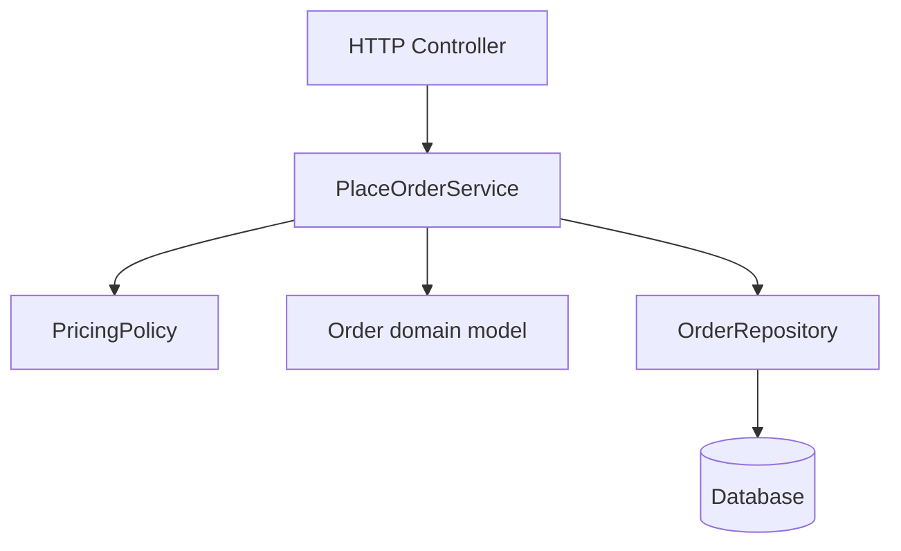

# Nhận diện nghiệp vụ rải rác trong controller, truy vấn và tiện ích dùng chung

Một ứng dụng có thể được chia thành controller, service, repository và các package tiện ích nhưng vẫn chưa có ranh giới nghiệp vụ rõ ràng. Quy tắc giảm giá có thể nằm trong controller; điều kiện khách hàng được phép mua lại bị nhúng trong câu SQL; một hàm `CommonUtils` lại quyết định đơn hàng nào được hủy. Khi cùng một chính sách xuất hiện ở nhiều nơi, mỗi luồng có thể hiểu nghiệp vụ theo một cách khác nhau. Thay đổi quy tắc trở nên khó kiểm soát và kiểm thử phải dựng nhiều thành phần kỹ thuật không liên quan.

Bài học này thuộc module `SOFTWARE_DESIGN_ARCHITECTURE_ARCHITECTURAL_PATTERN_LAYERED`, với mục tiêu học tổ chức phần mềm theo kiến trúc phân tầng. Trong chương **Sai lầm và đánh giá thiết kế**, ta tập trung nhận diện nghiệp vụ bị rải rác trong controller, truy vấn và tiện ích dùng chung, hiểu hệ quả và thực hiện refactor từng bước để đưa quyết định nghiệp vụ về nơi có thể bảo vệ, kiểm thử và tái sử dụng một cách nhất quán.

## Nghiệp vụ rải rác trông như thế nào?

Quy tắc nghiệp vụ là chính sách hoặc bất biến quyết định hệ thống được phép làm gì và kết quả nào là hợp lệ. Ví dụ trong cửa hàng trực tuyến:

- Khách hàng hạng Gold được giảm 10% cho một số nhóm sản phẩm.
- Đơn hàng chỉ được hủy trước khi chuyển sang trạng thái giao hàng.
- Khách hàng có khoản nợ quá hạn không được đặt đơn trả sau.
- Phí vận chuyển được miễn khi tổng giá trị hàng đủ điều kiện và địa chỉ nằm trong vùng hỗ trợ.

Những quy tắc này có thể bị phân tán qua nhiều nơi:

| Vị trí | Dấu hiệu | Rủi ro |
|---|---|---|
| Controller | Có nhiều nhánh `if` quyết định giá, trạng thái hoặc quyền theo chính sách bài toán | REST, giao diện quản trị và tác vụ nền có thể áp dụng quy tắc khác nhau |
| Truy vấn SQL/JPQL | Chính sách được ẩn trong điều kiện `WHERE`, `CASE` hoặc join khó nhận biết | Quy tắc khó được gọi lại ở luồng khác và khó kiểm thử độc lập |
| Utility dùng chung | Hàm tên chung như `isEligible`, `calculateFinalPrice`, `canCancel` chứa quyết định của một miền cụ thể | Không rõ ai sở hữu quy tắc; các module dùng chung có thể phụ thuộc lẫn nhau |
| Nhiều service khác nhau | Mỗi service tự viết lại cùng điều kiện | Các phiên bản quy tắc dần lệch nhau khi có thay đổi |

Không phải mọi điều kiện trong controller hoặc câu truy vấn đều là sai. Controller vẫn cần kiểm tra định dạng request và chuyển đổi HTTP; truy vấn vẫn cần lọc dữ liệu; utility vẫn phù hợp với phép toán tổng quát, thuần túy. Vấn đề xuất hiện khi chính sách của bài toán bị ẩn trong chi tiết kỹ thuật hoặc bị sao chép đến nhiều điểm thực thi.

## Controller đang làm thay phần nghiệp vụ

Xét ví dụ tạo đơn hàng dưới đây. Controller nhận request, tính giá, quyết định ưu đãi và lưu dữ liệu:

```java
@RestController
class OrderController {
    private final OrderRepository orders;

    OrderController(OrderRepository orders) {
        this.orders = orders;
    }

    @PostMapping("/orders")
    OrderResponse create(@RequestBody CreateOrderRequest request) {
        BigDecimal total = request.items().stream()
            .map(item -> item.unitPrice()
                .multiply(BigDecimal.valueOf(item.quantity())))
            .reduce(BigDecimal.ZERO, BigDecimal::add);

        if ("GOLD".equals(request.customerTier())) {
            total = total.multiply(new BigDecimal("0.90"));
        }

        if (total.compareTo(new BigDecimal("500000")) >= 0) {
            total = total.subtract(new BigDecimal("30000"));
        }

        Order order = Order.create(request.customerId(), total);
        orders.save(order);
        return OrderResponse.from(order);
    }
}
```

Đoạn mã có thể chạy, nhưng controller đang quyết định chính sách giá dựa trên hạng khách hàng và ngưỡng tổng tiền. Nếu ứng dụng có thêm API tạo đơn cho nhân viên, tác vụ nhập đơn hoặc xử lý đơn định kỳ, các luồng đó có thể phải sao chép logic. Khi mức giảm Gold thay đổi, nhóm phát triển phải tìm và sửa mọi bản sao; chỉ cần bỏ sót một nơi là giá cuối cùng không nhất quán.

Controller nên xử lý giao thức: nhận dữ liệu, kiểm tra cấu trúc đầu vào, chuyển sang command, gọi ca sử dụng và chuyển kết quả thành HTTP response. Các quyết định về giá và điều kiện đặt hàng nên được đặt ở thành phần nghiệp vụ hoặc application service phù hợp.

## Chính sách nghiệp vụ bị giấu trong truy vấn

Một repository có thể có truy vấn như sau:

```sql
select o.*
from orders o
join customers c on c.id = o.customer_id
where c.overdue_balance = 0
  and o.status in ('PENDING', 'CONFIRMED')
  and o.created_at >= :cutoff
  and (c.tier = 'GOLD' or o.total >= :minimum_total)
```

Truy vấn này vừa lấy dữ liệu, vừa thể hiện một phần điều kiện được phép tham gia một chương trình nghiệp vụ. Nếu điều kiện đó chỉ dùng để giới hạn tập dữ liệu cho một báo cáo, repository query có thể là nơi hợp lý. Nhưng nếu cùng chính sách được dùng để quyết định khách hàng có được đặt trả sau, nhận ưu đãi hoặc gia hạn đơn hàng hay không, việc giấu nó trong SQL sẽ khiến quy tắc khó nhận diện và khó tái sử dụng.

SQL cũng có thể là cách thực thi hiệu quả cho một chính sách lọc dữ liệu lớn. Không cần chuyển mọi điều kiện sang Java và tải hàng triệu bản ghi về bộ nhớ. Điều cần làm là biểu đạt chính sách ở một abstraction có tên và hợp đồng rõ ràng, rồi chọn cách thực thi phù hợp. Ví dụ, một `OrderEligibilitySpecification` có thể định nghĩa điều kiện; adapter repository chuyển specification thành JPQL/SQL khi cần lọc tại database. Khi đó, truy vấn vẫn tối ưu nhưng ý nghĩa chính sách có chủ sở hữu và có thể được kiểm thử.

Hãy phân biệt:

- **Điều kiện truy xuất dữ liệu:** tìm đơn theo mã khách hàng, phân trang, sắp xếp, lọc theo khoảng ngày người dùng yêu cầu.
- **Quyết định nghiệp vụ:** khách hàng có đủ điều kiện mua trả sau không, đơn ở trạng thái nào được hủy, hoặc mức ưu đãi nào được áp dụng.

Hai nhóm có thể phối hợp. Application service có thể yêu cầu repository lấy các dữ kiện cần thiết; policy hoặc domain object quyết định hành động hợp lệ. Với tập dữ liệu lớn, một phần tiêu chí nghiệp vụ có thể được đẩy xuống truy vấn như một cách tối ưu hóa, miễn là cùng một chính sách được giữ rõ ràng và có kiểm thử bảo vệ.

## Utility dùng chung trở thành nơi chứa chính sách

Một dấu hiệu khác là package `common`, `utils` hoặc lớp `ApplicationHelper` tích tụ các hàm có ý nghĩa nghiệp vụ:

```java
public final class CommonUtils {
    public static boolean canCancel(Order order) {
        return order.getStatus() == OrderStatus.PENDING
            || order.getStatus() == OrderStatus.CONFIRMED;
    }

    public static BigDecimal finalPrice(Customer customer, BigDecimal total) {
        if (customer.getTier() == CustomerTier.GOLD) {
            return total.multiply(new BigDecimal("0.90"));
        }
        return total;
    }
}
```

Tên `CommonUtils` không cho biết chính sách nào thuộc đơn hàng, chính sách nào thuộc định giá. Khi quy tắc hủy đơn thay đổi, người sửa phải biết hàm này được dùng ở đâu và mọi caller có cùng ngữ cảnh hay không. Utility có thể còn phụ thuộc vào kiểu entity hoặc enum của nhiều module, khiến package chung trở thành điểm kết nối chặt.

Hãy đặt hàm gần khái niệm mà nó diễn đạt. `Order` có thể bảo vệ quy tắc chuyển trạng thái của chính nó; `PricingPolicy` có thể quyết định mức giá; `OrderCancellationPolicy` có thể mô tả điều kiện hủy nếu quyết định phụ thuộc vào nhiều dữ kiện bên ngoài aggregate. Các phép toán tổng quát như chuẩn hóa chuỗi hoặc tính checksum vẫn phù hợp với utility thuần túy vì chúng không sở hữu chính sách riêng của một miền.

## Gom quy tắc về nơi có trách nhiệm rõ ràng

Một cách tổ chức sau refactor có thể như sau:



Controller chuyển request thành command. Application service điều phối ca sử dụng, tải dữ liệu cần thiết, gọi policy/domain và lưu kết quả. Domain model bảo vệ bất biến nội tại; policy riêng xử lý quyết định cần phối hợp nhiều đối tượng hoặc dữ kiện. Repository đảm nhiệm truy xuất và lưu trữ.

Ví dụ về chính sách giá:

```java
public class PricingPolicy {
    private static final BigDecimal GOLD_RATE = new BigDecimal("0.10");
    private static final BigDecimal DISCOUNT_THRESHOLD =
        new BigDecimal("500000");
    private static final BigDecimal ORDER_DISCOUNT =
        new BigDecimal("30000");

    public Money calculate(Customer customer, List<OrderLine> lines) {
        Money subtotal = lines.stream()
            .map(OrderLine::lineTotal)
            .reduce(Money.zero(), Money::add);

        Money afterTierDiscount = customer.isGold()
            ? subtotal.multiply(BigDecimal.ONE.subtract(GOLD_RATE))
            : subtotal;

        if (afterTierDiscount.isAtLeast(Money.of(DISCOUNT_THRESHOLD))) {
            return afterTierDiscount.subtract(Money.of(ORDER_DISCOUNT));
        }
        return afterTierDiscount;
    }
}
```

Đây là ví dụ rút gọn; kiểu `Money` nên tự bảo vệ quy tắc tiền tệ, scale và làm tròn phù hợp với hệ thống. Các hằng số minh họa chính sách, trong ứng dụng thật có thể được cấu hình hoặc đọc từ bảng chính sách có phiên bản. Điểm chính là việc tính giá có tên, đầu vào rõ ràng và có thể kiểm thử mà không cần khởi động web server.

Application service có thể dùng policy đó:

```java
@Service
class PlaceOrderService {
    private final CustomerRepository customers;
    private final ProductRepository products;
    private final OrderRepository orders;
    private final PricingPolicy pricingPolicy;

    PlaceOrderService(
            CustomerRepository customers,
            ProductRepository products,
            OrderRepository orders,
            PricingPolicy pricingPolicy) {
        this.customers = customers;
        this.products = products;
        this.orders = orders;
        this.pricingPolicy = pricingPolicy;
    }

    @Transactional
    public OrderResult place(PlaceOrderCommand command) {
        Customer customer = customers.getById(command.customerId());
        List<OrderLine> lines = command.items().stream()
            .map(item -> OrderLine.from(
                products.getById(item.productId()), item.quantity()))
            .toList();

        Money total = pricingPolicy.calculate(customer, lines);
        Order order = Order.create(customer.id(), lines, total);
        orders.save(order);
        return OrderResult.created(order.id(), total);
    }
}
```

Controller lúc này chỉ chuyển đổi hợp đồng HTTP:

```java
@PostMapping("/orders")
ResponseEntity<OrderResponse> create(
        @Valid @RequestBody CreateOrderRequest request) {
    OrderResult result = placeOrder.place(
        new PlaceOrderCommand(request.customerId(), request.items())
    );
    return ResponseEntity.status(HttpStatus.CREATED)
        .body(OrderResponse.from(result));
}
```

Ví dụ cho thấy quy tắc giá chỉ có một điểm sở hữu. Một API khác hoặc tác vụ nền có thể gọi cùng application use case hoặc policy theo hợp đồng phù hợp mà không sao chép công thức. Không nhất thiết mọi quy tắc đều phải nằm trong entity; quyết định phụ thuộc nhiều đối tượng hoặc chính sách có thể thay đổi theo cấu hình thường phù hợp với một policy/service chuyên biệt.

## Refactor từng bước, tránh di chuyển mã máy móc

Khi phát hiện nghiệp vụ rải rác trong một hệ thống đang chạy, hãy refactor có kiểm soát:

1. **Chọn một quy tắc cụ thể.** Ví dụ điều kiện hủy đơn hoặc cách tính giảm giá. Ghi lại đầu vào, kết quả, ngoại lệ và những luồng đang áp dụng quy tắc đó.
2. **Tìm các bản sao.** Tìm controller, service, truy vấn và utility có cùng điều kiện. So sánh xem chúng có thật sự là cùng một chính sách hay chỉ giống cú pháp.
3. **Viết kiểm thử đặc trưng cho quy tắc.** Bao gồm trường hợp biên, trạng thái không hợp lệ và các biến thể có ý nghĩa. Kiểm thử giúp giữ hành vi khi chuyển mã.
4. **Chọn nơi sở hữu.** Đặt bất biến vào domain object; quyết định phối hợp nhiều dữ kiện vào policy/domain service; trình tự ca sử dụng vào application service; truy xuất dữ liệu vào repository.
5. **Chuyển từng caller.** Thay controller hoặc utility bằng lời gọi tới abstraction mới. Nếu SQL cần tối ưu, giữ cách thực thi truy vấn nhưng dùng cùng định nghĩa chính sách hoặc kiểm thử tương đương.
6. **Xóa bản sao cũ khi không còn caller.** Sau đó tìm lại tham chiếu để tránh giữ hai phiên bản quy tắc song song.

Không nên di chuyển mọi `if` ra khỏi controller hoặc mọi điều kiện ra khỏi SQL. Kiểm tra request như `@NotBlank`, ánh xạ mã HTTP, phân trang và lọc theo tiêu chí tìm kiếm vẫn thuộc biên giao diện hoặc truy vấn. Hãy di chuyển những quyết định diễn đạt chính sách bài toán và cần nhất quán qua nhiều luồng.

## Kiểm thử để phát hiện quy tắc bị lệch

Một chiến lược kiểm thử hữu ích gồm nhiều mức:

| Mức kiểm thử | Mục tiêu | Ví dụ |
|---|---|---|
| Unit test cho domain/policy | Xác nhận quy tắc độc lập với framework | Gold được giảm đúng mức; đơn đã giao không được hủy |
| Unit test cho application service | Xác nhận điều phối và tác động | Policy từ chối thì repository không lưu đơn |
| Repository integration test | Xác nhận truy vấn/ánh xạ thực tế | Bộ lọc theo tenant, trạng thái và ngày trả đúng dữ liệu |
| API test | Xác nhận hợp đồng HTTP | Request sai định dạng trả 400; kết quả từ chối được ánh xạ đúng |
| Regression test qua nhiều luồng | Xác nhận mọi điểm gọi dùng cùng chính sách | REST API và tác vụ nền tính cùng một mức giá |

Nếu một chính sách được đẩy xuống SQL để tối ưu, cần test query với dữ liệu biên thực tế và so sánh kết quả với định nghĩa chính sách. Test một hàm Java không thể chứng minh query production đang lọc đúng; ngược lại, test query không thay thế unit test cho quy tắc có thể thực thi độc lập.

## Checklist review thiết kế

Khi review một thay đổi trong module phân tầng, hãy tự hỏi:

- Controller có đang quyết định giá, quyền nghiệp vụ, trạng thái hoặc chính sách sản phẩm không?
- Cùng một điều kiện có xuất hiện trong nhiều endpoint, job hoặc service không?
- Truy vấn có tên nghiệp vụ nhưng không có hợp đồng rõ về điều kiện và ý nghĩa không?
- Utility dùng chung có phụ thuộc vào entity, trạng thái hoặc khái niệm của một miền cụ thể không?
- Có thể chỉ ra một nơi chịu trách nhiệm cho từng quy tắc quan trọng không?
- Quy tắc có unit test độc lập và có test tích hợp cho cách truy xuất dữ liệu không?
- Việc tối ưu SQL có giữ được cùng ngữ nghĩa với chính sách nghiệp vụ không?

Một thiết kế tốt không nhất thiết có nhiều lớp hay package hơn. Mục tiêu là người đọc có thể tìm được nơi quyết định một chính sách, hiểu dữ kiện mà nó dựa vào và biết cách kiểm thử nó. Khi quy tắc được đặt gần khái niệm sở hữu nó, controller gọn hơn, repository tập trung vào dữ liệu, utility không trở thành nơi chứa nghiệp vụ và các luồng khác nhau có thể giữ cùng một cách hiểu về bài toán.
