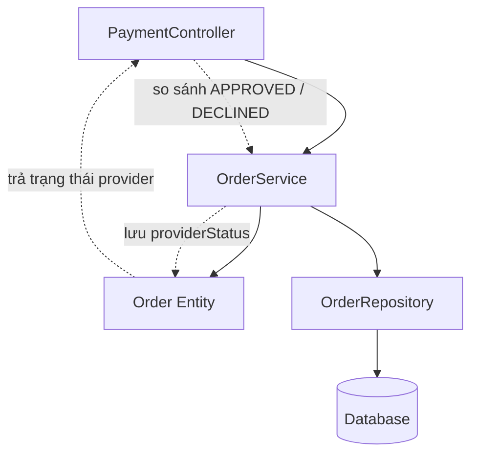

# Nhận diện thay đổi nhỏ nhưng lan qua quá nhiều tầng

Một dấu hiệu thường gặp của thiết kế khó bảo trì là một yêu cầu nhỏ buộc lập trình viên sửa rất nhiều thành phần ở các tầng khác nhau. Chẳng hạn, đổi nhà cung cấp thanh toán khiến controller, service, entity, repository và nhiều màn hình phải biết mã trạng thái riêng của nhà cung cấp. Hoặc thêm một trường hiển thị đơn giản lại buộc sửa hàng loạt lớp vì cùng một cấu trúc dữ liệu được dùng xuyên suốt ứng dụng.

Hiện tượng này thường được gọi là **change amplification**: phạm vi sửa đổi lớn hơn đáng kể so với ý nghĩa của thay đổi. Trong module `SOFTWARE_DESIGN_ARCHITECTURE_ARCHITECTURAL_PATTERN_LAYERED` — học tổ chức phần mềm theo kiến trúc phân tầng — bài học này giúp nhận diện khi nào sự lan truyền thay đổi là dấu hiệu coupling quá chặt, cách lần theo nguyên nhân và cách cải thiện ranh giới giữa các tầng.

Không phải mọi thay đổi chạm nhiều tầng đều là thiết kế tệ. Một thay đổi hợp đồng API hoặc quy tắc nghiệp vụ có thể cần cập nhật controller, application service, miền, lưu trữ và kiểm thử. Điều cần xem xét là liệu các thành phần bị sửa có thực sự sở hữu phần trách nhiệm thay đổi hay chỉ bị kéo vào vì phụ thuộc chi tiết của nhau.

## 1. Thay đổi lan truyền là gì?

Trong kiến trúc phân tầng, mỗi tầng có trách nhiệm riêng. Một yêu cầu điển hình có thể đi từ tầng trình bày qua tầng ứng dụng, tầng nghiệp vụ và tầng truy cập dữ liệu. Khi thay đổi một quy tắc hoặc chi tiết, một số tầng có thể cần phối hợp. Đó là điều bình thường nếu mỗi tầng cập nhật phần hợp đồng mà nó sở hữu.

Change amplification xuất hiện khi một thay đổi cục bộ làm phát sinh nhiều sửa đổi không cần thiết, ví dụ:

- Đổi một thư viện lưu trữ nhưng phải sửa nhiều service vì chúng trực tiếp dùng API của thư viện đó.
- Thêm một thuộc tính vào response bên ngoài khiến entity miền phải đổi theo dù thuộc tính đó chỉ phục vụ giao diện.
- Đổi mã trạng thái từ nhà cung cấp thanh toán khiến controller và nhiều quy tắc nghiệp vụ phải sửa vì chúng so sánh chuỗi của nhà cung cấp.
- Thay cách tính phí vận chuyển khiến nhiều module phải sửa vì cùng một công thức đã bị sao chép.
- Đổi tên một trường trong bảng database làm vỡ nhiều tầng vì tên cột hoặc entity JPA bị lộ đến tận controller.

Hãy phân biệt hai hiện tượng:

| Hiện tượng | Đặc điểm | Cách đánh giá |
|---|---|---|
| Lan truyền có chủ đích | Các tầng liên quan thật sự có hợp đồng hoặc trách nhiệm thay đổi | Chấp nhận được nếu thay đổi rõ ràng và có kiểm soát |
| Change amplification | Nhiều thành phần bị sửa chỉ vì phụ thuộc vào chi tiết không thuộc trách nhiệm của chúng | Dấu hiệu cần xem lại coupling, cohesion và ranh giới |

Ví dụ, thêm một trường bắt buộc vào request công khai có thể cần cập nhật OpenAPI, DTO, validation, command và quy tắc nghiệp vụ. Đây có thể là thay đổi hợp lý vì hợp đồng đầu vào và chính sách thực sự thay đổi. Nhưng nếu thêm một trường chỉ để hiển thị tên nhà cung cấp khiến entity miền, repository và các dịch vụ khác phải thay đổi, thiết kế có thể đang dùng chung một mô hình dữ liệu cho nhiều mục đích không liên quan.

## 2. Dấu hiệu nhận biết trong một thay đổi nhỏ

Khi review một pull request hoặc lập kế hoạch sửa lỗi, hãy quan sát phạm vi thay đổi và lý do từng thành phần bị ảnh hưởng.

### Nhiều tầng phải biết cùng một chi tiết

Nếu controller, application service, entity và repository đều chứa tên thư viện, tên nhà cung cấp hoặc mã trạng thái bên ngoài, một thay đổi ở chi tiết đó có thể lan rộng. Ví dụ, chuỗi `"PAYMENT_ACCEPTED"` xuất hiện ở nhiều tầng cho thấy hợp đồng của nhà cung cấp đang rò rỉ vào nội bộ.

### Cùng một quy tắc được triển khai nhiều nơi

Nếu logic tính phí, kiểm tra quyền, chuẩn hóa địa chỉ hoặc xác định trạng thái được sao chép ở nhiều service, thay đổi quy tắc buộc phải tìm và sửa mọi bản sao. Một bản sao bị bỏ sót có thể tạo hành vi không nhất quán.

### Thay đổi một cấu trúc dữ liệu làm vỡ nhiều consumer

Một lớp `Customer` vừa là entity JPA, vừa là response JSON, vừa là object dùng trong ca sử dụng và vừa là mô hình nghiệp vụ thường có quá nhiều lý do thay đổi. Thay tên cột hoặc thêm annotation ORM có thể ảnh hưởng đến serialization; đổi API response lại ảnh hưởng đến logic nội bộ.

### Sửa một module buộc sửa module không liên quan

Nếu thay đổi cách gửi email làm phải sửa module đơn hàng, báo cáo và quản trị chỉ vì chúng cùng gọi một lớp tiện ích có API quá cụ thể, ranh giới module có thể chưa đúng.

### Test thất bại ở nhiều nơi dù hành vi không đổi

Một thay đổi nội bộ nhỏ làm hàng loạt test mock tương tác bị hỏng có thể cho thấy test đang phụ thuộc cấu trúc triển khai. Tuy nhiên, test ở nhiều tầng thất bại cũng có thể phát hiện một thay đổi hợp đồng thực sự. Cần đọc assertion và mục tiêu test, không chỉ đếm số test đỏ.

## 3. Ví dụ: chi tiết nhà cung cấp thanh toán rò rỉ qua các tầng

Giả sử ứng dụng Spring Boot dùng một cổng thanh toán. Nhà cung cấp trả JSON với các trạng thái `APPROVED`, `DECLINED` và `PENDING`. Một thiết kế kém cô lập có thể để các giá trị này đi xuyên qua nhiều tầng.



Ví dụ code:

```java
@Service
class OrderService {
    private final ProviderSdk provider;
    private final OrderRepository repository;

    public void pay(UUID orderId) {
        OrderEntity order = repository.findById(orderId).orElseThrow();
        ProviderResponse response = provider.charge(order.getTotal());

        order.setProviderStatus(response.status());
        if ("APPROVED".equals(response.status())) {
            order.setStatus("PAID");
        } else if ("DECLINED".equals(response.status())) {
            order.setStatus("PAYMENT_FAILED");
        }
        repository.save(order);
    }
}
```

Đoạn code gộp nhiều trách nhiệm: gọi SDK, hiểu trạng thái riêng của nhà cung cấp, quyết định trạng thái đơn, thao tác entity lưu trữ và điều phối ca sử dụng. Khi thay SDK hoặc nhà cung cấp, `OrderService` phải đổi. Nếu `ProviderResponse` hoặc `providerStatus` còn được dùng ở controller và báo cáo, thay đổi tiếp tục lan rộng.

### Đặt một hợp đồng nội bộ ổn định

Có thể tách giao tiếp thanh toán qua port do application layer sở hữu:

```java
public interface PaymentGateway {
    PaymentResult authorize(PaymentRequest request);
}

public sealed interface PaymentResult {
    record Approved(String reference) implements PaymentResult {}
    record Declined(String reasonCode) implements PaymentResult {}
    record Pending(String reference) implements PaymentResult {}
}
```

Adapter hạ tầng chuyển đổi phản hồi của nhà cung cấp thành kiểu nội bộ:

```java
@Component
@RequiredArgsConstructor
class ProviderPaymentAdapter implements PaymentGateway {
    private final ProviderSdk providerSdk;

    @Override
    public PaymentResult authorize(PaymentRequest request) {
        ProviderResponse response = providerSdk.charge(
            request.amount(), request.currency(), request.idempotencyKey()
        );

        return switch (response.status()) {
            case "APPROVED" -> new PaymentResult.Approved(response.reference());
            case "DECLINED" -> new PaymentResult.Declined(response.reasonCode());
            default -> new PaymentResult.Pending(response.reference());
        };
    }
}
```

Tầng ứng dụng làm việc với kết quả nội bộ:

```java
@Service
@RequiredArgsConstructor
class PayOrderService {
    private final PaymentGateway paymentGateway;
    private final OrderRepository orderRepository;

    public void pay(OrderId orderId) {
        Order order = orderRepository.findById(orderId).orElseThrow();
        PaymentResult result = paymentGateway.authorize(
            PaymentRequest.forOrder(order)
        );

        switch (result) {
            case PaymentResult.Approved approved -> order.markPaid(approved.reference());
            case PaymentResult.Declined declined -> order.markPaymentDeclined(declined.reasonCode());
            case PaymentResult.Pending pending -> order.markPaymentPending(pending.reference());
        }
        orderRepository.save(order);
    }
}
```

Đây là phác thảo Java 21 dùng sealed interface và pattern matching cho switch. Dự án dùng phiên bản Java cũ hơn có thể thay bằng `instanceof` hoặc enum/result class phù hợp. Ví dụ cũng giả định ca sử dụng và repository đã xử lý transaction theo yêu cầu.

Khi đổi nhà cung cấp, adapter thường là nơi phải thay đổi chính. Application service chỉ cần thay đổi nếu ý nghĩa nghiệp vụ hoặc hợp đồng `PaymentGateway` thực sự thay đổi. Controller và entity không cần biết tên trạng thái của SDK. Ranh giới này làm giảm phạm vi thay đổi do chi tiết nhà cung cấp.

## 4. Tách mô hình theo mục đích để tránh một thay đổi kéo theo tất cả

Một nguyên nhân phổ biến của change amplification là dùng một lớp cho nhiều vai trò:

- Entity lưu trữ có annotation ORM và quan hệ database.
- Domain object thể hiện danh tính, hành vi và bất biến nghiệp vụ.
- Request DTO mô tả dữ liệu client được phép gửi.
- Response DTO mô tả dữ liệu API công khai trả về.
- Query projection phục vụ một màn hình hoặc báo cáo.

Các mô hình này có thể giống nhau ở ứng dụng nhỏ, nhưng chúng không có cùng lý do thay đổi. Không cần tách lớp một cách máy móc; hãy tách khi vòng đời và hợp đồng khác nhau.

Ví dụ, thêm `avatarUrl` vào response khách hàng chỉ nhằm hiển thị giao diện. Nếu API dùng trực tiếp entity JPA, thay đổi có thể buộc entity và mapping database phải đổi. Với response DTO riêng, có thể mở rộng hợp đồng trình bày mà không làm thay đổi mô hình miền hoặc schema nếu dữ liệu đã có từ nguồn khác.

```java
// Mô hình lưu trữ
@Entity
class CustomerJpaEntity {
    @Id
    private UUID id;
    private String displayName;
    private String email;
}

// Hợp đồng HTTP
public record CustomerResponse(
    UUID id,
    String displayName,
    String email,
    URI avatarUrl
) {}
```

Controller hoặc mapper chuyển đổi dữ liệu thành response. Nếu `avatarUrl` được tính từ dịch vụ hồ sơ bên ngoài, trách nhiệm lấy dữ liệu thuộc một adapter hoặc query service phù hợp; không cần thêm cột vào entity chỉ vì response có thêm trường.

Tương tự, không nên biến mọi lớp thành DTO riêng nếu chúng có cùng ý nghĩa, cùng vòng đời và thay đổi cùng nhau. Mục tiêu là tách những hợp đồng có lý do thay đổi khác nhau, không phải tăng số lượng lớp.

## 5. Tìm nguyên nhân bằng cách lần theo đường phụ thuộc

Khi một thay đổi lan rộng, hãy dựng lại đường đi từ nơi yêu cầu xuất hiện đến những thành phần bị ảnh hưởng. Có thể dùng một bảng đơn giản:

| Thành phần bị sửa | Vì sao phải sửa? | Có sở hữu trách nhiệm thay đổi không? | Hướng xử lý |
|---|---|---|---|
| Adapter thanh toán | Chuyển API nhà cung cấp mới | Có | Giữ thay đổi ở adapter nếu hợp đồng nội bộ không đổi |
| Application service | Xử lý kết quả nghiệp vụ mới | Có nếu chính sách thay đổi | Giữ logic điều phối tại đây |
| Entity đơn hàng | Bảo vệ trạng thái thanh toán mới | Có nếu trạng thái miền thay đổi | Cập nhật hành vi miền và bất biến |
| Controller | Chuyển mã SDK thành HTTP response | Không nếu chỉ SDK thay đổi | Gỡ phụ thuộc SDK khỏi controller |
| Báo cáo | Hiển thị chuỗi trạng thái riêng của nhà cung cấp | Thường không | Dùng trạng thái nội bộ hoặc projection phù hợp |

Một vài câu hỏi giúp tìm gốc rễ:

1. Thành phần nào quyết định ý nghĩa của dữ liệu hoặc hành vi đang thay đổi?
2. Các tầng khác đang phụ thuộc vào hợp đồng ổn định hay chi tiết implementation?
3. Có một kiểu dữ liệu được chia sẻ chỉ vì tiện, dù mỗi bên dùng một phần khác nhau không?
4. Quy tắc có bị sao chép ở nhiều nơi không?
5. Thay đổi có lan qua package/module không liên quan vì một dependency chung quá rộng?
6. Có thể thay implementation bằng một adapter khác mà consumer không đổi không?

Không nên chỉ nhìn số file thay đổi. Một migration database và cập nhật mapping, repository, integration test có thể là thay đổi hợp lý. Hãy xem quan hệ nguyên nhân: từng file có thay đổi vì hợp đồng hoặc trách nhiệm của nó thực sự thay đổi hay không.

## 6. Các dạng coupling làm thay đổi lan rộng

### Coupling do chi tiết triển khai

Consumer biết lớp cụ thể, thư viện, schema response hoặc kiểu ORM của provider. Đổi provider làm consumer phải sửa. Có thể giảm bằng interface/hợp đồng ổn định, adapter và dependency direction phù hợp.

### Coupling do dữ liệu dùng chung

Nhiều tầng cùng dùng một entity hoặc object mutable. Một trường được đổi tên, kiểu dữ liệu hoặc ý nghĩa làm nhiều bên bị ảnh hưởng. Có thể tách request/response model, command, domain model và persistence model tại ranh giới có ý nghĩa.

### Coupling do điều khiển

Một module phải biết trạng thái nội bộ hoặc thứ tự gọi phương thức của module khác để vận hành đúng. Thay đổi trình tự hoặc trạng thái có thể phá consumer. Cần làm rõ hợp đồng, chuyển điều phối về nơi sở hữu use case hoặc cung cấp thao tác có ý nghĩa cao hơn.

### Coupling do quy tắc bị phân tán

Một chính sách như tính phí hoặc phân quyền xuất hiện trong controller, service và repository. Khi chính sách đổi, mọi bản sao cần cập nhật. Hãy xác định một nơi sở hữu quy tắc, đồng thời đặt các kiểm tra bổ sung ở ranh giới phù hợp nếu cần bảo vệ dữ liệu.

### Coupling do hợp đồng quá rộng

Một interface hoặc module chung phục vụ nhiều consumer với nhu cầu khác nhau. Thay đổi một thao tác làm tất cả consumer phải biên dịch hoặc kiểm thử lại. Cân nhắc tách interface theo nhu cầu hoặc phân chia API công khai theo khả năng.

Không phải coupling nào cũng xấu. Các thành phần phải phối hợp để hoàn thành một ca sử dụng. Mục tiêu là làm cho phụ thuộc thể hiện quan hệ nghiệp vụ có ý nghĩa, giảm phụ thuộc vào chi tiết dễ thay đổi và giữ thay đổi trong phạm vi hợp lý.

## 7. Giảm change amplification bằng ranh giới có trách nhiệm

### Đặt hợp đồng gần bên sở hữu nhu cầu

Khi application service cần khả năng từ hạ tầng, nó có thể định nghĩa port như `PaymentGateway`, `CustomerLookup` hoặc `NotificationSender`. Adapter triển khai port và chuyển đổi chi tiết công nghệ. Hợp đồng nên diễn đạt nhu cầu của consumer, không sao chép API của nhà cung cấp.

### Giữ hướng phụ thuộc có chủ đích

Tầng trình bày có thể phụ thuộc vào hợp đồng của tầng ứng dụng; tầng ứng dụng có thể phụ thuộc vào miền và các port mà nó cần. Hạ tầng cung cấp implementation của các port. Tránh để miền hoặc application service import controller, HTTP request, `EntityManager`, `ResultSet` hay DTO riêng của nhà cung cấp.

### Đặt quy tắc ở nơi có đủ quyền sở hữu

Quy tắc về trạng thái đơn hàng nên được bảo vệ bởi entity hoặc policy miền thích hợp. Application service điều phối việc tải dữ liệu, gọi hành vi và lưu thay đổi. Controller kiểm tra cú pháp và chuyển đổi giao tiếp. Repository chịu trách nhiệm truy xuất và lưu trữ. Khi một quy tắc có một nơi sở hữu rõ, thay đổi chính sách thường tập trung hơn.

### Dùng adapter và mapper ở ranh giới

Adapter chuyển đổi giao thức ngoài thành hợp đồng nội bộ; mapper chuyển đổi giữa mô hình persistence và mô hình ứng dụng/miền khi hai mô hình có lý do tồn tại khác nhau. Tránh để các tầng thấp hơn hoặc cao hơn tự chuyển đổi tùy tiện theo kiểu riêng.

### Giữ interface nhỏ và theo nhu cầu

Một interface không nên gom mọi thao tác có thể tưởng tượng. Nếu một consumer chỉ cần đọc hồ sơ, một port `CustomerProfileReader` có thể phù hợp hơn repository CRUD tổng quát. Nhưng đừng tạo interface cho mọi lớp chỉ để có thể mock; abstraction cần thể hiện một ranh giới hoặc điểm biến đổi có ý nghĩa.

## 8. Không biến mọi thay đổi nhiều tầng thành lỗi kiến trúc

Một số thay đổi vốn dĩ có phạm vi xuyên tầng:

- Thêm một quy tắc nghiệp vụ mới có thể cần cập nhật domain model, application use case, persistence và API.
- Thay đổi hợp đồng công khai cần cập nhật request/response, tài liệu API, client và contract test.
- Thêm thuộc tính bắt buộc cần thay đổi schema, migration, mapping, validation và dữ liệu hiện có.
- Thay đổi mô hình bảo mật có thể ảnh hưởng controller, application service, policy và cấu hình hạ tầng.

Trong các trường hợp này, việc nhiều tầng cùng thay đổi có thể là biểu hiện của một yêu cầu xuyên suốt đúng nghĩa. Hãy đánh giá xem mỗi sửa đổi có trực tiếp phục vụ yêu cầu hay chỉ bị kéo theo do lộ chi tiết.

Ví dụ, thêm trường `deliveryInstructions` vào đơn hàng có thể cần:

1. Cập nhật hợp đồng request nếu client được phép gửi chỉ dẫn.
2. Kiểm tra độ dài và chuẩn hóa đầu vào tại biên tiếp nhận.
3. Cập nhật command và ca sử dụng.
4. Bảo vệ quy tắc miền nếu có giới hạn hoặc điều kiện trạng thái.
5. Lưu trường mới bằng migration và mapping.
6. Cập nhật response nếu client cần đọc lại trường đó.

Đây là sự phối hợp có chủ đích vì dữ liệu và hành vi thực sự thay đổi. Nhưng nếu cùng một thay đổi buộc tất cả màn hình, báo cáo và tích hợp phải biết tên cột database hoặc kiểu entity JPA, có thể mô hình persistence đang bị lộ quá rộng.

## 9. Review một pull request có dấu hiệu lan truyền

Khi một PR nhỏ chạm nhiều tầng, đừng kết luận chỉ từ số lượng file. Hãy yêu cầu mô tả rõ thay đổi và xem từng nhóm sửa đổi:

- **Hợp đồng đầu vào/đầu ra:** API hoặc message contract có thật sự thay đổi không? Client nào cần phối hợp?
- **Chính sách nghiệp vụ:** Có quy tắc hoặc trạng thái mới không? Nơi sở hữu quy tắc đã được cập nhật chưa?
- **Chi tiết hạ tầng:** Có thư viện, schema, endpoint hoặc nhà cung cấp thay đổi không? Các chi tiết này đã được giữ trong adapter chưa?
- **Mô hình dữ liệu:** Entity, DTO và projection có đang bị dùng chung ngoài mục đích của chúng không?
- **Kiểm thử:** Test nào chứng minh hành vi nghiệp vụ, test nào chứng minh tích hợp? Có test nào chỉ hỏng vì phụ thuộc chi tiết triển khai không?
- **Tính tương thích:** Thay đổi có ảnh hưởng dữ liệu cũ, consumer cũ, API đã phát hành hoặc thông điệp đang nằm trong queue không?

Một review tốt không cố ép PR chỉ sửa một tầng. Nó kiểm tra lý do mỗi tầng tham gia và liệu các ranh giới vẫn được tôn trọng sau thay đổi.

## 10. Kiểm thử để phát hiện phụ thuộc không mong muốn

Test hành vi giúp xác nhận thay đổi không làm sai quy tắc; kiểm thử kiến trúc có thể phát hiện phụ thuộc sai hướng trước khi nó trở thành vấn đề lớn.

Ví dụ, dùng ArchUnit để ngăn application layer phụ thuộc vào package controller hoặc chi tiết persistence:

```java
@AnalyzeClasses(packages = "com.example")
class LayerDependencyTest {

    @ArchTest
    static final ArchRule application_must_not_depend_on_web =
        noClasses()
            .that().resideInAPackage("..application..")
            .should().dependOnClassesThat()
            .resideInAnyPackage("..presentation..", "..web..");

    @ArchTest
    static final ArchRule domain_must_not_depend_on_infrastructure =
        noClasses()
            .that().resideInAPackage("..domain..")
            .should().dependOnClassesThat()
            .resideInAnyPackage("..infrastructure..", "..persistence..");
}
```

Các tên package trong ví dụ cần được điều chỉnh theo cấu trúc thật của dự án. Quy tắc kiến trúc không chứng minh toàn bộ chất lượng thiết kế, nhưng có thể ngăn một số phụ thuộc không mong muốn xuất hiện lặng lẽ.

Khi có nhiều implementation của một port, contract test có thể xác minh tất cả adapter tuân thủ cùng một hợp đồng. Ví dụ, `JpaOrderRepositoryAdapter` và `InMemoryOrderRepository` đều phải đáp ứng cùng quy tắc về tìm kiếm đơn hàng. Test này giúp thay implementation mà consumer vẫn giữ hành vi mong đợi.

## 11. Đo phạm vi thay đổi và quyết định refactor

Không có một con số file hoặc tầng cố định để xác định change amplification. Có thể theo dõi một số dấu hiệu theo thời gian:

- Một yêu cầu thay đổi cục bộ thường xuyên kéo theo sửa nhiều package không liên quan.
- Nhiều PR phải cập nhật cùng một đoạn quy tắc hoặc cùng một mapping.
- Thay một adapter làm nhiều consumer sửa dù hợp đồng không đổi.
- Một module có nhiều consumer trực tiếp phụ thuộc vào cấu trúc nội bộ của nó.
- Test thường xuyên phải sửa chỉ vì đổi cách tổ chức lớp, không phải vì hành vi thay đổi.

Khi thấy xu hướng lặp lại, hãy cân nhắc refactor theo phạm vi nhỏ:

1. Chọn một loại thay đổi thường xuyên xảy ra, ví dụ đổi nhà cung cấp thanh toán.
2. Xác định các lớp đang biết chi tiết nhà cung cấp.
3. Định nghĩa hoặc thu gọn hợp đồng nội bộ phản ánh nhu cầu thật.
4. Di chuyển chuyển đổi dữ liệu và giao thức vào adapter.
5. Cập nhật consumer để chỉ phụ thuộc hợp đồng.
6. Bổ sung test hành vi và test kiến trúc để giữ ranh giới.
7. Quan sát lần thay đổi tương tự tiếp theo: phạm vi sửa đổi có giảm và dễ dự đoán hơn không?

Không cần refactor toàn bộ hệ thống chỉ vì tìm thấy một ví dụ. Hãy ưu tiên khu vực thường xuyên thay đổi, gây lỗi hoặc cản trở phát triển. Một abstraction mới có chi phí: nó cần được hiểu, kiểm thử và duy trì. Chỉ tạo nó khi lợi ích cách ly và ổn định lớn hơn chi phí đó.

## 12. Câu hỏi tự đánh giá thiết kế

Trước khi hoàn tất một thay đổi, hãy tự hỏi:

1. Yêu cầu thực sự thay đổi điều gì: hợp đồng, chính sách nghiệp vụ, dữ liệu hay chi tiết triển khai?
2. Mỗi tầng bị sửa có sở hữu một phần thay đổi không?
3. Có tầng nào chỉ sửa vì đang phụ thuộc vào kiểu dữ liệu hoặc thư viện không thuộc về nó không?
4. Một quy tắc có đang được lặp lại ở nhiều nơi không?
5. Có thể thay implementation mà giữ nguyên hợp đồng của consumer không?
6. Mô hình request, response, miền và persistence có đang bị dùng chung quá mức không?
7. Test có chứng minh đúng hành vi cần thiết hay chỉ khóa chặt cấu trúc nội bộ?
8. Thay đổi có thể được chia thành bước tương thích để giảm rủi ro triển khai không?

Nếu một thay đổi nhỏ thường xuyên lan qua nhiều tầng vì chi tiết dễ thay đổi bị chia sẻ rộng, đó là tín hiệu cần xem lại quyền sở hữu hợp đồng, hướng phụ thuộc và mô hình dữ liệu. Nếu các tầng cùng thay đổi vì một quy tắc hoặc hợp đồng thực sự thay đổi, hãy giữ sự phối hợp đó rõ ràng và có kiểm thử. Thiết kế tốt không phải là không bao giờ sửa nhiều tầng; đó là khả năng dự đoán vì sao từng tầng phải thay đổi và giới hạn ảnh hưởng ở đúng nơi có trách nhiệm.
