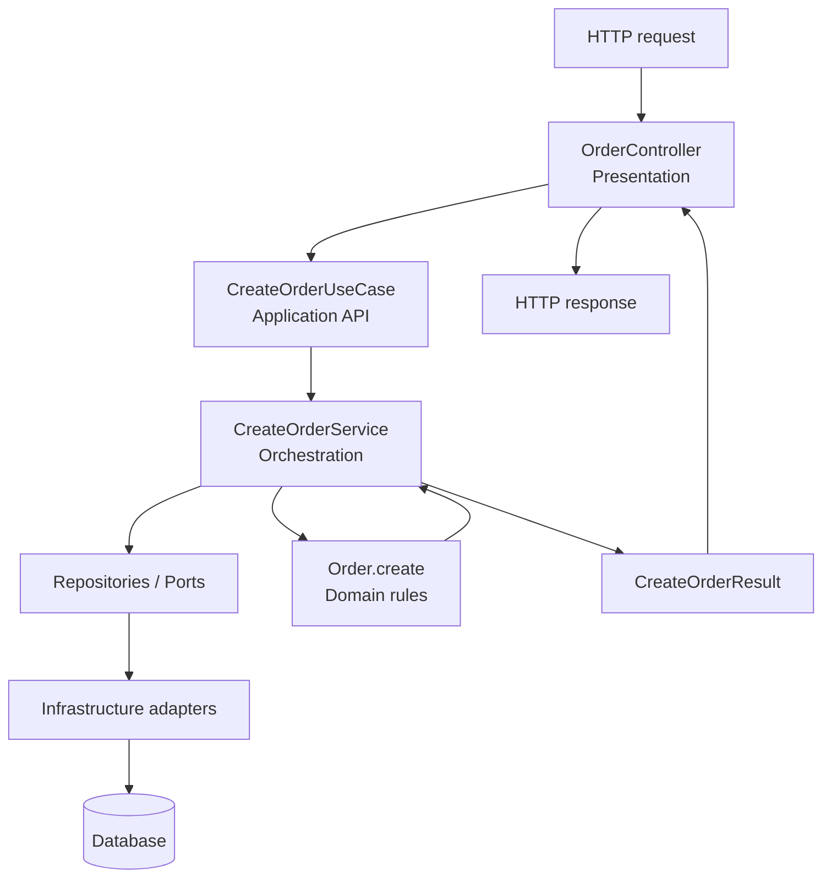

# Tách nghiệp vụ khỏi controller lớn bằng ca sử dụng có hợp đồng rõ ràng

> Chương: **Cải tiến hệ thống hiện có**

Trong module **SOFTWARE_DESIGN_ARCHITECTURE_ARCHITECTURAL_PATTERN_LAYERED**, chúng ta học cách tổ chức phần mềm theo kiến trúc phân tầng. Khi một ứng dụng đã phát triển lâu, controller thường dần nhận thêm nhiều trách nhiệm: đọc request, kiểm tra dữ liệu, truy vấn repository, quyết định quy tắc nghiệp vụ, điều phối giao dịch, gọi dịch vụ ngoài và tạo response. Bài này trình bày cách tách phần nghiệp vụ và điều phối đó thành các ca sử dụng có hợp đồng rõ ràng, từng bước và có thể kiểm chứng mà không làm thay đổi hành vi API ngoài ý muốn.

Mục tiêu của refactoring không phải là tạo thật nhiều class. Mục tiêu là để controller chịu trách nhiệm giao tiếp HTTP, Application biểu diễn và điều phối mục tiêu của người dùng, còn Domain giữ các quy tắc nghiệp vụ. Mỗi ranh giới cần có hợp đồng dễ hiểu về dữ liệu đầu vào, kết quả và lỗi có thể xảy ra.

## 1. Dấu hiệu controller đang gánh quá nhiều trách nhiệm

Hãy xem một controller tạo đơn hàng trong hệ thống cũ:

```java
@RestController
@RequestMapping("/orders")
public class OrderController {
    private final ProductRepository products;
    private final CustomerRepository customers;
    private final OrderRepository orders;

    public OrderController(ProductRepository products,
                           CustomerRepository customers,
                           OrderRepository orders) {
        this.products = products;
        this.customers = customers;
        this.orders = orders;
    }

    @PostMapping
    public ResponseEntity<?> create(
            @RequestBody CreateOrderRequest request,
            @AuthenticationPrincipal CustomerPrincipal principal) {
        if (request.quantity() <= 0) {
            return ResponseEntity.badRequest().body("Invalid quantity");
        }

        Customer customer = customers.findById(principal.customerId())
            .orElseThrow();
        Product product = products.findById(request.productId())
            .orElseThrow();

        if (!product.isSellable()) {
            return ResponseEntity.unprocessableEntity()
                .body("Product is not sellable");
        }
        if (!customer.canPlaceOrder()) {
            return ResponseEntity.status(409).body("Customer is blocked");
        }

        BigDecimal total = product.getPrice()
            .multiply(BigDecimal.valueOf(request.quantity()));
        Order order = new Order(customer, product,
            request.quantity(), total);
        orders.save(order);

        return ResponseEntity.ok(new OrderResponse(
            order.getId(), order.getTotal(), order.getStatus().name()));
    }
}
```

Đây là ví dụ minh họa một controller đã phình to. Các dấu hiệu đáng chú ý:

- Controller cần biết nhiều repository và client kỹ thuật.
- Điều kiện nghiệp vụ như sản phẩm có được bán hay khách hàng có được đặt hàng được viết trực tiếp trong method HTTP.
- Việc tính tiền và tạo đơn nằm cạnh logic tạo response.
- Khó kiểm thử quy trình mà không dựng MVC hoặc mock nhiều dependency.
- Nếu thêm một điểm vào khác như message consumer hoặc batch job, logic có nguy cơ bị sao chép.
- Thay đổi response hoặc URL có thể vô tình làm thay đổi code nghiệp vụ vốn không liên quan.

Không phải controller nào có vài dòng điều kiện cũng cần refactor. Vấn đề xuất hiện khi controller có nhiều lý do thay đổi, chứa quy tắc được dùng lại hoặc khó kiểm thử độc lập.

## 2. Ca sử dụng là ranh giới theo mục tiêu nghiệp vụ

**Ca sử dụng (use case)** mô tả một mục tiêu mà người dùng hoặc một hệ thống khác muốn đạt được, chẳng hạn tạo đơn hàng, hủy đơn, đăng ký tài khoản hoặc hoàn tiền. Một ca sử dụng xác định dữ liệu cần thiết, các bước phối hợp, kết quả và những trường hợp không thể hoàn tất.

Trong kiến trúc phân tầng:

- **Presentation** nhận giao tiếp HTTP, kiểm tra cấu trúc request, chuyển đổi dữ liệu và biểu diễn response.
- **Application** cung cấp ca sử dụng, tải dữ liệu cần thiết, điều phối các hành vi, xác định ranh giới giao dịch và trả kết quả.
- **Domain** bảo vệ quy tắc, trạng thái hợp lệ và bất biến nghiệp vụ.
- **Infrastructure** hiện thực việc truy cập database, thanh toán, gửi message hoặc tích hợp hệ thống ngoài.

Một controller có thể gọi một hoặc nhiều ca sử dụng tùy endpoint. Một ca sử dụng cũng có thể được gọi từ REST controller, message consumer hoặc tác vụ nền. Vì vậy, hợp đồng ca sử dụng nên diễn đạt mục tiêu nghiệp vụ, không gắn với giao thức HTTP.

## 3. Xác định hợp đồng của ca sử dụng

Trước khi chuyển code, hãy viết rõ ca sử dụng cần gì và cung cấp điều gì. Với `CreateOrder`, một hợp đồng có thể gồm:

| Thành phần | Nội dung |
|---|---|
| Mục tiêu | Tạo một đơn hàng cho khách hàng hiện tại |
| Đầu vào | Mã khách hàng, mã sản phẩm, số lượng, địa chỉ giao hàng |
| Kết quả thành công | Mã đơn hàng, tổng tiền, trạng thái ban đầu |
| Điều kiện từ chối | Không tìm thấy khách hàng/sản phẩm, sản phẩm ngừng bán, khách hàng bị chặn, số lượng không hợp lệ |
| Tác động | Tạo đơn hàng; các thao tác liên quan được thực hiện theo chính sách giao dịch đã chọn |

Hợp đồng cần đủ rõ để bên gọi không phải biết cách thực hiện bên trong. Không đưa `HttpServletRequest`, `ResponseEntity`, `@RequestBody`, JPA entity hoặc response riêng của SDK vào API Application. Những kiểu này thuộc Presentation hoặc Infrastructure.

Ví dụ command và result độc lập với HTTP:

```java
public record CreateOrderCommand(
    UUID customerId,
    UUID productId,
    int quantity,
    String shippingAddress
) {}

public record CreateOrderResult(
    UUID orderId,
    BigDecimal total,
    String status
) {}
```

Command là dữ liệu mà ca sử dụng cần để thực hiện mục tiêu. Result là dữ liệu mà bên gọi cần sau khi ca sử dụng hoàn tất. Chúng không nhất thiết phải sao chép toàn bộ request/response DTO. Chỉ đưa vào hợp đồng những trường có ý nghĩa với ca sử dụng.

Một hợp đồng tốt cũng mô tả các lỗi có thể xảy ra. Có thể dùng exception ứng dụng/domain có kiểu rõ ràng hoặc một kiểu kết quả phân biệt thành công và thất bại. Điều quan trọng là bên gọi biết các trường hợp cần xử lý, còn Application không phụ thuộc exception của servlet, Jackson hoặc JDBC driver.

## 4. Tạo API Application cho ca sử dụng

Một interface giúp công bố ranh giới mà Presentation cần sử dụng:

```java
public interface CreateOrderUseCase {
    CreateOrderResult execute(CreateOrderCommand command);
}
```

Interface này có thể đặt trong package API của Application. Tên method `execute` là quy ước thường gặp; dự án cũng có thể chọn tên cụ thể hơn như `createOrder`. Tên nên làm rõ mục tiêu và tránh tạo một API tổng quát khó hiểu.

Implementation thực hiện việc điều phối:

```java
@Service
public class CreateOrderService implements CreateOrderUseCase {
    private final CustomerRepository customers;
    private final ProductRepository products;
    private final OrderRepository orders;

    public CreateOrderService(CustomerRepository customers,
                              ProductRepository products,
                              OrderRepository orders) {
        this.customers = customers;
        this.products = products;
        this.orders = orders;
    }

    @Override
    @Transactional
    public CreateOrderResult execute(CreateOrderCommand command) {
        Customer customer = customers.findById(command.customerId())
            .orElseThrow(CustomerNotFoundException::new);
        Product product = products.findById(command.productId())
            .orElseThrow(ProductNotFoundException::new);

        Order order = Order.create(
            customer,
            product,
            command.quantity(),
            command.shippingAddress());

        orders.save(order);

        return new CreateOrderResult(
            order.getId(), order.getTotal(), order.getStatus().name());
    }
}
```

Ví dụ tập trung vào việc tải dữ liệu, gọi hành vi Domain, lưu kết quả và trả result. Các repository ở đây là hợp đồng mà Application sử dụng; adapter persistence hiện thực chúng bằng JPA hoặc công nghệ khác. Nếu entity đang được quản lý trong persistence context, dirty checking có thể đồng bộ thay đổi khi flush; lời gọi `save` được giữ trong ví dụ để làm rõ yêu cầu lưu của ca sử dụng.

## 5. Đưa quyết định nghiệp vụ về Domain

Application service nên điều phối trình tự, không trở thành nơi chứa tất cả điều kiện. Các quy tắc thuộc về trạng thái và hành vi của đơn hàng nên được bảo vệ bởi mô hình Domain:

```java
public class Order {
    private final UUID id;
    private final UUID customerId;
    private final UUID productId;
    private final int quantity;
    private final String shippingAddress;
    private final BigDecimal total;
    private OrderStatus status;

    private Order(Customer customer, Product product,
                  int quantity, String shippingAddress) {
        this.id = UUID.randomUUID();
        this.customerId = customer.getId();
        this.productId = product.getId();
        this.quantity = quantity;
        this.shippingAddress = shippingAddress;
        this.total = product.getPrice()
            .multiply(BigDecimal.valueOf(quantity));
        this.status = OrderStatus.PENDING;
    }

    public static Order create(Customer customer, Product product,
                               int quantity, String shippingAddress) {
        if (quantity <= 0) {
            throw new InvalidOrderQuantityException();
        }
        if (!product.isSellable()) {
            throw new ProductNotSellableException(product.getId());
        }
        if (!customer.canPlaceOrder()) {
            throw new CustomerCannotOrderException(customer.getId());
        }
        return new Order(customer, product, quantity, shippingAddress);
    }

    public UUID getId() { return id; }
    public BigDecimal getTotal() { return total; }
    public OrderStatus getStatus() { return status; }
}
```

Đoạn mã là minh họa và lược bỏ một số chi tiết như `ShippingAddress` value object, constructor persistence và getter. Quy tắc được đặt tại nơi có thể bảo vệ bất biến của đơn hàng. Nếu chính sách liên quan nhiều aggregate hoặc không thuộc riêng entity nào, có thể dùng domain service hoặc policy phù hợp.

Không cần chuyển mọi phép kiểm tra vào Domain. Kiểm tra JSON có đúng cấu trúc, trường có bị thiếu hoặc chuỗi có vượt giới hạn của request là trách nhiệm của Presentation. Application có thể kiểm tra điều kiện điều phối như tìm thấy dữ liệu cần thiết. Domain chịu trách nhiệm cho quyết định nghiệp vụ và trạng thái hợp lệ.

## 6. Giữ controller tập trung vào HTTP

Sau khi có use case, controller chỉ chuyển đổi hợp đồng HTTP sang hợp đồng Application và ngược lại:

```java
public record CreateOrderRequest(
    @NotNull UUID productId,
    @NotNull @Positive Integer quantity,
    @NotBlank @Size(max = 300) String shippingAddress
) {}

public record OrderResponse(UUID id, BigDecimal total, String status) {}
```

```java
@RestController
@RequestMapping("/orders")
public class OrderController {
    private final CreateOrderUseCase createOrder;

    public OrderController(CreateOrderUseCase createOrder) {
        this.createOrder = createOrder;
    }

    @PostMapping
    public ResponseEntity<OrderResponse> create(
            @Valid @RequestBody CreateOrderRequest request,
            @AuthenticationPrincipal CustomerPrincipal principal) {
        var command = new CreateOrderCommand(
            principal.customerId(),
            request.productId(),
            request.quantity(),
            request.shippingAddress());

        var result = createOrder.execute(command);
        var response = new OrderResponse(
            result.orderId(), result.total(), result.status());

        return ResponseEntity.ok(response);
    }
}
```

`CreateOrderRequest` và `OrderResponse` thuộc Presentation; `CreateOrderCommand` và `CreateOrderResult` thuộc hợp đồng Application. Danh tính khách hàng được lấy từ principal đã xác thực, không mặc định tin `customerId` do client tự gửi. Tùy ứng dụng, việc xác thực quyền có thể nằm trong security layer, Application policy hoặc cả hai ở các mục đích khác nhau.

Controller vẫn có trách nhiệm HTTP như route, method, status code, header, validation request và response mapping. “Controller mỏng” không có nghĩa controller không còn logic nào; nó có nghĩa controller không chứa quy trình nghiệp vụ và không trực tiếp thao tác với repository hay SDK chỉ để hoàn thành ca sử dụng.

Ví dụ cũ trả `200 OK` sau khi tạo đơn, vì vậy ví dụ sau refactor cũng giữ `200 OK`. Nếu hệ thống muốn chuyển sang `201 Created` và thêm `Location`, đó là một thay đổi hợp đồng API riêng, cần được đánh giá và triển khai có chủ đích. Tương tự, các exception Domain cần được ánh xạ về status/error body cũ bằng handler ở Presentation để client không nhận thay đổi ngoài ý muốn.

## 7. Bảo toàn hợp đồng API trong lúc refactor

Khi tách một controller đang chạy trong production, thay đổi cấu trúc bên trong không nên tự động làm thay đổi cách client sử dụng API. Trước khi refactor, ghi nhận các hành vi hiện tại:

- HTTP method, URL, path/query parameter và header được yêu cầu.
- Các trường JSON bắt buộc, tùy chọn, giá trị mặc định và quy tắc validation.
- Status code và response body khi thành công.
- Status code, error code và body khi lỗi.
- Authentication, authorization và danh tính người dùng được xác định thế nào.
- Transaction boundary, side effect, thứ tự gọi dịch vụ ngoài và hành vi khi lỗi.

Ví dụ, nếu API cũ trả `200 OK` sau khi tạo đơn, không tự ý đổi thành `201 Created` trong cùng lần refactor chỉ vì đó là lựa chọn REST phổ biến. Nếu muốn sửa hợp đồng, hãy xem đó là thay đổi API riêng, có kế hoạch tương thích và cập nhật client.

Tương tự, đừng vô tình thay đổi cách xử lý null, rounding tiền, thứ tự side effect hoặc loại exception. Một refactoring an toàn thường giữ nguyên hành vi quan sát được trong khi thay đổi vị trí và cấu trúc code.

## 8. Chiến lược refactor từng bước

Không cần viết lại toàn bộ module trong một lần. Có thể thực hiện theo trình tự:

### Bước 1: Lập bản đồ method hiện tại

Liệt kê các trách nhiệm trong controller: HTTP binding, validation, xác thực, truy vấn, quyết định nghiệp vụ, ghi dữ liệu, gọi dịch vụ ngoài, mapping response và xử lý lỗi. Xác định phần nào thuộc một mục tiêu người dùng cụ thể.

### Bước 2: Tạo characterization test

Trước khi di chuyển code, viết test mô tả hành vi đang tồn tại: request hợp lệ, request không hợp lệ, các nhánh lỗi quan trọng, response status/body và side effect cần có. Những test này giúp phát hiện thay đổi ngoài ý muốn khi cấu trúc được thay đổi.

Nếu controller hiện tại khó test, có thể bắt đầu bằng test tích hợp qua MockMvc hoặc test ở cấp hiện đang khả thi. Mục tiêu là ghi lại hành vi quan sát được trước khi tách, không cần chờ có bộ test hoàn hảo.

### Bước 3: Trích xuất một method theo mục tiêu

Tìm một nhóm thao tác cùng phục vụ một mục tiêu, ví dụ tạo đơn. Đặt chúng vào method riêng với tên thể hiện ca sử dụng. Bước này có thể vẫn nằm trong controller ban đầu, giúp tách logic trước khi thay đổi nhiều class.

### Bước 4: Di chuyển method sang Application service

Tạo `CreateOrderService`, chuyển phần điều phối và dependency cần thiết sang class mới. Dùng constructor injection. Controller gọi service thay vì tự truy cập repository. Giữ nguyên thứ tự thao tác, điều kiện và kết quả.

### Bước 5: Xác định command/result và công bố hợp đồng

Tách request/response HTTP khỏi kiểu dữ liệu Application. Tạo command/result chỉ chứa dữ liệu ca sử dụng cần. Nếu đây là ranh giới được nhiều adapter sử dụng hoặc cần thay implementation, công bố interface use case rõ ràng.

### Bước 6: Chuyển quy tắc nghiệp vụ về Domain

Tách các quyết định về trạng thái, giới hạn, tính tiền hoặc điều kiện chuyển trạng thái khỏi controller/Application service và đặt chúng trong entity, value object, domain service hoặc policy thích hợp. Làm từng quy tắc và bổ sung test Domain.

### Bước 7: Kiểm tra lại transaction và side effect

Đặt transaction ở ranh giới ca sử dụng nếu các thao tác database cần cùng commit/rollback. Kiểm tra propagation, rollback rule, lời gọi dịch vụ ngoài và event. Việc chuyển method từ controller sang service có thể thay đổi thời điểm Spring proxy áp dụng `@Transactional`; cần xác minh thay vì chỉ di chuyển annotation theo vị trí.

### Bước 8: Chạy test và loại bỏ code cũ

Chạy lại characterization test, controller test, Application test và Domain test. Khi kết quả tương đương, xóa dependency repository hoặc client không còn cần trong controller. Không giữ một bản logic cũ song song với service mới vì hai nơi có thể lệch nhau theo thời gian.

## 9. Ví dụ trước và sau khi tách

| Trước refactor | Sau refactor |
|---|---|
| Controller gọi nhiều repository | Controller gọi `CreateOrderUseCase` |
| Controller tự kiểm tra sản phẩm có được bán | `Order.create(...)` bảo vệ quy tắc này |
| Controller tính tiền và tạo entity | Domain tạo đơn và xác định tổng tiền theo chính sách |
| Controller quyết định các bước lưu | Application điều phối repository và giao dịch |
| Controller tạo response từ entity persistence | Controller ánh xạ `CreateOrderResult` thành `OrderResponse` |
| Khó gọi quy trình từ nguồn khác | REST, message consumer hoặc job có thể gọi cùng use case |

Luồng sau refactor:



Sơ đồ thể hiện các trách nhiệm chính. Tùy cách triển khai, Application có thể tải dữ liệu trước khi gọi Domain rồi yêu cầu repository lưu kết quả. Adapter persistence hiện thực các hợp đồng truy cập dữ liệu; controller chỉ quan tâm đến API của ca sử dụng.

## 10. Kiểm thử sau khi tách

Sau refactor, mỗi ranh giới có thể được kiểm thử theo mục tiêu riêng:

| Loại kiểm thử | Nội dung xác minh | Ví dụ |
|---|---|---|
| Presentation/Web test | Request binding, validation, HTTP status, header và response mapping | MockMvc xác minh `POST /orders` trả response đúng |
| Application unit test | Trình tự điều phối, repository được gọi, kết quả và lỗi được xử lý | Fake repository trả Product/Customer; kiểm tra Order được lưu |
| Domain unit test | Bất biến và quy tắc nghiệp vụ | Không tạo đơn khi quantity không dương hoặc sản phẩm ngừng bán |
| Persistence integration test | Mapping, truy vấn, transaction và constraint | Lưu và tải lại đơn bằng database kiểm thử |
| Integration test chọn lọc | Các tầng phối hợp trong một luồng quan trọng | Tạo đơn qua HTTP và xác minh dữ liệu đã lưu |

Ví dụ Application test có thể dùng fake repository để xác minh luồng mà không cần Spring context. Domain test không cần mock database nếu quy tắc đã được đặt trong đối tượng nghiệp vụ. Presentation test có thể mock use case để xác minh hợp đồng HTTP độc lập với logic bên trong.

Đừng chỉ kiểm tra rằng controller đã gọi service. Cần xác minh dữ liệu command chính xác, kết quả được ánh xạ đúng và các nhánh lỗi quan trọng vẫn giữ hành vi cũ. Một refactor chỉ chuyển code sang class mới nhưng không làm rõ trách nhiệm hoặc không có test bảo vệ hành vi sẽ khó đánh giá an toàn.

## 11. Những điểm dễ sai khi di chuyển logic

### Di chuyển cả request DTO vào Application

Request DTO phản ánh hợp đồng HTTP và có thể chứa annotation hoặc kiểu riêng của giao thức. Application nên nhận command độc lập. Nếu dùng chung một class vì tiện, hãy cân nhắc mức phụ thuộc framework và khả năng thay đổi API.

### Đưa mọi điều kiện vào Application service

Application có thể chứa điều kiện điều phối, nhưng không nên trở thành một controller thứ hai. Quy tắc về trạng thái và hành vi cần được bảo vệ ở Domain để các điểm gọi khác không phải lặp lại.

### Chuyển transaction mà không kiểm tra proxy

Spring thường áp dụng `@Transactional` thông qua proxy. Gọi method transactional từ một method khác trong cùng instance (self-invocation) không đi qua proxy mặc định. Khi tách class, kiểm tra bean được gọi qua proxy và transaction bắt đầu/kết thúc ở đúng phạm vi.

### Thay đổi thứ tự side effect

Nếu code cũ lưu đơn rồi gọi thanh toán, việc đảo thứ tự có thể thay đổi trạng thái khi thanh toán lỗi. Nếu gửi email hoặc message trong transaction, cần hiểu rõ side effect có thể xảy ra trước hay sau commit. Không đổi thứ tự chỉ để code trông gọn hơn.

### Tạo một service tổng quát cho mọi thao tác

Một `OrderService` có thể chứa hàng chục method không cùng mục tiêu và lại trở thành class lớn mới. Hãy tổ chức theo ca sử dụng hoặc nhóm trách nhiệm có liên quan, ví dụ `CreateOrderService`, `CancelOrderService`, `RefundOrderService`. Không cần một class riêng cho mọi method nhỏ nếu việc tách không tạo ra ranh giới có ý nghĩa.

### Giữ logic ở cả controller cũ và use case mới

Nếu controller tiếp tục kiểm tra hoặc cập nhật dữ liệu trong khi service mới cũng làm điều đó, hai luồng có thể khác nhau. Sau khi chuyển và kiểm thử, xóa phần cũ và dependency không còn dùng.

## 12. Khi nào cần interface cho ca sử dụng?

Một interface như `CreateOrderUseCase` giúp tách bên gọi khỏi implementation, hỗ trợ thay thế hoặc kiểm thử. Tuy nhiên, không phải mọi Application service đều bắt buộc phải có interface.

Interface có ích khi:

- Nhiều adapter đầu vào cần gọi cùng một ca sử dụng.
- Module Presentation cần phụ thuộc vào một hợp đồng ổn định của Application.
- Cần thay implementation hoặc cấu hình implementation theo môi trường.
- Muốn đặt quy tắc phụ thuộc rõ giữa module và dễ kiểm tra kiến trúc.

Nếu ứng dụng nhỏ, chỉ có một caller và interface không tạo ra ranh giới cần bảo vệ, một class service với method công khai rõ ràng có thể đủ. Dù có interface hay không, command/result, trách nhiệm và hành vi lỗi vẫn cần được định nghĩa rõ.

## 13. Checklist refactor một controller lớn

Trước khi kết thúc, hãy kiểm tra:

1. Đã ghi nhận hành vi API cũ bằng characterization test chưa?
2. Mỗi nhóm logic đã gắn với một mục tiêu ca sử dụng rõ ràng chưa?
3. Application contract có độc lập với HTTP, JPA và SDK không?
4. Controller chỉ xử lý giao tiếp, validation đầu vào và mapping response chưa?
5. Quy tắc nghiệp vụ có được bảo vệ ở Domain thay vì lặp trong nhiều caller không?
6. Transaction boundary, rollback và thứ tự side effect có giữ đúng ý nghĩa không?
7. Các lỗi cũ có được ánh xạ thành response tương thích không?
8. Test Presentation, Application và Domain đã xác minh đúng ranh giới chưa?
9. Dependency cũ và logic trùng trong controller đã được loại bỏ chưa?
10. Refactor có thể được chia thành commit nhỏ, dễ review và dễ rollback không?

Hãy chọn một ca sử dụng có phạm vi vừa phải để bắt đầu, giữ nguyên hợp đồng bên ngoài, di chuyển phần điều phối sang Application và đưa các quy tắc phù hợp về Domain. Sau mỗi bước, chạy các kiểm thử đặc trưng để biết hành vi nào đã được bảo toàn. Khi một ca sử dụng đã rõ ràng và ổn định, tiếp tục áp dụng cách làm tương tự cho các phần còn lại.

## Ghi nhớ

- Controller lớn thường là dấu hiệu nhiều lý do thay đổi đang bị trộn trong một nơi: HTTP, điều phối, nghiệp vụ và hạ tầng.
- Ca sử dụng biểu diễn một mục tiêu nghiệp vụ với command, result và các trường hợp lỗi rõ ràng.
- Presentation chuyển đổi giữa request/response HTTP và hợp đồng Application; Application điều phối; Domain bảo vệ quy tắc; Infrastructure thực hiện kỹ thuật.
- Refactor an toàn bắt đầu bằng việc ghi nhận hành vi cũ, sau đó trích xuất từng ca sử dụng và kiểm thử lại hợp đồng.
- Giữ nguyên status, payload, validation, authorization, transaction và thứ tự side effect trừ khi có thay đổi API/nghiệp vụ được chủ động thiết kế.
- Interface use case hữu ích khi bảo vệ ranh giới; không cần tạo interface hoặc class mới một cách máy móc.
