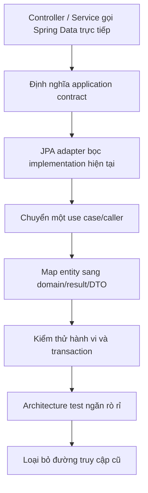

# Đưa truy cập dữ liệu sau hợp đồng và ngăn rò rỉ entity ORM

Bài học này thuộc chương **Cải tiến hệ thống hiện có** của module `SOFTWARE_DESIGN_ARCHITECTURE_ARCHITECTURAL_PATTERN_LAYERED`, trong chương trình **học tổ chức phần mềm theo kiến trúc phân tầng**. Trong một ứng dụng Java đã phát triển lâu, controller hoặc application service có thể gọi thẳng Spring Data JPA, trả `Page<Entity>` ra API hoặc để entity ORM đi xuyên qua nhiều tầng. Cách làm này có thể thuận tiện lúc đầu, nhưng dần khiến nghiệp vụ phụ thuộc vào schema, persistence context, lazy loading và framework lưu trữ.

Mục tiêu của bài học là refactor theo từng bước: đưa thao tác dữ liệu sau một hợp đồng mà tầng application cần, đặt implementation JPA ở adapter data access, và chuyển entity ORM thành domain model hoặc application DTO trước khi đi qua ranh giới. Việc tách này giúp thay đổi công nghệ lưu trữ hoặc API dễ kiểm soát hơn, nhưng cần thực hiện có lộ trình để không làm hỏng hành vi hiện tại.

Sau bài học, bạn có thể nhận diện nơi entity ORM đang rò rỉ, thiết kế hợp đồng truy cập dữ liệu vừa đủ, chuyển một use case sang adapter mà vẫn giữ transaction và kết quả, và kiểm thử refactor theo từng lát cắt.

## 1. Nhận diện vấn đề trong hệ thống hiện có

Một ứng dụng Spring Boot có thể bắt đầu với controller gọi trực tiếp Spring Data repository:

```java
@RestController
@RequestMapping("/orders")
public class OrderController {
    private final SpringDataOrderRepository orders;

    public OrderController(SpringDataOrderRepository orders) {
        this.orders = orders;
    }

    @GetMapping
    public Page<OrderEntity> list(Pageable pageable) {
        return orders.findAll(pageable);
    }
}
```

Đoạn code ngắn và có thể hoạt động tốt trong ứng dụng nhỏ. Nhưng nó để lộ một số quyết định persistence qua HTTP API:

- Controller biết `SpringDataOrderRepository`, `Pageable` và `Page`.
- Response serialize trực tiếp `OrderEntity`, nên thay đổi field hoặc quan hệ JPA có thể làm thay đổi JSON ngoài ý muốn.
- Entity có thể chứa quan hệ lazy, proxy hoặc vòng tham chiếu; serializer có thể kích hoạt truy vấn bổ sung, gặp lỗi lazy loading hoặc tạo JSON quá sâu.
- Client nhận cấu trúc gần với bảng/entity và dần phụ thuộc vào cách lưu trữ.
- Nếu CLI, message consumer hoặc một API khác cần cùng nghiệp vụ, chúng có thể lặp truy vấn và mapping riêng.

Một dấu hiệu khác là application service nhận `EntityManager`, `JpaRepository`, `HttpServletRequest` hoặc trả về `OrderEntity`. Khi đó tầng application đã biết chi tiết công nghệ hoặc giao thức mà nó không nhất thiết cần biết.

Không phải mọi ứng dụng đều cần tách entity JPA khỏi domain model. Dùng cùng một class làm entity và domain object có thể là lựa chọn hợp lý khi hệ thống nhỏ, mô hình đơn giản và nhóm chấp nhận dependency. Bài học tập trung vào trường hợp ranh giới đã trở thành vấn đề thực tế: nhiều tầng phụ thuộc persistence, API bị buộc theo entity hoặc việc thay đổi dữ liệu gây ảnh hưởng rộng.

## 2. Hợp đồng truy cập dữ liệu là gì?

**Hợp đồng truy cập dữ liệu** là interface hoặc abstraction mô tả thao tác mà application cần từ nơi lưu trữ. Nó được đặt ở phía cần sử dụng, thường trong application/core hoặc một package API có chủ sở hữu rõ ràng. Adapter data access hiện thực hợp đồng đó bằng JPA, JDBC, MyBatis hoặc một nguồn dữ liệu khác.

Ví dụ, use case hủy đơn cần tìm một đơn hàng theo ID và lưu thay đổi. Hợp đồng có thể là:

```java
// package com.example.orders.application.port
public interface OrderRepository {
    Optional<Order> findById(OrderId id);
    void save(Order order);
}
```

Hợp đồng dùng kiểu `Order` và `OrderId` của mô hình nghiệp vụ. Nó không trả `OrderEntity`, `JpaRepository`, `EntityManager`, `Pageable` hay `ResultSet`. Application biết nó cần một đơn hàng và muốn lưu đơn hàng sau khi áp dụng quy tắc; adapter chịu trách nhiệm chuyển đổi sang dạng lưu trữ.

### Hợp đồng nên diễn đạt nhu cầu, không sao chép API của framework

Một interface như sau thường chỉ đổi tên abstraction mà không tạo được ranh giới hữu ích:

```java
public interface OrderRepository {
    JpaRepository<OrderEntity, UUID> getJpaRepository();
}
```

Hoặc:

```java
public interface OrderRepository {
    Page<OrderEntity> findAll(Pageable pageable);
    void saveAll(Iterable<OrderEntity> entities);
    void flush();
    // Và toàn bộ phương thức CRUD tổng quát của Spring Data...
}
```

Nếu application phải biết entity, `Pageable` và các thao tác đặc thù JPA thì dependency vẫn bị rò qua hợp đồng. Hãy định nghĩa phương thức theo use case hoặc nhu cầu truy vấn thật sự, chẳng hạn `findOpenOrders(customerId, pageRequest)` hoặc `save(order)`.

Hợp đồng không cần chỉ có hai phương thức. Với truy vấn báo cáo, một query port riêng có thể trả projection/read model. Với thao tác cập nhật hàng loạt, một phương thức chuyên biệt như `reserveStockIfAvailable(...)` có thể hợp lý hơn việc tải hàng nghìn entity rồi sửa từng đối tượng. Điều quan trọng là kiểu đầu vào/đầu ra và ngữ nghĩa của hợp đồng không phụ thuộc vào ORM.

## 3. Đặt implementation JPA trong adapter

Một cách tổ chức package có thể là:

```text
com.example.orders
├── presentation
│   └── OrderController.java
├── application
│   ├── CancelOrderService.java
│   └── port
│       └── OrderRepository.java
├── domain
│   ├── Order.java
│   └── OrderId.java
└── dataaccess
    └── jpa
        ├── SpringDataOrderRepository.java
        ├── JpaOrderRepositoryAdapter.java
        ├── OrderEntity.java
        └── OrderMapper.java
```

Ở đây, application sở hữu interface `OrderRepository`; data access sở hữu entity JPA, Spring Data interface, mapper và adapter. Mũi tên dependency mã nguồn hướng từ adapter vào hợp đồng mà nó implement. Lúc chạy, application vẫn gọi interface và Spring cung cấp adapter cụ thể.

### Entity JPA chỉ thuộc adapter persistence

Ví dụ entity lưu trữ:

```java
@Entity
@Table(name = "orders")
class OrderEntity {
    @Id
    private UUID id;

    @Column(name = "customer_id", nullable = false)
    private UUID customerId;

    @Enumerated(EnumType.STRING)
    @Column(nullable = false)
    private OrderStatus status;

    protected OrderEntity() {}

    UUID id() { return id; }
    UUID customerId() { return customerId; }
    OrderStatus status() { return status; }

    void updateFrom(Order order) {
        this.customerId = order.customerId().value();
        this.status = order.status();
    }

    static OrderEntity from(Order order) {
        var entity = new OrderEntity();
        entity.id = order.id().value();
        entity.updateFrom(order);
        return entity;
    }
}
```

Đây là ví dụ rút gọn; constructor, accessor và mapping thực tế phụ thuộc cách thiết kế entity. Class được để package-private để giảm khả năng code bên ngoài adapter sử dụng trực tiếp. Entity giữ annotation JPA và chi tiết schema ở tầng persistence.

Spring Data repository chỉ là chi tiết bên trong adapter:

```java
interface SpringDataOrderRepository
        extends JpaRepository<OrderEntity, UUID> {
}
```

Adapter hiện thực hợp đồng application:

```java
@Repository
class JpaOrderRepositoryAdapter implements OrderRepository {
    private final SpringDataOrderRepository jpa;
    private final OrderMapper mapper;

    JpaOrderRepositoryAdapter(SpringDataOrderRepository jpa,
                              OrderMapper mapper) {
        this.jpa = jpa;
        this.mapper = mapper;
    }

    @Override
    public Optional<Order> findById(OrderId id) {
        return jpa.findById(id.value()).map(mapper::toDomain);
    }

    @Override
    public void save(Order order) {
        var entity = jpa.findById(order.id().value())
                .orElseGet(() -> OrderEntity.from(order));
        entity.updateFrom(order);
        jpa.save(entity);
    }
}
```

Ví dụ minh họa mapping đơn giản cho một entity. Với aggregate có nhiều collection/quan hệ, mapper cần xử lý ID, quan hệ, cascade, orphan removal và version một cách rõ ràng; không nên thay toàn bộ graph bằng entity mới nếu điều đó có thể xóa hoặc ghi đè dữ liệu ngoài ý muốn. Trong một transaction, entity được tải bởi persistence context có thể đang được quản lý; cập nhật entity đó sẽ được ORM dirty-checking khi flush. Chiến lược `save` cụ thể cần phù hợp với lifecycle và cách Spring Data xác định entity mới/cũ.

### Mapper là ranh giới chuyển đổi

`OrderMapper` chuyển đổi giữa `OrderEntity` và `Order`:

```java
@Component
class OrderMapper {
    Order toDomain(OrderEntity entity) {
        return Order.rehydrate(
                new OrderId(entity.id()),
                new CustomerId(entity.customerId()),
                entity.status());
    }
}
```

`rehydrate` ở đây là phương thức tạo lại trạng thái domain từ dữ liệu đã lưu; domain model có thể cung cấp factory riêng để bảo vệ invariant. Không nhất thiết phải dùng một thư viện mapper. Với vài field, mapping tường minh thường dễ đọc và dễ review; với mapping lớn, công cụ sinh mã có thể giảm boilerplate nhưng vẫn cần kiểm tra quy tắc chuyển đổi.

## 4. Đưa use case qua hợp đồng mà vẫn giữ hành vi

Application service chỉ biết `OrderRepository`:

```java
@Service
public class CancelOrderService {
    private final OrderRepository orders;

    public CancelOrderService(OrderRepository orders) {
        this.orders = orders;
    }

    @Transactional
    public CancelOrderResult execute(CancelOrderCommand command) {
        var order = orders.findById(command.orderId());
        if (order.isEmpty()) {
            return new CancelOrderResult.NotFound();
        }

        var decision = order.get().cancel(command.reason());
        if (decision instanceof Order.CancelDecision.Rejected rejected) {
            return new CancelOrderResult.Rejected(rejected.reason());
        }

        orders.save(order.get());
        return new CancelOrderResult.Cancelled(order.get().id());
    }
}
```

Application không cần biết `OrderEntity` hoặc cách JPA lưu thay đổi. Ranh giới transaction vẫn đặt quanh use case cần tính nhất quán; adapter tham gia transaction do Spring quản lý nếu nó dùng cùng transaction manager và resource phù hợp. Đưa repository sau interface không có nghĩa mỗi thao tác phải mở transaction riêng.

Khi refactor, cần giữ nguyên các hành vi quan trọng:

- Điều kiện tìm thấy/không tìm thấy và cách xử lý bản ghi bị xóa.
- Quy tắc cập nhật trạng thái, optimistic locking/version và unique constraint.
- Transaction boundary, rollback behavior và các side effect sau commit.
- Cách phân trang, sắp xếp, lọc và thứ tự kết quả.
- Quan hệ được tải, cascade/orphan removal và các trường mặc định.
- Mã lỗi, response và contract mà client hiện tại đang sử dụng.

Một thay đổi chỉ chuyển vị trí code nhưng vô tình đổi các hành vi trên vẫn là một refactor không an toàn.

## 5. Ngăn entity ORM rò rỉ qua API và tầng application

### Không trả entity trực tiếp từ controller

Controller nên nhận request DTO và trả response DTO:

```java
public record OrderResponse(
        UUID id,
        String status,
        BigDecimal total) {}

@RestController
@RequestMapping("/orders")
public class OrderController {
    private final GetOrderUseCase getOrder;

    @GetMapping("/{id}")
    public OrderResponse get(@PathVariable UUID id) {
        var result = getOrder.execute(new GetOrderQuery(id));
        return new OrderResponse(
                result.id(), result.status().name(), result.total());
    }
}
```

Ở ví dụ này, `OrderResponse` là hợp đồng HTTP. Application trả `OrderView` hoặc một result model của use case; controller map sang response DTO. API có thể đổi tên field, định dạng ngày, cấu trúc lồng hoặc version mà không buộc phải đổi entity/database.

### Không đưa entity vào application result

Các chữ ký sau tạo rò rỉ:

```java
Page<OrderEntity> findOrders(Pageable pageable);
Optional<OrderEntity> getOrder(UUID id);
List<OrderEntity> listByCustomer(UUID customerId);
```

Thay vào đó, dùng kiểu do application sở hữu:

```java
public record OrderSearch(
        CustomerId customerId,
        OrderStatus status,
        int page,
        int size) {}

public record OrderSummary(
        OrderId id,
        OrderStatus status,
        BigDecimal total) {}

public record OrderPage(
        List<OrderSummary> items,
        int page,
        int pageSize,
        long totalItems) {}

public interface OrderQueries {
    OrderPage search(OrderSearch search);
}
```

Adapter persistence chuyển `Page<OrderEntity>` hoặc projection SQL thành `OrderPage`. Application không cần phụ thuộc `Page`, `Pageable` hay entity JPA. Kiểu phân trang tự định nghĩa có thể đơn giản hơn; nếu ứng dụng đã chấp nhận Spring Data ở application layer thì giữ `Pageable` cũng là một trade-off có chủ đích, không phải lỗi tự động.

### Tránh lazy loading trong lúc serialize

Entity JPA có thể chứa quan hệ `LAZY`. Nếu controller trả entity, JSON serializer có thể truy cập quan hệ sau khi transaction hoặc persistence context kết thúc, dẫn đến `LazyInitializationException`; hoặc nếu session còn mở, serializer có thể kích hoạt N+1 query. Cách xử lý là xác định dữ liệu response cần, tải đúng projection/fetch plan trong query adapter, map sang DTO/read model trong phạm vi phù hợp và đóng ranh giới persistence trước khi serialize.

Không nên dùng `EAGER` cho mọi quan hệ để né lỗi lazy. Eager loading có thể kéo theo dữ liệu không cần thiết và làm query nặng. Cũng không nên dựa vào Open Session in View để controller/template tự kích hoạt truy vấn tùy ý nếu mục tiêu là kiểm soát rõ data access.

## 6. Tách đường đọc và đường ghi khi cần

Không phải truy vấn nào cũng cần tải một aggregate domain. Một màn hình danh sách có thể chỉ cần ID, trạng thái, tên khách và tổng tiền. Dùng repository tải toàn bộ aggregate cho mọi màn hình có thể gây truy vấn dư và mapping không cần thiết.

Có thể định nghĩa query port riêng:

```java
public interface OrderQueries {
    OrderPage search(OrderSearch search);
}
```

JPA adapter có thể dùng projection hoặc constructor expression để lấy đúng cột cần thiết, rồi trả `OrderPage`. Đường ghi vẫn dùng `OrderRepository` để tải aggregate, gọi hành vi domain và lưu thay đổi. Cách tách read/write ở mức hợp đồng này không bắt buộc phải triển khai CQRS đầy đủ hoặc dùng hai database; nó chỉ phản ánh hai nhu cầu truy cập dữ liệu khác nhau.

Nếu truy vấn báo cáo rất phức tạp, một DAO/query adapter trả projection có thể phù hợp hơn một repository aggregate. Điều quan trọng là không trả `OrderEntity` qua application chỉ vì ORM đã tạo sẵn class đó.

## 7. Refactor tăng dần mà không làm gián đoạn hệ thống

Đừng chuyển tất cả repository và controller cùng lúc nếu hệ thống có nhiều luồng đang hoạt động. Có thể refactor theo từng use case hoặc một lát cắt dọc.

### Bước 1: Lập bản đồ nơi entity đang được sử dụng

Tìm các điểm controller, application service, event handler, job và API công khai đang nhận/trả entity JPA hoặc gọi Spring Data trực tiếp. Ghi lại query, transaction, quan hệ lazy, cascade và các trường JSON mà client đang dùng. Mục tiêu là hiểu contract thực tế trước khi thay đổi.

### Bước 2: Chọn một use case nhỏ và xác định hợp đồng

Chọn một luồng có phạm vi rõ, ví dụ xem chi tiết đơn hoặc hủy đơn. Định nghĩa interface theo nhu cầu của use case và kiểu dữ liệu phía application/domain. Giữ nguyên ngữ nghĩa và tránh đưa toàn bộ API Spring Data vào interface mới.

### Bước 3: Bọc implementation hiện có bằng adapter

Tạo adapter JPA gọi Spring Data repository hiện tại. Ban đầu adapter có thể chuyển đổi tối thiểu để giữ nguyên hành vi. Không cần thay schema hoặc đổi database trong cùng bước.

### Bước 4: Chuyển một caller qua hợp đồng

Đổi constructor dependency của một application service sang interface mới. Giữ transaction và thứ tự xử lý. Nếu controller hiện gọi JPA trực tiếp, chuyển nó sang use case/query service trước khi xóa đường cũ.

### Bước 5: Đưa entity ra khỏi chữ ký và response

Thêm domain model, command/result hoặc response DTO tại ranh giới phù hợp. Map dữ liệu trong adapter hoặc application theo quyền sở hữu của từng kiểu. Kiểm tra JSON hiện tại để tránh vô tình phá API compatibility.

### Bước 6: Chuyển các luồng còn lại và xóa đường truy cập cũ

Chuyển từng controller, job và message handler. Khi không còn caller trực tiếp, xóa dependency cũ hoặc giới hạn quyền truy cập package. Tránh để song song hai đường ghi có semantics khác nhau quá lâu.

### Bước 7: Thêm hàng rào kiến trúc

Sau khi ranh giới ổn định, thêm architecture test để application không tham chiếu `..dataaccess.jpa.entity..`, presentation không gọi `..dataaccess.jpa..`, và các hợp đồng công khai không để lộ kiểu web/persistence. Quy tắc phải phản ánh lựa chọn thật của dự án.



## 8. Kiểm thử trong quá trình chuyển đổi

Mỗi loại test bảo vệ một phần cam kết:

| Loại kiểm thử | Điều cần xác nhận | Ví dụ |
|---|---|---|
| Unit test application | Use case điều phối đúng qua contract | Fake `OrderRepository`, kiểm tra not found, rejected và saved |
| Integration test adapter | JPA mapping và truy vấn giữ đúng semantics | Lưu/đọc entity, enum, quan hệ, phân trang và projection với database kiểm thử |
| Transaction test | Thay đổi cần nguyên tử cùng commit/rollback | Gây lỗi sau một thao tác ghi và xác nhận không có trạng thái dở dang |
| API contract test | Response không đổi ngoài ý muốn | So sánh JSON field, status, sorting và pagination trước/sau refactor |
| Architecture test | Dependency không quay lại adapter | Application không tham chiếu entity/JPA; presentation không gọi JDBC/JPA adapter |
| Regression test | Luồng cũ vẫn giữ hành vi | Hủy đơn, cập nhật trạng thái, quyền truy cập và xử lý lỗi như trước |

Mock repository không chứng minh mapping JPA đúng. Cần integration test với database phù hợp để kiểm tra query, constraint, lazy/eager, cascade và locking. H2 không phải lúc nào cũng tái hiện hành vi của PostgreSQL/MySQL; với tính năng phụ thuộc dialect hoặc concurrency, có thể dùng Testcontainers với cùng loại database như môi trường chạy.

Trong giai đoạn chuyển đổi, có thể chạy test của adapter mới song song với test hiện tại hoặc dùng characterization test để ghi nhận hành vi legacy. Không nên tạo hai lần ghi production chỉ để so sánh kết quả vì có thể phát sinh tác dụng phụ trùng. Nếu cần đối chiếu, dùng fixture/test database hoặc shadow read có kiểm soát.

## 9. Những lỗi refactor thường gặp

1. **Chỉ đổi tên `JpaRepository` thành `OrderRepository`.** Nếu interface vẫn trả entity và kiểu Spring Data, ranh giới chưa được tạo thực sự.
2. **Tách interface nhưng đặt ở data access.** Application vẫn phải phụ thuộc vào package implementation. Nếu muốn dependency hướng vào trong, hợp đồng nên thuộc application/core hoặc một module API độc lập.
3. **Map entity thành domain quá muộn.** Nếu controller nhận entity rồi mới map response, application và các caller khác vẫn có thể phụ thuộc persistence. Hãy chuyển mapping qua adapter/query boundary.
4. **Tạo entity mới rồi ghi đè toàn bộ graph.** Có thể làm mất quan hệ, version hoặc dữ liệu không được gửi trong request. Cập nhật entity managed theo aggregate và semantics rõ ràng.
5. **Làm mất transaction boundary.** Chuyển repository method có thể vô tình thay propagation hoặc làm mỗi bước commit riêng. Giữ transaction quanh use case cần nhất quán.
6. **Dùng DTO như bản sao toàn bộ entity.** DTO nên phản ánh nhu cầu của caller/API; không cần sao chép mọi cột và quan hệ.
7. **Bật eager loading để chữa lỗi serialize.** Cách này có thể tăng lượng dữ liệu và query. Chọn fetch plan/projection theo use case.
8. **Refactor toàn hệ thống trong một lần.** Phạm vi lớn làm khó khoanh vùng regression. Chuyển theo use case và xác minh từng bước.
9. **Tạo abstraction không có lợi ích.** Một lớp adapter chỉ chuyển tiếp một phương thức mà không bảo vệ contract, mapping hay dependency có thể làm code dài hơn. Chỉ tách khi ranh giới giải quyết một vấn đề thực tế.

## 10. Tiêu chí quyết định mức tách

Hãy chọn mức abstraction dựa trên chi phí và nhu cầu của hệ thống:

| Bối cảnh | Lựa chọn có thể phù hợp | Điều cần chấp nhận/kiểm tra |
|---|---|---|
| Ứng dụng nhỏ, entity đơn giản, API nội bộ | Dùng JPA entity trực tiếp trong một số tầng có thể chấp nhận | Chấp nhận coupling; tránh để entity trở thành public API ổn định ngoài hệ thống |
| Nhiều use case dùng chung nghiệp vụ, cần nhiều adapter | Port/repository do application sở hữu và JPA adapter | Cần mapping, test adapter và composition root rõ ràng |
| Query/report cần projection và join phức tạp | Query port/DAO riêng trả read model | Giữ query tối ưu, tránh tải aggregate không cần thiết |
| Entity/ORM đã lan vào API công khai | DTO/versioned response và mapping ở boundary | Cần quản lý compatibility và migration client |
| Refactor hệ thống legacy nhiều caller | Chuyển từng use case, giữ adapter cũ tạm thời | Cần characterization/regression tests và kế hoạch xóa đường cũ |

Không cần tách mọi entity, repository và DTO chỉ vì một mẫu kiến trúc khuyên như vậy. Hãy tách khi ranh giới giúp kiểm soát dependency, bảo vệ hợp đồng API, làm transaction/fetch rõ ràng hoặc cho phép thay đổi persistence mà không lan ra toàn hệ thống.

## 11. Checklist cho một lát cắt refactor

Trước khi kết thúc một lát cắt, hãy xác nhận:

- Application chỉ phụ thuộc vào contract mà nó cần; interface không trả entity hoặc kiểu ORM.
- JPA entity và Spring Data repository nằm trong adapter persistence.
- Controller nhận/trả DTO theo hợp đồng API; entity không bị serialize trực tiếp.
- Mapping entity/domain/result có chủ sở hữu rõ ràng và xử lý đúng quan hệ/version.
- Transaction boundary, rollback, locking và side effect vẫn đúng.
- Query fetch đúng dữ liệu cần thiết, không phát sinh lazy-loading hoặc N+1 ngoài dự kiến.
- Unit, integration, API contract và architecture tests phù hợp đều chạy qua.
- Caller cũ đã được chuyển hoặc có kế hoạch rõ để loại bỏ.

Đưa truy cập dữ liệu sau hợp đồng là một refactor về dependency và quyền sở hữu kiểu dữ liệu. Entity ORM có thể vẫn tồn tại và ORM vẫn có thể là công nghệ phù hợp; điều cần kiểm soát là nơi entity được biết đến và cách dữ liệu đi qua ranh giới. Chuyển từng use case, giữ nguyên hành vi và thêm kiểm thử kiến trúc giúp hệ thống hiện có tiến dần đến cấu trúc dễ thay đổi mà không cần viết lại toàn bộ ứng dụng.
