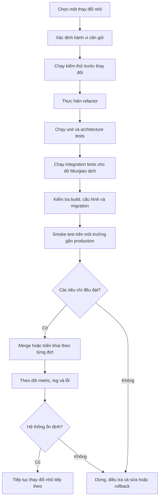

# Kiểm chứng chức năng, giao dịch và khả năng triển khai sau mỗi thay đổi

Refactor một hệ thống đang chạy có rủi ro đặc biệt: mã nguồn có thể trở nên rõ ràng hơn nhưng hành vi mà người dùng và hệ thống khác đang dựa vào lại thay đổi ngoài ý muốn. Một phương thức được tách thành nhiều service, một repository được thay bằng adapter mới, hoặc một transaction được chuyển sang lớp khác đều có thể làm thay đổi kết quả, thời điểm ghi dữ liệu, cách xử lý lỗi và khả năng triển khai.

Vì vậy, mỗi thay đổi cần được kiểm chứng ở ba mặt liên quan với nhau:

- **Chức năng:** hệ thống vẫn thực hiện đúng hành vi đã cam kết, kể cả các trường hợp lỗi và quy tắc ít gặp.
- **Giao dịch và dữ liệu:** các thao tác đọc/ghi vẫn có ranh giới nhất quán, rollback đúng khi cần và không làm hỏng dữ liệu hiện có.
- **Khả năng triển khai:** phiên bản mới có thể khởi động, hoạt động cùng hạ tầng và phiên bản cũ trong giai đoạn chuyển tiếp, đồng thời có cách quan sát và phục hồi nếu phát sinh sự cố.

Trong kiến trúc phân tầng, kiểm chứng phải đi qua đúng các ranh giới: controller và hợp đồng giao tiếp, application service và use case, domain model và bất biến, repository/adapter và kho dữ liệu, cuối cùng là môi trường triển khai. Bài học này trình bày cách xây dựng vòng kiểm chứng lặp lại sau mỗi thay đổi khi cải tiến hệ thống hiện có trong Java/Spring.

## 1. Vì sao cần kiểm chứng sau từng thay đổi?

Một đợt refactor lớn thường thay đổi nhiều yếu tố cùng lúc: cấu trúc lớp, dependency injection, transaction, truy vấn và cấu hình triển khai. Nếu chỉ chạy test sau khi hoàn thành toàn bộ, khi một test thất bại sẽ khó xác định thay đổi nào gây ra lỗi. Nếu triển khai một lần sau nhiều tuần, lỗi có thể đã lan qua nhiều commit và khó quay lại trạng thái ổn định.

Một vòng làm việc an toàn thường có nhịp như sau:



Mục tiêu của vòng lặp không phải chạy mọi loại test sau mỗi dòng code. Hãy chọn kiểm tra tương ứng với rủi ro của thay đổi. Một thay đổi tên phương thức có thể chỉ cần compile, unit test và architecture test; thay đổi cách lưu đơn hàng cần integration test với database; thay đổi schema hoặc transaction cần kiểm tra migration, commit/rollback và khả năng tương thích khi triển khai.

## 2. Xác định hành vi hiện có trước khi refactor

Trong hệ thống cũ, tài liệu có thể thiếu, quy tắc nghiệp vụ nằm rải rác hoặc hành vi thực tế khác với thiết kế ban đầu. Trước khi sửa, hãy xác định điều gì được xem là hợp đồng cần giữ.

### Characterization test

Characterization test ghi nhận hành vi đang quan sát được của hệ thống, đặc biệt khi chưa chắc hành vi đó có đúng với tài liệu hay không. Test này giúp refactor không vô tình thay đổi kết quả trong lúc cấu trúc nội bộ được cải thiện.

Ví dụ, một hệ thống tính phí vận chuyển cũ có quy tắc làm tròn chưa được mô tả. Ta có thể ghi lại các đầu vào và đầu ra đang được chấp nhận:

```java
class ShippingFeeCharacterizationTest {
    private final LegacyShippingCalculator calculator =
            new LegacyShippingCalculator();

    @Test
    void records_existing_rounding_for_fractional_fee() {
        var fee = calculator.calculate(
                new BigDecimal("125000"),
                new BigDecimal("0.075"));

        assertEquals(new BigDecimal("9375.00"), fee);
    }

    @Test
    void records_existing_minimum_fee_rule() {
        var fee = calculator.calculate(
                new BigDecimal("1000"),
                new BigDecimal("0.01"));

        assertEquals(new BigDecimal("500.00"), fee);
    }
}
```

Các giá trị trên chỉ là ví dụ minh họa; khi viết characterization test cho hệ thống thật, phải lấy dữ liệu từ hành vi đã quan sát, production-safe fixture hoặc quy tắc đã được chủ sở hữu nghiệp vụ xác nhận. Không nên biến một lỗi đã biết thành hợp đồng vĩnh viễn. Nếu phát hiện hành vi hiện tại sai, hãy ghi rõ quyết định: giữ nguyên trong đợt refactor cấu trúc, hay sửa nghiệp vụ trong một thay đổi riêng có phê duyệt và test thể hiện hành vi mới.

### Regression test cho hành vi quan trọng

Sau khi xác định hành vi cần giữ, viết regression test cho các luồng có ảnh hưởng lớn: tạo đơn, hủy đơn, hoàn tiền, cập nhật tồn kho, phân quyền, truy vấn danh sách, xử lý retry. Bao gồm cả trường hợp biên và thất bại, không chỉ happy path.

Một bảng hành vi có thể giúp xác định phạm vi:

| Use case | Thành công cần giữ | Trường hợp thất bại cần kiểm tra |
|---|---|---|
| Tạo đơn | Đơn được tạo với giá và số lượng đúng | Sản phẩm ngừng bán, số lượng sai, khách hàng không có quyền |
| Hủy đơn | Trạng thái và tồn kho được cập nhật đúng | Đơn đã giao, đã hủy hoặc hoàn tiền không thành công |
| Thanh toán | Giao dịch được ghi nhận đúng một lần theo khóa nghiệp vụ | Timeout, callback lặp, nhà cung cấp từ chối |
| Tra cứu | Bộ lọc và quyền truy cập trả đúng dữ liệu | Không tồn tại, tenant khác, tham số sai |
| Báo cáo | Tổng số và khoảng thời gian đúng | Dữ liệu rỗng, phân trang, múi giờ và ranh giới ngày |

Nếu hệ thống có nhiều hành vi khó mô tả, hãy ưu tiên luồng quan trọng theo tần suất, giá trị nghiệp vụ và hậu quả khi sai. Có thể dùng dữ liệu production đã ẩn danh hoặc fixture tổng hợp để tạo kịch bản lặp lại, nhưng không đưa dữ liệu cá nhân hoặc bí mật thật vào repository test.

## 3. Kiểm chứng từng tầng theo đúng trách nhiệm

Kiến trúc phân tầng tạo điều kiện kiểm thử từng phần mà không cần luôn khởi động toàn bộ ứng dụng.

| Tầng | Câu hỏi kiểm chứng | Loại test phù hợp |
|---|---|---|
| Presentation | Request/response, validation, mã HTTP và quyền truy cập có đúng không? | Controller test, MockMvc/WebTestClient |
| Application | Use case điều phối đúng thứ tự và xử lý lỗi đúng không? | Unit test với fake/mock các port |
| Domain | Bất biến và quy tắc nghiệp vụ có được bảo vệ không? | Unit test Java thuần |
| Data access/infrastructure | Truy vấn, ánh xạ, transaction và adapter có đúng với công nghệ thật không? | Repository integration test, contract test |
| Toàn ứng dụng | Cấu hình và các thành phần phối hợp có đúng không? | Smoke test và end-to-end test |

Ví dụ, khi chuyển quy tắc hủy đơn từ `OrderService` vào `Order.cancel()`, unit test domain cần chứng minh đơn đã giao không thể bị hủy. Unit test application cần chứng minh use case không gọi cổng hoàn tiền hoặc giải phóng kho khi domain từ chối. Integration test cần xác nhận trạng thái sau khi lưu và transaction rollback nếu một bước ghi dữ liệu thất bại.

Không nên dùng một end-to-end test duy nhất để chứng minh mọi quy tắc. Khi test thất bại, test ở đúng ranh giới thường cho biết nguyên nhân cụ thể hơn và chạy nhanh hơn.

## 4. Kiểm chứng ranh giới transaction

Một refactor có thể vô tình làm transaction bị mở quá rộng, quá hẹp hoặc không còn bao quanh các thao tác cần tính nhất quán. Cần xác định rõ dữ liệu nào phải cùng commit, dữ liệu nào có thể cập nhật độc lập và thao tác nào nằm ngoài database transaction.

Ví dụ use case chuyển tiền cần ghi nợ tài khoản nguồn và ghi có tài khoản đích trong cùng transaction:

```java
@Service
class TransferService {
    private final AccountRepository accounts;

    TransferService(AccountRepository accounts) {
        this.accounts = accounts;
    }

    @Transactional
    public void transfer(AccountId sourceId, AccountId targetId, Money amount) {
        var source = accounts.findById(sourceId)
                .orElseThrow(AccountNotFoundException::new);
        var target = accounts.findById(targetId)
                .orElseThrow(AccountNotFoundException::new);

        source.withdraw(amount);
        target.deposit(amount);

        accounts.save(source);
        accounts.save(target);
    }
}
```

Nếu việc lưu tài khoản đích thất bại sau khi tài khoản nguồn đã được ghi, transaction cần rollback cả hai thay đổi. Đây là hành vi cần được kiểm chứng với database thật hoặc database tương thích, không chỉ mock repository.

### Kiểm thử rollback

Một integration test có thể cố ý tạo lỗi sau khi thay đổi đầu tiên được flush và sau đó xác nhận dữ liệu không bị ghi dở. Ví dụ khái niệm:

```java
@SpringBootTest
class TransferTransactionIT {
    @Autowired TransferService transfers;
    @Autowired AccountJpaRepository accounts;

    @Test
    void rolls_back_both_accounts_when_second_write_fails() {
        var sourceBefore = accounts.findById(SOURCE_ID).orElseThrow();
        var targetBefore = accounts.findById(TARGET_ID).orElseThrow();

        assertThrows(RuntimeException.class, () ->
                transfers.transfer(SOURCE_ID, TARGET_ID, Money.of("50.00")));

        var sourceAfter = accounts.findById(SOURCE_ID).orElseThrow();
        var targetAfter = accounts.findById(TARGET_ID).orElseThrow();

        assertEquals(sourceBefore.getBalance(), sourceAfter.getBalance());
        assertEquals(targetBefore.getBalance(), targetAfter.getBalance());
    }
}
```

Để test có ý nghĩa, cần tạo lỗi ở đúng vị trí và đảm bảo transaction thật đã được gọi qua Spring proxy. Có thể dùng constraint vi phạm có kiểm soát, test double ở điểm gọi phù hợp hoặc một adapter test chuyên biệt. Không nên giả định một test chỉ mock `save()` đã chứng minh database rollback.

### Cẩn thận với test tự rollback

Spring test thường có thể chạy test trong transaction và rollback khi test kết thúc. Điều này tiện để cô lập dữ liệu, nhưng có thể che giấu lỗi liên quan đến commit, callback sau commit hoặc hành vi transaction lồng nhau. Với những thay đổi liên quan commit boundary, hãy có test thực hiện commit thật và đọc lại dữ liệu trong transaction mới. Có thể dùng `TestTransaction` hoặc thiết kế test không gắn `@Transactional` ở cấp test, tùy cấu trúc.

`@Transactional` trong Spring thường dựa trên proxy. Gọi một phương thức transactional từ một phương thức khác trong cùng object (self-invocation) có thể không đi qua proxy, vì vậy không kích hoạt hành vi transaction như mong đợi trong cấu hình proxy mặc định. Khi chuyển phương thức giữa các lớp, hãy kiểm tra caller thực tế, propagation và nơi transaction bắt đầu/kết thúc.

### Kiểm tra rollback rule và lỗi ngoài database

Theo cấu hình mặc định phổ biến của Spring, runtime exception và error kích hoạt rollback, còn checked exception không tự động rollback nếu không cấu hình thêm. Khi refactor thay đổi kiểu exception hoặc bọc lỗi, hãy xác nhận rollback rule vẫn phù hợp, ví dụ dùng `rollbackFor` khi cần.

Gọi API thanh toán, gửi email hoặc cập nhật hệ thống kho không tự rollback cùng transaction database. Nếu database rollback sau khi API ngoài đã thành công, hai hệ thống có thể lệch trạng thái. Cần kiểm thử các điểm lỗi giữa các bước và thiết kế idempotency, outbox, retry hoặc hành động bù trừ. Đừng viết test kỳ vọng transaction database tự hoàn tác tác dụng phụ HTTP.

## 5. Kiểm chứng repository và dữ liệu hiện có

Khi thay đổi repository, ORM mapping, truy vấn hoặc cấu trúc bảng, cần xác nhận dữ liệu thực được đọc/ghi đúng. Unit test với mock chỉ kiểm tra cách application gọi port; nó không chứng minh câu SQL, join, khóa, kiểu dữ liệu hay mapping JPA chính xác.

Repository integration test nên kiểm tra:

- Entity/domain mapping giữ nguyên giá trị, nullability và quan hệ cần thiết.
- Truy vấn theo ID, bộ lọc, sắp xếp và phân trang trả kết quả đúng.
- Unique constraint, foreign key và optimistic locking hoạt động đúng.
- Trường hợp không tìm thấy, xung đột đồng thời và dữ liệu cũ được xử lý rõ ràng.
- Transaction commit/rollback theo ranh giới use case.

Ví dụ test repository:

```java
@DataJpaTest
class OrderRepositoryIT {
    @Autowired TestEntityManager entityManager;
    @Autowired SpringDataOrderRepository orders;

    @Test
    void finds_orders_by_customer_and_status() {
        var order = OrderEntity.pending(CUSTOMER_ID, "ORD-1001");
        entityManager.persistAndFlush(order);

        var result = orders.findByCustomerIdAndStatus(
                CUSTOMER_ID, OrderStatus.PENDING, Pageable.unpaged());

        assertEquals(1, result.getTotalElements());
        assertEquals("ORD-1001", result.getContent().get(0).getOrderNumber());
    }
}
```

Nếu production sử dụng PostgreSQL, MySQL hoặc SQL Server, nên chạy các test quan trọng với đúng hệ quản trị hoặc một phiên bản tương thích gần bằng Testcontainers. H2 có thể hữu ích cho test nhanh, nhưng không bảo đảm giống production về SQL dialect, collation, locking, isolation và kiểu dữ liệu.

Với dữ liệu hiện có, hãy tạo fixture đại diện cho cả bản ghi cũ và mới. Kiểm tra null, giá trị mặc định, timezone, độ chính xác số thập phân và dữ liệu không còn tuân theo giả định mới. Không chỉ kiểm tra một database sạch vừa tạo từ migration mới.

## 6. Kiểm chứng migration và tương thích giữa phiên bản

Refactor hệ thống đang chạy thường cần thay đổi schema. Nếu triển khai nhiều instance hoặc rolling deployment, phiên bản cũ và mới có thể cùng truy cập database trong một khoảng thời gian. Một migration phá vỡ tương thích có thể làm phiên bản cũ lỗi ngay khi phiên bản mới bắt đầu triển khai.

Chiến lược **expand-and-contract** chia thay đổi schema thành các bước tương thích:

1. **Expand:** thêm cột/bảng mới hoặc thay đổi theo cách phiên bản cũ vẫn hoạt động. Nếu cần, cho phép cả cột cũ và mới tồn tại song song.
2. **Dual compatibility:** triển khai ứng dụng có thể đọc/ghi theo cách tương thích với cả cấu trúc cũ và mới. Có thể backfill dữ liệu theo lô và kiểm tra kết quả.
3. **Switch:** chuyển đọc sang cấu trúc mới sau khi dữ liệu đã đầy đủ và phiên bản cũ không còn ghi theo cách cũ.
4. **Contract:** chỉ xóa cột hoặc bảng cũ sau khi mọi instance và tác vụ nền đã chuyển sang cấu trúc mới, và không còn đường rollback cần nó.

Ví dụ đổi `customer_name` thành `display_name`: đầu tiên thêm `display_name` nullable; ứng dụng mới ghi cả hai hoặc có cơ chế đồng bộ; backfill dữ liệu cũ; chuyển đọc sang `display_name`; sau một khoảng xác nhận ổn định mới xóa `customer_name`. Trình tự thực tế phụ thuộc cách ứng dụng cũ và mới ghi dữ liệu, nhưng nguyên tắc là không xóa cấu trúc mà một phiên bản đang chạy vẫn cần.

Migration cần được kiểm chứng trên bản sao dữ liệu đại diện về thời gian chạy, khóa, dung lượng và kết quả backfill. Kiểm tra cả đường nâng cấp từ schema hiện tại và khả năng khôi phục. Không nên chỉ chạy migration trên database rỗng.

## 7. Kiểm chứng khả năng triển khai

Build thành công không đồng nghĩa ứng dụng có thể chạy trong môi trường đích. Sau thay đổi, cần kiểm tra artifact, cấu hình, secret, kết nối dependency, quyền truy cập và quy trình khởi động.

Một checklist triển khai tối thiểu:

| Hạng mục | Kiểm chứng | Ví dụ lỗi cần phát hiện |
|---|---|---|
| Artifact | Build đúng JAR/container image và phiên bản | Thiếu resource hoặc dependency runtime |
| Configuration | Profile, biến môi trường, secret được nạp | URL database hoặc credential sai |
| Startup | Ứng dụng khởi động trong môi trường gần production | Bean không được inject, migration lỗi |
| Readiness | Instance chỉ nhận tải khi sẵn sàng | App đã mở port nhưng chưa kết nối được dependency bắt buộc |
| Health | Liveness/readiness phản ánh đúng trạng thái | Dependency tạm lỗi khiến mọi instance bị restart liên tục |
| Database | Migration và quyền schema hoạt động | Tài khoản runtime thiếu quyền hoặc schema chưa tương thích |
| Shutdown | Dừng nhận request mới và hoàn tất request đang chạy | Request bị cắt hoặc message đang xử lý bị mất |
| Observability | Log, metric, trace có thể truy vấn | Không xác định được phiên bản hoặc instance gây lỗi |

Spring Boot Actuator có thể cung cấp health endpoint. Nên tách readiness và liveness theo ý nghĩa: readiness cho biết instance có thể nhận traffic; liveness cho biết tiến trình có cần được khởi động lại hay không. Không đưa mọi dependency bên ngoài vào liveness một cách máy móc, vì một database tạm thời gián đoạn có thể khiến toàn bộ replica cùng bị restart và làm sự cố nặng hơn.

Smoke test sau triển khai nên đi qua một số luồng quan trọng với dữ liệu kiểm thử an toàn: xác thực, đọc dữ liệu, tạo một bản ghi kiểm thử nếu có thể, và xác nhận phản hồi từ các dependency cần thiết. Smoke test không thay thế integration hoặc end-to-end test đầy đủ; nó xác nhận phiên bản vừa triển khai có thể hoạt động ở môi trường đó.

## 8. Triển khai theo từng đợt và chuẩn bị rollback

Thay đổi lớn nên được triển khai theo phạm vi tăng dần nếu hạ tầng hỗ trợ:

- **Canary:** đưa phiên bản mới tới một tỷ lệ nhỏ traffic hoặc một nhóm instance trước.
- **Blue-green:** chạy hai môi trường tương đương, chuyển traffic sang môi trường mới khi đạt tiêu chí.
- **Rolling deployment:** thay instance từng nhóm, theo dõi trạng thái trong suốt quá trình.

Không có chiến lược nào phù hợp với mọi ứng dụng. Canary giúp giới hạn phạm vi ảnh hưởng nhưng cần khả năng phân phối và quan sát traffic. Blue-green cần tài nguyên cho hai môi trường và database phải tương thích với cả hai phiên bản trong thời gian chuyển đổi. Rolling deployment tiết kiệm tài nguyên hơn nhưng yêu cầu phiên bản cũ và mới có thể cùng hoạt động.

Trước khi triển khai, hãy xác định tiêu chí dừng hoặc rollback, ví dụ:

- Tỷ lệ lỗi 5xx vượt ngưỡng đã thống nhất.
- p95/p99 tăng đáng kể so với baseline trong khoảng thời gian đủ mẫu.
- Số giao dịch thất bại, bản ghi trùng hoặc sai lệch dữ liệu tăng.
- Connection pool, queue depth hoặc tài nguyên vượt ngưỡng vận hành.
- Health/readiness không ổn định hoặc dependency bắt buộc không thể kết nối.

Rollback ứng dụng không nhất thiết khôi phục được database. Nếu migration đã xóa cột hoặc chuyển đổi dữ liệu không thể đảo ngược, việc quay lại binary cũ có thể làm ứng dụng không chạy. Vì vậy, schema tương thích ngược và kế hoạch khôi phục dữ liệu cần được thiết kế trước khi phát hành. Với thay đổi dữ liệu không thể đảo ngược, có thể cần forward-fix hoặc quy trình phục hồi riêng thay vì chạy migration ngược tự động.

## 9. Theo dõi sau triển khai và đối chiếu hành vi

Sau khi triển khai, tiếp tục quan sát hệ thống theo cùng các chỉ số đã dùng trước thay đổi. So sánh với baseline theo endpoint, loại giao dịch và phiên bản. Chú ý:

- Tỷ lệ thành công/thất bại của từng use case.
- Độ trễ p50/p95/p99 và số request timeout.
- Lỗi database, thời gian chờ connection, lock wait và số transaction rollback.
- Số lần gọi hệ thống ngoài, retry, timeout và lỗi callback.
- Các chỉ số nghiệp vụ như số đơn tạo thành công, số giao dịch bị từ chối, số bản ghi trùng hoặc chênh lệch tổng tiền.

Log nên có correlation ID hoặc trace ID để nối các bước qua controller, application service và adapter. Tránh ghi thông tin nhạy cảm như token, mật khẩu, dữ liệu thanh toán đầy đủ hoặc dữ liệu cá nhân không cần thiết. Khi so sánh phiên bản, cần gắn version/build identifier vào metric, log hoặc trace.

Đối với thay đổi liên quan tiền, tồn kho hoặc trạng thái đơn hàng, chỉ số kỹ thuật chưa đủ. Có thể đối chiếu tổng số giao dịch, tổng giá trị, số lần chuyển trạng thái và các bản ghi đối soát theo khoảng thời gian. Dùng truy vấn chỉ đọc hoặc báo cáo đã kiểm soát để tránh tạo tải và không sửa dữ liệu production trong quá trình xác minh.

## 10. Ví dụ: chuyển xử lý thanh toán sang adapter mới

Giả sử hệ thống cũ gọi trực tiếp SDK thanh toán trong `OrderService`. Ta muốn tách thành `PaymentPort` và `PaymentAdapter` mà vẫn giữ hành vi.

Trước khi refactor, hãy ghi nhận:

1. Khi thanh toán thành công, trạng thái đơn hàng và mã giao dịch được lưu như thế nào?
2. Khi nhà cung cấp timeout, hệ thống đánh dấu đơn hàng ở trạng thái nào?
3. Callback lặp có tạo thêm giao dịch hoặc gửi email nhiều lần không?
4. Khi database commit thất bại sau khi nhà cung cấp đã thu tiền, hệ thống có cách đối soát hoặc retry không?
5. API hiện tại có trả cùng mã HTTP và cấu trúc lỗi mà client đang dựa vào không?

Sau đó tách port và adapter:

```java
public interface PaymentPort {
    PaymentResult charge(PaymentCommand command);
}
```

```java
@Component
class HttpPaymentAdapter implements PaymentPort {
    private final PaymentClient client;

    HttpPaymentAdapter(PaymentClient client) {
        this.client = client;
    }

    @Override
    public PaymentResult charge(PaymentCommand command) {
        var response = client.charge(command.idempotencyKey(), command.amount());
        return PaymentResult.fromProvider(response);
    }
}
```

Application service gọi `PaymentPort`, còn adapter biết SDK/HTTP cụ thể. Bộ kiểm chứng sau thay đổi gồm:

| Mức | Kiểm tra |
|---|---|
| Unit test application | Thành công cập nhật trạng thái; từ chối không ghi nhận đã thanh toán; timeout chuyển sang trạng thái chờ xác minh theo quy tắc |
| Contract test adapter | Request, authentication, timeout, response và lỗi nhà cung cấp được ánh xạ đúng |
| Integration test database | Trạng thái đơn, payment reference và idempotency record được commit/rollback phù hợp |
| Callback test | Callback lặp hoặc đến sai thứ tự không làm cập nhật trạng thái sai |
| Deployment smoke test | Cấu hình endpoint/secret đúng, health ổn định và giao dịch sandbox thành công |
| Production canary | Tỷ lệ thành công, timeout, duplicate và đối soát không xấu hơn baseline |

Nếu các test đều đạt nhưng production có tỷ lệ timeout tăng, cần dừng mở rộng rollout và điều tra network, timeout, connection pool hoặc khác biệt môi trường. Không nên kết luận refactor an toàn chỉ từ việc unit test xanh.

## 11. Chọn bộ kiểm chứng theo mức độ rủi ro

Không cần chạy mọi kiểm tra với cùng tần suất. Có thể phân loại theo phạm vi tác động:

| Loại thay đổi | Kiểm tra tối thiểu nên có | Kiểm tra bổ sung khi phù hợp |
|---|---|---|
| Đổi tên hoặc di chuyển lớp không đổi hành vi | Compile, unit test liên quan, architecture test | Test module/build nếu thay package API |
| Tách application service hoặc domain behavior | Unit test domain/application, controller regression test | Integration test nếu thay transaction hoặc persistence |
| Thay repository hoặc query | Repository integration test, test phân trang/lọc/ánh xạ | Load test nếu thay đổi truy vấn quan trọng |
| Thay transaction hoặc xử lý lỗi | Integration test commit/rollback, concurrency test | Kiểm tra outbox/idempotency nếu có hệ thống ngoài |
| Thay schema hoặc dữ liệu | Migration test trên dữ liệu đại diện, compatibility test | Backup/restore rehearsal, kiểm tra thời gian migration |
| Thay cấu hình hoặc cách triển khai | Build artifact, startup, readiness và smoke test | Canary, failover và rollback rehearsal |

Đối với hệ thống cũ có test coverage thấp, đừng chờ có một bộ test hoàn hảo mới bắt đầu refactor. Hãy thêm characterization test cho hành vi quan trọng, chọn thay đổi nhỏ, kiểm tra thủ công có ghi nhận ở các điểm chưa tự động hóa và dần bổ sung test khi ranh giới được làm rõ.

## 12. Điều kiện để tiếp tục thay đổi

Một thay đổi có thể xem là sẵn sàng cho bước tiếp theo khi:

1. Hành vi cần giữ hoặc hành vi mới đã được mô tả bằng test hay tiêu chí có thể kiểm tra.
2. Unit test, integration test và architecture test phù hợp đều đạt.
3. Transaction commit/rollback, xử lý lỗi và tác dụng phụ bên ngoài đã được kiểm chứng ở đúng ranh giới.
4. Migration và schema tương thích với phiên bản sẽ cùng tồn tại trong quá trình triển khai.
5. Artifact khởi động được trong môi trường mục tiêu, health/smoke test đạt và có metric/log để quan sát.
6. Có tiêu chí dừng rollout, cách phục hồi và người chịu trách nhiệm khi phát hiện sai lệch.

Nếu một tiêu chí chưa đạt, hãy giữ phạm vi thay đổi ở mức có thể điều tra, sửa hoặc quay lại. Không gom thêm refactor khác khi lỗi hiện tại chưa được hiểu rõ; nếu không, mỗi thay đổi mới sẽ làm tăng số giả thuyết cần kiểm tra.

Kiểm chứng chức năng, giao dịch và khả năng triển khai là một phần của chính quá trình cải tiến hệ thống hiện có. Khi mỗi bước refactor đều có hành vi được bảo vệ, dữ liệu được kiểm tra và kế hoạch phát hành rõ ràng, nhóm có thể cải thiện cấu trúc bên trong mà vẫn kiểm soát được rủi ro đối với người dùng và hoạt động vận hành.
