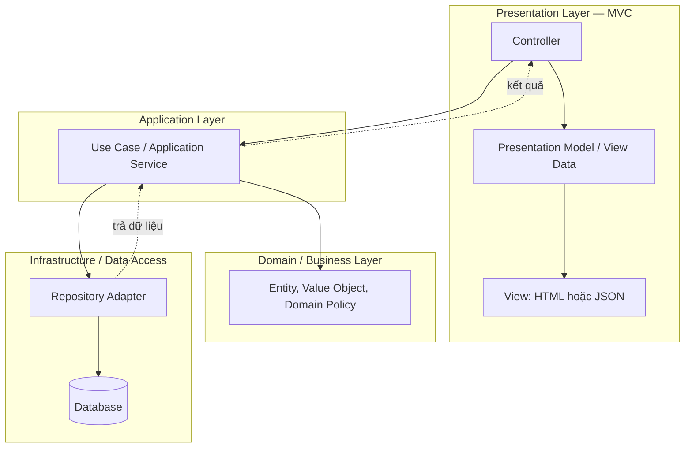
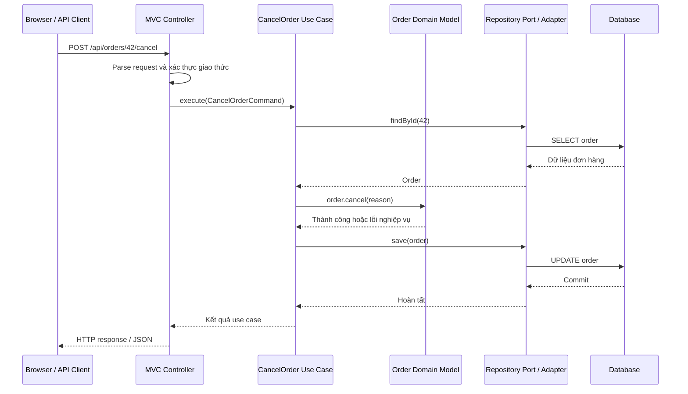

# Phân biệt layered architecture với MVC trong tầng trình bày

Bài học này thuộc module `SOFTWARE_DESIGN_ARCHITECTURE_ARCHITECTURAL_PATTERN_LAYERED`, nhằm giúp người học tổ chức phần mềm theo kiến trúc phân tầng. Trong chương **Lựa chọn và tiến hóa kiến trúc**, ta phân biệt hai khái niệm thường bị xem nhầm là hai phương án cạnh tranh: layered architecture tổ chức trách nhiệm của toàn ứng dụng, còn Model–View–Controller (MVC) là một mẫu tổ chức tương tác và trình bày. Một ứng dụng có thể dùng kiến trúc phân tầng và triển khai tầng trình bày bằng MVC cùng lúc.

## 1. Hai khái niệm giải quyết hai phạm vi khác nhau

**Layered architecture (kiến trúc phân tầng)** chia hệ thống thành các nhóm trách nhiệm và quy định cách chúng được phép phụ thuộc, gọi nhau. Một cách tổ chức thường gặp có Presentation, Application, Domain/Business và Infrastructure/Data Access. Số tầng và tên gọi có thể thay đổi theo quy mô, framework và nhu cầu; điều quan trọng là trách nhiệm và chiều phụ thuộc được xác định rõ.

**MVC** chia trách nhiệm trong một luồng tương tác thành ba vai trò:

- **Model:** trạng thái và dữ liệu mà tương tác cần hiển thị hoặc thay đổi. Trong một ứng dụng, model có thể là mô hình miền, presentation model hoặc dữ liệu được chuẩn bị riêng cho màn hình; không mặc định luôn là entity JPA.
- **View:** cách biểu diễn thông tin cho người dùng, chẳng hạn trang HTML, template, giao diện desktop hoặc response representation.
- **Controller:** tiếp nhận thao tác hoặc yêu cầu, diễn giải đầu vào, điều phối cập nhật model và chọn view/response phù hợp.

MVC chủ yếu trả lời câu hỏi: *một tương tác ở tầng trình bày được chia trách nhiệm giữa thành phần nào?* Layered architecture trả lời câu hỏi rộng hơn: *toàn ứng dụng được chia thành những trách nhiệm nào và các phần phụ thuộc nhau ra sao?*

Vì vậy, so sánh chúng như hai kiến trúc loại trừ nhau sẽ dẫn đến lựa chọn sai. MVC có thể là cách tổ chức bên trong Presentation Layer của một hệ thống phân tầng.

## 2. Hình dung mối quan hệ giữa hai mô hình

Sơ đồ sau thể hiện một ứng dụng web dùng MVC ở tầng trình bày và các tầng phía sau để xử lý use case, quy tắc nghiệp vụ và lưu trữ:



Trong cách tổ chức này, Controller thuộc Presentation Layer. Nó nhận request, chuyển đầu vào thành command/query, gọi use case và chuyển kết quả thành model dành cho view hoặc response DTO. Application Service điều phối ca sử dụng. Domain bảo vệ quy tắc nghiệp vụ. Repository adapter giao tiếp với database.

MVC không yêu cầu Controller phải chứa quy tắc nghiệp vụ hoặc truy cập trực tiếp database. Nếu Controller tự viết SQL, tự kiểm tra mọi chính sách và thay đổi entity, ứng dụng có thể vẫn mang tên MVC nhưng đã làm mờ ranh giới của kiến trúc phân tầng.

## 3. MVC trong ứng dụng web truyền thống

Trong một ứng dụng web trả HTML từ server, luồng MVC có thể diễn ra như sau:

1. Người dùng gửi biểu mẫu hoặc chọn một hành động.
2. Router chuyển request tới Controller phù hợp.
3. Controller đọc và kiểm tra dữ liệu đầu vào ở mức giao thức, sau đó gọi thao tác cần thiết.
4. Model được đọc hoặc cập nhật theo kết quả xử lý.
5. Controller chọn View và cung cấp dữ liệu cần hiển thị.
6. View render HTML trả về trình duyệt.

Ví dụ trong Spring MVC, controller có thể trả tên template và đặt dữ liệu vào `Model`:

```java
@Controller
@RequestMapping("/orders")
class OrderPageController {
    private final GetOrderDetailsUseCase getOrderDetails;

    OrderPageController(GetOrderDetailsUseCase getOrderDetails) {
        this.getOrderDetails = getOrderDetails;
    }

    @GetMapping("/{id}")
    String detail(@PathVariable String id, Model model) {
        OrderDetails details = getOrderDetails.execute(new OrderId(id));
        model.addAttribute("order", details);
        return "orders/detail";
    }
}
```

Trong ví dụ, `Model` là đối tượng của Spring MVC dùng để đưa dữ liệu tới view template. Nó không đồng nghĩa với Domain Model. `OrderDetails` có thể là DTO được use case trả về; template `orders/detail` dùng DTO đó để render HTML.

Controller không cần biết truy vấn được thực hiện bằng JPA hay SQL. Nó cũng không nên quyết định chính sách như đơn đã giao có được hủy hay không. Những quyết định đó thuộc use case hoặc mô hình nghiệp vụ theo đúng ngữ nghĩa.

## 4. MVC trong REST API và response JSON

REST API thường không trả một template HTML do server render. Thay vào đó, View có thể được hiểu là representation của tài nguyên, thường là JSON hoặc XML. Controller vẫn đóng vai trò tiếp nhận HTTP request và trả response theo hợp đồng API.

```java
@RestController
@RequestMapping("/api/orders")
class OrderRestController {
    private final GetOrderDetailsUseCase getOrderDetails;

    OrderRestController(GetOrderDetailsUseCase getOrderDetails) {
        this.getOrderDetails = getOrderDetails;
    }

    @GetMapping("/{id}")
    ResponseEntity<OrderDetailsResponse> detail(@PathVariable String id) {
        OrderDetails details = getOrderDetails.execute(new OrderId(id));
        return ResponseEntity.ok(OrderDetailsResponse.from(details));
    }
}
```

`OrderDetailsResponse` là response DTO được tạo cho hợp đồng HTTP. Nó không nhất thiết giống domain entity hoặc JPA entity. Trong Spring MVC, `@RestController` kết hợp cơ chế message conversion để serialize kết quả thành JSON; vì thế không có template HTML truyền thống, nhưng trách nhiệm biểu diễn dữ liệu ra bên ngoài vẫn tồn tại.

Đừng suy luận rằng mọi REST API đều phải có một lớp tên `View`. View là vai trò biểu diễn trong MVC; trong API, response DTO và serializer có thể cùng đảm nhiệm vai trò đó. Tên lớp và cách hiện thực phụ thuộc vào framework.

## 5. Controller không phải Application Service

Hai thành phần này có thể cùng được gọi là “điều phối” trong giao tiếp hàng ngày, nhưng chúng điều phối ở hai phạm vi khác nhau.

| Thành phần | Trách nhiệm chính | Ví dụ |
|---|---|---|
| MVC Controller | Giao tiếp với giao thức/UI: nhận request, chuyển đổi input, chọn response hoặc view | Đọc path variable, kiểm tra kiểu dữ liệu HTTP, trả status code |
| Application Service / Use Case | Điều phối một hành động của ứng dụng theo hợp đồng độc lập với giao thức | Tải đơn, gọi hành vi miền, quản lý transaction, lưu thay đổi |
| Domain Model | Bảo vệ quy tắc và bất biến nghiệp vụ | Không cho phép hủy đơn đã giao |
| Repository Adapter | Hiện thực truy xuất/lưu trữ bằng công nghệ cụ thể | Dùng Spring Data JPA để đọc và ghi entity |

Một controller có thể nhận yêu cầu từ HTTP hôm nay, trong khi ngày mai cùng use case được gọi từ message consumer hoặc tác vụ nền. Nếu quy trình nghiệp vụ nằm trong Application Service, các điểm vào khác nhau có thể tái sử dụng nó. Nếu quy trình bị đặt trong Controller, các điểm vào mới dễ phải sao chép hoặc gọi ngược controller.

Controller có thể thực hiện các kiểm tra đầu vào mang tính giao thức, chẳng hạn trường bắt buộc, định dạng ngày hoặc chuyển đổi chuỗi sang ID. Application Service có thể xác thực các điều kiện của hợp đồng use case như quyền thao tác hoặc tính hợp lệ của command. Quy tắc nghiệp vụ như chuyển trạng thái hợp lệ cần được bảo vệ trong mô hình miền hoặc policy sở hữu quy tắc.

## 6. Phân biệt các loại “Model” trong MVC

Từ *Model* thường gây nhầm lẫn vì có thể chỉ nhiều loại dữ liệu khác nhau:

- **Domain Model:** khái niệm, hành vi và bất biến nghiệp vụ như `Order`, `Money`, `Customer`.
- **Persistence Model:** lớp ánh xạ lưu trữ, ví dụ JPA entity có `@Entity`, quan hệ ORM và trường version.
- **View Model / Presentation Model:** dữ liệu đã chuẩn bị theo nhu cầu của màn hình, ví dụ `OrderDetailsViewModel` có tên khách, nhãn trạng thái và các dòng hiển thị.
- **Spring MVC `Model`:** vùng chứa thuộc tính để controller đưa dữ liệu tới view template.
- **Request/Response DTO:** hợp đồng dữ liệu nhận từ hoặc trả về API; chúng có thể là presentation model nhưng không tự động là domain model.

Các mô hình này đôi khi dùng chung một lớp trong ứng dụng nhỏ, nhưng không nên mặc định chúng đồng nhất. Domain Model có thể chứa hành vi và quy tắc không nên lộ ra JSON. JPA entity có thể chứa chi tiết mapping không nên trở thành hợp đồng giao diện. View Model có thể chứa chuỗi đã định dạng hoặc nhãn dành riêng cho màn hình mà miền không cần biết.

Ví dụ, miền lưu trạng thái `OrderStatus.SHIPPED`. View Model có thể cung cấp `statusLabel = "Đang giao"` và `canShowCancelButton = false`. Nhãn hiển thị và việc có hiển thị nút hay không là dữ liệu trình bày. Quyết định hủy thực sự có hợp lệ vẫn phải được kiểm tra ở phía ứng dụng/miền; ẩn nút không phải là biện pháp bảo vệ nghiệp vụ.

## 7. Luồng xử lý hoàn chỉnh trong ứng dụng phân tầng dùng Spring MVC

Giả sử người dùng gửi yêu cầu hủy đơn hàng. Một luồng có ranh giới rõ có thể là:



Sơ đồ cho thấy MVC Controller chỉ là điểm vào và điểm ra của tầng trình bày. Use case điều phối quy trình; Domain Model quyết định hành động có hợp lệ hay không; adapter thực hiện truy cập dữ liệu. Nếu yêu cầu bị từ chối vì đơn đã giao, lỗi nghiệp vụ được chuyển thành response HTTP thích hợp mà không cần Controller tự kiểm tra lại toàn bộ quy tắc.

## 8. Những cách kết hợp thường gặp

| Cách tổ chức | Đặc điểm | Khi có thể phù hợp |
|---|---|---|
| Layered + MVC | Các tầng tổ chức toàn ứng dụng; MVC tổ chức Presentation | Ứng dụng web có nghiệp vụ và nhiều adapter |
| Layered + server-side MVC | Controller, Model, View render HTML trong Presentation; use case và domain nằm phía sau | Cổng quản trị, ứng dụng web render bằng template |
| Layered + REST Controller | Controller chuyển request/response JSON; View là representation/DTO | Backend phục vụ SPA hoặc mobile app |
| Layered + UI MVC ở client | Frontend có MVC/MVVM riêng; backend vẫn có các tầng server | Ứng dụng có frontend độc lập và backend API |

Một hệ thống có thể có MVC ở cả client và server, nhưng hai MVC đó nằm ở hai ứng dụng hoặc hai phạm vi khác nhau. Không nên gộp chúng thành một “tầng MVC” duy nhất xuyên suốt toàn hệ thống.

## 9. Sai lầm thường gặp khi nhầm layered architecture với MVC

### Xem MVC là kiến trúc phân tầng đầy đủ

Chỉ có Model, View và Controller chưa nói rõ use case được điều phối ở đâu, quy tắc nghiệp vụ thuộc thành phần nào, database được truy cập qua adapter nào và chiều phụ thuộc giữa chúng ra sao. Một ứng dụng MVC vẫn cần quyết định về các ranh giới này khi nghiệp vụ đủ phức tạp.

### Đặt toàn bộ nghiệp vụ trong Controller

Controller trở nên dài, có nhiều nhánh điều kiện, truy vấn repository và cập nhật entity. Logic khó tái sử dụng từ tác vụ nền hoặc message consumer, và khó kiểm thử nếu phải dựng HTTP context. Hãy chuyển quy trình vào Application Service và quy tắc vào Domain Model/Policy phù hợp.

### Xem Spring MVC `Model` là Domain Model

`org.springframework.ui.Model` chỉ là nơi chứa thuộc tính cho view. Nó không tự bảo vệ bất biến, không đại diện cho aggregate và không nên được truyền xuống Domain Layer.

### Trả JPA entity trực tiếp làm View Model

Serializer có thể truy cập lazy association, gây N+1 hoặc `LazyInitializationException`; thay đổi mapping có thể làm thay đổi hợp đồng API. Hãy dùng DTO/projection phù hợp với dữ liệu cần hiển thị.

### Tạo tầng hoặc lớp chỉ vì tên pattern

Không cần thêm một `ModelService`, `ViewManager` hoặc `BaseController` cho mọi màn hình chỉ để có đủ ba tên MVC. Cũng không cần tạo bốn tầng vật lý riêng hoặc bốn tiến trình triển khai. Tách trách nhiệm khi nó giải quyết được nhu cầu thực tế và xác định rõ API giữa các phần.

## 10. Cách kiểm thử các ranh giới

Việc kết hợp MVC với layered architecture cho phép chọn loại kiểm thử theo trách nhiệm:

- **Controller/API test:** xác minh route, chuyển đổi input, validation giao thức, HTTP status và response DTO. Có thể dùng `@WebMvcTest` hoặc công cụ tương đương để giới hạn phạm vi web.
- **Unit test Application Service:** dùng fake/mock port để xác minh use case điều phối đúng và xử lý kết quả/lỗi.
- **Unit test Domain:** tạo entity/value object thật để kiểm tra quy tắc, chuyển trạng thái và bất biến mà không cần Spring.
- **Integration test Repository Adapter:** kiểm tra mapping, query, transaction và database thực hoặc database thử nghiệm.
- **End-to-end test:** kiểm tra một luồng người dùng xuyên qua các tầng khi cần xác minh tích hợp toàn hệ thống.

Không nên dùng một `@SpringBootTest` cho mọi quy tắc miền nếu test chỉ cần tạo một object và gọi một phương thức. Ngược lại, unit test Controller không thể chứng minh SQL hoặc transaction hoạt động đúng. Mỗi loại test cần kiểm tra đúng hợp đồng của thành phần.

## 11. Khi nào cần điều chỉnh cách kết hợp?

Với ứng dụng CRUD nhỏ, Controller có thể gọi một service đơn giản và mô hình dữ liệu có thể đồng thời dùng cho persistence trong một phạm vi có kiểm soát. Khi nghiệp vụ tăng, nhiều giao thức cùng sử dụng một use case hoặc cần bảo vệ bất biến, việc tách Application Service và Domain Model thường đem lại lợi ích rõ hơn.

Hãy xem xét điều chỉnh khi:

- Controller chứa quy tắc và quy trình dài, khó đọc hoặc khó kiểm thử độc lập.
- Cùng hành động phải được gọi từ HTTP, scheduler và message consumer.
- Thay đổi template hoặc JSON API làm lan sang quy tắc nghiệp vụ.
- Entity ORM bị dùng như DTO, khiến lazy loading và persistence context rò rỉ ra ngoài.
- Không thể xác định một phụ thuộc được phép đi từ tầng nào sang tầng nào.

Không có số tầng hoặc cách đặt package bắt buộc cho mọi hệ thống. Có thể bắt đầu với cấu trúc nhỏ, sau đó tách module hoặc adapter khi lý do thay đổi và ranh giới phụ thuộc trở nên rõ. Điều quan trọng là MVC không thay thế quyết định về kiến trúc toàn ứng dụng.

## 12. Checklist phân biệt và review

Khi đọc một ứng dụng dùng MVC, hãy hỏi:

1. MVC đang được áp dụng ở client, server hay cả hai?
2. Controller chỉ xử lý giao thức và điều hướng tới use case, hay đang chứa quy tắc nghiệp vụ?
3. “Model” trong code là Domain Model, Persistence Model, View Model hay Spring MVC `Model`?
4. View được render thành HTML hay response JSON/XML? Hợp đồng biểu diễn dữ liệu nằm ở đâu?
5. Application Service và Domain Model có ranh giới trách nhiệm rõ không?
6. Controller hoặc serializer có thể kích hoạt lazy loading hay truy cập database ngầm không?
7. Các phụ thuộc giữa Presentation, Application, Domain và Infrastructure có đúng chiều đã chọn không?
8. Test đã phân biệt trách nhiệm Controller, use case, quy tắc miền và adapter chưa?

## 13. Ghi nhớ

Layered architecture tổ chức trách nhiệm và chiều phụ thuộc của toàn ứng dụng; MVC tổ chức vai trò Model, View và Controller trong một tương tác, thường ở tầng trình bày. Một ứng dụng phân tầng hoàn toàn có thể dùng Spring MVC cho HTML hoặc REST API. Controller nhận request và tạo response/view; Application Service điều phối use case; Domain Model bảo vệ quy tắc; adapter truy cập dữ liệu. Cần phân biệt Domain Model, Persistence Model, View Model và Spring MVC `Model`, vì chúng không mặc định là cùng một đối tượng. Hãy chọn cách kết hợp theo nhu cầu, giữ Controller gọn, không để ORM hoặc quy tắc nghiệp vụ rò rỉ vào tầng trình bày, và kiểm thử từng ranh giới bằng loại test phù hợp.
