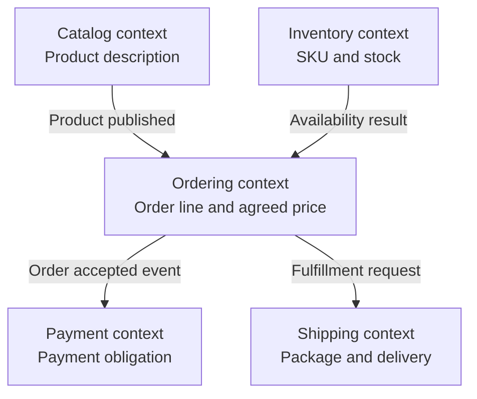

# So sánh phân tầng kỹ thuật với mô hình hóa nghiệp vụ theo DDD

Khi tổ chức mã nguồn, một nhóm có thể chia ứng dụng thành `controller`, `service`, `repository` và `entity`. Cách này làm rõ trách nhiệm kỹ thuật, nhưng chưa chắc cho biết những khái niệm nghiệp vụ nào quan trọng, quy tắc nào thuộc về đơn hàng hay thanh toán, và hai nhóm nghiệp vụ nên giao tiếp với nhau ra sao. Domain-Driven Design (DDD) tiếp cận bài toán từ mô hình và ngôn ngữ nghiệp vụ. Hai cách tiếp cận thường được đặt cạnh nhau, nhưng chúng giải quyết những chiều khác nhau của thiết kế và có thể kết hợp.

Bài học này thuộc module `SOFTWARE_DESIGN_ARCHITECTURE_ARCHITECTURAL_PATTERN_LAYERED`, với mục tiêu học tổ chức phần mềm theo kiến trúc phân tầng. Trong chương **Lựa chọn và tiến hóa kiến trúc**, ta so sánh phân tầng kỹ thuật với mô hình hóa nghiệp vụ theo DDD, xem khi nào mỗi cách hữu ích và cách kết hợp chúng trong ứng dụng Java/Spring mà không áp dụng DDD như một khuôn mẫu bắt buộc.

## Hai cách tiếp cận giải quyết hai câu hỏi khác nhau

**Phân tầng kỹ thuật (technical layering)** trả lời câu hỏi: mã nguồn được chia theo trách nhiệm thực thi như thế nào? Ví dụ:

- Presentation nhận yêu cầu và trả kết quả qua HTTP hoặc giao diện khác.
- Application điều phối ca sử dụng và ranh giới giao dịch.
- Domain chứa mô hình và quy tắc nghiệp vụ nếu ứng dụng có mô hình miền riêng.
- Data access/infrastructure thực hiện truy vấn, lưu trữ và tích hợp kỹ thuật.

**Domain-Driven Design (DDD)** trả lời câu hỏi: làm sao mô hình hóa một miền nghiệp vụ phức tạp, thống nhất ngôn ngữ giữa chuyên gia nghiệp vụ và nhóm phát triển, và xác định ranh giới giữa các mô hình? DDD chú trọng hiểu sâu miền, chia miền thành các bounded context, xác định ubiquitous language và chọn mô hình phù hợp cho từng ngữ cảnh.

Vì vậy, phân tầng chủ yếu tổ chức mã theo loại trách nhiệm; DDD tổ chức tư duy và mô hình theo ý nghĩa nghiệp vụ. Một hệ thống có thể có các layer kỹ thuật mà không sử dụng DDD đầy đủ. Ngược lại, một bounded context được mô hình hóa theo DDD vẫn cần quyết định cách tổ chức presentation, application, domain và infrastructure.

## So sánh theo các tiêu chí chính

| Tiêu chí | Phân tầng kỹ thuật | DDD |
|---|---|---|
| Điểm xuất phát | Trách nhiệm kỹ thuật của phần mềm | Hiểu biết và quy tắc của miền nghiệp vụ |
| Câu hỏi trọng tâm | Thành phần này nhận request, điều phối, xử lý nghiệp vụ hay truy cập dữ liệu? | Khái niệm này có ý nghĩa gì trong miền, thuộc ngữ cảnh nào và bất biến nào phải giữ? |
| Cách nhóm mã thường gặp | `controller`, `application`, `domain`, `repository`, `infrastructure` | Theo bounded context hoặc capability, bên trong có thể tiếp tục chia layer |
| Đơn vị mô hình quan trọng | Layer, component, interface và dependency | Entity, value object, aggregate, domain service, repository, bounded context |
| Ranh giới | Ranh giới trách nhiệm và hướng phụ thuộc | Ranh giới ngôn ngữ, mô hình và quyền sở hữu nghiệp vụ |
| Lợi ích nổi bật | Dễ định vị mã theo vai trò kỹ thuật, dễ chuẩn hóa luồng xử lý | Giảm hiểu lầm về nghiệp vụ, bảo vệ bất biến và giới hạn mô hình theo ngữ cảnh |
| Chi phí | Có thể tạo nhiều lớp kỹ thuật hoặc package rộng | Cần thời gian khám phá miền, trao đổi với chuyên gia và duy trì mô hình |

Không nên kết luận rằng một cách tiếp cận luôn tốt hơn cách còn lại. Nếu bài toán chủ yếu là CRUD đơn giản với ít quy tắc, tổ chức theo layer có thể đủ. Nếu nghiệp vụ có nhiều chính sách, trạng thái, ngoại lệ và thuật ngữ khác nhau giữa các bộ phận, tư duy DDD có thể giúp xác định mô hình và ranh giới phù hợp. Một hệ thống lớn thường cần cả hai góc nhìn.

## Hạn chế của cách chỉ nhóm theo tầng kỹ thuật

Giả sử một ứng dụng thương mại điện tử được tổ chức như sau:

```text
com.example.shop
├── controller
│   ├── OrderController.java
│   ├── PaymentController.java
│   └── ProductController.java
├── service
│   ├── OrderService.java
│   ├── PaymentService.java
│   └── ProductService.java
├── repository
│   ├── OrderRepository.java
│   ├── PaymentRepository.java
│   └── ProductRepository.java
└── entity
    ├── OrderEntity.java
    ├── PaymentEntity.java
    └── ProductEntity.java
```

Cấu trúc này giúp người đọc tìm mọi controller hoặc repository. Nhưng khi cần hiểu quy trình xác nhận đơn, họ phải đi qua nhiều package. Khi hệ thống lớn hơn, `service` có thể chứa cả logic định giá, chính sách tín dụng, điều phối thanh toán, đồng bộ tồn kho và gửi thông báo. Tên package chỉ cho biết lớp thuộc loại kỹ thuật nào, không thể hiện ranh giới nghiệp vụ hoặc chủ sở hữu của từng quy tắc.

Một `OrderService` có thể trở thành nơi điều phối mọi thứ, còn `OrderEntity` chỉ là cấu trúc dữ liệu phản chiếu bảng. Nếu quy tắc bị đặt trong nhiều service hoặc controller, ứng dụng vẫn có thể có đủ tầng nhưng mô hình nghiệp vụ không rõ. Đây là giới hạn của việc chỉ dùng package theo layer: cách nhóm mã không tự tạo ra mô hình miền tốt.

## DDD bổ sung góc nhìn về miền nghiệp vụ

DDD thường được trình bày qua hai nhóm hoạt động liên quan:

**Strategic design (thiết kế chiến lược)** tập trung vào toàn bộ miền và ranh giới mô hình. Nhóm tìm hiểu:

- **Domain:** lĩnh vực nghiệp vụ mà hệ thống phục vụ, ví dụ thương mại điện tử hoặc quản lý vận tải.
- **Subdomain:** phần nhỏ hơn của domain, có thể là core, supporting hoặc generic tùy mức độ tạo lợi thế và tính đặc thù.
- **Bounded context:** ranh giới trong đó một mô hình và ngôn ngữ có ý nghĩa nhất quán.
- **Ubiquitous language:** ngôn ngữ chung được nhóm phát triển và chuyên gia nghiệp vụ dùng trong trao đổi, thiết kế, mã nguồn và kiểm thử.
- **Context map:** cách các bounded context liên hệ, tích hợp hoặc phụ thuộc vào nhau.

**Tactical design (thiết kế chiến thuật)** tập trung vào mô hình bên trong một bounded context. Các khái niệm thường gặp gồm entity, value object, aggregate, aggregate root, domain service, domain event và repository. Không phải dự án nào cũng cần dùng tất cả các mẫu này.

### Bounded context tránh một mô hình dùng chung cho mọi nơi

Trong cửa hàng trực tuyến, từ “sản phẩm” có thể mang ý nghĩa khác nhau:

- Trong Catalog, sản phẩm có tên, mô tả, hình ảnh và danh mục hiển thị.
- Trong Inventory, sản phẩm gắn với SKU, vị trí kho và số lượng có thể xuất.
- Trong Ordering, dòng đơn hàng cần mô tả mặt hàng đã mua và giá tại thời điểm đặt.
- Trong Shipping, mặt hàng có kích thước, cân nặng và yêu cầu đóng gói.

Nếu ép tất cả ngữ cảnh dùng chung một `Product` class lớn, các trường và quy tắc của một ngữ cảnh có thể ảnh hưởng không cần thiết tới ngữ cảnh khác. Bounded context cho phép mỗi mô hình biểu đạt đúng ngôn ngữ và nhu cầu của nó. Các context trao đổi qua API, event hoặc hợp đồng tích hợp rõ ràng, thay vì truy cập trực tiếp entity nội bộ của nhau.



Các context không nhất thiết là microservice. Chúng có thể là module/package trong cùng một ứng dụng. Bounded context là ranh giới mô hình và ngôn ngữ; deployment boundary là quyết định triển khai riêng. Tách context thành service cần thêm lý do về scale, ownership, bảo mật hoặc vận hành.

## Kết hợp DDD với kiến trúc phân tầng

Một bounded context có thể được tổ chức theo layer. Ví dụ context `ordering`:

```text
com.example.shop.ordering
├── api
│   ├── OrderController.java
│   ├── PlaceOrderRequest.java
│   └── OrderResponse.java
├── application
│   ├── PlaceOrderService.java
│   └── PlaceOrderCommand.java
├── domain
│   ├── Order.java
│   ├── OrderLine.java
│   ├── Money.java
│   ├── PricingPolicy.java
│   └── OrderRepository.java
└── infrastructure
    ├── JpaOrderRepository.java
    ├── OrderJpaEntity.java
    └── SpringDataOrderRepository.java
```

Ở cấu trúc này, `ordering` là bounded context; `api`, `application`, `domain` và `infrastructure` là các trách nhiệm kỹ thuật bên trong context. Cách tổ chức này giúp người đọc vừa nhận biết khu vực nghiệp vụ, vừa hiểu vai trò của từng thành phần.

Hướng phụ thuộc cũng cần được giữ rõ. Domain không nên phụ thuộc vào controller, HTTP hoặc API của JPA. Application điều phối domain và các abstraction cần thiết. Infrastructure triển khai các abstraction bằng công nghệ cụ thể. Dependency injection có thể nối implementation vào lúc chạy.

### Ví dụ aggregate bảo vệ bất biến

Trong Ordering context, một đơn hàng có thể được mô hình hóa thành aggregate root `Order`. Các thay đổi trạng thái phải đi qua hành vi của aggregate để bảo vệ bất biến:

```java
public class Order {
    private final OrderId id;
    private final List<OrderLine> lines;
    private OrderStatus status;

    public void confirm() {
        if (lines.isEmpty()) {
            throw new EmptyOrderException(id);
        }
        if (status != OrderStatus.DRAFT) {
            throw new InvalidOrderTransitionException(status);
        }
        status = OrderStatus.CONFIRMED;
    }
}
```

`Order` kiểm soát trạng thái của chính aggregate. `OrderId`, `OrderLine` và `OrderStatus` là các kiểu thuộc mô hình Ordering; ví dụ đã lược bỏ constructor, getter và phần triển khai chi tiết. Application service điều phối ca sử dụng:

```java
@Service
class ConfirmOrderService {
    private final OrderRepository orders;

    ConfirmOrderService(OrderRepository orders) {
        this.orders = orders;
    }

    @Transactional
    public void confirm(OrderId orderId) {
        Order order = orders.getById(orderId);
        order.confirm();
        orders.save(order);
    }
}
```

`OrderRepository` là hợp đồng mà application/domain sử dụng; implementation JPA nằm trong infrastructure. Với JPA, entity đang được quản lý có thể được cập nhật nhờ dirty checking mà không nhất thiết phải gọi `save()` để kích hoạt SQL; lời gọi `save()` ở đây thể hiện hợp đồng repository của ví dụ và cách triển khai cụ thể có thể khác. Ranh giới `@Transactional` bao quanh ca sử dụng để thao tác tải, thay đổi và lưu thuộc cùng một transaction.

Không nên tạo aggregate quá lớn. Aggregate xác định ranh giới nhất quán và nơi bảo vệ bất biến; nếu gom nhiều đối tượng ít liên quan vào một aggregate, thao tác cập nhật có thể khóa quá nhiều dữ liệu và gây cạnh tranh. Những quy tắc liên quan nhiều aggregate có thể cần domain service, application orchestration hoặc quy trình eventual consistency tùy yêu cầu.

## Khác biệt giữa DDD và việc chỉ đổi tên package

Đổi `service` thành `domain`, `repository` thành `port` hoặc tạo thư mục `bounded-contexts` không tự biến ứng dụng thành DDD. Cần có mô hình phản ánh ngôn ngữ và quy tắc thật của miền. Một lớp `Order` chỉ chứa getter/setter trong khi toàn bộ quyết định nằm trong `OrderService` có thể vẫn là mô hình nghèo (anemic domain model). Mô hình nghèo không luôn sai, nhưng nếu nghiệp vụ có nhiều bất biến và chuyển trạng thái, việc chỉ giữ dữ liệu trong entity sẽ khiến quy tắc bị phân tán.

DDD cũng không bắt buộc mọi logic phải nằm trong entity. Một số quyết định thuộc domain service vì chúng không tự nhiên thuộc về một entity hoặc value object cụ thể. Application service vẫn cần điều phối use case, kiểm soát giao dịch và phối hợp các cổng bên ngoài. Mục tiêu là đặt quyết định ở nơi có ý nghĩa nghiệp vụ, không phải dồn tất cả vào một lớp `DomainService` tổng quát.

## Khi nào nên dùng mỗi cách tiếp cận?

| Bối cảnh | Cách tiếp cận thường phù hợp | Lý do |
|---|---|---|
| CRUD đơn giản, quy tắc ít và ổn định | Phân tầng kỹ thuật gọn | Chi phí khám phá và mô hình hóa DDD có thể lớn hơn lợi ích |
| Ứng dụng có nhiều use case nhưng miền tương đối rõ | Layered kết hợp tổ chức theo feature | Giữ trách nhiệm kỹ thuật và tìm mã theo tính năng |
| Nghiệp vụ phức tạp, nhiều bất biến và thuật ngữ chuyên ngành | DDD trong các bounded context phù hợp | Mô hình hóa giúp giảm hiểu lầm và bảo vệ quy tắc |
| Nhiều bộ phận dùng cùng từ nhưng ý nghĩa khác nhau | Strategic DDD và context mapping | Xác định ranh giới mô hình và hợp đồng tích hợp |
| Một phần cần triển khai hoặc scale độc lập | Cân nhắc tách module/service sau khi có ranh giới rõ | Deployment tách riêng có chi phí vận hành và giao tiếp |

DDD đòi hỏi trao đổi liên tục với chuyên gia nghiệp vụ, thời gian khám phá và nỗ lực duy trì ngôn ngữ chung. Nếu nhóm không có điều kiện đó hoặc bài toán chưa có độ phức tạp tương ứng, áp dụng đầy đủ tactical patterns có thể tạo thêm ceremony mà không cải thiện kết quả. Có thể dùng một số ý tưởng có giá trị như ubiquitous language, tách module theo capability và bảo vệ bất biến mà không triển khai toàn bộ DDD.

## Những sai lầm khi lựa chọn và kết hợp

- **Xem DDD là một kiến trúc triển khai:** DDD không bắt buộc microservices, event sourcing hay CQRS. Đó là các lựa chọn khác có thể kết hợp khi có nhu cầu.
- **Xem mỗi layer là một bounded context:** Layer mô tả trách nhiệm kỹ thuật; bounded context mô tả ranh giới mô hình và ngôn ngữ. Một context có nhiều layer; một ứng dụng có thể chứa nhiều context.
- **Dùng chung một entity cho mọi context:** Mô hình chung có thể kéo theo phụ thuộc và thay đổi dây chuyền. Chỉ chia sẻ hợp đồng hoặc dữ liệu khi ngữ nghĩa thực sự ổn định và có chủ sở hữu.
- **Tách service quá sớm:** Bounded context có thể ở cùng tiến trình. Tách mạng khi chưa cần làm tăng độ trễ, lỗi từng phần và chi phí vận hành.
- **Tạo quá nhiều aggregate hoặc domain service:** Mỗi abstraction cần bảo vệ một bất biến hoặc diễn đạt một khái niệm có ý nghĩa.
- **Bỏ qua ngôn ngữ của chuyên gia:** Tên class do nhóm kỹ thuật tự nghĩ ra mà không được kiểm chứng có thể củng cố hiểu lầm thay vì giải quyết chúng.

## Tiến hóa từ phân tầng kỹ thuật sang mô hình miền rõ hơn

Không nhất thiết phải viết lại hệ thống để bắt đầu áp dụng tư duy DDD. Có thể tiến hóa theo từng bước:

1. **Khám phá một khu vực nghiệp vụ.** Trao đổi với người hiểu quy trình, ghi lại thuật ngữ, quy tắc, ngoại lệ và các trạng thái quan trọng.
2. **Tìm ranh giới ngôn ngữ.** Xác định từ nào có nghĩa khác nhau giữa Catalog, Ordering, Inventory hoặc Payment; tránh ép một mô hình chung cho tất cả.
3. **Chọn một bounded context có giá trị.** Bắt đầu từ khu vực có quy tắc phức tạp hoặc thay đổi thường xuyên, không cần mô hình hóa toàn bộ doanh nghiệp cùng lúc.
4. **Đặt quy tắc gần mô hình sở hữu.** Chuyển bất biến và hành vi vào entity, value object hoặc policy phù hợp; để application service điều phối.
5. **Giữ hợp đồng giữa các context.** Dùng API, event hoặc adapter để chuyển dữ liệu; không truy cập trực tiếp bảng hoặc entity nội bộ của context khác.
6. **Bảo vệ ranh giới bằng test.** Unit test cho domain, integration test cho repository/adapter và architecture test cho dependency giữa package hoặc module.
7. **Đánh giá lại deployment riêng.** Chỉ tách module thành tiến trình/service khi có yêu cầu độc lập về scale, ownership, bảo mật hoặc vận hành.

Một modular monolith có thể là nơi tốt để phát triển DDD: các bounded context được tổ chức thành module trong cùng ứng dụng, giao tiếp qua interface hoặc application contract rõ ràng. Khi một context thật sự cần triển khai riêng, nhóm đã có mô hình và hợp đồng để đánh giá việc tách. Dù giữ một tiến trình hay nhiều service, ranh giới mô hình vẫn cần được bảo vệ.

## Checklist lựa chọn kiến trúc

Trước khi chọn phân tầng kỹ thuật đơn thuần, áp dụng DDD hoặc kết hợp cả hai, hãy tự hỏi:

- Quy tắc nghiệp vụ có ít và ổn định, hay có nhiều bất biến, ngoại lệ và trạng thái phức tạp?
- Các nhóm nghiệp vụ có dùng cùng thuật ngữ với cùng ý nghĩa không?
- Có thể chỉ ra bounded context và chủ sở hữu mô hình không?
- Layer hiện tại có đang gom nhiều nghiệp vụ khác nhau vào cùng một service hoặc package không?
- Có quy tắc nào cần được bảo vệ bởi aggregate hoặc policy không?
- Các context trao đổi qua hợp đồng rõ hay đang phụ thuộc trực tiếp vào entity/database của nhau?
- Nhóm có thể duy trì trao đổi với chuyên gia nghiệp vụ và kiểm thử mô hình không?
- Việc tách deployment có lợi ích cụ thể vượt chi phí mạng và vận hành không?

Phân tầng kỹ thuật giúp tổ chức trách nhiệm trong mã nguồn; DDD giúp tổ chức mô hình và ranh giới theo nghiệp vụ. Khi bài toán đơn giản, một kiến trúc phân tầng gọn có thể là lựa chọn hợp lý. Khi miền phức tạp, có thể đưa DDD vào bên trong các layer và tổ chức theo bounded context. Hãy chọn mức mô hình hóa phù hợp với độ phức tạp thật, bảo vệ những ranh giới quan trọng và để kiến trúc tiến hóa theo hiểu biết cùng nhu cầu của hệ thống.
