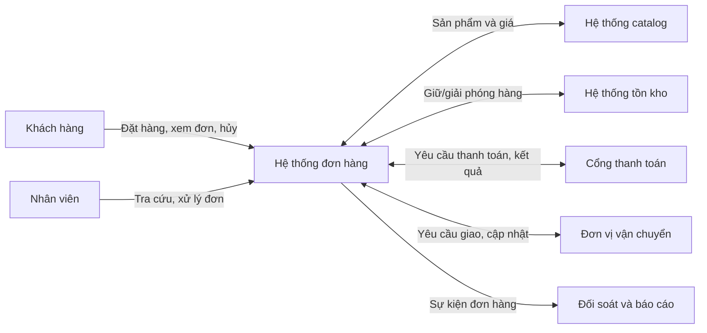
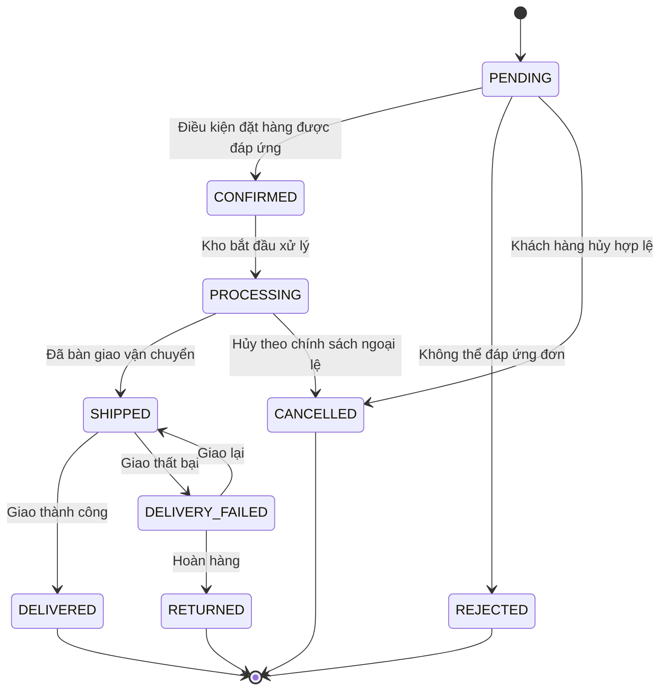
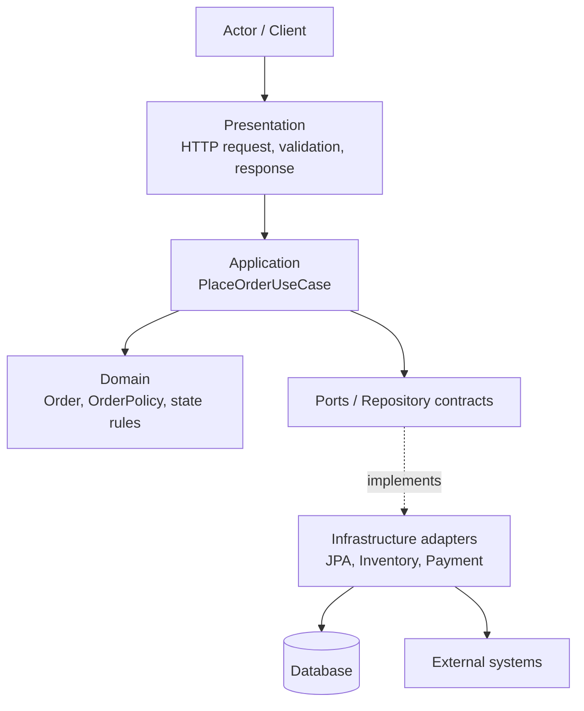

# Xác định yêu cầu, ca sử dụng và thuộc tính chất lượng của hệ thống đơn hàng

> Chương: **Thực hành hệ thống đơn hàng**

Trong module **SOFTWARE_DESIGN_ARCHITECTURE_ARCHITECTURAL_PATTERN_LAYERED** — học tổ chức phần mềm theo kiến trúc phân tầng — việc thiết kế hệ thống nên bắt đầu từ nhu cầu cần giải quyết. Trước khi quyết định tạo controller, service, repository hay bảng dữ liệu, nhóm cần hiểu ai sử dụng hệ thống đơn hàng, họ muốn hoàn thành việc gì, những quy tắc nào phải được giữ và hệ thống cần đạt chất lượng ra sao.

Bài này hướng dẫn cách chuyển nhu cầu ban đầu thành yêu cầu chức năng, ca sử dụng và thuộc tính chất lượng có thể kiểm chứng. Ví dụ xuyên suốt là một cửa hàng trực tuyến cho phép khách hàng đặt hàng, thanh toán, theo dõi và hủy đơn theo điều kiện. Các con số chất lượng trong bài là mục tiêu minh họa để nhóm thảo luận và xác nhận với stakeholder, không phải chuẩn áp dụng cho mọi sản phẩm.

## 1. Bắt đầu từ vấn đề và các bên liên quan

Một yêu cầu như “xây dựng hệ thống quản lý đơn hàng” còn quá rộng để thiết kế. Cần xác định hệ thống phục vụ ai và vấn đề hiện tại là gì. Với một cửa hàng trực tuyến, các bên liên quan có thể gồm:

| Bên liên quan | Mục tiêu hoặc mối quan tâm |
|---|---|
| Khách hàng | Tìm sản phẩm, đặt hàng, thanh toán, xem trạng thái và hủy đơn khi được phép |
| Nhân viên chăm sóc khách hàng | Tra cứu đơn, giải thích trạng thái và hỗ trợ xử lý ngoại lệ |
| Nhân viên kho | Nhận yêu cầu lấy hàng, xác nhận đóng gói và cập nhật tình trạng giao hàng |
| Bộ phận tài chính | Đối soát thanh toán, hoàn tiền và kiểm tra lịch sử giao dịch |
| Quản trị viên | Quản lý quyền truy cập, cấu hình và theo dõi hoạt động hệ thống |
| Hệ thống thanh toán/đơn vị vận chuyển | Trao đổi yêu cầu thanh toán, kết quả giao dịch và thông tin giao hàng |

Không phải tất cả bên liên quan đều là người dùng trực tiếp. Một payment provider hoặc warehouse system là hệ thống bên ngoài có hợp đồng tích hợp, nhưng hành vi của nó vẫn ảnh hưởng đến yêu cầu và chất lượng của hệ thống đơn hàng.

Trước khi ghi yêu cầu, nên hỏi:

- Đơn hàng được tạo từ đâu: website, ứng dụng di động, nhân viên hay kênh bán hàng khác?
- Một đơn có thể chứa nhiều sản phẩm, nhiều kho hoặc nhiều địa chỉ giao không?
- Khi nào đơn được xem là đã đặt: khi ghi nhận yêu cầu, khi giữ được hàng hay sau khi thanh toán thành công?
- Hệ thống có cho phép thanh toán khi giao hàng, thanh toán trực tuyến hay cả hai?
- Khi hết hàng, thanh toán bị từ chối hoặc khách hàng hủy, trạng thái và số lượng tồn kho phải thay đổi thế nào?
- Ai được xem, sửa hoặc hủy một đơn?
- Khối lượng giao dịch, thời gian cao điểm và yêu cầu vận hành dự kiến là bao nhiêu?

Các câu hỏi này làm rõ phạm vi và tránh việc nhóm tự giả định những quyết định có ảnh hưởng lớn đến nghiệp vụ.

## 2. Xác định phạm vi và ranh giới hệ thống

Trước tiên, mô tả hệ thống đơn hàng chịu trách nhiệm gì và phần nào thuộc hệ thống khác. Một phạm vi mẫu:

**Trong phạm vi hệ thống đơn hàng:**

- Tiếp nhận yêu cầu đặt hàng và xác định khách hàng.
- Kiểm tra sản phẩm, giá bán và điều kiện đặt hàng.
- Ghi nhận các dòng hàng và giá tại thời điểm đặt.
- Phối hợp giữ hàng, thanh toán và chuyển đơn sang xử lý.
- Quản lý trạng thái đơn, tra cứu lịch sử và xử lý hủy theo chính sách.
- Cung cấp thông tin cần thiết cho kho, chăm sóc khách hàng và đối soát.

**Có thể nằm ngoài phạm vi hoặc thuộc hệ thống tích hợp:**

- Quản lý danh mục sản phẩm và nội dung sản phẩm đầy đủ.
- Quản lý số lượng vật lý của kho ở mức chuyên sâu.
- Xử lý giao dịch thẻ và lưu thông tin thanh toán nhạy cảm.
- Tối ưu tuyến đường giao hàng.
- Quản lý chiến dịch marketing và chương trình khách hàng thân thiết.

Ranh giới này không có nghĩa các hệ thống hoàn toàn độc lập. Hệ thống đơn hàng cần lấy thông tin sản phẩm, phối hợp giữ hàng và yêu cầu thanh toán, nhưng cần xác định rõ dữ liệu nào nó sở hữu và dữ liệu nào chỉ tham chiếu. Ví dụ, đơn hàng nên lưu snapshot tên, mã và đơn giá tại thời điểm đặt để lịch sử không thay đổi khi catalog cập nhật giá sau đó.

Sơ đồ ngữ cảnh đơn giản:



Sơ đồ chỉ thể hiện các tương tác chính. Giao thức, đồng bộ hay bất đồng bộ và quyền sở hữu dữ liệu cần được xác nhận khi phân tích sâu hơn.

## 3. Viết yêu cầu chức năng có thể kiểm chứng

Yêu cầu chức năng mô tả hệ thống phải cung cấp hành vi nào. Nên viết theo ngôn ngữ người dùng hoặc nghiệp vụ, tránh mô tả sớm class, bảng hay endpoint khi chưa cần.

Một tập yêu cầu chức năng ban đầu có thể là:

| ID | Yêu cầu chức năng | Tiêu chí kiểm chứng ban đầu |
|---|---|---|
| FR-01 | Khách hàng có thể tạo đơn từ một hoặc nhiều sản phẩm đang được phép bán | Đơn được ghi nhận với đúng khách hàng, dòng hàng, số lượng và giá snapshot |
| FR-02 | Hệ thống kiểm tra điều kiện tồn kho trước khi xác nhận khả năng đáp ứng đơn | Không xác nhận giữ hàng vượt số lượng khả dụng theo chính sách tồn kho |
| FR-03 | Hệ thống có thể khởi tạo thanh toán và ghi nhận kết quả | Mỗi yêu cầu thanh toán được liên kết với đúng đơn và có trạng thái theo dõi |
| FR-04 | Khách hàng có thể xem đơn của mình và trạng thái hiện tại | Khách hàng không đọc được đơn thuộc người khác |
| FR-05 | Khách hàng có thể yêu cầu hủy đơn khi đơn còn ở trạng thái cho phép | Hệ thống từ chối hủy khi đơn đã vượt qua mốc nghiệp vụ không thể hủy |
| FR-06 | Nhân viên được phân quyền có thể cập nhật bước xử lý đơn | Chỉ chuyển trạng thái theo các chuyển tiếp được phép |
| FR-07 | Hệ thống lưu lịch sử thay đổi trạng thái quan trọng | Có thể xác định trạng thái trước/sau, thời điểm và nguồn thay đổi |
| FR-08 | Hệ thống xử lý request tạo đơn gửi lặp theo khóa idempotency | Cùng khóa và cùng nội dung không tạo đơn trùng |

Một yêu cầu tốt cần rõ điều kiện, kết quả và ngoại lệ. “Hệ thống xử lý đơn nhanh” không phải yêu cầu chức năng; đó là một mối quan tâm chất lượng cần có ngữ cảnh và thước đo riêng.

## 4. Xác định quy tắc nghiệp vụ và vòng đời đơn hàng

Yêu cầu chức năng cho biết người dùng có thể làm gì. Quy tắc nghiệp vụ xác định khi nào hành động đó hợp lệ và trạng thái thay đổi ra sao.

Ví dụ, nhóm cần thống nhất:

- Giá bán được chốt tại thời điểm nào và có bao gồm thuế/phí hay không?
- Số lượng tối thiểu/tối đa trong một dòng hàng là bao nhiêu?
- Đơn có được tạo khi chưa thanh toán không?
- Giữ hàng có thời hạn bao lâu và điều gì xảy ra khi thanh toán hết hạn?
- Đơn đã được đóng gói hoặc bàn giao cho đơn vị vận chuyển còn được hủy không?
- Hoàn tiền là một trạng thái của đơn hay một quy trình thanh toán riêng được liên kết với đơn?

Không nên chỉ dùng một trường `status` với các giá trị tùy ý mà không định nghĩa chuyển tiếp. Một state machine mẫu:



Đây là mô hình minh họa. Hệ thống thực tế có thể có trạng thái `PAYMENT_PENDING`, `PARTIALLY_FULFILLED`, `REFUND_PENDING` hoặc tách trạng thái thanh toán và trạng thái giao hàng thành các quy trình riêng. Không nên ép mọi tiến trình vào một enum đơn nếu chúng có vòng đời độc lập.

Một số bất biến cần ghi rõ:

- Đơn phải có ít nhất một dòng hàng hợp lệ.
- Số lượng của mỗi dòng phải lớn hơn 0.
- Giá snapshot không bị thay đổi chỉ vì giá catalog thay đổi sau khi đặt.
- Một đơn không thể được xác nhận nếu các điều kiện bắt buộc để đáp ứng đơn chưa thỏa.
- Một đơn đã giao thành công không thể quay về trạng thái đang xử lý theo luồng thông thường.
- Việc hủy phải giải phóng giữ hàng và xử lý thanh toán/hoàn tiền theo chính sách, không chỉ đổi `status`.

## 5. Mô tả ca sử dụng

Use case kết nối yêu cầu chức năng với các bước mà actor thực hiện. Một mô tả hữu ích thường gồm: tên/mục tiêu, actor chính, trigger, tiền điều kiện, luồng thành công, luồng thay thế, hậu điều kiện và các quy tắc liên quan.

### Use case UC-01: Đặt hàng

| Thuộc tính | Mô tả |
|---|---|
| Actor chính | Khách hàng đã đăng nhập |
| Actor/hệ thống phụ | Catalog, Inventory, Payment |
| Mục tiêu | Gửi một đơn mua sản phẩm và nhận mã đơn để theo dõi |
| Trigger | Khách hàng xác nhận giỏ hàng |
| Tiền điều kiện | Khách hàng được phép đặt hàng; giỏ hàng có ít nhất một dòng |
| Hậu điều kiện thành công | Đơn được ghi nhận; kết quả giữ hàng/thanh toán được phản ánh bằng trạng thái có thể theo dõi |
| Hậu điều kiện thất bại | Không tạo đơn đã xác nhận sai; các giữ hàng hoặc giao dịch tạm thời được xử lý theo chính sách phục hồi |

**Luồng thành công mẫu:**

1. Khách hàng gửi yêu cầu đặt hàng với các dòng sản phẩm, số lượng, địa chỉ giao và idempotency key.
2. Presentation xác thực request, lấy customer identity từ phiên đăng nhập và chuyển thành command.
3. Application tải dữ liệu sản phẩm/giá cần thiết và kiểm tra khách hàng có thể đặt hàng.
4. Domain kiểm tra bất biến đơn hàng và tạo dữ liệu đơn với snapshot giá.
5. Application phối hợp yêu cầu giữ hàng và khởi tạo thanh toán theo quy trình đã chọn.
6. Hệ thống ghi nhận đơn cùng các trạng thái liên quan, trả mã đơn và trạng thái hiện tại.
7. Khách hàng dùng mã đơn để tra cứu tiến trình.

**Luồng thay thế và ngoại lệ:**

- A1: Request sai định dạng hoặc số lượng không hợp lệ. Từ chối trước khi tạo đơn và trả lỗi đầu vào.
- A2: Sản phẩm không tồn tại hoặc không còn được bán. Từ chối đơn với lỗi nghiệp vụ phù hợp.
- A3: Không đủ tồn kho. Không xác nhận đơn; nếu đã có giữ hàng một phần thì phải giải phóng theo quy trình bù.
- A4: Payment provider từ chối thanh toán. Đơn chuyển sang trạng thái thất bại/chờ xử lý theo chính sách; không được báo đã thanh toán.
- A5: Payment provider timeout, không rõ giao dịch đã thành công hay chưa. Tra cứu hoặc xử lý callback theo transaction reference/idempotency; không gửi yêu cầu thu tiền mới một cách mù quáng.
- A6: Client gửi lại cùng request do timeout. Idempotency key giúp trả lại kết quả của lần xử lý đã nhận diện thay vì tạo đơn khác.
- A7: Dịch vụ tồn kho hoặc thanh toán tạm thời không khả dụng. Trả trạng thái có thể thử lại hoặc ghi nhận công việc chờ xử lý theo chính sách; không khẳng định đơn đã hoàn tất nếu chưa có xác nhận cần thiết.

Use case này cho thấy “đặt hàng” không đơn giản chỉ là insert một hàng vào bảng. Nó phối hợp nhiều quy tắc và hệ thống, vì vậy cần xác định rõ điểm nào là chấp nhận yêu cầu, điểm nào là xác nhận đơn và điểm nào là hoàn tất thanh toán.

### Use case UC-02: Hủy đơn

| Thuộc tính | Mô tả |
|---|---|
| Actor chính | Khách hàng sở hữu đơn hoặc nhân viên được phân quyền |
| Trigger | Actor gửi yêu cầu hủy với lý do |
| Tiền điều kiện | Đơn tồn tại; actor có quyền; trạng thái hiện tại cho phép hủy |
| Luồng chính | Tải đơn, kiểm tra quyền và trạng thái, ghi nhận yêu cầu hủy, phối hợp giải phóng hàng và xử lý thanh toán |
| Hậu điều kiện | Đơn chuyển trạng thái theo chính sách; lịch sử và các tác động liên quan được ghi nhận |

Nếu đơn đã giao, hủy đơn có thể không còn phù hợp; khách hàng cần quy trình trả hàng/hoàn tiền. Việc tách use case hủy và trả hàng giúp hợp đồng cùng quy tắc rõ hơn.

## 6. Từ use case đến hợp đồng Application và API

Khi đã hiểu mục tiêu và luồng nghiệp vụ, có thể thiết kế hợp đồng Application độc lập với HTTP. Ví dụ command cho use case đặt hàng:

```java
public record OrderLineCommand(
    UUID productId,
    int quantity
) {}

public record PlaceOrderCommand(
    UUID customerId,
    List<OrderLineCommand> lines,
    String shippingAddress,
    String idempotencyKey
) {}

public record PlaceOrderResult(
    UUID orderId,
    OrderStatus status,
    BigDecimal total
) {}

public interface PlaceOrderUseCase {
    PlaceOrderResult execute(PlaceOrderCommand command);
}
```

Trong ứng dụng Spring, controller có thể nhận request DTO, lấy customer ID từ principal đã xác thực rồi gọi use case:

```java
@RestController
@RequestMapping("/orders")
class OrderController {
    private final PlaceOrderUseCase placeOrder;

    OrderController(PlaceOrderUseCase placeOrder) {
        this.placeOrder = placeOrder;
    }

    @PostMapping
    ResponseEntity<OrderResponse> create(
            @Valid @RequestBody PlaceOrderRequest request,
            @AuthenticationPrincipal CustomerPrincipal principal,
            @RequestHeader("Idempotency-Key") String key) {

        var command = new PlaceOrderCommand(
            principal.customerId(),
            request.lines().stream()
                .map(line -> new OrderLineCommand(
                    line.productId(), line.quantity()))
                .toList(),
            request.shippingAddress(),
            key);

        var result = placeOrder.execute(command);
        var body = new OrderResponse(
            result.orderId(), result.status().name(), result.total());
        return ResponseEntity.ok(body);
    }
}
```

Đoạn code minh họa cách chuyển hợp đồng, không phải toàn bộ triển khai production. Request DTO cần validation cho danh sách dòng hàng, số lượng, địa chỉ và giới hạn kích thước; use case phải kiểm tra các quy tắc nghiệp vụ kể cả khi được gọi từ message consumer hoặc job. `customerId` lấy từ principal để client không thể tùy ý đặt đơn dưới danh tính người khác.

Hợp đồng HTTP và hợp đồng Application không nhất thiết giống nhau. HTTP có header, status code và định dạng JSON; Application nhận command/result diễn đạt mục tiêu nghiệp vụ. Sự tách biệt này giúp thay đổi API mà ít ảnh hưởng tới Domain và use case.

## 7. Xác định thuộc tính chất lượng

Yêu cầu chức năng cho biết hệ thống làm gì. **Thuộc tính chất lượng (quality attributes)** mô tả hệ thống cần vận hành tốt như thế nào trong một bối cảnh cụ thể. Những thuộc tính thường quan trọng với hệ thống đơn hàng gồm:

- **Performance:** thời gian phản hồi và throughput khi có tải.
- **Availability:** khả năng phục vụ trong khoảng thời gian yêu cầu.
- **Reliability:** khả năng hoàn thành đúng hành vi và phục hồi khi thành phần gặp lỗi.
- **Consistency and integrity:** không tạo đơn trùng, không xác nhận giữ hàng vượt tồn kho, không báo thanh toán thành công khi chưa có xác nhận.
- **Security and privacy:** bảo vệ dữ liệu khách hàng, đơn hàng và quyền thao tác.
- **Scalability:** khả năng tăng tải theo số khách, đơn và sự kiện.
- **Modifiability:** khả năng thay đổi chính sách giá, thanh toán hoặc vận chuyển với phạm vi ảnh hưởng kiểm soát được.
- **Observability:** khả năng truy vết một đơn qua các bước và hệ thống tích hợp.
- **Maintainability and testability:** khả năng hiểu, sửa và xác minh từng phần của hệ thống.

Không nên chỉ ghi “hệ thống phải nhanh, bảo mật, dễ mở rộng”. Các từ này chưa thể kiểm thử. Cần gắn mỗi thuộc tính với stimulus, bối cảnh, phản hồi mong đợi và thước đo.

## 8. Viết quality attribute scenario có thể đo được

Một quality attribute scenario thường có sáu phần:

1. **Source:** ai hoặc thành phần nào tạo kích thích?
2. **Stimulus:** sự kiện hoặc tải nào xảy ra?
3. **Environment:** hệ thống đang ở điều kiện vận hành nào?
4. **Artifact:** thành phần nào chịu tác động?
5. **Response:** hệ thống cần phản ứng ra sao?
6. **Response measure:** đo phản ứng bằng tiêu chí nào?

Ví dụ minh họa cho hệ thống đơn hàng:

| Thuộc tính | Stimulus và môi trường | Phản hồi mong đợi / thước đo mẫu |
|---|---|---|
| Performance | 500 request đọc trạng thái đơn mỗi giây trong giờ cao điểm, dữ liệu ở mức dự kiến | 95% request hoàn tất dưới 300 ms, 99% dưới 800 ms, đo tại API gateway |
| Availability | Một instance ứng dụng bị dừng trong giờ hoạt động | Load balancer chuyển traffic sang instance khỏe; API đặt/tra cứu vẫn phục vụ theo SLO đã thống nhất |
| Consistency | Hai khách hàng đồng thời đặt sản phẩm chỉ còn một đơn vị | Tối đa một yêu cầu giữ hàng được xác nhận thành công; số tồn không âm |
| Reliability | Payment provider timeout sau khi nhận yêu cầu thu tiền | Hệ thống giữ trạng thái chưa xác định, tra cứu/reconcile theo transaction reference và không thu tiền lặp |
| Security | Khách hàng A thử đọc đơn của khách hàng B | Request bị từ chối; không trả dữ liệu của đơn B; sự kiện truy cập bị ghi nhận theo chính sách |
| Modifiability | Thêm nhà cung cấp thanh toán thứ hai | Có thể triển khai adapter mới mà không sửa quy tắc tính tổng tiền hoặc vòng đời đơn; kiểm thử hợp đồng gateway vẫn chạy |
| Observability | Một đơn bị kẹt ở trạng thái chờ thanh toán | Có thể tìm toàn bộ log/trace liên quan bằng order ID/correlation ID và xác định bước cuối cùng |

Các con số như 500 request/giây hay 300 ms chỉ là ví dụ để minh họa cách viết measurable scenario. Nhóm cần lấy baseline, dự báo tải, ngân sách vận hành và kỳ vọng người dùng để thống nhất mục tiêu thật. Cần nói rõ đo ở đâu, loại request nào, kích thước dữ liệu và tỷ lệ lỗi cho phép.

## 9. Phân biệt tính nhất quán nghiệp vụ và giao dịch kỹ thuật

Hệ thống đơn hàng thường phối hợp database, inventory service và payment provider. Một giao dịch `@Transactional` của Spring/JPA chỉ quản lý transaction trong phạm vi transaction manager tương ứng, thường là một database. Nó không tự động làm cho lời gọi HTTP tới payment provider hoặc inventory service trở thành một phần của cùng transaction ACID.

Ví dụ, không nên giả định đoạn sau có thể rollback cả database lẫn khoản tiền đã thu:

```java
@Transactional
public void placeOrder(PlaceOrderCommand command) {
    Order order = createAndSaveOrder(command);
    paymentClient.charge(order); // Hệ thống bên ngoài
    inventoryClient.reserve(order); // Hệ thống bên ngoài
}
```

Nếu payment provider đã thu tiền rồi database rollback, khoản tiền không tự hoàn lại. Nếu inventory đã giữ hàng rồi request thanh toán thất bại, hệ thống cần giải phóng giữ hàng theo quy trình bù. Timeout cũng không chứng minh thao tác bên ngoài đã thất bại; cần truy vấn trạng thái hoặc xử lý callback.

Một thiết kế thường gặp là:

1. Trong transaction database cục bộ, ghi đơn ở trạng thái chờ và ghi một outbox event.
2. Sau commit, worker gửi yêu cầu giữ hàng/thanh toán hoặc phát sự kiện.
3. Ghi nhận kết quả thành công/thất bại bằng một transaction mới.
4. Nếu một bước thất bại sau khi bước trước đã thành công, chạy hành động bù phù hợp, ví dụ giải phóng hàng hoặc yêu cầu hoàn tiền.
5. Dùng idempotency key và transaction reference để retry an toàn, tránh tạo tác động trùng.

Đây là một workflow bất đồng bộ hoặc saga ở mức khái quát. Không phải hệ thống nào cũng cần saga; nếu phạm vi chỉ có một database và không có tích hợp phân tán, transaction cục bộ có thể đủ. Hãy chọn dựa trên ranh giới nhất quán thực tế.

## 10. Truy vết yêu cầu tới use case và quyết định kiến trúc

Một yêu cầu chỉ hữu ích khi có thể liên kết với cách triển khai và kiểm thử. Bảng truy vết mẫu:

| Yêu cầu | Use case | Thuộc tính chất lượng liên quan | Hướng thiết kế/kiểm thử |
|---|---|---|---|
| FR-01 Tạo đơn | UC-01 Đặt hàng | Performance, integrity, reliability | API/Application use case; test tạo đơn và snapshot giá |
| FR-02 Giữ hàng | UC-01 Đặt hàng, UC-02 Hủy đơn | Consistency, concurrency | Inventory contract; test cạnh tranh và không oversell |
| FR-03 Thanh toán | UC-01 Đặt hàng | Reliability, security, observability | Payment port/adapter; idempotency, timeout và reconciliation test |
| FR-04 Tra cứu đơn | UC-03 Xem đơn | Performance, privacy | Read API/projection; test phân quyền và p95 latency |
| FR-05 Hủy đơn | UC-02 Hủy đơn | Consistency, modifiability | Domain state transition; test điều kiện hủy và hành động bù |
| FR-07 Lịch sử trạng thái | UC-01/02 và xử lý kho | Auditability, observability | Order history/event; test lịch sử không mất dấu |

Truy vết giúp tránh tình trạng chọn công nghệ vì xu hướng mà không biết nó giải quyết yêu cầu nào. Ví dụ, event-driven architecture chỉ có lý do khi các thuộc tính như tách rời tích hợp, khả năng phục hồi hoặc xử lý bất đồng bộ thực sự cần thiết và nhóm chấp nhận chi phí vận hành tương ứng.

## 11. Ưu tiên và quản lý yêu cầu thay đổi

Không phải yêu cầu nào cũng cần triển khai ngay. Có thể dùng MoSCoW để trao đổi mức ưu tiên:

- **Must have:** tạo đơn, kiểm tra điều kiện cơ bản, ghi nhận trạng thái và bảo vệ quyền truy cập.
- **Should have:** lịch sử trạng thái, idempotency cho thao tác tạo đơn, công cụ hỗ trợ nhân viên.
- **Could have:** gợi ý thời gian giao, báo cáo nâng cao hoặc tích hợp thêm kênh bán hàng.
- **Won't have now:** các chức năng đã xác định là ngoài phạm vi của phiên bản hiện tại.

Ưu tiên cần được xác nhận với stakeholder. Một yêu cầu bảo mật hoặc toàn vẹn dữ liệu có thể là Must have dù không phải chức năng người dùng nhìn thấy.

Khi yêu cầu thay đổi, hãy cập nhật cả use case, quy tắc, quality scenario, hợp đồng API và kiểm thử liên quan. Ví dụ, cho phép hủy sau khi đóng gói có thể tác động đến workflow kho, giữ hàng, thanh toán và hoàn tiền; đây không chỉ là thêm một điều kiện `if` trong controller.

## 12. Từ yêu cầu đến các tầng kiến trúc

Yêu cầu và use case giúp xác định trách nhiệm của từng tầng:



- Presentation xử lý hợp đồng giao tiếp và danh tính người gọi.
- Application tổ chức trình tự của use case, transaction cục bộ và phối hợp các port.
- Domain bảo vệ bất biến, chính sách và chuyển trạng thái hợp lệ.
- Infrastructure hiện thực lưu trữ và tích hợp kỹ thuật.

Không phải mọi hệ thống đơn hàng đều cần một domain model lớn hoặc một số tầng cố định. Nếu nghiệp vụ đơn giản, có thể dùng cấu trúc gọn hơn. Nếu quy tắc và tích hợp phức tạp, ranh giới rõ giúp kiểm thử và thay đổi an toàn hơn. Số tầng nên phản ánh nhu cầu thực tế, không phải mục tiêu tự thân.

## 13. Checklist xác định yêu cầu cho hệ thống đơn hàng

Trước khi bắt đầu thiết kế chi tiết, hãy kiểm tra:

1. Đã xác định actor, stakeholder và mục tiêu của từng bên chưa?
2. Phạm vi hệ thống và trách nhiệm của catalog, inventory, payment, delivery đã rõ chưa?
3. Yêu cầu chức năng có ID, điều kiện và tiêu chí nghiệm thu kiểm chứng được chưa?
4. Các trạng thái đơn, chuyển tiếp hợp lệ và điều kiện hủy đã được thống nhất chưa?
5. Use case có actor, trigger, tiền điều kiện, luồng chính, ngoại lệ và hậu điều kiện chưa?
6. Các quyết định về snapshot giá, giữ hàng, thanh toán, hoàn tiền và request lặp đã rõ chưa?
7. Quality attributes có scenario đo được, có bối cảnh tải và điểm đo cụ thể chưa?
8. Các mục tiêu hiệu năng/availability có được xác nhận dựa trên nhu cầu và khả năng vận hành không?
9. Ranh giới transaction cục bộ và các bước tích hợp phân tán có được phân biệt rõ không?
10. Yêu cầu đã được truy vết tới use case, quyết định kiến trúc và kiểm thử chưa?

Nếu còn câu hỏi quan trọng chưa được trả lời, hãy ghi lại thành giả định hoặc quyết định cần stakeholder xác nhận. Đừng biến giả định thành quy tắc hệ thống một cách âm thầm. Một bộ yêu cầu tốt giúp nhóm biết phải xây dựng gì, kiểm chứng thành công ra sao và kiến trúc cần bảo vệ những thuộc tính nào.

## Ghi nhớ

- Bắt đầu từ stakeholder, mục tiêu và phạm vi; xác định rõ hệ thống đơn hàng sở hữu dữ liệu/nghiệp vụ nào và tích hợp với hệ thống nào.
- Yêu cầu chức năng mô tả hành vi; quy tắc nghiệp vụ xác định điều kiện và chuyển trạng thái; use case mô tả luồng chính, ngoại lệ và kết quả.
- Thuộc tính chất lượng như performance, availability, consistency, security và modifiability cần được mô tả bằng scenario có bối cảnh và thước đo.
- Các mục tiêu số trong ví dụ chỉ là giả định ban đầu; phải được xác nhận bằng nhu cầu, baseline và khả năng vận hành.
- `@Transactional` thường bảo vệ transaction của database cục bộ; nó không tự tạo atomicity với payment provider hoặc inventory service.
- Dùng idempotency, outbox, reconciliation và hành động bù khi workflow đi qua nhiều hệ thống và cần phục hồi an toàn.
- Truy vết yêu cầu tới use case, quyết định kiến trúc và test giúp giữ thiết kế bám sát nhu cầu thực tế.
