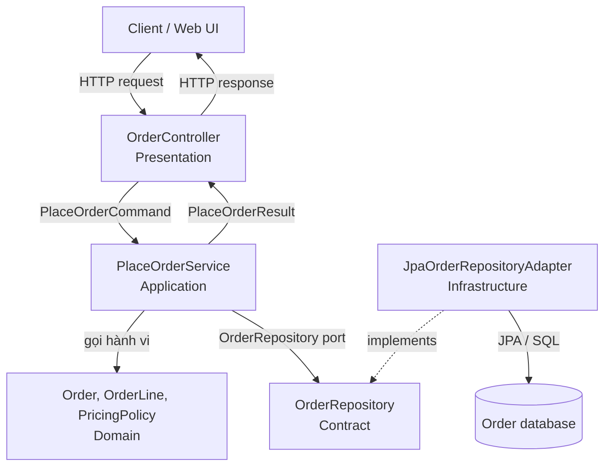
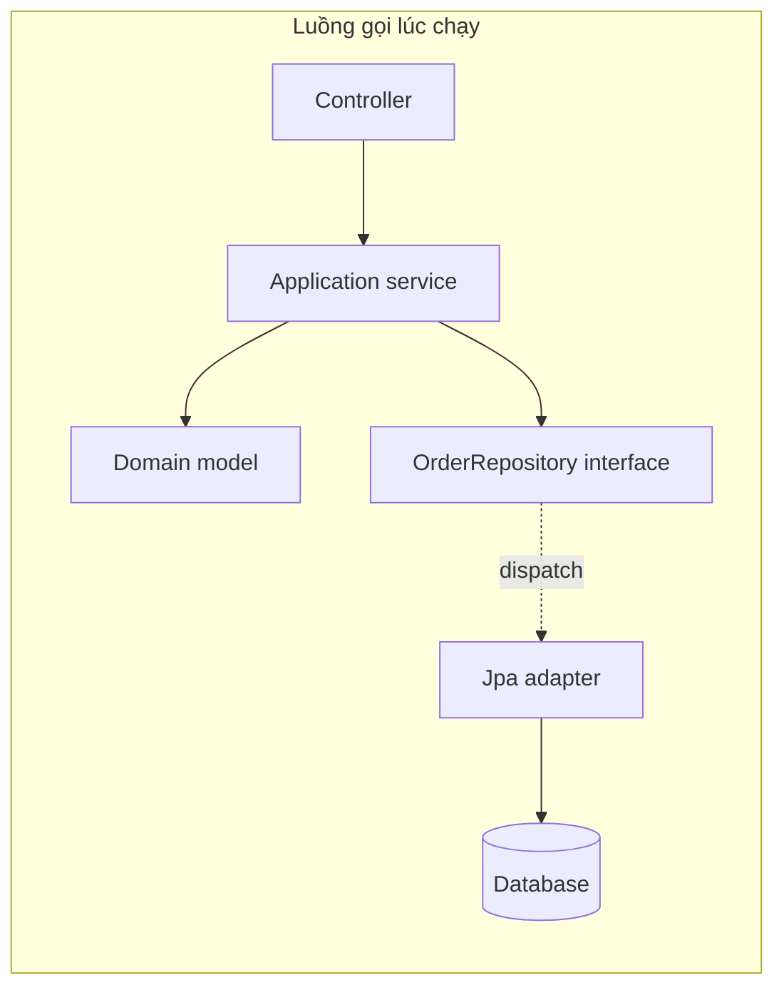
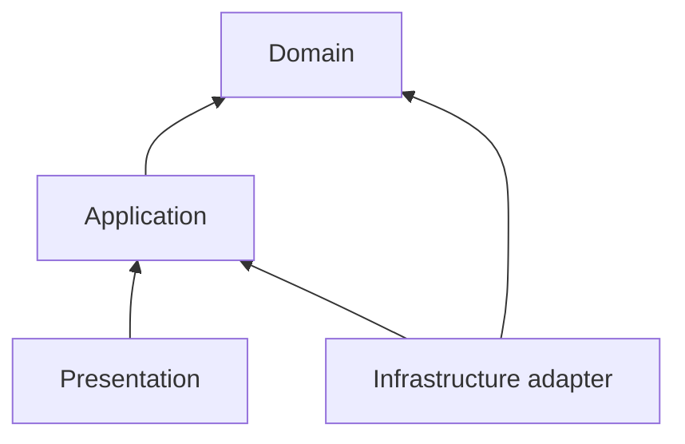
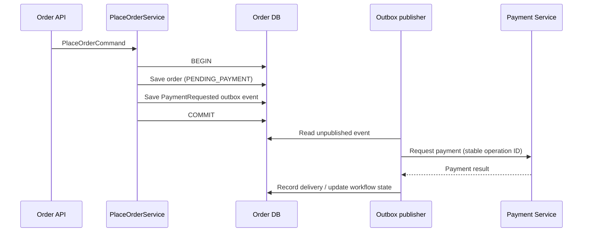
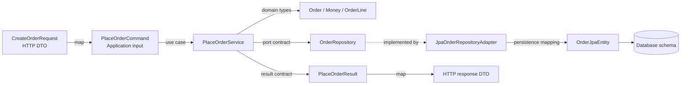

# Vẽ sơ đồ tầng, hợp đồng và quy tắc phụ thuộc

Khi thiết kế hệ thống quản lý đơn hàng, chỉ vẽ các hộp mang tên Controller, Service và Repository là chưa đủ. Một sơ đồ có ích cần cho người đọc biết mỗi thành phần chịu trách nhiệm gì, dữ liệu đi qua các ranh giới bằng hợp đồng nào, thành phần nào được phép phụ thuộc vào thành phần nào, và những thao tác nào phải cùng thành công hoặc thất bại. Nếu các quy tắc này không rõ, controller có thể gọi thẳng database, domain model có thể phụ thuộc vào JPA, hoặc một ca sử dụng có thể lưu đơn hàng nhưng thất bại ở bước liên quan mà không có cách khôi phục.

Bài học này thuộc module `SOFTWARE_DESIGN_ARCHITECTURE_ARCHITECTURAL_PATTERN_LAYERED`, với mục tiêu học tổ chức phần mềm theo kiến trúc phân tầng. Trong chương **Thực hành hệ thống đơn hàng**, ta thực hành vẽ sơ đồ tầng, xác định hợp đồng giữa các tầng và viết quy tắc phụ thuộc có thể kiểm tra được. Ví dụ dùng Java/Spring cho ca sử dụng tạo đơn hàng, nhưng các nguyên tắc áp dụng được cho những ứng dụng phân tầng khác.

## Bắt đầu từ ca sử dụng và ranh giới

Trước khi vẽ package hoặc lớp, hãy mô tả một hành vi cụ thể. Ví dụ: khách hàng gửi yêu cầu tạo đơn hàng gồm các sản phẩm và số lượng. Hệ thống cần xác minh dữ liệu, tải thông tin sản phẩm và khách hàng, tính giá theo chính sách, tạo đơn hàng, lưu đơn và trả mã đơn cùng tổng tiền.

Đầu vào và kết quả ở mức nghiệp vụ có thể mô tả như sau:

| Thành phần | Nội dung |
|---|---|
| Actor | Khách hàng đã xác thực |
| Use case | Đặt hàng (`PlaceOrder`) |
| Dữ liệu đầu vào | Mã khách hàng, danh sách mã sản phẩm và số lượng, khóa idempotency nếu API hỗ trợ gửi lại an toàn |
| Quy tắc chính | Đơn có ít nhất một dòng; số lượng hợp lệ; sản phẩm được phép bán; giá được tính theo chính sách hiện hành |
| Kết quả thành công | Mã đơn hàng, tổng tiền và trạng thái ban đầu |
| Kết quả từ chối | Mã lý do có ý nghĩa như sản phẩm không bán được hoặc dữ liệu đơn không hợp lệ |
| Tác động dữ liệu | Tạo đơn hàng và các bản ghi liên quan trong phạm vi transaction đã xác định |

Phạm vi ví dụ không giả định rằng mọi cửa hàng phải có cùng quy tắc tồn kho, thanh toán hoặc phê duyệt. Khi một hệ thống có thêm giữ chỗ tồn kho, thanh toán hoặc vận chuyển, hãy đưa các bước đó vào mô hình sau khi xác định rõ chủ sở hữu dữ liệu và yêu cầu nhất quán.

## Sơ đồ trách nhiệm của các tầng

Một cách tổ chức phù hợp cho use case này có thể gồm Presentation/API, Application, Domain và Infrastructure/Data Access. Đây là cách chia trách nhiệm logic; các thành phần có thể chạy trong cùng một ứng dụng Spring Boot.



Mỗi phần có một trách nhiệm dễ diễn đạt:

- **Presentation/API:** nhận HTTP, kiểm tra cấu trúc request, ánh xạ DTO sang command, gọi use case và ánh xạ kết quả sang response. Nó không tự quyết định giá hoặc cập nhật bảng đơn hàng.
- **Application:** thực hiện trình tự của use case: tải dữ kiện cần thiết, gọi domain, lưu kết quả, điều phối transaction và phát sinh tác động tiếp theo theo hợp đồng.
- **Domain:** biểu diễn khái niệm đơn hàng, tiền, dòng đơn và chính sách nghiệp vụ; bảo vệ bất biến như đơn không rỗng hoặc không thể chuyển trạng thái tùy tiện.
- **Infrastructure/Data Access:** triển khai cổng truy cập bằng JPA/JDBC, ánh xạ mô hình lưu trữ và giao tiếp với database hoặc dịch vụ ngoài.

Không bắt buộc mọi ứng dụng phải có đúng bốn tầng hoặc đúng tên package này. Với ứng dụng nhỏ, application và domain có thể gần nhau; một dự án khác có thể tách query/read model riêng. Sơ đồ phải thể hiện ranh giới thực sự có ý nghĩa trong hệ thống.

## Phân biệt luồng gọi lúc chạy và hướng phụ thuộc mã nguồn

Một điểm dễ nhầm là mũi tên trong sơ đồ runtime không phải lúc nào cũng trùng với hướng phụ thuộc ở mã nguồn. Khi chạy, application service gọi phương thức `OrderRepository`. Nhưng nếu `OrderRepository` là interface do application sở hữu, adapter JPA phụ thuộc vào interface đó để triển khai hợp đồng.





Sơ đồ phụ thuộc thứ hai là góc nhìn về dependency ở mức mã nguồn: presentation phụ thuộc vào application contract; application sử dụng domain và các port cần thiết; adapter infrastructure phụ thuộc vào port và mô hình bên trong để triển khai. Domain không import controller, HTTP, Spring Data hoặc lớp JPA. Tùy cách đặt interface, application hoặc domain có thể sở hữu port; điều quan trọng là nơi cần hợp đồng không phải phụ thuộc trực tiếp vào chi tiết triển khai.

Trong sơ đồ, có thể dùng mũi tên liền cho lời gọi runtime và mũi tên nét đứt có nhãn `implements` hoặc `depends on` cho quan hệ triển khai/phụ thuộc. Luôn ghi chú ý nghĩa mũi tên để người đọc không hiểu nhầm.

## Xác định hợp đồng ở từng ranh giới

Hợp đồng (contract) quy định một thành phần nhận gì, trả gì, những lỗi nào có thể xảy ra và điều kiện nào phải được giữ. Hợp đồng không chỉ là chữ ký phương thức; nó còn bao gồm ngữ nghĩa, quy tắc dữ liệu, tính nhất quán và cam kết tương thích.

| Ranh giới | Hợp đồng nên thể hiện | Tránh để lộ |
|---|---|---|
| Client → Controller | HTTP method/path, request/response DTO, validation, mã lỗi, version API | Entity JPA hoặc object nội bộ của domain |
| Controller → Application | Command/query và kiểu kết quả của use case | `HttpServletRequest`, `ResponseEntity`, header thô hoặc `EntityManager` |
| Application → Domain | Entity/value object/policy và hành vi nghiệp vụ | Chi tiết HTTP, SQL hoặc framework persistence |
| Application → Repository port | Các thao tác dữ liệu theo ngôn ngữ use case/domain | Câu SQL cụ thể, tên bảng hoặc kiểu `JpaRepository` nếu muốn giữ application độc lập |
| Adapter → Database | Mapping, query, transaction resource và schema | Không để schema trở thành hợp đồng công khai cho client |

### Hợp đồng HTTP và command của ứng dụng

Request DTO biểu diễn hợp đồng giao tiếp với client. Command biểu diễn ý định của ca sử dụng. Hai kiểu có thể giống trường dữ liệu nhưng không cần là cùng một class:

```java
public record CreateOrderRequest(
        @NotNull UUID customerId,
        @NotEmpty List<@Valid CreateOrderItemRequest> items) {}

public record CreateOrderItemRequest(
        @NotNull UUID productId,
        @Positive int quantity) {}
```

```java
public record PlaceOrderCommand(
        CustomerId customerId,
        List<RequestedOrderLine> lines,
        String idempotencyKey) {}

public record RequestedOrderLine(ProductId productId, int quantity) {}
```

Controller chuyển đổi từ DTO sang command:

```java
@RestController
@RequestMapping("/orders")
class OrderController {
    private final PlaceOrderUseCase placeOrder;

    OrderController(PlaceOrderUseCase placeOrder) {
        this.placeOrder = placeOrder;
    }

    @PostMapping
    ResponseEntity<?> create(
            @Valid @RequestBody CreateOrderRequest request,
            @RequestHeader(value = "Idempotency-Key", required = false)
            String idempotencyKey) {

        PlaceOrderCommand command = new PlaceOrderCommand(
            new CustomerId(request.customerId()),
            request.items().stream()
                .map(item -> new RequestedOrderLine(
                    new ProductId(item.productId()), item.quantity()))
                .toList(),
            idempotencyKey
        );

        PlaceOrderResult result = placeOrder.handle(command);
        return OrderHttpResponseMapper.toResponse(result);
    }
}
```

Các kiểu `CustomerId`, `ProductId`, `PlaceOrderUseCase`, `PlaceOrderResult` và mapper là kiểu của ví dụ. `@Valid` kiểm tra cấu trúc và ràng buộc đầu vào ở biên HTTP; application/domain vẫn phải bảo vệ các quy tắc có ý nghĩa nghiệp vụ. Không tin `customerId` do client gửi chỉ vì nó hợp lệ về định dạng: quyền thực hiện thao tác trên khách hàng phải được xác minh dựa trên actor đã xác thực.

### Hợp đồng use case và kết quả

Application có thể công khai một port đầu vào:

```java
public interface PlaceOrderUseCase {
    PlaceOrderResult handle(PlaceOrderCommand command);
}
```

Kết quả có thể biểu diễn thành công và các từ chối nghiệp vụ dự kiến bằng kiểu dữ liệu rõ ràng:

```java
public sealed interface PlaceOrderResult
        permits PlaceOrderResult.Created, PlaceOrderResult.Rejected {

    record Created(OrderId orderId, Money total)
            implements PlaceOrderResult {}

    record Rejected(PlaceOrderErrorCode code)
            implements PlaceOrderResult {}
}
```

Ví dụ mã lỗi có thể gồm `PRODUCT_NOT_SELLABLE`, `CUSTOMER_NOT_ELIGIBLE` hoặc `ORDER_RULE_VIOLATION`. Không dùng `HttpStatus` làm kiểu trả về trong application/domain; adapter HTTP ánh xạ mã lỗi sang status và response body theo hợp đồng API. Lỗi hạ tầng bất ngờ như database timeout nên được xử lý theo chính sách exception ở ranh giới phù hợp, không biến thành một từ chối nghiệp vụ chung.

### Hợp đồng repository port

Application cần thao tác với đơn hàng qua một abstraction có ngữ nghĩa rõ:

```java
public interface OrderRepository {
    Optional<Order> findById(OrderId id);
    void save(Order order);
}
```

Hợp đồng cần nói rõ `save` lưu aggregate mới hay cập nhật aggregate hiện có, `findById` có giới hạn tenant/actor hay không, và các lỗi dữ liệu quan trọng được biểu diễn thế nào. Nếu use case cần bảo đảm idempotency, có thể định nghĩa một port riêng để tìm hoặc ghi nhận kết quả theo idempotency key; đừng nhồi mọi trách nhiệm vào `OrderRepository` chỉ vì cùng liên quan đến đơn hàng.

Adapter triển khai port bằng JPA:

```java
@Repository
class JpaOrderRepositoryAdapter implements OrderRepository {
    private final SpringDataOrderJpaRepository jpa;
    private final OrderPersistenceMapper mapper;

    JpaOrderRepositoryAdapter(
            SpringDataOrderJpaRepository jpa,
            OrderPersistenceMapper mapper) {
        this.jpa = jpa;
        this.mapper = mapper;
    }

    @Override
    public Optional<Order> findById(OrderId id) {
        return jpa.findById(id.value()).map(mapper::toDomain);
    }

    @Override
    public void save(Order order) {
        jpa.save(mapper.toEntity(order));
    }
}
```

Đoạn mã là phác thảo; mapper cần xử lý đầy đủ value object, quan hệ và version. Application không nhận `OrderJpaEntity` và không gọi trực tiếp `SpringDataOrderJpaRepository`. Nhờ đó, adapter có thể thay đổi cách lưu mà hợp đồng use case vẫn giữ nguyên ngữ nghĩa.

## Ghi rõ quy tắc phụ thuộc

Một sơ đồ chỉ có giá trị khi nhóm thống nhất những phụ thuộc nào được phép. Với ví dụ trên, có thể viết thành các quy tắc:

1. Presentation chỉ gọi application use case và mapper DTO; không gọi repository hoặc truy vấn database trực tiếp.
2. Application điều phối use case, phụ thuộc vào domain và port cần thiết; không import adapter JPA, controller hoặc kiểu HTTP.
3. Domain chứa quy tắc và kiểu nghiệp vụ; không phụ thuộc Spring, JPA, servlet, database driver hoặc API bên ngoài.
4. Infrastructure triển khai port, chuyển đổi dữ liệu và tích hợp công nghệ; không trở thành nơi sở hữu chính sách nghiệp vụ.
5. Module khác chỉ dùng hợp đồng công khai của Ordering; không truy cập entity, repository hoặc bảng nội bộ tùy tiện.
6. Không tạo dependency cycle giữa các package/layer. Nếu hai bên cần gọi nhau, hãy xem lại quyền sở hữu hợp đồng hoặc dùng event/application orchestration phù hợp.

Đây là quy tắc định hướng cho ví dụ. Một ứng dụng có thể chọn package layout hoặc số tầng khác, nhưng cần chỉ rõ ngoại lệ và lý do. Đừng để các quy tắc chỉ tồn tại trong tài liệu; có thể dùng review, module boundary hoặc architecture test để kiểm tra tự động.

Ví dụ dùng ArchUnit để cấm domain phụ thuộc vào các layer bên ngoài:

```java
@AnalyzeClasses(packages = "com.example.shop")
class OrderArchitectureTest {
    @ArchTest
    static final ArchRule domainDoesNotDependOnOuterLayers =
        noClasses().that().resideInAPackage("..ordering.domain..")
            .should().dependOnClassesThat()
            .resideInAnyPackage(
                "..ordering.api..",
                "..ordering.application..",
                "..ordering.infrastructure.."
            );

    @ArchTest
    static final ArchRule applicationDoesNotDependOnInfrastructure =
        noClasses().that().resideInAPackage("..ordering.application..")
            .should().dependOnClassesThat()
            .resideInAPackage("..ordering.infrastructure..");
}
```

Đây là ví dụ quy tắc package; cần điều chỉnh package matcher và import theo cấu trúc thực tế của dự án. Architecture test không chứng minh quy tắc nghiệp vụ đúng, nhưng phát hiện sớm việc một thay đổi làm đảo chiều hoặc vượt qua ranh giới phụ thuộc.

## Đánh dấu transaction boundary và nhất quán dữ liệu

Trên sơ đồ use case, hãy đánh dấu nơi bắt đầu và kết thúc transaction. Với việc tạo đơn trong một database, application service thường là nơi phù hợp để đặt ranh giới vì nó hiểu toàn bộ ca sử dụng:

```java
@Service
class PlaceOrderService implements PlaceOrderUseCase {
    private final CustomerRepository customers;
    private final ProductCatalog products;
    private final OrderRepository orders;
    private final PricingPolicy pricing;

    PlaceOrderService(
            CustomerRepository customers,
            ProductCatalog products,
            OrderRepository orders,
            PricingPolicy pricing) {
        this.customers = customers;
        this.products = products;
        this.orders = orders;
        this.pricing = pricing;
    }

    @Override
    @Transactional
    public PlaceOrderResult handle(PlaceOrderCommand command) {
        Customer customer = customers.getById(command.customerId());
        List<Product> productList = command.lines().stream()
            .map(line -> products.getSellableProduct(line.productId()))
            .toList();

        List<OrderLine> lines = OrderLines.from(command.lines(), productList);
        Money total = pricing.calculate(customer, lines);
        Order order = Order.place(customer.id(), lines, total);
        orders.save(order);

        return new PlaceOrderResult.Created(order.id(), order.total());
    }
}
```

Đây là phác thảo của luồng ghi đơn. `ProductCatalog` là port đọc thông tin sản phẩm; nếu dữ liệu sản phẩm nằm trong cùng database, adapter có thể dùng cùng transaction manager. Nếu nó gọi dịch vụ khác qua mạng, lời gọi đó không trở thành một phần nguyên tử của transaction database chỉ vì được thực hiện bên trong phương thức `@Transactional`.

Đoạn code minh họa giả định các port đọc dữ liệu dùng cùng ranh giới persistence cục bộ. Nếu `ProductCatalog` gọi một dịch vụ từ xa, nên cân nhắc thực hiện bước đọc/kiểm tra trước transaction ghi để tránh giữ transaction và connection trong lúc chờ mạng. Tuy nhiên, dữ liệu từ xa có thể thay đổi sau bước kiểm tra; với tồn kho cần bảo đảm giữ chỗ, hãy dùng một lệnh reservation có định danh/idempotency và một quy trình xử lý kết quả bất đồng bộ hoặc bù trừ. Việc đọc “còn hàng” không tự bảo đảm rằng số lượng vẫn còn khi đơn được commit.

Với Spring proxy trong cấu hình phổ biến, transaction được bắt đầu hoặc tham gia khi lời gọi đi qua proxy. Khi phương thức kết thúc bình thường, transaction manager commit; khi gặp exception phù hợp với rollback rule, transaction rollback. Mặc định Spring thường rollback với `RuntimeException` và `Error`, còn checked exception không tự động rollback nếu không cấu hình `rollbackFor`. Self-invocation trong cùng bean có thể không đi qua proxy nên không kích hoạt transaction interceptor như mong đợi.

Nếu tất cả thao tác ghi thuộc cùng một database và cùng transaction manager, có thể bảo đảm tính nguyên tử cho các thay đổi đó. `flush()` gửi SQL xuống database trong transaction nhưng chưa phải commit; transaction vẫn có thể rollback. Không nên thông báo đơn đã tạo thành công trước khi commit thực sự hoàn tất.

### Không vẽ một transaction bao trùm nhiều dịch vụ như thể nó tự động nguyên tử

Giả sử tạo đơn còn phải gọi Payment Service hoặc Inventory Service. Transaction local của database Ordering không thể tự rollback một khoản thanh toán đã được dịch vụ Payment xác nhận. Nếu network timeout sau khi Payment đã xử lý, kết quả có thể chưa xác định. Sơ đồ cần thể hiện ranh giới phân tán và quy trình xử lý:



Transactional outbox ghi đơn hàng và sự kiện cần phát trong cùng transaction database. Publisher gửi sự kiện sau commit. Vì publisher có thể gửi lại khi không chắc lần trước đã nhận được hay chưa, consumer cần xử lý idempotent theo event ID hoặc operation ID. Outbox giúp không mất ý định phát sự kiện giữa commit và publish, nhưng không tự tạo exactly-once delivery.

Nếu quy trình gồm nhiều bước độc lập qua nhiều dịch vụ, có thể dùng Saga với trạng thái tiến trình và hành động bù trừ. Bù trừ là một thao tác nghiệp vụ mới, không phải rollback vật lý transaction đã commit trước đó. Hãy biểu diễn trạng thái như `PENDING_PAYMENT`, `PAID`, `PAYMENT_FAILED` hoặc `CANCELLATION_PENDING` để người vận hành và client hiểu được tiến trình.

## Vẽ sơ đồ hợp đồng và dữ liệu

Ngoài sơ đồ layer, một sơ đồ hợp đồng hữu ích cần ghi rõ dữ liệu nào vượt qua mỗi ranh giới. Ví dụ:



Khi review, hãy kiểm tra:

- DTO bên ngoài có bị dùng trực tiếp làm entity hoặc domain object không?
- Command có thể hiện ý định use case, thay vì chỉ sao chép toàn bộ request không cần thiết không?
- Domain có phụ thuộc vào kiểu của Spring/JPA hoặc HTTP không?
- Repository port có diễn đạt nhu cầu của use case và tránh lộ schema không?
- Adapter có chịu trách nhiệm mapping giữa domain và persistence model không?
- Kết quả và lỗi có mã ổn định để adapter chuyển thành HTTP hoặc giao thức khác không?
- Có đánh dấu dữ liệu nhạy cảm, actor/tenant scope và quy tắc phân quyền ở ranh giới phù hợp không?

Hợp đồng nên nhỏ và rõ. Không cần tạo DTO mới cho mọi lời gọi nội bộ nếu hai thành phần thực sự chia sẻ cùng một mô hình ổn định; nhưng ở ranh giới thay đổi độc lập như HTTP API, module khác hoặc dịch vụ ngoài, kiểu dữ liệu riêng giúp tránh lan truyền thay đổi.

## Quy trình vẽ sơ đồ cho một use case mới

Thực hiện theo trình tự sau để sơ đồ phản ánh đúng bài toán thay vì chỉ mô tả cấu trúc thư mục:

1. **Viết use case bằng ngôn ngữ nghiệp vụ.** Xác định actor, ý định, dữ liệu vào, kết quả, lỗi dự kiến và các tác động phụ.
2. **Xác định các trách nhiệm.** Đặt việc nhận/gửi giao thức ở presentation, điều phối ở application, quy tắc ở domain và công nghệ lưu trữ/tích hợp ở infrastructure.
3. **Vẽ luồng runtime.** Dùng mũi tên thể hiện thứ tự lời gọi từ controller qua use case tới domain/port và adapter.
4. **Vẽ dependency direction riêng.** Ghi rõ package nào import package nào, interface do layer nào sở hữu và adapter nào triển khai.
5. **Ghi hợp đồng trên mũi tên.** Nêu tên command, result, port, event hoặc DTO; tránh mũi tên chung chung không có ý nghĩa.
6. **Đánh dấu transaction và consistency boundary.** Chỉ ra thay đổi nào cùng database transaction, bước nào là network call, event hoặc eventual consistency.
7. **Đánh dấu lỗi và quyền.** Ghi nơi kiểm tra actor, tenant, validation, timeout, retry và xử lý từ chối nghiệp vụ.
8. **Kiểm tra sơ đồ với code và test.** Mỗi hộp phải tương ứng với một trách nhiệm thực; mỗi quy tắc phụ thuộc quan trọng nên có review hoặc test bảo vệ.

## Checklist review cuối cùng

| Nhóm | Câu hỏi |
|---|---|
| Trách nhiệm | Mỗi tầng có mục đích rõ và không ôm thay trách nhiệm của tầng khác không? |
| Hợp đồng | Đầu vào, đầu ra, lỗi và ngữ nghĩa dữ liệu của mỗi ranh giới đã rõ chưa? |
| Phụ thuộc | Domain có độc lập với framework và infrastructure không? Có dependency cycle hoặc gọi xuyên tầng không? |
| Persistence | Repository port và adapter có tách hợp đồng khỏi chi tiết JPA/SQL không? |
| Transaction | Transaction có bao đúng các thao tác local cần nguyên tử không? Có nhầm flush với commit không? |
| Distributed consistency | Network call, event, retry, idempotency và bù trừ có được mô tả đúng không? |
| Bảo mật | Actor, tenant và quyền trên tài nguyên được xác minh phía server ở đúng use case chưa? |
| Kiểm thử | Có unit test cho quy tắc, integration test cho adapter và architecture test cho dependency không? |

Một sơ đồ tốt không cần mô tả mọi class hoặc mọi cột database. Nó cần làm rõ đường đi của use case, hợp đồng qua các ranh giới, hướng phụ thuộc và phạm vi nhất quán. Khi những điều này được thể hiện và kiểm tra trong code, nhóm có thể thêm tính năng hoặc thay đổi công nghệ lưu trữ mà ít làm lan truyền thay đổi sang các phần không liên quan.
