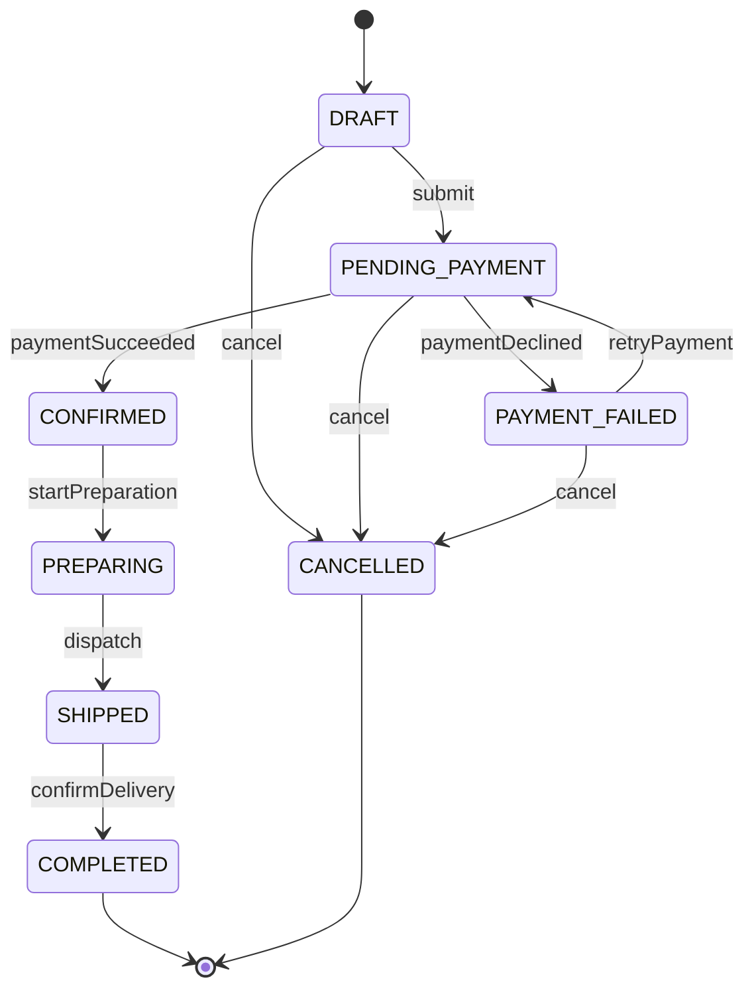
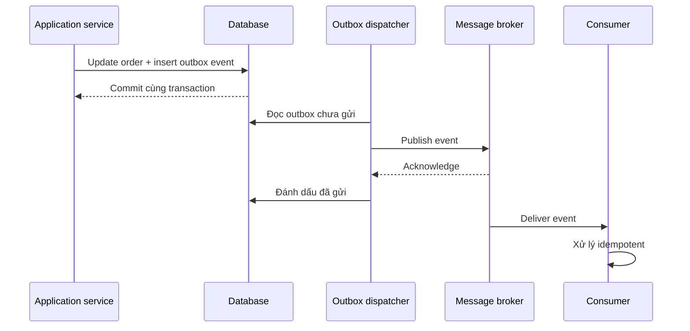

# Bổ sung quy tắc chuyển trạng thái và xử lý lỗi nghiệp vụ

Trong hệ thống đơn hàng, việc thay đổi một trường `status` có vẻ đơn giản, nhưng mỗi chuyển đổi trạng thái đều mang ý nghĩa nghiệp vụ. Một đơn hàng đã giao không thể quay lại trạng thái chờ thanh toán; một đơn đã hủy không nên được xử lý giao hàng; một yêu cầu thanh toán lặp không được tạo ra hai lần ghi nhận tiền. Nếu các quy tắc này chỉ nằm trong controller hoặc được rải rác trong nhiều service, các đường gọi khác nhau có thể tạo ra trạng thái không hợp lệ.

Khi bổ sung quy tắc chuyển trạng thái và xử lý lỗi nghiệp vụ, cần làm rõ ba điều: **trạng thái nào tồn tại, chuyển đổi nào được phép, và hệ thống phải phản hồi thế nào khi một thao tác không hợp lệ**. Trong kiến trúc phân tầng, domain model bảo vệ bất biến và chuyển trạng thái; application service điều phối use case và giao dịch; presentation ánh xạ lỗi thành phản hồi phù hợp; tầng hạ tầng xử lý lỗi kỹ thuật từ database hoặc hệ thống ngoài.

## 1. Mô hình hóa vòng đời đơn hàng

Trước khi viết `if` hoặc `switch`, hãy mô tả vòng đời đơn hàng bằng các trạng thái có ý nghĩa. Ví dụ một quy trình bán hàng cơ bản:

| Trạng thái hiện tại | Sự kiện/command | Trạng thái tiếp theo | Điều kiện chính |
|---|---|---|---|
| `DRAFT` | Gửi đơn (`submit`) | `PENDING_PAYMENT` | Đơn có ít nhất một dòng hàng và dữ liệu giao hàng hợp lệ |
| `PENDING_PAYMENT` | Thanh toán thành công | `CONFIRMED` | Kết quả thanh toán hợp lệ cho đúng đơn và đúng số tiền |
| `PENDING_PAYMENT` | Thanh toán bị từ chối | `PAYMENT_FAILED` | Kết quả từ cổng thanh toán xác nhận thất bại |
| `PAYMENT_FAILED` | Thử thanh toán lại | `PENDING_PAYMENT` | Đơn vẫn còn hiệu lực và chưa vượt giới hạn thử |
| `DRAFT`, `PENDING_PAYMENT`, `PAYMENT_FAILED` | Hủy đơn | `CANCELLED` | Đơn chưa bắt đầu xử lý giao hàng |
| `CONFIRMED` | Bắt đầu chuẩn bị | `PREPARING` | Kho xác nhận có thể thực hiện đơn |
| `PREPARING` | Giao cho vận chuyển | `SHIPPED` | Có thông tin bàn giao/vận đơn hợp lệ |
| `SHIPPED` | Xác nhận hoàn tất | `COMPLETED` | Có bằng chứng giao hàng theo chính sách |

Các trạng thái và điều kiện trong bảng là ví dụ. Một hệ thống có thể có thêm `ON_HOLD`, `PARTIALLY_FULFILLED`, `RETURN_REQUESTED` hoặc các trạng thái khác. Hãy chọn trạng thái theo quy trình thật và tránh thêm trạng thái chỉ để biểu diễn một chi tiết kỹ thuật tạm thời.



Sơ đồ cho thấy các đường chuyển đổi được hỗ trợ. Không có mũi tên từ `COMPLETED` quay lại `PREPARING`, cũng không có đường từ `CANCELLED` sang `CONFIRMED`. Nếu nghiệp vụ cần sửa một đơn đã hoàn tất, hãy mô hình hóa quy trình điều chỉnh/hoàn trả riêng thay vì âm thầm đưa đơn về trạng thái cũ.

## 2. Phân biệt trạng thái đơn hàng với trạng thái thanh toán

Không nên ép mọi khía cạnh của quy trình vào một enum `OrderStatus`. Vòng đời đơn hàng và vòng đời thanh toán có liên quan nhưng không đồng nhất. Ví dụ, đơn hàng có thể đã bị hủy trong khi khoản thanh toán đang ở trạng thái chờ hoàn tiền; sau đó hoàn tiền thành công hoặc thất bại.

Có thể mô hình hóa riêng:

| Order status | Payment status | Ý nghĩa |
|---|---|---|
| `PENDING_PAYMENT` | `PENDING` | Đơn đang chờ thanh toán |
| `CONFIRMED` | `CAPTURED` | Thanh toán đã được ghi nhận, đơn có thể xử lý |
| `CANCELLED` | `NOT_PAID` | Đơn bị hủy trước khi thu tiền |
| `CANCELLED` | `REFUND_PENDING` | Đơn đã hủy, quy trình hoàn tiền đang diễn ra |
| `CANCELLED` | `REFUNDED` | Đơn đã hủy và tiền đã được hoàn |

Tách hai state machine giúp tránh tạo ra enum khổng lồ như `CANCELLED_BUT_REFUND_PENDING`, `CANCELLED_AND_REFUNDED`, `PAID_AND_PREPARING`. Tuy nhiên, các trạng thái vẫn cần được phối hợp bằng quy tắc rõ ràng: chỉ đơn đủ điều kiện mới được xác nhận; không được bắt đầu chuẩn bị khi thanh toán chưa đáp ứng chính sách; hoàn tiền không được thực hiện hai lần.

## 3. Bảo vệ chuyển trạng thái trong domain model

Trạng thái là một phần của mô hình nghiệp vụ. Không nên để controller hoặc application service gán trực tiếp `order.status = SHIPPED` sau khi nhận một request. Hãy cung cấp các phương thức biểu diễn hành động có ý nghĩa, để aggregate tự kiểm tra trạng thái hiện tại và điều kiện chuyển đổi.

```java
public enum OrderStatus {
    DRAFT,
    PENDING_PAYMENT,
    CONFIRMED,
    PAYMENT_FAILED,
    PREPARING,
    SHIPPED,
    COMPLETED,
    CANCELLED
}
```

```java
public class Order {
    private final OrderId id;
    private OrderStatus status;
    private final List<OrderLine> lines;

    public void submit() {
        requireStatus(OrderStatus.DRAFT, "ORDER_CANNOT_BE_SUBMITTED");
        if (lines.isEmpty()) {
            throw new BusinessRuleViolation(
                    "ORDER_EMPTY", "Đơn hàng phải có ít nhất một sản phẩm");
        }
        status = OrderStatus.PENDING_PAYMENT;
    }

    public void paymentSucceeded() {
        requireStatus(OrderStatus.PENDING_PAYMENT,
                "PAYMENT_RESULT_NOT_EXPECTED");
        status = OrderStatus.CONFIRMED;
    }

    public void paymentDeclined() {
        requireStatus(OrderStatus.PENDING_PAYMENT,
                "PAYMENT_RESULT_NOT_EXPECTED");
        status = OrderStatus.PAYMENT_FAILED;
    }

    public void retryPayment() {
        requireStatus(OrderStatus.PAYMENT_FAILED,
                "ORDER_NOT_ELIGIBLE_FOR_PAYMENT_RETRY");
        status = OrderStatus.PENDING_PAYMENT;
    }

    public void startPreparation() {
        requireStatus(OrderStatus.CONFIRMED,
                "ORDER_NOT_READY_FOR_PREPARATION");
        status = OrderStatus.PREPARING;
    }

    public void dispatch() {
        requireStatus(OrderStatus.PREPARING,
                "ORDER_NOT_READY_FOR_DISPATCH");
        status = OrderStatus.SHIPPED;
    }

    public void complete() {
        requireStatus(OrderStatus.SHIPPED,
                "ORDER_NOT_SHIPPED");
        status = OrderStatus.COMPLETED;
    }

    public void cancel() {
        if (status != OrderStatus.DRAFT
                && status != OrderStatus.PENDING_PAYMENT
                && status != OrderStatus.PAYMENT_FAILED) {
            throw new BusinessRuleViolation(
                    "ORDER_CANNOT_BE_CANCELLED",
                    "Đơn hàng không còn ở giai đoạn được phép hủy trực tiếp");
        }
        status = OrderStatus.CANCELLED;
    }

    private void requireStatus(OrderStatus expected, String code) {
        if (status != expected) {
            throw new BusinessRuleViolation(
                    code, "Thao tác không hợp lệ với trạng thái hiện tại: " + status);
        }
    }
}
```

Đây là mã minh họa; constructor, getter, persistence mapping và các kiểu ID được lược bỏ. Điểm quan trọng là chỉ các phương thức nghiệp vụ mới thay đổi trạng thái. Mọi caller như REST controller, message handler hoặc tác vụ nền đều phải đi qua cùng quy tắc của aggregate.

Không nhất thiết phải dùng một framework state machine. Với quy trình có số trạng thái vừa phải, enum và phương thức chuyển đổi rõ ràng thường đủ dễ hiểu. Khi quy trình có nhiều nhánh, sự kiện, thời hạn và hành động bù trừ, có thể cân nhắc bảng chuyển trạng thái, policy riêng hoặc thư viện state machine. Công cụ không thay thế việc định nghĩa đúng quy tắc.

## 4. Tách điều kiện chuyển trạng thái khỏi chi tiết giao thức

Controller chỉ nên xác nhận request có cấu trúc hợp lệ, xác thực người gọi và chuyển command cho use case. Nó không nên tự kiểm tra `status == PENDING_PAYMENT` rồi gán `CONFIRMED`, bởi một endpoint khác hoặc message consumer có thể bỏ qua cùng quy tắc.

Application service điều phối việc tải aggregate, gọi hành vi domain và lưu thay đổi:

```java
@Service
class ConfirmPaymentService {
    private final OrderRepository orders;
    private final PaymentRepository payments;

    ConfirmPaymentService(
            OrderRepository orders,
            PaymentRepository payments) {
        this.orders = orders;
        this.payments = payments;
    }

    @Transactional
    public void confirm(ConfirmPaymentCommand command) {
        var payment = payments.findByProviderReference(command.providerReference())
                .orElseThrow(PaymentNotFoundException::new);

        if (!payment.matches(command.orderId(), command.amount(), command.currency())) {
            throw new BusinessRuleViolation(
                    "PAYMENT_DETAILS_MISMATCH",
                    "Thông tin thanh toán không khớp với đơn hàng");
        }

        if (payment.isAlreadyConfirmed()) {
            return; // Callback lặp: xử lý idempotent nếu cùng kết quả đã xác nhận.
        }

        var order = orders.findById(command.orderId())
                .orElseThrow(OrderNotFoundException::new);

        payment.confirm();
        order.paymentSucceeded();

        payments.save(payment);
        orders.save(order);
    }
}
```

Ví dụ giả định callback đã được xác thực chữ ký ở adapter hoặc tầng bảo mật phù hợp. Việc kiểm tra `providerReference`, đơn hàng, số tiền và tiền tệ giúp tránh áp dụng một callback hợp lệ về mặt chữ ký cho nhầm đơn. Nhánh idempotent cần so sánh kết quả đã lưu với callback mới; nếu callback lặp có nội dung khác, phải báo xung đột hoặc đưa vào quy trình điều tra, không được bỏ qua một cách mù quáng.

## 5. Phân loại lỗi trước khi xử lý

Không phải mọi lỗi đều là lỗi nghiệp vụ. Cần phân loại để tầng gọi biết nên sửa dữ liệu, thông báo người dùng, thử lại hay báo sự cố kỹ thuật.

| Nhóm lỗi | Ví dụ | Nơi thường phát sinh | Cách xử lý điển hình |
|---|---|---|---|
| Lỗi cấu trúc/validation đầu vào | Thiếu mã sản phẩm, số lượng âm, ngày sai định dạng | Presentation/API boundary | Trả lỗi validation, thường là HTTP `400` |
| Lỗi nghiệp vụ | Đơn đã giao không thể hủy, thiếu tồn kho, thanh toán bị từ chối | Domain hoặc application policy | Trả mã lỗi nghiệp vụ ổn định và thông điệp phù hợp |
| Không tìm thấy tài nguyên | Không có đơn hàng với ID được yêu cầu | Application/repository result | Thường ánh xạ HTTP `404` |
| Xung đột trạng thái hoặc đồng thời | Hai request cùng chuyển trạng thái, version đã thay đổi | Domain check hoặc persistence concurrency | Thường trả HTTP `409`, yêu cầu client tải lại hoặc xử lý lại theo use case |
| Lỗi kỹ thuật tạm thời | Database timeout, cache unavailable, API đối tác tạm lỗi | Infrastructure | Retry có giới hạn nếu thao tác an toàn; có thể trả `503` |
| Lỗi kỹ thuật không dự kiến | Bug, mapping sai, null ngoài dự kiến | Bất kỳ tầng nào | Ghi log có correlation ID, trả lỗi tổng quát `500` |

Validation đầu vào và quy tắc nghiệp vụ khác nhau. `@Valid` có thể kiểm tra số lượng là số dương hoặc trường bắt buộc có mặt. Nhưng điều kiện “đơn chưa bắt đầu chuẩn bị mới được hủy” phụ thuộc trạng thái hiện tại và phải được kiểm tra trong domain/use case. Một request có cú pháp đúng vẫn có thể không hợp lệ về nghiệp vụ.

## 6. Dùng lỗi nghiệp vụ có mã ổn định

Lỗi nghiệp vụ nên có mã máy đọc được để client, log và kiểm thử không phải phân tích chuỗi thông báo tiếng Việt. Có thể dùng một exception chung mang error code, hoặc các exception riêng cho từng trường hợp. Ví dụ:

```java
public class BusinessRuleViolation extends RuntimeException {
    private final String code;

    public BusinessRuleViolation(String code, String message) {
        super(message);
        this.code = code;
    }

    public String code() {
        return code;
    }
}
```

Mã như `ORDER_CANNOT_BE_CANCELLED`, `ORDER_EMPTY` hoặc `PAYMENT_DETAILS_MISMATCH` là một phần hợp đồng lỗi của API nếu được trả cho client. Hãy đặt tên ổn định, tránh đổi mã chỉ vì câu thông báo được biên tập lại. Không đưa dữ liệu nội bộ, SQL, stack trace hoặc thông tin bí mật vào message.

Một số hệ thống thích dùng result type thay cho exception đối với kết quả từ chối nghiệp vụ thường xuyên. Cách đó cũng hợp lệ nếu hợp đồng rõ ràng, ví dụ `Either<BusinessError, OrderResult>` hoặc một kiểu kết quả có `success` và `errorCode`. Điều quan trọng là không biến lỗi nghiệp vụ dự kiến thành `NullPointerException`, `IllegalStateException` chung chung hoặc một chuỗi khó phân biệt.

## 7. Ánh xạ lỗi thành phản hồi HTTP

Presentation chịu trách nhiệm chuyển lỗi ứng dụng thành giao thức HTTP. Với Spring, có thể dùng `@RestControllerAdvice` và `ProblemDetail`:

```java
@RestControllerAdvice
class ApiExceptionHandler {

    @ExceptionHandler(OrderNotFoundException.class)
    ProblemDetail handleNotFound(OrderNotFoundException ex) {
        var problem = ProblemDetail.forStatus(HttpStatus.NOT_FOUND);
        problem.setTitle("Không tìm thấy đơn hàng");
        problem.setDetail("Đơn hàng được yêu cầu không tồn tại hoặc không khả dụng");
        problem.setProperty("code", "ORDER_NOT_FOUND");
        return problem;
    }

    @ExceptionHandler(BusinessRuleViolation.class)
    ProblemDetail handleBusinessRule(BusinessRuleViolation ex) {
        var problem = ProblemDetail.forStatus(HttpStatus.CONFLICT);
        problem.setTitle("Không thể thực hiện thao tác");
        problem.setDetail(ex.getMessage());
        problem.setProperty("code", ex.code());
        return problem;
    }

    @ExceptionHandler(MethodArgumentNotValidException.class)
    ProblemDetail handleValidation(MethodArgumentNotValidException ex) {
        var problem = ProblemDetail.forStatus(HttpStatus.BAD_REQUEST);
        problem.setTitle("Dữ liệu yêu cầu không hợp lệ");
        problem.setProperty("code", "REQUEST_VALIDATION_FAILED");
        return problem;
    }
}
```

Ví dụ minh họa cách ánh xạ; không phải mọi lỗi nghiệp vụ đều bắt buộc là `409`. Lỗi phụ thuộc quy tắc và hợp đồng API: một hành động xung đột với trạng thái hiện tại thường phù hợp `409 Conflict`; dữ liệu đầu vào đúng cú pháp nhưng không đáp ứng điều kiện miền có thể được API quy ước là `422 Unprocessable Content`. Hãy chọn nhất quán và ghi rõ trong hợp đồng. `404` cũng cần cân nhắc chính sách bảo mật: một số hệ thống trả cùng phản hồi cho tài nguyên không tồn tại và tài nguyên người gọi không được phép xem để tránh tiết lộ sự tồn tại.

Không nên bắt mọi `Exception` rồi trả `400`, vì lỗi database hoặc bug phía server không phải lỗi người dùng. Lỗi kỹ thuật cần được ghi log ở phía server với stack trace và correlation ID; phản hồi client chỉ nên chứa thông tin an toàn và mã theo dõi nếu cần.

## 8. Bảo đảm chuyển trạng thái đúng khi có request đồng thời

Kiểm tra trạng thái trong Java rồi lưu không đủ để ngăn hai request đồng thời. Ví dụ, hai nhân viên cùng mở một đơn `CONFIRMED`; cả hai đều đọc trạng thái đó, một người bắt đầu chuẩn bị, người còn lại cũng thực hiện cùng thao tác. Nếu không có kiểm soát đồng thời, cả hai có thể cùng ghi đè hoặc phát sinh tác dụng phụ lặp.

Một lựa chọn phổ biến với JPA là optimistic locking bằng `@Version`:

```java
@Entity
class OrderEntity {
    @Id
    private UUID id;

    @Enumerated(EnumType.STRING)
    private OrderStatus status;

    @Version
    private long version;
}
```

Khi cập nhật, ORM kiểm tra version đã đọc. Nếu một transaction khác cập nhật trước, thao tác sau có thể thất bại với optimistic locking exception. Application có thể chuyển lỗi đó thành xung đột nghiệp vụ, thường là HTTP `409`, để client tải trạng thái mới và quyết định lại.

Không nên tự động retry mù quáng một command có tác dụng phụ bên ngoài. Retry có thể hợp lý nếu chỉ chạy lại thao tác database thuần, logic có thể tính lại từ trạng thái mới và không tạo tác dụng phụ trùng. Với thanh toán, gửi email hoặc tạo vận đơn, cần idempotency key, ghi nhận kết quả và phối hợp bằng outbox/saga hoặc quy trình tương ứng.

Ngoài optimistic locking, có thể dùng pessimistic lock hoặc cập nhật có điều kiện ở database cho các điểm tranh chấp cao. Chọn giải pháp dựa trên tần suất xung đột, throughput và khả năng xử lý khi xung đột xảy ra. Ràng buộc database như unique constraint vẫn cần thiết để bảo vệ dữ liệu trước các đường ghi khác nhau.

## 9. Xử lý sự kiện và tác dụng phụ sau chuyển trạng thái

Khi đơn chuyển từ `PENDING_PAYMENT` sang `CONFIRMED`, hệ thống có thể cần gửi thông báo, cập nhật kho hoặc phát sự kiện cho hệ thống vận chuyển. Không nên để domain entity tự gửi HTTP hoặc email. Domain có thể biểu đạt sự kiện nghiệp vụ; application điều phối việc ghi thay đổi và phát sự kiện; adapter thực hiện giao tiếp bên ngoài.

Nếu cần bảo đảm trạng thái đơn và thông điệp được ghi cùng nhau, transactional outbox là một lựa chọn:



Transaction database ghi trạng thái đơn và bản ghi outbox trong cùng commit. Dispatcher có thể gửi lại nếu gặp lỗi, do đó consumer phải idempotent và message nên có event ID duy nhất. Outbox không tạo ra giao dịch nguyên tử xuyên database và broker; nó giúp không mất sự kiện giữa commit dữ liệu và thao tác publish, với mô hình giao ít nhất một lần.

Với tác dụng phụ không quan trọng hoặc có thể tái tạo, `@TransactionalEventListener(phase = AFTER_COMMIT)` có thể đủ để chạy sau khi transaction commit. Tuy nhiên, listener trong cùng tiến trình vẫn có thể mất sự kiện nếu tiến trình dừng sau commit nhưng trước khi xử lý xong. Hãy dùng outbox khi yêu cầu độ tin cậy cần được bảo đảm qua restart.

## 10. Kiểm thử quy tắc chuyển trạng thái

Mỗi chuyển đổi nên có test cho cả trường hợp được phép và bị từ chối. Một bảng test có thể được xây dựng trực tiếp từ state transition table:

| Trạng thái hiện tại | Thao tác | Kết quả mong đợi |
|---|---|---|
| `DRAFT` | `submit()` | `PENDING_PAYMENT` |
| `PENDING_PAYMENT` | `paymentSucceeded()` | `CONFIRMED` |
| `PENDING_PAYMENT` | `cancel()` | `CANCELLED` |
| `PAYMENT_FAILED` | `retryPayment()` | `PENDING_PAYMENT` |
| `CONFIRMED` | `startPreparation()` | `PREPARING` |
| `PREPARING` | `dispatch()` | `SHIPPED` |
| `SHIPPED` | `complete()` | `COMPLETED` |
| `COMPLETED` | `cancel()` | Lỗi `ORDER_CANNOT_BE_CANCELLED` |
| `CANCELLED` | `paymentSucceeded()` | Lỗi `PAYMENT_RESULT_NOT_EXPECTED` |

Ví dụ unit test domain:

```java
class OrderStateTransitionTest {
    @Test
    void cannot_cancel_a_completed_order() {
        var order = OrderFixture.completed();

        var error = assertThrows(
                BusinessRuleViolation.class,
                order::cancel);

        assertEquals("ORDER_CANNOT_BE_CANCELLED", error.code());
        assertEquals(OrderStatus.COMPLETED, order.status());
    }
}
```

Ngoài unit test, cần có:

- Application test chứng minh lỗi domain không làm gọi payment/refund/inventory port ngoài ý muốn.
- Integration test chứng minh trạng thái và version được lưu đúng, rollback khi transaction thất bại.
- Concurrency test cho hai command cạnh tranh cùng một đơn hàng.
- API test xác nhận mã HTTP và error code ổn định.
- Callback/idempotency test chứng minh cùng một thông báo thanh toán được giao lại không tạo tác dụng phụ trùng.
- Outbox test chứng minh event được ghi cùng transaction và dispatcher có thể retry.

## 11. Checklist review khi bổ sung quy tắc

Trước khi hoàn thành một thay đổi liên quan trạng thái đơn hàng, hãy kiểm tra:

1. Tất cả trạng thái có ý nghĩa nghiệp vụ và có tên rõ ràng chưa?
2. Các chuyển đổi hợp lệ và bất hợp lệ đã được liệt kê chưa?
3. Bất biến có được bảo vệ trong domain model thay vì chỉ kiểm tra ở controller không?
4. Trạng thái đơn, thanh toán, giao hàng và hoàn tiền có bị gộp thành một enum khó quản lý không?
5. Lỗi nghiệp vụ có mã ổn định, thông điệp an toàn và cách ánh xạ HTTP nhất quán không?
6. Lỗi kỹ thuật có được phân biệt với lỗi nghiệp vụ và xử lý retry/timeout đúng không?
7. Transaction có bao quanh các thay đổi dữ liệu cần cùng commit không? Tác dụng phụ ngoài database đã có cơ chế phối hợp chưa?
8. Hai request đồng thời hoặc callback lặp có thể đưa đơn vào trạng thái sai hay gây tác dụng phụ trùng không?
9. Test đã bao phủ chuyển đổi hợp lệ, chuyển đổi bị cấm, rollback, xung đột và idempotency chưa?

Một mô hình trạng thái tốt không chỉ ngăn thao tác sai; nó còn làm rõ quy trình cho người phát triển, vận hành và người sử dụng API. Khi quy tắc được bảo vệ tại domain, application service điều phối giao dịch, lỗi được phân loại và ánh xạ nhất quán, hệ thống đơn hàng có thể phát triển thêm chức năng mà không làm các đường xử lý khác nhau tạo ra trạng thái mâu thuẫn.
