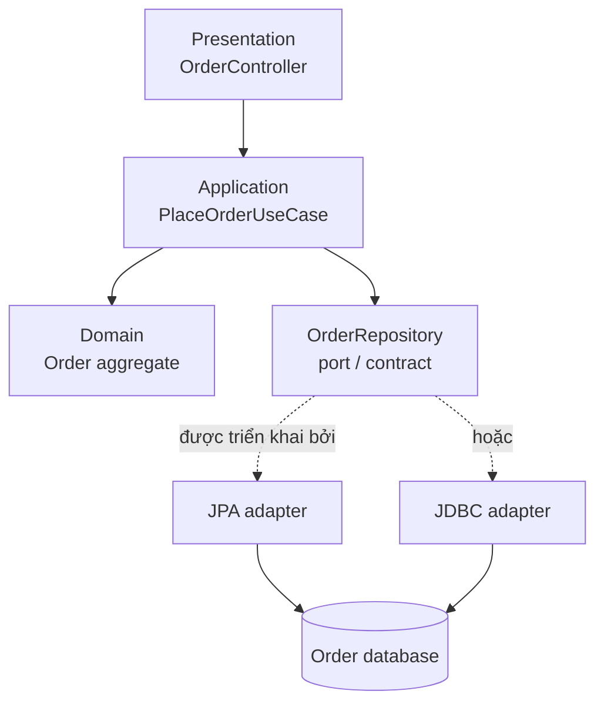

# Thay công nghệ lưu trữ và đo phần mã phải thay theo hợp đồng

Trong module **SOFTWARE_DESIGN_ARCHITECTURE_ARCHITECTURAL_PATTERN_LAYERED** (Học tổ chức phần mềm theo kiến trúc phân tầng), bài học này dùng hệ thống quản lý đơn hàng để thực hành thay công nghệ lưu trữ mà không làm thay đổi không cần thiết các tầng còn lại. Trọng tâm là thiết kế hợp đồng truy cập dữ liệu phù hợp với use case, triển khai nhiều adapter lưu trữ và đo xem một thay đổi công nghệ buộc phải chạm đến bao nhiêu phần mã.

Giả sử ứng dụng hiện dùng Spring Data JPA và một cơ sở dữ liệu quan hệ. Nhóm muốn chuyển phần lưu đơn hàng sang JDBC để kiểm soát SQL và giảm chi phí ORM. Một phép thay thế tốt cần bảo toàn hành vi mà application và domain đang dựa vào: tìm đơn theo ID, lưu aggregate cùng các dòng hàng, xử lý đơn không tồn tại, bảo đảm thay đổi trong một use case được commit hoặc rollback đúng cách. Mục tiêu không phải là ép mọi khác biệt của hai công nghệ vào một interface chung chung; mục tiêu là xác định rõ hợp đồng mà tầng ứng dụng cần và đo phần thay đổi nằm ngoài ranh giới lưu trữ.

## 1. Thay công nghệ lưu trữ là phép thử của ranh giới tầng

Một hệ thống phân tầng có thể tổ chức luồng truy cập dữ liệu như sau:



Application gọi hợp đồng `OrderRepository`. JPA adapter hoặc JDBC adapter thực hiện hợp đồng đó bằng công nghệ cụ thể. Controller không cần biết dữ liệu được lưu bằng ORM hay SQL thủ công; domain cũng không cần biết Hibernate entity hoặc `JdbcTemplate`.

Khi thay JPA bằng JDBC, những phần thường cần thay đổi là:

- Adapter lưu trữ: cách ánh xạ domain object sang hàng dữ liệu và ngược lại.
- Truy vấn: JPQL, entity graph hoặc Spring Data repository được thay bằng SQL và mapper dòng kết quả.
- Cấu hình hạ tầng: DataSource, transaction manager, connection pool, driver và cấu hình triển khai.
- Migration dữ liệu hoặc schema nếu công nghệ đích dùng cấu trúc khác.
- Kiểm thử tích hợp dành riêng cho adapter và truy vấn.

Nếu controller, domain và use case phải sửa chỉ vì đổi JPA sang JDBC, hãy điều tra xem chi tiết lưu trữ đã rò rỉ qua hợp đồng hay chưa. Tuy vậy, không nên hứa rằng thay công nghệ luôn chỉ sửa đúng một package: nếu công nghệ mới có ngữ nghĩa transaction, kiểu dữ liệu, truy vấn hoặc khả năng nhất quán khác, một số hợp đồng có thể cần điều chỉnh có chủ đích.

## 2. Hợp đồng lưu trữ không chỉ là chữ ký phương thức

Một interface Java chỉ mô tả một phần hợp đồng. Hợp đồng thực sự còn bao gồm ngữ nghĩa mà bên gọi có quyền kỳ vọng.

Ví dụ:

```java
public interface OrderRepository {
    Optional<Order> findById(OrderId id);

    Order save(Order order);
}
```

Chữ ký trên chưa trả lời hết các câu hỏi:

- Nếu không có đơn hàng, `findById` trả `Optional.empty()` hay ném exception?
- `save` tạo mới hay cập nhật? Có giữ nguyên ID không?
- Các dòng hàng và thông tin cần thiết của aggregate có được lưu cùng đơn không?
- Khi lưu thất bại giữa chừng, có để lại một phần dữ liệu không?
- Việc đọc có thấy dữ liệu vừa ghi trong cùng transaction không?
- Nếu hai yêu cầu đồng thời sửa cùng một đơn, hệ thống phát hiện xung đột như thế nào?
- Kết quả có được sắp xếp ổn định và phân trang theo cùng một quy tắc không?

Các điều này cần được định nghĩa trong tài liệu hợp đồng và test. Nếu không, hai adapter có thể cùng biên dịch nhưng hành xử khác nhau.

### Hợp đồng nên diễn đạt nhu cầu của application

Một port tốt thường được đặt ở phía application hoặc domain, nơi cần sử dụng khả năng lưu trữ. Tên và phương thức nên phản ánh use case hoặc nhu cầu nghiệp vụ, không sao chép API của framework.

Ví dụ, nếu use case chỉ cần lấy đơn và lưu aggregate, hợp đồng trên có thể đủ. Nếu use case cần truy vấn các đơn đang chờ thanh toán quá hạn, hãy cân nhắc một phương thức có ngữ nghĩa rõ như:

```java
List<OrderId> findPendingPaymentOrdersBefore(Instant deadline);
```

Thay vì đưa `JpaSpecificationExecutor`, `EntityManager`, `Pageable` hoặc `CriteriaBuilder` ra khỏi adapter, hãy biểu diễn điều kiện truy vấn mà application thực sự cần. Có thể dùng một query port riêng cho truy vấn đọc nếu mô hình đọc có nhu cầu khác với repository của aggregate.

Không nên tạo một interface CRUD tổng quát có hàng chục phương thức chỉ để mọi adapter có cùng một hình thức. Hợp đồng nhỏ, rõ và có ý nghĩa giúp việc thay implementation dễ đánh giá hơn.

## 3. Giữ domain model độc lập với ORM

Domain object biểu diễn khái niệm và quy tắc nghiệp vụ. ORM entity biểu diễn cách lưu trữ bằng JPA. Có thể có dự án nhỏ dùng một class cho cả hai mục đích, nhưng khi mục tiêu là thay công nghệ lưu trữ độc lập, sự tách biệt giúp giảm phụ thuộc.

Ví dụ domain model đơn giản:

```java
public record OrderId(UUID value) {}

public record OrderLine(
    UUID productId,
    int quantity,
    BigDecimal unitPrice
) {
    public OrderLine {
        Objects.requireNonNull(productId);
        Objects.requireNonNull(unitPrice);
        if (quantity <= 0) {
            throw new IllegalArgumentException("Quantity must be positive");
        }
    }

    public BigDecimal subtotal() {
        return unitPrice.multiply(BigDecimal.valueOf(quantity));
    }
}

public final class Order {
    private final OrderId id;
    private final UUID customerId;
    private final List<OrderLine> lines;
    private final OrderStatus status;

    public Order(
            OrderId id,
            UUID customerId,
            List<OrderLine> lines,
            OrderStatus status) {
        this.id = Objects.requireNonNull(id);
        this.customerId = Objects.requireNonNull(customerId);
        if (lines == null || lines.isEmpty()) {
            throw new IllegalArgumentException("Order must contain lines");
        }
        this.lines = List.copyOf(lines);
        this.status = Objects.requireNonNull(status);
    }

    public OrderId id() { return id; }
    public UUID customerId() { return customerId; }
    public List<OrderLine> lines() { return lines; }
    public OrderStatus status() { return status; }
}
```

Ví dụ lược bỏ các hành vi chuyển trạng thái để tập trung vào ánh xạ. Trong hệ thống thực tế, domain cần bảo vệ bất biến và cung cấp hành động nghiệp vụ; adapter chỉ chuyển đổi dữ liệu. Domain không nên chứa `@Entity`, `@OneToMany`, `JpaRepository` hoặc `JdbcTemplate` nếu mục tiêu là độc lập với công nghệ lưu trữ.

## 4. Đặt transaction ở ranh giới use case

Transaction thường thuộc ranh giới application use case, vì use case biết những thao tác dữ liệu nào phải thành công hoặc thất bại cùng nhau.

```java
@Service
@RequiredArgsConstructor
public class PlaceOrderService {
    private final OrderRepository orderRepository;

    @Transactional
    public OrderId handle(PlaceOrderCommand command) {
        var order = new Order(
            command.orderId(),
            command.customerId(),
            command.lines(),
            OrderStatus.PENDING_PAYMENT
        );

        orderRepository.save(order);
        return order.id();
    }
}
```

Trong ví dụ này, `PlaceOrderCommand` cung cấp `OrderId`, `customerId` và `List<OrderLine>`; phần tạo dòng hàng từ request/catalog được thực hiện trước khi gọi use case này.

Ở đây, adapter không tự mở một transaction độc lập cho từng lệnh lưu. Nó tham gia transaction do application mở. Nếu lưu header đơn thành công nhưng lưu một dòng hàng thất bại, transaction cần rollback toàn bộ thay đổi thuộc cùng database resource.

Điều này cần được bảo đảm bởi cấu hình thực tế:

- JPA adapter dùng transaction manager phù hợp với EntityManager và DataSource của nó.
- JDBC adapter dùng cùng DataSource và transaction manager mà use case đang quản lý.
- Nếu một use case gọi nhiều adapter trong cùng transaction, các adapter phải tham gia cùng transaction resource hoặc có cơ chế phối hợp được thiết kế rõ.
- Không tự ý thêm `REQUIRES_NEW` vào adapter, vì điều đó có thể khiến một phần dữ liệu commit dù use case ngoài rollback.

Nếu thay từ JPA sang JDBC nhưng transaction manager thay đổi, cần kiểm tra rollback, isolation, timeout, locking và cách connection được lấy/trả. Cùng dùng một database không tự động chứng minh mọi adapter đang tham gia cùng transaction. Với Spring, `JdbcTemplate` cần dùng DataSource được transaction manager quản lý; cấu hình JPA/JDBC hỗn hợp phải được kiểm tra cụ thể.

## 5. JPA adapter: một cách triển khai hợp đồng

JPA adapter chuyển đổi giữa domain object và entity được Hibernate quản lý:

```java
@Entity
@Table(name = "orders")
class OrderJpaEntity {
    @Id
    UUID id;

    UUID customerId;

    @Enumerated(EnumType.STRING)
    OrderStatus status;

    @OneToMany(mappedBy = "order", cascade = CascadeType.ALL,
               orphanRemoval = true)
    List<OrderLineJpaEntity> lines = new ArrayList<>();
}
```

Adapter triển khai port:

```java
@Repository
@RequiredArgsConstructor
class JpaOrderRepositoryAdapter implements OrderRepository {
    private final SpringDataOrderJpaRepository jpaRepository;

    @Override
    public Optional<Order> findById(OrderId id) {
        return jpaRepository.findById(id.value())
            .map(OrderJpaMapper::toDomain);
    }

    @Override
    public Order save(Order order) {
        var entity = OrderJpaMapper.toEntity(order);
        var saved = jpaRepository.save(entity);
        return OrderJpaMapper.toDomain(saved);
    }
}
```

Mapper chịu trách nhiệm chuyển đổi hai mô hình. Entity JPA có thể cần constructor, field access, quan hệ và annotation phục vụ persistence. Những chi tiết này nằm trong adapter.

Với aggregate có nhiều dòng hàng, adapter cần bảo đảm cách lưu header và lines phù hợp với vòng đời aggregate. `cascade`, `orphanRemoval`, trạng thái entity managed/detached và flush behavior đều có thể ảnh hưởng kết quả. Hợp đồng `save` cần được test để xác nhận dữ liệu có thể đọc lại đầy đủ sau khi transaction commit.

## 6. JDBC adapter: thay implementation nhưng giữ hợp đồng

JDBC adapter dùng SQL rõ ràng và ánh xạ ResultSet sang domain. Với ID UUID được tạo từ phía ứng dụng, cả JPA và JDBC có thể lưu cùng ID mà không phụ thuộc vào cơ chế sequence của database.

Ví dụ rút gọn:

```java
@Repository
@RequiredArgsConstructor
class JdbcOrderRepositoryAdapter implements OrderRepository {
    private final JdbcTemplate jdbc;

    @Override
    public Optional<Order> findById(OrderId id) {
        var headers = jdbc.query(
            """
            select id, customer_id, status
            from orders
            where id = ?
            """,
            (rs, rowNum) -> new OrderHeader(
                rs.getObject("id", UUID.class),
                rs.getObject("customer_id", UUID.class),
                OrderStatus.valueOf(rs.getString("status"))
            ),
            id.value()
        );

        if (headers.isEmpty()) {
            return Optional.empty();
        }

        var header = headers.get(0);
        var lines = jdbc.query(
            """
            select product_id, quantity, unit_price
            from order_lines
            where order_id = ?
            order by line_number
            """,
            (rs, rowNum) -> new OrderLine(
                rs.getObject("product_id", UUID.class),
                rs.getInt("quantity"),
                rs.getBigDecimal("unit_price")
            ),
            id.value()
        );

        return Optional.of(new Order(
            new OrderId(header.id()),
            header.customerId(),
            lines,
            header.status()
        ));
    }

    @Override
    public Order save(Order order) {
        jdbc.update(
            """
            insert into orders(id, customer_id, status)
            values (?, ?, ?)
            on conflict (id) do update
                set customer_id = excluded.customer_id,
                    status = excluded.status
            """,
            order.id().value(),
            order.customerId(),
            order.status().name()
        );

        jdbc.update("delete from order_lines where order_id = ?",
            order.id().value());

        for (int index = 0; index < order.lines().size(); index++) {
            var line = order.lines().get(index);
            jdbc.update(
                """
                insert into order_lines(
                    order_id, line_number, product_id, quantity, unit_price
                ) values (?, ?, ?, ?, ?)
                """,
                order.id().value(),
                index + 1,
                line.productId(),
                line.quantity(),
                line.unitPrice()
            );
        }

        return order;
    }

    private record OrderHeader(
        UUID id, UUID customerId, OrderStatus status
    ) {}
}
```

Câu lệnh `ON CONFLICT` trong ví dụ là cú pháp của PostgreSQL, không phải SQL chuẩn cho mọi database. Nếu dùng MySQL, SQL Server hoặc Oracle, phần upsert cần cách viết khác. Đây chính là chi tiết thuộc adapter: thay database có thể buộc sửa SQL nhưng không nhất thiết buộc application thay đổi.

Ví dụ cũng dùng cách xóa và chèn lại các dòng hàng để minh họa. Trong hệ thống thật, cần cân nhắc khóa ngoại, audit, ID riêng của dòng hàng, thứ tự dòng, optimistic locking, trigger và chi phí ghi. Không nên dùng cách này nếu nó làm mất lịch sử hoặc tạo tác động phụ không phù hợp.

## 7. Hợp đồng phải giữ ngữ nghĩa, không chỉ giữ tên method

Hai adapter cùng có `findById` và `save` chưa đủ để nói rằng chúng tương đương. Cần xác định các ngữ nghĩa sau:

| Khía cạnh | Hợp đồng cần làm rõ |
|---|---|
| Không tìm thấy | Trả empty hay ném lỗi? |
| Tạo mới/cập nhật | ID được tạo ở đâu? Cập nhật có ghi đè dữ liệu không? |
| Aggregate | Header và các dòng hàng có được lưu như một đơn vị không? |
| Thứ tự | Dòng hàng hoặc kết quả danh sách có thứ tự ổn định không? |
| Đồng thời | Xung đột cập nhật được phát hiện bằng version, lock hay điều kiện SQL nào? |
| Transaction | Các thao tác có tham gia transaction của use case không? |
| Precision | Decimal, scale, rounding và timezone được giữ đúng không? |
| Tính duy nhất | Unique constraint và xử lý duplicate có tương đương không? |
| Xóa | Xóa mềm, xóa cứng và cascade có cùng ý nghĩa không? |
| Lỗi | Lỗi constraint, timeout và mất kết nối được chuyển thành lỗi ứng dụng như thế nào? |

Ví dụ, JPA có thể dùng `@Version` để optimistic locking. JDBC adapter muốn giữ cùng hành vi phải đưa version vào câu lệnh cập nhật:

```sql
UPDATE orders
SET status = ?, version = version + 1
WHERE id = ? AND version = ?;
```

Nếu số dòng cập nhật bằng 0, adapter cần báo xung đột để application xử lý. Nếu JDBC adapter bỏ qua version, nó có thể ghi đè thay đổi đồng thời trong khi JPA adapter phát hiện lỗi. Hai implementation khi đó không cùng hợp đồng dù method signature giống nhau.

Tương tự, database khác nhau có thể có khác biệt về collation, cách so sánh chuỗi, độ chính xác timestamp, isolation level và hành vi khóa. Hợp đồng cần mô tả phần nào là yêu cầu nghiệp vụ, phần nào là giới hạn kỹ thuật được chấp nhận.

## 8. Kiểm thử hợp đồng cho mọi adapter

Một cách hiệu quả để bảo đảm thay implementation không làm thay đổi hành vi là dùng chung một bộ contract test. Bộ test được chạy với từng adapter và database tương ứng.

Ví dụ cấu trúc test:

```java
abstract class OrderRepositoryContractTest {
    protected abstract OrderRepository repository();

    @Test
    void returnsEmptyWhenOrderDoesNotExist() {
        assertThat(repository().findById(
            new OrderId(UUID.randomUUID())
        )).isEmpty();
    }

    @Test
    void savesAndLoadsWholeOrder() {
        var order = anOrderWithTwoLines();
        repository().save(order);

        var loaded = repository().findById(order.id()).orElseThrow();

        assertThat(loaded.id()).isEqualTo(order.id());
        assertThat(loaded.customerId()).isEqualTo(order.customerId());
        assertThat(loaded.lines()).hasSize(2);
        assertThat(loaded.status()).isEqualTo(order.status());
    }
}
```

Mỗi adapter cung cấp fixture và implementation của repository:

```java
class JpaOrderRepositoryContractTest
        extends OrderRepositoryContractTest {
    @Autowired OrderRepository repository;

    @Override
    protected OrderRepository repository() {
        return repository;
    }
}
```

Một lớp test tương tự được cấu hình cho JDBC adapter. Có thể dùng Testcontainers để chạy database cùng loại với môi trường triển khai. Test contract nên bao gồm:

- Tìm kiếm khi có và không có dữ liệu.
- Lưu mới và cập nhật.
- Lưu aggregate nhiều dòng và đọc lại đầy đủ.
- Bảo toàn thứ tự nếu thứ tự thuộc hợp đồng.
- Unique constraint và dữ liệu không hợp lệ.
- Rollback khi một phần thao tác lưu thất bại.
- Xung đột cập nhật đồng thời nếu hợp đồng yêu cầu optimistic locking.
- Precision, timezone và mapping enum.

Contract test kiểm tra hành vi quan sát được của adapter. Adapter vẫn có thể có test riêng cho chi tiết SQL, batch update hoặc query plan. Không nên ép test contract xác minh câu SQL cụ thể vì đó là chi tiết triển khai.

## 9. Đo phần mã phải thay theo hợp đồng

Đề bài không chỉ yêu cầu thay công nghệ lưu trữ mà còn đo phần mã phải thay. Cần xác định phạm vi trước khi bắt đầu để có baseline công bằng.

Một cách đơn giản là phân loại các thay đổi theo tầng:

| Phần mã | Thay đổi khi JPA chuyển sang JDBC | Kỳ vọng |
|---|---|---|
| JPA entity và mapper | Có thể xóa hoặc giữ nếu adapter khác còn dùng | Thường thay đổi |
| JPA repository implementation | Thay bằng JDBC implementation | Thay đổi |
| SQL, row mapper, truy vấn | Viết theo database/driver đích | Thay đổi |
| DataSource/transaction configuration | Có thể thay cấu hình | Tùy môi trường |
| Application use case | Không đổi nếu hợp đồng và ngữ nghĩa được giữ | Nên ổn định |
| Domain model | Không đổi nếu không phụ thuộc ORM và nghiệp vụ không đổi | Nên ổn định |
| Controller/API DTO | Không đổi nếu hợp đồng API không đổi | Nên ổn định |
| Contract tests | Chạy lại cho adapter mới; chỉ đổi khi hợp đồng nghiệp vụ thay đổi | Phần lớn giữ nguyên |
| Migration/operations | Có thể thay đổi | Cần đánh giá riêng |

### Các chỉ số có thể thu thập

**1. Số file nguồn thay đổi ngoài adapter lưu trữ**

Đếm các file thuộc application, domain và presentation bị thay đổi chỉ để hỗ trợ việc đổi công nghệ. Nếu nhiều file ngoài adapter phải sửa, hãy ghi rõ nguyên nhân: rò rỉ kiểu JPA, API truy vấn bị phụ thuộc framework, khác biệt transaction hay yêu cầu nghiệp vụ thật sự thay đổi.

**2. Số tham chiếu công nghệ lưu trữ rò rỉ qua ranh giới**

Tìm các import hoặc kiểu như `EntityManager`, `JpaRepository`, `@Entity`, `Pageable`, `JdbcTemplate` trong application/domain/presentation. Với kiến trúc dùng port, các kiểu này thường chỉ xuất hiện trong adapter và cấu hình hạ tầng. Có thể dùng tìm kiếm mã nguồn hoặc dependency analysis để đo trước/sau.

**3. Số thay đổi của hợp đồng**

Ghi lại port có phải thêm hoặc đổi phương thức không. Nếu hợp đồng phải mở rộng vì use case thực sự cần khả năng mới, điều đó có thể hợp lý. Nếu phải đưa `Specification`, `EntityManager` hoặc `ResultSet` vào interface để adapter mới hoạt động, hợp đồng đang bị kéo theo công nghệ.

**4. Tỷ lệ test contract giữ nguyên**

Ghi nhận bao nhiêu test contract chạy không đổi trên adapter mới và bao nhiêu test phải thay vì ngữ nghĩa thực sự khác. Nếu phần lớn test phải viết lại do mỗi adapter có hành vi khác nhau, hợp đồng chưa đủ rõ hoặc implementation mới chưa tương đương.

**5. Phạm vi dependency bị tác động**

So sánh dependency graph trước và sau. Một thay đổi storage lý tưởng không làm controller hoặc domain bắt đầu phụ thuộc vào driver JDBC. Nếu thêm dependency database mới khiến nhiều module phải khai báo driver hoặc import class hạ tầng, ranh giới chưa được giữ.

Có thể ghi một bảng baseline:

| Chỉ số | Trước thay đổi | Sau thay đổi |
|---|---:|---:|
| File thay đổi trong adapter | Ghi số thực tế | Ghi số thực tế |
| File thay đổi ngoài adapter chỉ vì storage | Ghi số thực tế | Ghi số thực tế |
| Import JPA/JDBC ngoài infrastructure | Ghi số thực tế | Ghi số thực tế |
| Phương thức port phải đổi | Ghi số thực tế | Ghi số thực tế |
| Contract test phải sửa vì khác ngữ nghĩa | Ghi số thực tế | Ghi số thực tế |
| Use case cần sửa | Ghi số thực tế | Ghi số thực tế |

Không đặt mục tiêu "ngoài adapter luôn bằng 0". Nếu phát hiện hợp đồng cũ thiếu một khả năng thực sự cần cho use case, sửa port có thể là thay đổi đúng. Điều quan trọng là mọi thay đổi ngoài adapter phải giải thích được bằng yêu cầu nghiệp vụ hoặc giới hạn ngữ nghĩa, không phải vì application đang biết cách JPA/JDBC hoạt động.

### Cách đọc kết quả

Nếu chỉ adapter, cấu hình và migration thay đổi, trong khi domain, use case và API giữ nguyên, ranh giới lưu trữ đang bảo vệ tốt phần còn lại của hệ thống.

Nếu application thay đổi vì phải bỏ `Pageable` hoặc `JpaSpecificationExecutor`, hợp đồng query có thể đang rò rỉ framework. Nếu domain thay đổi vì entity cần constructor hoặc annotation JPA, domain có thể đang bị ORM chi phối. Nếu controller thay đổi vì response trực tiếp trả entity, hợp đồng API đang gắn với persistence.

Nếu use case phải thay đổi do JDBC adapter không còn cung cấp semantics mà ứng dụng đang dựa vào, hãy xác định đó là khác biệt nghiệp vụ thật hay một giới hạn do implementation. Ví dụ, nếu hệ thống trước đây dựa vào optimistic locking mà adapter mới không kiểm tra version, cần sửa adapter để khôi phục hợp đồng thay vì bỏ kiểm tra để giảm số file thay đổi.

## 10. Quy trình thay adapter từng bước

Một quy trình có thể kiểm soát:

1. **Ghi nhận baseline:** lưu số file và module phụ thuộc công nghệ hiện tại; xác định hành vi, truy vấn, transaction và ràng buộc dữ liệu quan trọng.
2. **Đọc hợp đồng hiện có:** xác định use case thực sự cần những thao tác dữ liệu nào, kể cả ý nghĩa khi không tìm thấy, cập nhật đồng thời và rollback.
3. **Bổ sung contract test:** nếu hợp đồng chưa có test, viết test với adapter hiện tại để ghi nhận hành vi cần giữ.
4. **Tạo adapter mới:** triển khai port bằng công nghệ đích, giữ domain và application độc lập.
5. **Chạy contract test trên adapter mới:** dùng database đích hoặc môi trường tương thích; sửa khác biệt ở adapter nếu có thể.
6. **Kiểm tra transaction và consistency:** xác minh transaction manager, isolation, locking, precision, unique constraint và rollback.
7. **Chuyển cấu hình:** chọn adapter qua cấu hình Spring/profile hoặc wiring rõ ràng. Bảo đảm chỉ có một implementation hoạt động cho cùng port nếu không có chiến lược định tuyến chủ đích.
8. **Di chuyển dữ liệu và cutover:** lập kế hoạch snapshot, delta, đối soát số lượng và checksum; xác định thời điểm nguồn ghi chính thay đổi.
9. **Quan sát sau chuyển đổi:** theo dõi lỗi, latency, query count, pool usage và sai lệch dữ liệu; giữ phương án quay lại có điều kiện.
10. **Đo lại phạm vi thay đổi:** so sánh baseline, ghi lại lý do của từng thay đổi ngoài adapter và cập nhật tài liệu hợp đồng nếu ngữ nghĩa thực sự thay đổi.

Không nên chuyển production chỉ dựa trên việc ứng dụng khởi động thành công. Cần xác minh dữ liệu đọc/ghi, transaction, truy vấn quan trọng, backup/restore và khả năng vận hành của công nghệ mới.

## 11. Cẩn trọng với dual write, shadow read và migration dữ liệu

Khi thay database hoặc adapter, nhóm có thể muốn ghi đồng thời vào cả nơi cũ và nơi mới. Dual write trực tiếp thường nguy hiểm: ghi vào database cũ thành công nhưng database mới thất bại, hoặc ngược lại. Hai database không tự chia sẻ một transaction ACID chỉ vì chúng được gọi trong cùng một method Java.

Nếu cần chuyển đổi dần, hãy xác định một nguồn ghi chính và cơ chế đồng bộ có thể retry, đối soát và xử lý bản lặp. Outbox/CDC có thể giúp truyền thay đổi sang hệ thống đích; consumer cần idempotent và theo dõi độ trễ. Khi chuyển quyền ghi, phải có quy trình dừng/đồng bộ delta để không mất cập nhật.

Shadow read có thể gửi cùng truy vấn tới adapter mới để so sánh kết quả nhưng chỉ trả kết quả từ nguồn chính cho client. Đây là cách phát hiện sai khác mà không tạo tác động ghi kép. Tuy nhiên, cần giới hạn tải, tránh truy vấn nhạy cảm bị thực thi quá mức và chuẩn hóa khác biệt không có ý nghĩa như thứ tự mặc định hoặc định dạng timestamp trước khi so sánh.

Migration dữ liệu cần kiểm tra:

- Số lượng bản ghi và quan hệ khóa ngoại.
- Giá trị null, default và enum.
- Decimal scale, rounding và timezone.
- Dữ liệu trùng, unique key và collation.
- Thứ tự dòng hàng hoặc dữ liệu cần sắp xếp.
- Sequence/identity hoặc cách sinh ID.
- Lịch sử, audit và dữ liệu soft delete.

## 12. Những sai lầm thường gặp

**Hợp đồng sao chép API của JPA.** Đưa `JpaRepository`, `Specification`, `Pageable` hoặc entity vào tầng application khiến JDBC adapter khó thay thế. Hãy mô tả nhu cầu truy vấn bằng kiểu và ngữ nghĩa của ứng dụng.

**Dùng repository generic CRUD cho mọi use case.** Một interface quá rộng tạo nhiều phương thức không cần thiết và dễ kéo abstraction về cách lưu trữ. Chỉ cung cấp thao tác mà use case thực sự cần.

**Chỉ kiểm tra code biên dịch.** Hai adapter có thể biên dịch nhưng khác nhau về rollback, optimistic locking, thứ tự hoặc xử lý không tìm thấy. Dùng contract test và integration test trên database thực tế.

**Mở transaction riêng trong adapter.** `REQUIRES_NEW` hoặc transaction tự quản lý trong adapter có thể phá vỡ tính nguyên tử của use case. Transaction nên được quyết định ở ranh giới application, trừ khi có lý do nghiệp vụ rõ ràng.

**Giả định cùng database nghĩa là cùng transaction.** JPA và JDBC chỉ phối hợp khi dùng đúng DataSource và transaction manager/configuration tương thích. Hai database hoặc hai transaction manager độc lập không tự trở thành một giao dịch.

**Chuyển dữ liệu bằng dual write không có cơ chế phục hồi.** Một bên có thể thành công và bên kia thất bại. Cần nguồn sự thật, outbox/CDC, idempotency và đối soát.

**Ép hợp đồng che giấu khác biệt nghiệp vụ thật.** Nếu công nghệ mới không hỗ trợ một semantics quan trọng, không nên âm thầm bỏ nó. Hãy đánh giá khả năng bổ sung bằng adapter, thay đổi hợp đồng có chủ đích hoặc chọn công nghệ khác.

**Đo thành công bằng số file thay đổi đơn thuần.** Ít file hơn không chứng minh coupling thấp; một interface có thể đang chứa nhiều chi tiết framework. Đánh giá theo lý do thay đổi, dependency và hành vi được bảo toàn.

## 13. Checklist đánh giá một lần thay công nghệ lưu trữ

Trước khi hoàn tất thay adapter, hãy tự hỏi:

1. Hợp đồng có diễn đạt nhu cầu của use case thay vì API của JPA/JDBC không?
2. Domain và application có còn import kiểu hoặc annotation của công nghệ lưu trữ không?
3. Hai adapter có cùng hành vi khi tìm thấy/không tìm thấy, tạo mới, cập nhật và lưu aggregate không?
4. Các bất biến, unique constraint và optimistic locking có được giữ không?
5. Transaction của use case có bao trùm các thao tác cần nguyên tử không?
6. Isolation, rollback, precision, timezone và thứ tự dữ liệu có tương đương không?
7. Contract test có thể chạy trên từng adapter mà không sửa nội dung không liên quan không?
8. Có integration test cho truy vấn, transaction và migration trên database đích không?
9. Có nguồn ghi chính, phương án cutover, đối soát và rollback rõ ràng không?
10. Bao nhiêu file ngoài adapter phải thay đổi, và mỗi thay đổi có lý do cụ thể không?
11. Có dependency mới nào rò rỉ sang controller hoặc domain không?
12. Hiệu năng và khả năng vận hành sau chuyển đổi có được đo trên tải đại diện không?

Một ranh giới lưu trữ tốt giúp thay JPA bằng JDBC, hoặc chuyển sang một công nghệ khác, trở thành thay đổi chủ yếu ở adapter và cấu hình. Hợp đồng không phải lời hứa rằng mọi công nghệ đều giống nhau; nó là mô tả rõ những hành vi application cần. Khi kiểm thử hợp đồng trên từng implementation và đo minh bạch phần mã phải thay, nhóm có thể biết kiến trúc đang cô lập công nghệ đến đâu và chỗ nào cần cải thiện tiếp.

