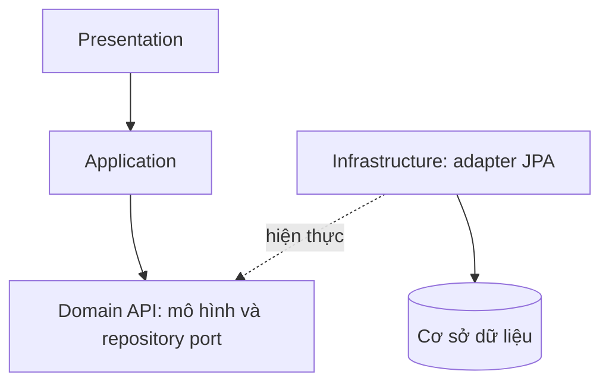

# Phân tầng đóng: chỉ sử dụng tầng liền kề theo quy tắc đã chọn

Bài học này thuộc module `SOFTWARE_DESIGN_ARCHITECTURE_ARCHITECTURAL_PATTERN_LAYERED`, có mục tiêu giúp người học tổ chức phần mềm theo kiến trúc phân tầng. Trong chương **Ranh giới và quy tắc phân tầng**, ta xem xét một quy tắc cụ thể: một tầng chỉ được sử dụng API của tầng liền kề theo hướng phụ thuộc đã quy định. Quy tắc đó thường được gọi là *phân tầng đóng* (*closed layering*).

## 1. Phân tầng đóng có nghĩa gì?

Một kiến trúc phân tầng chia mã nguồn thành các nhóm có trách nhiệm khác nhau. Chẳng hạn, tầng trình bày tiếp nhận HTTP, tầng ứng dụng điều phối ca sử dụng, tầng miền thực hiện quy tắc nghiệp vụ, còn tầng truy cập dữ liệu giao tiếp với cơ sở dữ liệu.

Trong mô hình phân tầng đóng, một tầng chỉ được gọi hoặc phụ thuộc trực tiếp vào tầng kế tiếp được cho phép. Tầng ở trên không được bỏ qua tầng trung gian để gọi thẳng một tầng thấp hơn. Nếu thứ tự được chọn là `Presentation → Application → Domain → Data Access`, một yêu cầu từ HTTP phải đi qua API ứng dụng trước khi đến phần nghiệp vụ; phần trình bày không tự truy vấn kho dữ liệu.

Điểm quan trọng là phải viết rõ **thế nào là liền kề và chiều phụ thuộc nào được phép**. Tên package, số tầng hoặc vị trí thư mục tự chúng không tạo ra quy tắc. Hai dự án đều có package `controller`, `service`, `repository` nhưng có thể đang áp dụng hai chính sách phụ thuộc khác nhau.

Phân tầng đóng thường được đối chiếu với phân tầng mở (*open layering*). Ở mô hình mở, một tầng có thể được phép bỏ qua tầng trung gian để sử dụng một tầng thấp hơn. Ví dụ, controller có thể gọi repository trực tiếp. Cách đó có thể giảm một số lớp chuyển tiếp, nhưng cũng cho phép nhiều điểm trong ứng dụng truy cập dữ liệu và dễ làm quy tắc nghiệp vụ bị phân tán. Không mô hình nào tự động phù hợp với mọi hệ thống; điều cần thiết là chọn và thực thi một chính sách nhất quán.

## 2. Chọn ranh giới và chiều phụ thuộc

Để minh họa, ta chọn bốn nhóm trách nhiệm cho một ứng dụng quản lý đơn hàng:

| Nhóm | Trách nhiệm | API trực tiếp được phép sử dụng |
|---|---|---|
| Presentation | Nhận HTTP, kiểm tra định dạng đầu vào, chuyển đổi request/response | API của Application |
| Application | Điều phối ca sử dụng, quản lý ranh giới giao dịch, phối hợp các bước | API của Domain |
| Domain | Mô hình hóa khái niệm và bất biến nghiệp vụ | Các kiểu miền và cổng (port) do Domain sở hữu |
| Infrastructure / Data Access | Hiện thực cổng, ánh xạ dữ liệu và giao tiếp với JPA, SQL hoặc dịch vụ ngoài | Cổng của Domain và thư viện hạ tầng cần thiết |

Trong ví dụ này, `OrderRepository` là một cổng do Domain khai báo; adapter trong Infrastructure hiện thực cổng đó. Vì vậy, đồ thị phụ thuộc mã nguồn được chọn là:



Các mũi tên liền biểu thị mã nguồn sử dụng API của nhóm đích. Mũi tên nét đứt biểu thị adapter phụ thuộc vào hợp đồng mà nó hiện thực. Với chính sách này:

- Presentation được phép gọi Application, nhưng không import trực tiếp kiểu Domain hoặc adapter Infrastructure.
- Application được phép dùng API Domain, bao gồm cổng repository, nhưng không phụ thuộc vào lớp JPA cụ thể.
- Domain không phụ thuộc vào Spring MVC, Spring Data, JPA hoặc package Infrastructure.
- Infrastructure được phép phụ thuộc vào cổng Domain để hiện thực nó và được phép dùng thư viện lưu trữ.

Đây là một cách tổ chức có sử dụng đảo ngược phụ thuộc ở ranh giới lưu trữ. Hợp đồng `OrderRepository` thuộc Domain; lớp `JpaOrderRepositoryAdapter` thuộc Infrastructure. Khi chạy, Spring tiêm adapter vào nơi cần `OrderRepository`. Do đó Application chỉ biết hợp đồng miền, dù lời gọi phương thức được thực thi bởi đối tượng adapter. Cần phân biệt phụ thuộc kiểu trong mã nguồn với đối tượng thực thi được tiêm lúc chạy.

Một dự án khác có thể đặt hợp đồng repository ở Application hoặc chọn kiểu phân tầng truyền thống với chiều phụ thuộc khác. Khi đó phải điều chỉnh bảng quy tắc và kiểm tra tương ứng. Không nên vừa tuyên bố một tầng chỉ được dùng tầng liền kề, vừa âm thầm cho phép import các lớp ở xa hơn.

## 3. Luồng xử lý trong ứng dụng Java/Spring

Giả sử khách hàng gửi `POST /orders` để tạo đơn hàng. Luồng xử lý có thể diễn ra như sau:

1. `OrderController` nhận request, kiểm tra cấu trúc dữ liệu HTTP và tạo command cho ca sử dụng.
2. `PlaceOrderUseCase` điều phối thao tác, mở ranh giới giao dịch và gọi API Domain.
3. Mô hình `Order` kiểm tra các bất biến như đơn hàng phải có ít nhất một dòng hàng và số lượng phải hợp lệ.
4. Use case gọi cổng `OrderRepository` được khai báo trong Domain.
5. Spring đã cung cấp `JpaOrderRepositoryAdapter` làm implementation của cổng. Adapter chuyển đổi mô hình miền sang entity lưu trữ và gọi Spring Data JPA.
6. Spring Data JPA thực hiện thao tác với cơ sở dữ liệu; kết quả được chuyển ngược qua các lớp theo hợp đồng đã chọn.

```mermaid
sequenceDiagram
    participant C as Client
    participant P as OrderController
    participant A as PlaceOrderUseCase
    participant D as Order / OrderRepository port
    participant I as JpaOrderRepositoryAdapter
    participant DB as Database
    C->>P: POST /orders
    P->>A: handle(command)
    A->>D: Order.place(...)
    D-->>A: Order hợp lệ
    A->>I: orders.save(order) qua interface
    Note over A,I: Spring inject adapter; Application chỉ phụ thuộc OrderRepository của Domain
    I->>DB: Lưu entity qua Spring Data JPA
    DB-->>I: Kết quả lưu
    I-->>A: Hoàn tất
    A-->>P: OrderId
    P-->>C: HTTP response
```

Sơ đồ trình tự mô tả đối tượng thực thi khi chương trình chạy. Ở mã nguồn, `PlaceOrderUseCase` chỉ tham chiếu `OrderRepository`; nó không cần biết `JpaOrderRepositoryAdapter` hay `EntityManager`. Đây là ranh giới quan trọng giúp thay cách lưu trữ mà không buộc tầng ứng dụng đổi theo.

### Hợp đồng miền và adapter lưu trữ

Một cổng đơn giản có thể được khai báo trong package Domain:

```java
package com.example.orders.domain;

public interface OrderRepository {
    void save(Order order);
}
```

Use case điều phối thao tác và dựa vào hợp đồng đó:

```java
package com.example.orders.application;

import com.example.orders.domain.Order;
import com.example.orders.domain.OrderRepository;
import org.springframework.stereotype.Service;
import org.springframework.transaction.annotation.Transactional;

@Service
public class PlaceOrderUseCase {
    private final OrderRepository orders;

    public PlaceOrderUseCase(OrderRepository orders) {
        this.orders = orders;
    }

    @Transactional
    public OrderId handle(PlaceOrderCommand command) {
        Order order = Order.place(command.customerId(), command.lines());
        orders.save(order);
        return order.id();
    }
}
```

`Order.place(...)` chịu trách nhiệm bảo vệ bất biến của đơn hàng. Use case quyết định thứ tự các bước và ranh giới giao dịch. Cổng repository mô tả khả năng lưu một đơn hàng mà không để Domain hoặc Application phụ thuộc vào chi tiết JPA.

Adapter thuộc Infrastructure có thể hiện thực cổng như sau:

```java
package com.example.orders.infrastructure.persistence;

import com.example.orders.domain.Order;
import com.example.orders.domain.OrderRepository;
import org.springframework.stereotype.Repository;

@Repository
class JpaOrderRepositoryAdapter implements OrderRepository {
    private final SpringDataOrderJpaRepository jpa;
    private final OrderMapper mapper;

    JpaOrderRepositoryAdapter(
            SpringDataOrderJpaRepository jpa,
            OrderMapper mapper) {
        this.jpa = jpa;
        this.mapper = mapper;
    }

    @Override
    public void save(Order order) {
        jpa.save(mapper.toEntity(order));
    }
}
```

`SpringDataOrderJpaRepository` làm việc với entity lưu trữ; `OrderMapper` chuyển đổi giữa entity và mô hình miền. Những kiểu này nằm trong Infrastructure. Nhờ constructor injection, Spring tìm bean hiện thực `OrderRepository` và cung cấp cho `PlaceOrderUseCase` khi khởi tạo ứng dụng.

Ví dụ trên minh họa ranh giới, không phải một cấu trúc package bắt buộc. Một hệ thống có thể cần nhiều cổng, nhiều adapter hoặc cách ánh xạ khác. Hãy giữ nguyên nguyên tắc: lớp gọi chỉ biết API được phép ở ranh giới của nó.

## 4. Nhận diện việc bỏ qua tầng

Các ví dụ sau vi phạm chính sách đã chọn:

```java
@RestController
class OrderController {
    // Vi phạm: Presentation biết trực tiếp Spring Data / Infrastructure.
    private final SpringDataOrderJpaRepository repository;
}
```

Controller khi đó có thể tự truy vấn hoặc ghi dữ liệu, khiến quy tắc nghiệp vụ, xử lý lỗi và giao dịch có nguy cơ bị phân tán giữa nhiều endpoint. Một vi phạm khác là Application import trực tiếp `JpaOrderRepositoryAdapter`; điều này buộc ca sử dụng biết cách lưu trữ cụ thể và làm việc thay adapter trở nên khó hơn.

Domain cũng không nên import `OrderController`, DTO HTTP, `JpaRepository` hay entity chỉ dành cho ORM. Nếu mô hình miền phụ thuộc vào các kiểu đó, thay đổi giao thức hoặc công nghệ lưu trữ có thể lan vào quy tắc nghiệp vụ.

Không phải mọi lời gọi qua một interface đều tự động đúng. Cần kiểm tra interface đó thuộc ranh giới nào, ai sở hữu hợp đồng và implementation nằm ở đâu. Đặt một interface trong package `application` nhưng khai báo phương thức chứa `EntityManager` vẫn làm rò rỉ chi tiết hạ tầng.

## 5. Thực thi quy tắc bằng cấu trúc và kiểm tra kiến trúc

Quy tắc phân tầng cần được thể hiện ở cấu trúc mã nguồn và được kiểm tra tự động. Với ứng dụng nhỏ, package riêng và quy ước review có thể đủ lúc đầu. Khi hệ thống lớn lên, có thể dùng module Gradle/Maven, Java Platform Module System hoặc ArchUnit để ngăn phụ thuộc trái phép.

Ví dụ dưới đây minh họa một số điều cấm bằng ArchUnit; tên package cần khớp với dự án thực tế:

```java
@AnalyzeClasses(packages = "com.example.orders")
class LayerRulesTest {

    @ArchTest
    static final ArchRule presentation_does_not_skip_layers =
        noClasses().that().resideInAPackage("..presentation..")
            .should().dependOnClassesThat()
            .resideInAnyPackage("..domain..", "..infrastructure..");

    @ArchTest
    static final ArchRule application_does_not_use_infrastructure =
        noClasses().that().resideInAPackage("..application..")
            .should().dependOnClassesThat()
            .resideInAPackage("..infrastructure..");

    @ArchTest
    static final ArchRule domain_is_independent =
        noClasses().that().resideInAPackage("..domain..")
            .should().dependOnClassesThat()
            .resideInAnyPackage(
                "..presentation..", "..application..", "..infrastructure..",
                "org.springframework..", "jakarta.persistence..", "javax.persistence..");
}
```

Các quy tắc này kiểm tra phụ thuộc mà ArchUnit nhận diện được trong bytecode. Chúng không thay thế kiểm thử hành vi hoặc việc kiểm tra cấu hình tiêm phụ thuộc lúc chạy. Nếu dự án có ngoại lệ được chấp thuận, hãy biểu diễn ngoại lệ thành quy tắc cụ thể, giới hạn phạm vi và ghi rõ lý do để nó không trở thành lối đi tùy tiện.

Nên kết hợp kiểm tra kiến trúc với các loại kiểm thử phù hợp:

- **Unit test cho Domain:** kiểm tra bất biến của `Order` bằng JUnit, không cần Spring hay cơ sở dữ liệu.
- **Unit test cho Application:** truyền một fake hoặc mock `OrderRepository` để xác minh use case gọi đúng thao tác và xử lý kết quả phù hợp.
- **Integration test cho Infrastructure:** kiểm tra adapter ánh xạ và lưu/đọc dữ liệu với cơ sở dữ liệu thử nghiệm.
- **Test cho Presentation:** xác minh endpoint chuyển request thành command, gọi đúng use case và tạo HTTP response phù hợp.
- **Architecture test:** kiểm tra các package hoặc module không tạo phụ thuộc vượt qua ranh giới đã định.

Những kiểm thử này trả lời các câu hỏi khác nhau: nghiệp vụ có đúng không, luồng ứng dụng có đúng không, adapter có giao tiếp đúng với hệ thống ngoài không và mã nguồn có tuân thủ chính sách phân tầng không.

## 6. Lợi ích và chi phí của phân tầng đóng

Phân tầng đóng giúp đường đi của yêu cầu dễ dự đoán. Controller không thể tự ý truy cập cơ sở dữ liệu; các ca sử dụng có một điểm điều phối; chi tiết lưu trữ được giữ sau adapter. Khi thay đổi giao thức HTTP hoặc công nghệ persistence, phạm vi ảnh hưởng thường nhỏ hơn nếu các hợp đồng được thiết kế ổn định.

Quy tắc này cũng giúp kiểm thử và review dễ hơn. Người đọc có thể xác định một lớp được phép biết những API nào, còn architecture test có thể phát hiện sớm một import sai tầng trước khi nó lan rộng.

Đổi lại, phân tầng đóng có thể tạo thêm interface, adapter và lời gọi chuyển tiếp. Một thao tác đọc đơn giản có thể phải đi qua nhiều lớp; nếu các lớp chỉ chuyển tiếp dữ liệu mà không bảo vệ trách nhiệm nào, cấu trúc trở nên nặng nề. Việc đặt sai hợp đồng cũng có thể khiến tầng nghiệp vụ phụ thuộc vào khái niệm lưu trữ hoặc khiến tầng ứng dụng khó điều phối các ca sử dụng.

Vì vậy, không cần tạo một interface cho mọi lớp hoặc ép mọi ứng dụng dùng cùng số tầng. Hãy đặt ranh giới ở nơi có lý do rõ ràng: thay đổi độc lập, quy tắc nghiệp vụ cần được bảo vệ, công nghệ ngoài cần được cô lập hoặc nhiều adapter cần cùng hiện thực một hợp đồng. Với hệ thống nhỏ, một số trách nhiệm có thể nằm trong cùng module nhưng vẫn được tách bằng API và quy ước phụ thuộc.

Phân tầng cũng là ranh giới logic trong mã nguồn, không nhất thiết là các tiến trình hay máy chủ riêng. Một ứng dụng Spring Boot có thể chạy trong một JVM, triển khai thành một artifact duy nhất, nhưng vẫn có các tầng Presentation, Application, Domain và Infrastructure. Tách thành nhiều deployment tier là quyết định triển khai khác, có thêm chi phí mạng, vận hành và độ trễ.

## 7. Cách quyết định và rà soát quy tắc

Khi áp dụng phân tầng đóng cho một module, hãy trả lời lần lượt:

1. Những trách nhiệm nào được tách thành tầng hoặc module? Tên gọi phải phản ánh trách nhiệm thực tế.
2. Với từng tầng, API của tầng liền kề nào được phép sử dụng? Có chiều phụ thuộc ngược nào được cho phép, chẳng hạn adapter hiện thực port không?
3. Tầng nào sở hữu hợp đồng? Hợp đồng có chứa kiểu của framework hoặc chi tiết lưu trữ không?
4. Có đường gọi nào bỏ qua API được chọn, ví dụ controller truy cập repository hoặc application import adapter JPA không?
5. Quy tắc nào có thể kiểm tra bằng module boundary hoặc architecture test, và ngoại lệ nào cần được ghi nhận?

Một quy tắc tốt đủ cụ thể để một thành viên khác có thể xác định một import là hợp lệ hay không. Nếu hai người đọc cùng một sơ đồ mà đưa ra hai kết luận khác nhau về việc một tầng có được gọi tầng khác hay không, ranh giới hoặc chiều phụ thuộc vẫn cần được làm rõ.

## 8. Ghi nhớ

Phân tầng đóng giới hạn việc sử dụng giữa các tầng vào những API liền kề đã được cho phép. Giá trị của nó nằm ở đường phụ thuộc có thể giải thích và kiểm tra được: tầng trình bày chuyển yêu cầu cho ứng dụng, ứng dụng điều phối qua API miền, còn adapter hạ tầng hiện thực các cổng cần thiết. Hãy định nghĩa rõ chiều phụ thuộc, phân biệt hợp đồng mã nguồn với đối tượng được tiêm lúc chạy, rồi bảo vệ quy tắc bằng cấu trúc module và kiểm tra kiến trúc. Số tầng và cách đặt port là lựa chọn thiết kế theo bối cảnh, không phải công thức bắt buộc cho mọi hệ thống.
