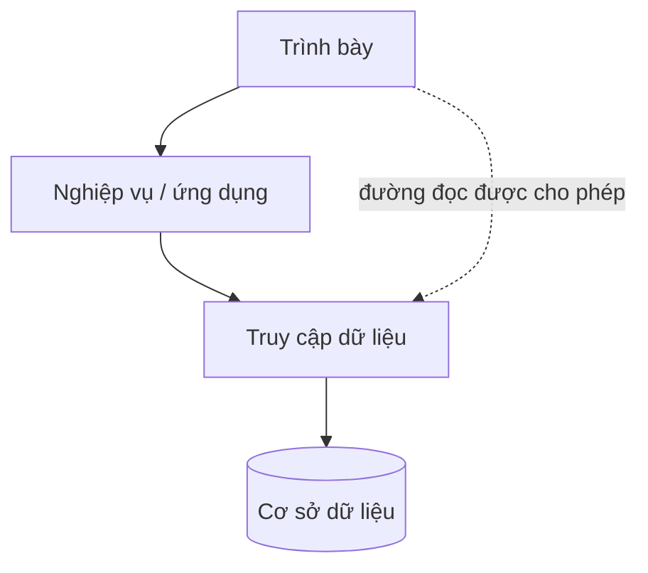
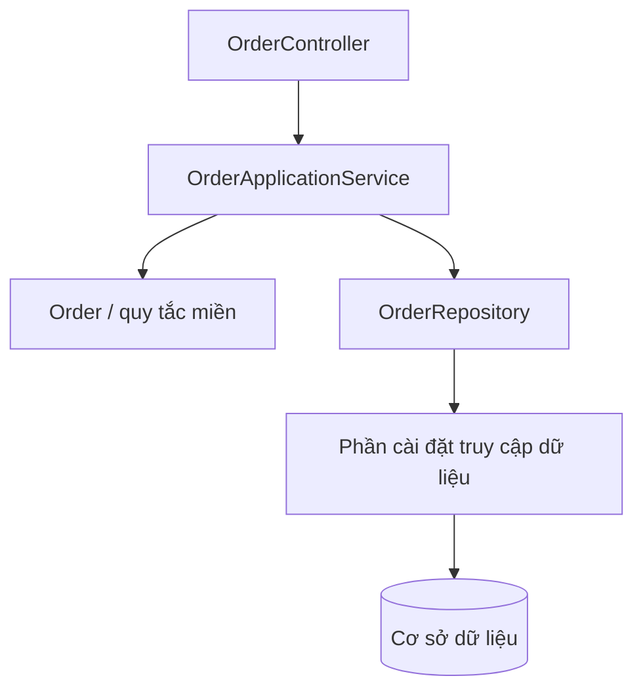

# Phân tầng mở: bỏ qua tầng có chủ đích mà không phá vỡ ranh giới

Trong kiến trúc phân tầng, một yêu cầu thường đi qua các tầng theo một thứ tự đã định. Tuy nhiên, không phải yêu cầu nào cũng cần mọi tầng tham gia. Một thao tác đọc đơn giản có thể không cần chạy qua tầng nghiệp vụ; một thành phần ở tầng trên đôi khi có thể gọi một dịch vụ thuộc tầng thấp hơn mà bỏ qua tầng nằm giữa. Cách tổ chức cho phép bỏ qua một số tầng theo quy tắc được công bố được gọi là **phân tầng mở** (*open layering*).

Trong module `SOFTWARE_DESIGN_ARCHITECTURE_ARCHITECTURAL_PATTERN_LAYERED` — học tổ chức phần mềm theo kiến trúc phân tầng — chủ đề này giúp ta xác định khi nào đường đi ngắn hơn là hợp lý, đồng thời giữ được trách nhiệm và ranh giới của từng tầng. Phân tầng mở là một lựa chọn thiết kế có đánh đổi; nó không phải giấy phép để mọi thành phần gọi tùy ý mọi thành phần khác.

## 1. Tầng đóng và tầng mở khác nhau ở đâu?

Một tầng **đóng** yêu cầu lời gọi từ tầng phía trên phải đi qua nó trước khi tiếp cận tầng thấp hơn. Tầng **mở** cho phép tầng phía trên bỏ qua nó để gọi một tầng thấp hơn, nếu quy tắc kiến trúc cho phép.

Ví dụ, xét cách chia thường gặp thành tầng trình bày, tầng nghiệp vụ và tầng truy cập dữ liệu:



Trong mô hình đóng, tầng trình bày gọi tầng nghiệp vụ; tầng nghiệp vụ gọi tầng truy cập dữ liệu. Tầng trình bày không gọi trực tiếp tầng truy cập dữ liệu. Trong mô hình mở, kiến trúc có thể cho phép thêm đường gọi trực tiếp từ trình bày đến một API đọc công khai của tầng dữ liệu. Tầng nghiệp vụ vẫn tồn tại và vẫn chịu trách nhiệm với những trường hợp cần quy tắc nghiệp vụ.

Điểm cốt lõi là **quyền bỏ qua một tầng được xác định bằng quy tắc**, không phải do từng lập trình viên tự quyết định trong mỗi lớp. Một kiến trúc cũng có thể đóng ở một số ranh giới và mở ở ranh giới khác. Không có yêu cầu rằng toàn bộ hệ thống phải theo một kiểu duy nhất.

## 2. Bỏ qua tầng không có nghĩa là bỏ qua trách nhiệm

Mỗi tầng được tạo ra để sở hữu một nhóm trách nhiệm. Đường đi của lời gọi có thể ngắn hơn, nhưng trách nhiệm vẫn phải có nơi thực hiện rõ ràng.

| Trách nhiệm | Nơi thường sở hữu trách nhiệm |
|---|---|
| Nhận HTTP, kiểm tra định dạng đầu vào, chuyển kết quả thành phản hồi | Tầng trình bày / giao tiếp |
| Điều phối một ca sử dụng, xác định ranh giới giao dịch | Tầng ứng dụng |
| Bảo vệ bất biến và quy tắc nghiệp vụ cốt lõi | Tầng miền hoặc thành phần nghiệp vụ tương ứng |
| Truy vấn, lưu trữ, ánh xạ dữ liệu và làm việc với hệ quản trị cơ sở dữ liệu | Tầng truy cập dữ liệu / hạ tầng |

Nếu một yêu cầu chỉ đọc một nhãn hiển thị đơn giản, không có quy tắc nghiệp vụ cần áp dụng, việc bỏ qua tầng nghiệp vụ có thể hợp lý. Nhưng nếu thao tác là đặt hàng, tính giá, ghi nhận thanh toán hoặc thay đổi trạng thái có điều kiện, việc bỏ qua nơi thực thi quy tắc sẽ làm hệ thống mất khả năng bảo vệ tính đúng đắn.

Vì vậy, trước khi mở một đường gọi, hãy trả lời câu hỏi: **tầng bị bỏ qua đang làm công việc gì trên đường đi này?** Nếu câu trả lời là “không có công việc cần thiết”, việc bỏ qua có thể giảm điều phối dư thừa. Nếu câu trả lời bao gồm kiểm tra quyền, áp dụng chính sách, kiểm tra bất biến, ghi lịch sử, quản lý giao dịch hoặc phát sự kiện, phải xác định chính xác thành phần nào sẽ tiếp tục đảm nhận các công việc đó.

## 3. Ví dụ: cho phép đường đọc đi thẳng đến API dữ liệu

Giả sử một ứng dụng Spring Boot có chức năng hiển thị mã và tên khách hàng trong một danh sách tra cứu nội bộ. Yêu cầu chỉ lấy hai trường đã được phép hiển thị; không tính toán giá, thay đổi trạng thái hay thực hiện quy tắc nghiệp vụ. Đội phát triển có thể quy định rằng màn hình tra cứu được phép gọi một hợp đồng đọc công khai của tầng dữ liệu, bỏ qua dịch vụ nghiệp vụ tổng quát.

```java
// Hợp đồng đọc công khai của tầng truy cập dữ liệu.
public interface CustomerLabelReader {
    Optional<CustomerLabelView> findLabelById(UUID customerId);
}

// Projection chỉ chứa dữ liệu mà màn hình này cần.
public record CustomerLabelView(UUID id, String displayName) {}
```

Controller sử dụng hợp đồng đó:

```java
@RestController
@RequestMapping("/customers")
@RequiredArgsConstructor
class CustomerLookupController {
    private final CustomerLabelReader customerLabelReader;

    @GetMapping("/{id}/label")
    CustomerLabelResponse getLabel(@PathVariable UUID id) {
        CustomerLabelView label = customerLabelReader.findLabelById(id)
            .orElseThrow(() -> new ResponseStatusException(HttpStatus.NOT_FOUND));

        return new CustomerLabelResponse(label.id(), label.displayName());
    }
}

record CustomerLabelResponse(UUID id, String displayName) {}
```

Ở đây, controller gọi trực tiếp `CustomerLabelReader`, nên đường đi bỏ qua dịch vụ nghiệp vụ tổng quát. Để đường gọi này vẫn có ranh giới rõ ràng:

- `CustomerLabelReader` là hợp đồng công khai, có tên và mục đích hẹp. Controller không biết câu SQL, cách lập chỉ mục hay loại cơ sở dữ liệu đang dùng.
- Kết quả là một projection chỉ đọc, không phải entity JPA có thể bị sửa rồi lưu ngoài ý muốn.
- Phần cài đặt truy vấn nằm trong tầng dữ liệu. Có thể thay JDBC bằng Spring Data JPA hoặc một nguồn dữ liệu khác mà không buộc controller biết chi tiết đó.
- Controller chỉ chuyển kết quả thành phản hồi HTTP. Truy vấn phải tự áp dụng điều kiện phạm vi dữ liệu cần thiết, chẳng hạn tenant hoặc đơn vị mà người dùng được phép xem. Kiểm soát truy cập vẫn phải được thực hiện ở lớp bảo mật hoặc thành phần có trách nhiệm tương ứng.

Đây là ví dụ cho một quy tắc mở cụ thể: **đường đọc đơn giản được phép gọi API đọc công khai; đường ghi và các thao tác có quy tắc nghiệp vụ vẫn đi qua ca sử dụng**. Nếu hệ thống dùng kiến trúc đảo ngược phụ thuộc, hợp đồng `CustomerLabelReader` có thể được đặt ở tầng trong và tầng hạ tầng cung cấp phần cài đặt. Vị trí đặt interface phụ thuộc mô hình phụ thuộc mà dự án chọn; điều cần giữ là hợp đồng ổn định và chi tiết lưu trữ không rò rỉ lên tầng gọi.

Không nên mở rộng ví dụ này thành quy tắc “controller được gọi repository tùy ý”. Nếu mỗi controller tự tạo truy vấn, tự lọc quyền, tự ghép dữ liệu và tự diễn giải quy tắc, tầng trình bày sẽ dần sở hữu trách nhiệm của các tầng khác. Khi đó, ranh giới đã bị phá vỡ dù mã nguồn vẫn được chia thành nhiều package.

## 4. Khi nào không nên bỏ qua tầng?

Hãy xét một yêu cầu tạo đơn hàng. Việc tạo đơn có thể phải kiểm tra khách hàng, xác nhận từng mặt hàng còn được bán, tính giá theo chính sách, giữ tồn kho, tạo mã đơn và phát sự kiện sau khi giao dịch thành công. Đây là một ca sử dụng có điều phối và quy tắc nghiệp vụ.



Trong đường đi này, controller không nên gọi thẳng repository để tạo đơn. Làm vậy có thể bỏ qua việc kiểm tra bất biến, ranh giới giao dịch hoặc các bước phối hợp cần thiết. Một endpoint khác hoặc một tác vụ chạy nền có thể tạo đơn theo cách riêng, khiến cùng một quy tắc được thực hiện không nhất quán.

Những dấu hiệu cho thấy tầng trung gian cần được giữ lại gồm:

- Thao tác làm thay đổi trạng thái có ý nghĩa nghiệp vụ.
- Có nhiều bước cần phối hợp hoặc cần cùng thành công/thất bại trong một giao dịch.
- Cần áp dụng chính sách, kiểm tra bất biến hoặc phân quyền ở cấp ca sử dụng.
- Cần ghi audit, phát sự kiện, cập nhật bộ nhớ đệm hoặc gọi hệ thống bên ngoài theo thứ tự xác định.
- Nhiều loại giao diện cùng thực hiện một hành động, ví dụ HTTP API, tác vụ theo lịch và thông điệp hàng đợi. Chúng cần dùng chung một điểm điều phối để không nhân bản quy tắc.

Trong các trường hợp đó, tầng ứng dụng hoặc miền đang cung cấp giá trị thực. Bỏ qua nó chỉ để giảm một lần gọi thường làm tăng chi phí bảo trì và rủi ro sai lệch dữ liệu.

## 5. Các quy tắc để đường gọi mở vẫn có giới hạn

Một chính sách phân tầng mở nên được viết thành quy tắc có thể giải thích và kiểm tra. Có thể bắt đầu với các nguyên tắc sau:

1. **Chỉ đi theo hướng phụ thuộc được kiến trúc cho phép.** Một tầng trên có thể gọi một API của tầng thấp hơn nếu chính sách cho phép. Tầng thấp hơn không được gọi ngược lên controller hoặc phụ thuộc vào chi tiết giao diện phía trên.
2. **Chỉ mở API công khai, có mục đích rõ.** Ưu tiên một hợp đồng đọc hẹp như `CustomerLabelReader` thay vì để tầng trên truy cập mọi repository, entity hoặc lớp nội bộ.
3. **Không chuyển trách nhiệm nghiệp vụ sang tầng gọi.** Tầng bị bỏ qua không cần tham gia một yêu cầu cụ thể, nhưng quy tắc nghiệp vụ vẫn phải được thực thi tại nơi sở hữu chúng.
4. **Không để lộ chi tiết triển khai.** Tránh trả entity ORM, đối tượng kết nối, câu truy vấn hoặc kiểu dữ liệu riêng của nhà cung cấp qua ranh giới. Dùng DTO, projection hoặc hợp đồng phù hợp với mục đích sử dụng.
5. **Làm rõ giao dịch và quyền truy cập.** Đường đi trực tiếp vẫn phải có chính sách phân quyền, lọc dữ liệu theo phạm vi người dùng và hành vi giao dịch nhất quán. Đừng giả định rằng một dịch vụ trung gian là nơi duy nhất có thể đang thực hiện các kiểm soát này.
6. **Giới hạn ngoại lệ.** Ghi rõ tầng nào được gọi tầng nào, qua API nào và vì sao. Nếu mọi đường gọi đều trở thành ngoại lệ, mô hình đã mất khả năng dự đoán.
7. **Giữ khả năng thay thế và kiểm thử.** Có thể thay phần cài đặt dữ liệu hoặc kiểm thử thành phần gọi bằng một implementation giả mà không phải dựng toàn bộ hệ thống.

Một bảng quy tắc mẫu cho kiến trúc phân tầng truyền thống có thể như sau:

| Tầng gọi | Tầng đích | Chính sách mẫu |
|---|---|---|
| Trình bày | Ứng dụng | Cho phép |
| Trình bày | Miền | Không cho phép gọi trực tiếp |
| Trình bày | Dữ liệu | Chỉ cho phép một số hợp đồng đọc được liệt kê rõ |
| Ứng dụng | Miền | Cho phép |
| Ứng dụng | Dữ liệu | Cho phép qua hợp đồng truy cập dữ liệu phù hợp |
| Miền | Trình bày | Không cho phép |
| Dữ liệu | Trình bày | Không cho phép |

Bảng này chỉ là ví dụ, không phải tiêu chuẩn áp dụng cho mọi dự án. Với kiến trúc dùng dependency inversion, hướng phụ thuộc mã nguồn giữa ứng dụng, miền và adapter dữ liệu có thể khác. Khi đó cần mô tả riêng **hướng gọi lúc chạy** và **hướng phụ thuộc lúc biên dịch** để tránh hiểu nhầm rằng hai hướng luôn giống nhau.

## 6. Phân tầng mở không phải phân tán hệ thống

Các tầng là cách chia trách nhiệm logic. Các tầng có thể nằm trong cùng một ứng dụng Spring Boot, cùng một tiến trình và cùng một lần triển khai. Cho phép controller gọi một API đọc ở tầng dữ liệu không có nghĩa là phải tách tầng dữ liệu thành một dịch vụ mạng riêng.

Ngược lại, một hệ thống có nhiều dịch vụ triển khai độc lập vẫn có thể tổ chức từng dịch vụ theo kiến trúc phân tầng. Vì vậy, khi thảo luận về phân tầng mở, hãy tập trung vào quyền phụ thuộc và đường gọi giữa các trách nhiệm trong mã nguồn. Quyết định tách thành các tiến trình hoặc dịch vụ là một vấn đề triển khai khác, có thêm chi phí mạng, vận hành và nhất quán dữ liệu.

## 7. Kiểm thử và duy trì quy tắc mở

Một đường gọi được mở có chủ đích cần được kiểm thử ở cả hành vi lẫn cấu trúc:

- **Kiểm thử controller:** thay `CustomerLabelReader` bằng fake hoặc mock để xác nhận phản hồi thành công, trường hợp không tìm thấy và cách xử lý lỗi. Bài kiểm thử này không cần khởi động cơ sở dữ liệu.
- **Kiểm thử tích hợp tầng dữ liệu:** xác nhận truy vấn trả đúng projection, xử lý bản ghi không tồn tại và luôn áp dụng điều kiện phân vùng dữ liệu hoặc tenant nếu hệ thống yêu cầu.
- **Kiểm thử ca sử dụng:** với thao tác ghi như tạo đơn hàng, xác nhận các quy tắc nghiệp vụ, giao dịch và các bước phối hợp vẫn được thực thi qua dịch vụ ứng dụng.
- **Kiểm thử kiến trúc:** dùng ArchUnit hoặc công cụ tương tự để kiểm tra package nào được phép phụ thuộc vào package nào. Có thể đặt API được phép sử dụng trong package công khai, đặt phần cài đặt trong package nội bộ và cấm tầng trình bày phụ thuộc vào package nội bộ. Ngoại lệ nên được thể hiện trong quy tắc kiểm tra thay vì chỉ ghi trong tài liệu.

Ví dụ một quy tắc ArchUnit ngăn tầng trình bày phụ thuộc vào chi tiết nội bộ của tầng dữ liệu:

```java
@ArchTest
static final ArchRule presentation_must_not_use_persistence_internals =
    noClasses()
        .that().resideInAPackage("..presentation..")
        .should().dependOnClassesThat()
        .resideInAnyPackage("..persistence.internal..");
```

Quy tắc trên chỉ minh họa một phần chính sách: nó chặn phụ thuộc vào package nội bộ. Dự án vẫn cần các quy tắc khác để kiểm soát phụ thuộc ngược, quyền truy cập miền và danh sách API đọc được phép. Một bài kiểm thử kiến trúc tốt làm cho ngoại lệ có thể nhìn thấy trong code review và báo lỗi khi một thay đổi vô tình mở rộng phạm vi phụ thuộc.

## 8. Đánh đổi khi chọn phân tầng mở

Phân tầng mở có thể giảm lớp điều phối không cần thiết, làm đường đọc ngắn hơn và giúp các truy vấn đơn giản dễ tối ưu. Nó cũng cho phép kiến trúc phản ánh khác biệt giữa đường đọc và đường ghi: đường đọc có thể dùng projection trực tiếp, trong khi đường ghi vẫn đi qua ca sử dụng để bảo vệ quy tắc.

Đổi lại, tầng trên biết nhiều hơn về các API của tầng dưới. Nếu có quá nhiều ngoại lệ, thay đổi tầng dữ liệu có thể ảnh hưởng đến nhiều controller; các quy tắc phân quyền hoặc chuyển đổi dữ liệu có thể bị lặp; người mới khó đoán đường đi chuẩn của một yêu cầu. Các vấn đề này thường xuất hiện dần, khi một ngoại lệ hợp lý ban đầu được sao chép sang những trường hợp có nghiệp vụ phức tạp hơn.

Do đó, hãy cân nhắc lợi ích của việc bỏ qua tầng so với chi phí phụ thuộc tăng thêm. Nếu tầng trung gian gần như chỉ chuyển tiếp lời gọi mà không thêm chính sách hay điều phối, có thể xem xét mở đường đi hoặc đơn giản hóa thiết kế. Nếu tầng đó sở hữu quy tắc quan trọng, hãy giữ nó trong đường đi. Không cần ép mọi dự án dùng cùng số lượng tầng, cũng không cần áp dụng DDD cho mọi ứng dụng; điều cần thiết là trách nhiệm và quy tắc phụ thuộc phải rõ ràng với quy mô bài toán.

## 9. Tự kiểm tra trước khi mở một đường gọi

Trước khi cho phép một tầng bỏ qua tầng khác, hãy tự trả lời:

1. Yêu cầu cụ thể này có thật sự cần tầng bị bỏ qua không?
2. Tầng đó đang sở hữu quy tắc, giao dịch, phân quyền hoặc điều phối nào có liên quan?
3. Tầng gọi sẽ phụ thuộc vào hợp đồng công khai nào, và hợp đồng đó có tránh để lộ chi tiết triển khai không?
4. Ngoại lệ có giới hạn cho một loại thao tác rõ ràng, chẳng hạn truy vấn chỉ đọc, hay đang trở thành quyền truy cập chung?
5. Có kiểm thử hành vi và kiểm thử kiến trúc để bảo vệ quy tắc này không?

Nếu có thể trả lời rõ các câu hỏi trên, nhóm có cơ sở để quyết định mở tầng và giải thích quyết định đó trong review. Nếu chưa thể xác định ai chịu trách nhiệm cho một quy tắc sau khi bỏ qua tầng, hãy giữ đường đi qua tầng đó cho đến khi thiết kế được làm rõ.

Phân tầng mở hữu ích khi nó loại bỏ một bước không cần thiết mà vẫn giữ nguyên quyền sở hữu trách nhiệm, hợp đồng công khai và hướng phụ thuộc đã thống nhất. Chất lượng của kiến trúc nằm ở những quy tắc có thể hiểu và kiểm tra được, không nằm ở việc mọi yêu cầu phải đi qua cùng một số tầng.
