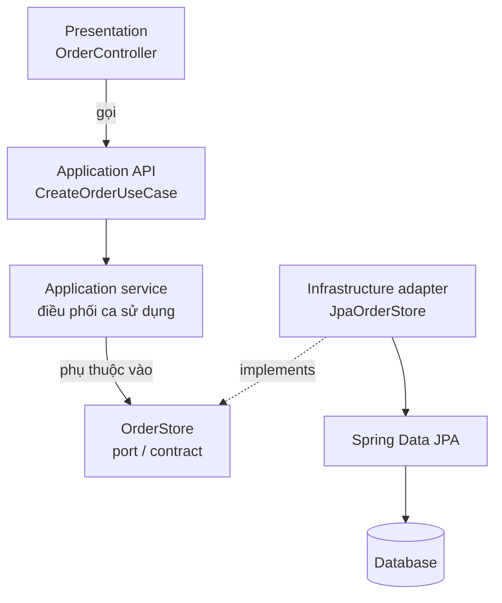

# Giới hạn API và ngăn tầng trên truy cập chi tiết triển khai của tầng dưới

> Chương: **Ranh giới và quy tắc phân tầng**

Trong module **SOFTWARE_DESIGN_ARCHITECTURE_ARCHITECTURAL_PATTERN_LAYERED**, chúng ta học cách tổ chức phần mềm theo kiến trúc phân tầng. Bài này tập trung vào một quy tắc thiết kế cụ thể: mỗi tầng chỉ công khai những thao tác mà tầng sử dụng cần biết, còn chi tiết triển khai phải được giữ bên trong tầng sở hữu chúng. Nhờ vậy, tầng phía trên có thể sử dụng một khả năng mà không phải hiểu tầng phía dưới lưu dữ liệu ra sao, dùng thư viện nào hoặc tổ chức nội bộ thế nào.

## 1. API của một tầng là gì?

Khi nghe đến API, nhiều người nghĩ ngay tới endpoint HTTP như `GET /orders`. Trong kiến trúc phân tầng, API còn có nghĩa rộng hơn: đó là **hợp đồng lập trình mà một tầng cung cấp cho tầng khác sử dụng**. Hợp đồng có thể là interface, class, method, kiểu dữ liệu đầu vào/đầu ra và quy ước lỗi.

Ví dụ, tầng Application có thể cung cấp khả năng tạo đơn hàng qua `CreateOrderUseCase`. Presentation gọi hợp đồng đó mà không cần biết ca sử dụng được thực hiện bởi class nào. Tương tự, Application có thể cần khả năng lưu đơn hàng qua một interface `OrderStore`; tầng Infrastructure cung cấp adapter hiện thực interface đó bằng JPA.

Một API của tầng nên trả lời được các câu hỏi:

- Người gọi được phép yêu cầu thao tác gì?
- Cần truyền những dữ liệu nào và nhận kết quả gì?
- Những điều kiện nào phải được đáp ứng?
- Lỗi hoặc kết quả không thành công được biểu diễn thế nào?
- Người gọi có cần biết chi tiết về framework, giao thức hay công nghệ lưu trữ không?

API là phần hợp đồng được phép phụ thuộc vào. Các class hỗ trợ, câu truy vấn, cấu trúc bảng, thuật toán nội bộ và thư viện triển khai không tự động trở thành API chỉ vì chúng đang tồn tại trong source code.

## 2. Vì sao phải giới hạn API?

Giả sử một controller gọi thẳng Spring Data repository, nhận về JPA entity rồi tự chuyển thành HTTP response. Controller khi đó biết cả endpoint, kiểu entity, cơ chế truy vấn và một phần cấu trúc lưu trữ. Nếu đổi tên cột, quan hệ entity, cách phân trang hoặc công nghệ persistence, thay đổi có thể lan lên controller và các tầng khác.

Một vấn đề khác là tầng phía trên có thể sử dụng một chi tiết nội bộ theo cách mà tầng sở hữu không dự định. Ví dụ, controller gọi một method `saveAndFlush()` chỉ vì method đó có sẵn trên `JpaRepository`, dù ca sử dụng không nên quyết định thời điểm flush. Một khi nhiều nơi phụ thuộc vào chi tiết ấy, việc thay đổi triển khai trở nên khó khăn.

Giới hạn API đem lại ba lợi ích chính:

1. **Giảm phụ thuộc:** bên gọi chỉ biết hợp đồng ổn định, không cần import các class nội bộ.
2. **Giữ quyền kiểm soát:** tầng sở hữu có thể thay đổi thuật toán, cấu trúc dữ liệu hoặc thư viện bên trong miễn là vẫn đáp ứng hợp đồng.
3. **Làm rõ trách nhiệm:** API cho thấy tầng muốn cung cấp khả năng gì; các thao tác ngoài hợp đồng được xem là không được phép từ tầng tiêu thụ.

## 3. Phân biệt hợp đồng với chi tiết triển khai

Hãy xem ví dụ lưu đơn hàng. Hợp đồng mà Application cần có thể chỉ là:

```java
package com.example.shop.application.port.out;

import com.example.shop.domain.Order;

public interface OrderStore {
    Order save(Order order);
}
```

Interface này mô tả khả năng lưu một đơn hàng bằng khái niệm của ứng dụng. Nó không nói rằng dữ liệu phải nằm trong PostgreSQL, phải dùng JPA hay phải có một bảng tên `orders`.

Infrastructure có thể hiện thực hợp đồng bằng Spring Data JPA:

```java
package com.example.shop.infrastructure.persistence;

import com.example.shop.application.port.out.OrderStore;
import com.example.shop.domain.Order;
import org.springframework.stereotype.Repository;

@Repository
public class JpaOrderStore implements OrderStore {
    private final SpringDataOrderRepository repository;

    public JpaOrderStore(SpringDataOrderRepository repository) {
        this.repository = repository;
    }

    @Override
    public Order save(Order order) {
        OrderEntity entity = OrderEntity.fromDomain(order);
        OrderEntity saved = repository.save(entity);
        return saved.toDomain();
    }
}
```

`SpringDataOrderRepository`, `OrderEntity` và cách chuyển đổi entity là chi tiết triển khai. Chúng thuộc vùng persistence của Infrastructure. Khi Application gọi `OrderStore`, nó không cần biết những class đó tồn tại.

Trong cách tổ chức này, interface được đặt ở phía cần khả năng lưu trữ (Application), còn adapter triển khai ở phía kỹ thuật (Infrastructure). Đây là cách áp dụng Dependency Inversion thường gặp. Ở dự án khác, vị trí interface có thể khác tùy quy ước và mô hình kiến trúc; điều cần giữ là hợp đồng mà tầng tiêu thụ dựa vào không bị buộc phải phụ thuộc vào API cụ thể của thư viện lưu trữ.

## 4. Không để tầng trên gọi xuyên vào chi tiết của tầng dưới

Xét ví dụ không tốt sau đây:

```java
@RestController
class OrderController {
    private final SpringDataOrderRepository repository;

    OrderController(SpringDataOrderRepository repository) {
        this.repository = repository;
    }

    @PostMapping("/orders")
    OrderEntity create(@RequestBody OrderEntity request) {
        return repository.save(request);
    }
}
```

Controller đang phụ thuộc trực tiếp vào repository Spring Data và JPA entity. Nó có thể vô tình để lộ trường persistence, quan hệ lazy, tên thuộc tính hoặc trạng thái kỹ thuật ra HTTP. Nó cũng bỏ qua nơi điều phối ca sử dụng và nơi kiểm tra quy tắc nghiệp vụ.

Một thiết kế rõ ràng hơn để Presentation gọi API của Application:

```java
package com.example.shop.application.api;

public interface CreateOrderUseCase {
    CreateOrderResult execute(CreateOrderCommand command);
}
```

```java
package com.example.shop.presentation;

@RestController
class OrderController {
    private final CreateOrderUseCase createOrder;

    OrderController(CreateOrderUseCase createOrder) {
        this.createOrder = createOrder;
    }

    @PostMapping("/orders")
    OrderResponse create(@Valid @RequestBody CreateOrderRequest request) {
        var command = new CreateOrderCommand(
            request.productId(), request.quantity());
        var result = createOrder.execute(command);
        return OrderResponse.from(result);
    }
}
```

Application cung cấp một hợp đồng hướng theo ca sử dụng. Controller chuyển dữ liệu HTTP thành command và ánh xạ kết quả thành response. Việc tìm dữ liệu, gọi quy tắc domain và lưu đơn được điều phối bên trong Application. Controller không cần gọi repository hoặc biết entity được lưu như thế nào.

Trong ví dụ này, `CreateOrderCommand` và `CreateOrderResult` là kiểu dữ liệu của hợp đồng Application. `CreateOrderRequest` và `OrderResponse` thuộc Presentation vì chúng phản ánh định dạng giao tiếp HTTP. Việc chuyển đổi giữa các kiểu dữ liệu giúp tránh để thay đổi API bên ngoài tự động lan vào mô hình nghiệp vụ.

## 5. Chọn nội dung API sao cho ổn định

Một API tốt không nhất thiết có thật nhiều interface. Nó cần đủ nhỏ để người gọi hiểu được, đồng thời đủ rõ để tầng sở hữu kiểm soát hành vi.

### Chỉ công khai thao tác mà bên gọi cần

Nếu một ca sử dụng chỉ cần lưu đơn hàng, hợp đồng có thể cung cấp `save(Order)`. Không nên đưa toàn bộ method của `JpaRepository` ra ngoài chỉ vì framework đã định nghĩa sẵn. Một API CRUD tổng quát có thể hợp lý cho một số module dữ liệu, nhưng thường quá rộng nếu được dùng làm hợp đồng cho một ca sử dụng nghiệp vụ.

### Dùng kiểu dữ liệu thuộc về hợp đồng

Tránh để API Application trả về `OrderEntity`, `EntityManager`, `JpaRepository`, `HttpServletRequest` hoặc kiểu riêng của một nhà cung cấp database. Những kiểu này kéo theo chi tiết công nghệ vào bên gọi.

Nên dùng command, result, DTO hoặc mô hình domain phù hợp với ranh giới đang thiết kế. Ví dụ, Presentation có thể nhận `OrderResponse`, Application trả về `CreateOrderResult`, còn adapter persistence chuyển đổi giữa `Order` và `OrderEntity`. Không phải mọi tầng đều cần một DTO riêng cho mọi method; chỉ tạo kiểu chuyển đổi khi nó giúp bảo vệ hợp đồng hoặc biểu diễn đúng trách nhiệm.

### Quy định rõ kết quả và lỗi

Hợp đồng nên xác định cách biểu diễn các trường hợp như không tìm thấy sản phẩm, số lượng không hợp lệ hoặc không thể tạo đơn. Có thể dùng exception nghiệp vụ, kiểu kết quả hoặc một quy ước khác nhất quán với dự án. Presentation có thể ánh xạ lỗi ứng dụng thành mã HTTP phù hợp, còn Application không nên ném trực tiếp exception đặc thù của servlet hoặc database driver qua ranh giới.

Không nên để hành vi của API phụ thuộc vào chi tiết ngầm như một method trả về `null` trong trường hợp không tìm thấy, hoặc một exception persistence bất kỳ xuất hiện từ sâu bên trong. Người gọi cần biết điều gì có thể xảy ra và phải xử lý ra sao.

### Đặt giao dịch ở nơi sở hữu ca sử dụng

Trong ứng dụng Spring, ranh giới giao dịch thường được đặt ở Application service vì đây là nơi điều phối một ca sử dụng có thể gồm nhiều thao tác. Controller không nên quyết định flush hoặc commit qua API của repository. Infrastructure thực hiện thao tác lưu trữ trong phạm vi giao dịch đã được thiết lập theo thiết kế. Một số hệ thống có yêu cầu giao dịch khác; vị trí cụ thể cần phản ánh ranh giới nhất quán dữ liệu của ca sử dụng.

## 6. Che giấu chi tiết bằng cấu trúc package và module Java

Trong Java, từ khóa `public` cho phép class hoặc method được truy cập từ nơi khác nếu package có thể được nhìn thấy; thành viên không ghi modifier có phạm vi package-private, chỉ truy cập được trong cùng package. Có thể tận dụng điều này để giữ các helper hoặc lớp triển khai ở phạm vi hẹp.

Ví dụ, trong cùng package `application.internal`, class hỗ trợ có thể để package-private:

```java
package com.example.shop.application.internal;

final class OrderPricingPolicy {
    // Chi tiết tính giá chỉ được dùng bên trong package này.
}
```

Trong khi đó, hợp đồng cần được Presentation sử dụng có thể nằm trong package API riêng và được khai báo `public`:

```java
package com.example.shop.application.api;

public interface CreateOrderUseCase {
    CreateOrderResult execute(CreateOrderCommand command);
}
```

Lưu ý rằng package con không phải package con về quyền truy cập của Java. `application.api` và `application.internal` là hai package khác nhau; package-private trong `application.internal` không thể được truy cập từ `application.api` chỉ vì tên thư mục có chung tiền tố.

Với hệ thống chia thành Java modules (JPMS), file `module-info.java` có thể chỉ `exports` package API cần công khai, đồng thời không export package triển khai:

```java
module com.example.shop.application {
    exports com.example.shop.application.api;
}
```

Module khác có thể sử dụng các kiểu được export, còn package nội bộ không được export sẽ không trở thành API công khai của module. JPMS là một cơ chế tăng cường ranh giới ở mức module; dự án không dùng JPMS vẫn có thể tổ chức package và áp dụng quy tắc truy cập bằng convention cùng kiểm tra kiến trúc.

Đổi tên package thành `internal` hoặc `impl` chỉ là tín hiệu cho người đọc, không tự động chặn truy cập. Muốn quy tắc có hiệu lực, cần kết hợp phạm vi truy cập của Java, module boundary khi phù hợp và kiểm tra phụ thuộc.

## 7. Giữ hướng phụ thuộc đúng với ranh giới API

Trong một luồng phân tầng điển hình, Presentation sử dụng API Application; Application sử dụng Domain và các hợp đồng mà nó cần; Infrastructure hiện thực những hợp đồng truy cập dữ liệu hoặc tích hợp bên ngoài. Luồng thực thi có thể đi từ Application tới adapter để đọc/ghi dữ liệu, trong khi chiều phụ thuộc mã nguồn vẫn hướng vào interface ổn định.

Sơ đồ sau minh họa sự khác nhau giữa nơi gọi hợp đồng và nơi hiện thực hợp đồng:



Mũi tên liền thể hiện lời gọi hoặc phối hợp lúc thực thi ở mức khái quát; mũi tên nét đứt thể hiện adapter hiện thực hợp đồng. Sơ đồ không yêu cầu mọi dự án phải đặt interface đúng package như ví dụ, nhưng giúp nhận ra điểm quan trọng: Application biết `OrderStore`, còn `OrderStore` không cần biết `JpaOrderStore`.

Một số quy tắc cần tránh:

- Presentation import package `infrastructure.persistence` để gọi repository trực tiếp.
- Domain import annotation hoặc class HTTP như `@RestController`, `HttpServletRequest`.
- Application trả entity JPA ra ngoài để controller tự serialize.
- Infrastructure gọi ngược vào controller hoặc phụ thuộc vào response DTO của HTTP.
- Một tầng truy cập trực tiếp vào class nội bộ của tầng khác thay vì gọi API đã công bố.

Nếu một trường hợp cần đi tắt vì lý do hiệu năng hoặc truy vấn đọc đặc thù, hãy thiết kế một API đọc riêng có mục đích rõ ràng và ghi nhận quy tắc đó. Không nên biến ngoại lệ thành quyền truy cập tự do.

## 8. Kiểm tra và duy trì ranh giới API

Ranh giới API cần được kiểm tra thường xuyên, vì một import tiện tay có thể làm mất hiệu lực thiết kế ban đầu. Có thể kết hợp nhiều cách:

| Cách kiểm tra | Có thể phát hiện điều gì? | Khi phù hợp |
|---|---|---|
| Review package và import | Tầng trên gọi class triển khai hoặc package nội bộ | Review thay đổi thường ngày |
| Kiểm tra phạm vi truy cập Java | Helper hoặc implementation bị công khai rộng không cần thiết | Khi thiết kế package và class |
| JPMS `exports` | Module khác truy cập package không được công khai | Ứng dụng chia thành Java modules |
| ArchUnit | Package vi phạm quy tắc phụ thuộc, ví dụ presentation phụ thuộc infrastructure | Dự án muốn tự động hóa quy tắc kiến trúc |
| Kiểm thử hợp đồng/integration | Adapter không đáp ứng hành vi mà interface quy định | Khi có một hoặc nhiều adapter cho cùng hợp đồng |

Ví dụ một quy tắc ArchUnit đơn giản để cấm Presentation phụ thuộc Infrastructure:

```java
@Test
void presentationMustNotDependOnInfrastructure() {
    noClasses()
        .that().resideInAPackage("..presentation..")
        .should().dependOnClassesThat()
        .resideInAPackage("..infrastructure..")
        .check(new ClassFileImporter().importPackages("com.example.shop"));
}
```

Đoạn mã minh họa ý tưởng kiểm tra package; khi áp dụng cần cấu hình đúng package gốc và phiên bản ArchUnit của dự án. Có thể bổ sung quy tắc cho Domain không phụ thuộc Presentation/Infrastructure và Application không phụ thuộc adapter cụ thể.

Nếu có nhiều adapter cùng triển khai một port, kiểm thử hợp đồng giúp xác minh chúng đáp ứng cùng một hành vi quan sát được. Chẳng hạn, một adapter JPA và một adapter giả lập trong kiểm thử đều phải lưu đơn và trả lại kết quả theo quy ước của `OrderStore`.

## 9. Những dấu hiệu API đang bị rò rỉ

Khi review một thay đổi, hãy chú ý các dấu hiệu sau:

- Một tầng phải import nhiều class từ package triển khai của tầng khác.
- Thay đổi tên cột hoặc annotation persistence lại buộc sửa controller.
- Controller phải kiểm tra trạng thái lazy loading hoặc tự khởi tạo quan hệ JPA trước khi trả response.
- Một method công khai nhận hoặc trả về kiểu dữ liệu đặc thù của framework không thuộc trách nhiệm của tầng đó.
- API cung cấp quá nhiều method nội bộ mà không có người gọi hợp lệ.
- Một tầng có thể gọi trực tiếp bất kỳ class nào ở tầng thấp hơn, khiến không thể biết hợp đồng nào được hỗ trợ.

Khi gặp các dấu hiệu này, hãy lần theo người gọi và lý do họ cần dữ liệu. Sau đó xác định thao tác thực sự cần công khai, chọn kiểu dữ liệu phù hợp với hợp đồng, chuyển phần chuyển đổi hoặc điều phối về tầng sở hữu trách nhiệm và bổ sung quy tắc kiểm tra để ngăn phụ thuộc quay trở lại.

## Ghi nhớ

- API của tầng là hợp đồng lập trình giữa các tầng, bao gồm thao tác, kiểu dữ liệu và quy ước hành vi.
- Tầng trên chỉ nên phụ thuộc vào API được công bố; implementation, entity persistence, câu truy vấn và helper là chi tiết nội bộ.
- Dùng interface, kiểu dữ liệu theo hợp đồng, phạm vi truy cập Java và package/module boundary để giới hạn phần được nhìn thấy.
- Với Spring, controller nên gọi API của Application; Application làm việc qua hợp đồng cần thiết; adapter Infrastructure hiện thực hợp đồng bằng công nghệ cụ thể.
- Convention đặt tên `internal` chưa đủ để cưỡng chế ranh giới. Có thể dùng JPMS, ArchUnit và kiểm thử hợp đồng để duy trì quy tắc.
- Chỉ công khai điều bên gọi cần và giữ rõ hành vi lỗi, dữ liệu vào/ra cùng trách nhiệm giao dịch.
