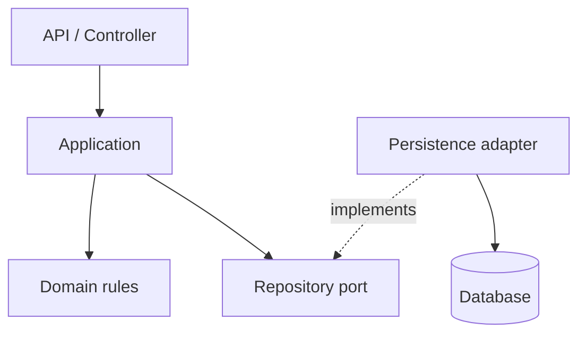

# Tổ chức package theo tầng hoặc theo tính năng có phân tầng bên trong

Trong kiến trúc phân tầng, việc xác định trách nhiệm của từng phần mới chỉ là một nửa công việc. Ta còn cần chọn cách sắp xếp các lớp và interface trong package để người đọc tìm được mã liên quan, thay đổi một tính năng mà ít ảnh hưởng đến phần khác, và giữ được hướng phụ thuộc mong muốn.

Bài học này thuộc module `SOFTWARE_DESIGN_ARCHITECTURE_ARCHITECTURAL_PATTERN_LAYERED` — học cách tổ chức phần mềm theo kiến trúc phân tầng. Trong chương **Ranh giới và quy tắc phân tầng**, ta tập trung vào hai cách bố trí package phổ biến: gom mã theo tầng kỹ thuật, hoặc gom theo tính năng rồi chia các tầng bên trong từng tính năng. Không có cách nào luôn đúng cho mọi dự án; lựa chọn nên phản ánh quy mô, cách nhóm công việc và ranh giới cần bảo vệ.

## Package theo tầng là gì?

Với cách tổ chức theo tầng (layer-first), package cấp cao nhất thường biểu thị loại trách nhiệm kỹ thuật. Ví dụ một ứng dụng cửa hàng có thể được bố trí như sau:

```text
com.example.shop
├── controller
│   ├── OrderController.java
│   └── ProductController.java
├── application
│   ├── OrderService.java
│   └── ProductService.java
├── domain
│   ├── Order.java
│   ├── Product.java
│   └── PricingPolicy.java
├── repository
│   ├── OrderRepository.java
│   └── ProductRepository.java
└── persistence
    ├── JpaOrderRepository.java
    └── JpaProductRepository.java
```

Nhìn vào tên package, người đọc nhận ra `controller` chứa thành phần giao tiếp với HTTP, `application` điều phối ca sử dụng, `domain` giữ mô hình và quy tắc bài toán, còn `persistence` chứa phần triển khai lưu trữ. Đây là cách tiếp cận dễ hiểu khi ứng dụng nhỏ, số tính năng chưa nhiều và các thành phần cùng tầng thường được thay đổi hoặc xem xét cùng nhau.

Tuy nhiên, khi số tính năng tăng lên, mỗi package có thể trở thành một danh sách dài chứa mã của nhiều khu vực nghiệp vụ. Muốn lần theo luồng tạo đơn hàng, người đọc phải chuyển qua `controller`, `application`, `domain`, `repository` và `persistence`, rồi phân biệt lớp nào thuộc đơn hàng, lớp nào thuộc sản phẩm. Các lớp của một tính năng bị trải rộng theo loại kỹ thuật.

## Package theo tính năng là gì?

Với cách tổ chức theo tính năng (feature-first), package cấp cao nhất biểu thị khu vực nghiệp vụ hoặc khả năng của hệ thống. Những thành phần phục vụ cùng một tính năng được đặt gần nhau:

```text
com.example.shop
├── orders
│   ├── OrderController.java
│   ├── PlaceOrderService.java
│   ├── Order.java
│   └── OrderRepository.java
├── catalog
│   ├── ProductController.java
│   ├── ProductQueryService.java
│   ├── Product.java
│   └── ProductRepository.java
└── customers
    ├── CustomerController.java
    ├── CustomerService.java
    ├── Customer.java
    └── CustomerRepository.java
```

Khi cần thay đổi luồng đặt hàng, phần lớn mã liên quan có thể tìm thấy trong `orders`. Cách bố trí này làm nổi bật các khu vực chức năng và có thể giảm việc phải di chuyển giữa nhiều package kỹ thuật.

Nhưng gom theo tính năng không có nghĩa là bỏ qua ranh giới tầng. Nếu `OrderController`, `Order`, và mã JPA đều nằm lẫn trong một package lớn, trách nhiệm vẫn có thể bị trộn. Khi tính năng phát triển, package `orders` cũng có thể trở thành nơi chứa quá nhiều lớp và khó phân biệt phần giao diện, điều phối, nghiệp vụ với lưu trữ.

## Kết hợp: theo tính năng, phân tầng bên trong

Một cách kết hợp thường hữu ích là đặt tính năng ở cấp package bên ngoài, rồi chia các trách nhiệm bên trong tính năng đó. Ví dụ:

```text
com.example.shop
├── orders
│   ├── api
│   │   ├── OrderController.java
│   │   ├── CreateOrderRequest.java
│   │   └── OrderResponse.java
│   ├── application
│   │   ├── PlaceOrderService.java
│   │   └── PlaceOrderCommand.java
│   ├── domain
│   │   ├── Order.java
│   │   ├── OrderLine.java
│   │   ├── PricingPolicy.java
│   │   └── OrderRepository.java
│   └── infrastructure
│       ├── JpaOrderRepositoryAdapter.java
│       ├── OrderJpaEntity.java
│       └── SpringDataOrderJpaRepository.java
├── catalog
│   ├── api
│   ├── application
│   ├── domain
│   └── infrastructure
└── customers
    ├── api
    ├── application
    ├── domain
    └── infrastructure
```

Ở đây, `orders` là ranh giới theo tính năng; `api`, `application`, `domain` và `infrastructure` biểu thị các trách nhiệm bên trong. Một luồng đặt hàng có thể được lần theo trong cùng khu vực, trong khi chi tiết kỹ thuật vẫn có vị trí rõ ràng.

Không bắt buộc mỗi tính năng phải có đủ bốn package con. Một tính năng chỉ đọc dữ liệu đơn giản có thể chưa cần package `domain` riêng; một tính năng nhỏ có thể chỉ có `api` và `application`. Chỉ tạo package khi nó giúp biểu đạt ranh giới hoặc gom nhóm mã có ý nghĩa, tránh tạo thư mục rỗng để làm đẹp sơ đồ.

## Hướng phụ thuộc quan trọng hơn tên package

Tên package không tự động bảo đảm kiến trúc đúng. Điều cần giữ là quy tắc phụ thuộc giữa các trách nhiệm. Trong một cách tổ chức điển hình:



Controller nhận dữ liệu giao thức và gọi ca sử dụng. Application điều phối công việc và dùng các abstraction cần thiết. Domain giữ quy tắc của bài toán. Adapter hạ tầng thực hiện thao tác lưu trữ theo hợp đồng mà application hoặc domain cần. Khi dùng dependency injection, Spring có thể nối implementation với interface trong lúc khởi tạo ứng dụng.

Ví dụ, interface lưu đơn hàng có thể được khai báo ở phía trong:

```java
package com.example.shop.orders.domain;

public interface OrderRepository {
    void save(Order order);
}
```

Application service sử dụng hợp đồng đó:

```java
package com.example.shop.orders.application;

import com.example.shop.orders.domain.Order;
import com.example.shop.orders.domain.OrderRepository;
import org.springframework.stereotype.Service;
import org.springframework.transaction.annotation.Transactional;

@Service
public class PlaceOrderService {
    private final OrderRepository orders;

    public PlaceOrderService(OrderRepository orders) {
        this.orders = orders;
    }

    @Transactional
    public void place(Order order) {
        order.confirm();
        orders.save(order);
    }
}
```

Adapter ở package hạ tầng triển khai interface bằng công nghệ lưu trữ cụ thể:

```java
package com.example.shop.orders.infrastructure;

import com.example.shop.orders.domain.Order;
import com.example.shop.orders.domain.OrderRepository;
import org.springframework.stereotype.Repository;

@Repository
class JpaOrderRepositoryAdapter implements OrderRepository {
    private final SpringDataOrderJpaRepository jpa;

    JpaOrderRepositoryAdapter(SpringDataOrderJpaRepository jpa) {
        this.jpa = jpa;
    }

    @Override
    public void save(Order order) {
        jpa.save(OrderJpaEntity.from(order));
    }
}
```

Các kiểu `SpringDataOrderJpaRepository` và `OrderJpaEntity` đại diện cho chi tiết JPA của ví dụ. Điểm chính là mã nghiệp vụ sử dụng hợp đồng `OrderRepository`; implementation biết cách ánh xạ và lưu bằng JPA. Nhờ đó, thay đổi công nghệ lưu trữ không buộc quy tắc đơn hàng phải phụ thuộc vào API của ORM.

Trong Java, package và modifier còn hỗ trợ kiểm soát khả năng truy cập. Có thể giữ lớp triển khai hoặc helper ở mức package-private khi không cần công khai ra ngoài package. Chỉ mở `public` cho các kiểu thực sự là điểm sử dụng giữa các package. Cách này giúp giảm số API nội bộ mà các phần khác có thể vô tình phụ thuộc.

## So sánh hai cách bố trí

| Tiêu chí | Theo tầng | Theo tính năng, có thể phân tầng bên trong |
|---|---|---|
| Tìm mã của một tính năng | Có thể phải đi qua nhiều package tầng | Thường tập trung trong package của tính năng |
| Nhìn tổng thể trách nhiệm kỹ thuật | Dễ thấy tất cả controller, service hoặc repository cùng loại | Cần nhìn vào cấu trúc con của từng tính năng |
| Thay đổi tập trung vào một tính năng | Có thể chạm nhiều package kỹ thuật | Thường giới hạn trong một khu vực tính năng hơn |
| Tái sử dụng thành phần chung | Dễ nhận ra các thành phần kỹ thuật dùng chung, nhưng dễ tạo package chung quá rộng | Cần xác định rõ phần nào thật sự dùng chung giữa các tính năng |
| Nguy cơ khi dự án lớn | Package theo tầng phình to và chứa nhiều miền nghiệp vụ | Package tính năng phình to hoặc lặp lại cấu trúc nếu ranh giới không rõ |

Đây là xu hướng, không phải bảo đảm. Một dự án theo tầng vẫn có thể dễ điều hướng nếu số tính năng ít và quy ước đặt tên tốt. Một dự án theo tính năng vẫn có thể rối nếu package không có ranh giới rõ hoặc phụ thuộc chéo tùy tiện.

## Chọn cách tổ chức theo bối cảnh

Với ứng dụng nhỏ, ít tính năng và nhóm phát triển quen làm việc theo lớp kỹ thuật, package theo tầng thường đủ đơn giản. Khi ứng dụng có nhiều khu vực nghiệp vụ độc lập, nhiều nhóm cùng thay đổi các tính năng khác nhau, package theo tính năng giúp gom mã và quyền sở hữu gần với công việc hơn. Khi mỗi tính năng có nhiều quy tắc và chi tiết kỹ thuật, chia tầng bên trong tính năng giúp giữ cả hai góc nhìn.

Một số câu hỏi hữu ích trước khi quyết định:

1. Khi sửa một tính năng, người phát triển thường phải mở những package nào? Các lớp liên quan có nằm gần nhau không?
2. Có thể xác định rõ thành phần nào được phép gọi thành phần nào không? Có package phụ thuộc vòng hoặc gọi xuyên vào chi tiết nội bộ của tính năng khác không?
3. Thành phần nào thật sự dùng chung? Có thể đặt hợp đồng ổn định ở một vị trí chung, hay chỉ đang gom mã vào `common`, `utils` hoặc `shared` vì chưa biết đặt ở đâu?
4. Cấu trúc hiện tại có giúp kiểm thử độc lập quy tắc nghiệp vụ và kiểm thử tích hợp adapter không?

Tránh tạo một package `common` chứa mọi thứ. Một thành phần chỉ nên được đưa ra dùng chung khi có nhiều bên sử dụng và ý nghĩa của nó ổn định. Nếu hai tính năng có khái niệm cùng tên nhưng quy tắc khác nhau, giữ chúng trong từng tính năng có thể rõ ràng hơn việc ép chúng dùng chung một lớp.

## Giữ ranh giới package bằng quy ước và kiểm tra

Package chỉ là một cơ chế tổ chức mã nguồn; nó không tự ngăn được một controller gọi thẳng `EntityManager` hoặc một domain object phụ thuộc vào `HttpServletRequest`. Nhóm phát triển cần thống nhất quy tắc phụ thuộc và kiểm tra chúng trong quá trình phát triển.

Ví dụ, có thể đặt các quy ước như sau:

- `api` gọi `application`, không gọi trực tiếp adapter lưu trữ.
- `application` điều phối ca sử dụng và phụ thuộc vào abstraction cần thiết.
- `domain` không phụ thuộc vào controller, HTTP hoặc chi tiết JPA.
- `infrastructure` có thể phụ thuộc vào hợp đồng bên trong để cung cấp implementation.
- Một tính năng chỉ truy cập phần công khai mà tính năng khác cho phép; không đọc trực tiếp các lớp nội bộ của nó.

Các quy tắc này có thể được kiểm tra bằng review, kiểm thử kiến trúc với thư viện như ArchUnit, hoặc bằng ranh giới module trong hệ thống build khi cần mức cô lập mạnh hơn. Ví dụ một quy tắc ArchUnit có thể xác nhận package domain không phụ thuộc vào package api hoặc infrastructure. Cấu trúc thư mục đẹp mà không có quy tắc phụ thuộc vẫn có thể dần trở thành một khối mã kết nối chặt.

Trong Spring Boot, đặt lớp `@SpringBootApplication` ở package gốc như `com.example.shop` thường giúp component scan bao phủ các package tính năng bên dưới. Nếu đặt lớp khởi động quá sâu, một số controller hoặc adapter có thể nằm ngoài phạm vi quét mặc định; khi đó cần điều chỉnh package hoặc cấu hình scan có chủ đích.

Cuối cùng, tổ chức package không quyết định ứng dụng phải chạy thành bao nhiêu tiến trình hay máy chủ. Các package `orders`, `catalog` và `customers` có thể cùng nằm trong một ứng dụng Spring Boot. Tách package theo tính năng giúp biểu đạt ranh giới logic; tách thành module build hoặc dịch vụ triển khai là quyết định bổ sung khi nhu cầu độc lập, quy mô nhóm hoặc vận hành thực sự yêu cầu.
