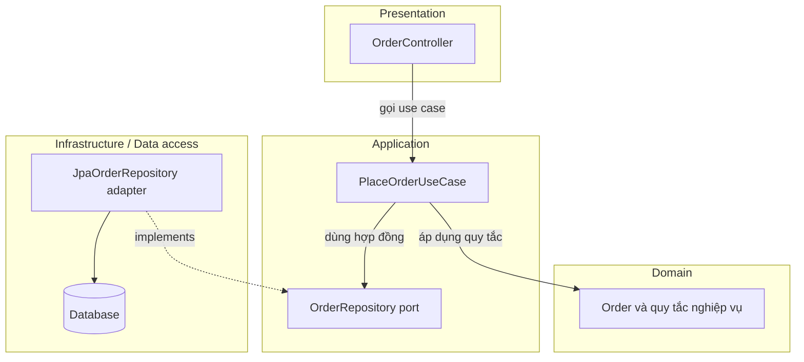
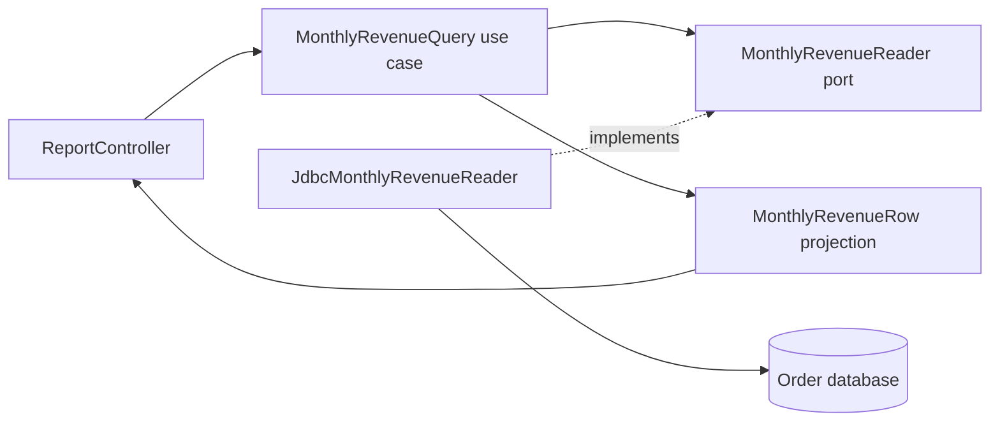

# Mô tả ranh giới, ngoại lệ kiến trúc bằng sơ đồ và bản ghi quyết định ADR

Kiến trúc phân tầng chỉ có ý nghĩa khi nhóm phát triển hiểu phần nào chịu trách nhiệm cho việc gì và những phần nào được phép phụ thuộc hoặc gọi nhau. Các quy tắc đó tạo thành **ranh giới kiến trúc**. Khi một yêu cầu đặc biệt buộc hệ thống đi khác quy tắc thông thường, nhóm cần mô tả ngoại lệ, lý do và giới hạn của nó để người đọc mã nguồn hiểu đây là quyết định có chủ đích.

Hai công cụ hữu ích là **sơ đồ kiến trúc** và **Architecture Decision Record (ADR)**. Sơ đồ cho thấy các thành phần, quan hệ và đường đi được phép. ADR ghi lại bối cảnh, quyết định, phương án đã cân nhắc và hệ quả. Chúng bổ sung cho nhau: sơ đồ giúp nhìn cấu trúc nhanh, còn ADR giải thích tại sao cấu trúc đó được chọn và khi nào cần xem xét lại.

## 1. Xác định ranh giới trước khi vẽ

Một tầng nên có trách nhiệm đủ rõ để ta có thể trả lời ba câu hỏi:

- Tầng này sở hữu loại quyết định và dữ liệu nào?
- Tầng này được phép gọi hoặc phụ thuộc vào những thành phần nào?
- Tầng này phải cung cấp hợp đồng gì cho thành phần khác?

Với ứng dụng Java/Spring có thể dùng các tầng logic sau làm điểm xuất phát:

| Tầng | Trách nhiệm chính | Ví dụ thành phần | Điều cần tránh |
|---|---|---|---|
| Presentation | Giao tiếp với người dùng hoặc client; chuyển đổi HTTP, giao diện và thông điệp | Spring MVC Controller, request/response DTO | Chứa quy tắc nghiệp vụ hoặc truy vấn SQL |
| Application | Điều phối use case, kiểm soát luồng công việc và ranh giới giao dịch | Application service, command/query handler | Trở thành nơi chứa mọi quy tắc domain hoặc phụ thuộc trực tiếp vào chi tiết hạ tầng |
| Domain | Mô hình hóa khái niệm, hành vi và bất biến nghiệp vụ | Entity, value object, domain service | Phụ thuộc vào HTTP, Spring Data hoặc cấu trúc bảng |
| Infrastructure / Data access | Kết nối công nghệ bên ngoài và chuyển đổi dữ liệu | JPA/JDBC adapter, message broker adapter | Để chi tiết lưu trữ rò rỉ lên các tầng nghiệp vụ |

Đây là một cách chia trách nhiệm phổ biến, không phải số tầng bắt buộc cho mọi hệ thống. Ứng dụng nhỏ có thể gộp một số phần khi ranh giới vẫn dễ hiểu; hệ thống lớn có thể tách thêm các module hoặc adapter. Điều quan trọng là quy tắc phụ thuộc phải phù hợp với thiết kế đã chọn và được áp dụng nhất quán.

### Luồng gọi và hướng phụ thuộc

Khi chạy, một yêu cầu có thể đi từ controller đến application service, rồi tới domain và adapter dữ liệu. Tuy nhiên, hướng phụ thuộc trong mã nguồn có thể khác hướng gọi ở thời gian chạy. Ví dụ, application định nghĩa `OrderRepository` như một cổng (port); adapter JPA ở hạ tầng triển khai giao diện đó. Application chỉ biết hợp đồng, không biết `JpaRepository` hay tên bảng.



Mũi tên liền mô tả quan hệ sử dụng hoặc luồng xử lý ở mức khái quát; mũi tên nét đứt mô tả adapter triển khai port. Khi viết sơ đồ cho một dự án cụ thể, cần ghi rõ loại quan hệ đang biểu diễn. Tránh dùng một mũi tên chung chung cho cả phụ thuộc mã nguồn, lời gọi lúc chạy và luồng dữ liệu vì người đọc có thể hiểu sai.

## 2. Viết quy tắc ranh giới có thể kiểm tra được

Một quy tắc như “các tầng phải tách biệt” quá mơ hồ để review. Hãy diễn đạt bằng điều kiện có thể kiểm tra, ví dụ:

1. Controller chỉ phụ thuộc vào hợp đồng application; không import repository của hạ tầng.
2. Application được gọi domain và các port mà use case cần; không phụ thuộc vào `EntityManager`, `JdbcTemplate` hoặc HTTP request.
3. Domain không phụ thuộc vào Spring, web framework hay thư viện lưu trữ.
4. Infrastructure triển khai port và được phép phụ thuộc vào công nghệ ngoài như Spring Data JPA hoặc JDBC.
5. Truy vấn đọc có thể trả projection chuyên biệt nếu đi qua hợp đồng application đã công bố và vẫn thực thi xác thực, phân quyền, quy tắc dữ liệu cần thiết.

Quy tắc cần nói rõ phạm vi: áp dụng cho toàn module hay một luồng cụ thể, áp dụng lúc biên dịch hay lúc chạy, và ai chịu trách nhiệm duy trì. Ví dụ “controller không truy cập database” có thể kiểm tra qua package dependency hoặc review import; “mọi thay đổi đơn hàng phải kiểm tra trạng thái hợp lệ” cần được bảo vệ bằng mô hình nghiệp vụ và kiểm thử.

### Phân tầng đóng và phân tầng mở

Trong **closed layering**, tầng chỉ được gọi tầng ngay bên dưới theo thứ tự đã định. Controller gọi application; application gọi domain hoặc port cần thiết. Chính sách này tạo luồng dễ lần theo và giới hạn việc bỏ qua trách nhiệm trung gian.

Trong **open layering**, một tầng có thể gọi xuyên qua tầng trung gian để sử dụng một khả năng được công bố ở tầng thấp hơn. Ví dụ, application có thể dùng một query service chuyên biệt để đọc projection thay vì dựng đầy đủ aggregate. Cách này có thể hữu ích, nhưng cần định nghĩa rõ thành phần nào được gọi xuyên tầng và vì sao. “Open” không có nghĩa mọi package đều được phép import lẫn nhau.

Chọn closed hay open là quyết định thiết kế theo nhu cầu. Nếu nhóm không ghi rõ chính sách, mỗi lập trình viên có thể tự diễn giải khác nhau, dẫn tới một số controller truy cập repository trực tiếp, một số khác đi qua use case, còn quy tắc nghiệp vụ bị phân tán.

## 3. Khi nào một ngoại lệ là hợp lý?

Ngoại lệ là một trường hợp cụ thể không tuân theo quy tắc mặc định vì có lý do kỹ thuật hoặc nghiệp vụ đáng kể. Nó cần có chủ sở hữu, phạm vi và giới hạn rõ ràng. Ngoại lệ không nên trở thành cách né tránh việc thiết kế hợp đồng.

Giả sử ứng dụng bán hàng có màn hình báo cáo doanh thu theo tháng. Luồng ghi đơn hàng sử dụng domain model để bảo vệ các bất biến. Nhưng báo cáo cần tổng hợp hàng triệu dòng dữ liệu, chỉ lấy một số cột và nhóm theo tháng. Tải toàn bộ aggregate đơn hàng vào bộ nhớ để tính báo cáo có thể tốn tài nguyên và chậm. Nhóm có thể quyết định dùng một truy vấn SQL tối ưu trả về projection chỉ đọc.

Ngoại lệ này có thể chấp nhận nếu:

- Truy vấn vẫn được gọi thông qua một query use case hoặc hợp đồng do application công bố.
- Adapter dữ liệu chịu trách nhiệm SQL và ánh xạ kết quả; controller không tự chạy truy vấn.
- Quyền xem báo cáo, phạm vi tenant và bộ lọc dữ liệu vẫn được kiểm tra.
- Kết quả chỉ phục vụ đọc; nó không được dùng để thay đổi trạng thái đơn hàng hoặc bỏ qua bất biến khi ghi.
- Có kiểm thử hiệu năng và kiểm thử tính đúng của kết quả, đồng thời ghi lại giới hạn của ngoại lệ.



Ở đây application vẫn sở hữu hợp đồng `MonthlyRevenueReader`; adapter triển khai hợp đồng bằng JDBC. Projection chỉ chứa các trường báo cáo cần thiết. Ngoại lệ nằm ở cách đọc dữ liệu: nó bỏ qua việc nạp đầy đủ aggregate domain cho truy vấn tổng hợp. Nó không cho phép controller gọi thẳng JDBC, cũng không thay đổi quy tắc của luồng ghi đơn hàng.

Ví dụ hợp đồng ở phía application:

```java
public interface MonthlyRevenueReader {
    List<MonthlyRevenueRow> findByPeriod(
            TenantId tenantId, YearMonth from, YearMonth to);
}

public record MonthlyRevenueRow(
        YearMonth month,
        BigDecimal revenue,
        long orderCount) {}
```

Application query service kiểm tra quyền và gọi port:

```java
@Service
class MonthlyRevenueQueryService {
    private final MonthlyRevenueReader reader;

    MonthlyRevenueQueryService(MonthlyRevenueReader reader) {
        this.reader = reader;
    }

    @PreAuthorize("hasAuthority('REPORT_READ')")
    public List<MonthlyRevenueRow> handle(
            TenantId tenantId, YearMonth from, YearMonth to) {
        if (from.isAfter(to)) {
            throw new InvalidReportPeriodException();
        }
        return reader.findByPeriod(tenantId, from, to);
    }
}
```

Đoạn mã là minh họa; cách áp dụng phân quyền có thể nằm ở Spring Security, application service hoặc cả hai. Điều cốt yếu là `tenantId` phải đến từ ngữ cảnh đã xác thực và được kiểm tra theo chính sách của hệ thống, không tin một giá trị tùy ý từ request. Adapter JDBC cần bind tham số truy vấn an toàn, lọc đúng tenant và chỉ trả dữ liệu mà người gọi được phép xem.

Một ngoại lệ không hợp lý là thêm `JdbcTemplate` vào controller vì “viết nhanh hơn”. Cách đó trộn giao thức HTTP với truy cập dữ liệu, bỏ qua hợp đồng application và khiến quy tắc bảo mật khó kiểm soát. Nếu nhiều màn hình cần cùng một kiểu truy vấn, hãy tạo một query service hoặc module đọc có trách nhiệm rõ ràng thay vì sao chép ngoại lệ.

## 4. Sử dụng sơ đồ để công bố quyết định

Sơ đồ tốt phải trả lời được câu hỏi của người đọc, không chỉ trang trí tài liệu. Tùy mục tiêu, có thể dùng:

| Loại sơ đồ | Dùng để trả lời | Nội dung nên thể hiện |
|---|---|---|
| Sơ đồ tầng / module | Hệ thống gồm những phần nào? | Tên tầng, module, trách nhiệm và ranh giới |
| Sơ đồ phụ thuộc | Mã nguồn được phép phụ thuộc theo hướng nào? | Mũi tên dependency, port và adapter |
| Sơ đồ luồng gọi | Một use case đi qua những thành phần nào lúc chạy? | Thứ tự gọi, dữ liệu vào/ra và điểm giao tiếp |
| Sơ đồ ngoại lệ | Ngoại lệ khác quy tắc mặc định ở đâu? | Đường đi bình thường, đường đi ngoại lệ và phạm vi áp dụng |

Với sơ đồ có ngoại lệ, nên vẽ cả đường đi chuẩn và đường đi ngoại lệ. Dùng nhãn như “read-only projection”, “chỉ module báo cáo” hoặc “không dùng cho lệnh ghi” để người xem nhận ra giới hạn. Đặt tên thành phần giống tên package, module hoặc interface trong mã nguồn giúp sơ đồ có thể đối chiếu khi review.

Không nên vẽ mọi class hoặc mọi method vào sơ đồ kiến trúc cấp cao. Chi tiết quá mức làm sơ đồ nhanh lỗi thời. Chỉ đưa vào các thành phần và quan hệ cần thiết để giải thích ranh giới, rồi liên kết sơ đồ với mã nguồn hoặc tài liệu chi tiết nếu dự án có quy ước đó.

## 5. Ghi lại ngoại lệ bằng Architecture Decision Record (ADR)

ADR là một bản ghi ngắn, có cấu trúc, mô tả một quyết định kiến trúc quan trọng. ADR giúp người đến sau hiểu bối cảnh tại thời điểm quyết định, thay vì chỉ thấy một đoạn mã có vẻ đi ngược quy tắc. Một ADR hữu ích thường có các phần:

- **Tiêu đề và mã định danh:** tên ngắn, duy nhất trong phạm vi dự án.
- **Trạng thái:** Proposed, Accepted, Rejected, Superseded hoặc trạng thái tương đương theo quy ước nhóm.
- **Bối cảnh:** vấn đề, ràng buộc và bằng chứng khiến nhóm cần quyết định.
- **Quyết định:** lựa chọn cụ thể, phạm vi và cách thực hiện.
- **Phương án đã cân nhắc:** các lựa chọn chính cùng lý do không chọn.
- **Hệ quả:** lợi ích, chi phí, rủi ro và trách nhiệm phát sinh.
- **Ràng buộc / kiểm soát:** điều kiện phải giữ để ngoại lệ không lan rộng.
- **Điều kiện xem xét lại:** số liệu hoặc thay đổi nào khiến nhóm cần đánh giá quyết định lần nữa.

### ADR mẫu: dùng projection JDBC cho báo cáo doanh thu

Ví dụ dưới đây là ADR minh họa cho tình huống báo cáo ở trên. Mã định danh và tên module chỉ nhằm minh họa cách ghi; dự án thực tế cần theo quy ước lưu ADR của chính mình.

```markdown
# ADR-007: Đọc báo cáo doanh thu bằng projection JDBC

- Status: Accepted
- Scope: Reporting / monthly revenue query

## Context

Màn hình báo cáo doanh thu cần tổng hợp số lượng lớn đơn hàng theo tháng.
Nạp đầy đủ Order aggregate gây thêm truy vấn, cấp phát bộ nhớ và độ trễ.
Luồng ghi đơn hàng hiện tại vẫn cần domain model để bảo vệ bất biến.

## Decision

Tạo MonthlyRevenueQueryService trong application và
MonthlyRevenueReader port do application sở hữu.
Infrastructure triển khai port bằng JDBC và trả projection chỉ đọc.
ReportController chỉ gọi query use case.

## Alternatives considered

1. Nạp mọi Order aggregate rồi tổng hợp trong Java:
   giữ cách đọc thống nhất nhưng chi phí bộ nhớ và thời gian cao.
2. Controller chạy SQL trực tiếp:
   ít lớp hơn nhưng phá vỡ ranh giới presentation/application.
3. Tạo bản sao dữ liệu báo cáo bất đồng bộ:
   có thể mở rộng tốt hơn nhưng thêm độ trễ đồng bộ và vận hành.

## Consequences

- Truy vấn đọc có thể tối ưu theo cơ sở dữ liệu và chỉ lấy cột cần thiết.
- Cần duy trì projection và kiểm thử SQL khi schema thay đổi.
- Dữ liệu báo cáo có thể phản ánh trạng thái tại thời điểm truy vấn;
  yêu cầu nhất quán mạnh hơn cần được đánh giá riêng.

## Constraints

- Chỉ áp dụng cho truy vấn báo cáo read-only đã được phê duyệt.
- Controller không được phụ thuộc vào JDBC hoặc repository adapter.
- Mọi truy vấn phải giới hạn tenant và tuân theo phân quyền báo cáo.
- Không sử dụng projection để thực hiện cập nhật đơn hàng.
- Integration test xác nhận phép tổng hợp và tenant isolation.

## Revisit when

- Báo cáo cần dữ liệu gần thời gian thực với tải tăng đáng kể.
- Độ trễ hoặc chi phí truy vấn vượt ngưỡng vận hành đã thống nhất.
- Schema hoặc yêu cầu nhất quán khiến cách đọc hiện tại không còn phù hợp.
```

ADR này ghi quyết định, không thay thế tài liệu API hay đặc tả SQL. Nếu quyết định thay đổi, tạo ADR mới tham chiếu ADR cũ và chuyển trạng thái bản ghi cũ thành `Superseded`; không âm thầm sửa lịch sử để làm như quyết định cũ chưa từng tồn tại. Với quyết định đang được đề xuất, để trạng thái `Proposed` cho tới khi người hoặc nhóm có thẩm quyền chấp thuận.

## 6. Đưa ranh giới và ADR vào quy trình phát triển

Để tài liệu có tác dụng, nhóm cần gắn nó với hoạt động kỹ thuật thường ngày:

1. **Khi tạo module hoặc use case:** xác định tầng sở hữu trách nhiệm, hợp đồng được công bố và dependency được phép.
2. **Khi phát sinh nhu cầu đi khác quy tắc:** mô tả vấn đề, đo hoặc nêu bằng chứng, xác định phạm vi nhỏ nhất của ngoại lệ và các phương án khác.
3. **Trước khi chấp nhận:** vẽ sơ đồ thể hiện đường đi chuẩn và ngoại lệ; viết ADR để ghi quyết định, hệ quả và biện pháp kiểm soát.
4. **Khi triển khai:** đặt interface và adapter đúng module; thêm kiểm thử để bảo vệ quy tắc ranh giới và hành vi ngoại lệ.
5. **Khi review hoặc thay đổi:** kiểm tra mã nguồn còn khớp sơ đồ và ADR không; cập nhật trạng thái hoặc tạo ADR thay thế khi quyết định đổi.

Có thể tự động kiểm tra một phần ranh giới bằng package-by-feature, module system hoặc công cụ phân tích dependency. Ví dụ, ArchUnit có thể kiểm tra domain không phụ thuộc package controller hay Spring Data. Những công cụ này giúp phát hiện vi phạm cấu trúc, nhưng không tự quyết định một ngoại lệ có hợp lý về nghiệp vụ hay hiệu năng; phần đó vẫn cần review và bằng chứng.

Ví dụ kiểm tra hướng phụ thuộc bằng ArchUnit:

```java
@AnalyzeClasses(packages = "com.example.orders")
class LayerDependencyTest {
    @ArchTest
    static final ArchRule domainMustNotDependOnWebOrPersistence =
            noClasses().that().resideInAPackage("..domain..")
                    .should().dependOnClassesThat()
                    .resideInAnyPackage("..presentation..", "..infrastructure..",
                            "org.springframework.data..",
                            "jakarta.persistence..");
}
```

Tên package và cấu hình ArchUnit cần khớp với dự án. Nếu một ngoại lệ được chấp nhận, nên giới hạn nó ở package hoặc module cụ thể và có kiểm thử riêng; tránh nới lỏng quy tắc toàn cục chỉ để một trường hợp vượt qua.

## 7. Đánh giá chất lượng của một ngoại lệ

Trước khi chấp nhận, hãy kiểm tra các câu hỏi sau:

| Câu hỏi | Dấu hiệu quyết định tốt |
|---|---|
| Vấn đề có thật và có bằng chứng không? | Có yêu cầu nghiệp vụ, số liệu hiệu năng, giới hạn công nghệ hoặc ràng buộc vận hành cụ thể |
| Phạm vi ngoại lệ có nhỏ không? | Chỉ một use case, module hoặc kiểu truy vấn cần thiết |
| Hợp đồng có còn rõ không? | Thành phần gọi qua interface hoặc API có chủ sở hữu |
| Quy tắc bảo mật và nghiệp vụ có được giữ không? | Xác thực, phân quyền, tenant isolation và bất biến vẫn được bảo vệ |
| Có thể kiểm thử không? | Có unit, integration hoặc architecture test phù hợp |
| Có thể quay lại quy tắc chuẩn không? | Có điều kiện xem xét lại và phương án thay thế |

Nếu một ngoại lệ được dùng lặp lại ở nhiều nơi, đó có thể là tín hiệu quy tắc phân tầng ban đầu cần điều chỉnh. Khi ấy, hãy đánh giá lại kiến trúc nền, cập nhật sơ đồ và ghi ADR mới để công bố quy tắc mới. Không nên giữ vô số ngoại lệ nhỏ mà không xem xét liệu chúng đã trở thành một mẫu thiết kế phổ biến của hệ thống.

## Kết luận

Ranh giới kiến trúc cần được diễn đạt thành trách nhiệm, hợp đồng và hướng phụ thuộc có thể kiểm tra. Sơ đồ làm rõ cấu trúc và đường đi; ADR ghi lại lý do, phạm vi và hệ quả của một quyết định, đặc biệt khi hệ thống cần ngoại lệ. Khi ngoại lệ được giới hạn, kiểm thử và xem xét lại theo điều kiện cụ thể, nhóm có thể đáp ứng nhu cầu thực tế mà vẫn giữ kiến trúc dễ hiểu và có khả năng thay đổi.
