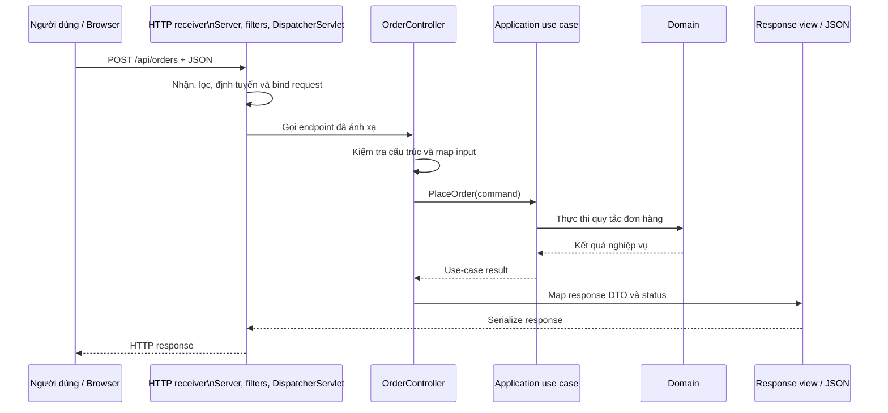
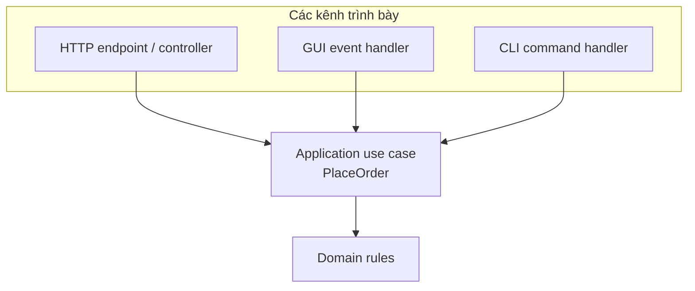

# Vai trò của controller, view và bộ tiếp nhận HTTP, GUI hoặc CLI

Bài học này thuộc chương **Tầng trình bày** của module `SOFTWARE_DESIGN_ARCHITECTURE_ARCHITECTURAL_PATTERN_LAYERED`, trong chương trình **học tổ chức phần mềm theo kiến trúc phân tầng**. Tầng trình bày là nơi ứng dụng tiếp xúc với người dùng hoặc hệ thống gọi nó. Một tương tác có thể đến qua HTTP, giao diện đồ họa (GUI) hoặc giao diện dòng lệnh (CLI); dù hình thức khác nhau, tầng này đều cần tiếp nhận đầu vào, chuyển nó thành yêu cầu mà ứng dụng hiểu được và trình bày kết quả phù hợp với kênh giao tiếp.

Trong mô hình MVC, các khái niệm **controller** và **view** thường được dùng để mô tả hai trách nhiệm quan trọng của tầng trình bày. Trong ứng dụng thực tế còn có bộ tiếp nhận hoặc adapter của từng kênh: endpoint HTTP, bộ xử lý sự kiện GUI, hay command handler của CLI. Các thành phần này phối hợp với nhau nhưng không thay thế trách nhiệm của tầng application và domain.

Sau bài học, bạn có thể phân biệt vai trò của controller, view và bộ tiếp nhận đầu vào; mô tả request đi từ HTTP, GUI hoặc CLI đến ca sử dụng; và quyết định phần xử lý nào thuộc tầng trình bày, phần nào cần giao cho application hoặc domain.

## 1. Tầng trình bày làm nhiệm vụ gì?

Tầng trình bày (presentation layer) xử lý ranh giới giao tiếp giữa ứng dụng với tác nhân bên ngoài. Tác nhân có thể là người dùng, một ứng dụng khác, một script tự động hoặc một thiết bị. Tầng này thường đảm nhận các việc sau:

- Tiếp nhận tương tác theo giao thức hoặc quy ước của kênh, chẳng hạn HTTP request, thao tác nhấn nút, lệnh terminal hoặc dữ liệu nhập từ bàn phím.
- Phân tích và chuyển đổi dữ liệu đầu vào thành tham số, command hoặc query mà tầng application có thể sử dụng.
- Thực hiện kiểm tra phù hợp với hình thức đầu vào, như trường bắt buộc, kiểu dữ liệu, cú pháp JSON, tham số dòng lệnh hoặc định dạng ngày.
- Gọi ca sử dụng ở tầng application và nhận kết quả.
- Chuyển kết quả thành dạng phù hợp với kênh: HTTP status và JSON, HTML, cập nhật thành phần GUI hoặc văn bản hiển thị trên terminal.
- Trình bày lỗi theo cách người dùng hoặc hệ thống gọi có thể hiểu, đồng thời tránh làm lộ thông tin nội bộ.

Tầng trình bày có thể thay đổi khi ứng dụng đổi từ giao diện server-rendered sang SPA, bổ sung ứng dụng di động hoặc cung cấp CLI. Các quy tắc nghiệp vụ cốt lõi không nên phải viết lại chỉ vì một kênh giao tiếp mới xuất hiện. Đó là lý do tầng trình bày thường đóng vai trò bộ chuyển đổi giữa giao thức bên ngoài và các ca sử dụng bên trong.

## 2. Controller, view và bộ tiếp nhận đầu vào

### Controller: điều phối một tương tác từ phía giao diện

**Controller** nhận một tương tác đã được bộ tiếp nhận định tuyến đến đúng handler, lấy dữ liệu cần thiết, gọi hành động hoặc truy vấn tương ứng ở tầng application, rồi quyết định cách phản hồi. Trong một ứng dụng web, controller thường là lớp có các endpoint như `GET /orders/{id}` hoặc `POST /orders`. Trong GUI, vai trò tương tự có thể nằm ở event handler hoặc controller của màn hình. Trong CLI, vai trò đó thường do command handler đảm nhận.

Controller thường chịu trách nhiệm:

- Đọc dữ liệu đầu vào đã được framework hoặc bộ tiếp nhận phân tích, chẳng hạn path variable, query parameter, request body hoặc sự kiện từ widget.
- Chuyển dữ liệu giao diện thành input model của ca sử dụng; không để DTO HTTP hoặc đối tượng widget trở thành mô hình nghiệp vụ.
- Gọi application service/use case và chuyển danh tính người gọi hoặc ngữ cảnh cần thiết theo hợp đồng.
- Chọn kết quả trình bày: chuyển hướng, trả JSON, chọn view, cập nhật trạng thái màn hình hoặc in kết quả CLI.
- Chuyển các kết quả và lỗi đã biết thành phản hồi phù hợp với kênh.

Controller có thể có logic điều phối nhỏ, nhưng không nên trở thành nơi chứa quy tắc như cách tính phí, điều kiện duyệt đơn hoặc trạng thái hợp lệ của một giao dịch. Những quy tắc đó cần được đặt ở application hoặc domain theo bản chất của chúng. Controller càng phụ thuộc vào cơ sở dữ liệu, framework persistence hay chi tiết nghiệp vụ thì càng khó tái sử dụng cùng ca sử dụng từ kênh khác.

### View: trình bày trạng thái và kết quả

**View** chịu trách nhiệm thể hiện dữ liệu cho người hoặc hệ thống tiêu thụ. View có thể là:

- Template HTML phía máy chủ như Thymeleaf, JSP hoặc một template engine khác.
- Thành phần giao diện trên trình duyệt trong ứng dụng SPA, ví dụ component hiển thị danh sách đơn hàng.
- Màn hình và widget trong ứng dụng desktop/mobile.
- Đầu ra văn bản, bảng hoặc JSON được định dạng cho CLI.

View quyết định cách hiển thị: nhãn, thứ tự cột, định dạng ngày giờ, màu sắc, trạng thái loading, thông báo dễ hiểu và cách trình bày lỗi. View không nên tự quyết định một quy tắc nghiệp vụ. Ví dụ, view có thể ẩn nút “Hủy đơn” nếu dữ liệu quyền hoặc trạng thái cho biết thao tác không khả dụng; nhưng việc hủy đơn có hợp lệ tại thời điểm xử lý hay không vẫn phải được kiểm tra trong application/domain. Giao diện có thể lỗi thời, bị sửa hoặc bị gọi bỏ qua, nên không thể là nơi bảo vệ bất biến nghiệp vụ duy nhất.

Trong API trả JSON, không nhất thiết có một template view riêng. Response DTO cùng serializer đóng vai trò biểu diễn kết quả cho client. Trong SPA, view có thể nằm hoàn toàn ở trình duyệt và backend chỉ cung cấp HTTP API. Do đó, “view” nên được hiểu theo trách nhiệm trình bày, không chỉ là một file HTML phía máy chủ.

### Bộ tiếp nhận hoặc adapter: kết nối một kênh với controller

**Bộ tiếp nhận đầu vào** (input receiver, handler hoặc inbound adapter) là phần tích hợp với kênh cụ thể. Nó biết cách nhận dữ liệu theo giao thức hoặc framework, phân tích cú pháp, định tuyến và gọi controller/handler thích hợp. Tùy công nghệ, bộ tiếp nhận và controller có thể là hai thành phần riêng hoặc được framework kết hợp trong một lớp.

| Kênh | Bộ tiếp nhận thường gặp | Dạng đầu vào | Dạng phản hồi |
|---|---|---|---|
| HTTP | Web server, servlet container, router và endpoint adapter | Method, URL, header, body, cookie | Status, header, JSON, HTML hoặc redirect |
| GUI | Event loop và event listener của toolkit | Click, nhập liệu, chọn mục, gesture | Cập nhật view, thông báo hoặc điều hướng |
| CLI | Process entry point, command parser và command handler | Argument, option, stdin, environment | stdout, stderr, mã thoát và file đầu ra nếu có |

Bộ tiếp nhận hiểu giao thức hoặc framework. Application service nên nhận một yêu cầu có ý nghĩa với ca sử dụng, không cần biết yêu cầu đó đến từ HTTP, nút bấm hay câu lệnh terminal.

## 3. Luồng HTTP trong ứng dụng Java/Spring

Giả sử người dùng gửi yêu cầu tạo đơn hàng bằng `POST /api/orders`. Một luồng thường gặp trong Spring MVC có thể diễn ra như sau:

1. Web server hoặc servlet container nhận kết nối HTTP và chuyển request vào ứng dụng.
2. Các filter và thành phần hạ tầng liên quan có thể xử lý bảo mật, logging, CORS hoặc các mối quan tâm xuyên suốt.
3. `DispatcherServlet` nhận request, tìm handler phù hợp dựa trên mapping.
4. `OrderController` nhận DTO đã được bind từ request body; validation ở mức cấu trúc/định dạng có thể được kích hoạt.
5. Controller chuyển dữ liệu thành input của `PlaceOrderUseCase` và gọi ca sử dụng ở tầng application.
6. Application/domain thực thi quy tắc nghiệp vụ và trả kết quả hoặc lỗi đã xác định.
7. Controller hoặc cơ chế xử lý lỗi chuyển kết quả thành response DTO, HTTP status và nội dung phản hồi. Message converter/serializer ghi response về client.
8. View phía trình duyệt hiển thị kết quả hoặc thông báo phù hợp.



Trong Spring MVC, `DispatcherServlet` là front controller của framework: nó nhận request trong servlet pipeline và điều phối đến handler phù hợp. Một lớp có `@RestController` là endpoint/controller của ứng dụng. Không nên gộp mọi thành phần của HTTP stack thành một “controller” duy nhất khi phân tích trách nhiệm: web server, servlet container, filter, dispatcher và endpoint có thể có vai trò khác nhau.

### Ví dụ controller mỏng với Spring MVC

Ví dụ dưới đây cho thấy controller nhận DTO dành cho HTTP, gọi use case và trả response DTO. Tên interface và lớp use case chỉ minh họa hợp đồng ở tầng application.

```java
public record CreateOrderRequest(
        @jakarta.validation.constraints.NotBlank String customerId,
        @jakarta.validation.constraints.NotEmpty
        java.util.List<@jakarta.validation.constraints.NotNull String> productIds
) {}

public record OrderResponse(String orderId, String status) {}

@RestController
@RequestMapping("/api/orders")
public class OrderController {
    private final PlaceOrderUseCase placeOrder;

    public OrderController(PlaceOrderUseCase placeOrder) {
        this.placeOrder = placeOrder;
    }

    @PostMapping
    public ResponseEntity<OrderResponse> create(
            @Valid @RequestBody CreateOrderRequest request) {
        var command = new PlaceOrderCommand(
                request.customerId(), request.productIds());
        var result = placeOrder.execute(command);
        var response = new OrderResponse(
                result.orderId(), result.status());
        return ResponseEntity.status(HttpStatus.CREATED).body(response);
    }
}
```

Ví dụ tập trung vào ranh giới trách nhiệm; các import, kiểu `PlaceOrderUseCase`, command và result được lược bớt. Controller không tự lưu entity, không tự tính giá và không quyết định quy tắc có thể đặt hàng. Nó chuyển hợp đồng HTTP sang hợp đồng của ca sử dụng rồi chuyển kết quả ngược lại thành response.

### Kiểm tra đầu vào và xử lý lỗi

Không phải mọi kiểm tra đều thuộc cùng một nơi:

- **Kiểm tra giao thức/định dạng:** JSON có parse được không, path parameter có chuyển thành UUID được không, trường bắt buộc có hiện diện không, option CLI có hợp lệ không. Đây thường là trách nhiệm của bộ tiếp nhận hoặc tầng trình bày.
- **Kiểm tra quy tắc ca sử dụng:** người gọi có quyền thực hiện thao tác này không, dữ liệu tham chiếu có tồn tại theo yêu cầu của ca sử dụng không, bước xử lý có thể thực hiện trong trạng thái hiện tại không. Thường thuộc application.
- **Bất biến nghiệp vụ:** số lượng không âm, đơn hàng không thể chuyển từ trạng thái đã giao sang trạng thái mới không hợp lệ, tổng tiền tuân theo quy tắc tính toán. Thuộc domain hoặc thành phần nghiệp vụ phù hợp.

Ví dụ, `@NotBlank` có thể phát hiện `customerId` rỗng trước khi gọi use case. Nhưng việc khách hàng đó có được phép đặt loại hàng cụ thể hay không là quy tắc của ứng dụng. Dù controller đã kiểm tra trước để cải thiện trải nghiệm, application/domain vẫn phải bảo vệ quy tắc khi được gọi từ một kênh khác hoặc khi trạng thái thay đổi giữa các bước.

Với HTTP, lỗi đầu vào thường được ánh xạ thành `400 Bad Request`; tài nguyên không tồn tại có thể thành `404 Not Found`; xung đột trạng thái có thể thành `409 Conflict`; và thành công tạo tài nguyên thường dùng `201 Created`. Việc chọn status phụ thuộc hợp đồng API. Một `@ControllerAdvice` hoặc exception handler có thể gom logic ánh xạ lỗi để các controller không lặp lại. Không nên trả stack trace, câu SQL, token hoặc chi tiết nội bộ trong thông báo cho client.

## 4. Cùng ca sử dụng qua GUI và CLI

Một ưu điểm của việc giữ tầng trình bày tách khỏi application là cùng một ca sử dụng có thể được gọi từ nhiều giao diện.

### GUI: sự kiện người dùng trở thành yêu cầu ứng dụng

Trong ứng dụng desktop JavaFX, người dùng nhập mã khách hàng rồi nhấn nút “Tạo đơn”. View hiển thị form và trạng thái; event handler nhận sự kiện, đọc giá trị từ form, tạo command và gọi use case. Kết quả được chuyển thành cập nhật giao diện.

```java
createButton.setOnAction(event -> {
    var command = new PlaceOrderCommand(
            customerIdField.getText(), selectedProductIds());

    placeOrder.execute(command)
            .whenComplete((result, error) -> Platform.runLater(() -> {
                if (error != null) {
                    messageLabel.setText(toUserMessage(error));
                    return;
                }
                messageLabel.setText("Đã tạo đơn " + result.orderId());
            }));
});
```

Đây là ví dụ minh họa luồng, giả định use case trả về một kết quả bất đồng bộ. Trong ứng dụng thực tế, cần xử lý trạng thái đang gửi, tránh người dùng gửi lặp, quản lý vòng đời task và phân biệt lỗi mạng với lỗi nghiệp vụ. Event handler không nên tự chứa quy tắc tính tổng tiền hoặc cập nhật trực tiếp database.

View GUI có thể hiển thị cùng dữ liệu theo cách khác với HTTP: một bảng, hộp thoại xác nhận, trạng thái loading hoặc thông báo inline. Controller/event handler chịu trách nhiệm chuyển sự kiện thành lệnh, còn view tập trung trình bày và phản ánh trạng thái.

### CLI: command handler tiếp nhận lệnh và trình bày kết quả

Với CLI, bộ tiếp nhận phân tích tên lệnh, option và argument. Command handler kiểm tra cấu trúc tham số, tạo command của application và định dạng đầu ra. Ví dụ một lệnh có thể là:

```text
orders create --customer C-104 --product P-1 --product P-7
```

Luồng xử lý có thể được biểu diễn như sau:

```java
int runCreateOrder(String customerId, List<String> productIds) {
    if (customerId == null || customerId.isBlank()) {
        System.err.println("Thiếu mã khách hàng (--customer)");
        return 2;
    }

    try {
        var result = placeOrder.execute(
                new PlaceOrderCommand(customerId, productIds));
        System.out.println("Đã tạo đơn: " + result.orderId());
        return 0;
    } catch (OrderRuleViolation ex) {
        System.err.println(toUserMessage(ex));
        return 1;
    }
}
```

Mã thoát `0` thường biểu thị thành công; mã khác `0` báo có lỗi theo quy ước của CLI. Chi tiết mã thoát nên được định nghĩa ổn định nếu script khác sẽ gọi lệnh này. Với CLI dùng thư viện parser, framework sẽ đảm nhận một phần công việc phân tích option và hiển thị trợ giúp; command handler vẫn nên tập trung vào việc chuyển lệnh thành use case và trình bày kết quả.

### Ba kênh, một hợp đồng application



HTTP, GUI và CLI có thể dùng các DTO đầu vào khác nhau vì mỗi kênh có quy ước riêng. Chúng nên chuyển dữ liệu về một hợp đồng application có ý nghĩa nhất quán. Không nhất thiết phải ép cả ba kênh dùng chung một lớp request; điều cần chia sẻ là hành vi ca sử dụng và quy tắc nghiệp vụ.

## 5. View và controller có phải luôn là hai lớp riêng?

Không. MVC là một cách tổ chức trách nhiệm, không bắt buộc mỗi khái niệm phải tương ứng đúng một class hoặc file. Trong ứng dụng server-rendered, controller có thể chọn template và truyền model cho view engine. Trong API JSON, response DTO cùng serializer có thể đảm nhiệm phần biểu diễn mà không có template riêng. Trong một component UI hiện đại, event handler và phần render có thể nằm gần nhau trong cùng component, nhưng vẫn nên phân biệt logic chuyển sự kiện với logic trình bày.

Điều cần duy trì là ranh giới trách nhiệm:

- Thành phần nhận tương tác hiểu giao thức hoặc widget của kênh.
- Thành phần điều phối tương tác gọi application use case.
- Thành phần view biểu diễn dữ liệu và trạng thái cho người dùng.
- Thành phần application/domain quyết định hành vi và quy tắc của hệ thống.

Nếu một ứng dụng nhỏ gộp một số vai trò trong cùng lớp, hãy giữ lớp đó ở mức đơn giản và tránh để chi tiết giao diện lan vào nghiệp vụ. Khi view/controller phình to, có nhiều nhánh theo kênh hoặc khó kiểm thử, đó là tín hiệu nên tách rõ các trách nhiệm.

## 6. Kiểm thử tầng trình bày

Kiểm thử nên xác nhận hợp đồng của từng kênh và cách nó chuyển tiếp yêu cầu. Không cần kiểm thử lại toàn bộ quy tắc nghiệp vụ ở mọi controller nếu application/domain đã có kiểm thử riêng.

| Thành phần | Điều nên kiểm tra | Ví dụ |
|---|---|---|
| HTTP receiver/controller | Mapping, bind dữ liệu, validation đầu vào, status, header, response DTO và lỗi được ánh xạ | Gửi JSON thiếu trường bắt buộc nhận `400`; yêu cầu hợp lệ gọi đúng use case và trả `201` |
| View/template | Dữ liệu được hiển thị, trạng thái rỗng/loading/error, nội dung an toàn và định dạng | Danh sách đơn hàng hiển thị đúng trạng thái; nội dung người dùng nhập được escape phù hợp |
| GUI handler | Sự kiện tạo đúng command, khóa thao tác khi đang gửi và phản ánh thành công/lỗi | Nhấn nút gọi use case một lần và cập nhật nhãn kết quả |
| CLI handler | Parse argument, thông báo, stdout/stderr và mã thoát | Thiếu `--customer` in trợ giúp phù hợp và trả mã thoát lỗi |
| Application/domain | Quy tắc và kết quả nghiệp vụ độc lập với giao thức | Đơn đã giao không thể bị hủy theo quy tắc hiện hành |

Với Spring, `@WebMvcTest` và `MockMvc` có thể kiểm tra controller cùng cấu hình MVC mà không cần khởi động toàn bộ hệ thống. Có thể mock use case để xác nhận controller chuyển đúng input và response. Test application service nên kiểm tra hành vi nghiệp vụ với các collaborator phù hợp. Với GUI, test event handler hoặc component ở mức hành vi; với CLI, gọi command handler với argument giả lập và kiểm tra đầu ra/mã thoát. Một số luồng end-to-end vẫn hữu ích để kiểm tra việc tích hợp giữa các phần, nhưng không nên thay thế kiểm thử đơn vị và kiểm thử hợp đồng ở ranh giới.

## 7. Lỗi thiết kế thường gặp

1. **Đặt quy tắc nghiệp vụ trong controller.** Ví dụ controller tự tính chiết khấu hoặc cho phép hủy đơn dựa trên một điều kiện riêng. Khi thêm GUI hoặc CLI, quy tắc dễ bị sao chép và không nhất quán. Hãy chuyển quy tắc vào application/domain.
2. **Để view tự truy cập repository.** View hoặc template gọi database làm giao diện phụ thuộc hạ tầng, khó kiểm thử và dễ tạo truy vấn ngoài kiểm soát. Hãy để use case lấy dữ liệu và cung cấp model phù hợp cho view.
3. **Đưa DTO giao thức vào sâu trong nghiệp vụ.** `HttpServletRequest`, `ResponseEntity`, JavaFX `TextField` hoặc kiểu option của CLI không nên trở thành tham số của domain. Hãy map chúng thành input model có ý nghĩa với use case.
4. **Tin rằng validation ở giao diện bảo vệ được nghiệp vụ.** Client có thể bỏ qua validation, gửi request trực tiếp hoặc dùng phiên bản giao diện cũ. Bất biến và quyền thực thi phải được kiểm tra ở phía tin cậy trong application/domain.
5. **Để controller tự xử lý mọi loại lỗi.** Lặp lại mapping exception và status làm các endpoint không nhất quán. Dùng cơ chế xử lý lỗi chung khi phù hợp, nhưng vẫn giữ hợp đồng phản hồi rõ ràng.
6. **Tạo một controller khổng lồ cho mọi kênh.** HTTP, GUI và CLI có vòng đời, kiểu dữ liệu và cách phản hồi khác nhau. Chúng có thể chia sẻ use case, nhưng adapter của từng kênh nên phản ánh đúng giao thức của nó.
7. **Đồng nhất view với HTML.** API JSON, GUI desktop và CLI đều cần cách biểu diễn đầu ra. Hãy nhìn view như trách nhiệm trình bày, không giới hạn ở template web.

## 8. Cân nhắc khi thiết kế tầng trình bày

Tách tầng trình bày rõ ràng giúp có thể thay giao diện, hỗ trợ nhiều kênh, kiểm thử hợp đồng đầu vào/đầu ra và giữ nghiệp vụ ít phụ thuộc framework. Đổi lại, nếu mọi trường đều phải đi qua nhiều lớp chuyển tiếp không có giá trị, mã sẽ dài và khó theo dõi. Không cần tạo interface hoặc class riêng cho từng thao tác đơn giản khi framework và cấu trúc hiện tại đã đủ rõ.

Một cách thực tế là tạo ranh giới theo kênh ở bên ngoài và giữ use case dùng chung ở bên trong. Ví dụ, `OrderController`, `CreateOrderCommandHandler` của CLI và handler của màn hình GUI có thể cùng gọi `PlaceOrderUseCase`. Mỗi adapter chỉ làm phần chuyển đổi cần thiết cho kênh của nó. Nếu sau này có thêm kênh, nhóm chỉ cần bổ sung adapter và view tương ứng; các quy tắc nghiệp vụ không phải được chép lại.

Khi xem xét một lớp có thuộc tầng trình bày hay không, hãy hỏi: nó có đang xử lý giao thức, sự kiện, định dạng hoặc cách hiển thị của một kênh cụ thể không? Nếu có, đó thường là trách nhiệm trình bày. Nếu nó điều phối một ca sử dụng xuyên suốt nhiều thành phần, hãy cân nhắc tầng application. Nếu nó xác định điều gì được phép theo quy tắc nghiệp vụ, hãy đặt quy tắc ở domain hoặc application theo bản chất. Phân biệt được các câu hỏi này giúp controller và view giữ đúng vai trò, đồng thời làm kiến trúc phân tầng dễ thay đổi hơn.
