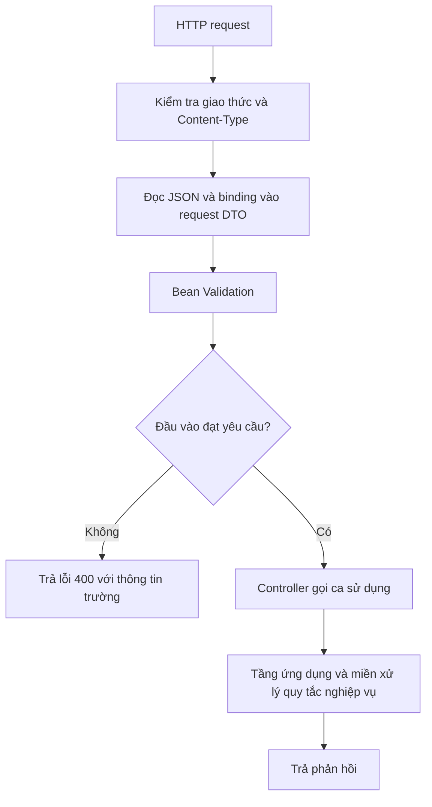

# Kiểm tra cú pháp, định dạng và trường bắt buộc tại biên tiếp nhận

Tầng trình bày là nơi ứng dụng tiếp nhận dữ liệu từ bên ngoài: HTTP request, biểu mẫu, thông điệp hoặc một giao diện khác. Dữ liệu đi vào cần được kiểm tra trước khi chuyển thành đầu vào cho ca sử dụng. Một request có thể thiếu trường bắt buộc, chứa chuỗi rỗng, sai định dạng ngày tháng hoặc không thể chuyển thành kiểu dữ liệu mà chương trình mong đợi. Nếu để những lỗi này đi sâu vào ứng dụng, chúng dễ trở thành lỗi khó hiểu ở tầng nghiệp vụ hoặc tầng dữ liệu.

Trong module `SOFTWARE_DESIGN_ARCHITECTURE_ARCHITECTURAL_PATTERN_LAYERED` — học tổ chức phần mềm theo kiến trúc phân tầng — bài học này tập trung vào trách nhiệm kiểm tra đầu vào tại tầng trình bày. Mục tiêu là tạo một hợp đồng đầu vào rõ ràng, phản hồi lỗi nhất quán và chỉ chuyển dữ liệu có hình dạng hợp lệ đến tầng ứng dụng. Việc kiểm tra ở biên không thay thế các quy tắc nghiệp vụ bên trong.

## 1. Vì sao cần kiểm tra ngay tại biên tiếp nhận?

Ứng dụng không thể giả định rằng dữ liệu gửi đến luôn đúng. Trình duyệt có thể gửi thiếu trường; client khác có thể gọi API trực tiếp; dữ liệu có thể bị sửa đổi hoặc được tạo bởi một phiên bản ứng dụng cũ. Kiểm tra phía giao diện giúp người dùng nhập liệu thuận tiện, nhưng máy chủ vẫn phải tự xác minh request vì máy chủ là nơi tiếp nhận dữ liệu và bảo vệ các quy tắc của hệ thống.

Kiểm tra tại biên có một số mục đích cụ thể:

- Phát hiện sớm request không thể đọc hoặc không có cấu trúc như API yêu cầu.
- Bảo đảm các trường bắt buộc có mặt và có giá trị phù hợp với kiểu dữ liệu.
- Từ chối chuỗi, số, ngày tháng hoặc mã định danh sai định dạng trước khi gọi ca sử dụng.
- Trả lỗi có thể hiểu và có thể xử lý tự động, thay vì để lỗi chuyển đổi dữ liệu xuất hiện sâu trong chương trình.
- Giữ tầng ứng dụng tập trung vào việc điều phối ca sử dụng và giữ tầng miền tập trung vào quy tắc nghiệp vụ.

Đây là một phần của ranh giới tin cậy: dữ liệu từ bên ngoài chỉ trở thành đầu vào nội bộ sau khi đã được phân tích và kiểm tra theo hợp đồng.

## 2. Phân biệt các loại kiểm tra

Các từ “hợp lệ” và “validation” thường được dùng chung, nhưng có một số loại lỗi khác nhau. Phân biệt chúng giúp đặt đúng trách nhiệm và chọn đúng cách trả lỗi.

| Loại kiểm tra | Câu hỏi cần trả lời | Ví dụ | Nơi thường xử lý |
|---|---|---|---|
| Giao thức và nội dung | Request có dùng phương thức, media type và cấu trúc nội dung mà endpoint hỗ trợ không? | Gửi XML đến endpoint chỉ nhận JSON; body không đọc được | HTTP adapter / tầng trình bày |
| Cú pháp và chuyển đổi kiểu | Nội dung có thể phân tích và chuyển thành kiểu dữ liệu đích không? | JSON sai cú pháp; chuỗi `abc` không chuyển được thành số; ngày sai định dạng | Bộ phân tích và cơ chế binding ở tầng trình bày |
| Trường bắt buộc và ràng buộc cấu trúc | Các trường cần thiết có giá trị và kích thước phù hợp không? | `name` bị thiếu hoặc chỉ có khoảng trắng; `pageSize` phải lớn hơn 0 | DTO và validation tại tầng trình bày |
| Quy tắc nghiệp vụ | Giá trị có được phép trong trạng thái hiện tại của hệ thống không? | Khách hàng đã bị khóa; số lượng đặt vượt tồn kho; ngày giao nằm ngoài chính sách | Tầng ứng dụng hoặc miền, tùy quyền sở hữu quy tắc |

Ví dụ, chuỗi `"2026-13-40"` không phải ngày hợp lệ theo định dạng ngày ISO; đó là lỗi phân tích hoặc chuyển đổi đầu vào. Ngược lại, `"2026-12-20"` có thể là ngày hợp lệ về cú pháp nhưng không được phép chọn vì đơn hàng đã hết hạn nhận đặt. Trường hợp thứ hai phụ thuộc vào trạng thái và chính sách nghiệp vụ, nên không thể chỉ kiểm tra bằng annotation định dạng ở controller.

Một nguyên tắc thực tế là: tầng trình bày kiểm tra request có thể được hiểu và có hình dạng phù hợp hay không; tầng ứng dụng và miền quyết định hành động đó có được phép thực hiện hay không.

## 3. Luồng tiếp nhận trong ứng dụng Spring Boot

Với một HTTP API dùng Spring MVC, luồng điển hình có thể hình dung như sau:



Các bước có thứ tự và có thể thất bại ở những điểm khác nhau:

1. **Tiếp nhận HTTP:** framework định tuyến request, kiểm tra phương thức và xử lý media type. Ví dụ, endpoint chỉ nhận JSON có thể trả `415 Unsupported Media Type` nếu client gửi loại nội dung không được hỗ trợ.
2. **Đọc và binding:** bộ chuyển đổi thông điệp đọc JSON rồi ánh xạ các giá trị vào tham số hoặc DTO Java. JSON sai cú pháp, kiểu dữ liệu không tương thích hoặc ngày không thể phân tích thường bị từ chối ở bước này.
3. **Kiểm tra ràng buộc:** Bean Validation đánh giá các annotation trên DTO khi tham số được đánh dấu `@Valid` hoặc `@Validated` theo cách cấu hình tương ứng.
4. **Chuyển sang ca sử dụng:** chỉ khi các bước tiếp nhận và kiểm tra cấu trúc thành công, controller mới gọi dịch vụ ứng dụng.

Không phải lỗi nào cũng là lỗi Bean Validation. Một JSON hỏng chưa tạo được DTO để kiểm tra annotation; một giá trị ngày không thể chuyển thành `LocalDate` cũng thường thất bại trước bước Bean Validation. Vì vậy, API cần xử lý cả lỗi phân tích/binding lẫn lỗi ràng buộc trên DTO.

## 4. Dùng request DTO để mô tả hợp đồng đầu vào

Không nên nhận trực tiếp entity JPA hoặc đối tượng miền làm body của endpoint. Entity thường chứa trạng thái và quan hệ nội bộ; việc binding trực tiếp có thể cho phép client gửi những trường mà họ không nên được quyền thay đổi. Hãy tạo một request DTO chỉ chứa dữ liệu mà thao tác đó chấp nhận.

Ví dụ, endpoint tạo hồ sơ khách hàng có thể nhận:

```java
import jakarta.validation.constraints.Email;
import jakarta.validation.constraints.NotBlank;
import jakarta.validation.constraints.NotNull;
import jakarta.validation.constraints.Pattern;
import jakarta.validation.constraints.Size;
import java.time.LocalDate;

public record CreateCustomerRequest(
    @NotBlank(message = "Tên không được để trống")
    @Size(max = 120, message = "Tên không được vượt quá 120 ký tự")
    String name,

    @NotBlank(message = "Email không được để trống")
    @Email(message = "Email không đúng định dạng")
    @Size(max = 254, message = "Email không được vượt quá 254 ký tự")
    String email,

    @NotBlank(message = "Số điện thoại không được để trống")
    @Pattern(
        regexp = "^\\+?[0-9]{8,15}$",
        message = "Số điện thoại phải có từ 8 đến 15 chữ số"
    )
    String phone,

    @NotNull(message = "Ngày sinh là bắt buộc")
    LocalDate birthDate
) {}
```

Các annotation trong ví dụ có ý nghĩa khác nhau:

| Annotation | Kiểm tra điều gì? | Lưu ý |
|---|---|---|
| `@NotNull` | Giá trị không được là `null` | Không cấm chuỗi rỗng hoặc chuỗi chỉ có khoảng trắng |
| `@NotEmpty` | Giá trị không được `null` và không được rỗng | Chuỗi chỉ có khoảng trắng vẫn có thể đạt yêu cầu |
| `@NotBlank` | Chuỗi không được `null`, rỗng hoặc chỉ gồm khoảng trắng | Thường phù hợp với trường văn bản bắt buộc |
| `@Size(min, max)` | Độ dài hoặc kích thước nằm trong giới hạn | Giá trị `null` thường vẫn hợp lệ; kết hợp với `@NotNull` hoặc `@NotBlank` nếu bắt buộc |
| `@Email` | Chuỗi có hình dạng địa chỉ email được validator chấp nhận | Không thay thế `@NotBlank`; cũng không chứng minh địa chỉ có thật hoặc nhận được thư |
| `@Pattern` | Chuỗi khớp biểu thức chính quy | Giá trị `null` thường vẫn hợp lệ; kết hợp với ràng buộc bắt buộc nếu cần |

Các annotation kiểm tra độc lập với nhau. Chẳng hạn, `@Email` không tự làm cho trường email trở thành bắt buộc; `@Size(max = 120)` không tự cấm giá trị `null`. Kết hợp các ràng buộc theo đúng hợp đồng sẽ tránh những lỗ hổng tưởng rằng đã kiểm tra nhưng thực ra chưa kiểm tra.

Biểu thức số điện thoại trong ví dụ chỉ là quy tắc định dạng đơn giản để minh họa. Sản phẩm thực tế cần chọn định dạng theo quốc gia, cách lưu trữ và yêu cầu nghiệp vụ; không nên coi một regex ngắn là bộ xác thực số điện thoại toàn cầu.

## 5. Kích hoạt kiểm tra trong controller

Với Spring Boot 3 và Jakarta Bean Validation, cần có thư viện validation trong ứng dụng, thường là dependency `spring-boot-starter-validation`. Sau đó đánh dấu body bằng `@Valid`:

```java
@RestController
@RequestMapping("/customers")
@RequiredArgsConstructor
class CustomerController {
    private final CustomerApplicationService customerService;

    @PostMapping
    ResponseEntity<CustomerResponse> create(
            @Valid @RequestBody CreateCustomerRequest request) {

        CreateCustomerCommand command = new CreateCustomerCommand(
            request.name(), request.email(), request.phone(), request.birthDate()
        );
        CreateCustomerResult created = customerService.create(command);
        CustomerResponse response = new CustomerResponse(
            created.customerId(), created.name()
        );
        return ResponseEntity.status(HttpStatus.CREATED).body(response);
    }
}
```

Khi DTO vi phạm ràng buộc, Spring MVC thường ném `MethodArgumentNotValidException` và không gọi phần thân phương thức controller. Khi dữ liệu hợp lệ, controller chuyển request DTO thành command của tầng ứng dụng rồi ánh xạ kết quả thành response DTO. Cách chuyển đổi này giữ hợp đồng HTTP ở tầng trình bày, tránh để tầng ứng dụng phụ thuộc vào kiểu request hoặc response của Spring MVC. Controller không tự triển khai quy tắc nghiệp vụ trong bước chuyển đổi đó.

Đối với tham số đường dẫn hoặc query, Spring cũng hỗ trợ chuyển kiểu và có thể áp dụng ràng buộc cho tham số phương thức. Ví dụ:

```java
@RestController
@Validated
@RequiredArgsConstructor
class CustomerSearchController {
    private final CustomerSearchService customerSearchService;

    @GetMapping("/customers")
    List<CustomerSummary> search(
            @RequestParam(defaultValue = "1") @Min(1) int page,
            @RequestParam(defaultValue = "20") @Min(1) @Max(100) int pageSize) {
        // Chuyển các tham số đã kiểm tra đến ca sử dụng.
        return customerSearchService.search(page, pageSize);
    }
}
```

Ví dụ này minh họa kiểm tra giới hạn phân trang. Cách bật method validation và loại exception cụ thể có thể phụ thuộc phiên bản Spring và cấu hình ứng dụng; cần kiểm tra hành vi thực tế của phiên bản dự án đang dùng. Với tham số bắt buộc, Spring có thể tự trả lỗi khi thiếu; nếu tham số là tùy chọn, hãy khai báo rõ mặc định hoặc `required = false` và xác định cách xử lý `null`.

### Trường hợp thiếu, rỗng và giá trị mặc định

Không phải lúc nào “thiếu trường” cũng giống “trường có giá trị mặc định”. Ví dụ, một thuộc tính kiểu `boolean` có thể trở thành `false` khi không được cung cấp; ứng dụng khó phân biệt client cố ý gửi `false` với client bỏ quên trường. Nếu việc có mặt của giá trị là bắt buộc, dùng kiểu wrapper như `Boolean` cùng `@NotNull` hoặc thiết kế DTO phù hợp để phân biệt hai trường hợp.

Với trường văn bản, một JSON body có thể chứa `"name": ""`, `"name": "   "`, `"name": null` hoặc không có thuộc tính `name`. Cách Jackson binding trường hợp thiếu phụ thuộc kiểu dữ liệu và cấu hình; với DTO tham chiếu thông thường, giá trị thường trở thành `null`, sau đó `@NotBlank` sẽ từ chối. Nếu API cần phân biệt rõ “không gửi” với “gửi null”, chẳng hạn trong thao tác cập nhật từng phần, cần mô hình hóa sự khác biệt đó trong hợp đồng thay vì dựa vào một annotation đơn lẻ.

## 6. Kiểm tra dữ liệu lồng nhau và quan hệ giữa các trường

Một request có thể chứa đối tượng con hoặc danh sách. Muốn Bean Validation đi sâu vào đối tượng con, cần đánh dấu `@Valid` tại thuộc tính chứa nó. Ví dụ:

```java
public record AddressRequest(
    @NotBlank String street,
    @NotBlank String city,
    @NotBlank @Size(max = 20) String postalCode
) {}

public record RegisterCustomerRequest(
    @NotBlank String name,
    @NotNull @Valid AddressRequest address,
    @NotEmpty List<@NotNull @Valid AddressRequest> deliveryAddresses
) {}
```

`@NotNull` bảo đảm đối tượng địa chỉ chính có mặt; `@Valid` yêu cầu kiểm tra các trường bên trong. Với danh sách, `@NotEmpty` yêu cầu có ít nhất một phần tử, còn `@NotNull @Valid` trên phần tử kiểm tra phần tử không null và tiếp tục xác thực từng địa chỉ.

Đôi khi tính hợp lệ phụ thuộc vào quan hệ giữa nhiều trường, chẳng hạn `endDate` không được trước `startDate`. Có thể dùng một class-level constraint hoặc validator tùy chỉnh trên DTO nếu đây là điều kiện về hình dạng của request. Nếu điều kiện phụ thuộc trạng thái hệ thống, quyền người dùng hoặc chính sách nghiệp vụ, hãy kiểm tra trong tầng ứng dụng/miền. Ví dụ, ngày kết thúc lớn hơn ngày bắt đầu là một quan hệ giữa hai giá trị; nhưng ngày đó có được đặt lịch trong thời điểm hiện tại hay không có thể phụ thuộc lịch hoạt động và chính sách của hệ thống.

## 7. Phản hồi lỗi nhất quán

Một API hữu ích cần cho client biết trường nào không đạt yêu cầu và lý do ở mức có thể hành động. Không nên trả stack trace, tên lớp nội bộ, câu SQL hoặc toàn bộ request body trong phản hồi lỗi.

Với Spring Framework 6, có thể dùng `ProblemDetail` để định dạng lỗi. Ví dụ sau gom các lỗi trường từ `MethodArgumentNotValidException`:

```java
@RestControllerAdvice
class ApiValidationExceptionHandler {

    @ExceptionHandler(MethodArgumentNotValidException.class)
    ResponseEntity<ProblemDetail> handleInvalidBody(
            MethodArgumentNotValidException exception) {

        List<Map<String, String>> errors = exception.getBindingResult()
            .getFieldErrors()
            .stream()
            .map(error -> Map.of(
                "field", error.getField(),
                "message", Objects.requireNonNullElse(
                    error.getDefaultMessage(), "Giá trị không hợp lệ"
                )
            ))
            .toList();

        ProblemDetail problem = ProblemDetail.forStatusAndDetail(
            HttpStatus.BAD_REQUEST,
            "Một hoặc nhiều trường đầu vào không hợp lệ"
        );
        problem.setTitle("Dữ liệu đầu vào không hợp lệ");
        problem.setProperty("errors", errors);

        return ResponseEntity.badRequest().body(problem);
    }
}
```

Ứng dụng cũng cần định nghĩa cách xử lý lỗi đọc body, ví dụ `HttpMessageNotReadableException`, để JSON sai cú pháp hoặc không chuyển được kiểu dữ liệu có thông báo phù hợp. Không nên giả định handler cho `MethodArgumentNotValidException` sẽ xử lý mọi lỗi đầu vào: hai exception đại diện cho hai giai đoạn khác nhau. Tương tự, lỗi tham số bắt buộc bị thiếu hoặc lỗi chuyển đổi query/path parameter có thể cần handler riêng, hoặc được framework xử lý theo mặc định.

Mã HTTP nên phản ánh loại lỗi theo hợp đồng API. Thông thường, request sai cú pháp, sai kiểu hoặc vi phạm ràng buộc đầu vào được trả `400 Bad Request`; media type không hỗ trợ được trả `415 Unsupported Media Type`. Một số API chọn `422 Unprocessable Content` cho một nhóm lỗi nội dung có thể phân tích nhưng không thể xử lý. Dù chọn quy ước nào, hãy dùng nhất quán và ghi rõ trong tài liệu API.

Phản hồi lỗi nên có tên trường, thông điệp ổn định hoặc mã lỗi có thể xử lý bằng máy. Tránh phản chiếu giá trị nhạy cảm như mật khẩu, token hoặc dữ liệu cá nhân trong thông báo. Nếu client cần hiển thị thông điệp theo ngôn ngữ, có thể dùng mã lỗi ổn định để client hoặc tầng trình bày ánh xạ sang thông điệp đã bản địa hóa.

## 8. Kiểm tra đầu vào không thay thế quy tắc nghiệp vụ

Giả sử endpoint nhận yêu cầu chuyển tiền với `amount` là số dương. `@Positive` có thể kiểm tra giá trị lớn hơn 0 ở biên tiếp nhận. Tuy nhiên, số tiền đó có được phép chuyển hay không còn phụ thuộc số dư, hạn mức, trạng thái tài khoản, loại tiền và quyền của người thực hiện. Những điều kiện này cần được xác minh trong tầng ứng dụng hoặc miền, tại thời điểm xử lý ca sử dụng.

Tương tự:

- `@Email` kiểm tra hình dạng chuỗi email, không xác nhận người dùng sở hữu hộp thư đó.
- `@NotNull` kiểm tra sự hiện diện của giá trị, không chứng minh giá trị tham chiếu đến bản ghi đang tồn tại.
- `@Positive` kiểm tra số dương, không quyết định số lượng đó có còn trong kho.
- `@Pattern` kiểm tra hình dạng mã, không xác nhận mã đó được phép dùng trong trạng thái hiện tại.
- `@Past` có thể kiểm tra ngày nằm trước thời điểm hiện tại, nhưng quy định tuổi tối thiểu hoặc ngoại lệ theo loại tài khoản là chính sách nghiệp vụ riêng.

Nếu chỉ kiểm tra ở controller, các luồng khác như tác vụ theo lịch, consumer nhận thông điệp hoặc lệnh nội bộ có thể bỏ qua quy tắc. Ngược lại, nếu đưa mọi kiểm tra chuỗi và định dạng vào miền, mô hình miền sẽ bị gắn với chi tiết HTTP/JSON. Hãy đặt kiểm tra hình dạng của request ở adapter tiếp nhận và bảo vệ bất biến nghiệp vụ tại nơi mọi luồng thực thi đều phải tuân theo.

## 9. Kiểm thử tại biên tiếp nhận

Kiểm tra đầu vào nên được xác minh bằng kiểm thử web/API, vì mục tiêu là bảo đảm framework binding, validation và phản hồi HTTP phối hợp đúng. Có thể dùng `MockMvc` trong bài kiểm thử `@WebMvcTest` để gửi request mà không cần khởi động toàn bộ hệ thống.

Một bộ trường hợp tối thiểu cho endpoint tạo khách hàng có thể gồm:

| Request | Kết quả mong đợi | Điều cần xác minh |
|---|---|---|
| Thiếu `name` | `400 Bad Request` | Trường bắt buộc được kiểm tra |
| `name` chỉ chứa khoảng trắng | `400 Bad Request` | `@NotBlank` được kích hoạt |
| Email sai hình dạng | `400 Bad Request` | Lỗi chỉ rõ trường email |
| Ngày sinh sai định dạng hoặc JSON hỏng | `400 Bad Request` | Lỗi binding được xử lý |
| Gửi media type không hỗ trợ | `415 Unsupported Media Type` | Hợp đồng HTTP được thực thi |
| Body hợp lệ | `201 Created` | Controller chuyển tiếp đến ca sử dụng |

Với request không hợp lệ, hãy xác minh dịch vụ ứng dụng không được gọi. Điều đó chứng minh lỗi được chặn tại biên thay vì chỉ được phát hiện sau khi đã bắt đầu ca sử dụng. Với request hợp lệ, kiểm tra DTO/command được chuyển tiếp đúng và phản hồi thành công có cấu trúc như hợp đồng.

Ngoài kiểm thử tự động, tài liệu OpenAPI nên mô tả trường bắt buộc, kiểu dữ liệu, định dạng, giới hạn và cấu trúc lỗi. Tài liệu giúp client tạo request đúng; kiểm thử máy chủ bảo đảm hợp đồng đó được thực thi. Hai việc bổ trợ cho nhau.

## 10. Những sai lầm thường gặp

- **Chỉ kiểm tra ở giao diện:** client có thể bị bỏ qua hoặc bị thay thế. Máy chủ luôn phải kiểm tra dữ liệu nhận được.
- **Dùng `@NotNull` cho mọi trường văn bản:** chuỗi rỗng và chuỗi khoảng trắng vẫn có thể vượt qua. Chọn `@NotBlank` khi yêu cầu là văn bản có nội dung.
- **Cho rằng `@Size`, `@Email` hoặc `@Pattern` tự bắt buộc trường:** nhiều constraint chấp nhận `null`; cần kết hợp với ràng buộc bắt buộc.
- **Nhận trực tiếp entity làm request body:** client có thể tác động vào trường nội bộ hoặc quan hệ không thuộc hợp đồng endpoint. Dùng DTO riêng cho từng thao tác.
- **Gộp lỗi binding và lỗi nghiệp vụ:** JSON không phân tích được là lỗi tiếp nhận; tài khoản không đủ điều kiện thực hiện thao tác là kết quả nghiệp vụ. Phản hồi và nơi xử lý nên thể hiện đúng khác biệt.
- **Để controller chứa quá nhiều điều kiện nghiệp vụ:** controller nên phối hợp HTTP và chuyển tiếp đầu vào đã kiểm tra, không trở thành nơi tập trung chính sách của miền.
- **Trả thông tin lỗi nội bộ:** stack trace hoặc giá trị nhạy cảm có thể làm lộ thông tin. Chỉ trả thông tin cần thiết cho client sửa request.

Khi thiết kế một endpoint, hãy bắt đầu từ hợp đồng: trường nào phải có, kiểu và định dạng nào được chấp nhận, giới hạn nào áp dụng, và lỗi nào sẽ được trả. Sau đó mô tả các ràng buộc đó trên request DTO, kích hoạt kiểm tra tại controller, xử lý riêng lỗi phân tích/binding và kiểm thử các trường hợp sai. Những câu hỏi về trạng thái hệ thống, quyền thực hiện và bất biến nghiệp vụ được chuyển đến tầng sở hữu chúng.

Kiểm tra cú pháp, định dạng và trường bắt buộc tại biên tiếp nhận giúp dữ liệu đi vào ứng dụng có hình dạng rõ ràng, lỗi được phát hiện sớm và các tầng bên trong giữ đúng trách nhiệm. Một biên tiếp nhận tốt vừa nghiêm ngặt với dữ liệu không đúng hợp đồng, vừa đưa ra phản hồi đủ rõ để client có thể sửa request.
