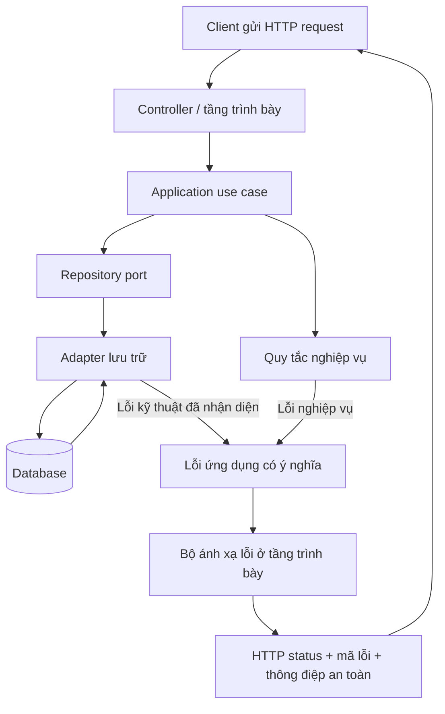

# Chuyển lỗi ứng dụng thành hợp đồng phản hồi mà không lộ chi tiết hạ tầng

*Chương: Tầng trình bày*

Bài học này thuộc module `SOFTWARE_DESIGN_ARCHITECTURE_ARCHITECTURAL_PATTERN_LAYERED`, có mục tiêu **Học tổ chức phần mềm theo kiến trúc phân tầng**. Trong kiến trúc phân tầng, tầng trình bày là ranh giới giao tiếp giữa ứng dụng và bên gọi, chẳng hạn trình duyệt, ứng dụng di động hoặc một hệ thống khác qua HTTP. Một trách nhiệm quan trọng tại ranh giới này là chuyển lỗi phát sinh trong quá trình xử lý thành phản hồi có cấu trúc, ổn định và an toàn.

Một lỗi nội bộ có thể chứa tên lớp Java, câu lệnh SQL, tên bảng, đường dẫn máy chủ, thông tin cấu hình hoặc dữ liệu nhạy cảm. Những chi tiết đó hữu ích khi chẩn đoán ở phía máy chủ, nhưng thường không thuộc hợp đồng API. Bên gọi cần biết yêu cầu thất bại theo cách nào, có thể sửa dữ liệu hay thử lại không và mã lỗi nào có thể dùng để xử lý. Nó không cần biết ứng dụng dùng Hibernate, PostgreSQL hay một thư viện cụ thể.

## 1. Vì sao cần một hợp đồng lỗi ở tầng trình bày?

Hãy xét một yêu cầu tạo đơn hàng. Controller nhận dữ liệu, gọi ca sử dụng, ca sử dụng kiểm tra quy tắc nghiệp vụ và yêu cầu repository lưu đơn hàng. Trong luồng đó có thể xảy ra nhiều loại lỗi:

- Dữ liệu đầu vào thiếu hoặc sai định dạng.
- Đơn hàng được yêu cầu không tồn tại.
- Đơn hàng đã xác nhận nên không thể hủy.
- Một mã đơn hàng bị trùng với dữ liệu đã có.
- Cơ sở dữ liệu tạm thời không thể kết nối.
- Một lỗi lập trình chưa được dự đoán xảy ra.

Nếu trả nguyên exception cho client, phản hồi có thể làm lộ thông tin triển khai và buộc client phụ thuộc vào cấu trúc nội bộ. Ví dụ, việc đổi từ JPA sang JDBC có thể làm tên exception thay đổi dù ý nghĩa đối với người dùng vẫn là “dịch vụ lưu trữ hiện không khả dụng”.

Tầng trình bày cần chuyển những kết quả hoặc lỗi đó thành một **hợp đồng phản hồi công khai**. Hợp đồng nên trả lời được:

1. Yêu cầu thất bại theo nhóm nào?
2. HTTP status nào mô tả đúng kết quả?
3. Mã lỗi ổn định nào để client xử lý bằng chương trình?
4. Thông điệp nào an toàn và hữu ích cho người gọi?
5. Có mã tham chiếu nào để đội vận hành tra cứu log khi cần không?

Hợp đồng công khai cần ổn định ngay cả khi cách tổ chức package, framework, database hoặc dịch vụ bên trong thay đổi.

## 2. Phân biệt lỗi nghiệp vụ, lỗi đầu vào và lỗi hạ tầng

Không nên gom mọi exception vào một phản hồi chung. Cần phân biệt ý nghĩa của lỗi trước khi quyết định cách phản hồi.

| Nhóm lỗi | Ví dụ | Cách phản hồi thường phù hợp |
|---|---|---|
| Đầu vào không hợp lệ | Thiếu trường bắt buộc, sai định dạng ngày | `400 Bad Request` |
| Không tìm thấy tài nguyên | Mã đơn hàng không tồn tại | `404 Not Found` |
| Xung đột trạng thái nghiệp vụ | Hủy đơn đã giao, tạo mã đã được sử dụng | `409 Conflict` |
| Chưa xác thực hoặc không có quyền | Token không hợp lệ, người dùng không được phép thao tác | `401 Unauthorized` hoặc `403 Forbidden` |
| Giới hạn hoặc phụ thuộc tạm thời | Vượt giới hạn gọi API, dịch vụ phụ thuộc tạm ngừng | `429 Too Many Requests` hoặc `503 Service Unavailable` |
| Lỗi không dự đoán | Lỗi lập trình hoặc trạng thái nội bộ không xử lý được | `500 Internal Server Error` |

Bảng trên là hướng dẫn theo ngữ nghĩa HTTP, không phải quy tắc thay thế việc thiết kế hợp đồng của API. Chẳng hạn, một API có thể chọn `422 Unprocessable Content` cho dữ liệu đúng cú pháp nhưng không thỏa điều kiện ngữ nghĩa. Điều quan trọng là chọn nhất quán, ghi rõ trong tài liệu API và không để client phải đoán.

Một số phân biệt cần giữ rõ:

- **Lỗi nghiệp vụ** biểu thị thao tác không được phép theo quy tắc của miền, ví dụ đơn hàng đã giao nên không thể hủy. Đây thường là kết quả có thể dự đoán và có thể ánh xạ thành mã lỗi nghiệp vụ ổn định.
- **Lỗi xác thực dữ liệu** biểu thị yêu cầu không đáp ứng hợp đồng đầu vào, ví dụ thiếu địa chỉ giao hàng hoặc số lượng âm.
- **Lỗi hạ tầng** biểu thị thành phần kỹ thuật không thực hiện được công việc, ví dụ database timeout. Đây không đồng nghĩa với việc người dùng nhập sai dữ liệu.
- **Lỗi không dự đoán** cần được ghi nhận để điều tra và trả thông tin tổng quát cho client.

Không ánh xạ mọi lỗi lưu trữ thành `404`, `409` hoặc `503`. Ví dụ, vi phạm unique constraint có thể tương ứng với xung đột mã đơn hàng nếu constraint đó biểu diễn đúng một quy tắc nghiệp vụ đã biết. Một lỗi kết nối database lại có ý nghĩa khác. Việc phân loại cần dựa trên nguyên nhân đã xác định, không chỉ dựa vào lớp exception chung.

## 3. Giữ ranh giới giữa lỗi nội bộ và lỗi công khai

Tầng nghiệp vụ và tầng ứng dụng nên diễn đạt lỗi bằng khái niệm của ứng dụng. Ví dụ:

- `OrderNotFoundException`: không tìm thấy đơn hàng theo mã được yêu cầu.
- `OrderAlreadyShippedException`: đơn hàng đã giao nên không thể hủy.
- `DuplicateOrderCodeException`: mã đơn hàng đã được sử dụng.
- `OrderStoreUnavailableException`: khả năng lưu trữ đơn hàng hiện không sẵn sàng.

Những kiểu lỗi này mô tả ý nghĩa đối với ca sử dụng. Chúng không cần kế thừa từ exception của Spring MVC hoặc chứa `HttpStatus`. Tầng trình bày mới quyết định cách biểu diễn chúng thành HTTP.

Chi tiết hạ tầng nên được chuyển đổi gần nơi nó đi qua ranh giới hạ tầng. Ví dụ, adapter lưu trữ có thể nhận diện một lỗi unique constraint cụ thể và chuyển nó thành `DuplicateOrderCodeException`. Nếu adapter gặp lỗi kết nối đã được xác định là tạm thời, nó có thể chuyển thành lỗi ứng dụng có ý nghĩa như `OrderStoreUnavailableException`. Việc chuyển đổi này giúp tầng trên không phải biết `DataIntegrityViolationException`, mã SQL hay tên constraint của database.

Không nên biến mọi exception của thư viện lưu trữ thành một lỗi nghiệp vụ. Nếu không xác định được ý nghĩa của lỗi, hãy để nó được xử lý như lỗi không dự đoán, ghi nhận nguyên nhân ở phía máy chủ và trả phản hồi tổng quát. Việc bắt một exception rộng rồi gắn nhãn “dữ liệu không hợp lệ” có thể khiến client sửa dữ liệu vô ích trong khi nguyên nhân thật là sự cố kỹ thuật.

Có thể hình dung ranh giới chuyển đổi như sau:



Trong thực tế, lỗi có thể phát sinh ở bất kỳ lời gọi nào trong luồng. Ý nghĩa của sơ đồ là mỗi ranh giới chuyển đổi chi tiết riêng của nó thành một khái niệm phù hợp với tầng tiếp theo. Bộ ánh xạ ở tầng trình bày chịu trách nhiệm tạo hợp đồng bên ngoài.

## 4. Dùng Problem Details để chuẩn hóa phản hồi HTTP

RFC 9457 định nghĩa định dạng **Problem Details for HTTP APIs**. Định dạng này cung cấp các trường phổ biến:

| Trường | Ý nghĩa |
|---|---|
| `type` | URI định danh loại vấn đề; nên ổn định và có thể trỏ đến tài liệu giải thích |
| `title` | Tiêu đề ngắn mô tả loại vấn đề |
| `status` | HTTP status của phản hồi |
| `detail` | Giải thích an toàn, cụ thể cho lần xảy ra lỗi |
| `instance` | URI nhận diện lần xảy ra vấn đề, thường là đường dẫn yêu cầu |
| Trường mở rộng | Mã lỗi, lỗi theo từng trường hoặc mã tham chiếu hỗ trợ |

Phản hồi thường có media type `application/problem+json`. Ví dụ, khi client gửi yêu cầu hủy một đơn hàng đã giao:

```http
HTTP/1.1 409 Conflict
Content-Type: application/problem+json
```

```json
{
  "type": "https://api.example.com/problems/order-already-shipped",
  "title": "Không thể hủy đơn hàng",
  "status": 409,
  "detail": "Đơn hàng đã được giao nên không thể hủy.",
  "instance": "/api/orders/ORD-1024/cancellation",
  "code": "ORDER_ALREADY_SHIPPED"
}
```

Client có thể dựa vào `status` và `code` để quyết định cách xử lý. `detail` dành cho con người đọc; client không nên phân tích chuỗi thông điệp để điều khiển luồng chương trình vì câu chữ có thể được chỉnh sửa hoặc bản địa hóa.

Trường mở rộng cần có ý nghĩa rõ ràng và được duy trì nhất quán. Ví dụ, lỗi validation có thể có mảng `errors` chứa tên trường công khai và mã vi phạm. Không nên trả toàn bộ đối tượng exception hoặc đối tượng binding nội bộ của framework.

## 5. Triển khai ánh xạ lỗi bằng Spring

Với Spring Framework 6 trở lên, `ProblemDetail` hỗ trợ tạo phản hồi theo RFC 9457. Có thể gom các bộ xử lý lỗi HTTP vào `@RestControllerAdvice` để controller tập trung vào xử lý yêu cầu thành công.

Ví dụ sau minh họa cách ánh xạ lỗi không tìm thấy đơn hàng:

```java
@RestControllerAdvice
public class ApiExceptionHandler {

    @ExceptionHandler(OrderNotFoundException.class)
    public ResponseEntity<ProblemDetail> handleOrderNotFound(
            OrderNotFoundException exception,
            HttpServletRequest request) {

        ProblemDetail problem = ProblemDetail.forStatusAndDetail(
                HttpStatus.NOT_FOUND,
                "Không tìm thấy đơn hàng được yêu cầu."
        );

        problem.setType(URI.create(
                "https://api.example.com/problems/order-not-found"
        ));
        problem.setTitle("Không tìm thấy đơn hàng");
        problem.setInstance(URI.create(request.getRequestURI()));
        problem.setProperty("code", "ORDER_NOT_FOUND");

        return ResponseEntity
                .status(HttpStatus.NOT_FOUND)
                .body(problem);
    }
}
```

Tham số `exception` có thể chứa mã đơn hàng hoặc thông tin nội bộ để phục vụ xử lý, nhưng ví dụ không đưa thông điệp exception trực tiếp vào `detail`. Thông điệp trả về được viết có chủ đích cho người gọi API. Tương tự, `type` và `code` là định danh công khai, không phải tên lớp Java.

Có thể bổ sung handler cho xung đột nghiệp vụ và lỗi validation:

```java
@ExceptionHandler(OrderAlreadyShippedException.class)
public ResponseEntity<ProblemDetail> handleAlreadyShipped(
        OrderAlreadyShippedException exception,
        HttpServletRequest request) {

    ProblemDetail problem = ProblemDetail.forStatusAndDetail(
            HttpStatus.CONFLICT,
            "Đơn hàng đã được giao nên không thể hủy."
    );
    problem.setType(URI.create(
            "https://api.example.com/problems/order-already-shipped"
    ));
    problem.setTitle("Không thể hủy đơn hàng");
    problem.setInstance(URI.create(request.getRequestURI()));
    problem.setProperty("code", "ORDER_ALREADY_SHIPPED");

    return ResponseEntity.status(HttpStatus.CONFLICT).body(problem);
}

@ExceptionHandler(MethodArgumentNotValidException.class)
public ResponseEntity<ProblemDetail> handleInvalidRequest(
        MethodArgumentNotValidException exception,
        HttpServletRequest request) {

    List<Map<String, String>> errors =
            exception.getBindingResult().getFieldErrors().stream()
                    .map(error -> Map.of(
                            "field", error.getField(),
                            "code", "INVALID_VALUE"
                    ))
                    .toList();

    ProblemDetail problem = ProblemDetail.forStatusAndDetail(
            HttpStatus.BAD_REQUEST,
            "Một hoặc nhiều trường dữ liệu không hợp lệ."
    );
    problem.setType(URI.create(
            "https://api.example.com/problems/invalid-request"
    ));
    problem.setTitle("Dữ liệu yêu cầu không hợp lệ");
    problem.setInstance(URI.create(request.getRequestURI()));
    problem.setProperty("code", "VALIDATION_FAILED");
    problem.setProperty("errors", errors);

    return ResponseEntity.badRequest().body(problem);
}
```

Đây là mã minh họa phần cốt lõi; các import, cấu hình và kiểu exception cụ thể phụ thuộc dự án. Nếu tên thuộc tính trong DTO khác tên trường JSON công khai, cần chuyển đổi sang tên trường API trước khi trả về. Không nên gửi `rejectedValue` hoặc toàn bộ thông điệp validation một cách máy móc, vì chúng có thể chứa dữ liệu người dùng hoặc thông tin nội bộ. Nếu muốn trả thông điệp theo từng trường, hãy dùng nội dung đã được thiết kế và kiểm soát cho API.

### Xử lý lỗi không dự đoán

Một handler tổng quát là lớp bảo vệ cuối cùng. Nó ghi exception đầy đủ ở phía máy chủ và trả nội dung an toàn:

```java
@ExceptionHandler(Exception.class)
public ResponseEntity<ProblemDetail> handleUnexpected(
        Exception exception,
        HttpServletRequest request) {

    String errorId = UUID.randomUUID().toString();

    log.error("Unhandled API error, errorId={}", errorId, exception);

    ProblemDetail problem = ProblemDetail.forStatusAndDetail(
            HttpStatus.INTERNAL_SERVER_ERROR,
            "Đã xảy ra lỗi. Vui lòng thử lại sau."
    );
    problem.setType(URI.create(
            "https://api.example.com/problems/internal-error"
    ));
    problem.setTitle("Lỗi máy chủ");
    problem.setInstance(URI.create(request.getRequestURI()));
    problem.setProperty("code", "INTERNAL_ERROR");
    problem.setProperty("errorId", errorId);

    return ResponseEntity.internalServerError().body(problem);
}
```

Client nhận `errorId` để cung cấp khi liên hệ hỗ trợ; đội vận hành có thể tìm log tương ứng. Nếu hệ thống đã có correlation ID hoặc trace ID, có thể dùng mã tham chiếu được quản lý thống nhất thay cho việc sinh thêm một mã riêng. Mã tham chiếu công khai không được chứa token, thông tin cá nhân hoặc dữ liệu nhạy cảm.

Không nên để handler tổng quát che giấu mọi lỗi đã biết. Các lỗi nghiệp vụ, validation và lỗi phụ thuộc tạm thời cần được xử lý trước bằng handler cụ thể để có status và mã lỗi chính xác. Lỗi không được nhận diện mới đi đến phản hồi `500`.

### Lưu ý về xác thực và phân quyền

Không phải mọi lỗi HTTP đều đi qua `@RestControllerAdvice`. Spring Security thường xử lý lỗi trong filter chain trước khi yêu cầu đến controller. Vì vậy:

- `AuthenticationEntryPoint` thường tạo phản hồi `401 Unauthorized` khi chưa xác thực hoặc thông tin xác thực không hợp lệ.
- `AccessDeniedHandler` thường tạo phản hồi `403 Forbidden` khi người gọi đã xác thực nhưng không có quyền.

Hai điểm xử lý này cũng cần tuân theo cùng hợp đồng lỗi công khai của API, chẳng hạn cùng cấu trúc Problem Details và mã lỗi ổn định. Nếu chỉ chuẩn hóa lỗi trong controller advice, client có thể nhận hai định dạng khác nhau cho lỗi của cùng một API.

## 6. Những thông tin không nên đưa vào phản hồi

Thông điệp phản hồi phải giúp người gọi hành động mà không tiết lộ chi tiết có thể hỗ trợ việc dò tìm hoặc tấn công hệ thống.

| Không nên trả về | Có thể trả về thay thế |
|---|---|
| Stack trace hoặc tên lớp exception | Mã lỗi công khai và thông điệp tổng quát |
| SQL, tên bảng, tên constraint, câu truy vấn | Mô tả nghiệp vụ như “mã đơn hàng đã tồn tại” nếu đã xác định đúng nguyên nhân |
| Địa chỉ máy chủ, tên host nội bộ, đường dẫn file | Mô tả phụ thuộc đang tạm thời không khả dụng |
| Token, mật khẩu, header xác thực hoặc dữ liệu nhạy cảm | Mã tham chiếu lỗi để tra cứu phía máy chủ |
| Nội dung exception thô từ thư viện | Thông điệp được viết riêng cho hợp đồng API |

Một số nguyên tắc thực hành:

- Không dùng `exception.getMessage()` làm `detail` mặc định. Thông điệp có thể chứa SQL, tên bảng, dữ liệu đầu vào hoặc thông tin của thư viện.
- Không trả stack trace trong môi trường production. Stack trace và nguyên nhân gốc cần được ghi log ở phía máy chủ với quyền truy cập phù hợp.
- Không đưa toàn bộ request body vào log khi dữ liệu có thể chứa mật khẩu, token hoặc thông tin cá nhân. Hãy lọc và giới hạn dữ liệu ghi nhận.
- Không dùng thông điệp lỗi để xác nhận sự tồn tại của tài nguyên nhạy cảm nếu chính sách bảo mật yêu cầu che giấu thông tin đó.
- Không để mã lỗi công khai phụ thuộc vào tên exception, tên package hoặc mã lỗi riêng của database.

“Không lộ chi tiết hạ tầng” không có nghĩa là trả lời mơ hồ cho mọi lỗi. Nếu người dùng có thể sửa một trường dữ liệu, phản hồi nên chỉ rõ trường đó và loại vi phạm. Nếu thao tác không hợp lệ do trạng thái đơn hàng, phản hồi nên giải thích trạng thái liên quan. Chỉ những chi tiết nội bộ không cần thiết cho người gọi mới nên được giữ lại ở phía máy chủ.

## 7. Kiểm thử hợp đồng lỗi

Kiểm thử cần xác minh cả nội dung được trả về lẫn những thông tin không được phép xuất hiện. Có thể kiểm tra các trường hợp chính:

| Tình huống | Điều cần xác minh |
|---|---|
| Đơn hàng không tồn tại | HTTP 404, `code=ORDER_NOT_FOUND`, thông điệp an toàn |
| Không thể hủy do trạng thái đã giao | HTTP 409 và mã lỗi nghiệp vụ ổn định |
| Request thiếu trường bắt buộc | HTTP 400 và danh sách trường lỗi theo hợp đồng |
| Database hoặc dịch vụ phụ thuộc tạm thời không sẵn sàng | Status đã thống nhất, không có SQL hay host nội bộ trong body |
| Exception không dự đoán | HTTP 500, thông điệp tổng quát và mã tham chiếu |
| Chưa xác thực hoặc không đủ quyền | HTTP 401/403 theo đúng ngữ nghĩa, cùng định dạng lỗi công khai |

Với Spring MVC, có thể dùng `@WebMvcTest` và `MockMvc` để gọi endpoint rồi xác nhận status, content type và các trường JSON. Ví dụ kiểm tra lỗi không tìm thấy:

```java
mockMvc.perform(get("/api/orders/{id}", "missing-id"))
        .andExpect(status().isNotFound())
        .andExpect(content().contentTypeCompatibleWith(
                MediaType.APPLICATION_PROBLEM_JSON
        ))
        .andExpect(jsonPath("$.code").value("ORDER_NOT_FOUND"))
        .andExpect(jsonPath("$.status").value(404))
        .andExpect(jsonPath("$.detail").value(
                "Không tìm thấy đơn hàng được yêu cầu."
        ));
```

Ngoài việc xác nhận phản hồi đúng, nên kiểm tra rằng body không chứa tên exception nội bộ, SQL, stack trace hoặc thông tin bí mật. Với lỗi hạ tầng, có thể dùng adapter giả để mô phỏng lỗi đã nhận diện và xác minh bộ ánh xạ trả đúng hợp đồng. Kiểm thử tích hợp vẫn cần thiết để xác nhận adapter thực sự chuyển lỗi từ thư viện lưu trữ thành loại lỗi ứng dụng như dự kiến.

Khi hợp đồng API thay đổi, hãy xem mã lỗi, status, trường mở rộng và thông điệp có tương thích với client hiện tại không. Client nên dựa vào mã lỗi ổn định và status; không nên phụ thuộc vào câu chữ chi tiết có thể thay đổi theo ngôn ngữ.

## 8. Cách áp dụng trong một dự án

Khi thêm một loại lỗi mới, có thể thực hiện theo trình tự sau:

1. Xác định ý nghĩa của lỗi đối với ca sử dụng: lỗi đầu vào, quy tắc nghiệp vụ, không tìm thấy, xung đột hay sự cố kỹ thuật.
2. Chọn một biểu diễn nội bộ phù hợp ở tầng nghiệp vụ hoặc ứng dụng. Không đưa kiểu HTTP hay exception của framework vào mô hình nghiệp vụ.
3. Nếu lỗi bắt nguồn từ hạ tầng, chuyển đổi chi tiết kỹ thuật đã nhận diện thành lỗi có ý nghĩa ở adapter hoặc ranh giới tích hợp.
4. Định nghĩa mã lỗi công khai, HTTP status, tiêu đề và thông điệp an toàn.
5. Bổ sung handler tại tầng trình bày hoặc điểm xử lý bảo mật tương ứng.
6. Viết kiểm thử để xác nhận hợp đồng và kiểm tra không rò rỉ thông tin nội bộ.

Không cần tạo một hệ thống phân cấp exception phức tạp cho mọi tình huống. Một số ứng dụng có thể dùng kiểu kết quả rõ ràng thay cho exception cho những lỗi nghiệp vụ dự đoán được. Dù chọn cách nào, tầng trình bày vẫn cần một nơi tập trung để chuyển kết quả đó thành hợp đồng giao tiếp.

Một thiết kế tốt giữ được ba điều: tầng trong biểu đạt lỗi theo ngôn ngữ ứng dụng; tầng trình bày quyết định cách biểu diễn lỗi cho giao thức bên ngoài; chi tiết hạ tầng và nguyên nhân đầy đủ được lưu ở phía máy chủ để phục vụ vận hành. Nhờ vậy, API có thể giữ phản hồi ổn định và an toàn khi cách triển khai bên trong thay đổi.

