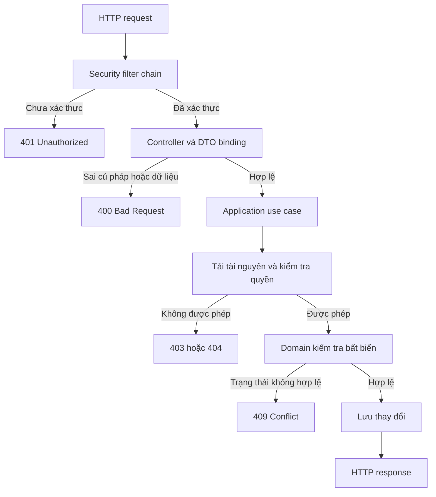

# Xác thực ở biên và phân biệt với kiểm tra quyền theo nghiệp vụ

Bài học này thuộc module **SOFTWARE_DESIGN_ARCHITECTURE_ARCHITECTURAL_PATTERN_LAYERED**, chương **Tầng trình bày**. Module hướng tới việc tổ chức phần mềm theo kiến trúc phân tầng, trong đó mỗi tầng có trách nhiệm riêng và cộng tác qua các hợp đồng rõ ràng. Bài này tập trung vào cách tầng trình bày kiểm tra dữ liệu ngay tại biên tiếp nhận, đồng thời phân biệt việc kiểm tra dữ liệu hợp lệ với xác thực danh tính và kiểm tra quyền thực hiện một hành động nghiệp vụ.

Ba khái niệm thường bị gọi chung là “xác thực” nhưng giải quyết ba câu hỏi khác nhau:

- **Kiểm tra hợp lệ đầu vào (input validation):** dữ liệu gửi đến có đúng cấu trúc, kiểu, định dạng và giới hạn được chấp nhận không?
- **Xác thực danh tính (authentication):** người hoặc hệ thống đang gọi là ai?
- **Ủy quyền/kiểm tra quyền (authorization):** danh tính đó có được phép thực hiện hành động trên tài nguyên cụ thể trong hoàn cảnh hiện tại không?

Tầng trình bày có vai trò quan trọng trong việc kiểm tra đầu vào và tiếp nhận kết quả xác thực danh tính từ cơ chế bảo mật. Tuy nhiên, quyền thực hiện một nghiệp vụ thường cần được đánh giá tại application hoặc domain, nơi có thể biết ca sử dụng, tài nguyên và trạng thái nghiệp vụ liên quan.

## 1. Vì sao phải kiểm tra dữ liệu ngay tại biên?

Tầng trình bày là nơi ứng dụng tiếp xúc với giao thức bên ngoài như HTTP. Dữ liệu đến từ request có thể sai định dạng, thiếu trường, vượt giới hạn hoặc chứa giá trị mà ứng dụng không chấp nhận. Nếu để dữ liệu không hợp lệ đi sâu vào các tầng sau, lỗi có thể xuất hiện muộn hơn, khó xác định nguồn gốc và khiến các tầng nghiệp vụ phải xử lý những trường hợp thuộc trách nhiệm của giao thức.

Kiểm tra tại biên giúp:

- Phản hồi sớm với lỗi có thể xác định từ request.
- Tạo hợp đồng đầu vào rõ ràng cho API.
- Ngăn dữ liệu sai kiểu hoặc vượt giới hạn đi vào luồng xử lý.
- Tránh để controller, application service và domain phải lặp lại việc kiểm tra cú pháp HTTP.
- Giảm nguy cơ nhận các trường mà client không được quyền điều khiển.

Ví dụ, endpoint tạo đơn hàng có thể yêu cầu danh sách dòng hàng không rỗng, mã sản phẩm đúng định dạng và số lượng là số nguyên dương. Các điều kiện về cấu trúc và giới hạn này có thể được kiểm tra khi Spring chuyển request JSON thành DTO.

Tuy vậy, việc một request vượt qua kiểm tra đầu vào không có nghĩa hành động được phép thực hiện. Một request có mã đơn hàng đúng định dạng và lý do hủy không rỗng vẫn có thể đến từ người không sở hữu đơn hàng, hoặc đơn hàng đã được giao nên không còn được hủy. Những quyết định đó cần thông tin về danh tính, quyền và trạng thái nghiệp vụ.

## 2. Phân biệt ba loại kiểm tra

| Loại kiểm tra | Câu hỏi cần trả lời | Ví dụ | Nơi thường xử lý |
|---|---|---|---|
| Kiểm tra hợp lệ đầu vào | Request có đúng hợp đồng dữ liệu không? | `quantity` phải là số nguyên dương | Presentation adapter; một số quy tắc đầu vào của use case |
| Xác thực danh tính | Ai đang gửi request? | Token hợp lệ ánh xạ thành người dùng `U-17` | Security filter chain hoặc cơ chế identity của hệ thống |
| Kiểm tra quyền | Người đó có được làm việc này với tài nguyên này không? | `U-17` có quyền hủy đơn `O-42` không? | Security policy, application service hoặc domain policy |

### 2.1. Kiểm tra hợp lệ đầu vào

Đây là việc kiểm tra dữ liệu theo hợp đồng mà adapter tiếp nhận công bố. Các điều kiện thường gồm:

- Trường bắt buộc có mặt và không rỗng.
- Kiểu dữ liệu có thể chuyển đổi, chẳng hạn UUID, số nguyên hoặc ngày giờ.
- Độ dài chuỗi và kích thước danh sách nằm trong giới hạn.
- Giá trị thuộc tập được API hỗ trợ.
- Quan hệ giữa các trường trong cùng request thỏa mãn cấu trúc đã định nghĩa.

Ví dụ, API có thể chấp nhận `quantity = 3`, nhưng từ chối `quantity = 0`, `quantity = -2` hoặc chuỗi `"ba"` nếu trường yêu cầu kiểu số nguyên. Đây là kiểm tra dữ liệu đầu vào, chưa phải quyết định xem người gọi có quyền đặt ba sản phẩm hay không.

### 2.2. Xác thực danh tính

Authentication xác định principal của request. Với ứng dụng Spring Security, danh tính thường được thiết lập trong security filter chain thông qua session, bearer token, OAuth2 resource server hoặc cơ chế phù hợp khác.

Sau bước này, ứng dụng có thể biết principal có mã người dùng nào và những authority hoặc scope nào đã được cấp. Controller có thể nhận principal đã xác thực thông qua `@AuthenticationPrincipal`, hoặc application adapter có thể lấy thông tin từ một abstraction về người gọi.

Không nên coi một trường như `userId`, `role` hoặc `isAdmin` trong JSON request là bằng chứng danh tính. Client có thể tự sửa các giá trị đó. Danh tính phải đến từ cơ chế xác thực đáng tin cậy của hệ thống.

### 2.3. Kiểm tra quyền theo nghiệp vụ

Authorization quyết định principal có thể thực hiện hành động cụ thể hay không. Quyết định này có thể phụ thuộc vào nhiều dữ kiện:

- Quyền hoặc scope được cấp cho principal.
- Người đó có thuộc tenant hoặc tổ chức sở hữu tài nguyên không.
- Người đó có phải chủ sở hữu hoặc người được ủy quyền trên tài nguyên không.
- Trạng thái hiện tại của tài nguyên có cho phép hành động không.
- Hạn mức, thời gian, quy trình phê duyệt hoặc quan hệ nghiệp vụ có đáp ứng điều kiện không.

Có token hợp lệ không có nghĩa người dùng được phép đọc mọi đơn hàng. Có scope `orders:write` cũng chưa đủ để kết luận người dùng được hủy bất kỳ đơn hàng nào. Hệ thống cần kiểm tra quyền trên đúng tài nguyên và trong đúng ngữ cảnh.

## 3. Đặt trách nhiệm ở đúng tầng

### 3.1. Presentation: kiểm tra hợp đồng của giao thức

Presentation adapter xử lý những điều kiện gắn với request và giao thức:

- Chuyển đổi JSON, path variable, query parameter và header thành kiểu dữ liệu.
- Kiểm tra trường bắt buộc, định dạng, độ dài và giới hạn đầu vào.
- Kiểm tra cấu trúc lồng nhau hoặc quan hệ giữa các trường trong request.
- Từ chối request sai cấu trúc trước khi gọi use case.
- Chuyển kết quả lỗi thành HTTP status và response theo hợp đồng API.

Ví dụ, `orderId` trên URL phải chuyển đổi được thành UUID. Request body phải có trường `reason` không rỗng và không dài quá giới hạn API. Đây là trách nhiệm phù hợp của tầng trình bày.

Presentation cũng có thể áp dụng quy tắc bảo mật ở mức endpoint, chẳng hạn chỉ principal có scope `orders:write` mới được gọi nhóm endpoint ghi đơn hàng. Đây là kiểm soát truy cập thô theo chức năng, thường được cấu hình bằng Spring Security.

### 3.2. Application: kiểm tra quyền trong ca sử dụng và điều phối

Application service biết hành động mà người gọi muốn thực hiện và có thể tải tài nguyên cần thiết để đánh giá quyền. Đây thường là vị trí phù hợp để phối hợp:

1. Nhận command cùng định danh người gọi đáng tin cậy.
2. Tải đơn hàng hoặc dữ liệu cần thiết.
3. Gọi policy kiểm tra quyền trên tài nguyên.
4. Gọi hành vi nghiệp vụ nếu được phép.
5. Lưu thay đổi trong ranh giới giao dịch thích hợp.

Ví dụ, quyền hủy đơn phụ thuộc vào chủ sở hữu của đơn. Controller chỉ biết request có `orderId`; application service tải đơn hàng để so sánh chủ sở hữu với người gọi. Nếu kiểm tra này chỉ nằm trong controller hoặc chỉ dựa vào role chung, một endpoint khác có thể vô tình bỏ qua điều kiện sở hữu.

### 3.3. Domain: bảo vệ bất biến nghiệp vụ

Domain chịu trách nhiệm bảo vệ các quy tắc làm cho trạng thái nghiệp vụ luôn hợp lệ. Ví dụ, đơn hàng đã giao không thể chuyển ngược sang trạng thái đã hủy nếu quy trình không cho phép. Quy tắc này cần đúng dù hành động đến từ REST API, tác vụ nền, consumer của message queue hay một giao diện khác.

Không phải mọi quyết định authorization đều phải nằm trong domain. Quy tắc như “chỉ người thuộc tenant sở hữu mới được xem tài nguyên” có thể được biểu diễn bằng application policy hoặc domain policy, tùy mức độ nó là một phần của mô hình nghiệp vụ. Điểm quan trọng là quyết định không phụ thuộc vào đối tượng HTTP hay annotation của Spring.

Domain nên nhận những dữ kiện cần thiết dưới dạng kiểu dữ liệu hoặc tham số rõ ràng. Không truyền `HttpServletRequest`, `SecurityContextHolder` hoặc `Authentication` của Spring vào domain model. Cách làm đó sẽ khiến quy tắc nghiệp vụ phụ thuộc framework và giao thức.

### 3.4. Data access: bảo vệ phạm vi truy cập dữ liệu

Repository và adapter lưu trữ có thể hỗ trợ cô lập dữ liệu theo tenant hoặc điều kiện truy vấn. Chẳng hạn, truy vấn có thể chỉ trả về đơn hàng thuộc tenant của principal. Đây là lớp phòng vệ hữu ích, nhưng không thay thế quyết định quyền ở use case.

Nếu chỉ lọc dữ liệu ở giao diện hoặc query list, một đường truy cập khác như tìm theo ID vẫn có thể để lộ tài nguyên. Những điều kiện phạm vi dữ liệu cần được áp dụng nhất quán ở các thao tác đọc và ghi liên quan.

## 4. Ví dụ với Java và Spring Boot

Giả sử hệ thống có endpoint hủy đơn hàng. Request chỉ chứa lý do hủy. Người gọi được xác thực bằng Spring Security và có scope `orders:write`. Ứng dụng cần kiểm tra thêm người gọi có quyền quản lý đơn hàng đó hay không và đơn hàng còn ở trạng thái cho phép hủy không.

### 4.1. DTO kiểm tra dữ liệu ở biên

Dùng DTO riêng cho request để giới hạn những trường client được gửi:

```java
import jakarta.validation.constraints.NotBlank;
import jakarta.validation.constraints.Size;

public record CancelOrderRequest(
        @NotBlank
        @Size(max = 300)
        String reason
) {}
```

DTO không chứa `ownerId`, `tenantId`, `status` hoặc `cancelledAt`. Đây là dữ liệu do hệ thống quản lý; client không được tự gửi để quyết định quyền hoặc trạng thái đơn hàng.

Controller nhận DTO bằng `@Valid`:

```java
@RestController
@RequestMapping("/orders")
class OrderController {
    private final CancelOrderUseCase cancelOrder;

    OrderController(CancelOrderUseCase cancelOrder) {
        this.cancelOrder = cancelOrder;
    }

    @PostMapping("/{orderId}/cancel")
    ResponseEntity<Void> cancel(
            @PathVariable UUID orderId,
            @Valid @RequestBody CancelOrderRequest request,
            @AuthenticationPrincipal AppPrincipal principal) {

        var command = new CancelOrderCommand(
                orderId,
                principal.userId(),
                request.reason()
        );

        cancelOrder.handle(command);
        return ResponseEntity.noContent().build();
    }
}
```

Trong ví dụ này, `AppPrincipal` là kiểu principal do ứng dụng định nghĩa hoặc ánh xạ từ cơ chế identity đang dùng. Endpoint cần được cấu hình yêu cầu authentication; nhờ vậy controller nhận principal đã được xác thực. `@Valid` yêu cầu Bean Validation kiểm tra DTO trước khi phương thức controller tiếp tục xử lý.

Có thể cấu hình quyền thô cho endpoint trong Spring Security:

```java
http.authorizeHttpRequests(authorize -> authorize
        .requestMatchers(HttpMethod.POST, "/orders/*/cancel")
            .hasAuthority("SCOPE_orders:write")
        .anyRequest().authenticated()
);
```

Cấu hình này chỉ chứng minh principal có scope được yêu cầu để gọi chức năng hủy đơn. Nó chưa chứng minh principal là chủ sở hữu đơn hàng hoặc đơn hàng đang ở trạng thái được hủy.

### 4.2. Application kiểm tra quyền trên tài nguyên

Use case tải đơn hàng và đánh giá quyền với dữ liệu thực tế:

```java
@Transactional
public void handle(CancelOrderCommand command) {
    Order order = orders.findById(command.orderId())
            .orElseThrow(OrderNotFoundException::new);

    orderAccessPolicy.assertCanManage(
            command.actorId(),
            order
    );

    order.cancel(command.reason(), clock.instant());
    orders.save(order);
}
```

Policy có thể kiểm tra chủ sở hữu hoặc quan hệ ủy quyền:

```java
public class OrderAccessPolicy {
    public void assertCanManage(UserId actorId, Order order) {
        if (!order.ownerId().equals(actorId)) {
            throw new OrderAccessDeniedException();
        }
    }
}
```

Domain model bảo vệ chuyển trạng thái hợp lệ:

```java
public void cancel(String reason, Instant now) {
    if (status != OrderStatus.PENDING
            && status != OrderStatus.CONFIRMED) {
        throw new OrderCannotBeCancelledException(status);
    }

    this.status = OrderStatus.CANCELLED;
    this.cancellationReason = reason;
    this.cancelledAt = now;
}
```

Ví dụ chia thành hai quyết định:

- `OrderAccessPolicy` xác định người gọi có quyền quản lý đơn hàng này không.
- `Order.cancel()` xác định trạng thái đơn hàng có cho phép chuyển sang đã hủy không.

Một hệ thống có thể đặt cả hai quy tắc trong domain policy hoặc tổ chức khác tùy mô hình. Dù chọn cách nào, kiểm tra quyền và bất biến phải được thực hiện trong luồng use case, không chỉ dựa vào request hợp lệ hoặc nút bấm trên giao diện.

### 4.3. Vì sao không nhận `actorId` từ request body?

Nếu API cho phép client gửi:

```json
{
  "actorId": "U-17",
  "orderId": "O-42",
  "reason": "Không còn nhu cầu"
}
```

thì client có thể sửa `actorId` thành mã người dùng khác. Việc so sánh chủ sở hữu với giá trị do client cung cấp sẽ không bảo vệ được tài nguyên.

Thay vào đó, adapter lấy actor từ principal đã xác thực rồi truyền mã định danh đó vào command. Command là hợp đồng nội bộ của use case; nó không cần chứa đối tượng security hoặc HTTP. Các adapter khác như consumer của message hoặc tác vụ nền cũng phải cung cấp danh tính hệ thống phù hợp và đi qua các quy tắc nghiệp vụ cần thiết.

## 5. Kiểm tra dữ liệu ở nhiều mức mà không lặp trách nhiệm

Một điều kiện có thể xuất hiện ở nhiều mức nhưng mỗi mức cần bảo vệ một điều khác nhau.

### 5.1. Kiểm tra cú pháp và cấu trúc ở presentation

Các kiểm tra sau thường phù hợp với DTO hoặc adapter:

- UUID, số, ngày giờ và enum có chuyển đổi được không.
- Trường bắt buộc có mặt không.
- Chuỗi có vượt giới hạn API không.
- Danh sách có số phần tử nằm trong giới hạn không.
- Những trường có quan hệ với nhau có đúng cấu trúc request không.

Ví dụ, `@NotBlank`, `@Size`, `@Positive`, `@NotNull` và `@Valid` có thể diễn đạt nhiều ràng buộc đầu vào. Với các điều kiện liên trường như `startDate` phải trước `endDate`, có thể dùng class-level constraint hoặc một validator riêng.

```java
public record CreateOrderLineRequest(
        @NotBlank String productId,
        @Positive int quantity
) {}

public record CreateOrderRequest(
        @NotEmpty
        List<@Valid CreateOrderLineRequest> lines
) {}
```

Khi dùng Bean Validation với Spring MVC, cần đưa dependency validation phù hợp vào ứng dụng và đánh dấu tham số request bằng `@Valid`. Kiểm tra kiểu JSON và chuyển đổi dữ liệu vẫn có thể thất bại trước khi Bean Validation chạy; ứng dụng cần xử lý cả lỗi parse và lỗi constraint.

### 5.2. Kiểm tra ở application

Application cần bảo vệ hợp đồng của ca sử dụng, kể cả khi nó được gọi từ một adapter khác. Ví dụ:

- Ca sử dụng tạo đơn cần ít nhất một dòng hàng.
- Người gọi phải có quyền thực hiện hành động trên đơn cụ thể.
- Sản phẩm phải tồn tại và có thể được đặt trong thời điểm xử lý.
- Hạn mức hoặc điều kiện phối hợp giữa nhiều thành phần phải được đáp ứng.

Một use case không nên giả định mọi lời gọi đều đến từ controller có `@Valid`. Tác vụ nền, message consumer, kiểm thử hoặc một adapter nội bộ có thể gọi cùng use case. Những điều kiện cần đúng cho mọi đường vào phải được bảo vệ ở tầng phù hợp bên trong ứng dụng.

### 5.3. Kiểm tra bất biến trong domain

Domain bảo vệ trạng thái hợp lệ bằng value object, constructor hoặc phương thức nghiệp vụ. Ví dụ, một `Quantity` không thể được tạo với giá trị âm; một `Money` cần có đơn vị tiền tệ rõ ràng; một đơn hàng đã giao không thể được hủy nếu mô hình không cho phép chuyển trạng thái đó.

Việc kiểm tra lại một điều kiện ở domain không nhất thiết là lặp mã vô ích. Presentation có thể từ chối sớm và tạo lỗi thân thiện; domain vẫn phải bảo vệ bất biến nếu một đường gọi khác bỏ qua adapter HTTP. Hai lớp kiểm tra có mục đích khác nhau.

Không nên đưa mọi quy tắc vào annotation của DTO. Annotation phù hợp với ràng buộc dữ liệu; quy tắc phụ thuộc trạng thái hiện tại, dữ liệu lưu trữ, quyền hoặc nhiều đối tượng thường cần application service hay domain policy.

## 6. Chuẩn hóa, bảo mật và những lỗi thường gặp

### 6.1. Kiểm tra đầu vào không thay thế cơ chế bảo mật

Validation không phải giải pháp tổng quát cho SQL injection hoặc cross-site scripting. Với truy vấn SQL, hãy dùng parameter binding hoặc API truy vấn an toàn thay vì ghép chuỗi từ đầu vào. Khi hiển thị dữ liệu, hãy encode theo ngữ cảnh đầu ra. Với file upload, cần giới hạn kích thước, kiểm tra loại nội dung thực tế và kiểm soát nơi lưu trữ.

Không nên “sanitize” mọi chuỗi bằng cách xóa ký tự tùy tiện. Cách đó có thể làm thay đổi dữ liệu hợp lệ hoặc khiến ứng dụng hiểu sai ý nghĩa đầu vào. Hãy định nghĩa rõ dữ liệu nào cần chuẩn hóa, chuẩn hóa ở đâu và hợp đồng có cho phép biến đổi đó không.

Ví dụ, có thể trim khoảng trắng ở hai đầu tên hiển thị nếu hợp đồng quy định. Không nên tự ý thay đổi mật khẩu, mã định danh hoặc nội dung người dùng mà không có quy tắc rõ ràng.

### 6.2. Tránh mass assignment

Không ánh xạ trực tiếp request JSON vào entity JPA hoặc domain object có các trường nội bộ. Nếu client có thể gửi `role`, `ownerId`, `price`, `status` hay `approvedAt`, việc bind tự động có thể cho phép thay đổi dữ liệu mà client không được quyền điều khiển.

DTO chuyên biệt cho từng thao tác giúp công bố đúng tập trường được phép nhận. Với cập nhật một phần, cần phân biệt rõ trường bị bỏ qua với trường được gửi `null`; hai trạng thái này có thể mang ý nghĩa khác nhau.

### 6.3. Đừng chỉ kiểm tra role ở endpoint

Một role hoặc scope thường cho biết người gọi có thể sử dụng một chức năng chung. Nó không tự trả lời người đó có quyền thao tác trên mọi bản ghi hay không.

Ví dụ, `orders:write` có thể cho phép gọi endpoint cập nhật đơn hàng, nhưng ứng dụng vẫn phải xác định đơn hàng thuộc tenant nào, người dùng có quyền trên tenant đó không và trạng thái đơn có cho phép cập nhật không. Kiểm tra này nên nằm trong use case hoặc policy có thể được tái sử dụng bởi các adapter.

### 6.4. Đừng nhầm quyền với điều kiện nghiệp vụ

Hai điều kiện sau khác nhau:

- “Người dùng là chủ đơn hàng hoặc người được ủy quyền” là điều kiện truy cập.
- “Đơn hàng chưa được giao” là điều kiện nghiệp vụ để hủy.

Một người có quyền quản lý đơn vẫn không thể thực hiện hành động khi trạng thái không cho phép. Ngược lại, một đơn hàng đang ở trạng thái chờ xử lý không có nghĩa bất kỳ người dùng nào cũng được hủy nó.

Giữ hai loại quyết định riêng giúp thông báo lỗi rõ hơn, kiểm thử dễ hơn và tránh đưa logic quyền vào những kiểm tra dữ liệu đơn giản.

### 6.5. Tránh rò rỉ thông tin qua lỗi

API thường dùng các mã trạng thái như sau:

| Tình huống | Phản hồi thường dùng |
|---|---|
| JSON sai cú pháp, kiểu dữ liệu không chuyển đổi được hoặc DTO vi phạm constraint | `400 Bad Request` |
| Chưa đăng nhập hoặc thông tin xác thực không hợp lệ | `401 Unauthorized` |
| Đã xác thực nhưng không có quyền thực hiện chức năng | `403 Forbidden` |
| Tài nguyên không tồn tại hoặc được cố ý che giấu khỏi người gọi | `404 Not Found` |
| Yêu cầu hợp lệ nhưng xung đột với trạng thái hiện tại | `409 Conflict` |

Một số API chọn `422 Unprocessable Content` cho dữ liệu có cú pháp đúng nhưng không thỏa mãn quy tắc xử lý. Điều quan trọng là hợp đồng phải nhất quán và không dùng lỗi validation để che giấu mọi loại lỗi quyền hoặc lỗi nghiệp vụ.

Trong trường hợp tiết lộ sự tồn tại của tài nguyên tạo ra rủi ro, hệ thống có thể trả `404` thay vì `403` cho người không được phép. Đây là quyết định bảo mật cần nhất quán trên các endpoint liên quan. Không trả stack trace, câu truy vấn hoặc dữ liệu nội bộ trong response lỗi.

## 7. Kiểm thử các ranh giới và quyết định quyền

Các loại kiểm thử nên tập trung vào hành vi mà mỗi tầng sở hữu:

- **Web/MVC test:** request sai JSON, thiếu trường, chuỗi quá dài hoặc số lượng không hợp lệ phải bị từ chối trước khi use case chạy.
- **Security integration test:** request không có thông tin xác thực nhận phản hồi phù hợp; principal thiếu scope không gọi được endpoint.
- **Application test:** người không sở hữu tài nguyên hoặc thuộc tenant khác không thể thực hiện hành động; use case không lưu thay đổi khi quyền bị từ chối.
- **Domain test:** trạng thái không hợp lệ không thể chuyển đổi, bất kể adapter gọi phương thức từ đâu.
- **Integration test:** kiểm tra repository và cơ chế cô lập tenant nếu điều kiện truy cập được thực thi một phần ở truy vấn dữ liệu.

Ví dụ, test application có thể xác minh người dùng khác không hủy được đơn:

```java
@Test
void rejectsCancellationByAnotherUser() {
    UserId owner = new UserId("U-10");
    UserId anotherUser = new UserId("U-20");
    Order order = anOrderOwnedBy(owner);

    when(orders.findById(order.id())).thenReturn(Optional.of(order));

    assertThrows(
            OrderAccessDeniedException.class,
            () -> useCase.handle(new CancelOrderCommand(
                    order.id(),
                    anotherUser,
                    "Không còn nhu cầu"
            ))
    );

    verify(orders, never()).save(any());
}
```

Test này kiểm tra quyết định quyền và xác minh rằng thao tác lưu không diễn ra sau khi bị từ chối. Test domain riêng có thể xác minh đơn đã giao không thể bị hủy. MVC test lại xác minh `@Valid` từ chối request có lý do rỗng. Mỗi test bảo vệ một hợp đồng khác nhau.

Không nên chỉ kiểm tra annotation có mặt trong mã nguồn. Cần kiểm tra hành vi thực tế qua request hoặc lời gọi use case, bởi cấu hình security, validation dependency và exception handler đều ảnh hưởng đến kết quả cuối cùng.

## 8. Quy trình xử lý một request an toàn

Một luồng xử lý điển hình có thể được tổ chức như sau:



Thứ tự cụ thể có thể thay đổi theo framework và chính sách bảo mật. Chẳng hạn, security filter có thể chặn request trước khi controller đọc body; application có thể cần tải tài nguyên trước khi quyết định trả `403` hay `404`. Sơ đồ thể hiện trách nhiệm chính và các điểm có thể kết thúc luồng.

Khi thiết kế endpoint, hãy xác định rõ:

1. Dữ liệu nào client được phép gửi và dữ liệu nào phải lấy từ principal hoặc hệ thống?
2. Điều kiện nào thuộc hợp đồng HTTP và có thể kiểm tra trước khi gọi use case?
3. Chức năng yêu cầu scope hoặc authority nào?
4. Quyền trên tài nguyên phụ thuộc vào dữ kiện nào và tầng nào có đủ thông tin để đánh giá?
5. Bất biến nào phải luôn đúng dù ca sử dụng được gọi từ REST, message hay tác vụ nền?
6. Mỗi loại lỗi được ánh xạ thành phản hồi nào mà không tiết lộ dữ liệu nhạy cảm?

## 9. Ghi nhớ

- Kiểm tra hợp lệ đầu vào, xác thực danh tính và kiểm tra quyền là ba quyết định khác nhau.
- Presentation kiểm tra hợp đồng của giao thức và có thể áp dụng quyền thô ở mức endpoint.
- Danh tính phải đến từ cơ chế authentication đáng tin cậy; không tin `userId`, `role` hoặc `tenantId` do client tự khai báo.
- Application hoặc policy phù hợp kiểm tra quyền trên tài nguyên và điều phối hành động.
- Domain bảo vệ bất biến và chuyển trạng thái hợp lệ, độc lập với HTTP và Spring Security.
- DTO riêng giúp giới hạn trường client có thể gửi; tránh bind trực tiếp request vào entity hoặc mô hình nội bộ.
- Kiểm tra sớm ở biên cải thiện phản hồi, nhưng các quy tắc phải đúng với mọi đường gọi cần được bảo vệ ở tầng bên trong.
- Kiểm thử riêng validation, authentication, authorization và bất biến nghiệp vụ để biết chính xác ranh giới nào đang được bảo vệ.

