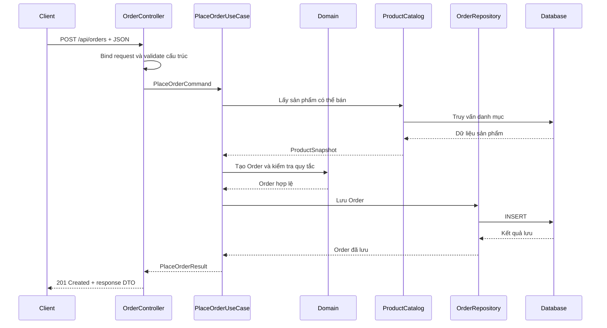

# Giữ controller gọn, không chứa quy tắc nghiệp vụ

Trong module **SOFTWARE_DESIGN_ARCHITECTURE_ARCHITECTURAL_PATTERN_LAYERED** (Học tổ chức phần mềm theo kiến trúc phân tầng), bài học này tập trung vào trách nhiệm của tầng trình bày. Ta dùng API tạo đơn hàng trong một cửa hàng trực tuyến để nhận diện phần việc của controller, cách chuyển yêu cầu HTTP thành lời gọi ca sử dụng, và cách giữ quy tắc nghiệp vụ ở đúng nơi.

Một controller gọn vẫn có công việc rõ ràng: nhận request, kiểm tra dữ liệu ở biên, chuyển đổi dữ liệu giao tiếp, gọi chức năng ứng dụng và tạo HTTP response. Controller trở nên cồng kềnh khi nó tự quyết định chính sách bán hàng, tính toán nghiệp vụ, truy vấn cơ sở dữ liệu hoặc điều phối nhiều bước vốn thuộc tầng ứng dụng và miền.

## 1. Controller đứng ở đâu trong kiến trúc phân tầng?

Tầng trình bày là ranh giới giữa bên ngoài và ứng dụng. Với một REST API Spring, controller là adapter nhận HTTP request và trả HTTP response. Nó biết những khái niệm như:

- Đường dẫn và HTTP method, ví dụ `POST /api/orders`.
- Header, query parameter, path variable và JSON body.
- Mã trạng thái HTTP, header `Location` và định dạng response.
- Cách chuyển lỗi của ứng dụng thành phản hồi HTTP phù hợp.

Controller gọi một ca sử dụng ở tầng ứng dụng. Ca sử dụng điều phối công việc; mô hình miền bảo vệ quy tắc nghiệp vụ; các adapter hạ tầng thực hiện lưu trữ hoặc tích hợp với hệ thống khác.

| Thành phần | Câu hỏi mà thành phần chịu trách nhiệm trả lời |
|---|---|
| Controller | Request HTTP này được tiếp nhận và phản hồi theo giao thức như thế nào? |
| Application service / use case | Để hoàn thành mục tiêu của người dùng, cần phối hợp những bước nào? |
| Domain model | Trạng thái và hành động nào hợp lệ theo quy tắc nghiệp vụ? |
| Repository / infrastructure adapter | Dữ liệu được đọc, ghi hoặc trao đổi với hệ thống ngoài bằng công nghệ nào? |

Ranh giới này là cách tổ chức trách nhiệm trong mã nguồn. Một ứng dụng Spring Boot vẫn có thể đóng gói controller, application, domain và adapter trong cùng một tiến trình. Không cần tách mỗi tầng thành một máy chủ hoặc một dịch vụ riêng.

## 2. Controller nên làm gì?

Một controller có thể thực hiện những công việc gắn trực tiếp với giao thức và dữ liệu đầu vào/đầu ra.

**Tiếp nhận và định tuyến request.** Annotation như `@PostMapping`, `@GetMapping`, `@PathVariable` và `@RequestParam` mô tả endpoint. Spring chuyển request đến đúng phương thức controller.

**Kiểm tra cấu trúc dữ liệu ở biên.** Ví dụ, mã sản phẩm phải có mặt, danh sách dòng hàng không được rỗng, số lượng phải là số dương. Đây là kiểm tra định dạng và điều kiện đầu vào cơ bản trước khi gọi ca sử dụng.

**Chuyển đổi DTO thành lệnh ứng dụng.** JSON request là hợp đồng giao tiếp HTTP. Controller có thể ánh xạ DTO thành command hoặc input model mà use case nhận.

**Gọi ca sử dụng và nhận kết quả.** Controller chuyển quyền xử lý cho application service. Nó không cần biết use case đã gọi bao nhiêu repository hoặc dịch vụ ngoài.

**Tạo response theo HTTP.** Controller chuyển kết quả thành response DTO, chọn status code phù hợp và thêm header cần thiết. Ví dụ, tạo tài nguyên mới thường trả `201 Created` cùng header `Location`.

Các thao tác ánh xạ nhỏ ở controller không phải là quy tắc nghiệp vụ. Không cần tạo thêm một lớp chỉ để chuyển một DTO đơn giản nếu việc đó khiến mã khó theo dõi hơn. Khi ánh xạ phức tạp, dùng mapper riêng có thể làm controller dễ đọc hơn.

## 3. Những việc không nên đặt trong controller

Controller không nên tự quyết định một đơn hàng có được phép tạo hay không theo chính sách bán hàng, tự tính giá cuối cùng, tự thay đổi trạng thái nghiệp vụ hoặc điều phối việc giữ tồn kho. Những quyết định đó cần nằm trong application service hoặc domain model tùy bản chất của quy tắc.

Ví dụ, controller không nên chứa các bước sau:

- Đọc giá sản phẩm từ repository rồi tự tính tổng tiền.
- Kiểm tra tồn kho và quyết định có được bán theo chính sách nghiệp vụ.
- Áp dụng mã giảm giá, thuế hoặc giới hạn số lượng theo từng khách hàng.
- Tự tạo entity JPA và gọi `save()` trực tiếp.
- Gọi nhiều dịch vụ bên ngoài theo một quy trình nghiệp vụ.
- Tự mở, commit hoặc rollback giao dịch cơ sở dữ liệu.
- Tự quyết định một đơn hàng đã thanh toán có được hủy hay không.

Một quy tắc hữu ích để phân loại: nếu quyết định đó phải đúng khi cùng nghiệp vụ được gọi từ REST API, tác vụ nền, message consumer hoặc giao diện dòng lệnh, thì nó không nên chỉ tồn tại trong controller HTTP.

### Phân biệt validation ở biên và quy tắc nghiệp vụ

Hai loại kiểm tra thường bị trộn lẫn:

| Loại kiểm tra | Ví dụ | Nơi phù hợp |
|---|---|---|
| Cấu trúc và định dạng request | Trường bắt buộc, UUID đúng định dạng, danh sách không rỗng, số lượng lớn hơn 0 | DTO và Bean Validation ở tầng trình bày |
| Quy tắc nghiệp vụ | Sản phẩm còn được bán, khách hàng đủ điều kiện mua, đơn được phép hủy ở trạng thái hiện tại | Application/domain |
| Quyền truy cập endpoint | Người dùng đã đăng nhập và có role cần thiết để gọi API | Spring Security hoặc cơ chế bảo vệ ở biên |
| Quyền thực hiện hành động trên tài nguyên | Người gọi có quyền hủy chính đơn hàng này hay không | Use case và chính sách nghiệp vụ/bảo mật phù hợp |

Validation ở controller giúp trả lỗi sớm và nhất quán cho request sai cấu trúc. Tuy nhiên, tầng miền vẫn phải bảo vệ bất biến của nó. Không thể giả định mọi nơi gọi use case đều đi qua controller hoặc mọi dữ liệu đều đã được Bean Validation kiểm tra.

## 4. Theo dấu một request tạo đơn hàng

Giả sử khách hàng gửi request tạo đơn với danh sách sản phẩm và số lượng. Luồng xử lý nên được phân chia như sau:



Sơ đồ chỉ minh họa một luồng đơn giản. Thực tế, application có thể gọi cổng lấy sản phẩm, dịch vụ định giá hoặc dịch vụ tồn kho; domain có thể từ chối thao tác nếu bất biến bị vi phạm. Controller không cần điều phối từng tương tác đó. Nó chỉ cần biết hợp đồng đầu vào và đầu ra của ca sử dụng.

## 5. Ví dụ controller gọn với Java và Spring

### DTO dành cho HTTP

Request DTO biểu diễn dữ liệu mà client được phép gửi. Trong ví dụ này, client không tự khai báo `customerId` để xác định chủ sở hữu đơn hàng; danh tính khách hàng được lấy từ người dùng đã xác thực. Điều này tránh việc client có thể tùy ý gửi mã khách hàng khác và giả làm chủ đơn.

```java
public record CreateOrderRequest(
    @NotEmpty
    List<@Valid CreateOrderItemRequest> items
) {}

public record CreateOrderItemRequest(
    @NotNull UUID productId,
    @Positive int quantity
) {}

public record OrderResponse(
    UUID orderId,
    BigDecimal total,
    String status
) {}
```

`@NotEmpty` kiểm tra danh sách có ít nhất một phần tử; `@Valid` yêu cầu kiểm tra từng phần tử; `@NotNull` và `@Positive` kiểm tra các trường tương ứng. Để Spring thực thi các ràng buộc này, endpoint cần nhận body với `@Valid` và ứng dụng cần cấu hình Bean Validation phù hợp.

### Controller chỉ làm nhiệm vụ ở biên

```java
@RestController
@RequestMapping("/api/orders")
public class OrderController {
    private final PlaceOrderUseCase placeOrder;

    public OrderController(PlaceOrderUseCase placeOrder) {
        this.placeOrder = placeOrder;
    }

    @PostMapping
    public ResponseEntity<OrderResponse> create(
            @Valid @RequestBody CreateOrderRequest request,
            @AuthenticationPrincipal CurrentUser currentUser) {

        var items = request.items().stream()
            .map(item -> new PlaceOrderItem(
                item.productId(),
                item.quantity()
            ))
            .toList();

        var command = new PlaceOrderCommand(
            currentUser.userId(),
            items
        );

        var result = placeOrder.handle(command);

        var response = new OrderResponse(
            result.orderId(),
            result.total(),
            result.status()
        );

        var location = URI.create("/api/orders/" + result.orderId());
        return ResponseEntity.created(location).body(response);
    }
}
```

`CurrentUser` là kiểu principal của ứng dụng, được cấu hình trong Spring Security. Ví dụ giả định endpoint yêu cầu người dùng đã đăng nhập; nếu principal không tồn tại hoặc không đúng kiểu, cấu hình bảo mật cần xử lý trường hợp đó. Controller lấy định danh từ ngữ cảnh xác thực và truyền vào command. Với hệ thống có chính sách phân quyền phức tạp, use case vẫn cần kiểm tra người dùng có được phép thực hiện hành động trên tài nguyên cụ thể hay không.

Controller trên thực hiện các việc ở biên: nhận DTO, chuyển các dòng hàng thành input của use case, gọi use case và tạo response. Nó không truy vấn repository, không tính tổng tiền, không tự kiểm tra tồn kho và không thay đổi trạng thái đơn hàng.

### Hợp đồng của ca sử dụng

Application cung cấp một hợp đồng mà controller có thể gọi:

```java
public interface PlaceOrderUseCase {
    PlaceOrderResult handle(PlaceOrderCommand command);
}

public record PlaceOrderCommand(
    UUID customerId,
    List<PlaceOrderItem> items
) {}

public record PlaceOrderItem(
    UUID productId,
    int quantity
) {}

public record PlaceOrderResult(
    UUID orderId,
    BigDecimal total,
    String status
) {}
```

Tầng ứng dụng chịu trách nhiệm phối hợp việc lấy thông tin sản phẩm, yêu cầu domain tạo đơn, lưu đơn và trả kết quả. Ví dụ rút gọn:

```java
@Service
public class PlaceOrderService implements PlaceOrderUseCase {
    private final ProductCatalog productCatalog;
    private final OrderRepository orderRepository;

    public PlaceOrderService(
            ProductCatalog productCatalog,
            OrderRepository orderRepository) {
        this.productCatalog = productCatalog;
        this.orderRepository = orderRepository;
    }

    @Transactional
    @Override
    public PlaceOrderResult handle(PlaceOrderCommand command) {
        var lines = command.items().stream()
            .map(item -> {
                var product =
                    productCatalog.getSellableProduct(item.productId());

                return new OrderLine(
                    product.id(),
                    item.quantity(),
                    product.price()
                );
            })
            .toList();

        var order = Order.place(command.customerId(), lines);
        var saved = orderRepository.save(order);

        return new PlaceOrderResult(
            saved.id(),
            saved.total(),
            saved.status().name()
        );
    }
}
```

Đây là nơi điều phối các bước và đặt ranh giới giao dịch cho thao tác lưu. Quy tắc như đơn hàng phải có dòng hàng, số lượng hợp lệ hoặc trạng thái nào cho phép chuyển đổi nên được mô hình miền bảo vệ. `ProductCatalog` và `OrderRepository` là các abstraction mà application cần; adapter cụ thể có thể sử dụng JPA, JDBC hoặc API của dịch vụ khác.

Các kiểu `CurrentUser`, `ProductCatalog`, `ProductSnapshot`, `OrderRepository`, `Order`, `OrderLine` và `OrderStatus` là những thành phần minh họa thuộc các phần khác của ứng dụng, không phải định nghĩa đầy đủ trong đoạn mã này.

## 6. Ví dụ controller phình to và cách tách trách nhiệm

Một controller dễ trở nên khó bảo trì khi mỗi endpoint tự làm tất cả:

```java
@PostMapping
public ResponseEntity<?> create(@RequestBody CreateOrderRequest request) {
    var product = productRepository.findById(request.productId())
        .orElseThrow();

    if (product.getStock() < request.quantity()) {
        return ResponseEntity.badRequest().body("Không đủ hàng");
    }

    var total = product.getPrice()
        .multiply(BigDecimal.valueOf(request.quantity()));

    var entity = new OrderEntity();
    entity.setProduct(product);
    entity.setQuantity(request.quantity());
    entity.setTotal(total);

    orderJpaRepository.save(entity);
    product.setStock(product.getStock() - request.quantity());
    productRepository.save(product);

    return ResponseEntity.ok(entity);
}
```

Đoạn mã này có nhiều vấn đề về trách nhiệm:

- Controller biết cách truy vấn và lưu entity JPA.
- Controller tự quyết định điều kiện tồn kho và tính tổng tiền.
- Quy tắc bán hàng chỉ được thực thi khi đi qua endpoint này; tác vụ nền có thể vô tình bỏ qua.
- Việc ghi đơn và cập nhật tồn kho có thể không được đặt trong một ranh giới giao dịch nhất quán.
- Entity lưu trữ bị trả trực tiếp ra API, khiến thay đổi schema có thể ảnh hưởng hợp đồng HTTP.

Cách tách là chuyển quy trình tạo đơn sang `PlaceOrderUseCase`/`PlaceOrderService`, đặt quy tắc của đơn hàng ở domain, và để repository adapter xử lý lưu trữ. Controller chỉ chuyển request thành command và kết quả use case thành response. Nếu nghiệp vụ cập nhật tồn kho cần tính nhất quán, application cần điều phối theo chính sách giao dịch phù hợp; không nên giải quyết bằng cách nhét thêm lệnh repository vào controller.

## 7. Xử lý lỗi mà không làm controller đầy try-catch

Một controller có thể có nhiều endpoint cùng gặp các lỗi như không tìm thấy đơn, dữ liệu không hợp lệ, xung đột trạng thái hoặc lỗi xác thực. Viết `try-catch` lặp lại trong từng phương thức sẽ làm phần xử lý HTTP lấn át luồng chính.

Spring hỗ trợ xử lý lỗi tập trung bằng `@RestControllerAdvice`:

```java
@RestControllerAdvice
public class ApiExceptionHandler {

    @ExceptionHandler(OrderNotFoundException.class)
    ResponseEntity<ApiError> handleNotFound(
            OrderNotFoundException exception) {
        return ResponseEntity.status(HttpStatus.NOT_FOUND)
            .body(new ApiError("ORDER_NOT_FOUND",
                "Không tìm thấy đơn hàng"));
    }

    @ExceptionHandler(OrderStateConflictException.class)
    ResponseEntity<ApiError> handleConflict(
            OrderStateConflictException exception) {
        return ResponseEntity.status(HttpStatus.CONFLICT)
            .body(new ApiError("ORDER_STATE_CONFLICT",
                "Trạng thái đơn hàng không cho phép thao tác này"));
    }
}

public record ApiError(String code, String message) {}
```

Đây là ví dụ rút gọn; ứng dụng cần định nghĩa exception và chính sách ánh xạ lỗi nhất quán. Spring MVC cũng có xử lý mặc định cho nhiều lỗi binding và validation. Có thể tùy chỉnh phản hồi validation tại advice hoặc cơ chế xử lý lỗi tập trung của ứng dụng.

Thông thường:

- `400 Bad Request`: request sai cấu trúc hoặc không vượt qua validation đầu vào.
- `401 Unauthorized`: chưa xác thực hoặc thông tin xác thực không hợp lệ.
- `403 Forbidden`: đã xác thực nhưng không có quyền truy cập.
- `404 Not Found`: tài nguyên không tồn tại hoặc không được phép tiết lộ sự tồn tại tùy chính sách.
- `409 Conflict`: yêu cầu xung đột với trạng thái hiện tại của tài nguyên, ví dụ hủy đơn đã giao.
- `201 Created`: tạo tài nguyên thành công.

Không nên gửi stack trace, câu SQL, thông tin bí mật hoặc thông điệp exception nội bộ ra client. Phản hồi API nên có mã lỗi ổn định và nội dung đủ để client xử lý.

## 8. Ranh giới xác thực và phân quyền

Xác thực trả lời câu hỏi "người gọi là ai?". Phân quyền trả lời "người gọi có được phép làm việc này không?". Spring Security thường xử lý xác thực và các quy tắc truy cập endpoint trước khi controller chạy. Controller có thể nhận principal để truyền danh tính vào command.

Tuy nhiên, quyền thực hiện hành động trên một đơn hàng cụ thể có thể phụ thuộc vào dữ liệu và trạng thái nghiệp vụ. Ví dụ, khách hàng chỉ được xem đơn của mình; nhân viên hỗ trợ có thể xem đơn trong phạm vi được giao; đơn đã giao có thể không còn được hủy. Những kiểm tra đó cần được thực hiện ở nơi có đủ ngữ cảnh, thường là application service hoặc một chính sách miền được gọi bởi use case.

Không nên tin `customerId`, `ownerId` hoặc role nhạy cảm do client tự gửi trong JSON. Lấy danh tính từ ngữ cảnh xác thực và để use case kiểm tra quyền trên tài nguyên cụ thể.

## 9. Kiểm thử controller và use case riêng biệt

Tách trách nhiệm giúp kiểm thử tập trung vào đúng hợp đồng:

| Loại kiểm thử | Điều cần xác minh | Ví dụ |
|---|---|---|
| Web/controller test | Đường dẫn, HTTP method, binding, validation, status code, response DTO | `@WebMvcTest` và `MockMvc` |
| Application test | Use case điều phối đúng, truyền dữ liệu đúng, xử lý kết quả và lỗi | Unit test với fake/mock `ProductCatalog` và `OrderRepository` |
| Domain test | Bất biến và quy tắc nghiệp vụ luôn được giữ | Unit test cho `Order.place`, chuyển trạng thái |
| Integration test | Các adapter và cấu hình hoạt động khi ghép lại | `@SpringBootTest`, database kiểm thử hoặc Testcontainers |

Một web test có thể xác minh request thiếu dòng hàng nhận `400`, còn request hợp lệ gọi use case với command có đúng người dùng và sản phẩm. Test này không cần chứng minh phép tính tổng tiền đúng; đó là trách nhiệm của domain test. Ngược lại, domain test không chứng minh endpoint có trả `201 Created` hoặc header `Location` chính xác; controller test kiểm tra điều đó.

Tránh viết toàn bộ kiểm thử nghiệp vụ thông qua HTTP chỉ vì endpoint đã có sẵn. Cách đó thường làm test chậm, khó khoanh vùng lỗi và khiến quy tắc miền phụ thuộc vào cấu hình web.

## 10. Giữ controller gọn mà không tạo thêm tầng máy móc

Controller gọn không có nghĩa là controller không được có bất kỳ dòng xử lý nào. Những việc như ánh xạ DTO, chọn status code, đọc query parameter, chuẩn hóa biểu diễn ngày giờ hoặc xây dựng header là trách nhiệm hợp lý của tầng trình bày.

Cần cân nhắc tách mapper riêng khi:

- Có nhiều endpoint dùng chung một phép ánh xạ phức tạp.
- Việc chuyển đổi có nhiều nhánh theo loại response.
- Quy tắc biểu diễn dữ liệu cần được tái sử dụng hoặc kiểm thử độc lập.

Cần cân nhắc tạo application service khi:

- Một hành động gồm nhiều bước phối hợp.
- Hành động có thể được gọi từ nhiều adapter đầu vào.
- Cần xác định ranh giới giao dịch, phân quyền hoặc xử lý lỗi ở cấp ca sử dụng.

Không nên tạo interface, mapper hoặc service chỉ để chuyển tiếp một dòng mã nếu chưa có ranh giới trách nhiệm thực sự. Cũng không nên đưa quy tắc nghiệp vụ vào controller chỉ vì endpoint hiện tại là nơi duy nhất gọi nó. Mức độ phân tách nên tương xứng với độ phức tạp và nhu cầu thay đổi của ứng dụng; một ứng dụng CRUD nhỏ không bắt buộc phải áp dụng đầy đủ DDD hoặc một hệ thống phân lớp quá chi tiết.

## 11. Danh sách tự rà soát một controller

Khi xem lại một endpoint, hãy tự hỏi:

1. Phương thức này có chủ yếu xử lý HTTP và chuyển tiếp đến một ca sử dụng không?
2. Validation ở đây có chỉ kiểm tra cấu trúc request, định dạng và điều kiện biên không?
3. Quy tắc nghiệp vụ có còn được bảo vệ khi use case được gọi từ tác vụ nền hoặc adapter khác không?
4. Controller có truy cập repository, entity JPA hoặc dịch vụ ngoài trực tiếp không?
5. Danh tính và dữ liệu nhạy cảm có được lấy từ nguồn đáng tin cậy không?
6. Response có dùng DTO dành cho API và status code phù hợp không?
7. Xử lý lỗi chung có được tập trung để tránh lặp lại ở mọi endpoint không?
8. Có thể kiểm thử hợp đồng HTTP độc lập với kiểm thử nghiệp vụ không?

Một controller được tổ chức tốt giúp người đọc nhìn thấy ngay endpoint nhận dữ liệu gì, gọi ca sử dụng nào và trả kết quả ra sao. Khi chính sách nghiệp vụ thay đổi, nhóm phát triển có thể sửa application hoặc domain mà không phải tìm và sửa cùng một quy tắc trong từng controller. Đó là lợi ích thiết thực của việc giữ tầng trình bày mỏng và có ranh giới rõ ràng.

