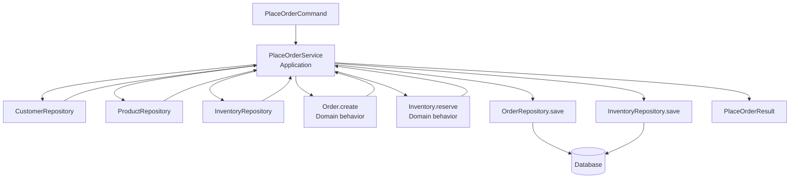

# Điều phối tải dữ liệu, gọi hành vi nghiệp vụ và lưu kết quả

> Chương: **Tầng ứng dụng**

Trong module **SOFTWARE_DESIGN_ARCHITECTURE_ARCHITECTURAL_PATTERN_LAYERED**, chúng ta học cách tổ chức phần mềm theo kiến trúc phân tầng. Bài này tập trung vào công việc trung tâm của tầng Application: nhận yêu cầu của một ca sử dụng, tải dữ liệu cần thiết, gọi các hành vi nghiệp vụ trên mô hình Domain, lưu trạng thái đã thay đổi và trả kết quả cho bên gọi.

Tầng Application đóng vai trò điều phối. Nó biết một ca sử dụng cần thực hiện những bước nào và phối hợp các thành phần ra sao. Các quy tắc quyết định điều gì là hợp lệ vẫn thuộc Domain; cách truy vấn SQL, ánh xạ JPA hay giao tiếp với hệ thống lưu trữ thuộc Infrastructure. Giữ rõ ba trách nhiệm này giúp một ca sử dụng có thể được thực hiện nhất quán và kiểm thử độc lập.

## 1. Một ca sử dụng cần được điều phối như thế nào?

Hãy xét chức năng đặt hàng. Khi khách hàng gửi yêu cầu tạo đơn, hệ thống thường phải:

1. Xác định khách hàng và sản phẩm được yêu cầu.
2. Kiểm tra dữ liệu cần thiết có tồn tại và có thể được sử dụng hay không.
3. Gọi hành vi nghiệp vụ để tạo đơn và giữ các bất biến của đơn hàng.
4. Gọi hành vi nghiệp vụ để giữ chỗ hoặc trừ số lượng tồn kho theo quy tắc của hệ thống.
5. Lưu những thay đổi cần thiết trong cùng ranh giới nhất quán dữ liệu.
6. Trả mã đơn hàng và thông tin kết quả cho bên gọi.

Đây là một **ca sử dụng (use case)**: một mục tiêu mà người dùng hoặc hệ thống bên ngoài muốn đạt được. Tầng Application tổ chức trình tự các bước để đạt mục tiêu đó.

Nếu tất cả các bước nằm trong controller, controller sẽ phải biết cách tải dữ liệu, gọi nhiều đối tượng nghiệp vụ, lưu trữ và quản lý giao dịch. Nếu toàn bộ trình tự lại được đặt trong một entity Domain, entity đó có thể phải biết repository hoặc chi tiết hạ tầng. Application service cung cấp vị trí thích hợp để phối hợp các thành phần mà vẫn giữ từng trách nhiệm ở đúng nơi.

## 2. Luồng điều phối từ yêu cầu đến kết quả

Một luồng đặt hàng điển hình có thể mô tả như sau:



Trình tự có thể thay đổi theo nghiệp vụ thực tế, nhưng vai trò của Application vẫn tương tự:

- **Tải dữ liệu:** lấy những đối tượng hoặc dữ liệu mà ca sử dụng cần để đưa ra quyết định.
- **Gọi hành vi nghiệp vụ:** yêu cầu các đối tượng Domain thực hiện thao tác và tự bảo vệ bất biến của chúng.
- **Lưu kết quả:** yêu cầu các repository lưu trạng thái mới hoặc để cơ chế persistence đồng bộ thay đổi trong giao dịch.
- **Trả kết quả:** cung cấp dữ liệu cần thiết cho bên gọi mà không để lộ chi tiết lưu trữ.

Application không cần biết câu SQL cụ thể. Nó chỉ cần biết hợp đồng mà mình sử dụng, ví dụ `ProductRepository.findById(...)` hoặc `OrderRepository.save(...)`.

## 3. Tải dữ liệu cần thiết trước khi gọi nghiệp vụ

Application service cần xác định dữ liệu nào là đầu vào của ca sử dụng. Với chức năng đặt hàng, command có thể chứa mã khách hàng, mã sản phẩm và số lượng:

```java
public record PlaceOrderCommand(
    UUID customerId,
    UUID productId,
    int quantity
) {}
```

Các repository thể hiện khả năng truy xuất mà Application cần:

```java
public interface CustomerRepository {
    Optional<Customer> findById(UUID customerId);
}

public interface ProductRepository {
    Optional<Product> findById(UUID productId);
}

public interface InventoryRepository {
    Optional<Inventory> findByProductId(UUID productId);
    Inventory save(Inventory inventory);
}

public interface OrderRepository {
    Order save(Order order);
}
```

Đây là các hợp đồng ở phía Application hoặc Domain theo quy ước của dự án. Adapter ở Infrastructure sẽ hiện thực chúng bằng JPA, JDBC, một dịch vụ ngoài hoặc một cơ chế lưu trữ khác.

Khi tải dữ liệu, cần phân biệt hai loại kiểm tra:

- **Kiểm tra khả năng tìm thấy:** khách hàng hoặc sản phẩm có tồn tại không, tài khoản có bị khóa không, dữ liệu liên quan có sẵn không. Application thường điều phối việc tìm dữ liệu và quyết định ca sử dụng phải xử lý trường hợp không tìm thấy như thế nào.
- **Kiểm tra quy tắc nghiệp vụ:** số lượng đặt có hợp lệ không, sản phẩm có được phép bán không, tồn kho có đủ không, khách hàng có thể đặt hàng trong trạng thái hiện tại không. Những quy tắc này nên được bảo vệ bởi hành vi Domain tương ứng, thay vì chỉ kiểm tra bằng các câu `if` rải rác trong Application.

Ví dụ, `Optional.empty()` có thể được chuyển thành lỗi `CustomerNotFoundException` hoặc `ProductNotFoundException` của ứng dụng. Đây là cách biểu diễn tình huống không thể tiếp tục ca sử dụng; nó không phải là quy tắc tính giá hay quy tắc tồn kho.

Chỉ tải dữ liệu mà ca sử dụng thực sự cần. Nếu cần hiển thị danh sách đơn hàng, không nên tải toàn bộ lịch sử và mọi quan hệ của từng đơn chỉ để trả một trang kết quả. Với truy vấn đọc, có thể dùng projection hoặc read model phù hợp. Với ca sử dụng thay đổi trạng thái, thường cần tải aggregate hoặc dữ liệu có đủ thông tin để Domain thực hiện hành vi một cách an toàn.

## 4. Gọi hành vi nghiệp vụ thay vì tự viết lại quy tắc trong Application

Sau khi tải dữ liệu, Application chuyển quyền quyết định nghiệp vụ cho mô hình Domain. Ví dụ, `Order.create(...)` có thể kiểm tra sản phẩm có được bán, số lượng có hợp lệ và tính thành tiền dựa trên giá tại thời điểm đặt hàng. `Inventory.reserve(...)` có thể kiểm tra lượng tồn khả dụng và cập nhật số lượng đã giữ.

Một phần mô hình Domain rút gọn:

```java
public class Order {
    private final UUID id;
    private final UUID customerId;
    private final UUID productId;
    private final BigDecimal unitPrice;
    private final int quantity;
    private final BigDecimal total;

    private Order(UUID id, UUID customerId, UUID productId,
                  BigDecimal unitPrice, int quantity) {
        this.id = id;
        this.customerId = customerId;
        this.productId = productId;
        this.unitPrice = unitPrice;
        this.quantity = quantity;
        this.total = unitPrice.multiply(BigDecimal.valueOf(quantity));
    }

    public static Order create(Customer customer, Product product,
                               int quantity) {
        if (quantity <= 0) {
            throw new InvalidOrderQuantityException();
        }
        if (!product.isSellable()) {
            throw new ProductNotSellableException(product.getId());
        }
        return new Order(UUID.randomUUID(), customer.getId(),
            product.getId(), product.getPrice(), quantity);
    }

    public UUID getId() { return id; }
    public BigDecimal getTotal() { return total; }
}
```

```java
public class Inventory {
    private int availableQuantity;

    public void reserve(int quantity) {
        if (quantity <= 0) {
            throw new InvalidReservationQuantityException();
        }
        if (availableQuantity < quantity) {
            throw new InsufficientInventoryException();
        }
        availableQuantity -= quantity;
    }
}
```

Các ví dụ đã lược bỏ constructor, mapping và một số phương thức truy cập để làm rõ hành vi. Điểm quan trọng là quy tắc tạo đơn và giữ chỗ nằm trong đối tượng nghiệp vụ. Application gọi các method này theo đúng trình tự của ca sử dụng, nhưng không cần biết công thức tính tiền hoặc cách kiểm tra tồn kho bên trong.

Nếu cùng một quy tắc được dùng ở nhiều ca sử dụng, đặt nó trong Domain giúp các điểm gọi có cùng hành vi. Việc lặp lại điều kiện trong nhiều Application service dễ dẫn đến một nơi được cập nhật, nơi khác bị bỏ sót.

## 5. Lưu trạng thái đã thay đổi

Sau khi Domain thực hiện hành vi, Application cần bảo đảm những thay đổi liên quan được lưu theo đúng ranh giới nhất quán của ca sử dụng. Với ví dụ đặt hàng, kết quả có thể gồm đơn hàng mới và số lượng tồn kho đã giảm.

```java
public record PlaceOrderResult(
    UUID orderId,
    BigDecimal total
) {}
```

Một Application service trong Spring có thể điều phối toàn bộ quá trình:

```java
@Service
public class PlaceOrderService implements PlaceOrderUseCase {
    private final CustomerRepository customers;
    private final ProductRepository products;
    private final InventoryRepository inventories;
    private final OrderRepository orders;

    public PlaceOrderService(CustomerRepository customers,
                             ProductRepository products,
                             InventoryRepository inventories,
                             OrderRepository orders) {
        this.customers = customers;
        this.products = products;
        this.inventories = inventories;
        this.orders = orders;
    }

    @Override
    @Transactional
    public PlaceOrderResult execute(PlaceOrderCommand command) {
        Customer customer = customers.findById(command.customerId())
            .orElseThrow(CustomerNotFoundException::new);
        Product product = products.findById(command.productId())
            .orElseThrow(ProductNotFoundException::new);
        Inventory inventory = inventories.findByProductId(product.getId())
            .orElseThrow(InventoryNotFoundException::new);

        Order order = Order.create(customer, product, command.quantity());
        inventory.reserve(command.quantity());

        Order savedOrder = orders.save(order);
        inventories.save(inventory);

        return new PlaceOrderResult(savedOrder.getId(), savedOrder.getTotal());
    }
}
```

Trong ví dụ này, Application thực hiện đúng vai trò điều phối:

1. Tải khách hàng, sản phẩm và tồn kho qua các repository.
2. Gọi `Order.create(...)` để Domain kiểm tra và tạo đơn.
3. Gọi `inventory.reserve(...)` để Domain kiểm tra và cập nhật tồn kho.
4. Yêu cầu lưu đơn hàng và tồn kho đã thay đổi.
5. Trả về mã đơn cùng tổng tiền.

Application không tự tính tổng tiền và không tự trừ tồn kho bằng phép gán trực tiếp. Nó cũng không tạo câu SQL hay thao tác `EntityManager` để ghi dữ liệu. Những chi tiết đó thuộc Domain hoặc adapter persistence.

Trong một ứng dụng JPA, nếu `Inventory` là entity đang được quản lý trong persistence context của giao dịch, thay đổi thuộc tính có thể được lưu tự động nhờ dirty checking khi giao dịch flush. Khi đó lời gọi `inventories.save(inventory)` có thể không cần thiết tùy cách adapter được thiết kế. Ví dụ dùng `save` tường minh để làm rõ hợp đồng lưu trữ; hãy tuân theo cơ chế persistence thực tế của dự án và tránh lưu lặp lại một cách máy móc.

## 6. Đặt ranh giới giao dịch cho ca sử dụng

Một ca sử dụng có thể gồm nhiều lần đọc và ghi. Nếu tạo đơn thành công nhưng cập nhật tồn kho thất bại, hệ thống có thể rơi vào trạng thái không nhất quán. Với dữ liệu nằm trong cùng một cơ sở dữ liệu quan hệ, một giao dịch bao quanh các thao tác cần đi cùng nhau giúp chúng được commit hoặc rollback như một đơn vị.

Trong Spring, `@Transactional` thường được đặt ở method của Application service vì đây là nơi biết toàn bộ phạm vi thao tác của ca sử dụng:

```java
@Transactional
public PlaceOrderResult execute(PlaceOrderCommand command) {
    // Load -> gọi hành vi Domain -> persist -> trả kết quả
}
```

Khi method kết thúc bình thường, Spring commit giao dịch. Nếu có lỗi thuộc quy tắc rollback, thay đổi được rollback. Mặc định của Spring, `RuntimeException` và `Error` kích hoạt rollback; checked exception không tự động rollback trừ khi cấu hình `rollbackFor` hoặc cơ chế tương ứng. Vì vậy, nếu dự án dùng checked exception cho lỗi ca sử dụng, cần cấu hình chính sách rollback rõ ràng.

Một số lưu ý khi thiết kế giao dịch:

- Giữ giao dịch đủ ngắn để tránh khóa dữ liệu quá lâu.
- Không đặt toàn bộ quá trình người dùng suy nghĩ hoặc nhập liệu vào một giao dịch dài.
- Xác định những cập nhật nào phải thành công cùng nhau và đặt ranh giới phù hợp.
- Với tác vụ chỉ đọc, có thể cân nhắc `@Transactional(readOnly = true)` nếu phù hợp với cơ chế persistence.
- Giao dịch cơ sở dữ liệu không tự động bao trùm email, HTTP call hoặc thao tác trên một hệ thống độc lập.

Nếu ca sử dụng cần gửi thông báo sau khi lưu đơn, thường nên phát sự kiện sau khi giao dịch commit hoặc dùng transactional outbox khi cần bảo đảm sự kiện được chuyển đi bền vững. Gọi dịch vụ email bên trong giao dịch không làm cho email có thể rollback cùng database.

## 7. Xử lý đồng thời và các lần thử lại

`@Transactional` bảo vệ một nhóm thao tác theo chính sách giao dịch của cơ sở dữ liệu, nhưng không có nghĩa mọi cuộc đua dữ liệu đều tự biến mất. Hai khách hàng có thể cùng đặt sản phẩm khi tồn kho chỉ còn một đơn vị. Nếu cả hai request đều đọc số lượng là một trước khi cập nhật, kết quả có thể vượt quá số lượng thực tế nếu không có cơ chế kiểm soát đồng thời.

Tùy yêu cầu, adapter persistence có thể dùng khóa phù hợp, chẳng hạn optimistic locking với trường `@Version`, hoặc pessimistic locking khi cần giữ khóa trong lúc cập nhật. Domain vẫn chịu trách nhiệm biểu diễn hành vi `reserve` và từ chối khi không đủ hàng; Application xác định thời điểm thực hiện ca sử dụng và xử lý kết quả xung đột theo chính sách của hệ thống.

Các request cũng có thể được gửi lại khi client không nhận được phản hồi dù server đã commit. Với thao tác tạo đơn có nguy cơ bị lặp, có thể dùng idempotency key hoặc mã yêu cầu duy nhất để nhận diện lần thực hiện, tránh tạo hai đơn cho cùng một ý định. Đây là yêu cầu của ca sử dụng và cần được thiết kế cùng ranh giới lưu trữ phù hợp.

## 8. Những việc Application service nên và không nên làm

| Nên làm ở Application | Nên giao cho Domain hoặc Infrastructure |
|---|---|
| Nhận command của ca sử dụng | Kiểm tra bất biến và quy tắc nghiệp vụ cốt lõi: Domain |
| Tải các đối tượng cần thiết qua repository | Câu SQL, JPQL, mapping JPA và kết nối: Infrastructure |
| Gọi hành vi trên aggregate hoặc domain service | Công thức nghiệp vụ và chuyển trạng thái hợp lệ: Domain |
| Điều phối nhiều thao tác theo trình tự | Chi tiết kỹ thuật gửi HTTP, truy cập file hoặc message broker: Infrastructure |
| Xác định ranh giới giao dịch cho ca sử dụng | Thực thi giao dịch và cơ chế lưu trữ: framework/Infrastructure |
| Trả kết quả của ca sử dụng | Định dạng JSON, HTTP status và header: Presentation |

Application service không nên trở thành nơi chứa tất cả logic chỉ vì nó đang điều phối. Một method dài với hàng loạt điều kiện về giá, trạng thái đơn, hạn mức và tồn kho thường là dấu hiệu quy tắc nghiệp vụ đang bị đặt sai chỗ. Hãy chuyển quyết định đó vào đối tượng Domain có đủ dữ liệu để bảo vệ bất biến.

Ngược lại, Domain không nên gọi trực tiếp repository hoặc phụ thuộc Spring để tự điều phối toàn bộ ca sử dụng. Khi entity tự tải đối tượng khác qua database, việc kiểm thử và hiểu vòng đời nghiệp vụ sẽ khó hơn. Application chịu trách nhiệm tải dữ liệu rồi truyền đối tượng hoặc giá trị cần thiết cho hành vi Domain.

## 9. Kiểm thử trình tự điều phối

Do Application service làm nhiệm vụ phối hợp, có thể kiểm thử nó bằng repository giả (fake) hoặc mock mà không cần dựng database thật. Bài kiểm thử tập trung vào việc ca sử dụng đã tải đúng dữ liệu, gọi hành vi nghiệp vụ, lưu thay đổi và trả kết quả theo mong đợi hay chưa.

Ví dụ minh họa với Mockito:

```java
@ExtendWith(MockitoExtension.class)
class PlaceOrderServiceTest {
    @Mock CustomerRepository customers;
    @Mock ProductRepository products;
    @Mock InventoryRepository inventories;
    @Mock OrderRepository orders;

    @Test
    void createsOrderAndPersistsReservedInventory() {
        // Arrange: cấu hình repository trả về customer, product và inventory.
        // Act: gọi service.execute(command).
        // Assert: kiểm tra OrderRepository.save và InventoryRepository.save
        // được gọi với các đối tượng đã thay đổi; kiểm tra result.
    }
}
```

Đây là khung kiểm thử, phần tạo fixture được lược bỏ để tập trung vào mục tiêu. Nên có các trường hợp như không tìm thấy khách hàng, không tìm thấy sản phẩm, Domain từ chối số lượng và lưu thất bại. Kiểm thử Application có thể xác minh bước nào đã được gọi; kiểm thử Domain riêng xác minh quy tắc cụ thể như không cho đặt số lượng âm hoặc không giữ vượt tồn kho.

Vẫn cần kiểm thử tích hợp cho adapter và giao dịch. Ví dụ, kiểm tra với database thử nghiệm rằng thay đổi tồn kho và việc tạo đơn cùng rollback khi một thao tác lưu thất bại. Unit test với mock không thể chứng minh mapping JPA, khóa đồng thời hoặc hành vi commit/rollback của cơ sở dữ liệu là chính xác.

## 10. Một checklist khi thiết kế ca sử dụng

Khi triển khai một Application service, hãy lần lượt trả lời:

1. Mục tiêu của ca sử dụng là gì và command cần chứa dữ liệu nào?
2. Cần tải những đối tượng hoặc read model nào? Có đang tải quá nhiều dữ liệu không?
3. Những quy tắc nào phải được kiểm tra bởi hành vi Domain?
4. Thứ tự gọi các hành vi có ý nghĩa gì? Có bước nào cần xảy ra trước bước khác không?
5. Những thay đổi nào phải được lưu cùng nhau? Ranh giới giao dịch nằm ở đâu?
6. Kết quả trả về cần thông tin gì cho bên gọi và có làm lộ entity hoặc chi tiết persistence không?
7. Trường hợp lỗi, request lặp và cập nhật đồng thời được xử lý theo chính sách nào?

Nếu có thể trả lời các câu hỏi này một cách rõ ràng, Application service thường sẽ có cấu trúc dễ đọc: tải dữ liệu, gọi hành vi, lưu thay đổi và trả kết quả. Khi một method bắt đầu chứa nhiều quy tắc hoặc chi tiết kỹ thuật, hãy xem lại ranh giới trách nhiệm trước khi thêm tiếp logic vào đó.

## Ghi nhớ

- Tầng Application điều phối một ca sử dụng bằng cách tải dữ liệu, gọi hành vi Domain, lưu thay đổi và trả kết quả.
- Repository là hợp đồng truy xuất/lưu trữ mà Application sử dụng; SQL, JPA mapping và kết nối thuộc Infrastructure.
- Quy tắc và bất biến nên được thực thi bởi hành vi Domain; Application quyết định trình tự phối hợp các hành vi đó.
- Ranh giới `@Transactional` thường bao quanh ca sử dụng cần tính nhất quán dữ liệu; giao dịch database không tự bao gồm hệ thống bên ngoài.
- Cần xem xét khóa đồng thời, idempotency và chính sách rollback khi ca sử dụng có cập nhật quan trọng.
- Kiểm thử Application tập trung vào trình tự điều phối; kiểm thử Domain và kiểm thử tích hợp xác minh quy tắc cùng hành vi persistence.
