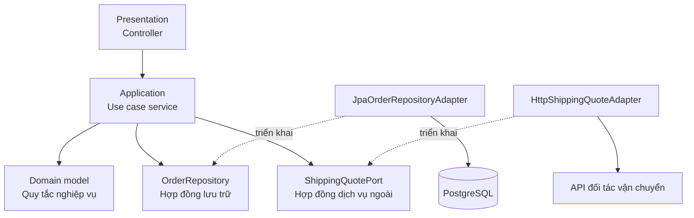

# Xác định tầng được gọi repository và hệ thống ngoài theo hợp đồng đã chọn

Trong kiến trúc phân tầng, tầng ứng dụng thường là nơi điều phối một ca sử dụng: lấy dữ liệu cần thiết, gọi mô hình nghiệp vụ, yêu cầu lưu kết quả và phối hợp với các khả năng do hệ thống khác cung cấp. Vì vậy, application service thường là nơi gọi các hợp đồng truy cập dữ liệu (repository port) và hợp đồng giao tiếp ra ngoài (outbound port). Tầng hạ tầng cung cấp adapter thực thi các hợp đồng đó bằng JPA, JDBC, HTTP client, SDK hoặc công nghệ cụ thể.

Điểm quyết định không chỉ là “lớp nào gọi lớp nào”, mà còn là **ai sở hữu hợp đồng** và **ai thực thi hợp đồng**. Hợp đồng nên nằm ở phía cần khả năng đó và được diễn đạt bằng ngôn ngữ ổn định của ứng dụng. Adapter ở phía hạ tầng phụ thuộc vào hợp đồng để triển khai. Cách tổ chức cụ thể có thể khác nhau giữa các dự án; điều quan trọng là giữ hướng phụ thuộc có chủ đích và không để quy tắc nghiệp vụ phụ thuộc vào chi tiết lưu trữ hoặc nhà cung cấp bên ngoài.

## Tầng ứng dụng điều phối, adapter thực hiện I/O

Xét chức năng tạo đơn hàng. Ứng dụng cần tìm sản phẩm, lấy báo giá vận chuyển từ một dịch vụ đối tác, tạo đơn hàng và lưu đơn hàng. Các phần có trách nhiệm khác nhau:

- Controller nhận HTTP request, kiểm tra dữ liệu ở biên giao tiếp và gọi use case.
- Application service điều phối các bước của use case, quyết định khi nào cần đọc, ghi hoặc gọi một khả năng bên ngoài.
- Domain model bảo vệ bất biến và thực hiện quy tắc nghiệp vụ như số lượng hợp lệ, trạng thái đơn hàng và cách tính tổng tiền theo chính sách.
- Repository adapter thực hiện truy vấn và lưu dữ liệu bằng công nghệ lưu trữ đã chọn.
- Adapter tích hợp bên ngoài gửi yêu cầu tới dịch vụ vận chuyển và chuyển phản hồi của nhà cung cấp thành kiểu dữ liệu mà ứng dụng hiểu.

Application service gọi qua giao diện hợp đồng. Khi chạy, dependency injection của Spring cung cấp adapter phù hợp. Nhờ vậy, application service biết **cần** tra cứu sản phẩm, lưu đơn hàng hoặc lấy báo giá, nhưng không cần biết dữ liệu nằm trong PostgreSQL hay dịch vụ vận chuyển dùng REST, SOAP hoặc SDK nào.



Các mũi tên nét đứt biểu diễn quan hệ triển khai hợp đồng trong mã nguồn. Lúc chạy, application service gọi phương thức trên interface; đối tượng adapter được Spring inject sẽ nhận lời gọi và thực hiện I/O. Do đó, luồng gọi lúc chạy có thể đi từ application tới adapter, trong khi mã nguồn application chỉ phụ thuộc vào interface.

## Quyết định tầng nào gọi repository

Repository là một hợp đồng cung cấp khả năng tìm và lưu đối tượng hoặc dữ liệu mà use case cần. Application service thường gọi repository vì nó điều phối việc lấy trạng thái ban đầu và lưu trạng thái sau khi nghiệp vụ xử lý. Controller không nên gọi thẳng repository vì như vậy giao diện sẽ tự điều phối nghiệp vụ và dễ bỏ qua các bước dùng chung. Domain entity cũng không nên tự gọi repository để tải hoặc lưu chính nó: mô hình nghiệp vụ nên làm việc với trạng thái được truyền vào, không tự thực hiện I/O.

Ví dụ hợp đồng repository mà use case tạo đơn hàng cần:

```java
public interface ProductRepository {
    Optional<Product> findSellableById(ProductId id);
}

public interface OrderRepository {
    void save(Order order);
}
```

Trong ví dụ này, các interface được đặt ở phần cốt lõi mà use case sử dụng, chẳng hạn `application.port.out`. Application service gọi chúng:

```java
@Service
class CreateOrderService implements CreateOrderUseCase {
    private final ProductRepository products;
    private final OrderRepository orders;
    private final ShippingQuotePort shippingQuotes;

    CreateOrderService(
            ProductRepository products,
            OrderRepository orders,
            ShippingQuotePort shippingQuotes) {
        this.products = products;
        this.orders = orders;
        this.shippingQuotes = shippingQuotes;
    }

    @Override
    public CreateOrderResult handle(CreateOrderCommand command) {
        var product = products.findSellableById(command.productId())
                .orElseThrow(ProductNotAvailableException::new);

        var shipping = shippingQuotes.quote(
                command.destination(), command.quantity());

        var order = Order.create(
                command.customerId(), product, command.quantity(), shipping.amount());
        orders.save(order);

        return CreateOrderResult.from(order);
    }
}
```

Đây là ví dụ rút gọn; các kiểu dữ liệu và quy tắc cụ thể phụ thuộc bài toán. Application service kiểm soát thứ tự: tìm sản phẩm có thể bán, lấy báo giá, yêu cầu domain tạo đơn hàng và lưu kết quả. `Order.create(...)` chịu trách nhiệm bảo vệ bất biến của đơn hàng; service không cần tự cài đặt lại mọi quy tắc đó.

### Hợp đồng repository nên nằm ở đâu?

Không có một vị trí duy nhất đúng cho mọi repository. Hãy xem hợp đồng đang diễn đạt điều gì và phần nào sở hữu ý nghĩa đó:

| Loại hợp đồng | Vị trí thường phù hợp | Lý do |
|---|---|---|
| Repository lưu và tải aggregate theo ngôn ngữ miền nghiệp vụ | Domain, nếu domain sở hữu khái niệm repository đó | Hợp đồng diễn đạt vòng đời và ranh giới của aggregate |
| Cổng đọc dữ liệu phục vụ riêng một use case hoặc báo cáo | Application | Hình dạng kết quả và truy vấn được quyết định bởi nhu cầu của use case |
| Interface lưu trữ đơn giản trong một layered application | Application hoặc domain tùy quy ước thiết kế | Chọn một quy ước nhất quán và tránh để domain phụ thuộc ngược vào application |

Ví dụ, `OrderRepository` có thể thuộc domain nếu nó diễn đạt cách lưu và tải aggregate `Order` theo ngôn ngữ nghiệp vụ. `OrderSummaryQuery` có thể thuộc application nếu nó trả một projection chỉ phục vụ màn hình tổng hợp đơn hàng. Cả hai vẫn có thể được adapter hạ tầng triển khai bằng cùng một cơ sở dữ liệu.

Điều cần tránh là đặt interface ở tầng cao hơn rồi buộc tầng thấp hơn phụ thuộc ngược vào tầng đó theo cách phá vỡ quy tắc phụ thuộc. Domain không nên import một application service chỉ để gọi repository. Nếu domain sở hữu hợp đồng repository, application có thể sử dụng hợp đồng đó vì application phụ thuộc vào domain. Nếu application sở hữu một query port riêng, adapter hạ tầng có thể phụ thuộc vào application port để triển khai.

Repository cũng không nhất thiết phải là một CRUD tổng quát cho mọi bảng. Với aggregate, phương thức nên phản ánh thao tác có ý nghĩa như `findById` hoặc `save`. Với truy vấn đọc phức tạp, một query port trả về projection phù hợp với use case có thể rõ ràng và hiệu quả hơn việc tải cả aggregate rồi chuyển đổi nhiều lần.

## Quyết định tầng nào gọi hệ thống ngoài

Hệ thống ngoài có thể là cổng thanh toán, dịch vụ vận chuyển, nhà cung cấp định danh, dịch vụ gửi email, hệ thống thuế, kho tệp hoặc API của một đối tác. Application service thường gọi outbound port khi một use case cần khả năng đó. Adapter hạ tầng thực hiện lời gọi mạng, chuyển đổi giao thức và xử lý chi tiết SDK.

Ví dụ hợp đồng lấy báo giá vận chuyển:

```java
public interface ShippingQuotePort {
    ShippingQuote quote(Destination destination, int quantity);
}

public record ShippingQuote(Money amount, String serviceCode) {}
```

Hợp đồng dùng kiểu dữ liệu của ứng dụng (`Destination`, `Money`, `ShippingQuote`), không để lộ kiểu `WebClient`, `ResponseEntity` hay DTO riêng của nhà cung cấp. Adapter chuyển đổi giữa hợp đồng ổn định và giao thức cụ thể:

```java
@Component
class HttpShippingQuoteAdapter implements ShippingQuotePort {
    private final WebClient webClient;

    HttpShippingQuoteAdapter(WebClient shippingWebClient) {
        this.webClient = shippingWebClient;
    }

    @Override
    public ShippingQuote quote(Destination destination, int quantity) {
        var response = webClient.post()
                .uri("/quotes")
                .bodyValue(new PartnerQuoteRequest(
                        destination.postalCode(), quantity))
                .retrieve()
                .bodyToMono(PartnerQuoteResponse.class)
                .block();

        return new ShippingQuote(
                Money.of(response.amount(), response.currency()),
                response.serviceCode());
    }
}
```

Đoạn mã minh họa cách chuyển đổi, đã lược bỏ cấu hình timeout, xác thực, kiểm tra phản hồi và xử lý lỗi. Những chi tiết đó thuộc adapter vì chúng gắn với giao thức và nhà cung cấp. Nếu đối tác thay đổi cấu trúc JSON, adapter có thể được cập nhật mà không buộc domain model phải biết cấu trúc mới.

### Vì sao domain không tự gọi API?

Domain model nên tập trung vào quyết định và quy tắc nghiệp vụ. Ví dụ, domain có thể xác định một đơn hàng có đủ điều kiện giao hàng miễn phí hay không dựa trên tổng tiền và chính sách được cung cấp. Domain không nên tự tạo HTTP request để hỏi đối tác vận chuyển. Application service có thể gọi `ShippingQuotePort`, nhận kết quả rồi đưa dữ liệu cần thiết vào domain để domain quyết định hoặc tạo trạng thái phù hợp.

Trong một số thiết kế, domain có thể định nghĩa interface cho một chính sách hoặc khả năng mà quy tắc miền cần sử dụng. Điều đó không có nghĩa entity tự mở kết nối mạng. Application vẫn điều phối thời điểm gọi; adapter vẫn thực hiện I/O. Ranh giới cụ thể phụ thuộc việc hợp đồng biểu diễn một khái niệm miền hay một bước phối hợp của use case.

## Chọn hợp đồng theo ý nghĩa, không theo công nghệ

Một hợp đồng tốt mô tả khả năng mà phía gọi cần, với tên và kiểu dữ liệu phù hợp ngôn ngữ của ứng dụng. Trước khi tạo interface, hãy xác định:

1. Use case cần làm gì: tải aggregate, lưu thay đổi, lấy báo giá hay gửi thông báo?
2. Ai sở hữu ý nghĩa của thao tác: domain hay application?
3. Dữ liệu đầu vào và đầu ra nào ổn định, không phụ thuộc JPA hoặc nhà cung cấp?
4. Lỗi nào có ý nghĩa với use case: không tìm thấy, từ chối nghiệp vụ, tạm thời không khả dụng hay lỗi kỹ thuật?
5. Ai chịu trách nhiệm về timeout, retry, xác thực kết nối, chuyển đổi DTO và quan sát vận hành?

Không đưa `JpaRepository`, `EntityManager`, `WebClient`, `HttpResponse` hoặc lớp SDK của đối tác vào chữ ký port nếu application không thực sự cần phụ thuộc vào chúng. Những kiểu đó làm hợp đồng gắn chặt với một công nghệ và khiến việc thay adapter khó hơn. Tương tự, không nên trả một entity JPA trực tiếp qua controller; adapter hoặc tầng ứng dụng nên chuyển nó thành kiểu dữ liệu phù hợp với ranh giới tương ứng.

Đừng tạo interface chỉ để đổi tên một lời gọi nếu nó không thể hiện một ranh giới có ý nghĩa, không cần thay thế hoặc không giúp kiểm thử. Ngược lại, khi một use case cần hai nhà cung cấp khác nhau hoặc cần kiểm thử mà không kết nối hệ thống thật, một port rõ ràng tạo ra điểm thay thế hữu ích.

## Xử lý giao dịch khi có cả repository và hệ thống ngoài

Giao dịch cơ sở dữ liệu có thể bảo đảm một nhóm thao tác lưu trữ cùng thành công hoặc rollback theo cấu hình. Nó không tự biến lời gọi HTTP tới đối tác thành một phần nguyên tử của giao dịch đó. Nếu application service giữ transaction mở trong lúc chờ API ngoài, thời gian giữ kết nối và khóa có thể kéo dài; nếu API ngoài thành công nhưng transaction cơ sở dữ liệu rollback, hai hệ thống có thể ở trạng thái không đồng nhất.

Với một lời gọi đọc như lấy báo giá, có thể thực hiện lời gọi ngoài trước rồi mở transaction ngắn để lưu kết quả, sau khi đã xác nhận dữ liệu đầu vào cần thiết. Với thao tác có tác dụng phụ như thu tiền, gửi email hoặc tạo vận đơn, cần thiết kế trạng thái và khả năng phục hồi rõ ràng. Một cách thường dùng là lưu trạng thái chờ trong cơ sở dữ liệu, gọi đối tác bằng khóa idempotency, rồi ghi nhận kết quả ở transaction tiếp theo. Khi cần bảo đảm phát sự kiện sau khi lưu dữ liệu, transactional outbox giúp ghi thay đổi nghiệp vụ và thông điệp cần gửi trong cùng transaction; một tiến trình riêng chuyển tiếp thông điệp và có thể thử lại.

Không phải mọi tích hợp đều cần saga hoặc outbox. Chọn cơ chế dựa trên hậu quả khi một bước thất bại, yêu cầu nhất quán và khả năng thử lại của đối tác. Với mọi lời gọi mạng, cần cân nhắc timeout hữu hạn, giới hạn retry, backoff, xử lý lỗi rõ ràng và idempotency khi thao tác có thể được gửi lặp. Adapter thường thực hiện phần lớn chính sách kỹ thuật; application quyết định ý nghĩa nghiệp vụ của kết quả như tiếp tục, từ chối hay đưa use case vào trạng thái chờ.

## Kiểm thử các hợp đồng và ranh giới

Việc tách hợp đồng khỏi adapter giúp kiểm thử từng phần độc lập:

| Mức kiểm thử | Cách kiểm tra | Ví dụ |
|---|---|---|
| Unit test application | Thay port bằng fake hoặc mock | Khi sản phẩm không tồn tại, service không gọi cổng báo giá và không lưu đơn hàng |
| Unit test domain | Kiểm tra quy tắc không phụ thuộc I/O | Đơn hàng từ chối số lượng không hợp lệ |
| Integration test repository adapter | Dùng cơ sở dữ liệu kiểm thử | Adapter JPA lưu và tải đúng aggregate |
| Integration/contract test outbound adapter | Dùng HTTP server giả hoặc môi trường thử của nhà cung cấp | Adapter ánh xạ đúng request, response và lỗi của API đối tác |
| End-to-end test | Chạy luồng từ giao diện tới các thành phần tích hợp | Tạo đơn hàng và xác nhận trạng thái cuối cùng |

Unit test của application service có thể kiểm tra thứ tự tương tác và nhánh xử lý mà không cần khởi động Spring hoặc kết nối thật. Integration test xác nhận adapter tương thích với cơ sở dữ liệu hay API. End-to-end test hữu ích để kiểm tra cấu hình tích hợp tổng thể, nhưng thường chậm và khó chẩn đoán hơn nên không cần dùng nó cho mọi quy tắc.

## Ví dụ lựa chọn trong một use case

Với chức năng tạo đơn hàng, hãy lần theo nhu cầu:

| Nhu cầu | Thành phần điều phối hoặc xử lý | Hợp đồng / triển khai |
|---|---|---|
| Nhận dữ liệu từ trình duyệt | Controller | HTTP request DTO và use case input |
| Tìm sản phẩm có thể bán | Application service gọi repository | `ProductRepository`; adapter JPA hoặc JDBC |
| Kiểm tra đơn hàng hợp lệ | Domain model | Phương thức tạo/cập nhật aggregate và bất biến |
| Lấy báo giá vận chuyển | Application service gọi outbound port | `ShippingQuotePort`; adapter HTTP tới đối tác |
| Lưu đơn hàng | Application service gọi repository | `OrderRepository`; adapter lưu trữ |
| Trả kết quả cho client | Controller | Response DTO và mã HTTP |

Nếu yêu cầu thay đổi, chẳng hạn chuyển từ API vận chuyển đối tác A sang đối tác B, phần cần thay thường là adapter và cấu hình kết nối, miễn là hợp đồng vẫn đáp ứng cùng ý nghĩa. Nếu quy tắc tính phí vận chuyển thay đổi, phần domain hoặc application sở hữu chính sách đó cần được điều chỉnh theo thiết kế. Nếu thay đổi cách lưu aggregate, repository adapter có thể đổi từ JPA sang JDBC mà use case vẫn sử dụng cùng hợp đồng.

Khi tổ chức một chức năng mới, hãy xác định use case cần khả năng nào, đặt hợp đồng ở phía sở hữu nhu cầu, để application service điều phối và để adapter hạ tầng thực hiện I/O. Cách làm này giữ cho luồng xử lý dễ theo dõi, cho phép kiểm thử không cần hệ thống thật và giúp thay đổi công nghệ mà không kéo chi tiết triển khai vào quy tắc nghiệp vụ.
