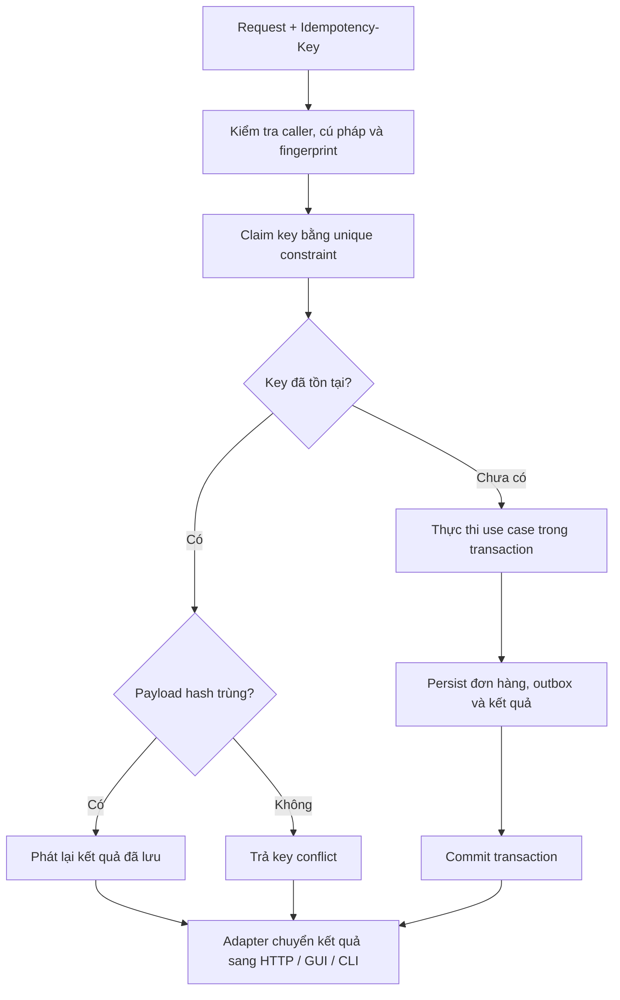

# Chọn ranh giới giao dịch, chống xử lý lặp và hợp đồng kết quả

Bài học này thuộc chương **Tầng ứng dụng** của module `SOFTWARE_DESIGN_ARCHITECTURE_ARCHITECTURAL_PATTERN_LAYERED`, trong chương trình **học tổ chức phần mềm theo kiến trúc phân tầng**. Tầng ứng dụng điều phối các ca sử dụng: nó kết hợp các thành phần nghiệp vụ, truy cập dữ liệu và dịch vụ cần thiết để hoàn thành một yêu cầu. Khi một ca sử dụng ghi dữ liệu, ba quyết định có ảnh hưởng trực tiếp đến độ tin cậy là: giao dịch bắt đầu và kết thúc ở đâu, request gửi lại được xử lý thế nào, và kết quả được biểu diễn ra sao cho caller.

Ba quyết định này liên quan chặt chẽ. Ranh giới giao dịch xác định thay đổi dữ liệu nào phải thành công hoặc thất bại cùng nhau. Cơ chế chống xử lý lặp bảo vệ hệ thống khi client retry hoặc gửi trùng request. Hợp đồng kết quả cho biết ca sử dụng hoàn thành, bị từ chối theo nghiệp vụ hay gặp lỗi ngoài dự kiến. Trong ứng dụng Java/Spring, các quyết định đó thường được thể hiện ở application service, transaction manager, repository và các adapter như HTTP controller hoặc CLI handler.

Sau bài học, bạn có thể chọn ranh giới giao dịch phù hợp với một use case; giải thích vì sao kiểm tra trước khi ghi không đủ để chống request đồng thời; thiết kế idempotency key; và xây dựng hợp đồng kết quả không phụ thuộc vào HTTP hay một framework cụ thể.

## 1. Ba vấn đề cần giải quyết cùng nhau

Giả sử khách hàng gửi yêu cầu đặt hàng. Ứng dụng cần kiểm tra điều kiện đặt hàng, tạo đơn, ghi các dòng đơn hàng, cập nhật lượng tồn và thông báo cho thành phần giao hàng. Nếu chỉ nhìn từng thao tác riêng lẻ, ta có thể vô tình để lại một đơn hàng chưa đủ dòng, trừ tồn kho nhưng không tạo được đơn, hoặc gửi thông báo dù giao dịch lưu dữ liệu đã rollback.

Hãy phân biệt ba câu hỏi:

| Quyết định | Câu hỏi | Mục tiêu |
|---|---|---|
| Ranh giới giao dịch | Những thay đổi dữ liệu nào phải cùng commit hoặc cùng rollback? | Giữ trạng thái nhất quán |
| Chống xử lý lặp | Nếu cùng một yêu cầu được gửi lại do timeout, retry hoặc click nhiều lần thì điều gì xảy ra? | Tránh tạo tác dụng phụ trùng lặp và trả kết quả nhất quán |
| Hợp đồng kết quả | Caller nhận được những kết quả nghiệp vụ nào và lỗi nào? | Giúp mỗi adapter phản hồi đúng mà không biết chi tiết nội bộ |

Đừng xem ba phần này như các tiện ích thêm vào sau khi viết use case. Chúng cần được thiết kế ngay quanh hành vi mà use case cam kết.

## 2. Chọn ranh giới giao dịch theo ca sử dụng

### Giao dịch là đơn vị thay đổi dữ liệu nguyên tử

Giao dịch cơ sở dữ liệu gom một nhóm thao tác đọc/ghi thành một đơn vị. Với giao dịch quan hệ theo ACID, các thuộc tính thường được mô tả là:

- **Atomicity:** hoặc tất cả thay đổi trong giao dịch được commit, hoặc các thay đổi đó bị rollback.
- **Consistency:** giao dịch đưa dữ liệu từ một trạng thái hợp lệ sang trạng thái hợp lệ theo các ràng buộc được hệ thống bảo vệ.
- **Isolation:** các giao dịch đồng thời được cô lập theo mức isolation đã cấu hình; mức độ ngăn hiện tượng đọc/ghi xen kẽ phụ thuộc hệ quản trị và isolation level.
- **Durability:** sau khi commit thành công, dữ liệu được lưu bền vững theo cam kết của hệ quản trị.

Giao dịch không tự động làm cho mọi quy tắc nghiệp vụ đúng. Chẳng hạn, hai request đồng thời cùng đọc thấy còn một sản phẩm rồi cùng trừ tồn kho có thể gây bán vượt tồn nếu thao tác không có khóa, điều kiện cập nhật nguyên tử hoặc isolation phù hợp. Cần phối hợp transaction với constraint, optimistic/pessimistic locking hoặc câu lệnh cập nhật có điều kiện tùy bài toán.

### Ranh giới thường đặt ở application service

Một nguyên tắc thực tế là đặt ranh giới giao dịch quanh **một ca sử dụng cần tính nhất quán dữ liệu**. Application service biết các bước nào cùng tạo nên kết quả của use case, nên đây thường là nơi phù hợp để bắt đầu và kết thúc giao dịch.

Ví dụ, `PlaceOrderService` có thể cần lưu đơn hàng, các dòng hàng và bản ghi outbox trong cùng một transaction. Nếu bất kỳ thao tác ghi bắt buộc nào thất bại, tất cả thay đổi đó cần rollback. Controller chỉ nhận request và gọi use case; repository chỉ thực hiện thao tác lưu trữ. Để mỗi repository method tự mở một transaction độc lập có thể khiến một phần use case đã commit trước khi phần khác thất bại.

```java
@Service
public class PlaceOrderService {
    private final CustomerRepository customers;
    private final OrderRepository orders;
    private final OutboxRepository outbox;

    public PlaceOrderService(CustomerRepository customers,
                             OrderRepository orders,
                             OutboxRepository outbox) {
        this.customers = customers;
        this.orders = orders;
        this.outbox = outbox;
    }

    @Transactional
    public PlaceOrderResult execute(PlaceOrderCommand command) {
        var customer = customers.findActiveById(command.customerId());
        if (customer.isEmpty()) {
            return new PlaceOrderResult.CustomerUnavailable();
        }

        var decision = Order.place(customer.get(), command.productIds());
        if (decision instanceof Order.Decision.Rejected rejected) {
            return new PlaceOrderResult.Rejected(rejected.reason());
        }

        var order = ((Order.Decision.Accepted) decision).order();
        orders.save(order);
        outbox.save(OutboxMessage.orderPlaced(order));
        return new PlaceOrderResult.Created(order.id(), order.status());
    }
}
```

Đây là ví dụ minh họa cấu trúc; các kiểu domain và repository được lược bớt. Những thay đổi trong database của `orders.save` và `outbox.save` tham gia cùng transaction nếu chúng dùng cùng transaction manager và cùng cơ sở dữ liệu. Kết quả nghiệp vụ bị từ chối được trả về trước khi ghi dữ liệu nên giao dịch có thể kết thúc bình thường mà không thay đổi trạng thái.

### Transaction không nên bao trùm mọi thứ

Một transaction dài làm tăng thời gian giữ connection, khóa và tài nguyên; đồng thời tăng khả năng deadlock hoặc xung đột. Đặc biệt, tránh giữ transaction database mở trong khi gọi một dịch vụ HTTP chậm, chờ người dùng, tải tệp hoặc gửi email. Database không thể rollback một email đã gửi hay một thao tác ở dịch vụ từ xa.

Hãy xác định phần cần nguyên tử trong cùng một resource trước. Với một transaction database, có thể commit các thay đổi cục bộ và bản ghi outbox cùng nhau; một worker gửi thông điệp sau commit. Nếu một quy trình bắt buộc phối hợp nhiều dịch vụ độc lập, hãy xem xét saga, compensating action hoặc quy trình có trạng thái thay vì giả định một `@Transactional` thông thường bao phủ được mọi dịch vụ.

### Cách `@Transactional` hoạt động trong Spring

Spring thường áp dụng transaction bằng proxy hoặc cơ chế weaving. Khi một lời gọi đi qua proxy, transaction được mở hoặc tham gia theo propagation, sau đó commit hoặc rollback khi phương thức kết thúc. Một số điểm cần hiểu rõ:

- `Propagation.REQUIRED` là mặc định phổ biến: tham gia transaction hiện có hoặc tạo transaction mới nếu chưa có.
- `readOnly = true` là gợi ý/cấu hình tối ưu cho transaction đọc tùy provider; nó không phải cơ chế bảo vệ tuyệt đối ngăn mọi câu lệnh ghi.
- Theo mặc định phổ biến của Spring, `RuntimeException` và `Error` làm rollback; checked exception không tự động rollback trừ khi cấu hình `rollbackFor` phù hợp.
- Gọi một phương thức `@Transactional` khác trong cùng object bằng self-invocation thường không đi qua proxy, nên annotation ở phương thức được gọi có thể không được áp dụng như mong đợi.
- Transaction gắn với luồng thực thi và transaction manager; không mặc định truyền sang một thread mới hoặc tác vụ `@Async`.

Vì vậy, đặt annotation lên mọi method chưa chắc tạo ra ranh giới đúng. Cần kiểm tra đường gọi thực tế, transaction manager được dùng và loại exception có thể thoát khỏi phương thức.

### Chọn phạm vi vừa đủ

| Tình huống | Cách tiếp cận thường phù hợp |
|---|---|
| Một use case ghi nhiều bảng trong cùng database | Một transaction ở application service bao trùm các thay đổi cần nguyên tử |
| Một truy vấn chỉ đọc | Có thể dùng transaction đọc với `readOnly = true` nếu phù hợp với provider và yêu cầu nhất quán |
| Một tác vụ gồm nhiều bước độc lập, có thể tiếp tục sau lỗi | Chia thành các bước có trạng thái và ranh giới commit rõ ràng |
| Gọi API/email sau khi lưu dữ liệu | Commit dữ liệu trước; dùng outbox hoặc cơ chế retry có kiểm soát cho tác vụ bên ngoài |
| Nhiều dịch vụ có database riêng | Xem xét saga hoặc workflow; transaction cục bộ không tạo atomicity xuyên dịch vụ |

## 3. Chống xử lý lặp khi client retry

### Vì sao request có thể đến nhiều lần?

Client gửi request nhưng không nhận được response đúng hạn. Điều đó không cho biết server chưa xử lý hay đã xử lý xong nhưng response bị mất. Client có thể retry; proxy, message broker hoặc người dùng cũng có thể gửi lại. Với thao tác đọc, lặp thường không gây thay đổi. Với thao tác tạo đơn, thanh toán, đăng ký hoặc trừ tồn, lặp có thể tạo ra tác dụng phụ ngoài ý muốn.

**Idempotency** là tính chất mà việc thực hiện lại cùng một thao tác với cùng định danh yêu cầu không tạo thêm tác dụng phụ sau lần xử lý đầu tiên; hệ thống thường trả lại kết quả đã lưu hoặc kết quả tương đương. Đây là cam kết ở mức thao tác nghiệp vụ, không có nghĩa mọi câu lệnh trong hệ thống tự nhiên chỉ chạy một lần.

Ví dụ, client tạo một `Idempotency-Key` ngẫu nhiên cho một lần người dùng xác nhận thanh toán. Nếu request timeout và client gửi lại cùng key, server nhận biết đây là cùng một thao tác logic. Nếu người dùng chủ động tạo một thanh toán mới, client phải tạo key mới.

### Thiết kế idempotency key

Một key hữu ích cần có phạm vi và thời hạn rõ ràng:

- Key được tạo cho một thao tác logic, thường ở client hoặc adapter tiếp nhận trước lần gửi đầu tiên; mọi lần retry của thao tác đó dùng lại key.
- Phạm vi key nên gắn với tenant/người gọi và loại thao tác, ví dụ `(tenant_id, operation, idempotency_key)`, để tránh va chạm giữa người dùng hoặc endpoint khác nhau.
- Lưu fingerprint/hash của payload đã chuẩn hóa. Nếu cùng key nhưng payload khác, trả kết quả xung đột thay vì dùng nhầm kết quả cũ.
- Lưu kết quả đủ để phát lại theo hợp đồng, cùng định danh tài nguyên hoặc trạng thái hoàn thành. Không lưu bí mật hoặc dữ liệu nhạy cảm không cần thiết.
- Quy định thời gian lưu key phù hợp với cửa sổ retry và yêu cầu nghiệp vụ. Xóa key quá sớm có thể cho phép một request cũ tạo tác dụng phụ lần nữa.

Ví dụ bảng idempotency có thể chứa:

| Trường | Mục đích |
|---|---|
| `tenant_id`, `operation`, `idempotency_key` | Khóa duy nhất trong phạm vi đã chọn |
| `request_hash` | Phát hiện cùng key nhưng payload khác |
| `state` | Trạng thái như PROCESSING hoặc COMPLETED nếu mô hình cần công khai trạng thái xử lý |
| `result_type`, `result_payload` | Kết quả nghiệp vụ đã lưu để phát lại |
| `resource_id`, `created_at`, `expires_at` | Liên kết tài nguyên và quản lý thời gian lưu |

Ràng buộc unique ở database trên bộ khóa là thành phần quan trọng. Chỉ làm `SELECT` kiểm tra key chưa tồn tại rồi mới `INSERT` là không đủ: hai request đồng thời có thể cùng đọc thấy chưa có bản ghi và cùng bắt đầu xử lý.

### Xử lý cạnh tranh một cách nguyên tử

Với thay đổi nằm trong cùng database, một mẫu phổ biến là dùng thao tác insert-if-absent dựa trên unique constraint để giành quyền xử lý key. Trong cùng transaction, hệ thống:

1. Xác thực caller và kiểm tra cú pháp/định dạng request.
2. Tính fingerprint của payload và thử tạo bản ghi idempotency theo khóa duy nhất.
3. Nếu tạo được bản ghi, request hiện tại là request xử lý đầu tiên; thực hiện use case.
4. Ghi thay đổi nghiệp vụ, bản ghi outbox nếu có và kết quả idempotency trong cùng transaction.
5. Commit tất cả cùng nhau. Nếu transaction rollback, bản ghi claim và thay đổi nghiệp vụ cũng rollback.
6. Nếu không tạo được bản ghi vì key đã tồn tại, đọc bản ghi hiện có: payload hash khác thì trả lỗi key conflict; kết quả đã hoàn tất thì phát lại kết quả đó.

Một cách triển khai trên PostgreSQL có thể dùng `INSERT ... ON CONFLICT DO NOTHING` thay vì dựa vào việc bắt exception unique violation trong một transaction đã bị đánh dấu rollback-only. Chi tiết khóa và mức cô lập cần được xác minh theo database cụ thể. Khi hai request cạnh tranh cùng key, unique constraint buộc chúng phối hợp; request thua cuộc chỉ được quyết định sau khi kết quả của request thắng cuộc được commit hoặc rollback.

Nếu thiết kế tách việc claim thành transaction commit riêng và giữ trạng thái `PROCESSING`, cần thêm lease/timeout, cơ chế phục hồi khi worker chết và quy tắc cho request đến trong lúc đang xử lý. Không được để bản ghi PROCESSING vĩnh viễn khiến key không thể dùng lại. Với mô hình một transaction bao trọn claim, thay đổi nghiệp vụ và kết quả, trạng thái trung gian chưa commit thường không cần được các request khác nhìn thấy.

### Idempotency không thay thế mọi bảo vệ dữ liệu

Idempotency key giải quyết việc nhận diện cùng một request logic. Nó không thay thế:

- Unique constraint cho dữ liệu phải duy nhất theo nghiệp vụ, ví dụ một mã hóa đơn hoặc một giao dịch thanh toán bên ngoài.
- Kiểm tra quyền và xác thực ở mỗi request.
- Kiểm soát cạnh tranh trên tài nguyên, ví dụ trừ tồn kho bằng câu lệnh có điều kiện hoặc optimistic locking.
- Deduplication ở consumer khi thông điệp được giao ít nhất một lần.

Một client có thể vô tình tạo key mới cho mỗi lần retry; khi đó server xem đó là các thao tác khác nhau. Vì vậy, hợp đồng API cần hướng dẫn rõ client giữ nguyên key cho lần retry của cùng một thao tác. Với các thao tác tài chính, còn cần khóa nghiệp vụ và đối soát với nhà cung cấp thanh toán; chỉ có key phía ứng dụng chưa đủ cho toàn bộ hệ thống.

## 4. Thiết kế hợp đồng kết quả của use case

### Kết quả nghiệp vụ khác response HTTP

Application service nên trả kết quả có ý nghĩa với ca sử dụng. Nó không nên trả `ResponseEntity`, mã HTTP, đối tượng servlet, `CommandLineRunner` hay kiểu widget của GUI. Adapter ở tầng trình bày sẽ chuyển kết quả đó thành định dạng riêng của kênh.

Một hợp đồng kết quả thường cần biểu diễn:

- Thành công và dữ liệu cần thiết cho bước tiếp theo, ví dụ ID đơn hàng và trạng thái.
- Kết quả từ chối có thể dự đoán theo nghiệp vụ, ví dụ khách hàng không khả dụng hoặc mặt hàng không thể đặt.
- Kết quả chưa tìm thấy hoặc xung đột trạng thái khi đó là phần của hợp đồng use case.
- Lỗi kỹ thuật hoặc lỗi bất ngờ, thường được biểu diễn bằng exception và xử lý ở ranh giới phù hợp.

Không phải mọi hệ thống đều cần một kiểu `Result` tổng quát. Có thể dùng sealed interface, kiểu dữ liệu riêng, exception nghiệp vụ có chủ đích hoặc một quy ước khác. Điều quan trọng là caller phân biệt được kết quả dự kiến với lỗi ngoài dự kiến.

### Ví dụ hợp đồng kết quả bằng sealed interface

Với Java hỗ trợ sealed types, có thể định nghĩa một tập kết quả đóng:

```java
public sealed interface PlaceOrderResult {
    record Created(UUID orderId, OrderStatus status)
            implements PlaceOrderResult {}

    record CustomerUnavailable()
            implements PlaceOrderResult {}

    record Rejected(OrderRejectionReason reason)
            implements PlaceOrderResult {}
}
```

Caller có thể xử lý rõ từng trường hợp. Một HTTP controller có thể ánh xạ `Created` thành `201 Created`, `CustomerUnavailable` thành `404` hoặc một mã nghiệp vụ đã thỏa thuận, và `Rejected` thành `409` hay response validation phù hợp. CLI có thể in thông báo tương ứng và trả mã thoát. GUI có thể hiển thị thông báo hoặc chuyển màn hình. Application không phải biết những lựa chọn trình bày đó.

```java
return switch (result) {
    case PlaceOrderResult.Created created ->
            ResponseEntity.created(orderUri(created.orderId()))
                    .body(toResponse(created));
    case PlaceOrderResult.CustomerUnavailable ignored ->
            ResponseEntity.notFound().build();
    case PlaceOrderResult.Rejected rejected ->
            ResponseEntity.status(HttpStatus.CONFLICT)
                    .body(toErrorResponse(rejected.reason()));
};
```

Đây là minh họa cách adapter HTTP ánh xạ hợp đồng; status cụ thể phải theo hợp đồng API của sản phẩm. Nếu dùng Java version chưa hỗ trợ pattern matching cho switch như trên, có thể dùng `instanceof` hoặc visitor.

### Kết quả dự kiến và exception

Một quy tắc hữu ích:

- Dùng kết quả nghiệp vụ tường minh cho tình huống dự kiến mà caller cần quyết định bước tiếp theo, như bị từ chối do trạng thái hiện tại.
- Dùng exception cho lỗi kỹ thuật hoặc lỗi không thể xử lý như một kết quả bình thường, ví dụ database unavailable, lỗi serialize nội bộ hoặc vi phạm điều kiện bất ngờ.
- Không nuốt exception rồi trả về `null` hoặc một kết quả thành công giả.
- Không để thông báo exception nội bộ trở thành thông điệp công khai cho người dùng.

Ranh giới này phụ thuộc vào ngữ nghĩa use case. Ví dụ “không tìm thấy đơn hàng” có thể là kết quả bình thường của một truy vấn tìm kiếm; ở một thao tác yêu cầu hủy một đơn bắt buộc phải tồn tại, nó có thể được biểu diễn thành kết quả từ chối rõ ràng. Hãy chọn một quy ước nhất quán và ghi rõ trong hợp đồng.

### Kết quả trả về ảnh hưởng thế nào đến commit/rollback?

Trong Spring, việc phương thức `@Transactional` trả về một object kiểu `Result` không tự làm transaction rollback. Nếu phương thức trả `Rejected` sau khi đã ghi một số dữ liệu, transaction thường vẫn commit trừ khi có exception phù hợp, transaction được đánh dấu rollback-only hoặc có cơ chế điều khiển rõ ràng.

Vì vậy:

- Kiểm tra các điều kiện từ chối trước khi ghi khi có thể.
- Nếu từ chối xảy ra sau khi đã thay đổi dữ liệu và những thay đổi đó không được phép tồn tại, hãy rollback một cách tường minh: ném exception được cấu hình rollback, dùng `TransactionAspectSupport.currentTransactionStatus().setRollbackOnly()` khi thực sự cần, hoặc tổ chức transaction bằng `TransactionTemplate` để điều khiển rõ hơn.
- Đừng dùng exception cho mọi nhánh nghiệp vụ chỉ vì muốn rollback; exception có thể làm luồng điều khiển khó hiểu và tạo log nhiễu. Chọn kết quả hay exception theo hợp đồng, rồi xác định rõ trạng thái transaction.

Một kết quả chỉ được xem là thành công sau khi transaction commit thành công. Spring transaction interceptor thực hiện commit khi lời gọi phương thức qua proxy kết thúc; lỗi commit có thể xảy ra sau khi thân phương thức đã tạo ra object kết quả. Adapter nhận kết quả từ lời gọi proxy sau khi interceptor hoàn tất, nên vẫn cần xử lý lỗi commit như lỗi thực thi use case.

## 5. Kết hợp idempotency, transaction và hợp đồng kết quả

Một luồng tạo đơn có thể phối hợp ba phần như sau:



Để sơ đồ này đúng trong môi trường đồng thời, bước claim phải là thao tác nguyên tử được bảo vệ bởi unique constraint; một lần đọc trước khi ghi không đủ. Với mô hình lưu cùng transaction, thay đổi nghiệp vụ và kết quả idempotency commit cùng nhau. Nếu commit thất bại, không có kết quả thành công nào được lưu để phát lại. Request retry sau đó có thể giành quyền xử lý và thực hiện lại use case.

Kết quả được lưu để phát lại nên là hợp đồng ổn định của use case hoặc một biểu diễn đã phiên bản hóa. Nếu chỉ lưu một response HTTP thô, logic idempotency sẽ gắn chặt với một adapter. Có thể lưu `result_type`, các trường kết quả và version; HTTP/GUI/CLI sau đó chuyển kết quả đó thành cách trình bày phù hợp. Nếu cùng key chỉ được hỗ trợ trong một endpoint, việc lưu response đã chuẩn hóa theo hợp đồng endpoint cũng có thể hợp lý, nhưng cần ghi rõ phạm vi.

## 6. Tác dụng phụ bên ngoài và transactional outbox

Giả sử sau khi tạo đơn, ứng dụng cần phát `OrderPlaced` đến message broker. Nếu gửi message trước khi commit database, consumer có thể nhận sự kiện cho một đơn hàng cuối cùng bị rollback. Nếu commit database trước rồi gửi message, ứng dụng có thể dừng giữa hai bước và message không bao giờ được gửi.

**Transactional outbox** giải quyết khoảng trống này bằng cách ghi bản ghi sự kiện vào bảng outbox trong cùng transaction với thay đổi nghiệp vụ. Một tiến trình riêng đọc các bản ghi đã commit và gửi chúng đến broker; sau khi gửi, nó đánh dấu hoặc lưu checkpoint. Nhờ vậy, việc tạo dữ liệu và ghi ý định phát sự kiện có cùng ranh giới commit.

Outbox thường cung cấp giao nhận ít nhất một lần (at-least-once), không tự đảm bảo consumer chỉ xử lý một lần. Worker có thể gửi thành công rồi chết trước khi đánh dấu đã gửi, dẫn đến gửi lại. Consumer cần idempotent hoặc lưu message ID đã xử lý trong cùng transaction với thay đổi của consumer. Nếu cần thứ tự theo aggregate, cần thêm partition/key hoặc sequence và quy tắc xử lý thứ tự.

Không nên gửi email hoặc gọi API thanh toán tùy tiện ngay bên trong transaction database rồi cho rằng rollback sẽ hoàn tác được. Hãy phân biệt dữ liệu cục bộ có thể rollback với tác dụng phụ ở hệ thống khác. Với thanh toán, thường cần một workflow có trạng thái, idempotency key được gửi đến nhà cung cấp nếu họ hỗ trợ, và quy trình đối soát/compensation khi kết quả không rõ ràng.

## 7. Kiểm thử các cam kết của use case

Kiểm thử cần tập trung vào hành vi có thể quan sát, đặc biệt là lỗi giữa chừng và request đồng thời.

| Cam kết | Kiểm thử nên có | Điều cần xác nhận |
|---|---|---|
| Transaction nguyên tử | Gây lỗi sau khi lưu một phần dữ liệu | Không còn thay đổi một phần sau rollback |
| Ranh giới use case | Gọi use case qua Spring proxy với database kiểm thử | Các repository cùng tham gia transaction theo cấu hình mong muốn |
| Idempotency tuần tự | Gửi hai lần cùng key và payload | Chỉ tạo một tài nguyên; lần sau nhận lại kết quả đã lưu |
| Idempotency đồng thời | Gửi song song nhiều request cùng key | Unique constraint/claim nguyên tử ngăn xử lý trùng |
| Key conflict | Dùng cùng key với payload khác | Request thứ hai bị từ chối theo hợp đồng |
| Hợp đồng kết quả | Kiểm tra từng nhánh success và business rejection | Adapter ánh xạ đúng từng kết quả; application không phụ thuộc HTTP |
| Outbox | Commit thành công và mô phỏng worker gửi lại | Sự kiện không bị mất; consumer chịu được giao nhận lặp |

Với Spring, integration test dùng database thực tế hoặc Testcontainers có thể kiểm tra transaction và unique constraint sát hành vi production hơn mock repository. Test đồng thời nên tạo nhiều request thực sự chạy song song và xác nhận số bản ghi/tác dụng phụ cuối cùng. Một test tuần tự hai lần không đủ chứng minh cơ chế chống race condition. Cũng cần kiểm tra cấu hình transaction rollback cho checked exception nếu use case có thể ném loại exception đó.

## 8. Những sai lầm thường gặp

1. **Mỗi repository tự commit một phần use case.** Khi bước sau thất bại, dữ liệu đã commit ở bước trước vẫn còn. Hãy đặt transaction quanh nhóm thay đổi cần nguyên tử.
2. **Giữ transaction mở trong khi gọi dịch vụ từ xa.** Điều này giữ connection/lock lâu và không tạo atomicity xuyên hệ thống. Dùng outbox hoặc workflow phù hợp.
3. **Chỉ kiểm tra key bằng câu SELECT.** Hai request đồng thời có thể cùng vượt qua kiểm tra. Cần unique constraint và thao tác claim nguyên tử.
4. **Tạo key mới mỗi lần retry.** Server không thể nhận ra đó là cùng một thao tác. Client cần giữ key cho đến khi có kết quả xác định hoặc hết thời hạn retry.
5. **Dùng cùng key cho payload khác.** Điều này có thể phát lại nhầm kết quả. Lưu fingerprint và từ chối key conflict.
6. **Cho rằng trả `Result.Error` tự rollback.** Spring thường commit nếu phương thức kết thúc bình thường. Phải xác định rõ có thay đổi nào cần rollback.
7. **Trả mã HTTP từ application service.** Điều này buộc use case biết giao thức. Hãy trả kết quả nghiệp vụ và để adapter ánh xạ.
8. **Giả định outbox bảo đảm exactly-once.** Worker hoặc broker có thể giao lại. Consumer vẫn cần xử lý lặp an toàn.

## 9. Cách ra quyết định

Khi thiết kế một use case, hãy đi theo thứ tự:

1. Xác định trạng thái nào phải nhất quán nếu use case thành công; nhóm các thao tác database đó vào một transaction ngắn và rõ.
2. Liệt kê những tác dụng phụ nằm ngoài database; chuyển chúng sang outbox hoặc workflow có retry/compensation nếu cần.
3. Xác định request có thể bị retry hoặc gửi trùng hay không. Với thao tác tạo thay đổi quan trọng, định nghĩa phạm vi key, fingerprint, thời hạn lưu và cách xử lý cạnh tranh.
4. Liệt kê kết quả nghiệp vụ mà caller cần phân biệt; tạo hợp đồng kết quả ổn định, độc lập với HTTP/GUI/CLI.
5. Quy định lỗi nào là business outcome, lỗi nào là exception; xác định nhánh nào commit và nhánh nào rollback.
6. Kiểm thử cả trường hợp thành công, từ chối, lỗi giữa chừng, retry tuần tự và request đồng thời.

Ví dụ, với `PlaceOrder`, một thiết kế có thể dùng một transaction để lưu order, order lines và outbox; unique key để một lần xác nhận chỉ tạo một đơn; và `PlaceOrderResult` để biểu diễn `Created`, `CustomerUnavailable` hoặc `Rejected`. HTTP controller chuyển kết quả thành status/JSON, CLI chuyển thành thông báo/mã thoát. Nếu database lỗi, exception đi qua ranh giới transaction để rollback; nếu client retry cùng key sau timeout, server trả lại kết quả đã lưu thay vì tạo đơn thứ hai.

Ranh giới giao dịch, idempotency và hợp đồng kết quả tạo nên cam kết đáng tin cậy của tầng ứng dụng. Chọn đúng ranh giới giúp dữ liệu không bị ghi dở dang; nhận diện đúng request lặp giúp retry an toàn; và hợp đồng rõ ràng giúp nhiều kênh giao tiếp dùng chung một ca sử dụng mà không kéo chi tiết trình bày vào nghiệp vụ.
