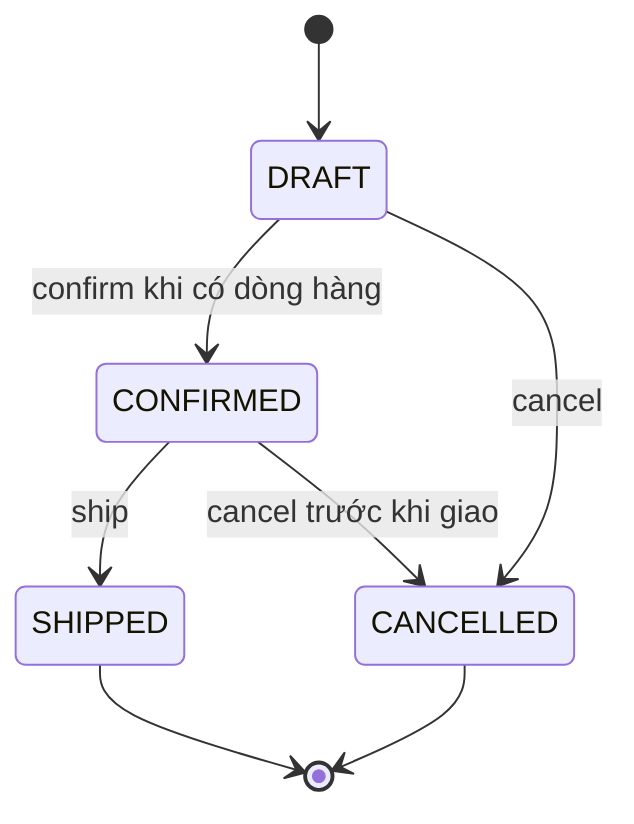
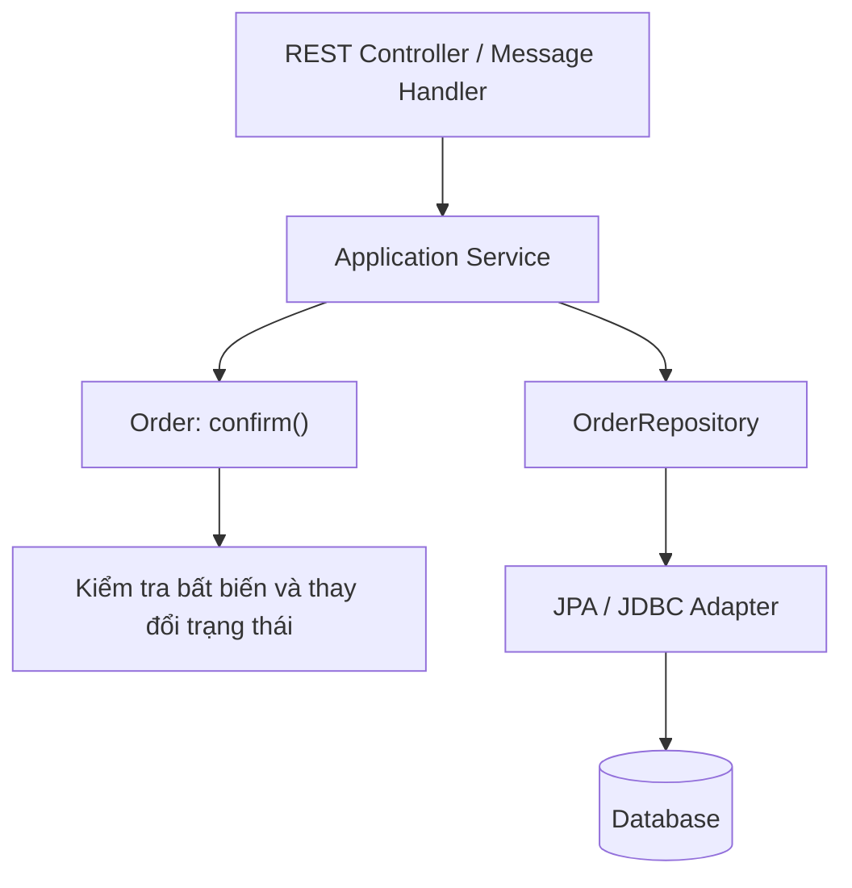

# Biểu diễn khái niệm, trạng thái và hành vi bằng ngôn ngữ nghiệp vụ

*Chương: Tầng nghiệp vụ*

Bài học này thuộc module `SOFTWARE_DESIGN_ARCHITECTURE_ARCHITECTURAL_PATTERN_LAYERED`, có mục tiêu **Học tổ chức phần mềm theo kiến trúc phân tầng**. Trong kiến trúc phân tầng, tầng nghiệp vụ biểu diễn những khái niệm mà tổ chức thực sự làm việc cùng, trạng thái mà các khái niệm đó có thể có và hành vi làm thay đổi trạng thái theo quy tắc của hoạt động kinh doanh.

Một hệ thống bán hàng không chỉ xử lý các bản ghi có cột `order_id`, `status` và `total`. Nó cần hiểu thế nào là một đơn hàng, khi nào đơn hàng được xác nhận, vì sao đơn đã giao không thể bị hủy và tổng tiền được tính theo quy tắc nào. Khi những ý nghĩa này được thể hiện rõ trong mô hình và tên gọi của mã nguồn, người đọc có thể hiểu phần mềm bằng ngôn ngữ gần với nghiệp vụ thay vì phải suy ra quy tắc từ các câu lệnh cập nhật dữ liệu rời rạc.

## 1. Tầng nghiệp vụ biểu diễn điều gì?

Tầng nghiệp vụ tập trung vào câu hỏi: **hệ thống phải tuân theo những quy tắc nào để thực hiện đúng hoạt động của tổ chức?** Nó thường chứa:

- **Khái niệm nghiệp vụ:** Đơn hàng, khách hàng, hợp đồng, khoản thanh toán, lịch hẹn, hạn mức tín dụng.
- **Trạng thái:** Nháp, đã xác nhận, đang giao, đã giao, đã hủy; đang chờ duyệt, được duyệt hoặc bị từ chối.
- **Hành vi:** Thêm sản phẩm vào đơn, xác nhận đơn, ghi nhận thanh toán, gia hạn hợp đồng.
- **Bất biến và điều kiện:** Số lượng phải dương, tổng tiền không âm, không thể hủy đơn đã giao, không thể duyệt một yêu cầu đã bị từ chối.
- **Các khái niệm hỗ trợ:** Giá tiền, khoảng thời gian, địa chỉ, chính sách chiết khấu hoặc quy tắc phân bổ.

Đây là trách nhiệm về ý nghĩa nghiệp vụ, không phải nơi chứa mọi thao tác mà ứng dụng cần thực hiện. Nhận HTTP request, chuyển đổi JSON, mở transaction hay chạy câu SQL là những trách nhiệm thuộc các tầng hoặc thành phần khác. Tầng nghiệp vụ có thể được gọi bởi nhiều ca sử dụng và nhiều kênh đầu vào, nhưng không cần biết yêu cầu đến từ REST API, tác vụ nền hay giao diện quản trị.

Ví dụ, một API và một tác vụ nhập đơn hàng đều có thể yêu cầu xác nhận đơn. Cả hai phải tuân theo cùng điều kiện: đơn phải còn ở trạng thái nháp và có ít nhất một dòng hàng. Nếu điều kiện được đặt trong mô hình đơn hàng, các đường gọi khác nhau vẫn áp dụng cùng một quy tắc.

## 2. Dùng ngôn ngữ nghiệp vụ để đặt tên cho mô hình

Tên trong mã nguồn nên phản ánh cách người làm nghiệp vụ gọi sự vật và hành động. Trong một hệ thống đặt hàng, những tên như `Order`, `OrderLine`, `confirm()`, `cancel()`, `ship()` và `OrderStatus` diễn đạt ý nghĩa rõ hơn các tên kỹ thuật như `DataObject`, `updateFlag()` hoặc `processStep2()`.

Một nhóm phát triển có thể thống nhất một số thuật ngữ:

| Thuật ngữ nghiệp vụ | Ý nghĩa cần thống nhất |
|---|---|
| Đơn hàng (Order) | Yêu cầu mua một tập hợp sản phẩm của khách hàng |
| Dòng hàng (Order line) | Một sản phẩm cùng số lượng và giá áp dụng trong đơn |
| Xác nhận (Confirm) | Chuyển đơn hợp lệ từ nháp sang trạng thái đã xác nhận |
| Giao hàng (Ship) | Ghi nhận đơn đã rời quy trình chuẩn bị để giao |
| Hủy (Cancel) | Kết thúc đơn theo điều kiện cho phép của quy trình |

Điều quan trọng không phải là dùng tiếng Anh hay tiếng Việt, mà là cùng một khái niệm được gọi nhất quán và có định nghĩa rõ ràng. Nếu bộ phận kinh doanh dùng từ “xác nhận” để nói về việc khách hàng chấp thuận báo giá, còn nhóm phát triển dùng từ đó cho thao tác duyệt nội bộ, hai bên cần làm rõ trước khi đặt tên lớp và phương thức.

Ngôn ngữ nghiệp vụ cũng giúp nhận ra những khái niệm tưởng giống nhau nhưng có ý nghĩa khác nhau. Ví dụ, “đã thanh toán” không nhất thiết đồng nghĩa với “đã giao”; “đã hủy” khác với “bị từ chối”. Nếu gộp chúng thành một cờ boolean như `completed`, mã nguồn sẽ khó thể hiện chính xác các trường hợp mà quy trình cần xử lý.

Có thể ghi nhận thuật ngữ chung trong tài liệu thiết kế, mô tả ca sử dụng, tên API và tên lớp. Cách làm này thường được gọi là *ubiquitous language* trong DDD. Dùng chung ngôn ngữ là một thực hành hữu ích; áp dụng đầy đủ Domain-Driven Design không phải điều kiện bắt buộc để xây dựng tầng nghiệp vụ rõ ràng.

## 3. Phân biệt đối tượng có định danh và đối tượng được nhận diện bằng giá trị

Hai kiểu mô hình thường gặp là entity và value object. Chúng giúp biểu diễn bản chất của khái niệm, nhưng không phải mọi lớp Java đều cần được phân loại máy móc theo hai kiểu này.

### Entity: đối tượng có vòng đời và định danh

Một entity được nhận diện bằng định danh của nó. Hai đối tượng có thể có cùng dữ liệu nhưng vẫn là hai entity khác nhau vì chúng đại diện cho hai sự vật khác nhau.

Ví dụ, hai đơn hàng của cùng một khách hàng có thể có cùng danh sách sản phẩm và tổng tiền, nhưng vẫn là hai đơn hàng riêng vì có mã đơn hàng khác nhau. Trong suốt vòng đời, trạng thái và dữ liệu của một đơn hàng có thể thay đổi mà định danh của nó vẫn giữ nguyên.

### Value object: đối tượng được nhận diện bằng giá trị

Một value object được nhận diện bởi các giá trị cấu thành. Ví dụ, hai giá tiền có cùng số tiền và cùng loại tiền tệ có thể được xem là tương đương. Địa chỉ giao hàng hoặc khoảng thời gian cũng có thể được mô hình hóa như value object nếu đó là cách miền nghiệp vụ sử dụng chúng.

Value object thường nên bất biến: sau khi tạo, các giá trị của nó không thay đổi. Khi cần một giá trị mới, ta tạo một đối tượng mới. Điều này làm giảm những thay đổi ngầm và giúp phép so sánh có ý nghĩa rõ ràng.

| Đặc điểm | Entity | Value object |
|---|---|---|
| Nhận diện | Định danh ổn định | Giá trị cấu thành |
| Vòng đời | Có thể thay đổi trạng thái theo thời gian | Thường bất biến |
| So sánh | Chủ yếu theo định danh | Theo giá trị |
| Ví dụ | Đơn hàng, khách hàng, hợp đồng | Tiền, địa chỉ, khoảng thời gian |

Một lưu ý quan trọng: entity trong mô hình nghiệp vụ không tự động đồng nghĩa với entity của JPA. Entity nghiệp vụ nói về định danh và vòng đời trong miền. `@Entity` của JPA nói về cách framework ánh xạ một lớp vào cơ sở dữ liệu. Một dự án có thể dùng cùng một lớp cho cả hai mục đích, hoặc tách mô hình nghiệp vụ khỏi persistence entity để giảm phụ thuộc vào ORM. Đây là quyết định kiến trúc và có chi phí đi kèm, không phải một quy tắc tuyệt đối.

## 4. Đặt trạng thái và hành vi cạnh nhau

Một mô hình thể hiện nghiệp vụ tốt thường giữ dữ liệu liên quan cùng những hành vi hợp lệ của dữ liệu đó. Nếu một đơn hàng có trạng thái và các quy tắc chuyển trạng thái, lớp `Order` là nơi tự nhiên để thể hiện những hành vi như xác nhận, giao hàng hoặc hủy đơn.

Ví dụ, đơn hàng có vòng đời đơn giản:



Quy tắc ở ví dụ này là: chỉ đơn nháp mới được thêm dòng hàng; chỉ đơn nháp có ít nhất một dòng hàng mới được xác nhận; chỉ đơn đã xác nhận mới được giao; đơn đã giao không thể hủy. Trạng thái không nên bị thay đổi tùy tiện từ bên ngoài vì như vậy các điều kiện có thể bị bỏ qua.

Một mô hình Java minh họa:

```java
public enum OrderStatus {
    DRAFT,
    CONFIRMED,
    SHIPPED,
    CANCELLED
}
```

```java
public record OrderLine(
        String productCode,
        int quantity,
        BigDecimal unitPrice) {

    public OrderLine {
        if (productCode == null || productCode.isBlank()) {
            throw new IllegalArgumentException(
                    "Mã sản phẩm không được để trống");
        }
        if (quantity <= 0) {
            throw new IllegalArgumentException(
                    "Số lượng phải lớn hơn 0");
        }
        Objects.requireNonNull(unitPrice, "unitPrice");
        if (unitPrice.signum() < 0) {
            throw new IllegalArgumentException(
                    "Đơn giá không được âm");
        }
    }

    public BigDecimal subtotal() {
        return unitPrice.multiply(BigDecimal.valueOf(quantity));
    }
}
```

`OrderLine` là một value object nhỏ: nó chứa mã sản phẩm, số lượng và đơn giá áp dụng cho dòng hàng. Constructor kiểm tra điều kiện để một dòng hàng không thể được tạo với số lượng bằng không hoặc đơn giá âm. Phương thức `subtotal()` biểu diễn cách tính thành tiền của dòng hàng.

Mô hình đơn hàng có thể giữ trạng thái và các hành vi:

```java
public class Order {
    private final UUID id;
    private final List<OrderLine> lines = new ArrayList<>();
    private OrderStatus status = OrderStatus.DRAFT;

    public Order(UUID id) {
        this.id = Objects.requireNonNull(id, "id");
    }

    public void addLine(OrderLine line) {
        ensureDraft();
        lines.add(Objects.requireNonNull(line, "line"));
    }

    public BigDecimal total() {
        return lines.stream()
                .map(OrderLine::subtotal)
                .reduce(BigDecimal.ZERO, BigDecimal::add);
    }

    public void confirm() {
        ensureDraft();
        if (lines.isEmpty()) {
            throw new IllegalStateException(
                    "Đơn hàng phải có ít nhất một dòng hàng");
        }
        status = OrderStatus.CONFIRMED;
    }

    public void ship() {
        if (status != OrderStatus.CONFIRMED) {
            throw new IllegalStateException(
                    "Chỉ đơn đã xác nhận mới được giao");
        }
        status = OrderStatus.SHIPPED;
    }

    public void cancel() {
        if (status == OrderStatus.SHIPPED
                || status == OrderStatus.CANCELLED) {
            throw new IllegalStateException(
                    "Không thể hủy đơn ở trạng thái hiện tại");
        }
        status = OrderStatus.CANCELLED;
    }

    private void ensureDraft() {
        if (status != OrderStatus.DRAFT) {
            throw new IllegalStateException(
                    "Chỉ đơn nháp mới được thay đổi dòng hàng");
        }
    }

    public UUID id() {
        return id;
    }

    public OrderStatus status() {
        return status;
    }
}
```

Đoạn mã sử dụng `UUID` làm định danh minh họa và `BigDecimal` cho phép tính tiền để tránh sai số nhị phân thường gặp khi dùng `double`. Trong ứng dụng tài chính thực tế, nên mô hình hóa cả loại tiền tệ, quy tắc làm tròn và độ chính xác; chỉ lưu một `BigDecimal` chưa thể hiện đầy đủ mọi quy tắc tiền tệ.

Điểm quan trọng trong ví dụ là bên gọi không thể tự đặt `status` thành `SHIPPED`. Nó phải gọi `ship()`, và hành vi này tự kiểm tra điều kiện. Nhờ đó, bất biến của đơn hàng được bảo vệ ở chính nơi mô hình quản lý trạng thái. Ví dụ dùng `IllegalStateException` để giữ mã ngắn; hệ thống lớn hơn có thể định nghĩa exception nghiệp vụ riêng như `OrderCannotBeShippedException` để tầng ứng dụng hoặc trình bày ánh xạ theo hợp đồng phù hợp.

## 5. Bất biến bảo vệ ý nghĩa của khái niệm

Bất biến là điều kiện phải luôn đúng đối với một đối tượng hoặc trong một phạm vi nghiệp vụ. Ví dụ:

- Một dòng hàng phải có số lượng lớn hơn không.
- Đơn hàng đã xác nhận phải có ít nhất một dòng hàng.
- Đơn hàng đã giao không thể quay lại trạng thái nháp.
- Một khoản thanh toán không thể có số tiền âm.
- Hạn mức còn lại không được âm sau khi cấp tín dụng.

Nếu các điều kiện này chỉ được kiểm tra trong controller, một đường gọi khác như message handler, batch job hoặc tác vụ nội bộ có thể bỏ qua chúng. Đưa bất biến vào mô hình nghiệp vụ giúp mọi đường vào đều phải tuân theo cùng quy tắc.

Cần phân biệt kiểm tra dữ liệu đầu vào với bất biến nghiệp vụ:

| Kiểm tra | Ví dụ | Nơi thường phù hợp |
|---|---|---|
| Cấu trúc/giao thức | JSON có trường `quantity`, ngày đúng định dạng | Tầng trình bày hoặc DTO |
| Quy tắc của khái niệm | Số lượng phải dương, đơn nháp mới được thêm hàng | Mô hình nghiệp vụ |
| Quy tắc phối hợp ca sử dụng | Người dùng hiện tại có quyền thao tác trên đơn này | Tầng ứng dụng và cơ chế phân quyền |
| Ràng buộc lưu trữ | Mã đơn hàng có unique constraint | Cơ sở dữ liệu và adapter truy cập dữ liệu |

Một kiểm tra có thể xuất hiện ở nhiều tầng vì mục tiêu khác nhau. Ví dụ, controller có thể từ chối số lượng âm để phản hồi sớm và rõ cho client, trong khi `OrderLine` vẫn phải bảo vệ điều kiện số lượng dương để mô hình luôn hợp lệ dù được tạo từ đâu.

Không nên để tầng nghiệp vụ phụ thuộc vào request DTO hoặc annotation validation của web framework chỉ để kiểm tra những quy tắc cốt lõi. Dữ liệu có thể được tạo từ nhiều nguồn, còn quy tắc phải tồn tại cùng khái niệm mà nó bảo vệ.

## 6. Phân biệt hành vi của mô hình với điều phối ứng dụng

Một câu hỏi thường gặp là: logic nên nằm trong entity, domain service hay application service?

Có thể dùng các nguyên tắc sau để quyết định:

- Nếu hành vi thay đổi trạng thái hoặc bảo vệ quy tắc của một khái niệm, hãy cân nhắc đặt hành vi đó trong entity hoặc value object liên quan. Ví dụ: `order.confirm()`.
- Nếu quy tắc nghiệp vụ không tự nhiên thuộc về một đối tượng đơn lẻ, một domain service có thể diễn đạt phép tính hoặc quyết định đó. Ví dụ: chính sách phân bổ một đơn hàng vào nhiều kho.
- Nếu công việc là điều phối các bước của một ca sử dụng, application service thường phù hợp. Ví dụ: tải đơn hàng, kiểm tra quyền, gọi hành vi xác nhận, lưu kết quả và phát sự kiện.

Application service có thể điều phối mà không cần tự chứa toàn bộ quy tắc. Một ví dụ đơn giản:

```java
public class ConfirmOrderService {
    private final OrderRepository orders;

    public ConfirmOrderService(OrderRepository orders) {
        this.orders = orders;
    }

    public void execute(UUID orderId) {
        Order order = orders.findById(orderId)
                .orElseThrow(OrderNotFoundException::new);

        order.confirm();

        orders.save(order);
    }
}
```

Trong ví dụ, service tìm đơn hàng và điều phối việc xác nhận, còn `Order.confirm()` kiểm tra trạng thái và số dòng hàng. `OrderRepository` là hợp đồng truy cập mà tầng ứng dụng sử dụng; implementation có thể dựa trên JPA, JDBC hoặc một cơ chế lưu trữ khác.

Tùy quy mô hệ thống, ranh giới giữa application service và business service có thể được tổ chức khác nhau. Một ứng dụng đơn giản không cần tạo một lớp service cho mỗi phương thức. Điều cần tránh là để quy tắc quan trọng bị phân tán thành nhiều câu lệnh cập nhật trạng thái ở controller, job và repository mà không có một nơi nào chịu trách nhiệm bảo vệ chúng.

## 7. Giữ mô hình nghiệp vụ độc lập với chi tiết kỹ thuật

Tầng nghiệp vụ cần tập trung vào ý nghĩa của khái niệm. Vì vậy, mô hình nên hạn chế phụ thuộc trực tiếp vào:

- Kiểu request/response của HTTP hoặc framework web.
- Câu SQL, tên bảng và chi tiết database.
- API cụ thể của ORM hoặc thư viện messaging, trừ khi dự án chủ động chấp nhận sự gắn kết đó.
- Biến môi trường, cấu hình triển khai và thông tin kết nối.
- Quy tắc hiển thị như định dạng ngày giờ hoặc chuỗi tiền tệ cho giao diện.

Ví dụ, `Order.confirm()` nên biểu đạt hành động xác nhận đơn hàng. Nó không cần biết phải trả HTTP 200, cập nhật cột nào trong bảng `orders`, hay ghi JSON ra message broker. Các tầng ngoài chịu trách nhiệm chuyển đổi và điều phối những công việc đó.

Một luồng điển hình:



Sơ đồ thể hiện các trách nhiệm logic. Chúng có thể cùng chạy trong một tiến trình Java; tách tầng nghiệp vụ khỏi tầng trình bày và truy cập dữ liệu không đồng nghĩa phải triển khai chúng thành các dịch vụ riêng. Hướng phụ thuộc cụ thể còn tùy cách tổ chức interface và adapter của dự án.

Một số hệ thống dùng trực tiếp JPA entity làm mô hình nghiệp vụ để giảm chuyển đổi và đơn giản hóa ứng dụng. Cách này có thể hợp lý khi miền đơn giản và nhóm hiểu rõ mức phụ thuộc vào persistence. Với miền phức tạp hoặc cần nhiều cách lưu trữ, tách mô hình nghiệp vụ khỏi persistence model có thể giúp quy tắc ít bị ảnh hưởng khi công nghệ dữ liệu thay đổi. Cả hai đều là lựa chọn có trade-off; không có một cách duy nhất phù hợp cho mọi ứng dụng.

## 8. Kiểm thử hành vi và trạng thái nghiệp vụ

Khi hành vi được biểu diễn thành phương thức có tên rõ ràng, kiểm thử có thể tập trung vào các quy tắc mà người làm nghiệp vụ quan tâm. Không nhất thiết phải khởi động Spring hoặc database để kiểm tra một chuyển trạng thái.

Ví dụ, các trường hợp cần kiểm tra cho `Order`:

| Tình huống | Kết quả mong đợi |
|---|---|
| Tạo đơn mới | Trạng thái là `DRAFT` |
| Thêm dòng hàng hợp lệ khi còn nháp | Dòng hàng được thêm |
| Thêm dòng hàng khi đã xác nhận | Bị từ chối |
| Xác nhận đơn không có dòng hàng | Bị từ chối |
| Xác nhận đơn có dòng hàng | Chuyển sang `CONFIRMED` |
| Giao đơn đã xác nhận | Chuyển sang `SHIPPED` |
| Giao đơn nháp | Bị từ chối |
| Hủy đơn đã giao | Bị từ chối |

Một unit test có thể kiểm tra hành vi:

```java
@Test
void cannotShipDraftOrder() {
    Order order = new Order(UUID.randomUUID());

    assertThrows(
            IllegalStateException.class,
            order::ship
    );
}
```

Và kiểm tra một chuyển trạng thái hợp lệ:

```java
@Test
void confirmsOrderWhenItHasAtLeastOneLine() {
    Order order = new Order(UUID.randomUUID());
    order.addLine(new OrderLine(
            "BOOK-01",
            2,
            new BigDecimal("120000")
    ));

    order.confirm();

    assertEquals(OrderStatus.CONFIRMED, order.status());
}
```

Các bài kiểm thử này xác nhận quy tắc của mô hình. Integration test vẫn cần thiết để kiểm tra việc lưu và tải trạng thái, mapping ORM, transaction và các ràng buộc database. Kiểm thử ở hai phạm vi trả lời hai câu hỏi khác nhau: mô hình có tuân thủ quy tắc không, và hệ thống có lưu/khôi phục mô hình đúng không?

## 9. Tránh mô hình chỉ chứa dữ liệu hoặc mô hình hóa quá mức

Một mô hình chỉ có getter/setter và không giữ quy tắc thường được gọi là *anemic domain model*. Kiểu mô hình này không tự động sai: nó có thể phù hợp với ứng dụng CRUD đơn giản, nơi phần lớn hành vi là đọc và ghi dữ liệu. Nhưng khi có nhiều trạng thái và quy tắc, việc để mọi quyết định trong các service thủ tục có thể làm quy tắc bị phân tán.

Ở chiều ngược lại, không nên tạo abstraction chỉ để làm mô hình trông phức tạp. Nếu một khái niệm chỉ có hai trường đơn giản và không có hành vi riêng, một lớp nhỏ hoặc kiểu dữ liệu có thể đã đủ. Một value object, domain service hay aggregate chỉ nên xuất hiện khi nó làm rõ một khái niệm, bảo vệ một quy tắc hoặc tạo ranh giới có ích.

Các dấu hiệu nên xem xét lại thiết kế:

- Cùng một điều kiện trạng thái được lặp lại trong nhiều controller hoặc service.
- Bất kỳ thành phần nào cũng có thể đặt trạng thái tùy ý bằng setter công khai.
- Tên lớp và phương thức không khớp thuật ngữ mà nghiệp vụ sử dụng.
- Mô hình chứa nhiều kiểu HTTP, JPA hoặc SQL dù các chi tiết đó không giúp diễn đạt quy tắc.
- Nhiều lớp trung gian chỉ chuyển tiếp dữ liệu mà không có trách nhiệm rõ ràng.

DDD cung cấp các kỹ thuật như entity, value object, aggregate và domain service để mô hình hóa miền phức tạp. Có thể áp dụng từng kỹ thuật khi cần; không cần triển khai đầy đủ DDD hoặc ép mọi ứng dụng vào một cấu trúc giống nhau.

Khi thiết kế tầng nghiệp vụ, hãy bắt đầu từ một quy trình thực tế: xác định các khái niệm mà người dùng nghiệp vụ nhắc đến, trạng thái hợp lệ của chúng, hành động làm thay đổi trạng thái và điều kiện phải luôn đúng. Sau đó chọn cách biểu diễn vừa đủ để các quy tắc quan trọng có tên, có nơi chịu trách nhiệm và có thể được kiểm thử độc lập.

