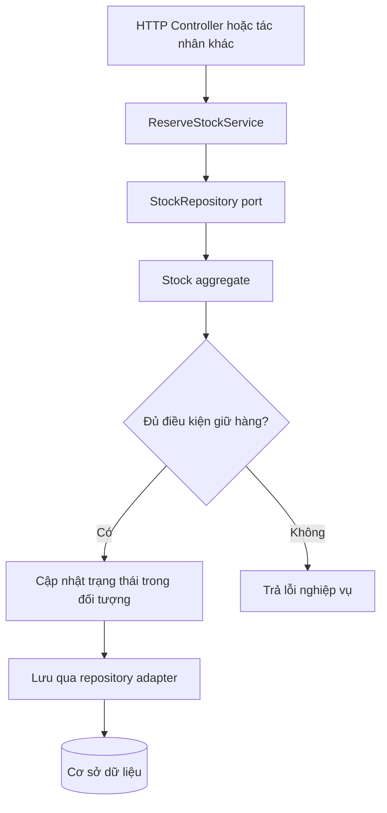

# Đặt hành vi cùng dữ liệu liên quan để duy trì trạng thái hợp lệ

Bài học này thuộc module `SOFTWARE_DESIGN_ARCHITECTURE_ARCHITECTURAL_PATTERN_LAYERED`, nhằm giúp người học tổ chức phần mềm theo kiến trúc phân tầng. Trong chương **Tầng nghiệp vụ**, ta tìm hiểu cách đặt hành vi ở cùng nơi với dữ liệu mà hành vi đó quản lý để bảo vệ các quy tắc và trạng thái hợp lệ của miền nghiệp vụ.

## 1. Vì sao dữ liệu và hành vi cần đi cùng nhau?

Một đối tượng nghiệp vụ thường có dữ liệu mô tả trạng thái hiện tại và những hành động được phép làm thay đổi trạng thái đó. Ví dụ, tồn kho của một mặt hàng có số lượng có thể đặt trước và số lượng đã được giữ cho đơn hàng. Quy tắc nghiệp vụ yêu cầu số lượng không âm và không được giữ nhiều hơn lượng đang có.

Nếu dữ liệu được công khai để mọi lớp tự sửa, bất kỳ nơi nào cũng có thể vô tình đưa đối tượng vào trạng thái sai. Một lớp có thể trừ tồn kho mà quên kiểm tra số lượng, lớp khác có thể cập nhật số lượng đã giữ mà không giảm số lượng khả dụng. Khi quy tắc chỉ nằm trong các service bên ngoài, mỗi luồng sử dụng dữ liệu phải nhớ thực hiện đầy đủ các bước và thứ tự tương tự.

Đặt hành vi cùng dữ liệu liên quan có nghĩa là đối tượng sở hữu trạng thái cũng cung cấp các thao tác nghiệp vụ để thay đổi trạng thái ấy. Đối tượng tự kiểm tra điều kiện, áp dụng thay đổi và giữ các bất biến của nó. Mã gọi yêu cầu một hành động có ý nghĩa như `reserve(3)` thay vì tự gán các trường như `available = available - 3` và `reserved = reserved + 3`.

Đây là một cách áp dụng đóng gói trong mô hình miền. Mục tiêu không chỉ là ẩn trường dữ liệu, mà là bảo đảm mọi thay đổi đều đi qua hành vi có ý nghĩa nghiệp vụ.

## 2. Trạng thái hợp lệ và bất biến

**Bất biến** là điều kiện phải luôn đúng đối với một đối tượng hoặc một nhóm đối tượng trong phạm vi nghiệp vụ đã xác định. Với ví dụ tồn kho, ta có thể chọn các bất biến sau:

- Số lượng khả dụng không âm.
- Số lượng đã giữ không âm.
- Chỉ có thể giữ số lượng dương và không vượt quá số lượng khả dụng.
- Chỉ có thể giải phóng hoặc xuất kho số lượng đã được giữ.

Giả sử một SKU đang có 12 đơn vị khả dụng và 4 đơn vị đã giữ. Khi giữ thêm 3 đơn vị, trạng thái mới phải là 9 khả dụng và 7 đã giữ. Khi giải phóng 2 đơn vị, trạng thái trở thành 11 khả dụng và 5 đã giữ. Trong mọi bước, đối tượng phải duy trì các bất biến đã chọn.

| Hành động | Điều kiện | Thay đổi trạng thái |
|---|---|---|
| Giữ hàng (`reserve`) | Số lượng lớn hơn 0 và không vượt quá lượng khả dụng | Giảm khả dụng, tăng đã giữ |
| Giải phóng (`release`) | Số lượng lớn hơn 0 và không vượt quá lượng đã giữ | Giảm đã giữ, tăng khả dụng |
| Xuất hàng (`ship`) | Số lượng lớn hơn 0 và không vượt quá lượng đã giữ | Giảm số lượng đã giữ |

Các điều kiện này là chính sách của miền tồn kho. Chúng cần được bảo vệ ở đối tượng nghiệp vụ, bất kể hành động được khởi tạo từ API đặt hàng, tác vụ nền hay giao diện quản trị.

## 3. Mô hình đối tượng giữ quyền thay đổi trạng thái

Ví dụ Java sau thể hiện một đối tượng `Stock` đóng gói dữ liệu và các hành vi làm thay đổi dữ liệu đó:

```java
package com.example.inventory.domain;

public class Stock {
    private final String sku;
    private int available;
    private int reserved;

    public Stock(String sku, int initialAvailable) {
        if (sku == null || sku.isBlank()) {
            throw new IllegalArgumentException("SKU is required");
        }
        if (initialAvailable < 0) {
            throw new IllegalArgumentException("Initial stock cannot be negative");
        }

        this.sku = sku;
        this.available = initialAvailable;
        this.reserved = 0;
    }

    public void reserve(int quantity) {
        requirePositive(quantity);
        if (quantity > available) {
            throw new InsufficientStockException(sku, available, quantity);
        }

        available -= quantity;
        reserved += quantity;
    }

    public void release(int quantity) {
        requirePositive(quantity);
        if (quantity > reserved) {
            throw new QuantityNotReservedException(sku, reserved, quantity);
        }

        reserved -= quantity;
        available += quantity;
    }

    public void ship(int quantity) {
        requirePositive(quantity);
        if (quantity > reserved) {
            throw new QuantityNotReservedException(sku, reserved, quantity);
        }

        reserved -= quantity;
    }

    private void requirePositive(int quantity) {
        if (quantity <= 0) {
            throw new IllegalArgumentException("Quantity must be positive");
        }
    }

    public String sku() {
        return sku;
    }

    public int available() {
        return available;
    }

    public int reserved() {
        return reserved;
    }
}
```

Các exception miền như `InsufficientStockException` và `QuantityNotReservedException` được lược bỏ phần khai báo để tập trung vào hành vi. Trong ứng dụng thực tế, chúng có thể mang SKU, số lượng hiện có và số lượng yêu cầu để tầng ứng dụng hoặc tầng trình bày chuyển thành kết quả phù hợp.

Có một số điểm đáng chú ý:

- Các trường trạng thái là `private`; mã bên ngoài không thể tùy ý gán `available` hoặc `reserved`.
- Constructor xác lập trạng thái ban đầu hợp lệ.
- `reserve`, `release` và `ship` diễn đạt hành động nghiệp vụ thay vì phơi bày thao tác số học.
- Mỗi phương thức kiểm tra điều kiện trước khi thay đổi trường. Nếu điều kiện không đạt, phương thức ném lỗi và không thực hiện một phần thay đổi.
- Các getter chỉ cung cấp thông tin cần thiết; chúng không trao quyền thay đổi trạng thái.

Với cách thiết kế này, một caller không thể giảm `available` mà quên tăng `reserved`. Quy tắc về sự nhất quán giữa hai trường được giữ tại chính đối tượng quản lý chúng.

## 4. Phối hợp với tầng ứng dụng và tầng truy cập dữ liệu

Đặt hành vi trong miền không có nghĩa đối tượng miền tự tìm dữ liệu trong cơ sở dữ liệu hoặc tự gọi API HTTP. Tầng ứng dụng vẫn chịu trách nhiệm điều phối ca sử dụng: tải đối tượng, yêu cầu đối tượng thực hiện hành vi, rồi lưu kết quả qua một hợp đồng lưu trữ.

Ví dụ, use case giữ hàng có thể được viết như sau:

```java
package com.example.inventory.application;

import com.example.inventory.domain.Stock;
import com.example.inventory.domain.StockRepository;
import org.springframework.stereotype.Service;
import org.springframework.transaction.annotation.Transactional;

@Service
public class ReserveStockService {
    private final StockRepository stocks;

    public ReserveStockService(StockRepository stocks) {
        this.stocks = stocks;
    }

    @Transactional
    public void handle(ReserveStockCommand command) {
        Stock stock = stocks.findBySku(command.sku())
            .orElseThrow(() -> new StockNotFoundException(command.sku()));

        stock.reserve(command.quantity());
        stocks.save(stock);
    }
}
```

`StockRepository` là hợp đồng truy xuất tồn kho. Hợp đồng có thể được đặt trong package Domain hoặc Application tùy cách tổ chức kiến trúc; adapter ở tầng hạ tầng sẽ hiện thực hợp đồng đó bằng JPA, SQL hoặc một công nghệ lưu trữ khác. Application service không tự tính lại số lượng khả dụng. Nó điều phối việc tải đối tượng, gọi `reserve` và lưu thay đổi trong giao dịch.

Luồng tổng quát:



Trong sơ đồ, `Stock` là nơi quyết định hành động giữ hàng có hợp lệ theo trạng thái miền hiện tại hay không. Application service xác định khi nào gọi hành động đó và phối hợp lưu trữ. Repository adapter chịu trách nhiệm ánh xạ và giao tiếp với cơ sở dữ liệu.

## 5. Từ đóng gói đối tượng đến Aggregate

Khi một quy tắc liên quan đến nhiều đối tượng, cần xác định nhóm dữ liệu nào phải thay đổi nhất quán cùng nhau. Trong thiết kế miền, một **aggregate** là một cụm đối tượng được quản lý qua một điểm vào gọi là **aggregate root**. Aggregate root bảo vệ các bất biến thuộc phạm vi cụm đó và kiểm soát cách bên ngoài yêu cầu thay đổi.

Ví dụ tồn kho ở trên có thể được mô hình hóa thành aggregate `Stock` với SKU, số lượng khả dụng và số lượng đã giữ. Mã bên ngoài tải aggregate qua repository và yêu cầu root thực hiện hành vi. Nếu sau này mô hình có thêm các bản ghi phân bổ theo kho hoặc lô hàng, cần quyết định liệu chúng phải nằm trong cùng aggregate để bảo đảm một bất biến tức thời hay có thể được phối hợp bằng quy trình khác.

Không nên đưa tất cả dữ liệu liên quan đến một nghiệp vụ vào cùng một aggregate. Aggregate lớn làm tăng phạm vi khóa, số dữ liệu phải tải và khả năng xung đột khi nhiều người dùng cập nhật. Hãy gom những dữ liệu cần được kiểm soát nhất quán trong cùng một ranh giới giao dịch; những phần khác có thể được liên kết bằng ID và phối hợp qua application service hoặc sự kiện miền.

Một quy tắc chỉ liên quan đến một đối tượng thường phù hợp với phương thức trên entity hoặc value object đó. Quy tắc phối hợp nhiều khái niệm miền nhưng không thuộc tự nhiên về một entity có thể được đặt trong domain service hoặc domain policy. Không cần ép mọi hành vi vào aggregate root nếu điều đó làm mô hình khó hiểu.

## 6. Khi nào nên dùng Value Object hoặc Domain Service?

Đặt hành vi cùng dữ liệu liên quan không có nghĩa mọi dữ liệu đều phải trở thành entity có ID và vòng đời riêng.

**Value Object** biểu diễn một giá trị được xác định bởi nội dung của nó, thường bất biến. Ví dụ `Money` có thể giữ số tiền và loại tiền, đồng thời cung cấp phép cộng hoặc so sánh có kiểm tra loại tiền. Việc đưa hành vi vào value object giúp tránh các phép tính tiền tùy tiện rải rác trong nhiều service.

```java
public record Money(long minorUnits, Currency currency) {
    public Money {
        if (currency == null) {
            throw new IllegalArgumentException("Currency is required");
        }
    }

    public Money add(Money other) {
        if (!currency.equals(other.currency())) {
            throw new IllegalArgumentException("Currency mismatch");
        }
        return new Money(minorUnits + other.minorUnits(), currency);
    }
}
```

Ví dụ dùng đơn vị nhỏ nhất của tiền tệ (chẳng hạn xu) để tránh sai số dấu phẩy động. Một ứng dụng thực tế cần quy định rõ cách làm tròn và cách biểu diễn đơn vị tiền tệ theo nghiệp vụ.

**Domain Service** phù hợp với một quyết định nghiệp vụ có ý nghĩa miền nhưng không thuộc tự nhiên về một entity hoặc value object duy nhất. Chẳng hạn, chính sách phân bổ đơn hàng cho nhiều kho có thể cần so sánh khả năng đáp ứng của một số kho. Service này nên nhận các khái niệm miền cần thiết và trả về quyết định hoặc kết quả miền. Việc tải dữ liệu và phối hợp repository thường vẫn do tầng ứng dụng đảm nhiệm.

## 7. Vì sao mô hình chỉ có getter và setter dễ gây lỗi?

Một mô hình chỉ chứa dữ liệu, thường được gọi là *anemic domain model*, có thể phù hợp với một số ứng dụng thiên về CRUD đơn giản. Nhưng khi có nhiều quy tắc trạng thái, nó dễ dẫn đến việc các service bên ngoài trở thành nơi duy nhất biết cách thay đổi dữ liệu đúng.

Ví dụ, một `Stock` chỉ cung cấp `getAvailable()`, `setAvailable(...)`, `getReserved()` và `setReserved(...)`. Mỗi service phải nhớ giảm một trường và tăng trường còn lại, kiểm tra số lượng dương và ngăn vượt mức. Một luồng quên một bước có thể lưu trạng thái không hợp lệ. Khi quy tắc thay đổi, phải tìm và cập nhật mọi nơi đang sửa các trường đó.

Mô hình có hành vi giúp caller nói rõ ý định (`reserve`, `release`, `ship`) và để đối tượng tự thực thi điều kiện. Tuy nhiên, không nên xem mọi setter đều sai hoặc mọi lớp dữ liệu đều cần nhiều phương thức. DTO dùng để truyền dữ liệu qua ranh giới HTTP, message hoặc truy vấn có thể chỉ chứa dữ liệu. Điều cần tránh là dùng DTO hoặc entity lưu trữ như một mô hình miền có thể bị sửa tùy tiện trong nhiều tầng.

## 8. Bảo vệ trạng thái khi có nhiều yêu cầu đồng thời

Các phương thức miền bảo vệ bất biến trong một lần thực thi trên một đối tượng. Nhưng trong ứng dụng nhiều người dùng, hai giao dịch có thể cùng đọc một lượng tồn kho cũ. Nếu mỗi giao dịch đều thấy đủ hàng, cả hai có thể cùng giữ hàng và tổng số lượng yêu cầu vượt quá tồn kho thực tế.

Vì vậy, đóng gói trong mô hình miền cần đi cùng cơ chế nhất quán ở tầng lưu trữ. Các lựa chọn thường gặp gồm:

- **Optimistic locking:** dùng phiên bản (`@Version` trong JPA) để phát hiện một giao dịch đã cập nhật cùng bản ghi trước đó. Giao dịch xung đột cần được thử lại hoặc trả kết quả phù hợp.
- **Pessimistic locking:** khóa bản ghi trong thời gian giao dịch để hạn chế các cập nhật đồng thời, đổi lại có thể tăng thời gian chờ và nguy cơ tranh chấp khóa.
- **Cập nhật có điều kiện tại cơ sở dữ liệu:** dùng câu lệnh nguyên tử, chẳng hạn chỉ giảm số lượng nếu `available >= quantity`, rồi kiểm tra số dòng được cập nhật.

Chọn cách nào tùy mức độ tranh chấp, yêu cầu hiệu năng và khả năng của hệ quản trị dữ liệu. Giao dịch và khóa bảo vệ tính nhất quán giữa các giao dịch; chúng không thay thế quy tắc nghiệp vụ trong mô hình. Ngược lại, chỉ có phương thức `reserve` trong Java cũng không tự giải quyết được tình huống nhiều tiến trình cập nhật cùng dữ liệu.

## 9. Kiểm thử hành vi và bất biến

Vì quy tắc được đặt cùng dữ liệu, có thể kiểm thử trực tiếp đối tượng miền mà không cần khởi động Spring hoặc kết nối cơ sở dữ liệu.

```java
class StockTest {
    @Test
    void reserveMovesQuantityFromAvailableToReserved() {
        Stock stock = new Stock("SKU-1", 12);

        stock.reserve(3);

        assertEquals(9, stock.available());
        assertEquals(3, stock.reserved());
    }

    @Test
    void cannotReserveMoreThanAvailable() {
        Stock stock = new Stock("SKU-1", 2);

        assertThrows(InsufficientStockException.class,
            () -> stock.reserve(3));

        assertEquals(2, stock.available());
        assertEquals(0, stock.reserved());
    }

    @Test
    void releaseReturnsReservedQuantityToAvailable() {
        Stock stock = new Stock("SKU-1", 10);
        stock.reserve(4);

        stock.release(2);

        assertEquals(8, stock.available());
        assertEquals(2, stock.reserved());
    }
}
```

Các kiểm thử này xác minh cả kết quả hợp lệ lẫn việc đối tượng không đổi trạng thái khi hành động bị từ chối. Ngoài ra, nên có:

- Kiểm thử application service để xác minh use case tải đúng aggregate, gọi hành vi và lưu khi phù hợp.
- Kiểm thử tích hợp repository để xác minh dữ liệu được ánh xạ và lưu/đọc đúng.
- Kiểm thử tích hợp đồng thời nếu nghiệp vụ có nguy cơ tranh chấp cập nhật, nhằm xác minh optimistic locking, khóa hoặc cập nhật có điều kiện hoạt động như mong đợi.

## 10. Cách quyết định nơi đặt hành vi

Khi thêm một quy tắc hoặc thao tác thay đổi dữ liệu, hãy tự hỏi:

1. Dữ liệu nào phải thay đổi cùng nhau để giữ một bất biến?
2. Đối tượng hoặc aggregate nào có đủ thông tin và ngữ nghĩa để quyết định thao tác có hợp lệ không?
3. Có thể cung cấp một phương thức diễn đạt ý định nghiệp vụ thay vì cho phép caller sửa từng trường không?
4. Quy tắc có được bảo vệ khi cùng hành động được gọi từ nhiều use case khác nhau không?
5. Nếu quy tắc liên quan nhiều aggregate hoặc dữ liệu ngoài, cần domain service, application orchestration hay một quy trình bất đồng bộ?
6. Cơ chế giao dịch và kiểm soát cập nhật đồng thời nào cần thiết để bảo vệ dữ liệu đã lưu?

Đừng gom mọi thứ vào một đối tượng lớn chỉ để nói rằng dữ liệu và hành vi luôn ở cùng nhau. Ranh giới tốt là ranh giới giúp xác định ai sở hữu trạng thái, ai có quyền thay đổi nó và bất biến nào phải được giữ trong mỗi giao dịch.

## 11. Ghi nhớ

Đặt hành vi cùng dữ liệu liên quan giúp đối tượng nghiệp vụ kiểm soát cách trạng thái của nó thay đổi. Thay vì để nhiều service đọc rồi sửa các trường công khai, hãy cung cấp hành động có ý nghĩa như `reserve`, `release` hoặc `ship`, kiểm tra điều kiện và cập nhật trạng thái trong cùng một nơi. Dùng aggregate để bảo vệ các bất biến cần nhất quán cùng nhau, value object cho khái niệm giá trị và domain service cho quyết định không thuộc tự nhiên về một đối tượng. Tầng ứng dụng vẫn điều phối ca sử dụng, tầng hạ tầng vẫn lưu trữ dữ liệu; giao dịch và cơ chế kiểm soát đồng thời bảo vệ tính nhất quán khi nhiều yêu cầu cùng cập nhật. Mức độ đóng gói và ranh giới aggregate cần phù hợp với quy tắc thực tế của hệ thống.
