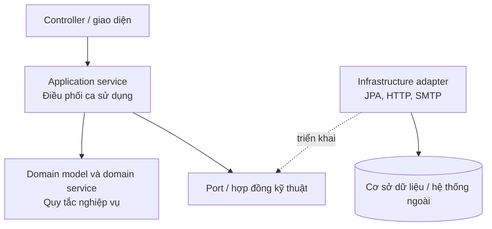
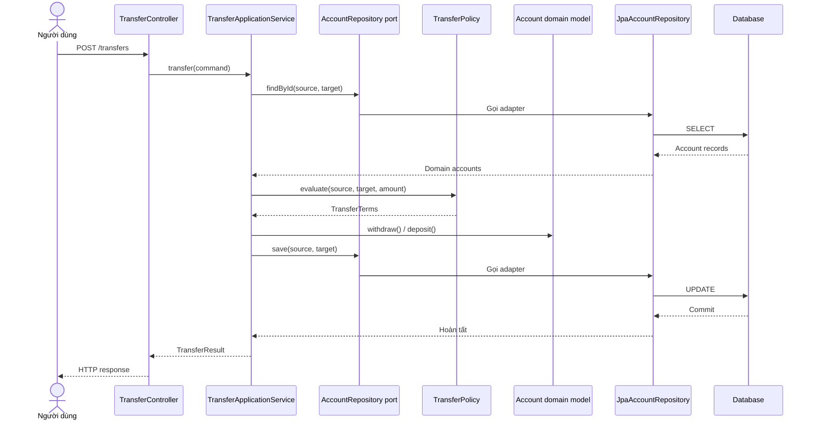

# Phân biệt dịch vụ miền, dịch vụ ứng dụng và dịch vụ hạ tầng

Trong một ứng dụng phân tầng, nhiều lớp có thể mang tên `Service`, nhưng chúng không nhất thiết làm cùng một việc. **Dịch vụ ứng dụng (application service)** điều phối một ca sử dụng; **dịch vụ miền (domain service)** diễn đạt quy tắc nghiệp vụ không thuộc tự nhiên về một thực thể hay đối tượng giá trị cụ thể; **dịch vụ hạ tầng (infrastructure service)** cung cấp khả năng kỹ thuật như truy cập cơ sở dữ liệu, gọi API đối tác hoặc gửi email.

Phân biệt ba loại dịch vụ giúp đặt logic đúng chỗ. Khi quy tắc nghiệp vụ bị đặt trong controller hoặc lớp gửi email, nó khó tái sử dụng và kiểm thử. Khi một application service chứa toàn bộ phép tính nghiệp vụ, nó dễ trở thành lớp điều phối quá nhiều chi tiết. Khi domain model phụ thuộc vào JPA hoặc HTTP client, việc thay công nghệ sẽ ảnh hưởng trực tiếp tới phần cốt lõi của hệ thống.

Tên gọi và cách chia package có thể khác giữa các dự án. Không phải ứng dụng nào cũng cần tạo đủ ba loại lớp, và Domain-Driven Design không phải yêu cầu bắt buộc để tổ chức một layered application. Hãy phân loại dựa trên **trách nhiệm thực tế** của mã, không dựa riêng vào hậu tố `Service`.

## Ba loại dịch vụ giải quyết ba nhu cầu khác nhau

| Loại dịch vụ | Câu hỏi nó trả lời | Trách nhiệm chính | Ví dụ |
|---|---|---|---|
| Dịch vụ ứng dụng | Hệ thống cần thực hiện ca sử dụng nào và theo trình tự nào? | Điều phối bước xử lý, gọi domain model và các port, quản lý ranh giới use case/giao dịch | `TransferApplicationService` |
| Dịch vụ miền | Quy tắc nghiệp vụ này thuộc về khái niệm miền nào? | Thực hiện quy tắc có ý nghĩa miền nhưng không tự nhiên thuộc về một entity/value object | `TransferPolicy` |
| Dịch vụ hạ tầng | Làm thế nào để thực hiện một khả năng kỹ thuật? | Kết nối hệ thống ngoài, truy cập lưu trữ, chuyển đổi giao thức và xử lý chi tiết công nghệ | `SmtpReceiptAdapter`, `JpaAccountRepository` |

Có thể hình dung mối quan hệ như sau:



Application service là điểm điều phối. Nó có thể gọi domain service để hỏi hoặc thực hiện một quy tắc nghiệp vụ, đồng thời gọi qua các hợp đồng để đọc, ghi dữ liệu hay sử dụng khả năng kỹ thuật. Adapter hạ tầng thực hiện I/O. Domain model không cần biết chi tiết adapter đang dùng công nghệ nào.

## Dịch vụ ứng dụng: điều phối một ca sử dụng

Dịch vụ ứng dụng mô tả một thao tác mà hệ thống cung cấp, chẳng hạn chuyển tiền, tạo đơn hàng, đăng ký tài khoản hoặc hủy đặt chỗ. Nó thường nhận một command hoặc input DTO, lấy các đối tượng cần thiết qua repository, gọi hành vi của domain model, yêu cầu lưu thay đổi và trả kết quả cho tầng trình bày.

Với chức năng chuyển tiền, application service có thể thực hiện các bước:

1. Nhận mã tài khoản nguồn, tài khoản đích và số tiền từ yêu cầu.
2. Tải hai tài khoản qua repository.
3. Gọi quy tắc miền để xác định giao dịch có hợp lệ theo chính sách hay không.
4. Gọi hành vi `withdraw` và `deposit` trên các đối tượng tài khoản.
5. Yêu cầu lưu các thay đổi trong một ranh giới giao dịch.
6. Trả mã giao dịch hoặc kết quả phù hợp cho controller.

Ví dụ:

```java
@Service
class TransferApplicationService {
    private final AccountRepository accounts;
    private final TransferPolicy transferPolicy;

    TransferApplicationService(
            AccountRepository accounts,
            TransferPolicy transferPolicy) {
        this.accounts = accounts;
        this.transferPolicy = transferPolicy;
    }

    @Transactional
    public TransferResult transfer(TransferCommand command) {
        var source = accounts.findById(command.sourceAccountId())
                .orElseThrow(AccountNotFoundException::new);
        var target = accounts.findById(command.targetAccountId())
                .orElseThrow(AccountNotFoundException::new);

        var terms = transferPolicy.evaluate(
                source, target, command.amount());

        source.withdraw(terms.amount().add(terms.fee()));
        target.deposit(terms.amount());

        accounts.save(source);
        accounts.save(target);

        return new TransferResult(source.id(), target.id(), terms.amount());
    }
}
```

Đây là ví dụ rút gọn để minh họa trách nhiệm. Các kiểu `TransferCommand`, `TransferResult`, `AccountRepository` và `Money` được giả định đã định nghĩa. `@Transactional` thường được đặt ở ranh giới application service để việc đọc trạng thái và lưu hai tài khoản được phối hợp trong cùng giao dịch cơ sở dữ liệu. Tính đúng đắn khi hai giao dịch đồng thời vẫn cần cơ chế phù hợp như optimistic locking, khóa hoặc cập nhật có điều kiện; annotation không tự giải quyết mọi vấn đề đồng thời.

Application service quyết định **thứ tự phối hợp**, nhưng không nên tự chứa mọi phép tính và bất biến. Ví dụ, việc tài khoản có đủ số dư để rút hay không nên được bảo vệ bởi `Account.withdraw(...)`. Chính sách tính phí dựa trên nhiều thông tin có thể thuộc domain service. Nếu application service trực tiếp tính phí, kiểm tra mọi quy tắc và sửa từng trường của entity, lớp này đang gánh trách nhiệm của domain.

Application service cũng thường là nơi phối hợp các khả năng ngoài miền như repository, cổng thanh toán hoặc gửi thông báo. Nó có thể quyết định khi nào gọi một port, nhưng chi tiết HTTP, SQL hoặc SMTP thuộc adapter. Với tác dụng phụ cần thực hiện sau khi commit, chẳng hạn gửi biên nhận, có thể dùng outbox hoặc cơ chế xử lý sau commit để tránh gửi thông báo thành công trong khi giao dịch lưu dữ liệu lại rollback.

## Dịch vụ miền: biểu đạt quy tắc nghiệp vụ

Một quy tắc thường nên nằm trong entity hoặc value object nếu quy tắc đó gắn trực tiếp với trạng thái của đối tượng. Ví dụ, `Account.withdraw(amount)` kiểm tra số tiền dương và số dư khả dụng trước khi giảm số dư. Không cần tạo `AccountService` chỉ để gọi lại một phương thức của `Account`.

Tuy nhiên, có những quy tắc liên quan đến nhiều đối tượng hoặc một khái niệm nghiệp vụ không thuộc tự nhiên về một đối tượng duy nhất. Dịch vụ miền là nơi phù hợp cho các quy tắc đó. Dịch vụ miền thường:

- Có tên diễn đạt ngôn ngữ nghiệp vụ, chẳng hạn chính sách chuyển tiền hoặc chính sách định giá.
- Là stateless hoặc giữ rất ít trạng thái kỹ thuật; kết quả chủ yếu phụ thuộc dữ liệu miền được truyền vào.
- Làm việc với entity, value object và kiểu dữ liệu của miền.
- Không phụ thuộc controller, HTTP request, JPA entity manager hay SDK của nhà cung cấp.
- Không trở thành nơi chứa tất cả logic chỉ vì tên lớp có chữ `DomainService`.

Ví dụ chính sách chuyển tiền cần xem xét đồng thời tài khoản nguồn, tài khoản đích và số tiền:

```java
public final class TransferPolicy {
    public TransferTerms evaluate(
            Account source,
            Account target,
            Money amount) {

        if (source.id().equals(target.id())) {
            throw new SameAccountTransferException();
        }

        if (!source.currency().equals(target.currency())) {
            throw new CurrencyMismatchException();
        }

        if (!amount.isPositive()) {
            throw new InvalidTransferAmountException();
        }

        var fee = calculateFee(source, amount);
        return new TransferTerms(amount, fee);
    }

    private Money calculateFee(Account source, Money amount) {
        if (source.isPremium()) {
            return Money.zero(amount.currency());
        }
        return amount.multiply(new BigDecimal("0.005"));
    }
}
```

Trong ví dụ này, chính sách cần hiểu cả tài khoản nguồn và số tiền để tính phí, nên nó không thuộc tự nhiên về controller hay một entity đơn lẻ. `TransferPolicy` trả về `TransferTerms`; application service sau đó điều phối việc rút và ghi có. Các bất biến nội tại như không cho tài khoản có số dư âm vẫn cần được bảo vệ trong `Account.withdraw(...)`, kể cả khi chính sách đã kiểm tra trước đó.

Không phải mọi quy tắc liên quan nhiều đối tượng đều cần domain service. Nếu có thể diễn đạt rõ ràng bằng một phương thức trên aggregate sở hữu hành vi, hãy đặt ở aggregate đó. Nếu quy tắc chỉ là chuyển đổi dữ liệu đơn giản, một hàm hoặc value object có thể đủ. Domain service hữu ích khi nó biểu diễn một khái niệm miền thực sự và giúp mô hình dễ hiểu hơn.

### Domain service có truy cập cơ sở dữ liệu hoặc gọi API không?

Thông thường, domain service không tự thực hiện I/O. Nó không nên mở kết nối database, tự gọi REST API hoặc gửi email. Những thao tác đó phụ thuộc môi trường và có thể thất bại do timeout, kết nối hoặc cấu hình. Để giữ quy tắc miền dễ kiểm thử, application service thường tải dữ liệu cần thiết trước rồi truyền các đối tượng hoặc giá trị cần thiết vào domain service.

Một số thiết kế có thể định nghĩa abstraction ở phía domain cho một chính sách hoặc dữ liệu mà quy tắc miền cần, ví dụ một hợp đồng cung cấp tỷ giá. Dù vậy, adapter vẫn thực hiện truy cập mạng; application vẫn điều phối thời điểm và phạm vi gọi. Cần cân nhắc liệu dữ liệu bên ngoài thực sự là đầu vào của một quy tắc miền hay chỉ là bước phối hợp của use case. Không nên đưa một repository hoặc HTTP client vào domain service theo thói quen.

## Dịch vụ hạ tầng: thực hiện khả năng kỹ thuật

Dịch vụ hạ tầng cung cấp cách thực hiện một thao tác phụ thuộc công nghệ hoặc môi trường. Ví dụ:

- Adapter JPA triển khai repository bằng Spring Data JPA.
- Adapter HTTP gọi API tỷ giá hoặc cổng thanh toán.
- Adapter SMTP gửi email qua máy chủ thư.
- Adapter lưu tệp ghi nội dung vào object storage.
- Thành phần cung cấp thời gian hệ thống, mã định danh hoặc thông tin cấu hình.

Phần cốt lõi nên nhìn thấy một hợp đồng phù hợp với nhu cầu của nó. Ví dụ application khai báo port gửi biên nhận:

```java
public interface ReceiptSender {
    void send(Receipt receipt);
}
```

Adapter hạ tầng triển khai hợp đồng bằng Spring Mail:

```java
@Component
class SmtpReceiptAdapter implements ReceiptSender {
    private final JavaMailSender mailSender;

    SmtpReceiptAdapter(JavaMailSender mailSender) {
        this.mailSender = mailSender;
    }

    @Override
    public void send(Receipt receipt) {
        var message = new SimpleMailMessage();
        message.setTo(receipt.recipient());
        message.setSubject("Biên nhận giao dịch");
        message.setText(receipt.summary());
        mailSender.send(message);
    }
}
```

`SmtpReceiptAdapter` biết cách tạo và gửi email bằng thư viện cụ thể. Nó không quyết định giao dịch nào đủ điều kiện nhận biên nhận, nội dung nào là nghĩa vụ pháp lý, hay khi nào use case được coi là hoàn tất. Những quyết định đó thuộc application hoặc domain tùy ý nghĩa nghiệp vụ.

Một adapter repository cũng là thành phần hạ tầng:

```java
@Repository
class JpaAccountRepository implements AccountRepository {
    private final SpringDataAccountRepository data;

    JpaAccountRepository(SpringDataAccountRepository data) {
        this.data = data;
    }

    @Override
    public Optional<Account> findById(AccountId id) {
        return data.findById(id.value()).map(AccountMapper::toDomain);
    }

    @Override
    public void save(Account account) {
        data.save(AccountMapper.toEntity(account));
    }
}
```

Adapter chuyển đổi giữa mô hình miền và entity lưu trữ. Trong ứng dụng nhỏ, có thể dùng chung entity JPA với mô hình nghiệp vụ để giảm mã, miễn là nhóm hiểu rõ sự phụ thuộc và chấp nhận hệ quả khi thay đổi persistence. Tách hai mô hình không phải yêu cầu tuyệt đối; nó có giá trị khi ranh giới nghiệp vụ, cách lưu trữ hoặc vòng đời thay đổi độc lập.

## So sánh qua một luồng xử lý hoàn chỉnh

Giả sử người dùng yêu cầu chuyển tiền. Luồng điển hình có thể được diễn đạt như sau:



Sơ đồ tách hai việc: application service điều phối thứ tự và ranh giới use case; domain service cùng entity thực hiện quy tắc miền. Repository port là hợp đồng mà application sử dụng, còn adapter JPA thực hiện truy vấn. Trong mã nguồn, application phụ thuộc vào hợp đồng; adapter phụ thuộc vào hợp đồng để triển khai. Chi tiết gọi cơ sở dữ liệu không xuất hiện trong domain service.

| Tình huống | Nên đặt ở đâu? | Vì sao? |
|---|---|---|
| Nhận command và tải hai tài khoản | Application service | Đây là bước của use case |
| Tính phí chuyển tiền dựa trên loại tài khoản và số tiền | Domain service hoặc policy miền | Quy tắc có ý nghĩa nghiệp vụ và liên quan nhiều dữ liệu miền |
| Kiểm tra tài khoản không được rút vượt số dư | Phương thức của `Account` | Quy tắc bảo vệ trạng thái của chính tài khoản |
| Mở truy vấn SQL và ánh xạ bản ghi | Infrastructure adapter | Phụ thuộc công nghệ lưu trữ |
| Gửi email qua SMTP | Infrastructure adapter | Phụ thuộc giao thức và thư viện gửi thư |
| Quyết định khi nào gửi biên nhận trong quy trình chuyển tiền | Application service hoặc cơ chế sự kiện của use case | Là quyết định điều phối ca sử dụng |

## Những nhầm lẫn thường gặp

### Đặt mọi thứ vào một lớp `XxxService`

Một lớp có thể bắt đầu với vài dòng điều phối, sau đó dần chứa kiểm tra nghiệp vụ, truy vấn, chuyển đổi DTO, gọi API và gửi email. Khi đó lớp khó thay đổi vì nhiều lý do khác nhau. Hãy tách phần quy tắc có ý nghĩa miền, phần điều phối use case và phần I/O theo trách nhiệm thực tế. Không cần tách một lớp nhỏ thành nhiều abstraction nếu điều đó không tạo ra ranh giới có ích.

### Gọi domain service là application service

Một phương thức `calculateDiscount(customer, cart)` có thể là domain service nếu nó thực hiện chính sách giảm giá của miền. Một phương thức `checkout(command)` thường là application service nếu nó tải dữ liệu, gọi chính sách, lưu đơn hàng và trả kết quả. Cả hai đều có thể không giữ trạng thái và đều có thể được gọi từ Spring bean; tiêu chí phân biệt là ý nghĩa công việc.

### Đặt quy tắc nghiệp vụ trong infrastructure adapter

Adapter có thể chuyển mã lỗi của nhà cung cấp thành lỗi ứng dụng, chuyển đổi tiền tệ theo định dạng giao thức hoặc thực hiện retry kỹ thuật. Nó không nên tự quyết định một giao dịch có được hoàn tiền theo chính sách kinh doanh hay khách hàng có được hưởng ưu đãi hay không. Những quyết định đó phải nằm trong domain hoặc application tùy bản chất quy tắc.

### Cho domain phụ thuộc Spring hoặc persistence

Gắn `@Entity`, `@Service`, `@Transactional` hoặc `JpaRepository` vào mọi lớp không phải điều kiện để có mô hình miền. Một dự án có thể dùng annotation ở domain vì lý do thực dụng, nhưng cần nhận thức rằng điều đó làm mô hình gắn với framework. Khi cần domain độc lập và dễ kiểm thử bằng Java thuần, giữ annotation và adapter ở ranh giới hạ tầng sẽ hữu ích hơn.

## Cách quyết định khi tạo một service mới

Trước khi đặt tên lớp, hãy tự hỏi:

1. **Nó điều phối một ca sử dụng?** Nếu có, đó thường là application service. Nó nhận input, gọi các bước cần thiết và xác định kết quả của use case.
2. **Nó thực hiện một quy tắc nghiệp vụ có tên trong ngôn ngữ miền?** Nếu quy tắc không thuộc tự nhiên về một entity hoặc value object, domain service có thể phù hợp.
3. **Nó kết nối công nghệ hoặc môi trường?** Nếu nó dùng SQL, JPA, HTTP, SMTP, SDK, filesystem hoặc cloud storage, đó thường là infrastructure service/adapter.
4. **Quy tắc có thể đặt trong entity hoặc value object hiện có không?** Nếu có, ưu tiên hành vi tại nơi sở hữu trạng thái để tránh tạo service chuyển tiếp không cần thiết.
5. **Hợp đồng thuộc về phía nào?** Đặt port ở phía cần khả năng đó; để adapter hạ tầng triển khai và chuyển đổi chi tiết công nghệ.

Các nguyên tắc này là hướng dẫn thiết kế, không phải công thức cứng. Một ứng dụng CRUD nhỏ có thể chỉ cần application service và repository adapter; một hệ thống có nhiều quy tắc có thể cần domain service rõ ràng; một tích hợp phức tạp có thể có nhiều adapter hạ tầng. Hãy giữ mô hình vừa đủ để thể hiện trách nhiệm, bảo vệ quy tắc và giúp kiểm thử.

Khi phân biệt được ba loại dịch vụ, ta có thể đọc một lớp bằng câu hỏi đơn giản: nó đang điều phối **việc cần làm**, diễn đạt **quy tắc của miền**, hay thực hiện **cách kết nối kỹ thuật**? Câu trả lời giúp đặt lớp vào đúng tầng, xác định hướng phụ thuộc và tránh để một thay đổi nhỏ lan qua toàn bộ ứng dụng.
