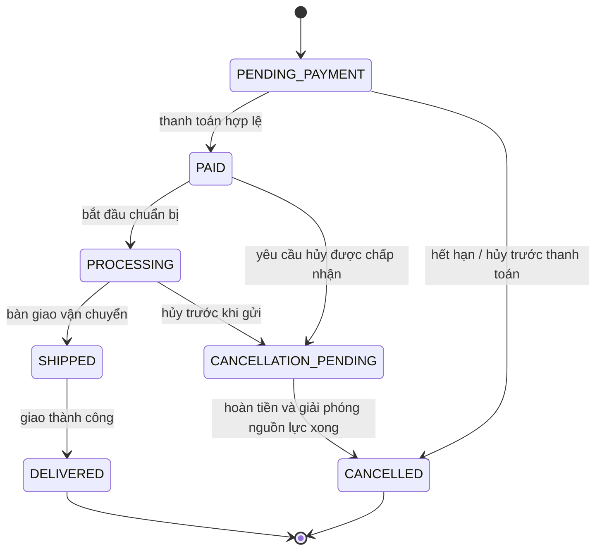

# Xử lý chuyển trạng thái và các quyết định nghiệp vụ quan trọng

Trong module **SOFTWARE_DESIGN_ARCHITECTURE_ARCHITECTURAL_PATTERN_LAYERED** (Học tổ chức phần mềm theo kiến trúc phân tầng), tầng nghiệp vụ chịu trách nhiệm bảo vệ các quy tắc quyết định điều gì được phép xảy ra trong hệ thống. Bài học này dùng quy trình xử lý đơn hàng để giải thích cách mô hình hóa trạng thái, kiểm tra điều kiện chuyển trạng thái và đưa ra các quyết định nghiệp vụ quan trọng.

Một đơn hàng không thể chuyển tùy ý từ trạng thái này sang trạng thái khác. Đơn chưa thanh toán không thể được giao; đơn đã giao không thể quay lại trạng thái đang xử lý; một đơn đã bị hủy không nên được thanh toán tiếp. Những giới hạn đó là quy tắc nghiệp vụ. Chúng cần được thực thi nhất quán dù yêu cầu đến từ REST API, tác vụ nền, webhook thanh toán hay message consumer.

## 1. Trạng thái biểu diễn điều gì?

Trạng thái (state) mô tả tình trạng hiện tại của một đối tượng nghiệp vụ tại một thời điểm. Với đơn hàng, trạng thái giúp hệ thống biết đơn đang chờ thanh toán, đã thanh toán, đang chuẩn bị, đã gửi đi hay đã hoàn tất.

Ví dụ, một quy trình đơn hàng có thể dùng các trạng thái:

| Trạng thái | Ý nghĩa |
|---|---|
| `PENDING_PAYMENT` | Đơn đã được tạo và đang chờ thanh toán |
| `PAID` | Thanh toán đã được xác nhận |
| `PROCESSING` | Đơn đang được chuẩn bị để giao |
| `SHIPPED` | Đơn đã bàn giao cho đơn vị vận chuyển |
| `DELIVERED` | Đơn đã được giao thành công |
| `CANCELLATION_PENDING` | Yêu cầu hủy đã được chấp nhận xử lý, còn chờ các bước bù trừ như hoàn tiền |
| `CANCELLED` | Đơn đã hủy hoàn tất |

Không phải ứng dụng nào cũng cần tất cả trạng thái này. Một cửa hàng đơn giản có thể chỉ cần `NEW`, `PAID`, `SHIPPED` và `CANCELLED`. Hãy chọn trạng thái dựa trên những khác biệt có ý nghĩa đối với quy tắc, hành động, quyền hạn hoặc quy trình tiếp theo. Nếu hai trạng thái luôn có cùng điều kiện và hành vi, có thể chúng không cần tách riêng.

Trạng thái không chỉ là nhãn để hiển thị trên giao diện. Nó ảnh hưởng đến việc người dùng được phép làm gì, hệ thống cần gọi dịch vụ nào và dữ liệu nào được phép thay đổi.

## 2. Chuyển trạng thái là một quyết định nghiệp vụ

Chuyển trạng thái (state transition) là hành động đưa một đối tượng từ trạng thái hiện tại sang trạng thái mới khi thỏa mãn các điều kiện xác định.

Với đơn hàng, một số chuyển đổi hợp lệ có thể là:

- `PENDING_PAYMENT → PAID`: cổng thanh toán xác nhận đã nhận đúng khoản tiền cần thiết.
- `PENDING_PAYMENT → CANCELLED`: đơn hết hạn thanh toán và được hủy theo chính sách.
- `PAID → PROCESSING`: hệ thống đã sẵn sàng bắt đầu chuẩn bị đơn.
- `PROCESSING → SHIPPED`: kiện hàng đã được bàn giao cho đơn vị vận chuyển.
- `SHIPPED → DELIVERED`: có xác nhận giao hàng thành công.
- `PAID → CANCELLATION_PENDING`: yêu cầu hủy được chấp nhận và cần xử lý hoàn tiền, giải phóng nguồn lực.
- `CANCELLATION_PENDING → CANCELLED`: các bước hủy và bù trừ cần thiết đã hoàn tất.

Sơ đồ dưới đây minh họa một quy trình có bước chờ xử lý hủy:



Sơ đồ không có nghĩa mọi đơn hàng đều phải đi qua đúng chuỗi này. Chẳng hạn, một sản phẩm kỹ thuật số có thể không có bước giao vận; một dịch vụ có thể có các trạng thái đặt lịch và hoàn thành. Điều quan trọng là trạng thái và đường chuyển phản ánh quy trình thực tế.

### Xác định điều kiện chuyển trạng thái

Một chuyển đổi thường cần kiểm tra nhiều điều kiện, không chỉ trạng thái hiện tại:

- **Trạng thái nguồn:** hành động có được phép ở trạng thái hiện tại không?
- **Dữ liệu liên quan:** khoản thanh toán có đủ số tiền và đúng đơn vị tiền tệ không?
- **Quyền hạn:** người thực hiện có quyền xác nhận, hủy hoặc bàn giao không?
- **Thời điểm:** thời hạn thanh toán đã hết chưa? Đơn đã được bàn giao cho hãng vận chuyển chưa?
- **Bất biến:** sau chuyển đổi, đối tượng vẫn phải ở trạng thái hợp lệ không?
- **Điều kiện phối hợp:** các nguồn lực cần thiết như tồn kho đã được giữ chỗ chưa?

Ví dụ, nhận một webhook báo thanh toán thành công không tự động có nghĩa là có thể chuyển mọi đơn sang `PAID`. Hệ thống cần xác minh webhook đến từ nguồn tin cậy, tham chiếu đúng đơn, đúng số tiền và đúng đơn vị tiền tệ; đồng thời đơn phải đang ở trạng thái chờ thanh toán hoặc sự kiện phải được nhận diện là bản lặp hợp lệ.

## 3. Bảo vệ quy tắc trong mô hình nghiệp vụ

Một cách dễ gây lỗi là cho phép mọi nơi gán trực tiếp trạng thái:

```java
order.setStatus(OrderStatus.DELIVERED);
```

Đoạn mã này không cho biết ai được phép giao hàng, đơn đã được gửi đi chưa hoặc có mã vận đơn không. Nếu controller, batch job và message consumer đều có thể gọi setter, mỗi nơi có thể áp dụng quy tắc khác nhau.

Thay vào đó, mô hình nghiệp vụ nên cung cấp các hành động mang ý nghĩa:

- `confirmPayment(...)`
- `beginFulfillment(...)`
- `markShipped(...)`
- `markDelivered(...)`
- `requestCancellation(...)`
- `confirmCancellation(...)`

Mỗi hành động tự kiểm tra điều kiện và giữ các bất biến liên quan. Người gọi yêu cầu thực hiện một hành động; đối tượng nghiệp vụ quyết định hành động đó có hợp lệ hay không.

### Ví dụ mô hình Order bằng Java

Đoạn mã sau tập trung vào một số quy tắc chính. Các kiểu `Money`, `PaymentConfirmation`, `Shipment` và ngoại lệ là các kiểu minh họa của ứng dụng.

```java
public enum OrderStatus {
    PENDING_PAYMENT,
    PAID,
    PROCESSING,
    SHIPPED,
    DELIVERED,
    CANCELLATION_PENDING,
    CANCELLED
}
```

```java
public final class Order {
    private final UUID id;
    private final Money total;
    private OrderStatus status;
    private String paymentReference;
    private String trackingNumber;

    public Order(UUID id, Money total) {
        this.id = Objects.requireNonNull(id);
        this.total = Objects.requireNonNull(total);
        this.status = OrderStatus.PENDING_PAYMENT;
    }

    public boolean confirmPayment(PaymentConfirmation payment) {
        Objects.requireNonNull(payment);

        // Webhook lặp lại cùng một khoản thanh toán là thao tác idempotent.
        if (paymentReference != null) {
            if (paymentReference.equals(payment.reference())
                    && total.equals(payment.amount())) {
                return false;
            }
            throw new BusinessRuleViolation(
                "Đơn hàng đã ghi nhận một khoản thanh toán khác");
        }

        requireStatus(OrderStatus.PENDING_PAYMENT);

        if (!total.equals(payment.amount())) {
            throw new BusinessRuleViolation(
                "Số tiền thanh toán không khớp với đơn hàng");
        }

        this.paymentReference = payment.reference();
        this.status = OrderStatus.PAID;
        return true;
    }

    public void beginFulfillment() {
        requireStatus(OrderStatus.PAID);
        this.status = OrderStatus.PROCESSING;
    }

    public void markShipped(Shipment shipment) {
        Objects.requireNonNull(shipment);
        requireStatus(OrderStatus.PROCESSING);

        if (shipment.trackingNumber() == null
                || shipment.trackingNumber().isBlank()) {
            throw new BusinessRuleViolation(
                "Cần mã vận đơn trước khi bàn giao");
        }

        this.trackingNumber = shipment.trackingNumber();
        this.status = OrderStatus.SHIPPED;
    }

    public void markDelivered() {
        requireStatus(OrderStatus.SHIPPED);
        this.status = OrderStatus.DELIVERED;
    }

    public void requestCancellation() {
        if (status == OrderStatus.PENDING_PAYMENT) {
            status = OrderStatus.CANCELLED;
            return;
        }

        if (status == OrderStatus.PAID
                || status == OrderStatus.PROCESSING) {
            status = OrderStatus.CANCELLATION_PENDING;
            return;
        }

        throw new BusinessRuleViolation(
            "Không thể yêu cầu hủy ở trạng thái hiện tại");
    }

    public void confirmCancellation() {
        requireStatus(OrderStatus.CANCELLATION_PENDING);
        status = OrderStatus.CANCELLED;
    }

    private void requireStatus(OrderStatus expected) {
        if (status != expected) {
            throw new BusinessRuleViolation(
                "Hành động không hợp lệ với trạng thái " + status);
        }
    }

    public UUID id() { return id; }
    public Money total() { return total; }
    public OrderStatus status() { return status; }
}
```

Một số điểm cần chú ý:

1. Constructor tạo đơn ở trạng thái ban đầu hợp lệ.
2. Không có setter công khai để tùy ý thay đổi trạng thái.
3. Mỗi phương thức thể hiện một hành động nghiệp vụ và kiểm tra trạng thái nguồn.
4. Xác nhận thanh toán còn kiểm tra số tiền.
5. Gửi hàng yêu cầu mã vận đơn.
6. Hủy đơn đã thanh toán hoặc đang chuẩn bị đi qua trạng thái chờ xử lý để ứng dụng có thể phối hợp hoàn tiền và giải phóng nguồn lực.
7. Webhook lặp lại với cùng mã tham chiếu thanh toán được xử lý idempotent trong ví dụ.

Trong hệ thống thật, `Money` cần bao gồm số tiền và đơn vị tiền tệ; phép so sánh phải kiểm tra cả hai. Cần xác minh tính xác thực của webhook ở adapter hoặc lớp bảo mật trước khi tạo `PaymentConfirmation`. Mô hình `Order` nhận một xác nhận đã được kiểm tra, không tự gọi cổng thanh toán hay kiểm tra chữ ký HTTP.

## 4. Phân biệt quyết định nghiệp vụ và điều phối quy trình

Tầng nghiệp vụ có các quyết định như:

- Một đơn ở trạng thái hiện tại có được hủy không?
- Số tiền nhận được có khớp tổng tiền đơn không?
- Một khách hàng có đủ điều kiện áp dụng mức giảm giá không?
- Một đơn có thể chuyển sang giao hàng khi chưa có mã vận đơn không?
- Một đơn đã giao có được sửa địa chỉ giao hàng không?

Tầng ứng dụng điều phối các bước cần thiết để thực hiện quyết định hoặc hoàn thành use case:

- Tải đơn hàng từ repository.
- Lấy dữ liệu thanh toán đã xác minh.
- Gọi phương thức nghiệp vụ để kiểm tra và chuyển trạng thái.
- Ghi thay đổi trong giao dịch phù hợp.
- Ghi sự kiện hoặc gửi yêu cầu sang hệ thống khác.
- Trả kết quả cho adapter gọi vào.

Một ví dụ application service xử lý xác nhận thanh toán:

```java
@Service
@RequiredArgsConstructor
public class ConfirmOrderPaymentService {
    private final OrderRepository orderRepository;
    private final OutboxRepository outboxRepository;

    @Transactional
    public void handle(VerifiedPaymentSucceeded event) {
        var order = orderRepository.getById(event.orderId());

        boolean newlyConfirmed = order.confirmPayment(new PaymentConfirmation(
            event.reference(),
            event.amount()
        ));

        if (!newlyConfirmed) {
            return;
        }

        orderRepository.save(order);

        outboxRepository.append(new OrderPaid(
            order.id(),
            event.reference()
        ));
    }
}
```

Trong ví dụ, adapter đã xác minh nguồn phát sự kiện trước khi tạo `VerifiedPaymentSucceeded`. Application tải đơn, gọi hành vi nghiệp vụ và lưu kết quả. Outbox ghi sự kiện cùng giao dịch database để một tiến trình khác có thể phát sự kiện sau khi commit. Cấu trúc outbox là một lựa chọn thiết kế; không phải ứng dụng nào cũng cần triển khai nó.

Không nên để mô hình miền gửi HTTP request, truy cập Spring Data repository hoặc mở transaction. Mô hình miền tập trung vào quyết định nghiệp vụ; application chịu trách nhiệm phối hợp các thành phần và ranh giới thực thi.

## 5. Quy tắc đơn giản, chính sách và quyết định có nhiều dữ liệu

Không phải mọi quyết định đều nằm trong một phương thức của entity. Cách đặt quy tắc phụ thuộc vào phạm vi và dữ liệu cần thiết.

**Quy tắc thuộc về một đối tượng.** Ví dụ, đơn phải có ít nhất một dòng hàng; đơn đã giao không thể chuyển lại thành đang chuẩn bị. Đặt hành vi trong `Order` giúp đối tượng bảo vệ trạng thái của chính nó.

**Quy tắc liên quan nhiều đối tượng.** Ví dụ, khách hàng chỉ được sử dụng một mã khuyến mãi nếu chưa vượt hạn mức và chiến dịch còn hiệu lực. Một domain service hoặc policy có thể phù hợp nếu quyết định cần phối hợp nhiều đối tượng và không tự nhiên thuộc riêng một entity.

**Quyết định cần dữ liệu bên ngoài.** Ví dụ, sản phẩm còn được bán hay không có thể cần truy vấn catalog; hạn mức tín dụng có thể cần gọi hệ thống tín dụng. Application tải dữ liệu qua các abstraction, sau đó đưa thông tin cần thiết vào policy/domain model. Không nên để entity tự truy vấn cơ sở dữ liệu để tìm dữ liệu còn thiếu.

Ví dụ một policy quyết định có thể hủy đơn hay không:

```java
public final class CancellationPolicy {
    public boolean canRequestCancellation(
            Order order,
            FulfillmentSnapshot fulfillment) {

        if (order.status() == OrderStatus.PENDING_PAYMENT) {
            return true;
        }

        return (order.status() == OrderStatus.PAID
                    || order.status() == OrderStatus.PROCESSING)
            && !fulfillment.handedToCarrier();
    }
}
```

Policy này minh họa quyết định cần cả trạng thái đơn và thông tin thực hiện giao hàng. Ứng dụng chịu trách nhiệm tải `FulfillmentSnapshot`, gọi policy và chỉ gọi `order.requestCancellation()` khi policy chấp thuận. Nếu việc bàn giao có thể xảy ra đồng thời với yêu cầu hủy, hệ thống còn phải bảo vệ quyết định này trước điều kiện tranh chấp khi ghi dữ liệu; một lần kiểm tra trong bộ nhớ không đủ để bảo đảm tính nhất quán.

Không cần tạo domain service hoặc policy cho mọi câu lệnh điều kiện. Nếu quy tắc ngắn và thuộc rõ một đối tượng, đặt trực tiếp trong đối tượng thường dễ hiểu hơn.

## 6. Xử lý hủy đơn và các tác động bên ngoài

Hủy đơn sau khi thanh toán thường không phải chỉ đổi một cột trạng thái. Hệ thống có thể cần:

1. Xác nhận đơn vẫn ở giai đoạn cho phép yêu cầu hủy.
2. Đánh dấu `CANCELLATION_PENDING` để ngăn quy trình giao hàng tiếp tục.
3. Yêu cầu cổng thanh toán hoàn tiền.
4. Giải phóng lượng hàng đã giữ chỗ.
5. Ghi nhận kết quả và chuyển đơn sang `CANCELLED` khi các bước cần thiết hoàn tất.

Các bước này có thể liên quan nhiều hệ thống và không thể được bao phủ bởi một transaction database thông thường. Nếu yêu cầu hoàn tiền thất bại tạm thời, đơn cần giữ trạng thái chờ xử lý để có thể retry. Nếu giải phóng tồn kho thất bại, hệ thống cũng cần ghi nhận và xử lý lại.

Một quy trình phối hợp nhiều bước qua các dịch vụ thường được triển khai bằng saga hoặc workflow. Mỗi bước có hành động tiếp theo và có thể có hành động bù trừ. Ví dụ, nếu giữ hàng thành công nhưng thanh toán thất bại, hệ thống có thể giải phóng lượng hàng đã giữ. Cần định nghĩa rõ trạng thái trung gian và cách xử lý khi một bước thất bại; không giả định các hệ thống bên ngoài sẽ rollback cùng database.

Với thao tác đơn giản trong một database, một transaction có thể đủ. Chỉ khi quy trình thật sự đi qua nhiều tài nguyên độc lập mới cần cơ chế phối hợp phân tán phù hợp.

## 7. Tránh cập nhật trạng thái tùy tiện và xử lý cạnh tranh đồng thời

Hai yêu cầu có thể đến gần như cùng lúc. Ví dụ, khách hàng gửi yêu cầu hủy trong khi webhook thanh toán đến; hoặc hai worker cùng nhận một sự kiện giao hàng. Cả hai có thể đọc cùng trạng thái cũ rồi cố ghi hai kết quả khác nhau.

Các kỹ thuật thường dùng:

- **Optimistic locking:** thêm cột phiên bản, ví dụ JPA `@Version`. Khi hai transaction cùng sửa một bản ghi, lần ghi dựa trên phiên bản cũ sẽ thất bại và cần tải lại, đánh giá lại hoặc báo xung đột.
- **Conditional update:** cập nhật có điều kiện theo trạng thái hiện tại, ví dụ chỉ đổi từ `PENDING_PAYMENT` sang `PAID` khi bản ghi vẫn ở trạng thái đó. Kiểm tra số dòng được cập nhật để biết có transaction khác đã thay đổi trạng thái.
- **Pessimistic locking:** khóa bản ghi trong transaction khi có lý do rõ ràng cần tuần tự hóa thao tác. Cách này có thể giảm xung đột nhưng làm tăng thời gian giữ khóa và nguy cơ nghẽn.
- **Idempotency:** cùng một yêu cầu hoặc sự kiện được gửi lại không tạo tác động nghiệp vụ lặp ngoài ý muốn. Có thể dùng event ID, payment reference hoặc idempotency key đã lưu để nhận diện bản lặp.

Ví dụ entity JPA có version:

```java
@Entity
public class OrderJpaEntity {
    @Id
    private UUID id;

    @Version
    private long version;

    @Enumerated(EnumType.STRING)
    private OrderStatus status;
}
```

Optimistic locking giúp phát hiện cập nhật cạnh tranh ở tầng lưu trữ. Nó không tự quyết định kết quả nghiệp vụ khi xung đột. Application cần xử lý lỗi phiên bản: tải lại trạng thái mới và đánh giá lại yêu cầu, hoặc trả lỗi xung đột phù hợp. Không nên tự động retry vô hạn một quyết định có thể không còn hợp lệ.

Idempotency cũng cần được thiết kế theo ý nghĩa nghiệp vụ. Một webhook thanh toán lặp lại cùng mã tham chiếu có thể được bỏ qua; một thanh toán mới với mã tham chiếu khác cho cùng đơn có thể là tình huống cần từ chối và điều tra. Không phải mọi lần gọi trùng endpoint đều có thể coi là thành công như nhau.

## 8. Ghi nhận lịch sử và sự kiện nghiệp vụ

Trong nhiều hệ thống, chỉ lưu trạng thái hiện tại chưa đủ để giải thích điều gì đã xảy ra. Đơn hàng có thể cần lịch sử chuyển trạng thái gồm:

- Trạng thái trước và sau.
- Hành động hoặc lý do chuyển đổi.
- Thời điểm xảy ra.
- Người dùng hoặc hệ thống thực hiện.
- Mã tham chiếu của sự kiện liên quan, chẳng hạn payment reference hoặc tracking number.

Lịch sử giúp hỗ trợ khách hàng, kiểm toán và điều tra lỗi. Có thể lưu bảng lịch sử trạng thái cùng transaction thay đổi đơn hàng.

Sự kiện nghiệp vụ (domain event) biểu diễn một điều có ý nghĩa đã xảy ra, ví dụ `OrderPaid`, `OrderShipped` hoặc `OrderCancelled`. Sự kiện có thể được dùng để thông báo cho thành phần khác, cập nhật báo cáo hoặc kích hoạt quy trình tiếp theo.

Cần phân biệt sự kiện đã xảy ra với yêu cầu thực hiện hành động. `CancelOrder` là một command/yêu cầu; `OrderCancelled` là sự kiện chỉ nên phát khi đơn thực sự đã hủy. Nếu hoàn tiền chưa xong và trạng thái mới chỉ là `CANCELLATION_PENDING`, không nên phát `OrderCancelled` như thể quy trình đã hoàn tất.

Không phải ứng dụng nào cũng cần event sourcing. Lưu trạng thái hiện tại cùng lịch sử thay đổi hoặc outbox thường đáp ứng được nhu cầu. Event sourcing là lựa chọn kiến trúc riêng, có chi phí về lưu trữ, versioning sự kiện, replay và mô hình đọc; không phải yêu cầu bắt buộc để xử lý chuyển trạng thái đúng.

## 9. Kiểm thử các chuyển đổi và quyết định

Kiểm thử nên bao gồm cả đường hợp lệ và đường bị từ chối. Một bảng chuyển đổi giúp xác định phạm vi:

| Trạng thái hiện tại | Hành động | Kết quả mong đợi |
|---|---|---|
| `PENDING_PAYMENT` | Xác nhận thanh toán đúng tiền | `PAID` |
| `PENDING_PAYMENT` | Xác nhận thanh toán sai tiền | Từ chối, giữ nguyên trạng thái |
| `PENDING_PAYMENT` | Hết hạn hoặc hủy trước thanh toán | `CANCELLED` |
| `PAID` | Bắt đầu chuẩn bị | `PROCESSING` |
| `PAID` | Yêu cầu hủy | `CANCELLATION_PENDING` |
| `PROCESSING` | Bàn giao với mã vận đơn hợp lệ | `SHIPPED` |
| `SHIPPED` | Xác nhận giao thành công | `DELIVERED` |
| `DELIVERED` | Yêu cầu hủy | Từ chối, giữ nguyên trạng thái |
| `CANCELLATION_PENDING` | Xác nhận các bước hủy hoàn tất | `CANCELLED` |

Unit test cho mô hình nghiệp vụ không cần khởi động Spring hoặc database:

```java
@Test
void cannotShipAnOrderBeforeItIsBeingProcessed() {
    var order = new Order(
        UUID.randomUUID(),
        Money.of("120.00", "VND")
    );

    assertThrows(
        BusinessRuleViolation.class,
        () -> order.markShipped(new Shipment("TRACK-001"))
    );

    assertEquals(OrderStatus.PENDING_PAYMENT, order.status());
}
```

Các nhóm kiểm thử nên có:

- **Domain unit test:** trạng thái hợp lệ, trạng thái bị cấm, điều kiện thanh toán, mã vận đơn, bất biến và hành động lặp.
- **Application test:** tải đúng dữ liệu, gọi domain, lưu trạng thái, ghi outbox và xử lý lỗi từ adapter.
- **Persistence integration test:** mapping trạng thái, optimistic locking, transaction rollback và conditional update hoạt động đúng với database.
- **Workflow/integration test:** webhook lặp, hoàn tiền thất bại rồi retry, hai yêu cầu cạnh tranh và sự kiện đến sai thứ tự.

Kiểm thử cạnh tranh cần xác minh một kết quả nhất quán khi hai thao tác cùng cố thay đổi đơn. Unit test đơn lẻ không thể chứng minh database đã ngăn được lost update; cần kiểm thử tích hợp phù hợp với cơ chế khóa hoặc cập nhật có điều kiện đang sử dụng.

## 10. Những lỗi thiết kế thường gặp

**Cho phép setter thay đổi trạng thái ở mọi nơi.** Cách này làm quy tắc phân tán giữa controller, service, batch job và listener. Hãy đưa các hành động hợp lệ thành phương thức có ý nghĩa trong mô hình nghiệp vụ.

**Chỉ kiểm tra trạng thái ở giao diện.** Ẩn nút hủy khi đơn đã giao không bảo vệ hệ thống; API, tác vụ nền hoặc request thủ công vẫn có thể gửi lệnh. Quy tắc phải được kiểm tra phía server.

**Dồn mọi quyết định vào một service khổng lồ.** Application service có thể trở thành nơi chứa toàn bộ chính sách, phép tính và điều kiện. Hãy đặt quy tắc gần đối tượng hoặc policy mà nó mô tả, để application tập trung điều phối.

**Coi mọi thay đổi trạng thái là một transaction database đơn giản.** Hoàn tiền, gửi email, giao vận và cập nhật tồn kho có thể xảy ra ở hệ thống khác. Cần trạng thái trung gian, retry và hành động bù trừ khi quy trình không thể commit nguyên tử.

**Không xử lý sự kiện trùng hoặc đến sai thứ tự.** Webhook và message broker thường có thể gửi lại thông điệp. Cần idempotency, kiểm tra trạng thái và lưu dấu sự kiện đã xử lý.

**Tạo quá nhiều trạng thái.** Mỗi trạng thái mới làm tăng số đường chuyển và trường hợp kiểm thử. Chỉ tách trạng thái khi có khác biệt thực sự về hành vi, quyền hoặc quy trình.

## 11. Cách rà soát một quyết định nghiệp vụ

Khi thêm hành động như hoàn tiền, giao hàng hoặc hủy đơn, hãy tự hỏi:

1. Đối tượng đang ở những trạng thái nào và trạng thái nào là trạng thái kết thúc?
2. Hành động được phép từ trạng thái nào?
3. Điều kiện dữ liệu, quyền hạn và thời điểm nào phải được kiểm tra?
4. Bất biến nào phải đúng trước và sau khi chuyển trạng thái?
5. Quy tắc thuộc một đối tượng hay cần policy phối hợp nhiều dữ liệu?
6. Application phải gọi những cổng hoặc dịch vụ nào để hoàn thành quy trình?
7. Điều gì xảy ra nếu một bước bên ngoài thất bại hoặc được gửi lại?
8. Làm sao phát hiện hai thao tác đồng thời cùng cập nhật một trạng thái?
9. Lịch sử hoặc sự kiện nào cần được lưu để giải thích quyết định?
10. Có kiểm thử cả chuyển đổi hợp lệ, chuyển đổi bị cấm, bản lặp và cạnh tranh đồng thời chưa?

Một thiết kế tốt giúp mỗi hành động nghiệp vụ có điều kiện rõ ràng, trạng thái không thể bị thay đổi tùy tiện và các tác động bên ngoài được điều phối có chủ đích. Nhờ vậy, các adapter khác nhau có thể cùng sử dụng một bộ quy tắc nhất quán, còn tầng nghiệp vụ giữ được vai trò trung tâm trong việc quyết định hệ thống được phép làm gì.

