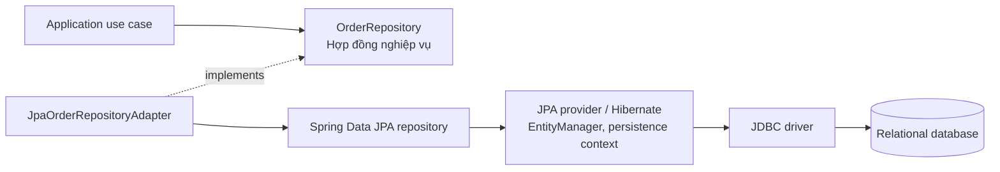

# Phân biệt repository, DAO và công cụ ORM theo hợp đồng và mức trừu tượng

Bài học này thuộc chương **Tầng truy cập dữ liệu** của module `SOFTWARE_DESIGN_ARCHITECTURE_ARCHITECTURAL_PATTERN_LAYERED`, trong chương trình **học tổ chức phần mềm theo kiến trúc phân tầng**. Tầng truy cập dữ liệu kết nối các ca sử dụng và mô hình nghiệp vụ với nơi lưu trữ như cơ sở dữ liệu quan hệ, document store hoặc dịch vụ bên ngoài. Trong Java, ba thuật ngữ thường xuất hiện ở khu vực này là **Repository**, **DAO (Data Access Object)** và **ORM (Object-Relational Mapping)**. Chúng có liên quan nhưng mô tả những khía cạnh khác nhau: hợp đồng mà ứng dụng cần, cách đóng gói thao tác lưu trữ và công nghệ ánh xạ dữ liệu.

Repository thường được thiết kế quanh khái niệm nghiệp vụ hoặc aggregate mà ứng dụng muốn truy xuất. DAO thường cung cấp các thao tác truy cập dữ liệu theo bảng, truy vấn hoặc nguồn dữ liệu. ORM là công cụ ánh xạ giữa mô hình đối tượng và cấu trúc quan hệ, đồng thời có thể quản lý vòng đời entity và đồng bộ thay đổi. Một repository có thể dùng DAO hoặc ORM ở bên dưới; DAO cũng có thể dùng ORM. Không cần xem ba khái niệm này là ba lựa chọn loại trừ nhau.

Sau bài học, bạn có thể nhận diện repository, DAO và ORM theo hợp đồng và mức trừu tượng; đọc một dự án Spring/JPA mà không nhầm interface repository với ORM; chọn cách tổ chức phù hợp cho ghi dữ liệu và truy vấn; và đánh giá chi phí khi tách các lớp này.

## 1. Nhìn từ ba câu hỏi khác nhau

| Khái niệm | Nó mô tả điều gì? | Hợp đồng thường nói về | Ví dụ Java |
|---|---|---|---|
| Repository | Cổng truy cập các đối tượng hoặc aggregate theo ngôn ngữ nghiệp vụ | Tìm, lưu hoặc truy xuất một tập đối tượng nghiệp vụ | `OrderRepository.findById(OrderId)` |
| DAO | Đối tượng đóng gói thao tác đọc/ghi một nguồn dữ liệu | Truy vấn, câu lệnh, bản ghi hoặc tập dữ liệu | `OrderDao.findRowsByCustomer(UUID)` |
| ORM | Công nghệ ánh xạ mô hình đối tượng với dữ liệu quan hệ | Mapping entity, identity, quan hệ, truy vấn và đồng bộ thay đổi | Jakarta Persistence, Hibernate |

Hãy dùng ba câu hỏi để phân biệt:

1. **Ứng dụng cần yêu cầu gì?** Đây là câu hỏi về hợp đồng. Nếu use case cần tải một đơn hàng và lưu thay đổi của nó, repository có thể biểu đạt nhu cầu đó bằng ngôn ngữ nghiệp vụ.
2. **Thao tác dữ liệu được tổ chức ra sao?** Đây là câu hỏi về cách đóng gói truy cập. DAO có thể cung cấp truy vấn theo bảng, projection hoặc câu lệnh SQL cụ thể.
3. **Đối tượng Java được chuyển thành hàng/cột thế nào?** Đây là câu hỏi về ORM. Hibernate hoặc một provider JPA đảm nhận mapping và theo dõi thay đổi entity.

Trong một ứng dụng nhỏ, một interface Spring Data JPA có thể đồng thời mang tên Repository và cung cấp thao tác lưu trữ trực tiếp. Trong một ứng dụng cần cô lập mô hình domain khỏi JPA, một repository adapter có thể gọi Spring Data JPA hoặc `EntityManager` ở bên trong. Cả hai cách đều hợp lệ nếu ranh giới phụ thuộc, giao dịch và trách nhiệm được hiểu rõ.

## 2. Repository: hợp đồng truy cập theo mô hình nghiệp vụ

### Repository là gì?

Repository là một mẫu thiết kế cung cấp giao diện giống như một tập hợp đối tượng nghiệp vụ để phần application/domain có thể tìm và lưu chúng mà không cần biết chi tiết dữ liệu được lưu bằng SQL, ORM hay một nguồn khác. Trong cách dùng gắn với Domain-Driven Design, repository thường tập trung vào **aggregate root**: caller tải một aggregate, thay đổi trạng thái qua các hành vi domain rồi yêu cầu lưu aggregate đó.

Ví dụ, use case đặt hàng cần tìm đơn hàng theo `OrderId` và lưu đơn sau khi gọi hành vi nghiệp vụ. Hợp đồng có thể viết như sau:

```java
public interface OrderRepository {
    Optional<Order> findById(OrderId id);
    void save(Order order);
}
```

Hợp đồng này dùng `Order` và `OrderId` của mô hình nghiệp vụ. Nó không để lộ `EntityManager`, `JpaRepository`, `ResultSet`, SQL hoặc kiểu dữ liệu của một database cụ thể. Application service có thể điều phối use case thông qua interface:

```java
public class CancelOrderService {
    private final OrderRepository orders;

    public CancelOrderService(OrderRepository orders) {
        this.orders = orders;
    }

    public CancelOrderResult execute(CancelOrderCommand command) {
        var order = orders.findById(command.orderId());
        if (order.isEmpty()) {
            return new CancelOrderResult.NotFound();
        }

        var decision = order.get().cancel(command.reason());
        if (decision instanceof Order.CancelDecision.Rejected rejected) {
            return new CancelOrderResult.Rejected(rejected.reason());
        }

        orders.save(order.get());
        return new CancelOrderResult.Cancelled(order.get().id());
    }
}
```

Đây là ví dụ giản lược. Ranh giới transaction thường được đặt ở application service hoặc một thành phần điều phối use case tương đương. Repository cung cấp khả năng lưu trữ; nó không tự quyết định toàn bộ quy trình hủy đơn.

### Hợp đồng repository nên thể hiện nhu cầu nghiệp vụ

Tên phương thức nên giúp caller hiểu nó đang lấy hoặc lưu điều gì. Ví dụ `findOpenOrdersForCustomer(CustomerId)` có ý nghĩa nghiệp vụ rõ hơn một phương thức tổng quát `executeQuery(String sql)`. Repository không nhất thiết chỉ có `save` và `findById`; nó có thể cung cấp các truy vấn được use case cần, miễn là hợp đồng vẫn ở mức phù hợp.

Một repository không nên trở thành bản sao của mọi thao tác SQL. Nếu interface có hàng chục phương thức như `selectColumnA`, `updateTableX` hoặc nhận `ResultSet`, nó đang bộc lộ chi tiết persistence và gần với DAO hơn. Ngược lại, cũng không cần ép mọi truy vấn báo cáo phức tạp thành thao tác tải một aggregate lớn. Với truy vấn đọc chuyên biệt, một query service hoặc DAO trả projection có thể phù hợp hơn.

### Repository không bắt buộc phải là một collection trong bộ nhớ

Ẩn dụ collection giúp người dùng repository thao tác với đối tượng nghiệp vụ thay vì SQL. Nó không có nghĩa mỗi repository phải tải toàn bộ dữ liệu hoặc cung cấp đầy đủ các phép thêm/xóa/lọc như một collection thực. Truy vấn cần phân trang, sắp xếp, lọc hoặc giới hạn kết quả vẫn có thể được thể hiện rõ trong hợp đồng.

Ví dụ:

```java
public interface OrderRepository {
    Optional<Order> findById(OrderId id);
    Page<OrderSummary> findRecentByCustomer(
            CustomerId customerId, Pageable pageable);
    void save(Order order);
}
```

`Pageable` và `Page` ở đây là kiểu của Spring Data. Nếu muốn hợp đồng domain/application độc lập với Spring, có thể định nghĩa `PageRequest` và `PageResult` của ứng dụng. Đây là quyết định về mức độ phụ thuộc framework, không phải quy tắc bắt buộc cho mọi dự án.

## 3. DAO: đóng gói thao tác truy cập dữ liệu

### DAO là gì?

DAO (Data Access Object) là mẫu thiết kế tách mã thao tác với nguồn dữ liệu ra khỏi phần gọi nó. DAO thường cung cấp các phương thức đọc/ghi dữ liệu theo truy vấn, bảng, tập bản ghi hoặc một cấu trúc lưu trữ. DAO có thể ẩn SQL, JDBC, stored procedure, driver hoặc API của nguồn dữ liệu.

Ví dụ một DAO hướng JDBC:

```java
public interface OrderDao {
    Optional<OrderRow> findRowById(UUID orderId);
    List<OrderRow> findRowsByCustomer(UUID customerId);
    int updateStatus(UUID orderId, String status);
}
```

`OrderRow` có thể là projection phản ánh cột dữ liệu. Implementation JDBC chịu trách nhiệm tạo `PreparedStatement`, bind tham số, đọc `ResultSet`, quản lý resource và chuyển dữ liệu thành kiểu Java.

```java
@Repository
public class JdbcOrderDao implements OrderDao {
    private final JdbcTemplate jdbc;

    public JdbcOrderDao(JdbcTemplate jdbc) {
        this.jdbc = jdbc;
    }

    @Override
    public Optional<OrderRow> findRowById(UUID orderId) {
        var rows = jdbc.query(
                "select id, customer_id, status from orders where id = ?",
                (rs, rowNum) -> new OrderRow(
                        rs.getObject("id", UUID.class),
                        rs.getObject("customer_id", UUID.class),
                        rs.getString("status")),
                orderId);
        return rows.stream().findFirst();
    }

    @Override
    public int updateStatus(UUID orderId, String status) {
        return jdbc.update(
                "update orders set status = ? where id = ?",
                status, orderId);
    }
}
```

Ví dụ lược bỏ import và lớp `OrderRow`. `JdbcTemplate` quản lý việc lấy/trả connection và đóng statement/result set; câu SQL dùng placeholder và bind tham số để tránh ghép dữ liệu đầu vào trực tiếp vào chuỗi SQL. DAO có thể tham gia transaction do tầng application mở nếu dùng cùng transaction manager và connection/resource tương ứng.

### DAO thường gần với cấu trúc lưu trữ hơn

DAO có thể tập trung vào một bảng, một nhóm bảng, một aggregate hoặc một loại truy vấn. Không có quy tắc rằng một DAO phải tương ứng đúng một bảng. Một DAO báo cáo có thể chạy join nhiều bảng và trả một projection. DAO có thể dùng JDBC thuần, `JdbcTemplate`, MyBatis, JPA `EntityManager` hoặc ORM khác.

DAO thích hợp khi:

- Cần kiểm soát SQL, join, batch update hoặc truy vấn tối ưu.
- Truy vấn trả dữ liệu dạng báo cáo/projection thay vì aggregate domain.
- Ứng dụng cần che giấu chi tiết một nguồn dữ liệu cụ thể sau interface.
- Nhiều use case cần dùng chung một thao tác dữ liệu cấp thấp.

DAO không tự quyết định quy tắc nghiệp vụ. Một phương thức `updateStatus(orderId, "CANCELLED")` có thể cập nhật một cột nhưng không bảo đảm đơn hàng đủ điều kiện hủy. Quyết định nghiệp vụ phải được thực hiện ở domain/application trước khi gọi thao tác lưu trữ, hoặc được bảo vệ thêm bằng điều kiện nguyên tử và constraint phù hợp.

## 4. ORM: ánh xạ đối tượng và dữ liệu quan hệ

### ORM giải quyết vấn đề gì?

ORM (Object-Relational Mapping) ánh xạ lớp/đối tượng Java với bảng/hàng/cột trong cơ sở dữ liệu quan hệ. Thay vì tự viết toàn bộ SQL và mapping cho mỗi thao tác, lập trình viên khai báo entity, quan hệ và cách ánh xạ; ORM cung cấp API để truy vấn, quản lý trạng thái đối tượng và đồng bộ thay đổi.

Trong hệ sinh thái Java:

- **Jakarta Persistence (JPA)** là đặc tả API và mapping cho persistence trong Java.
- **Hibernate ORM** là một implementation/provider phổ biến của Jakarta Persistence và cũng có API riêng.
- **Spring Data JPA** xây dựng abstraction repository trên Jakarta Persistence, thường dùng provider như Hibernate ở phía dưới.
- **JDBC** là API truy cập database mức thấp hơn; nó không phải ORM.

Do đó, JPA không đồng nghĩa với Hibernate, và Spring Data JPA không phải tên khác của ORM. Một ứng dụng Spring Data JPA có thể dùng Spring Data repository để gọi JPA, JPA provider để quản lý entity và JDBC ở tầng driver để giao tiếp với database.

### Entity và mapping

Ví dụ entity JPA đơn giản:

```java
@Entity
@Table(name = "orders")
public class OrderEntity {
    @Id
    private UUID id;

    @Column(name = "customer_id", nullable = false)
    private UUID customerId;

    @Enumerated(EnumType.STRING)
    @Column(nullable = false)
    private OrderStatus status;

    protected OrderEntity() {}

    // Constructor, getter và phương thức thay đổi trạng thái được lược bớt.
}
```

ORM đọc metadata để biết `OrderEntity` ánh xạ tới bảng `orders`, field nào ánh xạ tới cột nào và cách chuyển kiểu. Khi entity được quản lý trong persistence context, provider có thể theo dõi thay đổi (dirty checking) và phát SQL khi flush hoặc commit. Việc lưu entity không nhất thiết luôn tương ứng với một câu `INSERT` ngay tại dòng gọi `save`.

### Các cơ chế ORM cần hiểu

- **Persistence context / identity map:** trong một context, provider thường duy trì một thực thể quản lý cho mỗi định danh entity. Nhiều lần tìm cùng ID trong context có thể trả về cùng instance được quản lý.
- **Unit of Work:** provider theo dõi các entity mới, thay đổi hoặc bị xóa để đồng bộ chúng khi flush/commit.
- **Dirty checking:** thay đổi trên entity được quản lý có thể được phát hiện và chuyển thành câu lệnh SQL mà không cần gọi `update` thủ công cho từng field.
- **Relationship mapping:** quan hệ như `@ManyToOne`, `@OneToMany` mô tả liên kết giữa entity. `cascade` và `orphanRemoval` ảnh hưởng vòng đời lưu/xóa, cần cấu hình có chủ đích.
- **Lazy/eager loading:** quan hệ có thể được tải khi cần hoặc tải sớm. Lazy loading có thể gây truy vấn bổ sung hoặc lỗi nếu truy cập ngoài persistence context; eager loading có thể tải dữ liệu quá mức.
- **Query language:** JPQL, Criteria API hoặc API riêng của provider giúp truy vấn theo entity/field; native SQL vẫn có thể dùng khi cần tính năng database cụ thể.

ORM giảm mã mapping lặp lại nhưng không xóa chi phí truy vấn, không tự chọn mô hình aggregate đúng và không làm cho SQL biến mất. Lập trình viên vẫn cần hiểu index, join, transaction, locking và kế hoạch thực thi truy vấn.

## 5. Chúng phối hợp với nhau thế nào?

Một cấu trúc nhiều lớp có thể có repository ở phía trong, adapter dùng ORM hoặc DAO ở phía ngoài:



Ở ví dụ này:

1. Application gọi `OrderRepository`, hợp đồng thể hiện nhu cầu nghiệp vụ.
2. `JpaOrderRepositoryAdapter` hiện thực hợp đồng và chuyển đổi giữa domain model với entity persistence nếu hai mô hình tách biệt.
3. Adapter gọi Spring Data JPA repository hoặc `EntityManager`.
4. JPA provider như Hibernate quản lý entity và tạo thao tác SQL.
5. JDBC driver truyền câu lệnh đến database.

Trong dự án nhỏ hơn, có thể bỏ adapter riêng và để application phụ thuộc trực tiếp vào interface `JpaRepository`. Khi đó interface Spring Data vừa là repository theo cách đặt tên của framework, vừa là abstraction truy cập persistence; Hibernate vẫn là ORM provider. Cách rút gọn này giảm boilerplate nhưng làm application phụ thuộc vào Spring Data/JPA và entity persistence. Đó là một trade-off cần chủ động chọn.

### Repository adapter dùng Spring Data JPA

```java
public interface SpringDataOrderRepository
        extends JpaRepository<OrderEntity, UUID> {
    List<OrderEntity> findByCustomerId(UUID customerId);
}

@Repository
public class JpaOrderRepositoryAdapter implements OrderRepository {
    private final SpringDataOrderRepository jpa;
    private final OrderMapper mapper;

    public JpaOrderRepositoryAdapter(
            SpringDataOrderRepository jpa, OrderMapper mapper) {
        this.jpa = jpa;
        this.mapper = mapper;
    }

    @Override
    public Optional<Order> findById(OrderId id) {
        return jpa.findById(id.value()).map(mapper::toDomain);
    }

    @Override
    public void save(Order order) {
        jpa.save(mapper.toEntity(order));
    }
}
```

Ví dụ minh họa kiến trúc có domain model và entity persistence riêng; `OrderMapper` được lược bớt. Spring Data thường tạo implementation cho interface repository tại runtime. Adapter bảo vệ hợp đồng domain khỏi các kiểu `JpaRepository` và `OrderEntity`. Tùy cách quản lý entity, mapper có thể cần xử lý đúng ID, version và quan hệ để tránh ghi đè hoặc tạo entity trùng.

### DAO dùng ORM cũng là điều bình thường

Tên DAO không bắt buộc có nghĩa phải dùng JDBC. Một `JpaOrderDao` có thể gọi `EntityManager` và trả projection hoặc DTO phục vụ truy vấn. Ngược lại, một `OrderRepository` có thể dùng JDBC nếu JDBC là cách phù hợp nhất để hiện thực hợp đồng nghiệp vụ. Tên pattern mô tả vai trò/hợp đồng; công nghệ ở bên dưới là một quyết định riêng.

## 6. So sánh mức trừu tượng và tác động đến caller

| Tiêu chí | Repository | DAO | ORM |
|---|---|---|---|
| Trọng tâm | Mô hình và nhu cầu nghiệp vụ | Thao tác đọc/ghi dữ liệu | Mapping và vòng đời đối tượng persistence |
| Caller thường là | Application/domain service | Repository adapter, application hoặc query service | DAO/repository hoặc code persistence |
| Kiểu hợp đồng | Aggregate, entity domain, value object hoặc kết quả truy vấn nghiệp vụ | Row, record, projection, tham số truy vấn | Entity, persistence context, query API |
| Biết chi tiết SQL/database? | Nên hạn chế ở hợp đồng nghiệp vụ | Có thể biết hoặc che giấu SQL tùy abstraction | Provider sinh/thi hành SQL; người dùng vẫn cần hiểu database |
| Vai trò transaction | Tham gia transaction của use case | Thực thi thao tác trong transaction | Quản lý đồng bộ entity trong persistence context/transaction |
| Có thể dùng chung? | Có | Có thể hiện thực repository hoặc query service | Có thể là công nghệ bên dưới cả hai |

Đừng dùng bảng này như luật cứng về tên class. Nhiều framework và codebase đặt tên khác nhau. Hãy đọc interface, kiểu dữ liệu nó nhận/trả và trách nhiệm caller để xác định mức trừu tượng thực tế.

## 7. Chọn cách tổ chức cho từng loại nhu cầu

### Ghi và thay đổi aggregate

Khi use case tải một aggregate, gọi hành vi domain rồi lưu trạng thái mới, repository thường là hợp đồng phù hợp. Adapter có thể dùng ORM để tải aggregate và đồng bộ thay đổi. Nếu domain model được tách khỏi entity JPA, mapper và adapter tạo thêm mã nhưng giảm sự phụ thuộc vào persistence.

### Truy vấn báo cáo và màn hình đọc

Một màn hình báo cáo thường cần join nhiều bảng, lọc, sắp xếp và trả vài cột. Tải nhiều aggregate rồi chuyển thành view model có thể tốn tài nguyên và không cần thiết. Một DAO hoặc query service trả projection có thể đơn giản hơn:

```java
public interface OrderReportDao {
    List<OrderReportRow> findMonthlyTotals(
            UUID customerId, YearMonth from, YearMonth to);
}
```

Truy vấn có thể dùng JDBC, JPQL projection hoặc native SQL. Đầu ra là dữ liệu đọc phục vụ báo cáo, không nhất thiết phải tạo một đối tượng domain đầy đủ. Cách này thường được gọi là tách đường đọc/ghi ở mức ứng dụng; không bắt buộc phải triển khai CQRS hoặc database riêng.

### Ứng dụng nhỏ và modular monolith

Với một ứng dụng Spring Boot nhỏ, interface `OrderRepository extends JpaRepository<OrderEntity, UUID>` có thể là đủ. Tạo thêm domain repository interface, adapter, DAO, mapper và wrapper chỉ để chuyển tiếp từng lời gọi có thể làm code khó theo dõi hơn. Khi ranh giới domain cần độc lập, logic persistence phức tạp hoặc nhiều adapter cùng phục vụ một hợp đồng, tách lớp sẽ mang lại giá trị rõ hơn.

### Nhiều nguồn dữ liệu hoặc tích hợp ngoài

Nếu một use case đọc từ database và một API ngoài, có thể định nghĩa các cổng riêng như `OrderRepository` và `ShippingStatusGateway`. Adapter triển khai chúng bằng JPA, JDBC hoặc HTTP client. Không nên gọi API từ xa là ORM; cũng không nên ép một gateway dịch vụ bên ngoài thành repository nếu hợp đồng của nó không giống thao tác lưu/truy xuất tập đối tượng.

## 8. Những vấn đề ORM không tự giải quyết

### N+1 query và tải dữ liệu quá mức

Nếu tải danh sách đơn hàng rồi truy cập từng collection `items`, ORM có thể phát sinh một truy vấn lấy danh sách và thêm một truy vấn cho mỗi đơn. Đây là vấn đề N+1. Ngược lại, fetch join nhiều collection có thể tạo số hàng lớn do phép nhân và làm kết quả bị lặp. Cần đo truy vấn và chọn fetch plan, projection, batch fetching hoặc query chuyên biệt theo use case.

### Lazy loading và ranh giới transaction

Truy cập một quan hệ lazy sau khi persistence context đã đóng có thể gây `LazyInitializationException` với Hibernate. Mở rộng transaction hoặc bật Open Session in View có thể làm lỗi biến mất trong một số trường hợp nhưng cũng có thể khiến truy vấn phát sinh trong lúc render view. Thường tốt hơn khi use case tải rõ dữ liệu cần thiết và trả DTO/read model phù hợp.

### Mapping entity không thay thế mô hình domain

Entity JPA thường phải tuân theo yêu cầu constructor, ID, quan hệ và mapping của provider. Domain model có thể cần hành vi, invariant và value object khác. Có thể dùng cùng một class làm entity và domain object trong ứng dụng đơn giản; khi persistence bắt đầu chi phối thiết kế nghiệp vụ, cân nhắc tách hai mô hình. Tách riêng không phải yêu cầu phổ quát và cũng không tự động làm kiến trúc tốt hơn.

### Đồng bộ thay đổi và locking

ORM có thể theo dõi thay đổi và flush tự động, nhưng không thay thế transaction boundary hay concurrency control. Hai transaction vẫn có thể ghi đè nhau nếu không có optimistic locking (`@Version`), pessimistic lock hoặc điều kiện cập nhật thích hợp. Database constraint vẫn cần thiết để bảo vệ dữ liệu trước nhiều đường ghi khác nhau.

## 9. Kiểm thử repository, DAO và ORM

Mỗi mức cần một kiểu kiểm thử phù hợp:

| Mức kiểm thử | Mục tiêu | Ví dụ |
|---|---|---|
| Unit test application/domain | Xác nhận use case dùng hợp đồng repository đúng và quy tắc nghiệp vụ đúng | Mock `OrderRepository`, kiểm tra nhánh not found/rejected/created |
| Test adapter/DAO | Xác nhận mapping và truy vấn đúng với database | Lưu rồi đọc entity; kiểm tra SQL projection và cập nhật có điều kiện |
| Integration test ORM | Xác nhận mapping, cascade, lazy/eager, dirty checking, transaction và locking | Dùng database kiểm thử hoặc Testcontainers để xác nhận entity được persist đúng |
| Contract test | Xác nhận implementation khác nhau tuân theo cùng hợp đồng | Adapter JDBC và adapter JPA đều đáp ứng hành vi của `OrderRepository` |

Mock ORM không chứng minh mapping đúng. Test với H2 cũng không luôn tái hiện hành vi của PostgreSQL/MySQL, đặc biệt ở SQL dialect, locking, constraint hoặc isolation. Với truy vấn quan trọng, dùng cùng hệ quản trị hoặc Testcontainers phù hợp và kiểm tra câu SQL thực tế khi hiệu năng là yêu cầu.

## 10. Những nhầm lẫn cần tránh

1. **“Repository chính là ORM.”** Repository là hợp đồng truy cập; ORM là công nghệ ánh xạ và quản lý entity. Repository có thể dùng ORM, JDBC hoặc nguồn khác.
2. **“DAO luôn là một bảng.”** DAO là cách đóng gói thao tác dữ liệu; nó có thể truy vấn nhiều bảng hoặc phục vụ một projection.
3. **“Spring Data JPA là Hibernate.”** Spring Data JPA cung cấp abstraction repository; JPA là đặc tả; Hibernate có thể là provider thực thi.
4. **“Dùng ORM thì không cần biết SQL.”** ORM vẫn sinh SQL và có thể tạo truy vấn kém hiệu quả. Cần hiểu join, index, fetch plan và transaction.
5. **“Mọi truy vấn phải đi qua repository domain.”** Truy vấn báo cáo hoặc read model có thể phù hợp với DAO/query service chuyên biệt.
6. **“Phải có cả repository, DAO và ORM trong mọi dự án.”** Chỉ thêm abstraction khi nó bảo vệ ranh giới hoặc giảm độ phức tạp thực sự.
7. **“Entity JPA luôn là domain object.”** Có thể dùng chung ở ứng dụng đơn giản, nhưng hai vai trò có mục tiêu và ràng buộc khác nhau.

## 11. Cách chọn mức trừu tượng

Khi thiết kế tầng truy cập dữ liệu, hãy bắt đầu từ caller và nhu cầu của nó:

1. Nếu caller cần thao tác với một khái niệm nghiệp vụ hoặc aggregate, định nghĩa repository bằng kiểu và ngôn ngữ của mô hình đó.
2. Nếu caller cần truy vấn dữ liệu cụ thể, projection hoặc thao tác lưu trữ cấp thấp, cân nhắc DAO hoặc query service.
3. Chọn công nghệ hiện thực phía dưới theo yêu cầu: Spring Data JPA/Hibernate cho mapping entity và unit of work; JDBC hoặc `JdbcTemplate` cho SQL có kiểm soát; MyBatis hoặc công cụ khác nếu phù hợp.
4. Đặt transaction ở ranh giới use case cần nhất quán; bảo đảm repository/DAO cùng tham gia đúng transaction manager.
5. Kiểm thử hợp đồng ở phía caller và kiểm thử mapping/truy vấn với database ở phía adapter.
6. Chỉ tách interface, adapter, DAO và entity riêng khi lợi ích về phụ thuộc, hiệu năng, quyền sở hữu hoặc khả năng thay đổi lớn hơn chi phí mã và mapping.

Ví dụ, `CancelOrderService` có thể phụ thuộc `OrderRepository` để tải và lưu aggregate. `JpaOrderRepositoryAdapter` dùng Spring Data JPA; Spring Data gọi JPA provider như Hibernate; Hibernate quản lý entity và tạo SQL qua JDBC driver. Một báo cáo doanh thu riêng có thể dùng `OrderReportDao` trả projection từ SQL tối ưu. Trong cấu trúc này, repository, DAO và ORM đảm nhiệm các vai trò khác nhau nhưng phối hợp để hoàn thành trách nhiệm của tầng truy cập dữ liệu.
