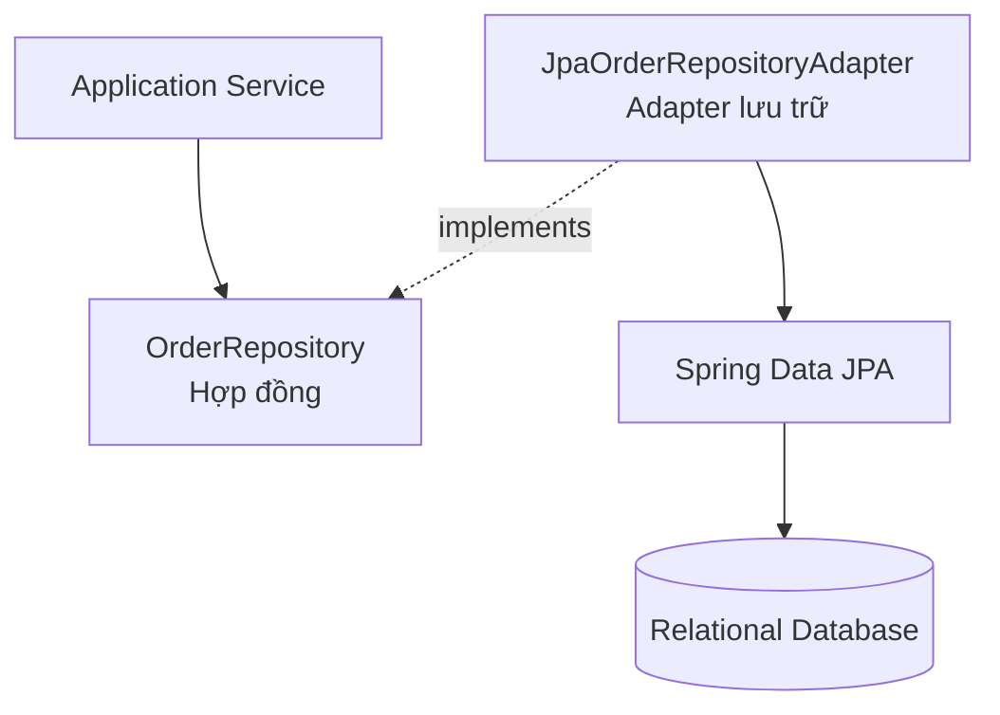

# Đóng gói truy vấn, thao tác lưu và chi tiết công nghệ lưu trữ

*Chương: Tầng truy cập dữ liệu*

Bài học này thuộc module `SOFTWARE_DESIGN_ARCHITECTURE_ARCHITECTURAL_PATTERN_LAYERED`, có mục tiêu **Học tổ chức phần mềm theo kiến trúc phân tầng**. Tầng truy cập dữ liệu chịu trách nhiệm giao tiếp với nơi lưu trữ như cơ sở dữ liệu quan hệ, kho tài liệu hoặc một dịch vụ lưu trữ bên ngoài. Nó đóng gói cách tìm, thêm, sửa, xóa và truy vấn dữ liệu để các tầng phía trên làm việc với hợp đồng có ý nghĩa thay vì phụ thuộc trực tiếp vào SQL, ORM hay chi tiết của nhà cung cấp.

Khi một ứng dụng đặt hàng cần tìm đơn hàng theo mã, ca sử dụng nên diễn đạt nhu cầu là “tìm đơn hàng”, không cần biết dữ liệu nằm trong bảng nào, câu truy vấn dùng cú pháp gì hoặc kết nối được cấu hình ra sao. Tầng truy cập dữ liệu chuyển nhu cầu đó thành thao tác lưu trữ, đồng thời chuyển kết quả về dạng mà ứng dụng có thể sử dụng.

## 1. Vai trò của tầng truy cập dữ liệu

Một ứng dụng thường có các trách nhiệm liên quan nhưng khác nhau:

- Tầng trình bày nhận yêu cầu từ HTTP hoặc một kênh đầu vào khác, sau đó tạo phản hồi.
- Tầng ứng dụng điều phối ca sử dụng, chẳng hạn tạo đơn hàng hoặc tra cứu lịch sử mua hàng.
- Tầng nghiệp vụ biểu diễn khái niệm, trạng thái và quy tắc như điều kiện xác nhận đơn.
- Tầng truy cập dữ liệu thực hiện truy vấn và thao tác lưu trữ theo hợp đồng mà ứng dụng cần.

Tầng truy cập dữ liệu giúp tách **điều ứng dụng muốn làm với dữ liệu** khỏi **cách dữ liệu được lưu và truy xuất**. Ví dụ, `OrderRepository` có thể cung cấp thao tác tìm đơn theo định danh và lưu đơn hàng. Implementation của hợp đồng đó có thể dùng Spring Data JPA, JDBC hoặc một cơ chế lưu trữ khác.

Một tầng dữ liệu được tổ chức tốt thường đảm nhiệm các việc sau:

1. Đóng gói câu truy vấn, mapping và thao tác đọc/ghi.
2. Chuyển đổi giữa mô hình ứng dụng/nghiệp vụ và mô hình lưu trữ khi cần.
3. Che giấu chi tiết công nghệ như API ORM, tên bảng, kiểu cột và cách kết nối.
4. Xử lý các vấn đề liên quan đến lưu trữ như phân trang, khóa, truy vấn tối ưu và lỗi kỹ thuật.
5. Cung cấp một ranh giới có thể kiểm thử độc lập.

Đây là tầng logic trong cấu trúc phần mềm. Nó có thể chạy cùng tiến trình với controller, application service và mô hình nghiệp vụ trong một ứng dụng Spring Boot. Tách tầng truy cập dữ liệu không đồng nghĩa phải triển khai database hoặc repository thành một dịch vụ mạng riêng.

## 2. Đóng gói nhu cầu dữ liệu bằng Repository và DAO

Hai mẫu thường gặp là Repository và Data Access Object (DAO). Chúng có thể được dùng gần như đồng nghĩa trong một số dự án, nhưng trọng tâm thiết kế thường khác nhau:

| Khía cạnh | Repository | DAO |
|---|---|---|
| Góc nhìn | Các đối tượng hoặc khái niệm nghiệp vụ mà ứng dụng cần | Thao tác truy cập một nguồn dữ liệu |
| Hợp đồng | Ví dụ: tìm và lưu đơn hàng | Ví dụ: chạy truy vấn, đọc hoặc cập nhật bản ghi |
| Mức trừu tượng | Thường gần với mô hình nghiệp vụ hoặc aggregate | Có thể gần với bảng, truy vấn hoặc cấu trúc lưu trữ |
| Ví dụ tên | `OrderRepository` | `OrderDao`, `OrderJdbcDao` |

Repository thường diễn đạt nhu cầu của tầng ứng dụng bằng ngôn ngữ nghiệp vụ. DAO có thể tập trung hơn vào thao tác lưu trữ. Không có quy tắc bắt buộc mọi dự án phải dùng cả hai. Một DAO có thể là implementation phía dưới của repository, hoặc repository có thể trực tiếp đóng vai trò abstraction truy cập dữ liệu.

Ví dụ, tầng ứng dụng cần một hợp đồng:

```java
public interface OrderRepository {
    Optional<Order> findById(OrderId id);

    void save(Order order);
}
```

Hợp đồng này nói rằng ứng dụng cần khả năng tìm và lưu đơn hàng. Nó không nói dữ liệu phải nằm trong bảng `orders`, phải sử dụng JPA hay phải gọi một stored procedure nào.

Tầng ứng dụng có thể phụ thuộc vào hợp đồng đó:

```java
public class FindOrderService {
    private final OrderRepository orders;

    public FindOrderService(OrderRepository orders) {
        this.orders = orders;
    }

    public Order execute(OrderId id) {
        return orders.findById(id)
                .orElseThrow(OrderNotFoundException::new);
    }
}
```

Implementation cụ thể được cung cấp ở phía hạ tầng. Với cách tổ chức này, service không phải khởi tạo `EntityManager`, viết SQL hoặc xử lý `ResultSet`.

## 3. Hướng phụ thuộc và vị trí của hợp đồng

Trong kiến trúc phân tầng đơn giản, repository có thể được khai báo ở tầng ứng dụng hoặc tầng nghiệp vụ tùy ngữ nghĩa và quy ước của dự án. Adapter truy cập dữ liệu triển khai hợp đồng đó. Khi áp dụng Dependency Inversion, chi tiết lưu trữ phụ thuộc vào abstraction mà ứng dụng cần, thay vì tầng ứng dụng phụ thuộc vào implementation của database.



Mũi tên nét đứt biểu diễn quan hệ triển khai interface. Luồng thực thi đi từ application service qua hợp đồng đến adapter và database; hướng phụ thuộc mã nguồn có thể hướng vào abstraction. Hai góc nhìn này không nên bị nhầm lẫn.

Trong Java, interface giúp tách nơi khai báo nhu cầu khỏi nơi cung cấp chi tiết. Tuy nhiên, chỉ tạo interface chưa đủ để có ranh giới tốt. Nếu interface công khai `JpaRepository`, `EntityManager`, `Pageable` ở mọi nơi hoặc trả về entity gắn chặt với ORM, chi tiết lưu trữ vẫn rò rỉ lên tầng trên.

Hợp đồng nên phản ánh những thao tác mà ca sử dụng thực sự cần. Không nhất thiết tạo một interface CRUD tổng quát với hàng chục phương thức nếu ứng dụng chỉ cần vài truy vấn có ý nghĩa. Một abstraction nhỏ và rõ thường dễ hiểu hơn một abstraction tổng quát nhưng buộc mọi caller biết quá nhiều khả năng lưu trữ.

## 4. Triển khai với Spring Data JPA

Spring Data JPA có thể tự tạo implementation cho các interface repository. Ví dụ, persistence model biểu diễn cấu trúc dữ liệu mà JPA ánh xạ:

```java
@Entity
@Table(name = "orders")
public class OrderJpaEntity {
    @Id
    private UUID id;

    @Column(name = "customer_id", nullable = false)
    private UUID customerId;

    @Column(nullable = false)
    private String status;

    @Column(name = "created_at", nullable = false)
    private Instant createdAt;

    protected OrderJpaEntity() {
    }

    // Constructor, getter và các phương thức mapping được lược bớt.
}
```

Interface Spring Data có thể khai báo các truy vấn:

```java
public interface SpringDataOrderRepository
        extends JpaRepository<OrderJpaEntity, UUID> {

    Optional<OrderJpaEntity> findByCustomerIdAndId(
            UUID customerId,
            UUID orderId);

    @Query("""
           select o
           from OrderJpaEntity o
           where o.status = :status
           order by o.createdAt desc
           """)
    List<OrderJpaEntity> findRecentByStatus(
            @Param("status") String status);
}
```

Spring Data có thể suy ra truy vấn từ tên phương thức hoặc thực thi truy vấn được khai báo bằng `@Query`. Truy vấn JPQL tham chiếu tên entity và thuộc tính Java; native query có thể dùng SQL theo hệ quản trị cụ thể. Chọn loại nào tùy độ phức tạp, khả năng tối ưu và mức phụ thuộc mà dự án chấp nhận.

Một adapter có thể chuyển giữa hợp đồng ứng dụng và Spring Data:

```java
@Repository
public class JpaOrderRepositoryAdapter implements OrderRepository {
    private final SpringDataOrderRepository repository;
    private final OrderMapper mapper;

    public JpaOrderRepositoryAdapter(
            SpringDataOrderRepository repository,
            OrderMapper mapper) {
        this.repository = repository;
        this.mapper = mapper;
    }

    @Override
    public Optional<Order> findById(OrderId id) {
        return repository.findById(id.value())
                .map(mapper::toDomain);
    }

    @Override
    public void save(Order order) {
        OrderJpaEntity entity = mapper.toEntity(order);
        repository.save(entity);
    }
}
```

Ví dụ giả định `OrderId`, `Order`, `OrderMapper` và `OrderJpaEntity` đã được định nghĩa trong dự án. Adapter chịu trách nhiệm gọi Spring Data và chuyển đổi mô hình. Tầng ứng dụng chỉ nhìn thấy `OrderRepository`.

Nếu dự án dùng trực tiếp JPA entity làm mô hình ứng dụng, mapper có thể không cần thiết. Điều đó giảm số lớp và chi phí chuyển đổi, nhưng cũng làm mô hình nghiệp vụ gắn với ORM hơn. Với miền phức tạp hoặc cần nhiều cách lưu trữ, tách persistence model có thể giúp thay đổi độc lập hơn. Hãy chọn theo nhu cầu thực tế thay vì tách lớp theo một công thức cố định.

## 5. Đóng gói truy vấn mà vẫn giữ rõ ý nghĩa

Một repository không chỉ là nơi đặt mọi câu SQL. Nó cần cung cấp truy vấn có tên và kết quả phù hợp với nhu cầu của ca sử dụng.

Ví dụ, một màn hình quản trị có thể cần danh sách đơn hàng đang chờ xử lý. Có thể khai báo truy vấn có phân trang:

```java
public interface SpringDataOrderRepository
        extends JpaRepository<OrderJpaEntity, UUID> {

    Page<OrderJpaEntity> findByStatus(
            String status,
            Pageable pageable);
}
```

Ở phía implementation, Spring Data trả về trang dữ liệu cùng các tham số phân trang và sắp xếp:

```java
Page<OrderJpaEntity> page = repository.findByStatus(
        "PENDING",
        PageRequest.of(0, 20, Sort.by("createdAt").descending())
);
```

Ví dụ trên minh họa API của Spring Data. Nếu muốn tránh để kiểu `Page`, `Pageable` hoặc entity JPA đi ra khỏi tầng lưu trữ, adapter có thể chuyển kết quả thành kiểu trang và DTO riêng của ứng dụng. Cần giới hạn kích thước trang và chọn thứ tự ổn định để tránh tải quá nhiều dữ liệu hoặc khiến bản ghi thay đổi vị trí khó dự đoán giữa các trang.

Với truy vấn báo cáo hoặc danh sách chỉ cần một số cột, projection có thể tiết kiệm việc tải toàn bộ entity:

```java
public interface OrderSummary {
    UUID getId();
    String getStatus();
    BigDecimal getTotal();
}
```

Projection giúp lấy đúng dữ liệu mà màn hình cần. Nhưng DTO/projection của persistence không nhất thiết phải trở thành kiểu trả về công khai của API. Tầng trình bày vẫn chịu trách nhiệm định dạng response; application service có thể chuyển đổi hoặc phối hợp dữ liệu theo ca sử dụng.

Một số nguyên tắc khi thiết kế truy vấn:

- Đặt tên theo ý nghĩa mà caller cần, chẳng hạn `findPendingOrdersForCustomer`, thay vì tên mơ hồ như `getData2`.
- Chỉ trả các trường cần thiết cho tác vụ, nhất là với báo cáo hoặc danh sách lớn.
- Chú ý số lượng truy vấn, N+1 query, chiến lược fetch và phân trang.
- Dùng tham số truy vấn thay vì nối chuỗi từ dữ liệu đầu vào.
- Giữ logic nghiệp vụ quan trọng trong mô hình hoặc dịch vụ nghiệp vụ; truy vấn có thể lọc dữ liệu nhưng không nên âm thầm thay thế toàn bộ quy tắc miền.
- Xem xét index và execution plan khi truy vấn trở thành điểm nghẽn, dựa trên dữ liệu và workload thực tế.

Đóng gói truy vấn không có nghĩa che giấu hoàn toàn cách truy vấn hoạt động. Người bảo trì vẫn cần đọc được truy vấn, hiểu lý do chọn join/projection và đo được hiệu năng.

## 6. JDBC và các công nghệ lưu trữ khác

Tầng truy cập dữ liệu có thể dùng JDBC trực tiếp hoặc thông qua `JdbcTemplate`. Ví dụ với `NamedParameterJdbcTemplate`:

```java
@Repository
public class OrderJdbcDao {
    private final NamedParameterJdbcTemplate jdbc;

    public OrderJdbcDao(NamedParameterJdbcTemplate jdbc) {
        this.jdbc = jdbc;
    }

    public Optional<OrderRow> findById(UUID orderId) {
        String sql = """
                select id, customer_id, status, total
                from orders
                where id = :id
                """;

        var parameters = new MapSqlParameterSource()
                .addValue("id", orderId);

        List<OrderRow> rows = jdbc.query(
                sql,
                parameters,
                (rs, rowNum) -> new OrderRow(
                        rs.getObject("id", UUID.class),
                        rs.getObject("customer_id", UUID.class),
                        rs.getString("status"),
                        rs.getBigDecimal("total")
                )
        );

        return rows.stream().findFirst();
    }
}
```

Các kiểu `OrderRow` và import được lược bớt để tập trung vào cách truy vấn. Tham số `:id` được bind riêng với giá trị đầu vào. Không nên ghép trực tiếp dữ liệu người dùng vào chuỗi SQL vì điều đó tạo nguy cơ SQL injection.

JDBC giúp kiểm soát câu SQL, mapping và cách đọc dữ liệu rõ ràng, nhưng người viết phải tự quản lý nhiều chi tiết hơn ORM. JPA giúp biểu diễn quan hệ đối tượng và hỗ trợ quản lý persistence context, nhưng cần hiểu lazy loading, flush, dirty checking và cách ORM sinh truy vấn. Không có công nghệ nào luôn tốt hơn; hãy chọn theo độ phức tạp của mô hình, yêu cầu hiệu năng, kỹ năng nhóm và khả năng vận hành.

Nếu thay JPA bằng JDBC, phần adapter có thể cần viết lại câu truy vấn và mapping. Nếu hợp đồng ứng dụng được giữ ổn định, các ca sử dụng phía trên có cơ hội ít thay đổi hơn. Việc thay công nghệ không tự động miễn phí: kiểu dữ liệu, transaction, locking, phân trang, truy vấn đặc thù và hành vi nhất quán của từng hệ quản trị vẫn cần được kiểm tra.

## 7. Mapping và ranh giới của mô hình lưu trữ

Dữ liệu trong database thường được tổ chức theo bảng, khóa ngoại, cột và quan hệ. Mô hình nghiệp vụ lại được tổ chức theo khái niệm và hành vi. Hai mô hình có thể trùng nhau trong ứng dụng đơn giản, nhưng không bắt buộc phải giống hệt.

Ví dụ, database có thể lưu:

- Bảng `orders` chứa mã đơn, khách hàng, trạng thái và thời điểm tạo.
- Bảng `order_lines` chứa từng sản phẩm, số lượng và đơn giá.
- Bảng `customers` chứa thông tin khách hàng.

Mô hình nghiệp vụ có thể biểu diễn một `Order` cùng tập hợp `OrderLine`. Adapter hoặc mapper chuyển đổi giữa cấu trúc quan hệ và đối tượng nghiệp vụ. Mapping cần xử lý định danh, giá trị null, enum, tiền tệ, thời gian và quan hệ giữa các bản ghi một cách nhất quán.

Không nên để mô hình nghiệp vụ phải biết tên cột hoặc cách join bảng. Ngược lại, adapter phải hiểu cách lưu trữ để khôi phục mô hình đúng. Nếu hai phía có cùng cấu trúc và việc chuyển đổi chỉ tạo thêm mã lặp, dùng chung mô hình có thể là lựa chọn hợp lý. Nếu schema thay đổi thường xuyên hoặc mô hình miền có quy tắc phức tạp, tách hai mô hình có thể đem lại ranh giới hữu ích.

## 8. Transaction, đồng thời và lỗi lưu trữ

Một thao tác nghiệp vụ có thể cần nhiều câu lệnh lưu trữ cùng thành công hoặc cùng thất bại. Ví dụ, xác nhận đơn hàng có thể cập nhật trạng thái đơn, ghi nhận lịch sử và tạo bản ghi liên quan. Transaction giúp các thao tác đó được thực hiện như một đơn vị nhất quán.

Trong Spring, ranh giới transaction thường được đặt ở application service vì nó bao phủ toàn bộ ca sử dụng:

```java
@Service
public class ConfirmOrderService {
    private final OrderRepository orders;

    public ConfirmOrderService(OrderRepository orders) {
        this.orders = orders;
    }

    @Transactional
    public void execute(OrderId id) {
        Order order = orders.findById(id)
                .orElseThrow(OrderNotFoundException::new);

        order.confirm();
        orders.save(order);
    }
}
```

Với JPA, khi entity được quản lý trong persistence context, thay đổi có thể được ghi xuống database khi flush hoặc commit; lời gọi `save` có thể vẫn hữu ích để thể hiện ý định của repository và duy trì cùng hợp đồng với implementation khác. Chi tiết chính xác phụ thuộc cách tải và quản lý entity của dự án.

Không nên mở transaction độc lập ở mọi phương thức DAO hoặc repository một cách tùy tiện. Nếu mỗi thao tác tự commit, một ca sử dụng gồm nhiều bước có thể bị chia thành các phần không còn nguyên tử. Cũng cần tránh giữ transaction mở trong lúc gọi dịch vụ mạng chậm hoặc chờ người dùng, vì điều đó có thể giữ khóa và kết nối lâu.

Khi nhiều yêu cầu đồng thời cập nhật cùng dữ liệu, cần có chiến lược nhất quán. JPA hỗ trợ optimistic locking bằng trường `@Version`:

```java
@Version
private long version;
```

Nếu hai transaction cùng đọc một phiên bản và cùng cập nhật, một transaction có thể bị từ chối khi phiên bản đã thay đổi. Ứng dụng cần quyết định có thử lại, báo xung đột hay yêu cầu người dùng tải dữ liệu mới. Optimistic locking hữu ích khi xung đột không quá thường xuyên; nó không thay thế mọi yêu cầu khóa hoặc thiết kế nhất quán.

Ràng buộc database như primary key, foreign key và unique constraint vẫn quan trọng vì nhiều tiến trình có thể cùng ghi dữ liệu. Kiểm tra trong Java giúp phản hồi sớm, còn constraint ở database là lớp bảo vệ cuối cùng trước các ghi đồng thời hoặc đường ghi khác.

Lỗi kỹ thuật từ driver, ORM hoặc database nên được xử lý ở ranh giới phù hợp và chuyển thành lỗi có ý nghĩa đối với ứng dụng khi có thể nhận diện chính xác. Không để tầng ứng dụng phải phụ thuộc vào mã SQL hoặc tên exception của một nhà cung cấp. Tầng trình bày sẽ quyết định cách chuyển lỗi ứng dụng thành HTTP response; repository không nên tự tạo response HTTP.

## 9. Kiểm thử tầng truy cập dữ liệu

Tầng truy cập dữ liệu cần các bài kiểm thử xác nhận truy vấn, mapping và hành vi lưu trữ thực tế. Unit test application service có thể dùng fake repository để kiểm tra điều phối, nhưng không chứng minh câu SQL hoặc mapping JPA hoạt động đúng.

| Loại kiểm thử | Mục tiêu | Công cụ/cách làm thường gặp |
|---|---|---|
| Unit test tầng ứng dụng | Ca sử dụng gọi đúng hợp đồng và xử lý kết quả phù hợp | Fake hoặc mock repository |
| Integration test JPA | Mapping, derived query, JPQL, quan hệ và transaction | `@DataJpaTest` |
| Integration test JDBC | SQL, tham số, RowMapper và kiểu dữ liệu | Database kiểm thử và `JdbcTemplate` |
| Kiểm thử tích hợp rộng | Luồng lưu/tải qua nhiều tầng | `@SpringBootTest` khi cần |

Có thể kiểm thử repository bằng database kiểm thử như Testcontainers để gần với hệ quản trị production. H2 trong bộ nhớ có thể tiện và nhanh, nhưng không phải lúc nào cũng tái hiện chính xác cú pháp SQL, kiểu dữ liệu, collation, locking hoặc hành vi transaction của database thật. Chọn môi trường kiểm thử theo những đặc tính mà ứng dụng phụ thuộc.

Các trường hợp đáng kiểm tra gồm:

- Tìm thấy và không tìm thấy bản ghi.
- Lưu mới, cập nhật và tải lại trạng thái.
- Truy vấn có điều kiện, sắp xếp và phân trang.
- Mapping quan hệ một-nhiều và dữ liệu null.
- Unique constraint, foreign key và xung đột phiên bản.
- Rollback khi một bước trong transaction thất bại.

Kiểm thử truy vấn nên xác nhận cả dữ liệu trả về và số lượng truy vấn ở những luồng nhạy cảm hiệu năng. Không nên tối ưu chỉ dựa trên suy đoán; hãy đo bằng dữ liệu gần với thực tế.

## 10. Những dấu hiệu tầng truy cập dữ liệu đang bị thiết kế sai

Một số dấu hiệu thường gặp:

- Controller hoặc application service tự viết SQL, gọi `EntityManager` hay đọc `ResultSet` trực tiếp.
- Tên exception, kiểu dữ liệu hoặc annotation của ORM xuất hiện xuyên suốt tầng nghiệp vụ.
- Repository trở thành một lớp CRUD tổng quát quá lớn, không diễn đạt được nhu cầu cụ thể của ứng dụng.
- Một truy vấn phức tạp bị giấu trong phương thức có tên mơ hồ, khiến người bảo trì không hiểu điều kiện lọc hoặc chi phí của nó.
- Quy tắc nghiệp vụ quan trọng chỉ tồn tại trong một câu SQL hoặc trigger mà nhóm không tài liệu hóa và kiểm thử đầy đủ.
- Transaction bị chia nhỏ không chủ đích hoặc kéo dài quá lâu.
- Mock repository được dùng thay cho mọi integration test, khiến lỗi mapping và truy vấn không được phát hiện.

Đóng gói dữ liệu cũng không có nghĩa phải tạo interface và adapter cho mọi bảng. Với một ứng dụng nhỏ, Spring Data repository có thể đã đủ. Với hệ thống phức tạp, một adapter riêng có thể bảo vệ hợp đồng và chuyển đổi mô hình. Hãy tạo abstraction khi nó giúp giảm phụ thuộc, làm rõ truy vấn hoặc tạo điểm kiểm thử có ý nghĩa.

Khi thiết kế tầng truy cập dữ liệu, hãy bắt đầu từ các ca sử dụng: ứng dụng cần tìm và thay đổi dữ liệu nào, kết quả cần có hình dạng gì, những truy vấn nào cần tối ưu, và chi tiết lưu trữ nào nên được giữ bên trong adapter? Một ranh giới tốt cho phép nhóm thay đổi truy vấn hoặc công nghệ lưu trữ có kiểm soát, đồng thời giúp tầng ứng dụng tiếp tục diễn đạt nhu cầu bằng ngôn ngữ rõ ràng.

