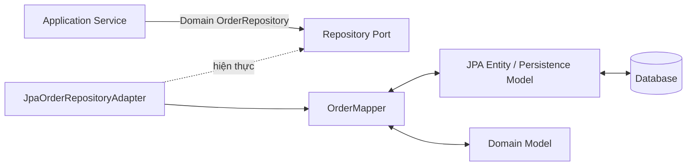

# Phân biệt mô hình nghiệp vụ với entity và mô hình ánh xạ lưu trữ

Bài học này thuộc module `SOFTWARE_DESIGN_ARCHITECTURE_ARCHITECTURAL_PATTERN_LAYERED`, nhằm giúp người học tổ chức phần mềm theo kiến trúc phân tầng. Trong chương **Tầng truy cập dữ liệu**, ta phân biệt mô hình mô tả nghiệp vụ với các đối tượng được thiết kế để lưu và đọc dữ liệu. Việc hiểu rõ các vai trò này giúp tầng truy cập dữ liệu cô lập công nghệ lưu trữ, đồng thời giữ cho quy tắc nghiệp vụ không bị chi phối bởi cấu trúc bảng hoặc framework ORM.

## 1. Một từ “entity”, nhiều ý nghĩa

Trong tài liệu và mã nguồn Java, từ *entity* thường được dùng cho hai khái niệm khác nhau:

- **Domain entity (thực thể miền):** đối tượng nghiệp vụ có danh tính ổn định và vòng đời riêng. Nó biểu diễn một khái niệm trong miền, có thể chứa dữ liệu, hành vi và quy tắc bảo vệ trạng thái.
- **JPA entity (thực thể ánh xạ):** lớp được đánh dấu bằng `@Entity` để ORM ánh xạ đối tượng với dữ liệu lưu trữ. Lớp này có các yêu cầu và chi tiết kỹ thuật phục vụ việc nạp, lưu, quản lý quan hệ và đồng bộ trạng thái với cơ sở dữ liệu.

Hai vai trò có thể được đảm nhiệm bởi cùng một lớp, nhưng không đồng nghĩa. Một `Order` trong miền có thể là domain entity vì nó có mã đơn và hành vi hủy. Một `OrderRow` có thể là JPA entity vì nó ánh xạ một hàng trong bảng. Cũng có dự án đặt `@Entity` trực tiếp lên lớp `Order` và dùng nó cho cả hai vai trò.

Vì vậy, khi nói “mô hình nghiệp vụ” và “entity lưu trữ”, cần xác định rõ đang nói đến entity theo ngữ nghĩa miền hay entity theo ngữ nghĩa JPA.

## 2. Mô hình nghiệp vụ trả lời câu hỏi của miền

Mô hình nghiệp vụ (domain model) mô tả các khái niệm, mối quan hệ, hành vi, chính sách và bất biến của hoạt động kinh doanh. Ví dụ với đơn hàng, mô hình có thể bao gồm:

- `Order` có mã đơn, khách hàng, các dòng hàng và trạng thái.
- `OrderLine` biểu diễn sản phẩm và số lượng đã đặt.
- `Money` biểu diễn số tiền cùng loại tiền tệ.
- `Order.cancel(...)` kiểm tra trạng thái và điều kiện được hủy trước khi chuyển trạng thái.

Mô hình này được thiết kế để trả lời câu hỏi như: đơn hàng có được hủy không, số lượng có hợp lệ không, tổng tiền được tính thế nào và trạng thái nào có thể chuyển tiếp. Nó không cần biết dữ liệu được lưu trong PostgreSQL, MySQL, MongoDB hay một hệ thống khác.

Ví dụ miền đơn giản:

```java
package com.example.orders.domain;

import java.util.List;

public class Order {
    private final OrderId id;
    private final List<OrderLine> lines;
    private OrderStatus status;

    public Order(OrderId id, List<OrderLine> lines) {
        if (lines == null || lines.isEmpty()) {
            throw new IllegalArgumentException("An order needs at least one line");
        }
        this.id = id;
        this.lines = List.copyOf(lines);
        this.status = OrderStatus.PLACED;
    }

    public void cancel() {
        if (status != OrderStatus.PLACED) {
            throw new OrderCannotBeCancelledException(id);
        }
        status = OrderStatus.CANCELLED;
    }

    public OrderId id() { return id; }
    public List<OrderLine> lines() { return lines; }
    public OrderStatus status() { return status; }
}
```

Đoạn mã minh họa một phần mô hình miền; các kiểu `OrderId`, `OrderLine`, `OrderStatus` và exception được giả định đã được định nghĩa. `Order` kiểm tra điều kiện nghiệp vụ và kiểm soát thay đổi trạng thái. Không có annotation JPA, tên bảng hoặc kiểu cột trong ví dụ này.

## 3. Mô hình lưu trữ trả lời câu hỏi của cơ sở dữ liệu và ORM

Mô hình lưu trữ (persistence model) mô tả cách dữ liệu được biểu diễn để công nghệ lưu trữ có thể đọc, ghi và truy vấn. Với JPA, mô hình này thường gồm các lớp `@Entity`, `@Embeddable`, các quan hệ `@OneToMany`, `@ManyToOne`, khóa chính, khóa ngoại và các thuộc tính phục vụ quản lý phiên bản.

Mô hình lưu trữ có thể chịu ảnh hưởng bởi:

- Cấu trúc bảng, tên cột, kiểu dữ liệu, khóa chính và khóa ngoại.
- Chiến lược nạp quan hệ (`LAZY` hoặc `EAGER`) và cách ORM theo dõi thay đổi.
- Ràng buộc duy nhất, chỉ mục, khả năng truy vấn và yêu cầu hiệu năng.
- Lịch sử schema, khả năng tương thích dữ liệu cũ và quy trình migration.
- Các trường kỹ thuật như phiên bản để optimistic locking hoặc dấu thời gian phục vụ audit.

Ví dụ một lớp lưu trữ có thể trông như sau:

```java
package com.example.orders.infrastructure.persistence;

import jakarta.persistence.*;
import java.util.ArrayList;
import java.util.List;

@Entity
@Table(name = "purchase_order")
public class OrderJpaEntity {
    @Id
    @Column(name = "order_id")
    private String id;

    @Column(name = "order_status", nullable = false)
    private String status;

    @Version
    private long version;

    @OneToMany(mappedBy = "order", cascade = CascadeType.ALL,
               orphanRemoval = true)
    private List<OrderLineJpaEntity> lines = new ArrayList<>();

    protected OrderJpaEntity() {
        // Constructor dành cho JPA.
    }

    public String getId() { return id; }
    public String getStatus() { return status; }
    public List<OrderLineJpaEntity> getLines() { return lines; }
}
```

`OrderJpaEntity` tập trung vào cách ORM ánh xạ dữ liệu: tên bảng, cột, khóa và quan hệ. Trường `version` hỗ trợ phát hiện cập nhật cạnh tranh. Quan hệ `lines` mô tả cách các dòng đơn hàng được lưu cùng đơn hàng trong cấu hình này. Các chi tiết ấy không nhất thiết là khái niệm mà miền cần biết.

Một lớp JPA entity thực tế còn cần các phương thức khởi tạo hoặc cập nhật phù hợp với mapping, quyền truy cập field/property và cách xử lý quan hệ hai chiều. Ví dụ trên chỉ minh họa vai trò của mô hình lưu trữ, không phải một mapping hoàn chỉnh để sao chép nguyên trạng.

## 4. So sánh hai mô hình

| Khía cạnh | Mô hình nghiệp vụ | Mô hình lưu trữ / JPA entity |
|---|---|---|
| Mục tiêu | Diễn đạt khái niệm và quy tắc nghiệp vụ | Ánh xạ dữ liệu với công nghệ lưu trữ |
| Câu hỏi chính | Hành động nào hợp lệ? Trạng thái nào đúng? | Dữ liệu nằm ở bảng/cột nào và được nạp ra sao? |
| Thành phần thường gặp | Entity miền, value object, domain service, aggregate | `@Entity`, `@Embeddable`, quan hệ ORM, khóa, version |
| Thay đổi khi | Chính sách hoặc khái niệm nghiệp vụ thay đổi | Schema, ORM, truy vấn hoặc yêu cầu lưu trữ thay đổi |
| Phụ thuộc framework | Có thể không cần framework | Thường phụ thuộc JPA hoặc thư viện persistence |
| Người sử dụng chính | Use case và các thành phần miền | Repository adapter và ORM |

Ranh giới này có thể được hiện thực bằng hai nhóm lớp riêng, hoặc một lớp cùng đảm nhiệm cả hai vai trò. Quyết định phụ thuộc vào độ phức tạp nghiệp vụ, mức độ thay đổi của schema, nhu cầu kiểm thử độc lập và chi phí mapping.

## 5. Vì sao cần mô hình ánh xạ ở tầng truy cập dữ liệu?

Khi hai mô hình được tách riêng, cần một bước chuyển đổi giữa chúng. Mapper hoặc data mapper chịu trách nhiệm chuyển dữ liệu từ JPA entity sang domain object và ngược lại.

```java
package com.example.orders.infrastructure.persistence;

import com.example.orders.domain.Order;
import com.example.orders.domain.OrderId;
import com.example.orders.domain.OrderStatus;
import java.util.stream.Collectors;

class OrderMapper {
    Order toDomain(OrderJpaEntity row) {
        var lines = row.getLines().stream()
            .map(this::lineToDomain)
            .collect(Collectors.toList());

        return Order.reconstitute(
            new OrderId(row.getId()),
            lines,
            OrderStatus.valueOf(row.getStatus())
        );
    }

    OrderJpaEntity toPersistence(Order order) {
        OrderJpaEntity row = new OrderJpaEntity();
        row.setId(order.id().value());
        row.setStatus(order.status().name());
        // Ánh xạ các dòng hàng và thiết lập quan hệ phía sở hữu.
        return row;
    }

    private OrderLine lineToDomain(OrderLineJpaEntity row) {
        // Chuyển mã sản phẩm, số lượng và giá lưu trữ thành kiểu miền.
        return new OrderLine(
            new ProductId(row.getProductId()),
            row.getQuantity(),
            Money.ofMinorUnits(row.getUnitPriceMinor(), row.getCurrency())
        );
    }
}
```

Đây là phác thảo về trách nhiệm mapper; các phương thức factory như `Order.reconstitute(...)`, setter dành cho mapping và constructor của `OrderLineJpaEntity` được lược bỏ. Trong hệ thống thực tế, mapper cần xử lý đầy đủ mọi trường, quan hệ và quy tắc tái tạo trạng thái đã lưu.

Mapper không nên tự phát minh quy tắc nghiệp vụ. Khi đọc một đơn hàng đã lưu, `reconstitute` có thể khôi phục trạng thái miền đã tồn tại mà không giả lập lại một hành động mới như đặt đơn. Nếu dữ liệu cũ không còn thỏa các bất biến hiện tại, cần có chính sách xử lý dữ liệu lịch sử: từ chối, chuyển đổi bằng migration, hoặc khôi phục theo quy tắc tương thích được xác định rõ.

## 6. Repository adapter giữ chi tiết lưu trữ ở đúng tầng

Tầng ứng dụng thường sử dụng một hợp đồng repository để tải và lưu mô hình mà nó cần. Adapter trong tầng truy cập dữ liệu hiện thực hợp đồng bằng JPA và mapper.

```java
package com.example.orders.infrastructure.persistence;

import com.example.orders.domain.Order;
import com.example.orders.domain.OrderId;
import com.example.orders.domain.OrderRepository;
import org.springframework.stereotype.Repository;
import java.util.Optional;

@Repository
class JpaOrderRepositoryAdapter implements OrderRepository {
    private final SpringDataOrderRepository jpa;
    private final OrderMapper mapper;

    JpaOrderRepositoryAdapter(
            SpringDataOrderRepository jpa,
            OrderMapper mapper) {
        this.jpa = jpa;
        this.mapper = mapper;
    }

    @Override
    public Optional<Order> findById(OrderId id) {
        return jpa.findById(id.value()).map(mapper::toDomain);
    }

    @Override
    public void save(Order order) {
        jpa.save(mapper.toPersistence(order));
    }
}
```

`SpringDataOrderRepository` là repository do Spring Data cung cấp hoặc được khai báo trong module persistence. Domain và Application chỉ biết hợp đồng `OrderRepository`; chúng không cần import `OrderJpaEntity`, `JpaRepository` hay annotation JPA.



Sơ đồ cho thấy adapter nằm ở tầng truy cập dữ liệu. Nó chuyển đổi giữa mô hình miền và mô hình lưu trữ, đồng thời giao tiếp với ORM và cơ sở dữ liệu. Tầng ứng dụng không phải biết cách các bảng được tổ chức.

## 7. Những lỗi thường gặp khi trộn hai mô hình

### Đưa annotation và quan hệ ORM vào mô hình miền

Nếu lớp miền phụ thuộc trực tiếp vào `@Entity`, `@OneToMany`, `EntityManager` hoặc proxy của Hibernate, việc thay đổi persistence có thể kéo theo thay đổi mô hình nghiệp vụ. Domain model cũng khó được kiểm thử độc lập hơn. Cách này vẫn có thể là lựa chọn hợp lý cho ứng dụng đơn giản, nhưng cần nhận thức rõ sự gắn kết mà nó tạo ra.

### Để controller trả JPA entity trực tiếp

Khi controller trả thẳng entity, cấu trúc lưu trữ trở thành hợp đồng HTTP. Việc đổi tên cột, thêm quan hệ hoặc điều chỉnh cách nạp dữ liệu có thể làm thay đổi JSON API. Lazy loading cũng có thể gây truy vấn ngoài dự kiến hoặc lỗi khi persistence context đã đóng. DTO phản hồi giúp định nghĩa hợp đồng giao tiếp độc lập với schema và ORM.

### Để quy tắc nghiệp vụ nằm trong callback hoặc setter của persistence entity

Một callback như `@PreUpdate` có thể phù hợp để thiết lập trường kỹ thuật hoặc kiểm tra yêu cầu mapping đơn giản. Nhưng chính sách như đơn đã giao không thể hủy nên được biểu diễn trong mô hình nghiệp vụ để mọi đường gọi đều tuân thủ, kể cả khi không đi qua một thao tác JPA cụ thể.

### Sao chép toàn bộ cấu trúc bảng sang domain model

Một bảng có thể được tách hoặc gộp vì lý do lưu trữ, hiệu năng hay lịch sử migration. Không phải mỗi bảng cần một domain entity, và không phải mỗi domain object cần một bảng riêng. Hãy để mô hình nghiệp vụ phản ánh ngôn ngữ và quy tắc miền, còn mô hình lưu trữ phản ánh nhu cầu persistence.

## 8. Quan hệ, tải dữ liệu và ranh giới aggregate

ORM cho phép khai báo quan hệ đối tượng như `@OneToMany` và `@ManyToOne`, nhưng quan hệ trong schema không tự động quyết định ranh giới nghiệp vụ. Một khóa ngoại chỉ thể hiện liên kết lưu trữ. Aggregate boundary được xác định bởi những bất biến cần được bảo vệ cùng nhau.

Ví dụ, các dòng hàng có thể thuộc aggregate `Order` và được thay đổi thông qua root `Order`. Tuy nhiên, một `Customer` được tham chiếu bởi nhiều đơn hàng không nhất thiết là đối tượng con của mỗi aggregate đơn hàng. Trong persistence model, `OrderJpaEntity` có thể lưu `customer_id` dưới dạng khóa ngoại; domain model có thể chỉ giữ `CustomerId` thay vì nạp toàn bộ đối tượng khách hàng.

Với quan hệ lớn, nên cân nhắc tải tường minh hoặc truy vấn projection phù hợp. Không nên dựa vào việc truy cập getter tùy tiện để ORM tự tải cả đồ thị đối tượng. Điều đó có thể tạo N+1 query, tải quá nhiều dữ liệu hoặc làm việc chuyển đổi mô hình vô tình kích hoạt truy vấn ngoài dự kiến.

## 9. Khi nào nên dùng chung một lớp, khi nào nên tách?

Tách domain model và persistence model mang lại ranh giới rõ hơn nhưng cũng có chi phí: thêm lớp, mapper, kiểm thử mapping và công sức đồng bộ hai mô hình. Không phải ứng dụng nào cũng cần hai bộ lớp.

| Bối cảnh | Cách cân nhắc |
|---|---|
| Ứng dụng CRUD nhỏ, quy tắc đơn giản, schema ổn định | Có thể dùng cùng một lớp cho domain và JPA nếu mức phụ thuộc chấp nhận được |
| Nghiệp vụ nhiều bất biến và hành vi phức tạp | Nên ưu tiên mô hình miền thể hiện hành vi rõ ràng; cân nhắc tách mapping để bảo vệ miền |
| Schema thay đổi vì tối ưu hoặc tích hợp hệ thống cũ | Tách persistence model giúp thay đổi lưu trữ ít ảnh hưởng mô hình miền |
| Cần thay ORM hoặc hỗ trợ nhiều nguồn dữ liệu | Hợp đồng repository và mapper giúp cô lập từng adapter |
| Dịch vụ đọc cần projection riêng để tối ưu truy vấn | Có thể dùng read model/DTO chuyên biệt thay vì tái sử dụng domain aggregate |

Một lớp duy nhất vẫn có thể giữ hành vi nghiệp vụ và được ánh xạ bằng JPA. Ngược lại, việc tách hai lớp không tự động tạo ra kiến trúc tốt nếu mapper phức tạp, hai mô hình trùng lặp không có lý do hoặc mọi thay đổi đều phải cập nhật hai nơi. Hãy chọn mức tách tương xứng với nhu cầu thay đổi và giá trị của sự độc lập.

## 10. Kiểm thử từng ranh giới

Khi mô hình được phân biệt rõ, các loại kiểm thử có mục tiêu riêng:

- **Unit test mô hình miền:** kiểm tra hành vi và bất biến như chuyển trạng thái đơn hàng, tính tiền hoặc xác thực dòng hàng. Không cần Spring hay database.
- **Test mapper:** xác minh dữ liệu persistence chuyển thành đúng kiểu miền và ngược lại, gồm ID, enum, tiền tệ, quan hệ và giá trị null theo hợp đồng.
- **Integration test repository:** dùng database thử nghiệm để xác minh truy vấn, lưu/đọc, cascade, khóa và transaction hoạt động đúng với mapping thực tế.
- **Test API:** xác minh controller trả DTO đúng hợp đồng, không làm lộ entity lưu trữ hoặc phụ thuộc vào cấu trúc bảng.

Test mapper đặc biệt hữu ích khi schema hoặc domain model thay đổi. Nó giúp phát hiện trường bị bỏ sót, enum không tương thích hoặc quan hệ được ánh xạ sai trước khi lỗi xuất hiện ở luồng nghiệp vụ.

## 11. Cách quyết định ranh giới trong dự án

Khi thiết kế một lớp hoặc repository, hãy tự hỏi:

1. Lớp này mô tả một khái niệm và hành vi nghiệp vụ, hay mô tả cách dữ liệu được lưu?
2. Nếu đổi tên bảng, kiểu cột hoặc ORM, lớp này có cần thay đổi không?
3. Nếu chính sách nghiệp vụ thay đổi, quy tắc có được biểu diễn ở mô hình miền thay vì rải trong mapping hoặc callback không?
4. Use case có thể làm việc với hợp đồng repository và domain model mà không import JPA entity không?
5. Có lý do cụ thể để tách hai mô hình, chẳng hạn nghiệp vụ phức tạp, schema không ổn định hoặc nhiều adapter không?
6. Việc ánh xạ có xử lý đúng danh tính, trạng thái, quan hệ và dữ liệu lịch sử không?

Ranh giới tốt giúp mỗi mô hình có một lý do thay đổi dễ hiểu. Mô hình nghiệp vụ thay đổi khi ngôn ngữ hoặc chính sách nghiệp vụ đổi; mô hình lưu trữ thay đổi khi cách tổ chức, truy vấn hoặc công nghệ lưu dữ liệu đổi. Hai loại thay đổi có thể xảy ra cùng lúc, nhưng không nên buộc chúng luôn phải xảy ra cùng nhau.

## 12. Ghi nhớ

Mô hình nghiệp vụ diễn đạt khái niệm, hành vi và bất biến của miền; JPA entity và mô hình lưu trữ diễn đạt cách dữ liệu được ánh xạ với bảng, cột, quan hệ và cơ chế ORM. Từ “entity” có thể chỉ domain entity hoặc JPA entity, nên cần nói rõ ngữ cảnh. Khi hai mô hình được tách, repository adapter và mapper chuyển đổi giữa chúng, giữ chi tiết persistence ở tầng truy cập dữ liệu. Tách lớp có chi phí và không bắt buộc cho mọi ứng dụng: hệ thống CRUD đơn giản có thể dùng chung một lớp, còn nghiệp vụ phức tạp hoặc schema hay thay đổi thường hưởng lợi từ ranh giới riêng. Hãy chọn theo nhu cầu thực tế và kiểm thử riêng quy tắc miền, mapping, repository và hợp đồng API.
