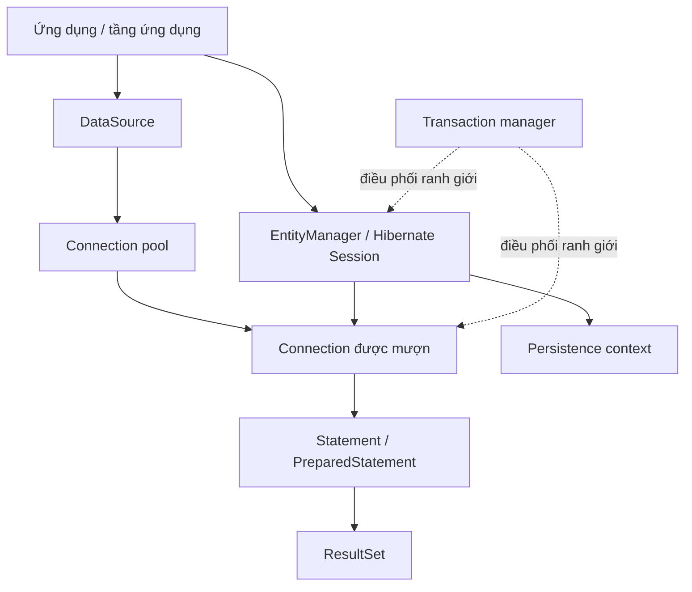
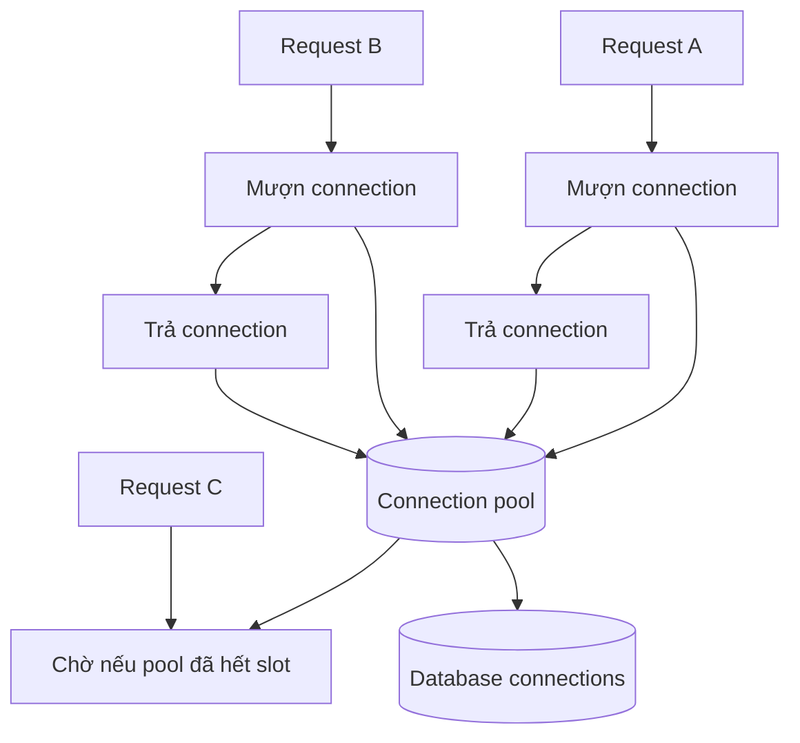

# Quản lý vòng đời kết nối, phiên làm việc và tài nguyên truy cập dữ liệu

Tầng truy cập dữ liệu làm việc với những tài nguyên có vòng đời và chi phí đáng kể: kết nối JDBC đến cơ sở dữ liệu, câu lệnh và tập kết quả, phiên làm việc ORM, persistence context và giao dịch. Những tài nguyên này cần được tạo hoặc mượn đúng lúc, sử dụng trong phạm vi phù hợp và giải phóng đúng cách. Một truy vấn có thể đúng về kết quả nhưng vẫn làm ứng dụng mất ổn định nếu connection không được trả về pool, session bị dùng đồng thời hoặc giao dịch giữ kết nối quá lâu.

Trong module `SOFTWARE_DESIGN_ARCHITECTURE_ARCHITECTURAL_PATTERN_LAYERED` — học tổ chức phần mềm theo kiến trúc phân tầng — bài học này tập trung vào cách quản lý vòng đời các tài nguyên ở tầng truy cập dữ liệu. Mục tiêu là hiểu ai sở hữu tài nguyên, khi nào tài nguyên được cấp phát và giải phóng, cách Spring quản lý chúng trong giao dịch, và cách nhận biết các vấn đề như rò rỉ kết nối hoặc cạn connection pool.

## 1. Những tài nguyên nào cần quản lý vòng đời?

Các API truy cập dữ liệu thường có nhiều loại tài nguyên khác nhau. Chúng liên quan với nhau nhưng không đồng nghĩa:

| Tài nguyên | Vai trò | Vòng đời thường gặp |
|---|---|---|
| `DataSource` | Cung cấp kết nối JDBC; thường đại diện cho connection pool | Được cấu hình và dùng trong suốt vòng đời ứng dụng |
| `Connection` | Đại diện cho một kết nối logic đang được mượn để thực hiện thao tác JDBC | Mượn từ `DataSource`, dùng trong một phạm vi thao tác hoặc giao dịch, sau đó đóng/trả lại |
| `Statement` / `PreparedStatement` | Thực thi câu lệnh SQL trên một kết nối | Tạo cho thao tác cần thiết, đóng sau khi dùng |
| `ResultSet` | Đọc các dòng kết quả của câu truy vấn | Mở khi thực thi truy vấn, đóng sau khi đọc xong |
| JPA `EntityManager` | Quản lý entity và persistence context | Thường gắn với một đơn vị công việc hoặc giao dịch theo cấu hình |
| Hibernate `Session` | API đặc thù của Hibernate để làm việc với persistence context | Mở, dùng và đóng theo phạm vi được chọn; thường được Spring quản lý trong ứng dụng Spring |
| Transaction | Xác định nhóm thao tác cần commit hoặc rollback cùng nhau | Bắt đầu trước các thao tác thuộc giao dịch và kết thúc bằng commit/rollback |

`DataSource` thường là đối tượng dùng chung, còn `Connection` là tài nguyên được mượn từ nó. `EntityManager` và Hibernate `Session` quản lý trạng thái đối tượng trong persistence context; chúng không phải connection pool. Transaction là ranh giới nguyên tử của công việc dữ liệu, không phải một loại connection khác.

Một cách nhìn tổng quát:



Sơ đồ mô tả mối quan hệ khái niệm. Với JPA, ứng dụng thường thao tác qua `EntityManager`; provider ORM có thể lấy và sử dụng JDBC connection bên dưới. Với JDBC trực tiếp, mã ứng dụng hoặc framework truy cập `Connection` qua `DataSource`.

## 2. Vòng đời kết nối JDBC

Một thao tác JDBC cơ bản thường có các bước:

1. Lấy một `Connection` từ `DataSource`.
2. Tạo `PreparedStatement` hoặc `Statement`.
3. Thực thi SQL và đọc `ResultSet` nếu có.
4. Đóng `ResultSet` và statement sau khi hoàn tất.
5. Đóng `Connection` để trả tài nguyên về nơi cấp phát.

Ví dụ dùng JDBC thuần:

```java
public Optional<CustomerRow> findCustomer(
        DataSource dataSource, UUID customerId) throws SQLException {

    String sql = "select id, display_name from customer where id = ?";

    try (Connection connection = dataSource.getConnection();
         PreparedStatement statement = connection.prepareStatement(sql)) {

        statement.setObject(1, customerId);

        try (ResultSet resultSet = statement.executeQuery()) {
            if (!resultSet.next()) {
                return Optional.empty();
            }

            return Optional.of(new CustomerRow(
                resultSet.getObject("id", UUID.class),
                resultSet.getString("display_name")
            ));
        }
    }
}

public record CustomerRow(UUID id, String displayName) {}
```

`try-with-resources` bảo đảm các tài nguyên được đóng khi khối lệnh kết thúc bình thường hoặc phát sinh exception. Khi dùng connection pool, gọi `Connection.close()` trên connection được pool bọc thường trả connection logic về pool để tái sử dụng; nó không nhất thiết đóng socket vật lý ngay lập tức. Nếu lấy connection trực tiếp từ driver không qua pool, `close()` thường đóng kết nối vật lý.

Không nên giữ `ResultSet` hoặc `Statement` để sử dụng sau khi connection đã được đóng/trả về pool. Các đối tượng này phụ thuộc vào connection và phạm vi thực thi của truy vấn.

### Tại sao phải đóng cả ba loại tài nguyên?

`ResultSet` có thể giữ cursor hoặc tài nguyên phía máy chủ. `Statement` có thể giữ trạng thái thực thi, tham số hoặc bộ đệm. `Connection` chiếm một slot của pool và có thể giữ transaction hoặc session phía database. Nếu bỏ quên bất kỳ tài nguyên nào, hệ thống có thể tăng dần số cursor, statement hoặc connection đang bị chiếm dụng.

Đóng tài nguyên theo thứ tự ngược với lúc mở là quy tắc dễ nhớ: đóng result set, đóng statement, rồi trả connection. `try-with-resources` tự thực hiện thứ tự đó khi khai báo theo thứ tự trên.

## 3. Connection pool và connection được mượn

Việc tạo kết nối vật lý đến cơ sở dữ liệu tốn thời gian và tài nguyên. Một connection pool duy trì một tập kết nối để nhiều thao tác mượn và trả lại, thay vì mỗi request đều thiết lập rồi hủy socket mới.

Trong Spring Boot, `DataSource` thường được cấu hình để dùng HikariCP nếu dependency và cấu hình phù hợp. Khi gọi `dataSource.getConnection()`, ứng dụng nhận một connection logic do pool quản lý. Khi gọi `close()`, connection được trả lại pool sau khi pool hoặc transaction manager hoàn tất các bước dọn dẹp cần thiết.



Connection pool giới hạn số kết nối đồng thời từ ứng dụng đến database. Nếu pool có 20 connection đang được mượn, request tiếp theo có thể phải chờ cho đến khi có connection được trả lại hoặc hết thời gian chờ. Vì vậy, pool không làm cho tài nguyên trở nên vô hạn; nó giúp kiểm soát mức sử dụng và tái sử dụng connection.

### Các thông số pool thường gặp

Với HikariCP trong Spring Boot, một số thuộc tính thường dùng gồm:

| Thuộc tính | Ý nghĩa | Khi cân nhắc |
|---|---|---|
| `maximum-pool-size` | Số connection tối đa pool có thể quản lý | Phải phù hợp giới hạn connection của database và tổng số instance ứng dụng |
| `minimum-idle` | Số connection nhàn rỗi mong muốn duy trì | Ảnh hưởng khả năng đáp ứng nhanh và lượng tài nguyên giữ sẵn |
| `connection-timeout` | Thời gian chờ tối đa để mượn connection từ pool | Đặt theo mục tiêu độ trễ và chính sách timeout của ứng dụng |
| `idle-timeout` | Thời gian connection nhàn rỗi có thể được thu hồi khi pool có nhiều hơn mức tối thiểu | Phù hợp với cách pool duy trì connection nhàn rỗi |
| `max-lifetime` | Tuổi thọ tối đa của connection trong pool | Nên thấp hơn giới hạn tuổi thọ do database hoặc hạ tầng mạng áp đặt |
| `leak-detection-threshold` | Ngưỡng để pool ghi log khi connection bị mượn quá lâu | Hữu ích khi điều tra nghi ngờ rò rỉ; không tự sửa được leak |

Ví dụ cấu hình trong `application.yml`:

```yaml
spring:
  datasource:
    hikari:
      maximum-pool-size: 16
      minimum-idle: 4
      connection-timeout: 30000
      idle-timeout: 600000
      max-lifetime: 1800000
      leak-detection-threshold: 60000
```

Các con số trên chỉ minh họa cú pháp, không phải cấu hình khuyến nghị cho mọi hệ thống. Cần đo tải thực tế, kiểm tra giới hạn của database, số instance đang chạy và thời gian giữ connection. Ví dụ, nếu mỗi instance có pool tối đa 16 và triển khai 8 instance, hệ thống có thể yêu cầu tối đa 128 connection từ database chỉ cho ứng dụng này, chưa tính worker hoặc ứng dụng khác.

Tăng `maximum-pool-size` không phải lúc nào cũng tăng throughput. Database có thể bị quá tải bởi quá nhiều truy vấn đồng thời, dẫn đến thời gian truy vấn dài hơn và pool càng bị giữ lâu. Hãy theo dõi số connection active/idle, số request đang chờ, thời gian mượn connection và thời gian thực thi SQL trước khi điều chỉnh.

## 4. Transaction quyết định phạm vi sử dụng connection

Một giao dịch gom các thao tác dữ liệu cần thành công hoặc thất bại cùng nhau. Trong ứng dụng Spring, `@Transactional` thường khai báo ranh giới giao dịch ở tầng ứng dụng hoặc service phù hợp. Transaction manager phối hợp với JDBC hoặc JPA để lấy, gắn và giải phóng tài nguyên theo cấu hình.

Ví dụ, chuyển tiền cần ghi nợ tài khoản nguồn và ghi có tài khoản đích trong cùng giao dịch:

```java
@Service
@RequiredArgsConstructor
class TransferService {
    private final AccountRepository accountRepository;

    @Transactional
    public void transfer(UUID fromId, UUID toId, Money amount) {
        Account source = accountRepository.findById(fromId)
            .orElseThrow(AccountNotFoundException::new);
        Account destination = accountRepository.findById(toId)
            .orElseThrow(AccountNotFoundException::new);

        source.debit(amount);
        destination.credit(amount);
    }
}
```

Khi phương thức được gọi qua proxy transaction của Spring, transaction manager bắt đầu hoặc tham gia giao dịch theo propagation đã cấu hình. Các thao tác repository tham gia cùng transaction; khi phương thức kết thúc bình thường, transaction được commit. Nếu exception thuộc nhóm rollback theo quy tắc đã cấu hình xảy ra, transaction được rollback. Connection được trả về pool khi phạm vi quản lý giao dịch hoàn tất.

Trong ứng dụng Spring, không nên tự gọi `connection.close()` trên connection đang được transaction manager quản lý, hoặc tự commit/rollback một connection do framework cấp cho giao dịch. Việc đó có thể phá vỡ ranh giới giao dịch. Dùng `JdbcTemplate`, repository hoặc API quản lý transaction phù hợp để framework thực hiện cleanup.

### Transaction và thời điểm lấy connection

Không phải mọi cấu hình đều lấy connection ngay đúng thời điểm vào phương thức có `@Transactional`. Với một số cấu hình JPA và connection handling, connection có thể được lấy khi thật sự cần truy cập database. Nhưng nguyên tắc cần nhớ là tài nguyên được giữ theo phạm vi transaction mà transaction manager quản lý; không giả định rằng mỗi câu SQL sẽ tự có một connection độc lập hoặc connection luôn được trả ngay sau câu truy vấn.

Một transaction kéo dài sẽ giữ các tài nguyên lâu hơn, có thể chiếm connection pool, giữ khóa và làm giảm khả năng xử lý yêu cầu khác. Vì vậy, phạm vi `@Transactional` nên bao quanh đơn vị công việc cần tính nguyên tử, không bao trùm các thao tác không liên quan hoặc thời gian chờ bên ngoài kéo dài.

Ví dụ không nên giữ transaction trong lúc gọi dịch vụ từ xa:

```java
// Tránh cách tổ chức có thể giữ connection/lock trong thời gian gọi mạng.
@Transactional
public void placeOrder(PlaceOrderCommand command) {
    Order order = createOrder(command);
    paymentGateway.authorize(order); // Có thể chờ mạng lâu.
    order.markPaid();
}
```

Gọi cổng thanh toán có thể mất vài giây hoặc timeout. Giữ transaction database trong suốt thời gian đó làm connection và khóa bị chiếm dụng. Một thiết kế khác có thể chia thành các bước ngắn: ghi trạng thái chờ thanh toán trong transaction, gọi cổng thanh toán ngoài transaction, rồi mở transaction mới để cập nhật kết quả. Nếu cần bảo đảm quy trình nhiều bước, hãy thiết kế trạng thái trung gian, idempotency, retry và cơ chế bù trừ phù hợp; không thể dựa vào một transaction JDBC để bao trùm một dịch vụ mạng độc lập.

## 5. Persistence context, EntityManager và Hibernate Session

Với JPA, `EntityManager` quản lý một persistence context. Persistence context theo dõi các entity đang được quản lý, identity map và thay đổi cần đồng bộ xuống database. Hibernate cung cấp `Session` như API riêng của provider. Trong ứng dụng Spring Data JPA, repository thường dùng `EntityManager` được quản lý bởi Spring và provider.

Khi một entity được tải trong persistence context, nó thường trở thành managed entity. Thay đổi thuộc tính của entity có thể được phát hiện bởi dirty checking và đồng bộ xuống database khi flush. `flush` gửi các thay đổi đang chờ xuống database; nó không đồng nghĩa với commit transaction. Commit mới hoàn tất giao dịch ở database.

Ví dụ trong Spring:

```java
@Service
@RequiredArgsConstructor
class CustomerService {
    private final CustomerRepository customerRepository;

    @Transactional
    public void rename(UUID customerId, String newName) {
        Customer customer = customerRepository.findById(customerId)
            .orElseThrow(CustomerNotFoundException::new);

        customer.rename(newName);
        // Không cần gọi save() bắt buộc trong mọi trường hợp:
        // entity đang managed sẽ được dirty checking đồng bộ khi flush.
    }
}
```

Khi transaction kết thúc, persistence context gắn với đơn vị công việc được hoàn tất. Entity có thể trở thành detached sau khi persistence context đóng hoặc kết thúc phạm vi quản lý. Một entity detached không còn được tự động dirty checking trong persistence context cũ; muốn cập nhật, cần đưa dữ liệu vào một persistence context phù hợp bằng cách tải lại hoặc dùng thao tác merge theo đúng ngữ nghĩa.

### Ai mở và đóng EntityManager?

Trong ứng dụng Spring sử dụng `@PersistenceContext`, `EntityManager` thường được cung cấp dưới dạng proxy nhận diện EntityManager gắn với transaction hoặc phạm vi persistence context hiện hành. Không tự đóng proxy được Spring inject. Khi dùng Spring Data JPA, để transaction manager và framework quản lý vòng đời này.

Nếu tự tạo `EntityManager` từ `EntityManagerFactory` ngoài cơ chế quản lý của Spring, mã gọi phải đóng nó sau khi sử dụng và quản lý transaction rõ ràng. Ví dụ khái niệm:

```java
EntityManager entityManager = entityManagerFactory.createEntityManager();
try {
    EntityTransaction transaction = entityManager.getTransaction();
    transaction.begin();
    try {
        // Thực hiện các thao tác JPA trong đơn vị công việc này.
        transaction.commit();
    } catch (RuntimeException exception) {
        if (transaction.isActive()) {
            transaction.rollback();
        }
        throw exception;
    }
} finally {
    entityManager.close();
}
```

Đây là cách quản lý thủ công cho môi trường tự quản lý; không sao chép đoạn `close()` vào service Spring đang dùng EntityManager do container quản lý.

### Session không phải HTTP session

Hibernate `Session` là đơn vị làm việc với persistence context của Hibernate. Nó khác với `HttpSession` dùng để lưu trạng thái người dùng web. Một HTTP request có thể tồn tại mà không có Hibernate Session, và một Hibernate Session có thể được dùng trong tác vụ nền không liên quan đến HTTP.

Không giữ Hibernate Session hoặc EntityManager như một singleton dùng chung cho nhiều request. Các đối tượng này không được thiết kế để nhiều luồng cùng sửa trạng thái persistence context. Dùng phạm vi transaction/đơn vị công việc phù hợp và để framework quản lý trong ứng dụng Spring.

## 6. Phạm vi request, Open Session in View và tải dữ liệu trễ

Một số ứng dụng web dùng cơ chế Open EntityManager in View (hoặc Open Session in View) để giữ persistence context mở trong suốt request HTTP, kể cả sau khi transaction service đã kết thúc. Cách này có thể cho phép lazy loading trong lúc tầng trình bày đang dựng response.

Tuy nhiên, nó có đánh đổi:

- Controller hoặc serializer có thể vô tình kích hoạt truy vấn bổ sung khi truy cập quan hệ lazy.
- Số lượng truy vấn và thời gian truy cập database có thể khó nhận biết từ code service.
- Tầng trình bày có thể phụ thuộc vào entity và cấu trúc persistence thay vì dùng DTO phù hợp.
- Persistence context tồn tại lâu hơn transaction nghiệp vụ, khiến phạm vi tài nguyên khó quan sát.

Với API phân tầng rõ ràng, thường nên tải đủ dữ liệu cần thiết trong transaction của ca sử dụng rồi ánh xạ sang DTO trước khi trả response. Nếu muốn tắt Open EntityManager in View trong Spring Boot, có thể cấu hình:

```yaml
spring:
  jpa:
    open-in-view: false
```

Đây là lựa chọn kiến trúc cần kiểm tra cùng các luồng đang dùng lazy loading. Khi tắt cơ chế này, mọi dữ liệu cần cho response phải được tải trong phạm vi persistence context còn mở, chẳng hạn bằng fetch join, entity graph hoặc projection. Không nên bật/tắt chỉ để che một lỗi lazy loading mà không xem lại ranh giới dữ liệu.

## 7. Quản lý transaction và tài nguyên trong Spring

Spring cung cấp các cơ chế khác nhau tùy loại truy cập dữ liệu:

- `DataSourceTransactionManager` quản lý giao dịch JDBC trên một `DataSource`.
- `JpaTransactionManager` quản lý giao dịch JPA cho một `EntityManagerFactory` và có thể phối hợp với JDBC trên cùng `DataSource` theo cấu hình phù hợp.
- `JdbcTemplate` quản lý việc lấy/trả connection và đóng statement/result set trong thao tác JDBC, đồng thời tham gia transaction Spring đang hoạt động.
- Spring Data repositories tham gia transaction theo cấu hình và cách gọi; tầng ứng dụng thường xác định ranh giới transaction của ca sử dụng.

Ví dụ dùng `JdbcTemplate`:

```java
@Repository
@RequiredArgsConstructor
class CustomerJdbcRepository {
    private final JdbcTemplate jdbcTemplate;

    public Optional<String> findName(UUID customerId) {
        List<String> names = jdbcTemplate.query(
            "select display_name from customer where id = ?",
            (resultSet, rowNumber) -> resultSet.getString("display_name"),
            customerId
        );
        return names.stream().findFirst();
    }
}
```

`JdbcTemplate` tự quản lý việc mượn và trả connection cũng như đóng statement/result set. Nếu phương thức được gọi trong một transaction Spring phù hợp, nó sử dụng tài nguyên gắn với transaction đó. Không cần tự lấy connection và đóng lại bên trong callback trừ khi đang dùng API cấp thấp với yêu cầu cụ thể.

### Ranh giới proxy của `@Transactional`

Trong cấu hình Spring proxy mặc định, `@Transactional` được áp dụng khi lời gọi đi qua proxy. Một lời gọi nội bộ từ phương thức này sang phương thức khác trong cùng instance (self-invocation) thường không đi qua proxy, nên annotation ở phương thức được gọi có thể không tạo transaction mới như người viết mong đợi. Hãy đặt ranh giới transaction ở phương thức public được gọi từ bean khác hoặc dùng cơ chế phù hợp với kiến trúc đã chọn.

Transaction trong Spring truyền thống thường gắn với thread hiện tại. Nếu khởi chạy tác vụ bất đồng bộ hoặc chuyển xử lý sang thread khác, không giả định transaction và connection tự đi theo. Tác vụ ở thread mới cần ranh giới transaction riêng nếu nó truy cập dữ liệu. Không truyền `Connection`, `EntityManager` hoặc Hibernate `Session` sang thread khác để dùng chung.

## 8. Rò rỉ kết nối và cạn connection pool

**Rò rỉ kết nối (connection leak)** xảy ra khi ứng dụng mượn connection nhưng không trả lại đúng lúc. Sau nhiều request, số connection bị giữ có thể tăng cho đến khi pool không còn slot trống. Request mới phải chờ hoặc thất bại do timeout.

Các nguyên nhân thường gặp:

- Mở connection JDBC mà không dùng `try-with-resources` hoặc `finally`.
- Có nhánh return hoặc exception khiến lệnh close không được thực thi.
- Giữ transaction quá lâu, chẳng hạn gọi HTTP hoặc chờ người dùng trong khi transaction vẫn mở.
- Đọc dữ liệu lớn hoặc stream result set quá lâu mà không đóng tài nguyên.
- Giữ kết nối trong cache, field singleton hoặc truyền qua nhiều lớp mà không xác định rõ nơi sở hữu.
- Tác vụ nền hoặc luồng bất đồng bộ không hoàn tất cleanup khi bị hủy.

Triệu chứng có thể gồm:

- Pool báo tất cả connection đang active trong thời gian dài.
- Request chờ lấy connection và tăng lỗi timeout.
- Số connection ở database tăng hoặc duy trì cao bất thường.
- Độ trễ tăng dù CPU ứng dụng chưa cao.
- Log leak detection chỉ ra stack trace nơi connection được mượn nhưng chưa được trả.

Leak detection của HikariCP giúp phát hiện connection bị giữ quá ngưỡng đã cấu hình. Nó là tín hiệu chẩn đoán, không có nghĩa pool tự thu hồi an toàn một connection vẫn đang được sử dụng. Hãy kiểm tra stack trace, thời gian transaction, nhánh exception và các thao tác I/O kéo dài.

### Phân biệt leak với truy vấn chậm

Một connection được giữ lâu không nhất thiết đã bị rò rỉ. Truy vấn chậm, khóa database, transaction chờ hoặc xử lý result set lớn đều có thể giữ connection hợp lệ nhưng quá lâu. Leak là trường hợp tài nguyên không được trả theo vòng đời dự kiến; truy vấn chậm là thao tác vẫn đang chạy nhưng mất nhiều thời gian. Cả hai đều có thể làm pool cạn, nhưng cách khắc phục khác nhau.

Khi điều tra, hãy đối chiếu thời gian mượn connection với thời gian SQL, thời gian transaction, trạng thái thread và số connection active/idle. Không nên chỉ tăng pool size để che triệu chứng.

## 9. Timeout, hủy thao tác và dọn dẹp an toàn

Các timeout nên được thiết kế ở nhiều lớp:

- Timeout chờ mượn connection giới hạn thời gian request đợi pool.
- Query timeout giới hạn thời gian thực thi câu lệnh nếu driver và database hỗ trợ.
- Transaction timeout giới hạn thời gian đơn vị công việc theo cơ chế transaction manager hỗ trợ.
- Timeout ở HTTP hoặc message consumer giới hạn thời gian xử lý ở lớp giao tiếp.

Các timeout này có quan hệ nhưng không thay thế nhau. Timeout của HTTP client không đảm bảo truy vấn database đã bị hủy; timeout mượn connection không giới hạn thời gian câu SQL sau khi đã lấy được connection. Cần cấu hình theo mục tiêu dịch vụ và khả năng hỗ trợ của driver/database.

Khi thao tác bị hủy hoặc phát sinh lỗi, tài nguyên cần được giải phóng bằng cơ chế sở hữu rõ ràng. Với JDBC thủ công, dùng `try-with-resources`. Với Spring transaction, để transaction manager xử lý rollback và cleanup. Không nuốt exception sau khi rollback nếu caller cần biết thao tác thất bại; hãy chuyển lỗi thành kết quả hoặc exception nghiệp vụ theo hợp đồng.

## 10. Theo dõi sức khỏe tài nguyên truy cập dữ liệu

Quản lý vòng đời cần được kiểm chứng khi chạy thật. Các chỉ số hữu ích gồm:

| Chỉ số | Ý nghĩa | Dấu hiệu cần điều tra |
|---|---|---|
| Active connections | Số connection đang được mượn | Gần mức tối đa trong thời gian dài |
| Idle connections | Số connection đang rảnh trong pool | Luôn bằng 0 khi tải không cao hoặc quá nhiều connection nhàn rỗi |
| Pending threads | Số luồng đang chờ connection | Tăng kéo dài, request timeout |
| Connection acquisition time | Thời gian lấy connection | Tăng dù SQL không chậm tương ứng |
| Query duration | Thời gian thực thi truy vấn | Truy vấn dài giữ connection lâu |
| Transaction duration | Thời gian giao dịch mở | Giao dịch kéo dài qua các thao tác không liên quan |
| Leak detection logs | Cảnh báo connection bị giữ lâu | Lặp lại ở cùng đường gọi hoặc stack trace |

Trong môi trường Spring Boot Actuator/Micrometer, pool có thể xuất các metric tùy phiên bản và cấu hình. Đặt dashboard và cảnh báo dựa trên xu hướng, không chỉ một lần vượt ngưỡng ngắn. Kết hợp metric với log truy vấn chậm, trace request và thông tin transaction để tìm đúng nơi giữ tài nguyên.

## 11. Kiểm thử vòng đời và cleanup

Nên kiểm thử cả kết quả truy vấn lẫn việc giải phóng tài nguyên:

- **Unit test cho repository JDBC:** dùng fake/mock hoặc database test để kiểm tra câu lệnh và ánh xạ kết quả; với API JDBC thủ công, xác minh statement/result set/connection được đóng cả khi có exception.
- **Integration test cho transaction:** xác minh nhiều thao tác cùng commit khi thành công và rollback khi một thao tác thất bại.
- **Kiểm thử pool dưới tải:** quan sát active, idle, pending và timeout khi số request đồng thời tăng.
- **Kiểm thử lỗi:** mô phỏng database ngắt kết nối, query timeout hoặc exception giữa transaction để xác minh tài nguyên được cleanup và lỗi được truyền đúng.
- **Kiểm thử bất đồng bộ:** xác minh tác vụ chạy trên thread khác mở transaction riêng và không dùng chung session/connection của thread gọi.

Với Spring, kiểm thử transaction cần chú ý test framework có thể tự mở transaction cho test và rollback sau test. Điều đó tiện cho cô lập dữ liệu, nhưng không nhất thiết chứng minh ranh giới transaction của service hoạt động như trong môi trường thật. Hãy có kiểm thử tích hợp gọi service qua Spring context và xác minh trạng thái database sau commit/rollback.

## 12. Nguyên tắc thiết kế để tài nguyên có chủ sở hữu rõ ràng

Khi thiết kế tầng truy cập dữ liệu, hãy thống nhất một số nguyên tắc:

1. **Ai mở thì phải có trách nhiệm đóng hoặc trả.** Với tài nguyên thủ công, dùng `try-with-resources`; với tài nguyên do Spring quản lý, không tự đóng ngoài hợp đồng framework.
2. **Giữ phạm vi tài nguyên ngắn và có mục đích.** Không giữ connection trong lúc xử lý nghiệp vụ không cần database, chờ mạng hoặc chờ người dùng.
3. **Transaction bao quanh đơn vị công việc nhất quán.** Chọn ranh giới theo ca sử dụng và điều kiện commit/rollback, không tùy tiện đặt transaction cho toàn bộ request dài.
4. **Không chia sẻ tài nguyên không thread-safe.** Không dùng chung connection, EntityManager hoặc Hibernate Session giữa các thread.
5. **Tách vòng đời pool khỏi vòng đời connection.** `DataSource`/pool là thành phần sống lâu; connection được mượn và trả lại theo thao tác hoặc transaction.
6. **Theo dõi thay vì đoán.** Dùng metric và log để phân biệt leak, truy vấn chậm, khóa và pool quá nhỏ.
7. **Dùng framework đúng phạm vi.** `JdbcTemplate`, Spring Data JPA và transaction manager giúp giảm lỗi cleanup; JDBC thủ công vẫn có chỗ dùng nhưng phải quản lý tài nguyên tường minh.

Một tầng truy cập dữ liệu được tổ chức tốt không chỉ biết cách gửi SQL hoặc ánh xạ entity. Nó còn bảo đảm mỗi connection, session và transaction tồn tại đúng phạm vi, được kết thúc đúng cách và có thể quan sát khi vận hành. Nhờ đó, tài nguyên database được chia sẻ có kiểm soát giữa các request, còn tầng ứng dụng và nghiệp vụ có thể tập trung vào điều phối và quy tắc của ca sử dụng.
