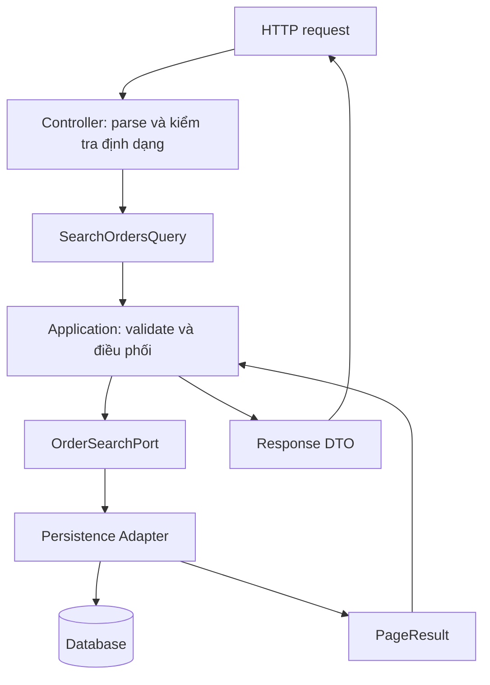

# Thiết kế hợp đồng tìm kiếm, phân trang và trường dữ liệu tùy chọn

Bài học này thuộc module `SOFTWARE_DESIGN_ARCHITECTURE_ARCHITECTURAL_PATTERN_LAYERED`, nhằm giúp người học tổ chức phần mềm theo kiến trúc phân tầng. Trong chương **Dữ liệu và hợp đồng giữa các tầng**, ta thiết kế hợp đồng cho thao tác tìm kiếm có bộ lọc, phân trang và dữ liệu tùy chọn. Một hợp đồng tốt giúp tầng trình bày, tầng ứng dụng và tầng truy cập dữ liệu hiểu thống nhất ý nghĩa của yêu cầu và kết quả, đồng thời giữ chi tiết framework và lưu trữ ở đúng ranh giới.

## 1. Hợp đồng tìm kiếm là thỏa thuận về ý nghĩa dữ liệu

Một API tìm kiếm đơn hàng có thể nhận từ khóa, trạng thái, khoảng ngày, cách sắp xếp và thông tin trang. Kết quả có thể gồm danh sách đơn hàng, số trang, tổng số bản ghi và một số trường chi tiết chỉ cần trong vài màn hình.

Nếu mỗi tầng tự hiểu các tham số theo một cách, cùng một yêu cầu có thể cho kết quả khác nhau. Ví dụ:

- Controller hiểu `page=1` là trang đầu tiên, nhưng repository lại hiểu đó là offset một bản ghi.
- Tầng ứng dụng cho phép sắp xếp theo `customerName`, trong khi tầng dữ liệu lại dùng tên cột `customer_name` và không kiểm soát danh sách trường được phép.
- Một màn hình không yêu cầu địa chỉ giao hàng nhưng mapper vẫn tải toàn bộ quan hệ địa chỉ cho mọi kết quả.
- Trường `note` bị bỏ qua và trường `note: null` bị hiểu giống nhau dù một trường hợp có nghĩa “không yêu cầu”, trường hợp kia có nghĩa “không có ghi chú”.

Hợp đồng phải xác định rõ tên trường, kiểu dữ liệu, đơn vị, giá trị mặc định, quy tắc kiểm tra, ý nghĩa của giá trị vắng mặt và cấu trúc phân trang. Các quy tắc đó cần nhất quán qua mọi tầng.

## 2. Thiết kế query object cho tầng ứng dụng

Không nên truyền nguyên `HttpServletRequest`, `MultiValueMap` hoặc toàn bộ tham số URL xuống các tầng bên dưới. Tầng trình bày chuyển đổi giao thức HTTP thành một đối tượng yêu cầu có kiểu và ngữ nghĩa rõ ràng. Đối tượng này có thể được gọi là query, criteria hoặc search command.

Ví dụ hợp đồng tìm kiếm đơn hàng:

```java
package com.example.orders.application;

import java.time.LocalDate;

public record SearchOrdersQuery(
    String keyword,
    OrderStatusFilter status,
    LocalDate createdFrom,
    LocalDate createdTo,
    int page,
    int size,
    OrderSortField sortBy,
    SortDirection direction,
    boolean includeShippingAddress
) {}

public enum OrderStatusFilter {
    ANY, PLACED, PAID, SHIPPED, CANCELLED
}

public enum OrderSortField {
    CREATED_AT, ORDER_NUMBER, TOTAL_AMOUNT
}

public enum SortDirection {
    ASC, DESC
}
```

Query object dùng kiểu ngày thay cho chuỗi ngày tùy ý, enum thay cho tên trường sắp xếp tùy ý và có cờ rõ nghĩa cho phần địa chỉ giao hàng. Không đưa `Pageable`, `Sort`, `PageRequest` của Spring Data vào hợp đồng ứng dụng nếu muốn giữ tầng ứng dụng độc lập với framework.

Giá trị mặc định và giới hạn cần được quy định tại ranh giới nhận yêu cầu. Chẳng hạn, trang bắt đầu từ 0, kích thước mặc định là 20, kích thước tối đa là 100, sắp xếp mặc định theo thời điểm tạo giảm dần. Cần thống nhất các quy tắc này trong API và trong kiểm tra đầu vào; không để mỗi tầng tự chọn một giá trị mặc định khác nhau.

```java
@RestController
@RequestMapping("/api/orders")
class OrderSearchController {
    private final SearchOrdersUseCase searchOrders;

    OrderSearchController(SearchOrdersUseCase searchOrders) {
        this.searchOrders = searchOrders;
    }

    @GetMapping
    OrderSearchResponse search(
            @RequestParam(required = false) String keyword,
            @RequestParam(required = false) OrderStatusFilter status,
            @RequestParam(required = false)
                @DateTimeFormat(iso = DateTimeFormat.ISO.DATE) LocalDate createdFrom,
            @RequestParam(required = false)
                @DateTimeFormat(iso = DateTimeFormat.ISO.DATE) LocalDate createdTo,
            @RequestParam(defaultValue = "0") int page,
            @RequestParam(defaultValue = "20") int size,
            @RequestParam(defaultValue = "CREATED_AT") OrderSortField sortBy,
            @RequestParam(defaultValue = "DESC") SortDirection direction,
            @RequestParam(defaultValue = "false") boolean includeShippingAddress) {

        SearchOrdersQuery query = new SearchOrdersQuery(
            keyword, status, createdFrom, createdTo,
            page, size, sortBy, direction, includeShippingAddress
        );
        return OrderSearchResponse.from(searchOrders.execute(query));
    }
}
```

Ví dụ minh họa việc chuyển query parameter sang kiểu dữ liệu có ý nghĩa. Trong ứng dụng thực tế, nên gom tham số thành request DTO hoặc dùng binder phù hợp khi danh sách dài, đồng thời khai báo xử lý lỗi nhất quán cho ngày sai định dạng, enum không hợp lệ và tham số lặp.

## 3. Kiểm tra đầu vào và chuẩn hóa một lần

Tầng trình bày chịu trách nhiệm kiểm tra định dạng giao thức như ngày không hợp lệ hoặc tham số không thể chuyển thành số. Tầng ứng dụng kiểm tra các quy tắc của yêu cầu tìm kiếm: trang không âm, kích thước trong giới hạn, ngày bắt đầu không sau ngày kết thúc và từ khóa có độ dài cho phép.

```java
public final class SearchOrdersQueryValidator {
    private static final int MAX_PAGE_SIZE = 100;
    private static final int MAX_KEYWORD_LENGTH = 120;

    public void validate(SearchOrdersQuery query) {
        if (query.page() < 0) {
            throw new InvalidSearchCriteriaException("page must be >= 0");
        }
        if (query.size() < 1 || query.size() > MAX_PAGE_SIZE) {
            throw new InvalidSearchCriteriaException(
                "size must be between 1 and " + MAX_PAGE_SIZE);
        }
        if (query.keyword() != null
                && query.keyword().trim().length() > MAX_KEYWORD_LENGTH) {
            throw new InvalidSearchCriteriaException("keyword is too long");
        }
        if (query.createdFrom() != null && query.createdTo() != null
                && query.createdFrom().isAfter(query.createdTo())) {
            throw new InvalidSearchCriteriaException(
                "createdFrom must not be after createdTo");
        }
    }
}
```

Đây là ví dụ rút gọn; có thể dùng Bean Validation hoặc cơ chế kiểm tra khác. Điều quan trọng là quy tắc được đặt tại nơi phù hợp và lỗi được biểu diễn rõ ràng. Đừng âm thầm ép kích thước 10.000 về 100 nếu API cần thông báo cho caller rằng yêu cầu vượt giới hạn. Nếu sản phẩm chủ ý chuẩn hóa hoặc giới hạn giá trị, hãy mô tả hành vi đó trong hợp đồng.

Sau khi kiểm tra, application service gọi cổng tìm kiếm. Cổng nên nhận các tiêu chí và thông tin trang theo kiểu độc lập với JPA:

```java
public interface OrderSearchPort {
    PageResult<OrderSummary> search(
        OrderSearchCriteria criteria,
        PageRequestData pageRequest
    );
}

public record PageRequestData(
    int page,
    int size,
    OrderSortField sortBy,
    SortDirection direction
) {}

public record PageResult<T>(
    java.util.List<T> items,
    int page,
    int size,
    long totalElements,
    int totalPages
) {}
```

`PageResult` là hợp đồng của ứng dụng, không phải `org.springframework.data.domain.Page`. Có thể dùng một kiểu kết quả khác nếu không cần tổng số trang; không nên đưa metadata không có ý nghĩa cho caller vào hợp đồng chỉ vì framework cung cấp sẵn.

## 4. Phân trang offset và các quy tắc cần ổn định

Với phân trang offset, caller gửi số trang và kích thước trang. Offset được tính bằng `page × size`. Ví dụ `page=2`, `size=20` nghĩa là bỏ qua 40 kết quả đầu và lấy tối đa 20 kết quả tiếp theo.

Phân trang cần có các quy tắc sau:

- **Chỉ số trang:** chọn bắt đầu từ 0 hoặc 1 và giữ nhất quán trong toàn bộ API. Ví dụ này dùng chỉ số 0.
- **Kích thước trang:** có giá trị mặc định và giới hạn tối đa để tránh yêu cầu trả về quá nhiều dữ liệu.
- **Sắp xếp xác định:** luôn có tiêu chí phụ duy nhất, thường là ID, để hai bản ghi có cùng thời gian tạo không đổi thứ tự tùy ý giữa các lần truy vấn.
- **Tổng số bản ghi:** nói rõ `totalElements` là số bản ghi thỏa bộ lọc hay chỉ là số phần tử trong trang hiện tại.
- **Trang vượt phạm vi:** thống nhất trả trang rỗng với metadata tổng, hoặc báo lỗi theo hợp đồng sản phẩm; không để từng adapter tự quyết định.
- **Bộ lọc được giữ nguyên:** khi chuyển trang, caller phải gửi lại cùng tiêu chí lọc và sắp xếp, hoặc dùng một token chứa ngữ cảnh truy vấn.

Ví dụ SQL khái niệm:

```sql
SELECT order_id, order_status, created_at, total_amount
FROM purchase_order
WHERE (:status IS NULL OR order_status = :status)
ORDER BY created_at DESC, order_id ASC
OFFSET :offset ROWS FETCH NEXT :size ROWS ONLY;
```

Truy vấn đếm tổng cần áp dụng cùng bộ lọc:

```sql
SELECT COUNT(*)
FROM purchase_order
WHERE (:status IS NULL OR order_status = :status);
```

Đây là SQL minh họa; cú pháp phân trang khác nhau theo hệ quản trị. Thực tế cần dùng parameter binding cho giá trị. Tên cột hoặc biểu thức `ORDER BY` không thể luôn truyền như một bind parameter, vì vậy tầng truy cập dữ liệu phải ánh xạ enum sắp xếp sang danh sách biểu thức đã cho phép, tuyệt đối không nối trực tiếp chuỗi do người dùng gửi vào SQL.

Offset pagination dễ hiểu và phù hợp với danh sách có quy mô vừa. Với tập dữ liệu rất lớn, offset cao có thể tốn kém vì cơ sở dữ liệu vẫn phải đi qua nhiều bản ghi. Khi đó có thể dùng keyset/cursor pagination.

## 5. Cursor pagination cho tập dữ liệu lớn hoặc thay đổi liên tục

Với cursor pagination, thay vì yêu cầu “trang số 15”, caller gửi một cursor đại diện cho vị trí cuối cùng đã đọc. Ví dụ sắp xếp theo `created_at DESC, order_id ASC`, cursor chứa giá trị `created_at` và `order_id` của bản ghi cuối trang trước. Truy vấn tiếp theo lấy những bản ghi đứng sau cặp giá trị đó theo cùng thứ tự.

```sql
SELECT order_id, order_status, created_at
FROM purchase_order
WHERE created_at < :lastCreatedAt
   OR (created_at = :lastCreatedAt AND order_id > :lastOrderId)
ORDER BY created_at DESC, order_id ASC
FETCH FIRST :size ROWS ONLY;
```

Cursor phải gắn với thứ tự sắp xếp và bộ lọc đã dùng. API thường trả `nextCursor` nếu còn dữ liệu và không nhất thiết trả tổng số bản ghi. Token nên được mã hóa hoặc ký để caller không thể tùy ý sửa cấu trúc nội bộ; cũng cần kiểm tra token hết hạn hoặc không còn tương thích với phiên bản hợp đồng.

Cursor pagination tránh chi phí offset lớn và ít bị xô lệch hơn khi bản ghi mới được thêm ở đầu danh sách. Tuy nhiên, nó không tự tạo ra một snapshot nhất quán tuyệt đối nếu các trường sắp xếp có thể thay đổi hoặc bản ghi bị xóa. Cần chọn trường sắp xếp ổn định, quy định cách xử lý dữ liệu thay đổi và chỉ dùng cursor khi yêu cầu truy cập thực sự cần.

Không nên trộn offset và cursor trong cùng một request nếu chưa định nghĩa rõ cách ưu tiên và metadata trả về. Hai chiến lược có hợp đồng khác nhau.

## 6. Trường dữ liệu tùy chọn trong kết quả

Không phải màn hình nào cũng cần cùng một lượng dữ liệu. Trang danh sách có thể chỉ cần mã đơn, trạng thái, ngày tạo và tổng tiền. Trang chi tiết có thể cần địa chỉ giao hàng, các dòng hàng hoặc lịch sử trạng thái. Hợp đồng nên biểu diễn rõ dữ liệu nào luôn có và dữ liệu nào chỉ được cung cấp khi caller yêu cầu hoặc khi có quyền truy cập.

Có một số cách thiết kế:

1. **Response DTO riêng theo mục đích:** `OrderSummary` cho danh sách và `OrderDetail` cho màn hình chi tiết. Cách này làm hợp đồng rõ ràng và dễ kiểm soát nhất khi hai trường hợp sử dụng khác nhau đáng kể.
2. **Trường tùy chọn có cờ yêu cầu:** ví dụ `includeShippingAddress=true`. Tầng ứng dụng truyền nhu cầu này xuống query; tầng truy cập dữ liệu có thể chọn projection hoặc tải quan hệ tương ứng.
3. **Field selection:** API cho phép caller yêu cầu một tập trường có giới hạn, chẳng hạn `fields=id,status,total`. Cần whitelist tên trường, xác định nhóm trường mặc định và tránh biến lựa chọn trường thành cơ chế truy cập dữ liệu tùy ý.

Đừng nhầm “trường tùy chọn” với “có thể bỏ qua quy tắc bảo mật”. Dữ liệu nhạy cảm như thông tin thanh toán, địa chỉ cá nhân hoặc ghi chú nội bộ phải được kiểm tra quyền ở tầng ứng dụng hoặc chính sách truy cập tương ứng, kể cả khi caller biết tên trường.

### Vắng mặt, null và giá trị rỗng

Trong JSON, ba trạng thái có thể mang ý nghĩa khác nhau:

| Biểu diễn | Ý nghĩa nên quy định rõ |
|---|---|
| Không có thuộc tính `shippingAddress` | Trường không được yêu cầu hoặc không thuộc response variant này |
| `"shippingAddress": null` | Trường được cung cấp trong hợp đồng nhưng hiện không có giá trị, hoặc không thể cung cấp theo quy ước đã công bố |
| `"shippingAddress": { ... }` | Có địa chỉ giao hàng |
| `"items": []` | Danh sách được yêu cầu và kết quả hiện không có phần tử |

Không nên dùng `null`, chuỗi rỗng và thuộc tính bị lược bỏ thay thế lẫn nhau mà không định nghĩa ý nghĩa. Với API cập nhật, `null` còn có thể mang nghĩa xóa giá trị; vì vậy hợp đồng đọc và ghi cần mô tả riêng.

Ví dụ response DTO cho trang danh sách:

```java
public record OrderSummaryResponse(
    String id,
    String status,
    Instant createdAt,
    MoneyResponse total
) {}

public record OrderSearchResponse(
    List<OrderSummaryResponse> items,
    int page,
    int size,
    long totalElements,
    int totalPages
) {}
```

Nếu cần địa chỉ, có thể định nghĩa một response variant riêng hoặc thêm trường nullable kèm quy tắc serialization đã công bố. Với cờ `includeShippingAddress`, không nên lúc thì lược bỏ thuộc tính, lúc thì trả `null` mà không có hợp đồng thống nhất.

## 7. Truyền nhu cầu dữ liệu qua các tầng

Một luồng tìm kiếm có thể được tổ chức như sau:



Mỗi ranh giới chỉ truyền thông tin cần thiết:

- Controller biết HTTP, query parameter và response status. Nó không truyền `HttpServletRequest` xuống Application.
- Application nhận query object đã có kiểu, kiểm tra quy tắc tìm kiếm và quyết định use case nào cần thực hiện.
- Search port biểu diễn nhu cầu tìm kiếm theo hợp đồng ứng dụng, không để lộ `Pageable`, `Page` hoặc `Specification` của Spring Data.
- Persistence adapter ánh xạ tiêu chí và sort field đã cho phép sang truy vấn JPA/SQL, chọn projection cần thiết và chuyển kết quả thành kiểu trả về của ứng dụng.
- Controller hoặc presenter chuyển kết quả ứng dụng thành DTO công khai. DTO không phải JPA entity và không nên làm lộ cấu trúc bảng.

Nếu một dự án chọn dùng `Pageable` trực tiếp trong application service để giảm lớp chuyển đổi, đó là một đánh đổi có chủ ý về mức phụ thuộc Spring Data. Cần nhất quán với ranh giới kiến trúc đã chọn và tránh để kiểu framework lan sang Domain.

## 8. Hiệu năng và tính nhất quán của truy vấn

Hợp đồng dữ liệu ảnh hưởng trực tiếp đến chi phí truy vấn. Trả thêm trường tùy chọn có thể làm phát sinh join, nạp quan hệ hoặc truy vấn phụ. Khi kết quả có hàng trăm bản ghi, việc truy cập một quan hệ lazy trong vòng lặp có thể gây N+1 query.

Một số nguyên tắc thực tế:

- Chọn projection chỉ lấy những cột cần cho response, đặc biệt với danh sách lớn.
- Dùng fetch join, entity graph hoặc truy vấn riêng có kiểm soát khi thật sự cần dữ liệu liên quan; kiểm tra số lượng truy vấn bằng integration test hoặc công cụ quan sát.
- Đánh giá chi phí truy vấn `COUNT(*)`; nếu tổng chính xác quá đắt, cân nhắc hợp đồng cursor không trả tổng hoặc một cơ chế ước lượng được mô tả rõ.
- Tạo index phù hợp với các bộ lọc và thứ tự sắp xếp thường dùng; kiểm tra execution plan với dữ liệu gần thực tế.
- Giới hạn kích thước trang và độ phức tạp của bộ lọc để tránh một endpoint tìm kiếm trở thành truy vấn toàn bảng không kiểm soát.
- Quy định múi giờ và biên ngày. Ví dụ `createdFrom` và `createdTo` là ngày theo múi giờ nào, và ngày kết thúc được hiểu bao gồm toàn bộ ngày hay là mốc thời gian loại trừ.

Với khoảng thời gian, thường dễ tránh lỗi biên bằng cách chuẩn hóa thành khoảng nửa mở `[fromInclusive, toExclusive)`. Nếu API nhận ngày kết thúc bao gồm, tầng ứng dụng có thể chuyển sang đầu ngày kế tiếp theo múi giờ nghiệp vụ và truy vấn `created_at < toExclusive`. Phải thống nhất múi giờ, đặc biệt khi dữ liệu lưu UTC nhưng người dùng làm việc theo giờ địa phương.

## 9. Tính tương thích khi hợp đồng thay đổi

Hợp đồng tìm kiếm là một phần của giao diện giữa các thành phần và có thể được nhiều caller sử dụng. Khi thay đổi:

- Thêm một tham số tùy chọn thường ít ảnh hưởng hơn nếu giá trị mặc định giữ nguyên hành vi cũ.
- Đổi ý nghĩa chỉ số trang, thứ tự sắp xếp mặc định hoặc cách xử lý `null` có thể làm caller hiện tại nhận kết quả khác dù kiểu dữ liệu không đổi.
- Đổi tên enum sort field hoặc loại bỏ trường response có thể phá vỡ client đã triển khai.
- Thay offset bằng cursor làm thay đổi cách caller tiếp tục lấy trang, vì vậy cần một phiên bản hoặc endpoint/hợp đồng mới nếu không thể duy trì tương thích.

Hãy xem xét cả tính tương thích cú pháp lẫn ngữ nghĩa. Một API vẫn trả HTTP 200 và JSON hợp lệ nhưng thay đổi thứ tự mặc định có thể phá vỡ trải nghiệm hoặc logic của client. Với thay đổi lớn, dùng versioning hoặc giai đoạn chuyển tiếp có thời hạn, ghi rõ trường cũ và mới cùng cách xử lý.

## 10. Kiểm thử hợp đồng

Nên kiểm tra riêng từng phần của hợp đồng:

- **Controller/API test:** xác minh tham số thiếu, mặc định, sai định dạng, page âm và size vượt giới hạn được xử lý theo đúng HTTP contract.
- **Application test:** xác minh query object được kiểm tra, tiêu chí và thông tin trang được chuyển đúng cho search port, trường tùy chọn được truyền đúng.
- **Repository integration test:** xác minh filter kết hợp, sort whitelist, trang đầu/trang cuối, trang rỗng, tổng số bản ghi và thứ tự ổn định.
- **Mapper/projection test:** xác minh response không thiếu trường bắt buộc, trường tùy chọn có đúng ý nghĩa và không vô tình kích hoạt truy vấn không cần thiết.
- **Compatibility test:** giữ ví dụ request/response đại diện để phát hiện thay đổi ngoài dự kiến khi hợp đồng được chỉnh sửa.

Với cursor pagination, cần kiểm thử việc lấy trang tiếp theo, cursor không hợp lệ, cursor gắn với bộ lọc khác và bản ghi có cùng giá trị sort chính. Với dữ liệu thay đổi đồng thời, cần xác định và kiểm tra mức nhất quán mà sản phẩm cam kết.

## 11. Checklist thiết kế

Trước khi hoàn tất hợp đồng tìm kiếm, hãy trả lời:

1. Tên, kiểu và ý nghĩa của từng bộ lọc là gì? Giá trị vắng mặt có nghĩa gì?
2. Chỉ số trang bắt đầu từ 0 hay 1? Kích thước mặc định và tối đa là bao nhiêu?
3. Thứ tự mặc định và tiêu chí phụ bảo đảm sắp xếp ổn định là gì?
4. Caller cần tổng số bản ghi hay chỉ cần biết còn trang tiếp theo?
5. Offset có đủ hiệu năng hay cần cursor? Cursor gắn với filter và sort như thế nào?
6. Trường response nào luôn có, trường nào tùy chọn, và khác biệt giữa thiếu trường với `null` là gì?
7. Trường tùy chọn có ảnh hưởng đến quyền truy cập hoặc chi phí truy vấn không?
8. Hợp đồng giữa các tầng có tránh lộ HTTP, JPA entity và kiểu framework không?
9. Các mặc định, giới hạn, lỗi và thay đổi tương thích đã được kiểm thử chưa?

## 12. Ghi nhớ

Hợp đồng tìm kiếm, phân trang và trường dữ liệu tùy chọn phải mô tả rõ ý nghĩa của filter, page, size, sort, metadata và giá trị vắng mặt. Tầng trình bày chuyển request thành query có kiểu; tầng ứng dụng xác thực và điều phối; cổng tìm kiếm biểu diễn nhu cầu độc lập với framework; adapter ánh xạ sang truy vấn lưu trữ và projection; response DTO định nghĩa dữ liệu công khai. Offset phù hợp với nhiều danh sách thông thường, cursor hữu ích cho tập dữ liệu lớn hoặc thay đổi liên tục. Hãy dùng sort ổn định, giới hạn kích thước, whitelist trường sắp xếp, kiểm soát dữ liệu tùy chọn và kiểm thử hợp đồng ở từng ranh giới. Các lựa chọn phải dựa trên nhu cầu thực tế và giữ tương thích với caller hiện có.
