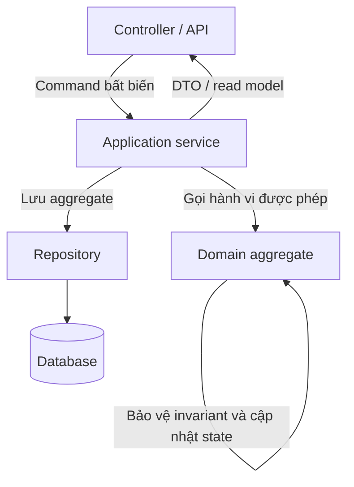

# Kiểm soát quyền thay đổi đối tượng và tránh rò rỉ trạng thái có thể sửa

Trong ứng dụng phân tầng, một đối tượng thường đi qua nhiều thành phần: controller nhận dữ liệu, application service điều phối ca sử dụng, domain thực thi quy tắc và repository lưu trạng thái. Nếu một tầng đưa trực tiếp đối tượng có thể sửa cho tầng khác, bên nhận có thể vô tình thay đổi dữ liệu mà không đi qua quy tắc của chủ sở hữu. Lỗi này thường khó phát hiện vì mã thay đổi trạng thái có thể nằm cách xa nơi đối tượng được tạo.

Bài học này thuộc module `SOFTWARE_DESIGN_ARCHITECTURE_ARCHITECTURAL_PATTERN_LAYERED`, tập trung vào cách tổ chức phần mềm theo kiến trúc phân tầng. Trong chương **Dữ liệu và hợp đồng giữa các tầng**, ta tìm hiểu cách kiểm soát quyền thay đổi đối tượng, đóng gói trạng thái và thiết kế hợp đồng dữ liệu để mỗi thành phần chỉ có quyền sửa những gì nó thực sự sở hữu.

## Rò rỉ trạng thái có thể sửa là gì?

Một đối tượng có trạng thái có thể sửa (mutable state) khi nội dung của nó có thể thay đổi sau khi được tạo. Ví dụ thường gặp là `ArrayList`, `HashMap`, mảng, `Date` hoặc một entity có setter công khai. Rò rỉ xảy ra khi một thành phần đưa tham chiếu tới trạng thái nội bộ đó ra ngoài. Bên nhận giữ tham chiếu và có thể thay đổi dữ liệu gốc mà không gọi phương thức kiểm soát của đối tượng sở hữu.

Ví dụ đơn giản:

```java
class ShoppingCart {
    private final List<CartLine> lines = new ArrayList<>();

    public List<CartLine> getLines() {
        return lines;
    }
}
```

Đoạn mã có vẻ chỉ đọc danh sách, nhưng `getLines()` trả về chính đối tượng `ArrayList` bên trong. Mọi nơi nhận được danh sách đều có thể gọi `clear()`, `remove()` hoặc `add()`:

```java
ShoppingCart cart = new ShoppingCart();
cart.getLines().clear(); // Thay đổi trực tiếp trạng thái bên trong giỏ hàng
```

Nếu `ShoppingCart` cần bảo đảm giỏ hàng không rỗng hoặc mỗi dòng hàng phải có số lượng dương, việc sửa trực tiếp như trên có thể phá vỡ các quy tắc đó. Đối tượng không còn kiểm soát được trạng thái của chính nó.

Rủi ro không chỉ nằm ở collection. Một tầng có thể giữ tham chiếu tới một mảng, một đối tượng ngày giờ có thể sửa, một map lồng nhau hoặc một entity ORM. Bất cứ khi nào hai thành phần cùng giữ tham chiếu tới một đối tượng mutable, chúng có thể vô tình chia sẻ quyền thay đổi.

## Quyền thay đổi phải thuộc về nơi bảo vệ quy tắc

Một nguyên tắc hữu ích là chỉ thành phần sở hữu một trạng thái mới được thay đổi trạng thái đó, thông qua những thao tác có ý nghĩa nghiệp vụ. Các tầng khác yêu cầu một hành động hoặc đọc một bản dữ liệu; chúng không được tùy ý sửa các trường bên trong.



Controller không nên giữ một tham chiếu mutable tới entity để sửa trực tiếp. Application service điều phối lệnh. Aggregate domain bảo vệ các bất biến và chỉ thay đổi trạng thái qua phương thức của nó. Repository đảm nhiệm lưu trữ. Khi trả dữ liệu ra ngoài, ứng dụng dùng DTO hoặc read model phù hợp thay vì để người gọi thao tác trực tiếp trên aggregate.

Điều này không có nghĩa mọi đối tượng trong chương trình đều phải bất biến. Aggregate có thể cần thay đổi trạng thái trong vòng đời của nó. Điều cần kiểm soát là ai có quyền thay đổi và thay đổi được thực hiện qua đường nào.

## Đóng gói trạng thái trong domain object

Ví dụ dưới đây giữ danh sách dòng hàng ở chế độ private. Bên ngoài chỉ có thể thêm dòng hàng qua phương thức `addLine`, nơi đối tượng kiểm tra trạng thái và dữ liệu đầu vào:

```java
public record OrderLine(UUID productId, int quantity, Money unitPrice) {
    public OrderLine {
        Objects.requireNonNull(productId, "productId");
        Objects.requireNonNull(unitPrice, "unitPrice");
        if (quantity <= 0) {
            throw new IllegalArgumentException("quantity phải lớn hơn 0");
        }
    }
}
```

```java
public final class Order {
    private final UUID id;
    private final List<OrderLine> lines = new ArrayList<>();
    private OrderStatus status = OrderStatus.DRAFT;

    public Order(UUID id) {
        this.id = Objects.requireNonNull(id, "id");
    }

    public UUID id() {
        return id;
    }

    public OrderStatus status() {
        return status;
    }

    public List<OrderLine> lines() {
        return List.copyOf(lines);
    }

    public void addLine(OrderLine line) {
        if (status != OrderStatus.DRAFT) {
            throw new IllegalStateException("Chỉ được sửa đơn nháp");
        }
        lines.add(Objects.requireNonNull(line, "line"));
    }

    public void confirm() {
        if (lines.isEmpty()) {
            throw new IllegalStateException("Không thể xác nhận đơn rỗng");
        }
        if (status != OrderStatus.DRAFT) {
            throw new IllegalStateException("Đơn hàng không ở trạng thái nháp");
        }
        status = OrderStatus.CONFIRMED;
    }
}
```

`lines` là danh sách mutable bên trong `Order`, nhưng không có getter trả về tham chiếu gốc. `lines()` trả về một bản sao cấu trúc không thể sửa đổi. Các phần tử `OrderLine` là record chứa các giá trị bất biến trong ví dụ, vì vậy người gọi cũng không thể sửa một dòng hàng thông qua phần tử được trả về.

Các thay đổi có ý nghĩa như thêm dòng hàng hoặc xác nhận đơn được thực hiện qua phương thức của `Order`. Nhờ đó, aggregate có thể kiểm tra trạng thái hiện tại và giữ các bất biến. Trong hệ thống thực tế, có thể có thêm phương thức xóa dòng, đổi số lượng hoặc tính tổng; mỗi phương thức cần bảo đảm các quy tắc tương ứng.

## Bản sao phòng vệ và collection không thể sửa đổi

Có hai cách thường dùng để ngăn bên nhận sửa collection gốc, nhưng chúng có hành vi khác nhau:

```java
public List<OrderLine> unmodifiableView() {
    return Collections.unmodifiableList(lines);
}

public List<OrderLine> snapshot() {
    return List.copyOf(lines);
}
```

`Collections.unmodifiableList(lines)` tạo một view không cho phép người nhận gọi thao tác sửa qua view đó. Tuy nhiên, view vẫn phản ánh thay đổi được thực hiện trên danh sách gốc. Nếu `Order` thêm một dòng mới, bên giữ view sẽ nhìn thấy dòng mới.

`List.copyOf(lines)` tạo một danh sách không thể sửa đổi và tách khỏi cấu trúc danh sách gốc tại thời điểm gọi. Nếu `Order` thay đổi danh sách sau đó, snapshot cũ không tự thay đổi. Cách này phù hợp khi hợp đồng yêu cầu người gọi nhận một ảnh chụp dữ liệu tại một thời điểm.

Cả hai cách trên đều chỉ bảo vệ cấu trúc collection ở mức nông. Nếu phần tử bên trong vẫn mutable, người nhận có thể sửa phần tử đó. Ví dụ:

```java
List<MutableLine> snapshot = List.copyOf(lines);
snapshot.get(0).setQuantity(0); // Vẫn sửa được phần tử nếu MutableLine có setter
```

Để tránh rò rỉ sâu, hãy dùng phần tử bất biến hoặc ánh xạ sang DTO bất biến. Khi cần trả về một cấu trúc lồng nhau, phải xem xét cả collection bên ngoài lẫn các object con, map, list hoặc mảng nằm bên trong.

## Bất biến nông và bất biến sâu trong Java

`final` chỉ ngăn gán lại biến tham chiếu; nó không làm object được tham chiếu trở thành bất biến:

```java
private final List<String> tags = new ArrayList<>();
```

Biến `tags` không thể trỏ sang một danh sách khác, nhưng danh sách vẫn có thể nhận thêm hoặc xóa phần tử. Tương tự, `record` tự động tạo accessor nhưng không tự động sao chép hoặc làm bất biến các object mutable được truyền vào.

Ví dụ record nhận một list nên tạo bản sao trong constructor:

```java
public record OrderSummary(UUID orderId, List<String> productNames) {
    public OrderSummary {
        Objects.requireNonNull(orderId, "orderId");
        productNames = List.copyOf(productNames);
    }
}
```

Sau khi tạo, bên gọi không thể sửa list nội bộ thông qua list ban đầu hoặc accessor. Ví dụ này an toàn vì `String` là bất biến. Nếu `productNames` chứa các object mutable, cần sao chép hoặc chuyển đổi từng phần tử nữa.

Với mảng hoặc kiểu mutable như `Date`, cần sao chép cả lúc nhận vào lẫn lúc trả ra:

```java
public final class DocumentPayload {
    private final byte[] content;

    public DocumentPayload(byte[] content) {
        this.content = content.clone();
    }

    public byte[] content() {
        return content.clone();
    }
}
```

Nếu chỉ clone trong constructor mà trả thẳng mảng nội bộ ở accessor, người gọi vẫn có thể sửa nội dung sau khi lấy ra. Sao chép ở cả hai hướng mới bảo vệ được trạng thái. Với ngày giờ, nên ưu tiên các kiểu bất biến như `Instant`, `LocalDate` hoặc `OffsetDateTime` thay cho `Date` khi hợp đồng cho phép.

## Thiết kế hợp đồng giữa các tầng bằng DTO và command

DTO giúp tầng giao tiếp nhận và trả dữ liệu theo hợp đồng rõ ràng mà không đưa entity nội bộ ra ngoài. Request mô tả dữ liệu người gọi được phép cung cấp; command mô tả yêu cầu mà tầng ứng dụng cần thực hiện; response hoặc read model chứa dữ liệu cần trình bày.

```java
public record AddOrderLineRequest(UUID productId, int quantity) {}

public record AddOrderLineCommand(UUID productId, int quantity) {
    public AddOrderLineCommand {
        Objects.requireNonNull(productId, "productId");
        if (quantity <= 0) {
            throw new IllegalArgumentException("quantity phải lớn hơn 0");
        }
    }
}

public record OrderLineResponse(UUID productId, int quantity, String unitPrice) {}

public record OrderResponse(UUID orderId, String status, List<OrderLineResponse> lines) {
    public OrderResponse {
        lines = List.copyOf(lines);
    }
}
```

Controller có thể ánh xạ request thành command và response từ kết quả truy vấn:

```java
@PostMapping("/orders/{orderId}/lines")
ResponseEntity<Void> addLine(
        @PathVariable UUID orderId,
        @Valid @RequestBody AddOrderLineRequest request) {

    addOrderLine.handle(
        orderId,
        new AddOrderLineCommand(request.productId(), request.quantity())
    );
    return ResponseEntity.noContent().build();
}
```

Client gửi dữ liệu cần thiết để yêu cầu một hành động. Application service tải aggregate, gọi `order.addLine(...)` và lưu thay đổi. Client không gửi cả entity với mọi trường nội bộ rồi yêu cầu hệ thống ghi đè. Cách nhận một entity trực tiếp từ JSON có thể tạo ra lỗi mass assignment: người gọi tự gửi thêm các trường như `status`, `approvedBy` hoặc `creditLimit` mà họ không được quyền thay đổi.

Response cũng nên là một bản biểu diễn có chủ đích. Tránh trả trực tiếp entity JPA ra HTTP: serializer có thể làm lộ trường nội bộ, kích hoạt lazy loading hoặc tạo vòng tham chiếu. Việc ánh xạ sang DTO cho phép kiểm soát trường nào được công khai và kiểu dữ liệu nào thuộc hợp đồng API.

## Repository cũng cần kiểm soát tham chiếu

Repository thường trả về aggregate hoặc đối tượng dữ liệu. Nếu repository trả một tham chiếu tới entity được quản lý bởi persistence context, bên gọi có thể sửa các trường và làm thay đổi dữ liệu sẽ được flush khi transaction kết thúc. Điều đó có thể hợp lệ nếu bên gọi đang thực hiện một ca sử dụng được phép thay đổi aggregate, nhưng sẽ nguy hiểm nếu tham chiếu được đưa tới thành phần chỉ có quyền đọc.

Với luồng cập nhật, application service nên tải aggregate, gọi phương thức nghiệp vụ và để repository lưu trạng thái sau khi quy tắc được áp dụng. Với luồng chỉ đọc, có thể dùng projection hoặc read model chỉ chứa dữ liệu cần hiển thị. Một DTO chỉ đọc không nên giữ tham chiếu tới entity mutable bên trong.

Ví dụ ánh xạ một aggregate thành read model:

```java
public OrderResponse toResponse(Order order) {
    List<OrderLineResponse> lines = order.lines().stream()
        .map(line -> new OrderLineResponse(
            line.productId(),
            line.quantity(),
            line.unitPrice().toString()
        ))
        .toList();

    return new OrderResponse(
        order.id(),
        order.status().name(),
        lines
    );
}
```

`OrderResponse` chỉ chứa giá trị phục vụ giao diện. Việc sửa list mà caller ban đầu dùng để tạo response không làm thay đổi danh sách nội bộ vì constructor đã dùng `List.copyOf`. Các kiểu phần tử cũng là record chứa giá trị bất biến trong ví dụ.

## Những lỗi thiết kế thường gặp

| Cách làm | Rủi ro | Cách xử lý phù hợp |
|---|---|---|
| Getter trả trực tiếp `ArrayList` nội bộ | Bên gọi có thể thêm, xóa hoặc thay đổi cấu trúc dữ liệu | Trả snapshot hoặc view không thể sửa; ưu tiên phần tử bất biến |
| Chỉ dùng `final` cho field collection | Tham chiếu cố định nhưng nội dung vẫn mutable | Kết hợp đóng gói, copy và API hành vi |
| Cho record chứa list mutable mà không copy | Caller có thể sửa list sau khi tạo record | Copy trong compact constructor và xem xét phần tử lồng nhau |
| Trả entity JPA trực tiếp qua API | Rò rỉ trường, lazy loading và cập nhật ngoài ý muốn | Ánh xạ sang response DTO hoặc projection |
| Request chứa toàn bộ entity và setter công khai | Có thể cập nhật trường mà client không được phép sửa | Dùng command chỉ chứa các trường được phép thay đổi |
| Dùng `Collections.unmodifiableList` nhưng tưởng đã có snapshot | View vẫn phản ánh thay đổi của danh sách gốc | Dùng `List.copyOf` khi cần snapshot |

## Kiểm thử việc không rò rỉ trạng thái

Các kiểm thử nên xác nhận caller không thể sửa trạng thái nội bộ qua hợp đồng đọc:

```java
@Test
void returnedLinesCannotModifyOrderState() {
    Order order = new Order(UUID.randomUUID());
    order.addLine(new OrderLine(productId, 2, unitPrice));

    List<OrderLine> exposed = order.lines();

    assertThrows(UnsupportedOperationException.class, exposed::clear);
    assertEquals(1, order.lines().size());
}
```

Với snapshot, cũng nên kiểm tra danh sách đã nhận không đổi khi aggregate tiếp tục thay đổi:

```java
@Test
void returnedLinesAreSnapshot() {
    Order order = new Order(UUID.randomUUID());
    order.addLine(firstLine);

    List<OrderLine> snapshot = order.lines();
    order.addLine(secondLine);

    assertEquals(1, snapshot.size());
    assertEquals(2, order.lines().size());
}
```

Ngoài unit test cho domain object, cần kiểm tra hợp đồng request/response: trường nội bộ không được cập nhật qua request ngoài ý muốn, response không chứa entity hoặc collection mutable, và application service chỉ gọi phương thức thay đổi hợp lệ. Test tích hợp persistence có thể xác nhận trạng thái chỉ được lưu sau khi ca sử dụng hoàn tất đúng quy tắc.

## Chọn mức bảo vệ phù hợp

Đóng gói và sao chép giúp kiểm soát quyền thay đổi nhưng cũng có chi phí. Copy collection lớn nhiều lần có thể tốn bộ nhớ và CPU; tạo quá nhiều DTO trùng lặp làm tăng mã ánh xạ. Không cần sao chép mọi đối tượng một cách máy móc. Hãy xác định ranh giới nơi dữ liệu được chia sẻ, ai sở hữu trạng thái, và bên nhận cần snapshot hay chỉ cần quyền đọc.

Với dữ liệu nhỏ, `List.copyOf` hoặc record bất biến thường đơn giản và hiệu quả. Với dữ liệu lớn, có thể dùng projection, cursor hoặc API đọc chuyên biệt để tránh sao chép toàn bộ. Với aggregate cần thay đổi, giữ trạng thái mutable bên trong và cung cấp các hành vi có kiểm soát. Với hợp đồng giữa tầng hoặc qua mạng, ưu tiên command và DTO chứa giá trị rõ ràng, tránh đưa tham chiếu nội bộ ra ngoài.

Trong kiến trúc phân tầng, kiểm soát khả năng thay đổi là một phần của thiết kế hợp đồng: tầng sở hữu dữ liệu bảo vệ các bất biến; tầng gọi chỉ nhận quyền đọc hoặc yêu cầu hành động qua API được công bố; repository và adapter chuyển dữ liệu qua ranh giới có chủ đích. Nhờ vậy, một thay đổi trạng thái không thể âm thầm xảy ra ở nơi không có trách nhiệm kiểm soát nó.
