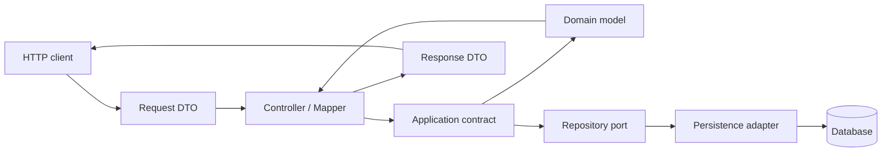
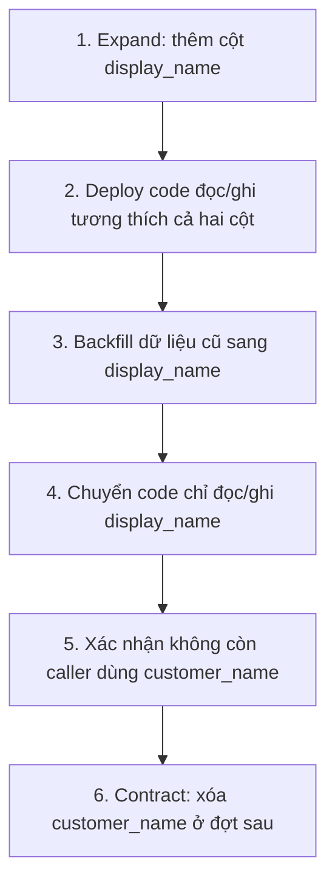

# Tiến hóa hợp đồng và duy trì tương thích mà không lan truyền thay đổi

*Chương: Dữ liệu và hợp đồng giữa các tầng*

Bài học này thuộc module `SOFTWARE_DESIGN_ARCHITECTURE_ARCHITECTURAL_PATTERN_LAYERED`, có mục tiêu **Học tổ chức phần mềm theo kiến trúc phân tầng**. Trong kiến trúc phân tầng, các tầng trao đổi dữ liệu qua những hợp đồng như interface Java, DTO, kiểu kết quả, sự kiện hoặc schema lưu trữ. Hợp đồng mô tả điều một bên cung cấp và bên còn lại được phép kỳ vọng. Khi yêu cầu nghiệp vụ thay đổi, hợp đồng cũng có thể cần thay đổi; thách thức là thực hiện việc đó mà không buộc mọi tầng, mọi client hoặc mọi thành phần tích hợp phải sửa cùng lúc.

Một hợp đồng tốt tạo ra ranh giới ổn định quanh ý nghĩa dữ liệu. Controller có thể thay cách nhận HTTP, database có thể thay schema, hoặc mô hình nghiệp vụ có thể được tổ chức lại mà các bên sử dụng hợp đồng vẫn tiếp tục hoạt động. Sự ổn định này không có nghĩa hợp đồng không bao giờ đổi. Nó có nghĩa thay đổi được đánh giá theo ảnh hưởng, được chuyển đổi tại ranh giới phù hợp và được triển khai theo lộ trình có kiểm soát.

## 1. Hợp đồng giữa các tầng là gì?

Hợp đồng là tập hợp những điều mà bên cung cấp cam kết và bên sử dụng dựa vào. Nó không chỉ là danh sách tên trường. Tùy ranh giới, hợp đồng có thể bao gồm:

- **Cấu trúc:** tên trường, kiểu dữ liệu, định dạng, quan hệ giữa các phần tử.
- **Ngữ nghĩa:** trường biểu diễn điều gì, đơn vị đo, cách làm tròn, trạng thái nào được chấp nhận.
- **Điều kiện:** trường nào bắt buộc, trường nào có thể vắng mặt hoặc nhận giá trị null.
- **Hành vi:** kết quả thành công, lỗi có thể xảy ra, thứ tự xử lý và các tác dụng phụ được cam kết.
- **Khả năng tương thích:** bên sử dụng cũ sẽ phản ứng ra sao khi có trường hoặc giá trị mới.

Ví dụ, `OrderRepository.findById(OrderId)` là một hợp đồng giữa tầng ứng dụng và tầng truy cập dữ liệu. Nó cho biết caller tìm một đơn hàng bằng định danh và nhận kết quả có thể không tồn tại. Hợp đồng HTTP `GET /api/orders/{id}` lại mô tả cách client gửi yêu cầu và cấu trúc phản hồi. Hai hợp đồng có thể cùng nói về một đơn hàng nhưng phục vụ hai nhóm caller khác nhau.

Cần phân biệt hợp đồng với implementation. Một hợp đồng có thể được triển khai bằng JPA hoặc JDBC; cùng một API có thể được phục vụ bởi một ứng dụng Spring Boot hoặc một gateway. Nếu caller phải biết implementation đang dùng để hiểu dữ liệu, ranh giới đã để lộ quá nhiều chi tiết.

## 2. Vì sao thay đổi thường lan truyền?

Thay đổi lan truyền khi nhiều thành phần cùng phụ thuộc vào một cấu trúc hoặc chi tiết chưa được bảo vệ. Ví dụ, nếu controller, application service, domain model và repository cùng sử dụng một JPA entity, việc đổi tên cột hoặc tách quan hệ có thể buộc nhiều tầng sửa theo. Nếu client phụ thuộc vào tên exception Java hoặc câu chữ thông báo lỗi, một thay đổi nội bộ cũng có thể làm client hỏng.

Một số nguyên nhân phổ biến:

- Dùng cùng một lớp cho request HTTP, mô hình nghiệp vụ, JPA entity và response.
- Trả kiểu framework như `Page`, `EntityManager` hoặc entity JPA qua nhiều tầng.
- Để client phụ thuộc vào tên lớp, thứ tự trường hoặc thông điệp lỗi không được cam kết.
- Thay đổi ý nghĩa trường mà không đổi tên hoặc phiên bản hợp đồng.
- Không xác định ai sở hữu hợp đồng và ai cần được thông báo khi nó thay đổi.

Sơ đồ dưới đây minh họa cách một adapter và mapper giữ thay đổi ở ranh giới:



Các kiểu dữ liệu ở từng ranh giới có thể khác nhau. Controller chuyển request thành lệnh ứng dụng; adapter lưu trữ chuyển mô hình sang persistence model; response mapper chọn dữ liệu công khai. Khi schema database đổi, adapter có thể hấp thụ phần lớn thay đổi. Khi JSON API đổi, tầng trình bày xử lý việc chuyển đổi mà không buộc mô hình nghiệp vụ phải mang theo tên trường HTTP.

Không cần tạo một lớp mới cho mọi kiểu dữ liệu. Mục tiêu là có ranh giới khi hai bên có lý do thay đổi khác nhau hoặc cần cam kết khác nhau.

## 3. Phân biệt thay đổi tương thích và thay đổi phá vỡ

Một thay đổi tương thích (backward-compatible) cho phép bên sử dụng đã tồn tại tiếp tục hoạt động theo hợp đồng trước đó. Một thay đổi phá vỡ (breaking change) khiến caller cũ không còn đáp ứng được hợp đồng mới, hoặc khiến dữ liệu cũ bị diễn giải khác đi.

Tương thích cần được xem xét theo từng loại ranh giới:

| Ranh giới | Thay đổi thường ít rủi ro hơn | Thay đổi thường có nguy cơ phá vỡ |
|---|---|---|
| Java interface | Thêm phương thức `default` có hành vi phù hợp | Xóa/đổi chữ ký phương thức; thêm abstract method khiến implementation cũ không còn biên dịch |
| JSON response | Thêm trường tùy chọn nếu client chấp nhận trường chưa biết | Xóa/đổi tên trường hoặc đổi kiểu dữ liệu |
| JSON request | Thêm trường tùy chọn có mặc định an toàn | Thêm trường bắt buộc mà client cũ chưa gửi |
| Enum | Client xử lý được giá trị chưa biết | Client giả định tập giá trị là cố định |
| Event/message | Thêm thuộc tính tùy chọn mà consumer cũ có thể bỏ qua | Đổi ý nghĩa, xóa thuộc tính hoặc thay cấu trúc mà consumer đang đọc |
| Database schema | Thêm cột nullable trong giai đoạn chuyển tiếp | Xóa/đổi tên cột khi phiên bản ứng dụng cũ vẫn đang chạy |

Các đánh giá trong bảng phụ thuộc vào cách triển khai thực tế. Ví dụ, thêm trường vào JSON response thường tương thích nếu client bỏ qua trường chưa biết. Một client dùng bộ giải mã nghiêm ngặt có thể từ chối JSON có trường mới. Tương tự, thêm giá trị enum có thể không làm JSON parser lỗi, nhưng có thể khiến một nhánh `switch` hoặc logic xử lý của client thất bại.

Vì vậy, không nên kết luận “chỉ thêm trường thì luôn an toàn”. Hãy xác định caller nào đang sử dụng hợp đồng và kiểm tra cách họ xử lý dữ liệu chưa biết, dữ liệu thiếu và giá trị null.

## 4. Những thay đổi nhỏ có thể làm đổi ngữ nghĩa

Một thay đổi có thể giữ nguyên cấu trúc nhưng vẫn phá vỡ hợp đồng vì ý nghĩa dữ liệu đã đổi.

Ví dụ, trường `amount` ban đầu được hiểu là số tiền tính bằng VND, sau đó được đổi thành đơn vị nghìn VND nhưng vẫn giữ tên và kiểu `BigDecimal`. Mã nguồn có thể biên dịch, JSON vẫn hợp lệ, nhưng client hiển thị số tiền sai gấp một nghìn lần.

Các thay đổi cần xem xét kỹ:

- **Đơn vị:** giây hay mili giây, mét hay kilomet, VND hay USD.
- **Độ chính xác:** số chữ số thập phân, cách làm tròn, giới hạn giá trị.
- **Null và vắng mặt:** không có trường có nghĩa là giữ nguyên, xóa giá trị hay dùng mặc định?
- **Trạng thái:** `CANCELLED` có nghĩa là khách hủy, hệ thống hủy hay nhà cung cấp từ chối?
- **Thứ tự:** danh sách có được đảm bảo sắp xếp theo thời gian hay không?
- **Thời gian:** múi giờ, định dạng và ý nghĩa của thời điểm tạo/cập nhật.
- **Lỗi:** status, mã lỗi và điều kiện thử lại có thay đổi không?

Với request cập nhật, cần phân biệt trường bị bỏ qua và trường được gửi với giá trị null. Ví dụ, khi cập nhật hồ sơ, bỏ qua `phone` có thể có nghĩa là giữ số điện thoại cũ; gửi `phone: null` có thể có nghĩa là xóa số điện thoại. Nếu hợp đồng không quy định rõ, client và server dễ hiểu khác nhau.

Đừng đổi ý nghĩa của trường cũ chỉ để tránh thêm trường mới. Nếu ý nghĩa mới khác đáng kể, hãy tạo trường mới hoặc một phiên bản hợp đồng mới và có kế hoạch chuyển đổi.

## 5. Dùng DTO và mapper để cô lập thay đổi

DTO (Data Transfer Object) là kiểu dữ liệu dùng để trao đổi qua một ranh giới. Request DTO, response DTO, command của application service và persistence entity có thể có cấu trúc khác nhau vì chúng phục vụ mục đích khác nhau.

Ví dụ, API tạo đơn hàng nhận thông tin khách và các dòng hàng:

```java
public record CreateOrderRequest(
        UUID customerId,
        List<CreateOrderLineRequest> items,
        String customerNote) {
}

public record CreateOrderLineRequest(
        String productCode,
        int quantity) {
}
```

Application service có thể nhận command đã được chuyển đổi và kiểm tra ở mức ca sử dụng:

```java
public record CreateOrderCommand(
        CustomerId customerId,
        List<RequestedOrderLine> items,
        Optional<String> customerNote) {
}
```

Response DTO có thể công khai một tập trường riêng:

```java
public record OrderResponse(
        UUID id,
        String status,
        BigDecimal total,
        String currency) {
}
```

Controller hoặc mapper chịu trách nhiệm chuyển đổi:

```java
@PostMapping("/api/orders")
public ResponseEntity<OrderResponse> create(
        @Valid @RequestBody CreateOrderRequest request) {

    CreateOrderCommand command = requestMapper.toCommand(request);
    Order order = createOrderService.execute(command);
    OrderResponse response = orderMapper.toResponse(order);

    return ResponseEntity.status(HttpStatus.CREATED).body(response);
}
```

Đây là ví dụ minh họa; cách biểu diễn optional field và validation cụ thể phụ thuộc cấu hình Jackson, Bean Validation và quy ước API của dự án. Điểm quan trọng là mapper có nhiệm vụ chuyển đổi dữ liệu giữa các hợp đồng. Nếu API đổi tên `customerNote` thành `note`, thay đổi có thể được xử lý trong request DTO và mapper mà không cần đổi tên thuộc tính trong domain model.

Tách DTO có chi phí: thêm mã mapping, kiểu dữ liệu và kiểm thử. Với ứng dụng nhỏ, dùng chung một kiểu có thể hợp lý nếu các bên thực sự có cùng vòng đời và cùng ngữ nghĩa. Khi API, domain và schema bắt đầu thay đổi độc lập, các DTO riêng thường giúp giới hạn phạm vi ảnh hưởng.

## 6. Tiến hóa hợp đồng JSON một cách an toàn

Giả sử API ban đầu trả về:

```json
{
  "id": "a2f4",
  "status": "CONFIRMED",
  "total": 250000
}
```

Sau này sản phẩm cần hiển thị loại tiền tệ. Có thể bổ sung trường `currency`:

```json
{
  "id": "a2f4",
  "status": "CONFIRMED",
  "total": 250000,
  "currency": "VND"
}
```

Đây thường là thay đổi tương thích với client cũ nếu client bỏ qua trường mới. Client mới có thể sử dụng trường này khi server cung cấp. Nếu server muốn hỗ trợ client cũ trong thời gian chuyển tiếp, cần quy định rõ giá trị mặc định hoặc hành vi khi trường chưa có.

Ngược lại, các thay đổi sau có nguy cơ phá vỡ:

- Đổi `total` từ số sang chuỗi định dạng tiền.
- Đổi tên `status` thành `orderStatus` rồi xóa trường cũ ngay.
- Bắt buộc client gửi `currency` trong request trong khi client cũ chưa biết trường này.
- Xóa giá trị enum mà client đang xử lý.
- Thay `total` từ tổng trước giảm giá sang tổng sau giảm giá mà không làm rõ ý nghĩa.

Một quy trình tiến hóa an toàn thường gồm:

1. Xác định các client và phiên bản đang sử dụng hợp đồng.
2. Thêm trường mới với ngữ nghĩa rõ ràng; giữ cách xử lý cũ trong thời gian chuyển tiếp nếu cần.
3. Triển khai server có thể đọc cả dạng cũ và mới, hoặc server tiếp tục phát trường cũ cùng trường mới.
4. Cập nhật và phát hành client để sử dụng trường mới.
5. Theo dõi mức sử dụng trường cũ và chỉ loại bỏ khi các caller cần thiết đã chuyển đổi.
6. Ghi rõ thời điểm ngừng hỗ trợ và cung cấp hướng dẫn chuyển đổi.

Với trường enum, client nên có nhánh xử lý giá trị chưa biết hoặc nhánh mặc định an toàn. Không nên giả định danh sách trạng thái không bao giờ mở rộng. Với dữ liệu nhạy cảm hoặc thao tác có tác dụng phụ, nhánh mặc định cần từ chối hoặc chuyển sang trạng thái xử lý an toàn thay vì đoán ý nghĩa.

## 7. Phiên bản hóa khi thay đổi không thể tương thích

Không phải thay đổi nào cũng có thể triển khai theo cách cộng thêm trường. Nếu ý nghĩa, cấu trúc hoặc hành vi thay đổi lớn, có thể cần phiên bản hợp đồng mới.

Một API có thể dùng phiên bản trong đường dẫn:

```text
/api/v1/orders
/api/v2/orders
```

Hoặc dùng cơ chế thương lượng nội dung qua header. Mỗi cách có ưu và nhược điểm về routing, tài liệu, cache và cách client chọn phiên bản. Dự án nên chọn một quy ước nhất quán và xác định thời gian hỗ trợ từng phiên bản.

Không cần tạo phiên bản mới cho mọi thay đổi nhỏ. Nếu thêm một trường tùy chọn tương thích, có thể giữ nguyên phiên bản và cập nhật tài liệu. Phiên bản mới phù hợp khi client cũ không thể hiểu đúng hợp đồng mới hoặc khi cần thay đổi ngữ nghĩa không thể duy trì song song một cách an toàn.

Trong ứng dụng nội bộ, hợp đồng Java giữa hai module có thể được thay đổi cùng một lần phát hành nếu cả hai module được triển khai đồng bộ. Nhưng nếu các module có nhịp phát hành độc lập, được dùng bởi plugin hoặc thư viện bên ngoài, cần quản lý tương thích chặt chẽ hơn. Phạm vi caller và khả năng triển khai đồng thời quyết định mức độ cần phiên bản hóa.

## 8. Tiến hóa schema database theo chiến lược expand-contract

Schema database cũng là một hợp đồng, đặc biệt khi nhiều phiên bản ứng dụng hoặc nhiều dịch vụ cùng truy cập dữ liệu. Đổi tên hoặc xóa cột ngay lập tức có thể làm phiên bản ứng dụng cũ lỗi khi nó vẫn đang chạy.

Ví dụ cần đổi cột `customer_name` thành `display_name`. Một quy trình expand-contract có thể gồm:



Chiến lược này tạo khoảng thời gian mà schema và ứng dụng mới vẫn tương thích với ứng dụng cũ. Cần thiết kế chính xác thứ tự đọc/ghi và xử lý dữ liệu cập nhật đồng thời trong giai đoạn chuyển tiếp. Backfill nên có thể chạy lặp an toàn hoặc có cơ chế theo dõi tiến độ.

Các bước tổng quát:

- **Expand:** thêm cấu trúc mới mà code cũ vẫn hoạt động, chẳng hạn cột nullable hoặc bảng mới.
- **Deploy tương thích:** phát hành ứng dụng có thể hoạt động với cả schema trước và sau khi mở rộng.
- **Backfill:** chuyển dữ liệu hiện có, kiểm tra số lượng và tính toàn vẹn.
- **Switch:** chuyển đọc và ghi sang cấu trúc mới.
- **Contract:** sau khi xác nhận không còn caller cũ, mới xóa cấu trúc cũ.

Không phải migration nào cũng cần đủ mọi bước. Nhưng khi có nhiều instance, deployment rolling hoặc nhiều ứng dụng cùng truy cập schema, cần xem schema như hợp đồng được chia sẻ. Migration phá vỡ nên được chia thành các giai đoạn có thể triển khai độc lập và có khả năng khôi phục.

## 9. Hợp đồng cho message và sự kiện

Các tầng hoặc dịch vụ cũng có thể trao đổi dữ liệu qua message queue hoặc event bus. Một event như `OrderConfirmed` có thể được consumer sử dụng để cập nhật tồn kho, gửi thông báo hoặc lập báo cáo.

Ví dụ:

```json
{
  "eventId": "evt-801",
  "eventType": "OrderConfirmed",
  "occurredAt": "2026-11-24T10:30:00Z",
  "orderId": "a2f4",
  "customerId": "c901"
}
```

Event là dữ liệu công khai đối với consumer. Khi thêm thuộc tính mới, consumer cũ cần bỏ qua trường chưa biết hoặc schema phải được quản lý theo quy tắc tương thích đã thống nhất. Không nên đổi ý nghĩa `occurredAt` từ thời điểm xác nhận sang thời điểm phát message mà vẫn giữ nguyên tên.

Một số nguyên tắc hữu ích:

- Đặt tên event theo sự kiện nghiệp vụ đã xảy ra, ví dụ `OrderConfirmed`, thay vì tên lệnh như `ConfirmOrder`.
- Ghi rõ phiên bản schema hoặc quy tắc tương thích nếu hệ thống cần quản lý nhiều producer/consumer.
- Consumer nên xử lý message lặp theo cách an toàn khi hệ thống có cơ chế giao nhận ít nhất một lần.
- Tránh đưa entity JPA hoặc đối tượng nội bộ vào payload; event nên là hợp đồng độc lập.
- Không xóa trường hoặc thay đổi ngữ nghĩa mà không có lộ trình cho các consumer.

Event bất biến theo nghĩa sự kiện đã xảy ra: nếu thông tin nghiệp vụ thay đổi về sau, thường nên phát một event mới thay vì sửa lại ý nghĩa của event cũ. Cách quản lý event cụ thể còn tùy yêu cầu lưu trữ, replay và tích hợp của hệ thống.

## 10. Kiểm thử tương thích hợp đồng

Kiểm thử hợp đồng xác nhận bên cung cấp và bên sử dụng hiểu cùng một giao diện. Nó có thể bao gồm kiểm thử schema, kiểm thử API, kiểm thử interface giữa module hoặc kiểm thử message.

Một chiến lược thực tế gồm:

| Kiểm thử | Câu hỏi cần trả lời |
|---|---|
| Provider contract test | Server có trả đúng status, field, kiểu và ngữ nghĩa đã cam kết không? |
| Consumer contract test | Client có chỉ dựa vào những phần hợp đồng mà nó thực sự cần không? |
| Compatibility test | Payload mới có được client cũ chấp nhận theo quy ước không? |
| Integration test | Các adapter, mapper và persistence có phối hợp đúng không? |
| Migration test | Schema sau migration có giữ và chuyển dữ liệu đúng không? |

Ví dụ kiểm tra response JSON bằng MockMvc:

```java
mockMvc.perform(get("/api/orders/{id}", orderId))
        .andExpect(status().isOk())
        .andExpect(jsonPath("$.id").value(orderId.toString()))
        .andExpect(jsonPath("$.status").value("CONFIRMED"))
        .andExpect(jsonPath("$.total").isNumber());
```

Kiểm thử này xác nhận các trường mà client đang dựa vào. Nếu hợp đồng có thêm `currency`, cần bổ sung kiểm thử cho client mới và kiểm tra client cũ có chấp nhận payload mới hay không theo cấu hình thực tế. Với hệ thống nhiều consumer, consumer-driven contract testing có thể ghi nhận kỳ vọng của từng consumer và xác minh provider vẫn đáp ứng chúng.

Kiểm thử không thay thế tài liệu. Schema OpenAPI, JSON Schema hoặc tài liệu event nên mô tả rõ trường bắt buộc, trường tùy chọn, nullability, enum, đơn vị và mã lỗi. Các kiểm tra tự động có thể phát hiện nhiều sai lệch trước khi phát hành.

## 11. Quy trình thay đổi hợp đồng mà không lan truyền

Khi cần thay đổi một hợp đồng, có thể thực hiện theo các bước:

1. **Xác định ranh giới và caller:** ai cung cấp, ai sử dụng, có bao nhiêu phiên bản đang chạy?
2. **Mô tả thay đổi:** trường nào được thêm, bỏ hoặc đổi ý nghĩa; điều gì xảy ra với dữ liệu cũ?
3. **Đánh giá tương thích:** caller cũ có thể đọc/ghi payload mới không? Có phụ thuộc ngầm nào không?
4. **Chọn vị trí chuyển đổi:** DTO mapper, adapter, anti-corruption layer hoặc phiên bản API.
5. **Lập lộ trình triển khai:** thứ tự phát hành provider, consumer, migration và thời điểm ngừng hỗ trợ.
6. **Kiểm thử và quan sát:** contract test, integration test, log mức sử dụng và cảnh báo lỗi tương thích.
7. **Loại bỏ phần cũ có kiểm soát:** chỉ xóa trường, method hoặc schema cũ sau khi các caller cần thiết đã chuyển đổi.

Một adapter hoặc anti-corruption layer có thể chuyển đổi giữa mô hình bên ngoài và mô hình nội bộ. Ví dụ, nhà cung cấp thanh toán dùng trạng thái `SETTLED`, còn miền nghiệp vụ của ứng dụng dùng `PAID`. Adapter có thể ánh xạ trạng thái bên ngoài thành khái niệm nội bộ. Nếu nhà cung cấp đổi tên trạng thái, phần thay đổi có thể được giữ trong adapter thay vì lan khắp domain model.

Không phải mọi thay đổi đều cần adapter riêng hoặc API version mới. Một thay đổi nội bộ có thể được triển khai đồng bộ nếu chỉ có một caller và cả hai phía nằm trong cùng đợt phát hành. Hãy chọn mức bảo vệ phù hợp với số lượng caller, nhịp phát hành và hậu quả khi hợp đồng bị phá vỡ.

## 12. Những nguyên tắc cần duy trì

Hợp đồng giữa các tầng có thể tiến hóa mà không lan truyền thay đổi khi nhóm làm rõ trách nhiệm của từng ranh giới và kiểm soát cách dữ liệu đi qua ranh giới đó. Các nguyên tắc cốt lõi là:

- Thiết kế hợp đồng theo nhu cầu của caller, không phơi bày chi tiết implementation.
- Giữ cấu trúc và ngữ nghĩa ổn định; xem thay đổi đơn vị, nullability, trạng thái và lỗi là thay đổi hợp đồng.
- Dùng DTO và mapper khi các bên có lý do thay đổi khác nhau.
- Ưu tiên thay đổi cộng thêm và có mặc định an toàn khi cần duy trì client cũ.
- Dùng phiên bản hóa hoặc lộ trình expand-contract cho thay đổi phá vỡ.
- Kiểm thử hợp đồng với cả provider và consumer, đặc biệt khi có nhiều nhóm phát hành độc lập.
- Chỉ loại bỏ hợp đồng cũ sau khi xác nhận caller đã chuyển đổi.

Một thiết kế tốt không ngăn cản phần mềm thay đổi. Nó làm cho thay đổi có thể được khoanh vùng, triển khai theo từng bước và xác minh bằng kiểm thử. Khi mỗi tầng phụ thuộc vào hợp đồng phù hợp thay vì cấu trúc nội bộ của tầng khác, hệ thống có thể phát triển mà không buộc mọi thành phần thay đổi cùng lúc.

