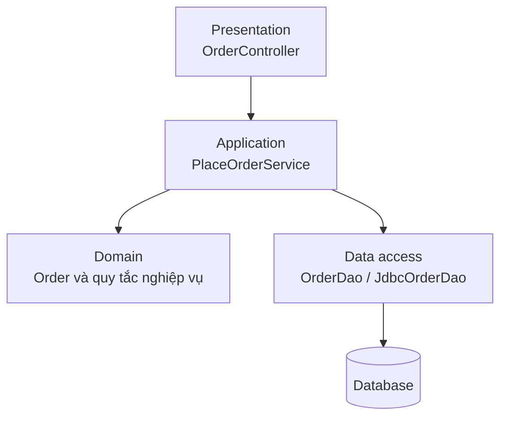
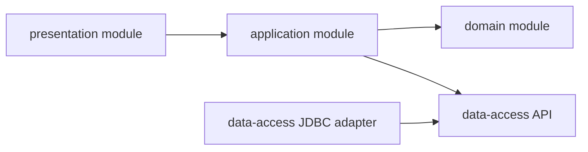
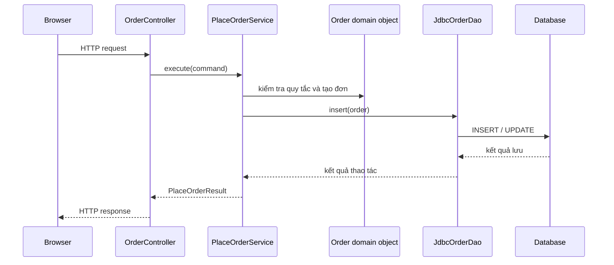
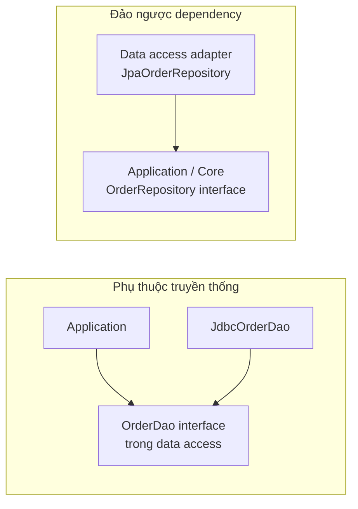

# Phụ thuộc trực tiếp từ trên xuống trong kiến trúc phân tầng truyền thống

Bài học này thuộc chương **Tổ chức phụ thuộc và lắp ráp ứng dụng** của module `SOFTWARE_DESIGN_ARCHITECTURE_ARCHITECTURAL_PATTERN_LAYERED`, trong chương trình **học tổ chức phần mềm theo kiến trúc phân tầng**. Kiến trúc phân tầng chia phần mềm thành các nhóm trách nhiệm có mức trừu tượng khác nhau. Trong cách tổ chức truyền thống, mã ở tầng cao hơn thường tham chiếu trực tiếp đến tầng thấp hơn để sử dụng dịch vụ mà tầng dưới cung cấp. Hướng phụ thuộc này tạo nên một trật tự dễ đọc: tầng trình bày gọi tầng ứng dụng/nghiệp vụ, tầng ứng dụng sử dụng mô hình nghiệp vụ và các thành phần truy cập dữ liệu.

“Phụ thuộc từ trên xuống” mô tả quan hệ giữa mã nguồn và kiểu dữ liệu mà một tầng biết đến. Nó có liên quan đến luồng gọi khi chương trình chạy, nhưng hai khái niệm không hoàn toàn giống nhau. Việc Spring inject một implementation qua constructor cũng không tự động đảo ngược hướng phụ thuộc mã nguồn; vị trí khai báo interface mới quyết định module nào phải phụ thuộc vào module nào.

Sau bài học, bạn có thể đọc sơ đồ phụ thuộc của một ứng dụng phân tầng truyền thống, phân biệt dependency ở thời điểm biên dịch với lời gọi lúc chạy, giải thích quy tắc tầng đóng và tầng mở, và nhận diện lợi ích cũng như chi phí của việc để tầng trên phụ thuộc trực tiếp vào tầng dưới.

## 1. Phụ thuộc từ trên xuống nghĩa là gì?

Giả sử ứng dụng được tổ chức thành các tầng logic: presentation, application, domain và data access. Mỗi tầng cung cấp một nhóm trách nhiệm cho tầng ở phía trên. Trong cách phân tầng truyền thống, tầng phía trên có thể import kiểu, gọi phương thức hoặc giữ tham chiếu đến thành phần ở tầng phía dưới.

Ví dụ, `OrderController` gọi `PlaceOrderService`; `PlaceOrderService` gọi các đối tượng domain và một thành phần truy cập dữ liệu như `OrderDao`. Có thể biểu diễn các quan hệ mã nguồn như sau:



Trong sơ đồ này, mũi tên thể hiện **mã ở đầu mũi tên phụ thuộc vào mã ở cuối mũi tên**. Application có thể phụ thuộc đồng thời vào domain và data access vì nó điều phối ca sử dụng: gọi quy tắc nghiệp vụ, tải dữ liệu cần thiết và lưu kết quả. Domain không cần biết controller, Spring MVC hay JDBC. Data access không cần gọi ngược lên controller để hoàn thành một truy vấn.

Đây là một cách tổ chức cụ thể, không phải quy định rằng mọi hệ thống phải có đúng bốn tầng hoặc đúng một sơ đồ như trên. Một ứng dụng đơn giản có thể gộp application và domain; hệ thống khác có thể chia thêm tầng tích hợp hoặc dịch vụ. Điều cần giữ là trách nhiệm của từng tầng và quy tắc phụ thuộc được mô tả rõ.

## 2. Phân biệt dependency mã nguồn và luồng gọi lúc chạy

Hai góc nhìn thường trùng hướng nhưng trả lời hai câu hỏi khác nhau.

**Dependency mã nguồn (compile-time dependency)** xuất hiện khi một module hoặc package cần biết kiểu của module/package khác để biên dịch. Ví dụ, `PlaceOrderService` import `OrderDao` và gọi `orderDao.insert(...)`; do đó mã application phụ thuộc vào kiểu `OrderDao`. Thay đổi chữ ký interface này có thể khiến application phải biên dịch lại.

**Luồng gọi lúc chạy (runtime call flow)** mô tả đối tượng nào gọi phương thức của đối tượng nào trong một lần xử lý. Khi có request, controller gọi application service; service gọi DAO; DAO gửi SQL đến database. Kết quả thường quay trở lại theo đường trả về.

Một sơ đồ dependency mã nguồn có thể trông như sau:



Sơ đồ runtime của cùng ví dụ có thể là:



Sơ đồ thứ nhất cho biết mã nào cần biết kiểu của mã nào. Sơ đồ thứ hai cho biết các đối tượng tương tác trong một lần chạy. Đừng suy ra mọi dependency chỉ từ một trace runtime: một thành phần có thể được gọi qua interface, callback hoặc event, và dependency mã nguồn phụ thuộc vào nơi khai báo hợp đồng.

## 3. Ví dụ Java/Spring với phụ thuộc trực tiếp xuống tầng truy cập dữ liệu

Một cách triển khai truyền thống là để application service phụ thuộc trực tiếp vào interface truy cập dữ liệu được khai báo trong package/module data access. Spring cung cấp implementation cụ thể khi khởi tạo ứng dụng.

```java
// package com.example.orders.dataaccess
public record OrderData(UUID id, UUID customerId, String status) {}

public interface OrderDao {
    void insert(OrderData order);
    Optional<OrderData> findById(UUID id);
}
```

```java
// package com.example.orders.application
@Service
public class PlaceOrderService {
    private final OrderDao orders;

    public PlaceOrderService(OrderDao orders) {
        this.orders = orders;
    }

    @Transactional
    public PlaceOrderResult execute(PlaceOrderCommand command) {
        var order = Order.place(command.customerId(), command.items());
        if (order instanceof Order.Creation.Rejected rejected) {
            return new PlaceOrderResult.Rejected(rejected.reason());
        }

        var created = ((Order.Creation.Accepted) order).order();
        orders.insert(new OrderData(
                created.id(), created.customerId(), created.status().name()));
        return new PlaceOrderResult.Created(created.id());
    }
}
```

```java
// package com.example.orders.dataaccess.jdbc
@Repository
public class JdbcOrderDao implements OrderDao {
    private final JdbcTemplate jdbc;

    public JdbcOrderDao(JdbcTemplate jdbc) {
        this.jdbc = jdbc;
    }

    @Override
    public void insert(OrderData order) {
        jdbc.update(
                "insert into orders (id, customer_id, status) values (?, ?, ?)",
                order.id(), order.customerId(), order.status());
    }

    @Override
    public Optional<OrderData> findById(UUID id) {
        // Truy vấn và ánh xạ hàng dữ liệu thành OrderData được lược bớt.
        return findOrderRow(id);
    }
}
```

Các kiểu domain, command, result và phần truy vấn trong ví dụ đã được lược bớt. `OrderData` là kiểu dữ liệu của tầng data access; application chuyển kết quả domain thành kiểu này trước khi gọi DAO. Vì `OrderDao` và `OrderData` được khai báo ở phía data access, application import các kiểu đó và có dependency mã nguồn xuống tầng data access. `JdbcOrderDao` hiện thực interface và được Spring phát hiện qua `@Repository`. Constructor injection giúp service nhận một implementation mà không tự tạo `new JdbcOrderDao(...)`.

Khi request chạy, Spring inject `JdbcOrderDao` vào `PlaceOrderService`; service gọi `insert`; DAO dùng `JdbcTemplate` để gửi câu SQL. Đây là dependency từ trên xuống ở mức hợp đồng, dù đối tượng cụ thể được lắp ráp bởi container.

### Composition root lắp ráp các thành phần

Ứng dụng thường có một điểm khởi tạo hoặc cấu hình nơi framework tìm bean, đọc cấu hình và tạo đồ thị đối tượng. Đây là *composition root* của ứng dụng. Trong Spring Boot, component scanning và auto-configuration thường đảm nhận nhiều phần của việc lắp ráp; cấu hình tường minh có thể dùng `@Configuration` và `@Bean`.

Composition root cần biết các implementation và cấu hình để tạo ứng dụng chạy được. Việc nó phụ thuộc vào nhiều module là bình thường vì nhiệm vụ của nó chính là lắp ráp. Không nên để mọi tầng tự khởi tạo implementation của tầng dưới, vì khi đó cấu hình, vòng đời và thay thế thành phần sẽ phân tán khắp mã nguồn.

## 4. Tầng đóng và tầng mở trong cách phụ thuộc từ trên xuống

Trong kiến trúc phân tầng, nhóm cần xác định tầng trên có được phép bỏ qua tầng trung gian hay không.

### Phân tầng đóng (closed layering)

Với quy tắc tầng đóng, một tầng chỉ được gọi tầng liền kề ngay bên dưới. Ví dụ trong mô hình ba tầng `Presentation -> Business -> Data Access`, presentation chỉ gọi business; nó không gọi trực tiếp DAO. Nếu presentation cần dữ liệu, business sẽ cung cấp use case hoặc query phù hợp.

Khi tách business thành application orchestration và domain model, cần định nghĩa rõ tầng nào là hàng xóm của tầng nào. Một thiết kế có thể cho application gọi domain và data access; domain vẫn độc lập với persistence. Không nên suy ra rằng domain bắt buộc phải gọi DAO chỉ để tạo thành một chuỗi bốn tầng.

Lợi ích là các tầng trung gian giữ được vai trò điều phối, kiểm tra quyền, chuyển đổi dữ liệu và áp dụng quy tắc. Nhược điểm là có thể phát sinh nhiều lời gọi chuyển tiếp hoặc lớp chỉ truyền dữ liệu nếu ranh giới được chia quá vụn.

### Phân tầng mở (open layering)

Với quy tắc tầng mở, một tầng được phép gọi bất kỳ tầng thấp hơn nào nếu cần. Presentation có thể gọi một dịch vụ truy vấn ở tầng dưới mà không phải đi qua mọi tầng trung gian; hoặc application có thể gọi data access trực tiếp thay vì buộc mọi thao tác phải đi qua domain service.

Điều này có thể giảm lớp chuyển tiếp không cần thiết, nhưng cũng làm tăng nguy cơ bỏ qua trách nhiệm của tầng trung gian. Ví dụ, nếu controller truy cập DAO trực tiếp, nhiều endpoint có thể tự thực hiện kiểm tra quyền, transaction hoặc mapping theo cách khác nhau.

### Quy tắc hỗn hợp

Không nhất thiết phải chọn một chế độ cho toàn bộ hệ thống. Nhóm có thể đặt quy tắc đóng giữa presentation và application để mọi tương tác đi qua use case, nhưng cho phép application truy cập data access bên cạnh domain. Cũng có thể cho phép một query handler đọc projection trực tiếp từ DAO trong khi các thao tác thay đổi aggregate phải đi qua domain model.

Điều quan trọng là ghi rõ ngoại lệ và lý do. “Tầng mở” không có nghĩa mọi tầng được gọi mọi nơi; “tầng đóng” cũng không tự động làm kiến trúc tốt nếu các tầng chỉ chuyển tiếp dữ liệu mà không giữ trách nhiệm thực.

## 5. Cách biểu diễn dependency trong package và module Java

Ở một dự án nhỏ, các tầng có thể được biểu diễn bằng package trong cùng một Gradle/Maven module:

```text
orders-app/
└── src/main/java/com/example/orders/
    ├── presentation/
    │   └── OrderController.java
    ├── application/
    │   └── PlaceOrderService.java
    ├── domain/
    │   └── Order.java
    └── dataaccess/
        ├── OrderDao.java
        └── jdbc/JdbcOrderDao.java
```

Package giúp con người đọc và review hướng phụ thuộc, nhưng Java package không tự động cấm package trên import package dưới theo một quy tắc kiến trúc. Nhóm có thể dùng convention, review hoặc kiểm tra kiến trúc tự động để phát hiện vi phạm.

Với dự án lớn hơn, các tầng hoặc nhóm trách nhiệm có thể được tách thành Gradle/Maven module. Khi đó dependency khai báo trong build file có thể thực thi một phần quy tắc:

```text
orders-presentation -> orders-application
orders-application  -> orders-domain
orders-application  -> orders-dataaccess-api
orders-dataaccess-jdbc -> orders-dataaccess-api
orders-boot -> các module cần lắp ráp
```

Build module giúp ngăn một số phụ thuộc không được khai báo và tạo ranh giới rõ hơn. Ví dụ trên dùng `OrderData` thuộc data access để adapter không phải import domain model. Nếu adapter dùng trực tiếp kiểu domain để mapping, nó sẽ tạo thêm dependency từ data access sang domain; đây là một cạnh phụ thuộc cần được chủ động chấp nhận hoặc loại bỏ nếu nhóm muốn giữ quy tắc một chiều nghiêm ngặt. Tuy nhiên, nếu tất cả module được đóng gói vào một ứng dụng Spring Boot và chạy trong cùng JVM, chúng vẫn có thể là một đơn vị triển khai. Ranh giới module mã nguồn không tự động là ranh giới process hoặc tier triển khai.

## 6. Spring Dependency Injection có đảo ngược dependency không?

Không thể kết luận hướng phụ thuộc chỉ từ việc dùng constructor injection. Dependency Injection (DI) là cách cung cấp một object mà một thành phần cần, thay vì để thành phần đó tự tạo implementation. Hướng phụ thuộc mã nguồn phụ thuộc vào **kiểu được tham chiếu và nơi khai báo kiểu đó**.

Trong ví dụ trên:

- `PlaceOrderService` import `OrderDao` từ package data access.
- `JdbcOrderDao` implement `OrderDao`.
- Spring tạo `JdbcOrderDao` và inject vào `PlaceOrderService`.

Application vẫn phụ thuộc xuống hợp đồng của data access. DI chỉ tách việc khởi tạo object khỏi service; nó không thay đổi dependency graph ở thời điểm biên dịch.

Một cách tổ chức khác là đặt interface `OrderRepository` trong module application hoặc domain/core, rồi để adapter data access phụ thuộc vào interface đó và implement nó. Khi ấy dependency mã nguồn hướng từ adapter ra phía trong, dù lúc chạy application vẫn gọi interface và implementation nằm ở adapter. Đây là một lựa chọn đảo ngược phụ thuộc, khác với mô hình truyền thống đang học. Cần phân biệt rõ hai cách để không gọi mọi constructor injection là Dependency Inversion Principle.



Ở sơ đồ đảo ngược, application/core định nghĩa hợp đồng mà nó cần; adapter ở phía ngoài phụ thuộc vào hợp đồng đó. Lúc chạy, composition root cung cấp adapter cho application. Luồng gọi vẫn có thể đi từ application đến adapter, nhưng dependency mã nguồn hướng về core. Đây là sự khác nhau quan trọng giữa **hướng gọi lúc chạy** và **hướng dependency khi biên dịch**.

## 7. Lợi ích và chi phí của phụ thuộc trực tiếp từ trên xuống

| Khía cạnh | Lợi ích | Chi phí/rủi ro |
|---|---|---|
| Dễ đọc | Hướng phụ thuộc đơn giản, dễ lần theo từ giao diện xuống lưu trữ | Sơ đồ có thể trở nên quá tuyến tính khi hệ thống có nhiều ngoại lệ |
| Tổ chức nhóm | Tầng dưới cung cấp dịch vụ cho tầng trên | Thay đổi hợp đồng tầng dưới có thể ảnh hưởng nhiều caller phía trên |
| Triển khai | Dễ bắt đầu với một ứng dụng đơn khối và ít abstraction | Application có thể bị gắn với framework hoặc công nghệ persistence |
| Kiểm thử | Có thể thay DAO/repository bằng fake hoặc mock nếu hợp đồng tách biệt | Nếu phụ thuộc class cụ thể hoặc static API, thay thế và kiểm thử khó hơn |
| Tối ưu dữ liệu | Tầng trên có thể tận dụng trực tiếp khả năng truy vấn của tầng dưới | Caller có thể lạm dụng truy vấn, bỏ qua quy tắc nghiệp vụ hoặc tạo phụ thuộc rải rác |

Mô hình truyền thống thường phù hợp khi hệ thống có quy mô vừa phải, công nghệ lưu trữ ổn định, đội ngũ cần cấu trúc dễ hiểu và chi phí thay đổi dependency thấp. Khi ứng dụng cần thay database, hỗ trợ nhiều adapter, cô lập domain khỏi framework hoặc phát triển nhiều nhóm song song, việc đảo ngược dependency hoặc tạo cổng rõ ràng có thể mang lại lợi ích lớn hơn.

Không nên tách mỗi tầng thành một microservice chỉ vì chúng phụ thuộc theo thứ tự. Layer là ranh giới logic trong thiết kế; service/process là ranh giới triển khai và vận hành. Tách dịch vụ kéo theo giao tiếp mạng, lỗi phân tán, bảo mật giữa dịch vụ, giám sát và quản lý dữ liệu riêng.

## 8. Kiểm thử và kiểm soát hướng phụ thuộc

### Kiểm thử theo từng tầng

- **Presentation:** kiểm tra controller nhận request, chuyển dữ liệu và gọi đúng application service; không cần kiểm tra SQL ở đây.
- **Application:** kiểm tra điều phối use case, thứ tự các lời gọi, kết quả nghiệp vụ và transaction boundary. Có thể thay DAO bằng fake/mock khi test logic điều phối.
- **Domain:** kiểm tra invariant và hành vi nghiệp vụ độc lập với Spring hoặc database.
- **Data access:** kiểm tra SQL, mapping, transaction participation và constraint bằng database kiểm thử phù hợp.

### Kiểm tra quy tắc kiến trúc

Với codebase có nhiều package/module, nhóm có thể kiểm tra dependency bằng ArchUnit, cấu hình build hoặc một architecture test. Ví dụ quy tắc mong muốn:

- Package presentation được phụ thuộc application, không import trực tiếp `dataaccess.jdbc`.
- Domain không phụ thuộc presentation, Spring MVC hoặc JDBC.
- Application không phụ thuộc vào module boot/composition root.
- Chỉ module data access implementation được phụ thuộc driver/database library.

Quy tắc cần khớp mô hình thực tế. Nếu nhóm chủ động chọn application phụ thuộc vào `dataaccess-api`, test kiến trúc không nên cấm toàn bộ package data access; thay vào đó, có thể cho phép API nhưng cấm phụ thuộc vào implementation JDBC cụ thể. Kiểm tra kiến trúc có ích khi nó mã hóa quyết định đã thống nhất, không phải khi nó áp đặt một mẫu chung bất kể bối cảnh.

## 9. Những lỗi thiết kế thường gặp

1. **Để tầng dưới gọi ngược controller hoặc UI.** Data access không nên phụ thuộc presentation để trả kết quả. Hãy trả kết quả qua lời gọi, callback hoặc cơ chế sự kiện có ranh giới được thiết kế rõ.
2. **Controller truy cập thẳng DAO ở mọi nơi.** Cách này có thể bỏ qua điều phối use case, authorization hoặc transaction. Chỉ cho phép truy cập trực tiếp nếu quy tắc tầng mở của dự án nêu rõ trường hợp đó.
3. **Cho rằng DI làm đảo ngược dependency.** Constructor injection không đổi nơi khai báo interface. Hãy kiểm tra import, package và module dependency.
4. **Để domain phụ thuộc framework persistence chỉ vì tiện.** Có thể dùng entity JPA làm domain object trong ứng dụng đơn giản, nhưng cần hiểu domain khi đó phụ thuộc annotation, vòng đời và cách hoạt động của ORM.
5. **Tạo nhiều tầng chuyển tiếp không có trách nhiệm.** Các lớp chỉ nhận tham số rồi gọi nguyên xi xuống dưới làm tăng số bước mà không tạo ranh giới có giá trị.
6. **Nhầm layer với tier triển khai.** Nhiều tầng logic có thể chạy trong cùng một JVM; không cần một máy chủ riêng cho mỗi tầng.
7. **Không kiểm soát ngoại lệ của tầng mở.** Nếu mọi tầng có thể bỏ qua tầng trung gian, các đường gọi sẽ khó đoán và logic chung dễ bị lặp. Cần quy tắc và kiểm thử kiến trúc rõ ràng.

## 10. Cách đọc một dependency graph

Khi review một sơ đồ hoặc dự án Java, hãy thực hiện lần lượt:

1. Xác định các tầng logic và trách nhiệm mà mỗi tầng sở hữu.
2. Đọc mũi tên theo quy ước: mũi tên chỉ lời gọi runtime hay dependency mã nguồn? Sơ đồ phải ghi rõ.
3. Kiểm tra tầng cao có phụ thuộc xuống tầng thấp đúng theo chính sách đóng/mở của dự án không.
4. Kiểm tra tầng thấp có import hoặc gọi trực tiếp tầng cao không; nếu có, xác định đó là vi phạm hay một callback/event được thiết kế có chủ đích.
5. Xem interface được khai báo ở module nào. Constructor injection không đủ để kết luận dependency đã được đảo ngược.
6. Xem composition root có lắp ráp implementation ở một nơi dễ tìm và dễ cấu hình không.

Ví dụ, nếu `OrderController` phụ thuộc `PlaceOrderService`, service phụ thuộc `OrderDao` trong package data access, và `JdbcOrderDao` thực hiện SQL, đó là hướng phụ thuộc truyền thống từ trên xuống. Nếu interface repository được chuyển vào module core và adapter JDBC implement interface đó, dependency mã nguồn đã được đảo ngược ở ranh giới persistence dù luồng gọi lúc chạy vẫn đi từ application đến adapter. Hiểu đúng sự khác nhau này giúp nhóm chọn cấu trúc phù hợp thay vì chỉ dựa vào tên pattern hoặc annotation của framework.
