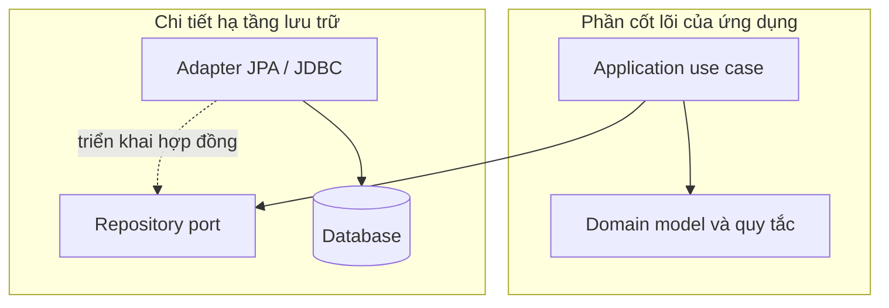

# Nhận diện giới hạn khi nghiệp vụ phụ thuộc trực tiếp vào công nghệ lưu trữ

Trong kiến trúc phân tầng, phần nghiệp vụ cần biết dữ liệu nào cần được đọc hoặc thay đổi để hoàn thành một ca sử dụng. Nhưng nếu mã nghiệp vụ phụ thuộc trực tiếp vào JPA, Hibernate, Spring Data, JDBC hoặc câu lệnh SQL cụ thể, cách lưu trữ bắt đầu chi phối cách viết và kiểm thử nghiệp vụ.

Sự phụ thuộc đó không phải lúc nào cũng sai. Một ứng dụng CRUD nhỏ có ít quy tắc có thể dùng trực tiếp JPA entity và Spring Data repository để giảm số lớp và mã chuyển đổi. Giới hạn xuất hiện khi quy tắc quan trọng, vòng đời nghiệp vụ hoặc hợp đồng của use case bị gắn chặt với chi tiết lưu trữ đến mức thay đổi schema, ORM hoặc cơ sở dữ liệu làm lan rộng thay đổi sang nhiều phần của ứng dụng.

Bài học này thuộc module **SOFTWARE_DESIGN_ARCHITECTURE_ARCHITECTURAL_PATTERN_LAYERED**, có mục tiêu học cách tổ chức phần mềm theo kiến trúc phân tầng. Trọng tâm là nhận ra dấu hiệu coupling với công nghệ lưu trữ, hiểu hệ quả và chọn mức tách biệt phù hợp với độ phức tạp thực tế.

## 1. Phân biệt nghiệp vụ với cách lưu dữ liệu

Nghiệp vụ mô tả hệ thống phải làm gì và những quy tắc nào luôn phải đúng. Công nghệ lưu trữ mô tả cách trạng thái được ghi và truy xuất: bảng, cột, khóa ngoại, câu SQL, entity mapping, transaction manager và cơ chế ORM.

Ví dụ trong hệ thống bán hàng:

- Quy tắc nghiệp vụ: đơn hàng đã giao không được hủy theo luồng hủy thông thường.
- Quy tắc nghiệp vụ: tổng tiền phải được tính từ các dòng hàng và chính sách giá được áp dụng.
- Nhu cầu ứng dụng: tải đơn hàng, yêu cầu hủy, lưu trạng thái mới và trả kết quả.
- Chi tiết lưu trữ: bảng `orders`, bảng `order_items`, cột `status`, quan hệ JPA và truy vấn SQL.

Quy tắc nghiệp vụ có thể tồn tại dù hệ thống dùng PostgreSQL, MySQL, một kho dữ liệu khác hoặc một adapter lưu trữ giả trong kiểm thử. Nếu quy tắc chỉ hoạt động khi có `EntityManager`, `JpaRepository` hoặc một truy vấn SQL cụ thể, ranh giới giữa nghiệp vụ và lưu trữ đã bị thu hẹp.



Trong thiết kế có port, phần cốt lõi diễn đạt nhu cầu đọc hoặc lưu qua một hợp đồng. Adapter lưu trữ phụ thuộc vào hợp đồng đó để thực hiện bằng công nghệ đã chọn. Lúc chạy, application service vẫn gọi adapter thông qua interface được inject; hướng phụ thuộc trong mã nguồn được giữ hướng về hợp đồng.

## 2. Dấu hiệu nghiệp vụ đang phụ thuộc trực tiếp vào lưu trữ

Không phải cứ nhìn thấy annotation JPA là có thể kết luận kiến trúc đã hỏng. Cần xem công nghệ lưu trữ có đang quyết định cấu trúc và hành vi nghiệp vụ hay không. Một số dấu hiệu thường gặp:

### Lớp nghiệp vụ sử dụng API lưu trữ trực tiếp

```java
@Service
class CancelOrderService {
    @PersistenceContext
    private EntityManager entityManager;

    public void cancel(UUID orderId) {
        OrderEntity order = entityManager.find(OrderEntity.class, orderId);
        if (order == null) {
            throw new OrderNotFoundException();
        }
        order.setStatus("CANCELLED");
        entityManager.flush();
    }
}
```

Lớp có tên gắn với use case đang trực tiếp phụ thuộc `EntityManager`, entity mapping và cơ chế flush của JPA. Nó vừa điều phối thao tác hủy, vừa truy cập persistence context và thay đổi biểu diễn lưu trữ. Nếu sau này muốn dùng JDBC, một dịch vụ lưu trữ từ xa hoặc fake repository trong unit test, lớp này phải thay đổi.

### Quy tắc nghiệp vụ bị viết trong truy vấn hoặc adapter

Ví dụ, điều kiện một đơn hàng có được hủy hay không chỉ xuất hiện trong câu SQL cập nhật hoặc trong callback của ORM. Một tác vụ nền hoặc một API khác có thể bỏ qua điều kiện đó. Khi quy tắc được bảo vệ chỉ bởi một câu truy vấn, các đường đi khác nhau trong ứng dụng dễ tạo ra hành vi không nhất quán.

Truy vấn có thể thực hiện lọc hiệu quả, nhưng quyết định nghiệp vụ cần được thể hiện rõ và được bảo vệ tại ranh giới phù hợp. Nếu dùng cập nhật có điều kiện để chống race condition, kết quả cập nhật phải được diễn giải thành kết quả nghiệp vụ; không nên để một câu SQL âm thầm trở thành nơi duy nhất chứa ý nghĩa quy tắc.

### Kiểu dữ liệu persistence lọt vào hợp đồng use case

Một use case nhận `Pageable`, `Sort`, `JpaSpecificationExecutor`, `EntityManager` hoặc trả trực tiếp `OrderEntity` cho controller có thể khiến phần cốt lõi và giao diện phụ thuộc vào Spring Data/JPA. Những kiểu này có ích trong adapter, nhưng không nhất thiết là kiểu phù hợp cho hợp đồng nghiệp vụ.

### Mô hình miền bị định hình bởi ORM

Entity có thể phải có constructor rỗng, setter công khai, quan hệ hai chiều, lazy proxy, cascade hoặc collection được ORM quản lý. Nếu các yêu cầu này khiến đối tượng không còn bảo vệ được bất biến hoặc buộc quy tắc nghiệp vụ phải gọi `Hibernate.initialize`, `Session` hay `EntityManager`, ORM đã ảnh hưởng đáng kể tới mô hình miền.

Một số nhóm dùng JPA entity làm luôn domain model. Cách đó có thể chấp nhận được khi mô hình đơn giản và nhóm chủ động với sự phụ thuộc. Điều cần đánh giá là liệu các yêu cầu mapping có làm thiết kế nghiệp vụ khó hiểu, khó kiểm thử hoặc khó thay đổi hay không.

## 3. Hệ quả khi coupling tăng

| Hệ quả | Vì sao xảy ra | Dấu hiệu trong công việc |
|---|---|---|
| Khó thay đổi công nghệ lưu trữ | API và kiểu dữ liệu của ORM xuất hiện trong nhiều lớp | Đổi JPA sang JDBC kéo theo sửa use case và domain |
| Khó kiểm thử quy tắc độc lập | Khởi tạo lớp nghiệp vụ cần Spring context, persistence context hoặc database | Unit test phải dựng database chỉ để kiểm tra một quy tắc đơn giản |
| Rò rỉ mô hình dữ liệu | Cột, quan hệ và entity mapping chi phối hợp đồng ứng dụng | Controller nhận/trả entity JPA hoặc dùng tên trường bảng |
| Quy tắc bị phân tán | Logic nằm trong query, entity listener, service và callback ORM | Cùng một thao tác có kết quả khác nhau tùy đường gọi |
| Lỗi vòng đời ORM khó truy vết | Lazy loading, dirty checking, cascade và transaction ảnh hưởng hành vi | `LazyInitializationException`, truy vấn N+1 hoặc ghi dữ liệu ngoài dự kiến |
| Thay đổi schema lan rộng | Nhiều lớp biết cấu trúc bảng và chi tiết truy vấn | Đổi quan hệ hoặc tên cột làm hỏng nhiều use case |

Các hệ quả này làm tăng chi phí bảo trì, nhưng không có nghĩa mọi ứng dụng phải tách domain model và persistence model ngay từ đầu. Nếu ứng dụng có ít quy tắc, vòng đời ngắn và chỉ một công nghệ lưu trữ, chi phí tạo abstraction có thể lớn hơn lợi ích. Vấn đề cần giải quyết là coupling đang gây trở ngại thực tế nào.

## 4. Ví dụ: tách nhu cầu nghiệp vụ khỏi JPA

Giả sử use case hủy đơn hàng cần tải đơn hàng, yêu cầu domain kiểm tra trạng thái và lưu thay đổi. Thay vì để application service gọi `EntityManager`, có thể định nghĩa một repository port:

```java
public interface OrderRepository {
    Optional<Order> findById(OrderId id);
    void save(Order order);
}
```

Hợp đồng này sử dụng kiểu `Order` và `OrderId` của ứng dụng hoặc domain, không để lộ `OrderEntity`, `EntityManager` hay `JpaRepository`. Application service điều phối use case:

```java
@Service
class CancelOrderService {
    private final OrderRepository orders;

    CancelOrderService(OrderRepository orders) {
        this.orders = orders;
    }

    @Transactional
    public void cancel(OrderId orderId) {
        var order = orders.findById(orderId)
                .orElseThrow(OrderNotFoundException::new);

        order.cancel();
        orders.save(order);
    }
}
```

Quy tắc trạng thái nằm trong domain model:

```java
public final class Order {
    private final OrderId id;
    private OrderStatus status;

    public void cancel() {
        if (status == OrderStatus.SHIPPED || status == OrderStatus.DELIVERED) {
            throw new OrderCannotBeCancelledException();
        }
        if (status == OrderStatus.CANCELLED) {
            return;
        }
        status = OrderStatus.CANCELLED;
    }
}
```

Adapter hạ tầng chuyển đổi giữa domain model và JPA entity:

```java
@Repository
class JpaOrderRepositoryAdapter implements OrderRepository {
    private final SpringDataOrderRepository data;

    JpaOrderRepositoryAdapter(SpringDataOrderRepository data) {
        this.data = data;
    }

    @Override
    public Optional<Order> findById(OrderId id) {
        return data.findById(id.value()).map(OrderMapper::toDomain);
    }

    @Override
    public void save(Order order) {
        data.save(OrderMapper.toEntity(order));
    }
}
```

Các lớp `OrderMapper`, `OrderEntity` và `SpringDataOrderRepository` là chi tiết triển khai của adapter. Khi đổi mapping hoặc công nghệ lưu trữ, phần lớn thay đổi được giữ trong adapter và cấu hình lắp ráp. Ví dụ đã lược bỏ constructor/factory, ánh xạ đầy đủ trường và chi tiết xử lý đồng thời để tập trung vào ranh giới.

### Ai sở hữu repository port?

Không có quy tắc bắt buộc rằng mọi repository interface phải nằm trong một package cụ thể. Nếu repository diễn đạt cách tải và lưu aggregate theo ngôn ngữ miền, domain có thể sở hữu hợp đồng. Nếu hợp đồng chỉ phục vụ một use case hoặc trả projection được định hình theo nhu cầu ứng dụng, application có thể sở hữu port đó. Trong cả hai trường hợp, adapter hạ tầng phụ thuộc vào interface để triển khai.

Điều cần tránh là domain phụ thuộc ngược vào một application service hoặc package hạ tầng chỉ để sử dụng repository. Chọn vị trí hợp đồng theo ý nghĩa mà nó đại diện, rồi giữ quy tắc phụ thuộc nhất quán.

## 5. Những chi tiết ORM cần được nhận diện

JPA/Hibernate mang lại nhiều tiện ích: ánh xạ đối tượng, quản lý quan hệ, dirty checking, lazy loading và transaction integration. Những tiện ích này cũng có hành vi cần hiểu rõ.

- **Lazy loading:** truy cập một quan hệ có thể phát sinh truy vấn bổ sung. Nếu truy cập ngoài persistence context, ứng dụng có thể gặp `LazyInitializationException`.
- **Dirty checking:** thay đổi entity đang được quản lý có thể được ghi khi flush/commit dù không gọi `save` ở đúng chỗ mà người đọc mong đợi. Vì vậy cần hiểu vòng đời persistence context.
- **Cascade và orphan removal:** thao tác trên một entity có thể kéo theo insert, update hoặc delete đối tượng liên quan. Cấu hình không phù hợp có thể gây thay đổi dữ liệu ngoài dự kiến.
- **Proxy và collection ORM:** kiểu thực tế có thể là proxy hoặc collection do Hibernate quản lý, ảnh hưởng tới kiểm tra kiểu, serialization và cách so sánh.
- **Transaction:** `@Transactional` và transaction manager của Spring điều khiển phạm vi persistence context. Annotation này cũng là một phụ thuộc framework, dù thường được chấp nhận ở application service như một quyết định kiến trúc thực dụng.
- **Truy vấn và phân trang:** fetch join trên collection kết hợp phân trang có thể nhân số dòng hoặc làm ORM phải xử lý phân trang trong bộ nhớ. Projection hoặc truy vấn riêng có thể phù hợp hơn.

Nhận diện các hành vi này giúp nhóm quyết định phần nào có thể dùng trực tiếp ORM và phần nào cần adapter hoặc mô hình riêng. Không phải mọi ứng dụng đều cần loại bỏ annotation JPA khỏi entity; cần hiểu rõ chi phí của lựa chọn đó.

## 6. Kiểm thử khi nghiệp vụ tách khỏi công nghệ lưu trữ

Khi domain không cần database để thực thi quy tắc, unit test có thể kiểm tra hành vi trực tiếp:

```java
@Test
void cannotCancelDeliveredOrder() {
    var order = OrderFixture.deliveredOrder();

    assertThrows(OrderCannotBeCancelledException.class, order::cancel);
}
```

Application service có thể được kiểm thử bằng fake repository để xác nhận điều phối: khi không tìm thấy đơn hàng thì báo lỗi; khi hủy hợp lệ thì yêu cầu lưu; khi domain từ chối thì không lưu trạng thái mới. Những test này không cần khởi động JPA.

Adapter vẫn cần integration test để kiểm tra mapping, truy vấn, khóa ngoại, transaction và hành vi thực tế của database. Có thể dùng Testcontainers với cùng hệ quản trị hoặc phiên bản gần với production. Unit test không thể thay thế integration test cho các chi tiết phụ thuộc ORM hoặc SQL.

| Mức kiểm thử | Mục tiêu | Phụ thuộc database? |
|---|---|---|
| Domain unit test | Bất biến và quy tắc nghiệp vụ | Không |
| Application unit test | Điều phối use case qua repository port | Không, dùng fake/mock |
| Mapper test | Chuyển đổi domain model và persistence model | Thường không |
| Repository integration test | Truy vấn, mapping, transaction và ràng buộc | Có |
| End-to-end test | Luồng thực từ API tới lưu trữ | Có |

Tách ranh giới không có nghĩa là bỏ kiểm thử database. Nó giúp mỗi loại test tập trung vào đúng rủi ro: quy tắc nghiệp vụ được kiểm tra nhanh, còn adapter được kiểm tra với công nghệ thật.

## 7. Chi phí của việc tách abstraction

Một thiết kế có port và adapter thường thêm interface, adapter, mapper và đôi khi thêm một mô hình persistence riêng. Điều này tạo ra chi phí:

- Nhiều kiểu dữ liệu và mã chuyển đổi cần duy trì.
- Cần quyết định rõ transaction nằm ở đâu và adapter tham gia transaction thế nào.
- Có thể phải viết truy vấn riêng để chuyển projection hoặc aggregate.
- Người mới cần hiểu thêm các ranh giới và cách Spring lắp ráp implementation.

Đổi lại, phần nghiệp vụ ít phụ thuộc ORM hơn, có thể kiểm thử độc lập và thay đổi công nghệ lưu trữ trong phạm vi nhỏ hơn. Giá trị của abstraction tăng khi quy tắc nghiệp vụ phức tạp, có nhiều use case dùng chung dữ liệu, có nhiều adapter hoặc cần thay đổi công nghệ thường xuyên.

| Bối cảnh | Lựa chọn có thể hợp lý | Điều cần theo dõi |
|---|---|---|
| CRUD nhỏ, quy tắc ít, một database | Dùng JPA entity và Spring Data trực tiếp ở application service | Không để controller chứa SQL hoặc quy tắc phức tạp |
| Nghiệp vụ có nhiều bất biến | Domain model độc lập hơn, repository port và adapter | Tránh tạo abstraction không mang ý nghĩa |
| Có nhiều nguồn lưu trữ hoặc tích hợp | Port theo nhu cầu, nhiều adapter | Hợp đồng phải ổn định và có ngữ nghĩa rõ |
| Truy vấn đọc/reporting phức tạp | Query port hoặc projection riêng cho use case | Không tải aggregate không cần thiết |
| Cần kiểm thử nghiệp vụ nhanh | Domain thuần và application port | Vẫn phải có integration test cho adapter |

Không nên tách chỉ vì một quy tắc hình thức như “mọi interface phải có adapter riêng”. Nếu một abstraction không bảo vệ ranh giới, không giúp kiểm thử hoặc không làm thay đổi dễ hơn, nó có thể chỉ làm codebase dài dòng. Cũng không nên để sự tiện lợi ban đầu khiến mọi quy tắc bị nhúng vào JPA entity hoặc query rồi trở nên khó tách khi hệ thống lớn lên.

## 8. Tách dần khi hệ thống đã phụ thuộc sâu

Không nhất thiết phải viết lại toàn bộ persistence layer để giảm coupling. Có thể tiến hành từng bước theo một use case có thay đổi thường xuyên hoặc đang khó kiểm thử:

1. **Tìm điểm rò rỉ:** xác định service nghiệp vụ nào import `EntityManager`, `JpaRepository`, `Pageable`, entity JPA hoặc SQL trực tiếp.
2. **Xác định nhu cầu:** mô tả thao tác cần thiết bằng ngôn ngữ use case, ví dụ `loadOrder`, `saveOrder` hoặc `findOpenOrders`.
3. **Đặt hợp đồng:** tạo repository/query port ở phía sở hữu nhu cầu, dùng kiểu dữ liệu không làm lộ chi tiết ORM khi lợi ích của việc tách là rõ ràng.
4. **Tạo adapter:** chuyển truy vấn hiện tại vào adapter JPA/JDBC và ánh xạ dữ liệu ở ranh giới.
5. **Giữ ranh giới giao dịch:** xác định transaction bao quanh use case hoặc thao tác phù hợp; kiểm tra rollback và cập nhật đồng thời.
6. **Kiểm thử hai phía:** unit test domain/application bằng dữ liệu giả, integration test adapter với database.
7. **Lặp lại theo nhu cầu:** tách những điểm coupling tiếp tục gây trở ngại, tránh tạo lớp mới cho mọi truy vấn nhỏ nếu không có lợi ích rõ.

Composition root (thường là cấu hình Spring và cơ chế component scanning/DI) lắp ráp application service với adapter. Application không tự khởi tạo `JpaOrderRepositoryAdapter`; nó nhận interface qua constructor. Cấu hình lắp ráp là nơi biết implementation cụ thể.

## 9. Câu hỏi để đánh giá mức coupling

Khi xem xét một module, hãy thử trả lời:

- Có thể kiểm thử quy tắc hủy đơn hàng mà không khởi động Spring hoặc database không?
- Nếu thay JPA bằng JDBC, những lớp nào ngoài adapter phải sửa?
- Controller hoặc application API có trả về entity JPA, `Pageable` hay `Specification` trực tiếp không?
- Quy tắc nghiệp vụ có bị phân tán giữa service, query, entity listener và callback ORM không?
- Có thể thay đổi cấu trúc bảng mà không phải thay đổi ngôn ngữ của use case không?
- Chi phí thêm port, mapper và adapter có tương xứng với lợi ích mà nhóm cần không?

Không cần đạt câu trả lời “không phụ thuộc công nghệ” cho mọi câu hỏi. Mục tiêu là hiểu sự phụ thuộc đang nằm ở đâu, nó gây ra chi phí nào và có đáng xử lý ở thời điểm hiện tại hay không.

Kiến trúc phân tầng giúp tách trách nhiệm trình bày, điều phối ứng dụng, quy tắc nghiệp vụ và truy cập dữ liệu. Khi nghiệp vụ phụ thuộc trực tiếp vào công nghệ lưu trữ, ranh giới đó trở nên mờ và thay đổi kỹ thuật dễ lan vào quy tắc cốt lõi. Nhận diện đúng giới hạn, chọn abstraction có ích và tách dần theo nhu cầu sẽ giúp ứng dụng dễ kiểm thử, dễ bảo trì mà không áp đặt một mức độ phức tạp giống nhau cho mọi dự án.
